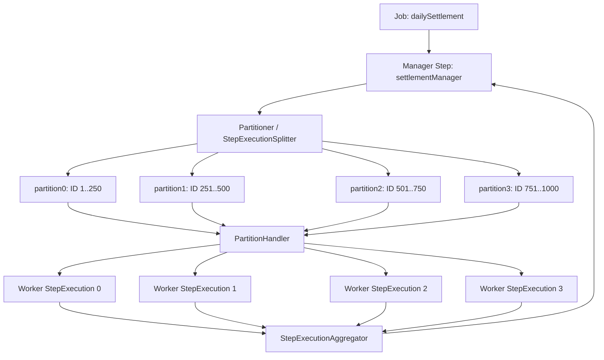

# Manager step và worker step

## 1. Bối cảnh và mục tiêu học tập

Trong module **SPRING_BATCH_SCALING_OPERATIONS**, việc mở rộng Spring Batch cho workload dữ liệu lớn phải dựa trên nút thắt thực tế, giới hạn CPU/I/O, transaction, thread safety và khả năng retry/restart. Bài thuộc chương **PartitionStep**, tập trung vào hai thành phần trung tâm của kiến trúc **partitioning**: **manager step** và **worker step**.

Giả sử job phải xử lý 8 triệu giao dịch. Nếu một step duy nhất đọc, xử lý và ghi toàn bộ dữ liệu, nó có thể mất nhiều giờ. Khi dữ liệu có thể chia thành những phạm vi độc lập, ta muốn tạo nhiều **StepExecution**, mỗi execution phụ trách một phần dữ liệu và có checkpoint riêng. Spring Batch cung cấp `PartitionStep` cùng các thành phần phối hợp để làm việc đó ngay trong một JVM hoặc phân phối qua nhiều máy.

Sau bài này, bạn có thể:

1. Mô tả trách nhiệm của manager step, worker step và các giao diện `Partitioner`, `StepExecutionSplitter`, `PartitionHandler`, `StepExecutionAggregator`.
2. Nêu rõ sự khác nhau giữa **số partition** (`gridSize`), **số worker hoạt động đồng thời** và **kích thước chunk**.
3. Viết cấu hình local partitioning: manager tạo các dải ID, worker xử lý một dải qua `ExecutionContext` và `@StepScope`.
4. Giải thích metadata của từng partition, failure/restart và lý do không thể suy ra exactly-once cho side effect.
5. Đo hiệu năng, xác nhận không bỏ sót/trùng dữ liệu, nhận biết lúc cần remote partitioning hoặc kiến trúc khác.

## 2. Manager step và worker step hoạt động thế nào?

**Manager step** là một `PartitionStep`. Nó không phải một chunk step chuyên đọc toàn bộ dữ liệu rồi tự xử lý từng item. Nhiệm vụ chủ yếu của manager là **tạo/khôi phục các phân vùng công việc, phân phối cho worker, đợi và tổng hợp kết quả**.

**Worker step** là một `Step` Spring Batch thông thường (chunk-oriented hoặc tasklet). Cùng một **định nghĩa step** được thực thi nhiều lần dưới các `StepExecution` khác nhau; mỗi execution nhận một `ExecutionContext` mô tả dữ liệu nó phải xử lý. Worker đọc/xử lý/ghi dữ liệu của mình và báo trạng thái bằng metadata Spring Batch.



Sơ đồ minh họa **bốn partition**, không cam kết có đúng bốn thread chạy đồng thời; điều đó còn phụ thuộc `PartitionHandler`, thread pool và tài nguyên hệ thống.

| Thành phần | Trách nhiệm chính | Không nên giao việc gì |
| --- | --- | --- |
| **Manager / `PartitionStep`** | Khởi tạo/khôi phục partition, điều phối worker, tổng hợp kết quả step | Đọc/ghi từng item của mọi partition như một bottleneck duy nhất |
| **`Partitioner`** | Trả về `Map<String, ExecutionContext>` mô tả phạm vi input của từng partition | Tự thực hiện I/O nghiệp vụ hoặc cập nhật checkpoint của worker |
| **`StepExecutionSplitter`** | Biến khai báo partition thành các `StepExecution` cần chạy, tính đến metadata/restart | Ghi đè tuỳ tiện những execution đã hoàn thành |
| **`PartitionHandler`** | Đưa công việc đến worker local hoặc remote và thu thập kết quả | Quyết định thuật toán chia dữ liệu nghiệp vụ |
| **Worker step** | Xử lý đúng phạm vi được giao, quản lý transaction/checkpoint của execution riêng | Đọc toàn bộ dataset hoặc ghi cùng phạm vi với worker khác |
| **`StepExecutionAggregator`** | Tổng hợp status và counters của worker cho manager step | Thay thế phép đối soát kết quả nghiệp vụ trong database |
| **`JobRepository`** | Lưu StepExecution, trạng thái và ExecutionContext phục vụ restart | Đảm bảo HTTP side effect hoặc thao tác ngoài transaction chỉ xảy ra một lần |

**Điểm phân biệt cần nhớ:** *manager step* và *worker step* là **vai trò**, không mặc định là **hai máy**. Với local partitioning, cả hai chạy trong cùng ứng dụng/JVM, nhưng worker executions có thể chạy trên các thread khác nhau. Với remote partitioning, manager và worker có thể nằm ở các JVM/nút mạng khác nhau.

## 3. Luồng xử lý từ khởi chạy đến tổng hợp

Một JobInstance có thể đi qua chuỗi sau:

1. Job chạy đến `settlementManager`. Framework tạo một `StepExecution` cho manager.
2. `Partitioner` (thông qua splitter) xác định các partition bằng những khóa **ổn định** như `partition0`, `partition1`; `ExecutionContext` của từng partition chứa thông số input, ví dụ `minId` và `maxId`.
3. Spring Batch tạo hoặc tìm metadata `StepExecution` cho các worker, có tên kiểu `settlementWorker:partition0`, `settlementWorker:partition1`.
4. `PartitionHandler` đưa các worker execution sang `TaskExecutor` local hoặc cơ chế giao việc remote tương ứng.
5. Mỗi worker mở step scope với **context riêng**, đọc/phân tích/ghi chỉ trong phạm vi được cấp. Worker commit và cập nhật metadata theo cấu hình step của nó.
6. Manager thu kết quả worker, aggregator tổng hợp trạng thái và counters để manager quyết định thành công/thất bại.
7. Nếu job thất bại, restart cùng `JobInstance` dựa trên metadata của từng worker; partition hoàn thành thường được giữ nguyên, partition thất bại được chạy lại khi điều kiện restart cho phép.

Trong một JVM, `TaskExecutorPartitionHandler` là lựa chọn thường gặp: nó gọi **toàn bộ worker step** trên các worker thread. Không nhầm với việc gắn `.taskExecutor(...)` trực tiếp vào **chunk step** của Spring Batch 6.x, nơi `ItemProcessor` được gọi đồng thời còn reader/writer của step đó chạy tuần tự.

## 4. Phân biệt gridSize, worker pool và chunk size

Ba thông số thường xuất hiện cùng nhau nhưng giải quyết ba vấn đề khác nhau:

| Thông số | Vị trí | Điều khiển | Điều không bảo đảm |
| --- | --- | --- | --- |
| `gridSize` | Manager / partition handler | Gợi ý số `StepExecution` được chia trong lượt đầu; partitioner có thể tạo số lượng theo logic riêng | Không bằng số thread, số CPU hoặc số DB connection |
| `corePoolSize / maxPoolSize` | `ThreadPoolTaskExecutor` | Số thread executor có thể duy trì/tạo khi có tác vụ | Không tự làm xuất hiện thêm partition; còn phụ thuộc queue |
| `chunkSize` | Worker chunk-oriented Step | Số item thường được xử lý trong một transaction/commit interval | Không quyết định số partition hoặc số worker đang chạy |

Ví dụ, `gridSize=12` và pool có bốn thread nghĩa là có thể có **12 phần dữ liệu** nhưng tối đa khoảng **4 worker thực thi cùng lúc** trên executor đó (nếu không dùng thêm cơ chế chạy song song khác). Một số partition phải chờ đến lượt.

Nếu dữ liệu lớn nhưng pool nhỏ, tăng `gridSize` có thể cải thiện cân bằng tải giữa các partition không đều, nhưng cũng tạo thêm StepExecution, metadata writes và overhead. Nếu `gridSize=2` mà pool có tám thread, tối đa chỉ có hai worker step của manager này chạy đồng thời.

**`gridSize` là một hint được truyền cho `Partitioner.partition(int gridSize)`; không phải ràng buộc tuyệt đối với mọi Partitioner.** `MultiResourcePartitioner` chẳng hạn có thể chia theo số tài nguyên thực tế. Kiểm tra số partition được tạo bằng metadata, không suy diễn từ cấu hình.

## 5. Thiết kế partition theo dữ liệu

Một `Partitioner` trả về bản đồ gồm tên partition và `ExecutionContext` tương ứng:

```java
public interface Partitioner {
    Map<String, ExecutionContext> partition(int gridSize);
}
```

Trong Spring Batch 6.x, `Partitioner` ở package `org.springframework.batch.core.partition`, còn `ExecutionContext` ở `org.springframework.batch.infrastructure.item` (Spring Batch 5.x dùng `org.springframework.batch.item.ExecutionContext`). Không dùng import của hai phiên bản lẫn nhau.

Có thể chia theo:

| Chiến lược | Ví dụ context | Khi nào phù hợp | Rủi ro |
| --- | --- | --- | --- |
| Dải khóa chính | `minId=1, maxId=250` | Khóa số ổn định, truy vấn range tốt | Dải ID thưa hoặc phân bố tải lệch |
| Danh sách file | `fileName=/data/day-01.csv` | Nhiều file độc lập | Chênh lệch kích thước file, file bị đổi sau restart |
| Shard/tenant | `tenantId=VN_HCM` | Dữ liệu tách biệt theo tenant | Tenant lớn có thể thành partition chậm nhất |
| Hash/bucket | `bucket=3, modulo=16` | Khóa phân bố đều, không có dải liên tục | Query phải tận dụng index hoặc cơ chế DB phù hợp |
| Thời gian | `fromTs, toTs` | Bảng log và event theo cửa sổ | Time zone, biên mở/đóng, late-arriving data |

Với khoảng thời gian, dùng quy ước **nửa mở** `[fromInclusive, toExclusive)` để tránh xử lý trùng ở biên. Với số nguyên, có thể dùng `BETWEEN minId AND maxId`, bảo đảm dải tiếp theo bắt đầu từ `maxId + 1`.

Tập partition phải có ba tính chất:

1. **Coverage:** hợp của tất cả phạm vi bằng dataset mục tiêu, không bị mất item.
2. **Disjointness:** không có hai worker được giao cùng khóa nghiệp vụ, trừ khi thuật toán có thiết kế xử lý trùng rõ ràng.
3. **Stable identity:** tên partition và cách xác định phạm vi ổn định giữa các lần restart; snapshot dữ liệu/điều kiện đọc không tự dịch chuyển ngoài kiểm soát.

Nếu dữ liệu đang thay đổi khi job chạy, chỉ dùng `MIN(id)` và `MAX(id)` ở lúc phân vùng chưa đủ để xác định snapshot logic. Có thể dùng điều kiện `created_at <= cutoff`, trạng thái batch/claim, snapshot hoặc chiến lược đồng bộ có kiểm soát.

## 6. Cấu hình local partitioning với Spring Batch 6.x

Ví dụ xử lý 1.000 hóa đơn theo bốn dải ID. Manager tạo các partition; mỗi worker thực thi một **tasklet** cập nhật cột `processed` cho dải của nó. Dùng một SQL update trong một transaction để minh họa vai trò manager/worker rõ ràng. Đối với dải hàng triệu bản ghi, bạn thường chọn worker **chunk-oriented Step** để tránh transaction quá dài và có checkpoint bên trong partition.

**Điều kiện chạy mẫu:**

- Có `DataSource` và `PlatformTransactionManager` cho JDBC, tên bean theo cấu hình repository của ứng dụng.
- JDBC `JobRepository` có các bảng metadata tương ứng với phiên bản và database vendor; trong Spring Batch 6.x chọn tường minh `@EnableJdbcJobRepository`.
- Bảng `invoice_input(id BIGINT PRIMARY KEY, processed BOOLEAN NOT NULL)` tồn tại, có dữ liệu `id=1..1000`, `processed=FALSE`.
- Code dưới đây minh họa cấu hình các bean Batch và SQL, không bao gồm kết nối/credential hoặc lệnh tạo dữ liệu mẫu.

```java
import java.util.LinkedHashMap;
import java.util.Map;

import javax.sql.DataSource;

import org.springframework.batch.core.job.Job;
import org.springframework.batch.core.job.builder.JobBuilder;
import org.springframework.batch.core.partition.Partitioner;
import org.springframework.batch.core.repository.JobRepository;
import org.springframework.batch.core.step.Step;
import org.springframework.batch.core.step.builder.StepBuilder;
import org.springframework.batch.core.step.tasklet.Tasklet;
import org.springframework.batch.core.configuration.annotation.EnableBatchProcessing;
import org.springframework.batch.core.configuration.annotation.EnableJdbcJobRepository;
import org.springframework.batch.core.configuration.annotation.StepScope;
import org.springframework.batch.infrastructure.item.ExecutionContext;
import org.springframework.batch.infrastructure.repeat.RepeatStatus;
import org.springframework.beans.factory.annotation.Qualifier;
import org.springframework.beans.factory.annotation.Value;
import org.springframework.context.annotation.Bean;
import org.springframework.context.annotation.Configuration;
import org.springframework.jdbc.core.JdbcTemplate;
import org.springframework.scheduling.concurrent.ThreadPoolTaskExecutor;
import org.springframework.transaction.PlatformTransactionManager;

@Configuration
@EnableBatchProcessing
@EnableJdbcJobRepository
public class InvoicePartitionConfig {

    @Bean
    JdbcTemplate jdbcTemplate(DataSource dataSource) {
        return new JdbcTemplate(dataSource);
    }

    @Bean
    Partitioner invoiceRangePartitioner() {
        return gridSize -> {
            final long firstId = 1L;
            final long lastId = 1_000L;
            final long total = lastId - firstId + 1L;
            int partitions = (int) Math.min(total, Math.max(1, gridSize));
            long blockSize = (total + partitions - 1L) / partitions;

            Map<String, ExecutionContext> result = new LinkedHashMap<>();
            for (int i = 0; i < partitions; i++) {
                long minId = firstId + i * blockSize;
                if (minId > lastId) {
                    break;
                }
                long maxId = Math.min(lastId, minId + blockSize - 1L);
                ExecutionContext context = new ExecutionContext();
                context.putLong("minId", minId);
                context.putLong("maxId", maxId);
                result.put("partition" + i, context);
            }
            return result;
        };
    }

    // Mỗi StepExecution của worker có một tasklet instance theo StepScope.
    @Bean
    @StepScope
    Tasklet invoiceRangeTasklet(
            @Value("#{stepExecutionContext['minId']}") Long minId,
            @Value("#{stepExecutionContext['maxId']}") Long maxId,
            JdbcTemplate jdbcTemplate) {

        return (contribution, chunkContext) -> {
            int updated = jdbcTemplate.update(
                "UPDATE invoice_input SET processed = TRUE " +
                "WHERE id BETWEEN ? AND ? AND processed = FALSE",
                minId, maxId
            );
            System.out.printf(
                "worker=%s, range=[%d,%d], updated=%d%n",
                Thread.currentThread().getName(), minId, maxId, updated
            );
            return RepeatStatus.FINISHED;
        };
    }

    @Bean
    Step invoiceWorkerStep(
            JobRepository jobRepository,
            PlatformTransactionManager transactionManager,
            @Qualifier("invoiceRangeTasklet") Tasklet tasklet) {

        return new StepBuilder("invoiceWorkerStep", jobRepository)
                .tasklet(tasklet)
                .transactionManager(transactionManager)
                .build();
    }

    @Bean("invoicePartitionExecutor")
    ThreadPoolTaskExecutor invoicePartitionExecutor() {
        ThreadPoolTaskExecutor executor = new ThreadPoolTaskExecutor();
        executor.setCorePoolSize(4);
        executor.setMaxPoolSize(4);
        executor.setQueueCapacity(8);
        executor.setThreadNamePrefix("invoice-part-");
        executor.setWaitForTasksToCompleteOnShutdown(true);
        return executor; // Spring quản lý init và destroy của bean
    }

    @Bean
    Step invoiceManagerStep(
            JobRepository jobRepository,
            @Qualifier("invoiceWorkerStep") Step workerStep,
            Partitioner invoiceRangePartitioner,
            @Qualifier("invoicePartitionExecutor")
                ThreadPoolTaskExecutor executor) {

        return new StepBuilder("invoiceManagerStep", jobRepository)
                .partitioner(workerStep.getName(), invoiceRangePartitioner)
                .step(workerStep)
                .gridSize(4)
                .taskExecutor(executor)
                .build();
    }

    @Bean
    Job invoicePartitionJob(
            JobRepository jobRepository,
            @Qualifier("invoiceManagerStep") Step managerStep) {

        return new JobBuilder("invoicePartitionJob", jobRepository)
                .start(managerStep)
                .build();
    }
}
```

### Đọc cấu hình từng bước

- `invoiceRangePartitioner()` trả về bốn context với các dải `[1,250]`, `[251,500]`, `[501,750]`, `[751,1000]`. Tên `partition0` tới `partition3` ổn định và có thể tìm trong metadata.
- `invoiceManagerStep` là `PartitionStep`. `.partitioner(workerStep.getName(), ...)` chọn tên worker để framework tạo tên `StepExecution`, còn `.step(workerStep)` cung cấp định nghĩa step thực thi.
- `.taskExecutor(executor)` ở **manager** khiến các **worker steps** được thực thi local trên thread pool, khác với executor chạy processor bên trong chunk step.
- `.gridSize(4)` yêu cầu splitter chia thành bốn partition theo thuật toán hiện tại. Nếu pool chỉ hai worker, vẫn có bốn dải nhưng tối đa hai worker step được chạy cùng lúc trên executor.
- `@StepScope` tạo instance tasklet theo từng worker `StepExecution`; `@Value("#{stepExecutionContext['minId']}")` và `maxId` được giải quyết lúc worker bắt đầu chạy. Không khai báo các tham số này như bean singleton global.
- `.transactionManager(transactionManager)` bảo đảm tasklet có transaction thích hợp. Với cùng datasource/transaction manager, câu SQL cập nhật dải ID được thực thi trong transaction của worker step.
- `UPDATE ... AND processed = FALSE` là thao tác **idempotent** cho tình huống đánh dấu đã xử lý đơn giản. Với tính toán doanh thu, tính phí, phát sự kiện hoặc gọi API, phải xây idempotency và đối soát theo contract nghiệp vụ tương ứng.

**Quan trọng:** ví dụ dùng dữ liệu đầu vào tĩnh 1..1000 để làm rõ kiến trúc. Trong ứng dụng thực, `Partitioner` nên lấy phạm vi từ dữ liệu đã chốt cho **JobInstance** hoặc tham số nghiệp vụ ổn định; không dùng biên thay đổi theo từng lần restart làm sai miền xử lý.

### Cách đọc trạng thái sau khi chạy

Bạn sẽ thấy một manager execution như `invoiceManagerStep` và các worker executions tên dạng:

```text
invoiceManagerStep
invoiceWorkerStep:partition0    minId=1    maxId=250
invoiceWorkerStep:partition1    minId=251  maxId=500
invoiceWorkerStep:partition2    minId=501  maxId=750
invoiceWorkerStep:partition3    minId=751  maxId=1000
```

Không dựa vào **thứ tự xuất hiện của log** để xác định partition nào chạy trước hoặc commit trước. Thứ tự phụ thuộc scheduler, pool, locks, data skew và độ trễ database.

## 7. Worker chunk-oriented Step trong hệ thống lớn

Trong production, worker thường cần đọc, xử lý, ghi theo chunk để giữ transaction ngắn, hỗ trợ retry/skip và checkpoint.

Ví dụ cấu hình worker chunk-oriented của **Spring Batch 6.x**:

```java
@Bean
Step invoiceChunkWorker(
        JobRepository repository,
        PlatformTransactionManager transactionManager,
        @Qualifier("partitionReader") ItemReader<Invoice> reader,
        ItemProcessor<Invoice, Result> processor,
        ItemWriter<Result> writer) {

    return new StepBuilder("invoiceChunkWorker", repository)
            .<Invoice, Result>chunk(100)
            .transactionManager(transactionManager)
            .reader(reader)
            .processor(processor)
            .writer(writer)
            .build();
}
```

Các kiểu `Invoice`, `Result`, reader, processor và writer trong đoạn trên là **thành phần nghiệp vụ cần tự định nghĩa**. Import các interface item của Spring Batch 6.x từ `org.springframework.batch.infrastructure.item.*`.

Reader phải lấy `minId` / `maxId` từ context của **worker execution hiện tại**. Ví dụ với `JdbcPagingItemReader` hoặc một reader tự viết:

```java
@Bean
@StepScope
ItemReader<Invoice> partitionReader(
        @Value("#{stepExecutionContext['minId']}") Long minId,
        @Value("#{stepExecutionContext['maxId']}") Long maxId,
        DataSource dataSource) {
    // Tạo reader riêng cho partition; query cần chứa:
    // WHERE id >= :minId AND id <= :maxId
    // ORDER BY id
    // Reader thực tế phải khai báo cách paging, row mapper,
    // saveState và unique name để bảo đảm restart.
    return buildInvoicePagingReader(dataSource, minId, maxId);
}
```

Hàm `buildInvoicePagingReader(...)` chỉ là **placeholder** chỉ ra vị trí cấu hình reader theo nguồn dữ liệu; cần cài đặt cụ thể trước khi chạy. Khuyến nghị sử dụng các builder có sẵn của Spring Batch và query có thứ tự duy nhất, ổn định.

**Đặc biệt quan trọng:** chunk size của worker **không phải** `gridSize` của manager. Mỗi partition có nhiều chunk commit riêng; nếu partition đang xử lý 250 bản ghi với `chunk(100)` thì thường cần ba lần commit, nhưng counters thực tế còn phụ thuộc filter, skip, rollback, read/write policy và cấu hình transaction.

### Thread safety khi worker chạy đồng thời

- Các worker `StepExecution` độc lập được phép dùng cùng **định nghĩa Step** nhưng component có state phải tách theo execution, thường bằng `@StepScope` cho reader/writer cần state.
- Singleton processor stateless thường dễ chia sẻ; singleton có `HashMap`/counter/buffer mutable thì cần thiết kế lại hoặc đồng bộ đúng cách.
- Không dùng một JDBC `Connection` hoặc `ResultSet` chia sẻ giữa nhiều worker; dùng `DataSource`/connection pool.
- Với local partitioning, từng worker có transaction riêng theo Step. Với remote partitioning, transaction tồn tại trong JVM và tài nguyên của worker; manager không tạo một transaction bao trùm mọi máy.
- Không giả định context của `ThreadLocal` hay logging MDC ở manager tự truyền tới worker. Nếu cần correlation, dùng job ID, step execution ID và partition key rõ ràng.

## 8. JobRepository, metadata và restart của partition

`JobRepository` ghi các execution của manager và từng worker, cùng `ExecutionContext` của chúng. Với JDBC repository, bảng `BATCH_STEP_EXECUTION` chứa từng worker execution và `BATCH_STEP_EXECUTION_CONTEXT` chứa dải input hoặc checkpoint.

Ví dụ lần chạy đầu:

| StepExecution | Trạng thái | Context | Ghi chú |
| --- | --- | --- | --- |
| `invoiceManagerStep` | `FAILED` | Trạng thái tổng hợp | Một worker lỗi nên manager không thể kết thúc thành công |
| `invoiceWorkerStep:partition0` | `COMPLETED` | `minId=1, maxId=250` | Kết quả đã commit |
| `invoiceWorkerStep:partition1` | `COMPLETED` | `minId=251, maxId=500` | Kết quả đã commit |
| `invoiceWorkerStep:partition2` | `FAILED` | `minId=501, maxId=750` | Có thể cần chạy lại từ checkpoint |
| `invoiceWorkerStep:partition3` | `COMPLETED` | `minId=751, maxId=1000` | Kết quả đã commit |

Restart với **cùng identifying JobParameters** tạo một `JobExecution` mới cho cùng `JobInstance`. Framework tham chiếu metadata partition để biết execution nào đã hoàn thành và execution nào đủ điều kiện chạy lại; trong tình huống minh họa, **partition2** cần chạy lại, còn ba partition completed thường không cần chạy lại.

**Phải phân biệt các khái niệm:**

- **Restart:** tiếp tục cùng `JobInstance` sau failure/stopped, dựa vào metadata và checkpoint hiện có.
- **New instance:** thay đổi identifying params, ví dụ `run.id`, sẽ tạo instance mới; không sử dụng lịch sử restart của instance cũ.
- **Retry:** một thao tác hoặc một chunk thất bại và được thử lại trong cùng worker execution theo chính sách; có thể không cần restart Job.
- **Rerun nghiệp vụ:** muốn tính lại toàn bộ kết quả của một kỳ đã completed cần chính sách riêng; không tự ép restart bằng cách sửa `STATUS` trong DB.

### Giới hạn của bảo đảm once-only

Tài liệu Spring Batch mô tả việc metadata phối hợp các worker theo ngữ nghĩa **mỗi worker step được thực thi một lần trên mỗi JobExecution** trong mô hình partitioning. Không nên diễn giải thành **tác động nghiệp vụ exactly-once**: một giao dịch DB có thể rollback, một request HTTP có thể đã đi ra ngoài trước khi worker chết, và một partition có thể được chạy lại trong execution sau.

Để restart an toàn:

1. Tạo partition tên ổn định và phạm vi dữ liệu không đổi khi chạy lại.
2. Sử dụng reader có checkpoint/restart nếu worker xử lý nhiều chunk; không lưu vị trí đã đọc như đã commit.
3. Đặt unique constraint hoặc upsert theo khóa nghiệp vụ ở writer; thiết kế side effect bên ngoài có idempotency key hoặc outbox.
4. Không xóa `BATCH_JOB_*`, `BATCH_STEP_EXECUTION*` hoặc reset sequence khi job cần restart.
5. Kiểm tra failure ở từng partition và đối soát tập ID cuối sau restart: đủ, không thiếu, không trùng.

### Tính bền vững của repository ở Spring Batch 6.x

Spring Batch 6.x có thể cung cấp `ResourcelessJobRepository` khi chỉ bật `@EnableBatchProcessing`. Implementation này **không thích hợp cho partitioning đồng thời hoặc restart bền vững**. Hãy chọn `@EnableJdbcJobRepository` hoặc một repository bền vững phù hợp, có cấu hình transaction, schema và kết nối nhất quán.

Với **remote partitioning**, manager và các worker cần có khả năng truy cập metadata theo kiến trúc được hỗ trợ, thông thường dùng một repository dùng chung. Bảo đảm transaction và quyền truy cập phù hợp giữa các JVM. Không xây một repository riêng cho từng worker rồi kỳ vọng manager tự tổng hợp được mọi trạng thái.

## 9. Local partitioning và remote partitioning

| Chủ đề | Local partitioning | Remote partitioning |
| --- | --- | --- |
| Manager và worker | Cùng JVM, nhiều thread | Thường ở nhiều JVM/máy |
| Thành phần giao việc | `TaskExecutorPartitionHandler` | Handler/messaging của Spring Batch Integration hoặc hạ tầng tương ứng |
| Đường đi công việc | TaskExecutor gửi `StepExecution` cho worker local | Message/transport gửi thông tin thực thi đến worker |
| Sử dụng tài nguyên | Cùng CPU/RAM và thường cùng pool DB | Có thể mở rộng CPU/RAM và pool theo nút |
| Độ phức tạp | Thấp hơn, dễ debug | Cao hơn: mạng, deploy, timeout, duplicate message |
| Lưu trạng thái | JobRepository; mỗi partition có metadata riêng | JobRepository dùng chung và cơ chế điều phối kết quả |
| Rủi ro phổ biến | Pool nhỏ, tranh DB, chia lệch, shared state | Worker mất kết nối, retry message, skew, version mismatch |
| Khi nên chọn | Một JVM còn tài nguyên, dữ liệu chia được | Một JVM không đủ sức hoặc cần nhiều host |

Các worker remote vẫn chạy một **Step** được cấu hình bằng reader/processor/writer/tasklet như bình thường. Phần khác nhau nằm ở **cách PartitionHandler giao `StepExecution` và thu kết quả**, không nằm ở việc worker phải viết lại toàn bộ logic nghiệp vụ.

Không nhầm với **remote chunking**:

- **Partitioning:** manager phân công **miền dữ liệu** (ví dụ ID 1..250), worker tự đọc và xử lý dữ liệu của partition đó.
- **Remote chunking:** manager đọc item rồi gửi các **chunk item** sang worker xử lý; manager có thể trở thành bottleneck đọc.
- **Parallel steps:** chạy những Step có **trách nhiệm khác nhau** cùng lúc, ví dụ xuất báo cáo và đồng bộ đối tác.
- **Multi-threaded chunk step (6.x):** cho **processor của một Step** chạy song song; không tạo các StepExecution độc lập theo dải dữ liệu.

### Remote không có nghĩa mọi lỗi mạng được giải quyết sẵn

Hạ tầng messaging và handler quyết định timeout, ack, re-delivery, worker discovery và cách trả kết quả. JobRepository giúp quản lý metadata và restart nhưng không thay thế cấu hình retry/timeout của hệ thống truyền tin, cũng không hoàn tác các side effect không tham gia transaction.

Trước khi chuyển từ local sang remote, nên giữ cùng định nghĩa partition key, worker Step và cách kiểm tra dữ liệu; thay đổi chủ yếu là lớp điều phối. Test worker mất kết nối, message gửi lặp, worker được khởi động lại và manager crash.

## 10. Tổng hợp kết quả và cách quan sát từng partition

`StepExecutionAggregator` tổng hợp metadata từ các worker executions về manager. Spring Batch cung cấp mặc định `DefaultStepExecutionAggregator` đủ dùng trong nhiều trường hợp; bạn có thể thay bằng aggregator riêng khi quy tắc nghiệp vụ cần báo cáo kết quả khác.

**Không lấy tổng số lượng item như bằng chứng duy nhất về tính đúng đắn.** Nếu partition0 ghi 250 record, partition1 bị trùng 20 nhưng partition2 bỏ sót 20, tổng số bản ghi có thể vẫn khớp; chỉ đối soát **tập khóa nghiệp vụ** mới phát hiện ra.

Một số truy vấn vận hành khi dùng JDBC `JobRepository`, schema Spring Batch phù hợp và prefix `BATCH_`:

```sql
-- Tình trạng manager và từng partition thuộc một JobExecution.
SELECT STEP_EXECUTION_ID,
       STEP_NAME,
       STATUS,
       EXIT_CODE,
       READ_COUNT,
       WRITE_COUNT,
       COMMIT_COUNT,
       ROLLBACK_COUNT,
       START_TIME,
       END_TIME
FROM BATCH_STEP_EXECUTION
WHERE JOB_EXECUTION_ID = :jobExecutionId
ORDER BY STEP_NAME;
```

```sql
-- Tìm những partition chưa hoàn tất trong một JobExecution.
SELECT STEP_NAME, STATUS, EXIT_CODE, EXIT_MESSAGE
FROM BATCH_STEP_EXECUTION
WHERE JOB_EXECUTION_ID = :jobExecutionId
  AND STEP_NAME LIKE 'invoiceWorkerStep:%'
  AND STATUS <> 'COMPLETED';
```

```sql
-- Đối soát dữ liệu nghiệp vụ chưa được đánh dấu processed.
SELECT id
FROM invoice_input
WHERE id BETWEEN 1 AND 1000
  AND processed = FALSE;
```

Các câu SQL `:jobExecutionId` dùng named parameter; khi chạy trực tiếp trong CLI database, thay bằng giá trị thích hợp hoặc cách bind tham số của công cụ đang dùng. `EXIT_MESSAGE` có thể dài; phân trang/lọc để không gây tải trên bảng metadata khi job có hàng chục nghìn partition.

**Khi job restart:** nên truy vấn các StepExecution của **cùng JobInstance**, không chỉ một JobExecution hiện tại. Partition đã completed ở execution trước có thể không được thực thi lại, vì vậy không nhất thiết xuất hiện đầy đủ các partition như những hàng mới ở execution sau.

### Metrics tối thiểu

- Tổng thời gian manager, thời gian worker nhanh nhất/chậm nhất/p95, số partition completed/failed/running.
- `READ_COUNT`, `WRITE_COUNT`, `COMMIT_COUNT`, `ROLLBACK_COUNT`, skip/retry theo từng worker.
- Active threads, queue length và số task rejected của executor.
- CPU saturation, heap/GC, connection pool active/pending, DB lock wait và query latency.
- Tỷ lệ partition bị skew: nếu một worker mất 30 phút còn ba worker chỉ mất 2 phút, rất có thể cần chia nhỏ hoặc đổi chiến lược phân hoạch.

## 11. Xử lý lệch tải, contention và lựa chọn gridSize

Một partition quá lớn có thể quyết định toàn bộ thời gian của manager vì manager phải chờ worker chậm nhất.

Ví dụ cùng 1 triệu bản ghi:

| Thiết kế | Phân bố dữ liệu | Hệ quả |
| --- | --- | --- |
| 4 partition theo ID đều nhưng một dải rất nhiều record “nặng” | Một worker chậm gấp 10 lần | Ba worker rảnh sớm và manager vẫn chờ |
| 16 partition, pool 4 | Mỗi partition nhỏ hơn, scheduler có thêm việc để cấp cho worker rảnh | Cân bằng tải tốt hơn nhưng thêm metadata/transaction overhead |
| 1.000 partition, pool 4 | Nhiều StepExecution rất nhỏ | Metadata, context và scheduling có thể thành bottleneck |
| 4 partition, pool 16 | Chỉ có bốn worker step thực thi | Mười hai thread bổ sung không giúp tăng throughput |

Cách chọn theo số liệu:

1. Đo baseline tuần tự với dữ liệu đại diện, phân biệt CPU-bound, I/O-bound, lock và network.
2. Chọn `gridSize` ban đầu gần hoặc nhỉnh hơn số worker thực tế, bảo đảm dải không trùng và mỗi partition có đủ việc.
3. Benchmark pool 2, 4, 8... trong hạn mức connection, CPU và DB, theo dõi worker chậm nhất và đuôi độ trễ.
4. Nếu dữ liệu lệch nặng, tăng partition count vừa phải, chuyển sang bucket/hash cân bằng hoặc chia theo khối lượng dự đoán. Giữ **partition identity ổn định trong cùng JobInstance** khi cần restart.
5. Đặt giới hạn đồng thời của scheduler: nhiều JobInstance cùng lúc, mỗi instance có pool riêng, có thể khiến tổng số worker vượt sức chịu tải của DB.

**Tránh chọn partition theo số CPU một cách máy móc.** Khi worker chủ yếu truy vấn database hoặc gọi API, giới hạn thường nằm ở connection pool, rate limit hoặc lock contention. Với worker CPU-bound, tăng pool vượt số core khả dụng có thể làm context switching và GC tăng.

## 12. Kiểm thử manager và worker step

Một pipeline partitioning cần ít nhất bốn nhóm test khác nhau:

| Nhóm | Điều kiện kiểm tra | Bằng chứng |
| --- | --- | --- |
| **Partitioner unit test** | Dải phủ đủ, không trùng, không rỗng ngoài dự kiến; tên ổn định | So tập ID / interval và context của mỗi partition |
| **Worker step test** | Worker chỉ đọc/ghi trong context được cấp; transaction và restart đúng | Dữ liệu DB theo phạm vi, metadata worker |
| **Manager integration test** | Có nhiều worker executions, handler thực thi song song như dự kiến, aggregator cho status chính xác | StepExecution, active thread, kết quả job |
| **Failure/restart test** | Một partition lỗi, restart cùng JobInstance chỉ thực hiện lại công việc cần thiết | Hai JobExecution, không thiếu/trùng business keys |

### Một unit test cho phân vùng

Kiểm tra thuật toán từ ví dụ bằng kỳ vọng cụ thể:

```java
@Test
void partitionsHaveNoGapsOrOverlaps() {
    Map<String, ExecutionContext> parts =
            invoiceRangePartitioner().partition(4);

    assertEquals(4, parts.size());
    assertEquals(1L, parts.get("partition0").getLong("minId"));
    assertEquals(250L, parts.get("partition0").getLong("maxId"));
    assertEquals(251L, parts.get("partition1").getLong("minId"));
    assertEquals(1_000L, parts.get("partition3").getLong("maxId"));

    long expectedMin = 1L;
    for (ExecutionContext context : parts.values()) {
        assertEquals(expectedMin, context.getLong("minId"));
        assertTrue(context.getLong("maxId") >= expectedMin);
        expectedMin = context.getLong("maxId") + 1L;
    }
    assertEquals(1_001L, expectedMin);
}
```

*Ví dụ test trên giả định method `invoiceRangePartitioner()` có thể được gọi từ config/fixture ở phạm vi test và đã import JUnit; đây là phép minh họa, không phải lệnh đã chạy trên dự án.*

### Fault injection có kiểm soát

Với bốn partition, cho worker `partition2` cố ý ném exception (không để retry trong lần chạy đầu hấp thụ hết lỗi). Kiểm tra các ý sau:

1. Manager và JobExecution đầu tiên kết thúc với failure phù hợp.
2. Có metadata cho bốn worker; mỗi partition giữ đúng `minId/maxId`.
3. Sau khi sửa/tắt fault, restart **cùng identifying JobParameters**, không thêm `run.id` mới.
4. Các partition completed không bị xử lý lại một cách vô cớ, partition2 được phục hồi theo chính sách.
5. DB đầu ra có đủ 1.000 khóa, không trùng, nội dung đúng; trường hợp API/file bên ngoài được kiểm riêng với idempotency.
6. Thử tắt worker/JVM giữa transaction và xác nhận hành vi trên database vendor thực tế, không chỉ H2.

**Đừng dùng `Thread.sleep(...)` rồi assert “job phải chạy nhanh hơn X ms” làm bằng chứng concurrency.** Dùng `CountDownLatch`/`Phaser` có timeout hoặc quan sát active worker đáng tin cậy để xác nhận có ít nhất hai worker đang chạy chồng lấp.

## 13. Sự khác biệt khi dùng Spring Batch 5.2

Khái niệm manager/worker/partitioner/handler về cơ bản giữ nguyên giữa Spring Batch 5.2 và 6.x, nhưng một số API của worker thay đổi:

| Chủ đề | Spring Batch 5.2 | Spring Batch 6.x |
| --- | --- | --- |
| Tạo manager Step | `new StepBuilder("manager", repository).partitioner(...).step(...).gridSize(...).taskExecutor(...)` | Cách cấu hình manager tương tự |
| Worker chunk | `.chunk(100, transactionManager)` | `.chunk(100).transactionManager(transactionManager)` |
| Worker tasklet | `.tasklet(tasklet, transactionManager)` | `.tasklet(tasklet).transactionManager(transactionManager)` |
| `ExecutionContext` import | `org.springframework.batch.item.ExecutionContext` | `org.springframework.batch.infrastructure.item.ExecutionContext` |
| `Partitioner` import | `org.springframework.batch.core.partition.support.Partitioner` | `org.springframework.batch.core.partition.Partitioner` |
| Repository thường gặp | JDBC repository qua cấu hình hạ tầng Batch 5.x | Cần chọn tường minh JDBC/Mongo nếu cần lưu bền vững, mặc định resourceless ở 6.x |

Ví dụ worker với Spring Batch 5.2:

```java
return new StepBuilder("invoiceWorkerStep", jobRepository)
        .<Invoice, Result>chunk(100, transactionManager)
        .reader(invoiceReader)
        .processor(invoiceProcessor)
        .writer(invoiceWriter)
        .build();
```

Không nhầm **partitioning worker Step** với **multi-threaded chunk Step**. Ngay trong Spring Batch 5.2, partitioning vẫn tạo nhiều worker `StepExecution` độc lập; tùy cấu hình, từng worker có thể chạy tuần tự trong phạm vi của nó. Nếu còn thêm executor bên trong worker, mô hình song song trở thành **hai tầng**, phải tính tổng số task/connection thực tế và kiểm tra restart phức tạp hơn.

## 14. Lỗi thường gặp và cách chẩn đoán

| Hiện tượng | Nguyên nhân thường gặp | Hướng xử lý |
| --- | --- | --- |
| Tăng `gridSize` nhưng chỉ một worker chạy | `SyncTaskExecutor` hoặc pool chỉ một thread; partitioner chỉ trả một context | Xem tên step execution, log thread, pool active, output partitioner |
| Nhiều worker xử lý cùng dữ liệu | Partition có phạm vi chồng lấn, reader quên lọc context | Test coverage/disjointness; bind min/max ở `@StepScope` |
| Worker đọc `minId` bằng `null` | Bean cần late binding đang singleton, sai key/context | Gắn `@StepScope` vào bean đúng; kiểm tra tên key và metadata |
| Manager hoàn tất nhưng output sai | Worker ghi lỗi nghiệp vụ, aggregator chỉ tổng hợp metadata | Đối soát business keys, row values và unique constraints |
| Restart chạy lại toàn bộ | Thay identifying JobParameters, tên partition không ổn định hoặc metadata bị xóa | Giữ tham số/naming ổn định; kiểm tra repository và checkpoint |
| Worker lỗi dù manager còn `STARTED` | Một worker chưa trả kết quả hoặc đang đợi timeout | Xem từng StepExecution và cơ chế timeout/handler |
| Lỗi `OptimisticLockingFailureException` | Nhiều tác nhân sửa chung metadata không hợp lệ | Kiểm tra StepExecution ownership, không tự sửa VERSION |
| DB hết connection khi chia nhiều worker | Pool không đủ so với đồng thời của các job/worker | Đo active/pending DB connection; giảm concurrency hoặc tăng pool có kiểm soát |
| Pool queue đầy, có `TaskRejectedException` | Quá nhiều partition/task được submit so với pool/queue | Điều chỉnh gridSize, pool và queue dựa trên tải đo được |
| Manager chậm vì một partition | Dữ liệu lệch hoặc worker gặp lock/hot key | So thời gian mỗi partition; chia nhỏ theo khối lượng |
| Remote worker mất liên lạc | Messaging/timeout, worker crash hoặc không nhìn thấy metadata | Kiểm tra broker, handler, repository và chính sách recovery |
| Một lần restart sinh kết quả trùng | Side effect ngoài transaction, thiếu idempotency | Dùng unique business key/upsert/outbox hoặc API idempotency key |

## 15. Bài tập thực hành

**Bài tập A — Chia phạm vi ID.** Bảng có ID 1..103, `gridSize=4`. Viết `Partitioner` tạo bốn context sao cho dải liên tục, không trùng, mỗi partition có ít nhất một ID. Nếu chia bằng công thức `ceil(total/gridSize)` như ví dụ, hãy tính chính xác các dải và chứng minh ID 103 không bị bỏ sót.

**Bài tập B — Theo dõi restart.** Bốn worker tương ứng `partition0..partition3`, trong đó partition1 thất bại sau khi commit hai chunk; ba partition khác completed. Giải thích các hàng metadata cần có, bước nào phải chạy lại và lý do writer cần idempotent ngay cả khi checkpoint được lưu.

**Bài tập C — Cân bằng tải.** `gridSize=4`, pool 4, nhưng thời gian xử lý của bốn partition lần lượt là 5, 5, 5 và 45 phút. Đề xuất một phương án tạo nhiều partition nhỏ hơn, nêu tradeoff về DB metadata và lock contention. Thiết kế benchmark với cùng workload và đo p95/slowest partition.

**Bài tập D — Chọn kiến trúc.** Một công việc chỉ đọc file lớn và gửi hàng triệu request API tới dịch vụ có rate limit, còn công việc khác cần xử lý 20 TB dữ liệu ở nhiều trung tâm. Nêu tiêu chí chọn local partitioning, remote partitioning hoặc remote chunking; xác định bottleneck, retry và mô hình lưu metadata cho từng phương án.

### Câu hỏi tự kiểm tra

1. Vì sao manager step không trực tiếp làm công việc của từng item trong mọi partition?
2. `gridSize=16` và pool 4 có nghĩa có 16 thread chạy đồng thời không? Vì sao?
3. Ai tạo `Map<String, ExecutionContext>` và ai gửi `StepExecution` sang worker?
4. Vì sao một `@StepScope` reader cần thiết khi mỗi worker đọc một dải ID khác nhau?
5. Phân biệt worker step và worker JVM; chúng có luôn tương ứng một-một không?
6. Nếu partition0 completed còn partition1 failed, restart cùng JobInstance xử lý thế nào?
7. Tại sao tổng `WRITE_COUNT` bằng số input vẫn chưa chứng minh không mất/trùng record?
8. Khi nào `PartitionNameProvider` có ích, và yêu cầu gì về tính ổn định của partition names?
9. Tại sao transaction manager của manager không bao bọc toàn bộ transaction của worker ở các máy khác nhau?
10. Khi chuyển từ Spring Batch 5.2 sang 6.x, bạn cần kiểm tra import và builder nào?

## 16. Tài liệu tham khảo

- [Spring Batch 6.0 — Scaling and Parallel Processing, Partitioning](https://docs.spring.io/spring-batch/reference/6.0/scalability.html): manager/worker, `Partitioner`, `PartitionHandler`, `StepExecutionSplitter`, `gridSize` và StepScope.
- [Spring Batch 6.x API — PartitionStepBuilder](https://docs.spring.io/spring-batch/reference/api/org/springframework/batch/core/step/builder/PartitionStepBuilder.html): `partitioner`, `step`, `gridSize`, `taskExecutor`, `partitionHandler` và `aggregator`.
- [Spring Batch 6.x API — TaskExecutorPartitionHandler](https://docs.spring.io/spring-batch/reference/api/org/springframework/batch/core/partition/support/TaskExecutorPartitionHandler.html): thực thi các worker Step local.
- [Spring Batch 6.x API — Partitioner](https://docs.spring.io/spring-batch/reference/api/org/springframework/batch/core/partition/Partitioner.html): hợp đồng tạo `ExecutionContext` cho các StepExecution.
- [Spring Batch 6.x API — TaskletStepBuilder](https://docs.spring.io/spring-batch/reference/api/org/springframework/batch/core/step/builder/TaskletStepBuilder.html): cấu hình tasklet Step.
- [Spring Batch 6.0 — Batch Infrastructure Configuration](https://docs.spring.io/spring-batch/reference/6.0/job/configuring-infrastructure.html): cấu hình repository bền vững và hạ tầng Batch.
- [Spring Batch 5.2 — Scaling and Parallel Processing](https://docs.spring.io/spring-batch/reference/5.2/scalability.html): mô hình partitioning ở Spring Batch 5.x.
- [Spring Batch 6.x — Meta-Data Schema](https://docs.spring.io/spring-batch/reference/6.0/schema-appendix.html): các bảng và counters của `StepExecution`.

**Kết luận áp dụng:** hãy xem manager là bộ phận **chia việc, điều phối và tổng hợp**, worker là **đơn vị xử lý dữ liệu có transaction/checkpoint riêng**, còn JobRepository là **nền tảng ghi nhận trạng thái để restart**. Chia đúng phạm vi, giữ tên partition ổn định, kiểm tra tính idempotent và đo số worker thực sự hoạt động là điều kiện để partitioning giúp hệ thống tăng tốc một cách an toàn.
