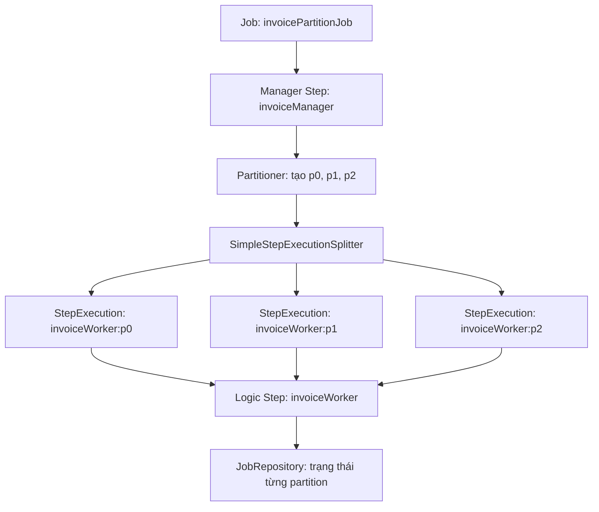

# Step name của partition worker trong Spring Batch

Trong Spring Batch, một `PartitionStep` có thể chia cùng một khối công việc thành nhiều `StepExecution` độc lập để chạy song song. **Tên của worker step** là điểm nối giữa cấu hình thực thi và các bản ghi partition trong `JobRepository`. Đặt tên đúng giúp nhận diện phần dữ liệu nào đang chạy, tìm partition lỗi, khôi phục job và theo dõi hiệu năng khi mở rộng workload.

Bài này tập trung vào **cách xác định, cấu hình và sử dụng step name của partition worker** trong module `SPRING_BATCH_SCALING_OPERATIONS`, với ví dụ local partitioning trên Spring Batch 5.x. Nguyên tắc nhận diện partition cũng áp dụng khi chuyển sang remote partitioning; cấu hình vận chuyển thông điệp khi chạy phân tán phụ thuộc công nghệ sử dụng.

## 1. Phân biệt tên cấu hình và tên của từng lần thực thi

Một job dùng partitioning thường có những khái niệm dễ nhầm lẫn:

| Khái niệm | Vai trò | Ví dụ |
| --- | --- | --- |
| `Job` name | Định danh job trong cấu hình | `invoicePartitionJob` |
| Manager `Step` name | Step tạo và điều phối các partition | `invoiceManager` |
| Worker `Step` name | Tên của step chứa logic xử lý được tái sử dụng cho từng partition | `invoiceWorker` |
| Partition key | Khóa duy nhất của một phần công việc do `Partitioner` trả về | `p0`, `p1`, `p2` |
| Worker `StepExecution` name | Tên của một lần thực thi worker trên một partition cụ thể | `invoiceWorker:p0` |
| Thread name / máy worker | Thông tin hạ tầng chạy công việc; có thể thay đổi giữa các lần thực thi | `partition-pool-1` |

**Quy tắc quan trọng:** với `SimpleStepExecutionSplitter` thông dụng, tên `StepExecution` của một partition có dạng:

```text
<workerStepName>:<partitionKey>
```

Ví dụ, khi cấu hình worker name là `invoiceWorker` và `Partitioner` trả về ba khóa `p0`, `p1`, `p2`, metadata sẽ có ba tên:

```text
invoiceWorker:p0
invoiceWorker:p1
invoiceWorker:p2
```

Trong đó:

- `invoiceWorker` là **tên gốc** của worker step, được cấu hình bằng `new StepBuilder("invoiceWorker", jobRepository)` và được tham chiếu trong `partitioner("invoiceWorker", partitioner)`.
- `p0` là **khóa partition**, tức `String` trong `Map<String, ExecutionContext>` do `Partitioner.partition(gridSize)` trả về.
- `invoiceWorker:p0` là **tên đầy đủ của `StepExecution`**, được ghi vào `BATCH_STEP_EXECUTION.STEP_NAME` để phục vụ vận hành và restart.

Một `Step` cấu hình có thể được thực thi nhiều lần, mỗi lần với `ExecutionContext` riêng; vì vậy không nên gọi `invoiceWorker:p0` là tên của một bean worker khác biệt. Bean `invoiceWorker` có thể vẫn chỉ là một đối tượng `Step`; các partition phân biệt nhau bởi `StepExecution` và context.

## 2. Tên được tạo ở đâu?

`Partitioner` trả về ánh xạ giữa **khóa partition** và **dữ liệu đầu vào**. `SimpleStepExecutionSplitter` dùng tên worker đã được cấu hình để tạo các `StepExecution` có tên đầy đủ. `PartitionHandler` nhận các `StepExecution` này và phân phối chúng tới worker; kết quả được tổng hợp về manager.



`Partitioner` **không cần** tự thêm `invoiceWorker:` vào khóa. Nếu trả về `"invoiceWorker:p0"` trong khi tên gốc đã là `invoiceWorker`, tên kết quả sẽ bị lặp thành `invoiceWorker:invoiceWorker:p0`.

Ở ví dụ này, `p0`, `p1` và `p2` là ba khóa trong cùng một lần chia việc; chúng không tương ứng cố định với ba thread hay ba máy. Thread pool quyết định tài nguyên thực thi, còn khóa partition quyết định **danh tính logic** của công việc.

## 3. Cấu hình minh họa hoàn chỉnh với Java

Giả sử bảng `invoices` có cột `id` và `processed`:

```sql
CREATE TABLE invoices (
    id BIGINT PRIMARY KEY,
    processed BOOLEAN NOT NULL DEFAULT FALSE
);
```

Ta muốn xử lý các bản ghi có `id` từ `1` đến `12` bằng ba partition. Mỗi partition sở hữu một khoảng `id` riêng, không chồng lấn. Đoạn mã dưới đây dùng Spring Batch 5.x, Spring Framework và `JdbcTemplate`; ứng dụng cần cấu hình sẵn `DataSource`, `JobRepository` và `PlatformTransactionManager`.

```java
import java.util.LinkedHashMap;
import java.util.Map;

import org.springframework.batch.core.Job;
import org.springframework.batch.core.Step;
import org.springframework.batch.core.job.builder.JobBuilder;
import org.springframework.batch.core.repository.JobRepository;
import org.springframework.batch.core.step.builder.StepBuilder;
import org.springframework.batch.core.partition.support.Partitioner;
import org.springframework.batch.item.ExecutionContext;
import org.springframework.batch.repeat.RepeatStatus;
import org.springframework.beans.factory.annotation.Qualifier;
import org.springframework.context.annotation.Bean;
import org.springframework.context.annotation.Configuration;
import org.springframework.core.task.TaskExecutor;
import org.springframework.jdbc.core.JdbcTemplate;
import org.springframework.scheduling.concurrent.ThreadPoolTaskExecutor;
import org.springframework.transaction.PlatformTransactionManager;

@Configuration
public class InvoicePartitionJobConfig {

    @Bean
    public Partitioner invoicePartitioner() {
        return gridSize -> {
            long firstId = 1L;
            long lastId = 12L;
            long total = lastId - firstId + 1;
            int partitions = (int) Math.min(total, Math.max(1, gridSize));
            long size = (total + partitions - 1) / partitions;

            Map<String, ExecutionContext> result = new LinkedHashMap<>();
            for (int i = 0; i < partitions; i++) {
                long fromId = firstId + i * size;
                long toId = Math.min(lastId, fromId + size - 1);
                if (fromId > lastId) {
                    break;
                }

                ExecutionContext context = new ExecutionContext();
                context.putLong("fromId", fromId);
                context.putLong("toId", toId);
                result.put("p" + i, context); // Key ổn định: p0, p1, p2
            }
            return result;
        };
    }

    @Bean
    public Step invoiceWorker(
            JobRepository jobRepository,
            PlatformTransactionManager transactionManager,
            JdbcTemplate jdbcTemplate) {
        return new StepBuilder("invoiceWorker", jobRepository)
                .tasklet((contribution, chunkContext) -> {
                    ExecutionContext context = contribution
                            .getStepExecution().getExecutionContext();
                    long fromId = context.getLong("fromId");
                    long toId = context.getLong("toId");

                    jdbcTemplate.update(
                            "UPDATE invoices SET processed = TRUE " +
                            "WHERE id >= ? AND id <= ? AND processed = FALSE",
                            fromId, toId);
                    return RepeatStatus.FINISHED;
                }, transactionManager)
                .build();
    }

    @Bean
    public ThreadPoolTaskExecutor partitionExecutor() {
        ThreadPoolTaskExecutor executor = new ThreadPoolTaskExecutor();
        executor.setCorePoolSize(3);
        executor.setMaxPoolSize(3);
        executor.setQueueCapacity(3);
        executor.setThreadNamePrefix("partition-pool-");
        return executor; // Spring quản lý khởi tạo và hủy executor
    }

    @Bean
    public Step invoiceManager(
            JobRepository jobRepository,
            @Qualifier("invoicePartitioner") Partitioner partitioner,
            @Qualifier("invoiceWorker") Step worker,
            @Qualifier("partitionExecutor") TaskExecutor executor) {
        return new StepBuilder("invoiceManager", jobRepository)
                .partitioner("invoiceWorker", partitioner)
                .step(worker)
                .gridSize(3)
                .taskExecutor(executor)
                .build();
    }

    @Bean
    public Job invoicePartitionJob(
            JobRepository jobRepository,
            @Qualifier("invoiceManager") Step manager) {
        return new JobBuilder("invoicePartitionJob", jobRepository)
                .start(manager)
                .build();
    }
}
```

Đối chiếu hai dòng định danh trong cấu hình:

```java
new StepBuilder("invoiceWorker", jobRepository) // Tên Step chạy nghiệp vụ
    // ...

new StepBuilder("invoiceManager", jobRepository)
    .partitioner("invoiceWorker", partitioner)  // Tên gốc để tạo StepExecution
    .step(worker);                             // Logic thực thi của worker
```

Hai giá trị `"invoiceWorker"` nên khớp nhau và nên được quản lý bằng hằng số chung trong hệ thống lớn để tránh lỗi gõ nhầm. Tên method `@Bean` hỗ trợ quản lý dependency injection nhưng **tên thực tế của `Step`** ở đây được đặt trực tiếp trong `StepBuilder`.

Với `gridSize(3)` và đoạn `Partitioner` trên, ba partition được tạo như sau:

| Partition key | `ExecutionContext` | `StepExecution.getStepName()` |
| --- | --- | --- |
| `p0` | `fromId=1`, `toId=4` | `invoiceWorker:p0` |
| `p1` | `fromId=5`, `toId=8` | `invoiceWorker:p1` |
| `p2` | `fromId=9`, `toId=12` | `invoiceWorker:p2` |

Thao tác `UPDATE` có điều kiện `processed = FALSE` giúp ví dụ dễ chạy lại và tránh cập nhật bản ghi đã đánh dấu. Trong ứng dụng thực, phải tự đánh giá tính idempotent của toàn bộ side effect, đặc biệt khi ghi file, gửi thông điệp hoặc gọi API bên ngoài. `gridSize` là gợi ý chia số partition; số thread chạy đồng thời còn phụ thuộc `TaskExecutor` và giới hạn tài nguyên.

## 4. Xem tên worker partition khi chạy

Trong logic hoặc listener của worker, đọc tên thực thi từ `StepExecution`:

```java
String executionName = contribution.getStepExecution().getStepName();
// Ví dụ: invoiceWorker:p1

long executionId = contribution.getStepExecution().getId();
// Mã định danh của bản ghi StepExecution, khác với executionName
```

Tên `StepExecution` cũng có trong bảng metadata. Có thể kiểm tra một lần chạy job bằng truy vấn:

```sql
SELECT STEP_EXECUTION_ID, STEP_NAME, STATUS, START_TIME, END_TIME
FROM BATCH_STEP_EXECUTION
WHERE JOB_EXECUTION_ID = :jobExecutionId
ORDER BY STEP_NAME;
```

Kết quả minh họa:

```text
STEP_NAME          STATUS
-----------------  ---------
invoiceManager     COMPLETED
invoiceWorker:p0   COMPLETED
invoiceWorker:p1   COMPLETED
invoiceWorker:p2   COMPLETED
```

`BATCH_STEP_EXECUTION` lưu một hàng cho từng `StepExecution`. Các chỉ số như `READ_COUNT`, `WRITE_COUNT` phát huy ý nghĩa rõ hơn ở chunk-oriented step; ví dụ `Tasklet` chạy lệnh SQL trực tiếp ở trên không tự tạo item read/write count. Nếu cần thống kê số dòng SQL đã thay đổi, hãy ghi nhận giá trị trả về của `JdbcTemplate.update(...)` qua log hoặc metric riêng.

Khi log, nên đưa đồng thời `jobExecutionId`, `stepExecutionId`, `stepName` và thông tin phạm vi dữ liệu (`fromId`, `toId`). Không nên chỉ dùng tên thread để xác định partition, vì executor có thể tái sử dụng thread cho nhiều partition.

## 5. Vì sao tên ổn định quyết định khả năng restart?

`JobRepository` lưu trạng thái của mỗi partition, trong đó có tên `StepExecution` và `ExecutionContext`. Khi restart **cùng một `JobInstance`** sau lỗi, cơ chế partitioning đối chiếu thông tin đã lưu để xác định phần công việc cần chạy lại.

Ví dụ lần chạy đầu:

| Step execution | Trạng thái |
| --- | --- |
| `invoiceWorker:p0` | `COMPLETED` |
| `invoiceWorker:p1` | `FAILED` |
| `invoiceWorker:p2` | `COMPLETED` |

Khi restart với cấu hình mặc định, partition đã hoàn thành thường được bỏ qua, còn `invoiceWorker:p1` được thực thi lại từ trạng thái lưu trước đó. Để làm được điều này, **tên gốc của worker và các khóa partition phải ổn định**.

Các thay đổi cần tránh giữa hai lần thực thi của cùng `JobInstance`:

- Đổi worker name từ `invoiceWorker` thành `processInvoiceStep` làm thay đổi tên đầy đủ của tất cả partition.
- Đổi khóa từ `p1` sang `part-1` hoặc gắn timestamp/UUID ngẫu nhiên khiến partition cũ khó được nhận diện lại.
- Thay đổi thứ tự ánh xạ `p0`, `p1`, ... sang các khoảng dữ liệu khác mà không kiểm soát snapshot đầu vào; một partition có thể xử lý sai phần dữ liệu khi chạy lại.
- Thay đổi cấu trúc partition trong lúc restart mà không xem xét metadata và `ExecutionContext` đã được lưu.

`SimpleStepExecutionSplitter` có logic hỗ trợ restart và có thể sử dụng cấu hình kích thước lưới đã lưu thay vì `gridSize` mới truyền vào. Vì vậy, **đổi `gridSize` không phải cách đáng tin cậy để chia lại công việc của một `JobInstance` đang restart**. Nếu cần chia lại toàn bộ dữ liệu theo cấu trúc mới, hãy thiết kế một lần chạy mới có `JobParameters` định danh phù hợp, đồng thời kiểm soát việc xử lý trùng.

Một số `Partitioner` có thể triển khai `PartitionNameProvider` để trả về danh sách tên partition khi restart mà không phải tính lại toàn bộ `ExecutionContext`. Khi sử dụng, danh sách tên do provider trả về **phải khớp** với các khóa mà `Partitioner.partition(...)` đã tạo.

## 6. Quy ước đặt tên cho workload lớn

Tên tốt giúp đọc log, phân tích SQL và tránh nhầm lẫn giữa các worker. Một quy ước dễ vận hành:

```text
<nghiepVu>Worker:<partitionKey>
```

Ví dụ:

| Tình huống | Worker step name | Partition key | Tên metadata |
| --- | --- | --- | --- |
| Xử lý đơn hàng theo vùng | `orderImportWorker` | `region-NORTH` | `orderImportWorker:region-NORTH` |
| Đọc file hàng loạt | `customerFileWorker` | `file-0007` | `customerFileWorker:file-0007` |
| Cập nhật dữ liệu theo dải ID | `invoiceWorker` | `p02` | `invoiceWorker:p02` |

Hướng dẫn thực hành:

1. **Đặt tên nghiệp vụ rõ ràng, ổn định.** Có thể dùng hậu tố `Manager` và `Worker` để phân biệt vai trò; tránh tên chung chung như `step1`.
2. **Mỗi partition key phải duy nhất** trong kết quả của một lần gọi `partition(...)`. Nên dùng khóa đơn giản, dễ đọc và tái tạo được.
3. **Cố định ý nghĩa của khóa.** Nếu `file-0007` đại diện một file, thứ tự liệt kê file phải được kiểm soát; khi cần, dùng định danh file ổn định hơn chỉ số danh sách.
4. **Tránh xung đột trong một job.** Hai manager dùng chung worker name và cùng tập khóa partition có thể tạo ra những tên `StepExecution` giống nhau; hãy định danh phạm vi worker phù hợp.
5. **Giữ tên ngắn gọn.** Kiểm tra độ dài cột `STEP_NAME` trong schema Spring Batch đang triển khai (nhiều schema chuẩn dùng `VARCHAR(100)`); không đưa dữ liệu nhạy cảm vào tên vì tên thường xuất hiện trong bảng metadata và log.
6. **Đừng gắn máy hoặc thread vào tên partition.** Partition có thể được chạy bởi thread/máy khác sau khi retry hoặc restart.

Tên là **danh tính logic**, không thay thế cơ chế phân vùng dữ liệu. Để an toàn khi chạy song song, mỗi partition cần nhận một phạm vi đầu vào độc lập hoặc có chiến lược xử lý trùng rõ ràng.

## 7. Local và remote partitioning có khác nhau về tên không?

Về ý nghĩa, **không**: manager vẫn tạo các `StepExecution` dựa trên worker name và partition key; mỗi worker xử lý phần dữ liệu từ `ExecutionContext` tương ứng. Điểm khác nhau nằm ở `PartitionHandler` và hạ tầng thực thi.

| Tiêu chí | Local partitioning | Remote partitioning |
| --- | --- | --- |
| Nơi chạy worker | Thread trong cùng ứng dụng/JVM | Tiến trình hoặc máy worker khác |
| Phân phối | `TaskExecutorPartitionHandler` hoặc cấu hình tương đương | Message broker/middleware với manager và worker |
| Tên `StepExecution` | `invoiceWorker:p0` | `invoiceWorker:p0` (cùng nguyên tắc) |
| Điều cần đồng bộ | Tên worker trong builder với `Step` được gọi | Tên worker, cách định tuyến và nhận context giữa manager/worker |
| Giám sát | Thread pool, DB connection pool, partition status | Thêm broker, queue, worker availability, timeout và duplicate delivery |

Trong remote partitioning, đừng đồng nhất tên partition với consumer ID hay hostname. Worker có thể chết, message có thể được chuyển lại; tên logic cần giữ nguyên để trace một partition xuyên suốt vòng đời job. Cần kiểm soát idempotency và cơ chế cập nhật `JobRepository` khi thiết kế môi trường phân tán.

## 8. Chẩn đoán lỗi thường gặp

| Hiện tượng | Nguyên nhân cần kiểm tra | Cách xử lý |
| --- | --- | --- |
| Metadata có `invoiceWorker:invoiceWorker:p0` | `Partitioner` đã tự thêm worker name vào key | Chỉ trả về key `p0`; để splitter tự ghép tên |
| Không tìm thấy partition đã hoàn thành khi restart | Worker name hoặc partition key bị đổi | Khôi phục quy tắc đặt tên và đối chiếu metadata của `JobInstance` cũ |
| Hai partition xử lý trùng dữ liệu | Các `ExecutionContext` có vùng dữ liệu chồng lấn | Kiểm tra `fromId/toId` hoặc danh sách file trước khi tăng song song |
| Có nhiều partition nhưng chạy tuần tự | `TaskExecutor` không có đủ worker, giới hạn pool hoặc tài nguyên bị nghẽn | Đo thời gian, kiểm tra executor, JDBC pool, lock và IO |
| Log có cùng tên thread cho nhiều partition | Thread pool tái sử dụng thread | Correlate bằng `stepExecutionId` và `stepName` |
| Lỗi lưu metadata do tên quá dài | Tổng độ dài worker name + `:` + key vượt giới hạn schema | Rút gọn tên và xác minh DDL |
| Sau deploy job restart có hành vi bất thường | Thay worker name hoặc logic chia partition trong cùng `JobInstance` | Xem lịch sử execution/context; xác định lại chiến lược restart hoặc chạy job instance mới |

Khi thấy job chậm, trước hết đo throughput từng partition, độ lệch lượng dữ liệu, CPU, IO, số kết nối DB và tình trạng lock. Việc có nhiều tên `StepExecution` không có nghĩa hệ thống đang xử lý thực sự song song hoặc nhanh hơn; tên chỉ hỗ trợ phân tích và quản trị.

## 9. Tự kiểm tra

**Câu 1.** Worker step tên `archiveWorker`. `Partitioner` trả về `Map` có khóa `jan` và `feb`. Hai tên `StepExecution` là gì?

**Đáp án:** `archiveWorker:jan` và `archiveWorker:feb`.

**Câu 2.** Khi restart, có nên tạo khóa `p-<randomUUID>` mới cho mỗi partition?

**Đáp án:** Không. Tên partition phải tái tạo ổn định để đối chiếu với trạng thái thực thi đã lưu. UUID chỉ thích hợp nếu là một định danh cố định được lưu và tái sử dụng qua restart.

**Câu 3.** `gridSize(8)` có bảo đảm chạy đúng 8 thread cùng lúc?

**Đáp án:** Không. `gridSize` gợi ý số partition; mức đồng thời thực tế do `Partitioner`, `PartitionHandler`, `TaskExecutor` và giới hạn tài nguyên quyết định.

**Câu 4.** Vì sao nên giữ `new StepBuilder("invoiceWorker", ...)` nhất quán với `.partitioner("invoiceWorker", ...)`?

**Đáp án:** Builder đầu tiên đặt tên của logic worker, còn builder thứ hai cung cấp tên gốc để splitter tạo các `StepExecution`. Giữ chúng nhất quán giúp metadata, restart, log và cấu hình remote worker dễ đối chiếu.

## 10. Tài liệu đối chiếu

- [Spring Batch 5.2 — Scaling and Parallel Processing, mục Partitioning](https://docs.spring.io/spring-batch/reference/5.2/scalability.html): vai trò của `Partitioner`, `ExecutionContext`, `PartitionHandler` và restart.
- [Spring Batch 5.2 API — SimpleStepExecutionSplitter](https://docs.spring.io/spring-batch/docs/5.2.x/api/org/springframework/batch/core/partition/support/SimpleStepExecutionSplitter.html): quy tắc đặt tên `workerStepName:partitionKey` và trách nhiệm nhận diện partition.
- [Spring Batch 5.2 API — PartitionStepBuilder](https://docs.spring.io/spring-batch/docs/current/api/org/springframework/batch/core/step/builder/PartitionStepBuilder.html): các phương thức `partitioner(workerStepName, ...)`, `step(...)`, `gridSize(...)` và `taskExecutor(...)`.
- [Spring Batch 5.2 API — Partitioner](https://docs.spring.io/spring-batch/docs/current/api/org/springframework/batch/core/partition/support/Partitioner.html): yêu cầu đối với khóa và `ExecutionContext` của từng partition.

**Ghi nhớ:** `StepBuilder` xác định tên gốc của worker, `Partitioner` xác định khóa của từng phần dữ liệu, còn `SimpleStepExecutionSplitter` ghép chúng thành tên `StepExecution` lưu trong metadata. Tên ngắn, rõ và ổn định giúp partitioning được giám sát và restart đáng tin cậy khi mở rộng từ nhiều thread đến nhiều máy.
