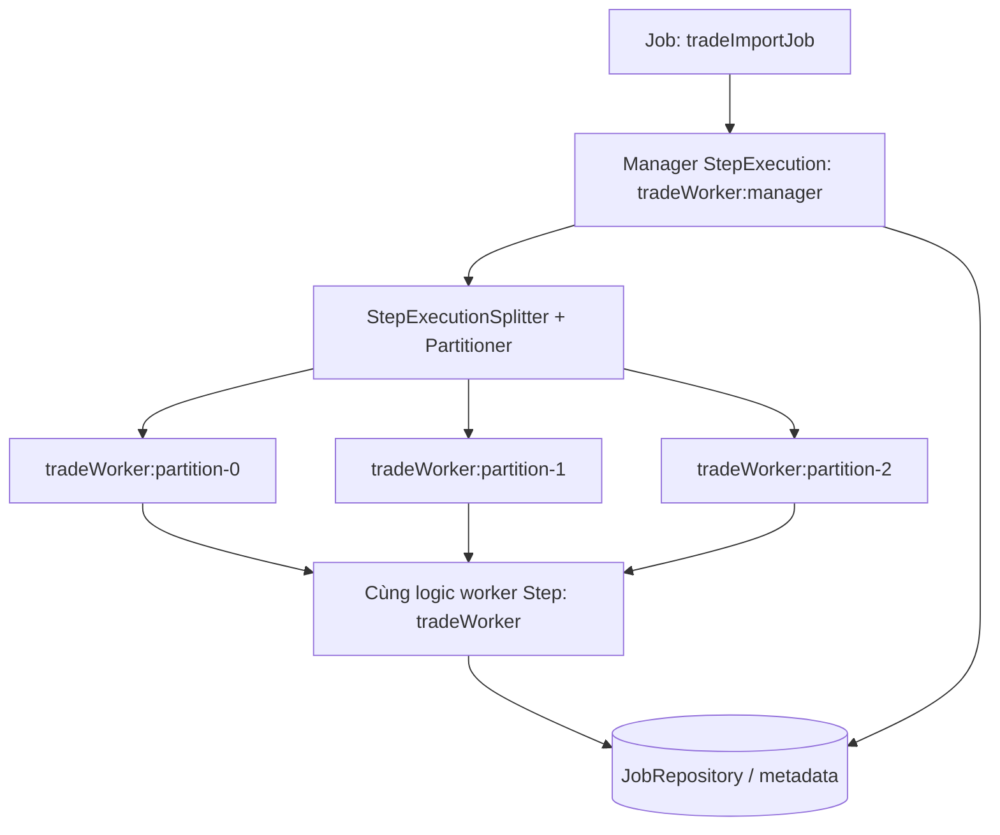

# Alias tên step bằng `name` trong PartitionStep

## Mục tiêu bài học

Trong chương **PartitionStep** của module **SPRING_BATCH_SCALING_OPERATIONS**, chúng ta học cách mở rộng Spring Batch với multi-threaded step, parallel steps, partitioning và xử lý phân tán, đồng thời bảo đảm thread safety, retry/restart và vận hành job trên nguồn lực thực tế.

Bài này tập trung vào một chi tiết nhỏ nhưng ảnh hưởng trực tiếp đến **định danh và khả năng restart**: khi cấu hình **PartitionStep**, vì sao tài liệu Spring Batch nhắc tới việc **đặt alias tên step bằng thuộc tính `name` thay cho `id` trong XML**, và làm thế nào để đạt cùng mục tiêu với Java configuration?

Sau bài học, bạn có thể:

- Phân biệt tên **manager step**, tên **worker step**, tên **partition** và tên **StepExecution** thực tế lưu trong JobRepository.
- Giải thích quy ước `workerStep:partitionName` và lý do nhiều ứng dụng chọn `workerStep:manager` cho manager.
- Dùng thuộc tính `name` của cấu hình XML để đặt tên logic cho manager step; dùng `StepBuilder("...", jobRepository)` tương đương trong Java configuration.
- Tránh nhầm tên bean của Spring với tên Step runtime, hoặc nhầm alias manager với tên worker trong `partitioner(workerStepName, ...)`.
- Hiểu tác động của việc thay tên step/partition đến truy vấn metadata, restart, quan sát và triển khai phân tán.

> **Giới hạn phiên bản:** Giải thích XML bám vào tài liệu namespace của Spring Batch 5.2.x và các phiên bản trước có hỗ trợ cú pháp này. Ví dụ Java dùng hướng cấu hình Spring Batch 5.x với `JobRepository` truyền vào builder. Nếu làm việc với Spring Batch 6.x, cần kiểm tra API/XSD đúng phiên bản đang dùng.

## 1. Ngữ cảnh: PartitionStep có nhiều tên liên quan

Khi chia một step để chạy nhiều phần dữ liệu, Spring Batch tạo **manager step** chịu trách nhiệm phối hợp công việc và các **StepExecution con** cho từng partition. Tất cả partition thường thực hiện cùng cấu hình **worker step** nhưng với `ExecutionContext` riêng.

Giả sử cần nhập 600.000 giao dịch, worker step có tên logic `tradeWorker`. `Partitioner` tạo ba khóa: `partition-0`, `partition-1`, `partition-2`.



Các chuỗi trên có các vai trò khác nhau:

| Tên | Ví dụ | Ai đặt? | Mục đích |
| --- | --- | --- | --- |
| **Tên Job** | `tradeImportJob` | `JobBuilder` hoặc namespace Job | Định danh job, kết hợp identifying JobParameters để xác định JobInstance |
| **Tên manager Step** | `tradeWorker:manager` | `name` trong XML hoặc tên truyền vào `StepBuilder` | Định danh **manager StepExecution** trong job |
| **Tên worker Step** | `tradeWorker` | Bean Step / `StepBuilder` | Chỉ ra cấu hình xử lý được tái sử dụng cho các partition |
| **Tên partition** | `partition-0` | Khóa trong `Map<String, ExecutionContext>` của `Partitioner` | Phân biệt các vùng dữ liệu |
| **Tên StepExecution con** | `tradeWorker:partition-0` | `SimpleStepExecutionSplitter` ghép tên worker với khóa partition | Định danh một lần thực thi worker trên một partition |
| **Tên Spring bean** | `tradeManagerStep` | Tên phương thức `@Bean` hoặc bean ID trong XML | Tra cứu dependency trong Spring ApplicationContext |

**Điểm then chốt:** Tên trong cột cuối cùng không phải các alias thay thế tùy ý cho nhau. Có thể đổi tên **bean** nhưng giữ nguyên tên **Step**; ngược lại, đổi tên Step runtime dù bean vẫn cùng tên sẽ ảnh hưởng metadata và khả năng restart.

### Công thức của tên StepExecution con

Với `SimpleStepExecutionSplitter` thông dụng:

```text
partitionStepExecutionName = workerStepName + ":" + partitionKey

tradeWorker + ":" + partition-0 -> tradeWorker:partition-0
tradeWorker + ":" + partition-1 -> tradeWorker:partition-1
tradeWorker + ":" + partition-2 -> tradeWorker:partition-2
```

Tên `tradeWorker:manager` là **quy ước đặt tên do người triển khai chọn**; Spring Batch **không tự tạo manager step với hậu tố `:manager`**. Trong khi đó, hậu tố của StepExecution con đến từ khóa `Partitioner` theo cơ chế mặc định của splitter. Các tên này dùng trong bảng metadata, log, metric và quyết định restart.

## 2. Alias bằng `name` trong XML nghĩa là gì?

Tài liệu Spring Batch khi mô tả `PartitionStep` thường đưa ví dụ XML dạng:

```xml
<step id="tradeWorker.manager">
    <partition step="tradeWorker" partitioner="tradePartitioner">
        <handler grid-size="3" task-executor="partitionExecutor"/>
    </partition>
</step>
```

Khi `Partitioner` trả về khóa `partition-0`, framework tạo StepExecution tên `tradeWorker:partition-0`. Vì vậy người vận hành thường muốn đặt manager là **`tradeWorker:manager`**, để các StepExecution cùng nhóm và dễ tra cứu:

```text
tradeWorker:manager
tradeWorker:partition-0
tradeWorker:partition-1
tradeWorker:partition-2
```

Trong cú pháp XML namespace mà Spring Batch hỗ trợ, **thuộc tính `name` có thể dùng thay `id` để định danh step**. Điều này giúp đặt tên theo ý muốn, chẳng hạn có dấu `:`, mà không buộc tên logic phải tuân mọi quy tắc của XML ID.

Ví dụ sau minh họa **bên trong cấu hình job dùng Spring Batch XML namespace đã khai báo**:

```xml
<job id="tradeImportJob">
    <step name="tradeWorker:manager">
        <partition step="tradeWorker" partitioner="tradePartitioner">
            <handler grid-size="3" task-executor="partitionExecutor"/>
        </partition>
    </step>
</job>
```

Trong cấu hình này:

- `<step name="tradeWorker:manager">` đặt **tên logic của manager step** trong job.
- `<partition step="tradeWorker" ...>` vẫn trỏ đến **worker step** có cấu hình được đăng ký với tên `tradeWorker`.
- `tradePartitioner` là bean tạo ngữ cảnh từng phân vùng.
- `partitionExecutor` là executor chạy các partition trong mô hình local partitioning.
- Tên `tradeWorker:partition-0` được tạo về sau bởi splitter từ tên worker và khóa partition; **không** được cấu hình bằng cách thêm `<step name="...">` cho từng worker.

**Lưu ý về XML:** Ví dụ là phần cấu hình trọng tâm; để chạy cần Spring Batch namespace/schema đúng phiên bản, định nghĩa worker step, partitioner, task executor, DataSource/JobRepository và transaction manager. Không nhầm thuộc tính `name` của **step** với thẻ alias bean của Spring Framework như `<alias name="..." alias="..."/>`. Bean alias chỉ thêm tên tra cứu bean trong container; nó không mặc nhiên đổi giá trị `Step.getName()` hoặc tên StepExecution lưu trong repository.

### Vì sao `name` hữu ích hơn `id` ở trường hợp này?

`id` trong cấu hình XML thường đóng vai trò định danh theo quy tắc schema/namespace; giá trị có dấu hai chấm có thể vướng ràng buộc cú pháp của `xs:ID`/tên XML. `name` được dùng để chỉ định tên step hợp với quy ước `worker:manager` mà tài liệu Spring Batch nêu.

Cần kiểm tra XSD của bản Spring Batch thực tế: cú pháp `name` này là **cách khai báo trong XML**, không phải một phương thức Java `PartitionStep#setNameAlias`, và không có nghĩa có thể dùng `name` với mọi loại thẻ XML hoặc đổi định danh của một step đã ghi metadata mà không xem xét restart.

## 3. Cách tương đương trong Java configuration

Ở dự án Spring Boot/Spring Batch hiện đại, ứng dụng thường xây dựng step trực tiếp bằng Java. Ta **không có thuộc tính XML `name`** để dùng ở đây; thay vào đó truyền tên logic cho `StepBuilder`.

```java
@Bean("tradeManagerStep")
Step tradeManagerStep(
        JobRepository jobRepository,
        @Qualifier("tradeWorkerStep") Step tradeWorkerStep,
        Partitioner tradePartitioner,
        @Qualifier("partitionExecutor") TaskExecutor executor) {

    return new StepBuilder("tradeWorker:manager", jobRepository)
            .partitioner("tradeWorker", tradePartitioner)
            .step(tradeWorkerStep)
            .gridSize(3)
            .taskExecutor(executor)
            .build();
}
```

Trong ví dụ:

- `@Bean("tradeManagerStep")` là **tên bean** dùng để inject `Step`.
- `new StepBuilder("tradeWorker:manager", jobRepository)` là **tên Step runtime** của manager.
- `partitioner("tradeWorker", tradePartitioner)` sử dụng **tên gốc của worker step** để tạo các tên StepExecution con.
- `.step(tradeWorkerStep)` cung cấp implementation của worker step cho `TaskExecutorPartitionHandler` thực thi tại local JVM.
- `gridSize(3)` là gợi ý về số partition. Nó không bảo đảm số thread thực thi bằng ba và cũng không bảo đảm thứ tự xử lý.

Tương ứng với ví dụ XML, cả hai kiểu cấu hình cùng thể hiện ý định đặt tên manager `tradeWorker:manager`. Đừng cố tìm `name` trên `PartitionStepBuilder` hoặc thay `@Bean("...")` và giả định nó sẽ sửa tên `StepExecution`.

### Định nghĩa worker step có tên trùng khớp

```java
@Bean("tradeWorkerStep")
Step tradeWorkerStep(
        JobRepository jobRepository,
        PlatformTransactionManager transactionManager,
        ItemReader<Long> tradeReader,
        ItemWriter<Long> tradeWriter) {

    return new StepBuilder("tradeWorker", jobRepository)
            .<Long, Long>chunk(500, transactionManager)
            .reader(tradeReader)
            .writer(tradeWriter)
            .build();
}
```

Ví dụ giả định `tradeReader` và `tradeWriter` nhận/ghi ID kiểu `Long` và được ứng dụng khai báo. Reader cần phù hợp với phạm vi partition; trong một JVM, reader/writer có mutable state phải thread-safe hoặc được tạo theo scope thích hợp. Khi dùng partitioning, nhiều `StepExecution` con có thể đồng thời chạy cùng logic worker; **không chia sẻ cursor hay bộ đệm mutable của một reader singleton** nếu nó không thread-safe.

Bất biến cần giữ ở cấu hình trên:

```text
workerStep.getName()           = "tradeWorker"
partitioner(workerStepName, …) = "tradeWorker"
managerStep.getName()          = "tradeWorker:manager"

Tên StepExecution con = "tradeWorker:<partitionKey>"
```

Nếu `partitioner("differentName", ...)` trỏ đến tên khác với worker step, local handler và repository có thể vẫn đi được một số đường cấu hình, nhưng tên được tạo trở nên gây hiểu lầm, và trong remote partitioning rất dễ không tìm được cấu hình step theo tên mong đợi. Luôn kiểm tra tên giữa builder, handler, worker deployment và metadata.

## 4. Ví dụ end-to-end: đặt tên khi xử lý các dải giao dịch

Giả sử job nhập 600.000 record. Ta phân 3 đoạn không chồng lấn; tất cả worker dùng cùng logic `tradeWorker` nhưng đọc `fromId`, `toId` từ `ExecutionContext`.

### 4.1. Partitioner tạo khóa ổn định

```java
@Bean
Partitioner tradePartitioner() {
    return gridSize -> {
        long firstId = 1L;
        long lastId = 600_000L; // Minh họa: thực tế lấy từ snapshot cố định.
        int count = Math.max(1, gridSize);
        long width = (lastId - firstId + count) / count;

        Map<String, ExecutionContext> parts = new LinkedHashMap<>();
        for (int i = 0; i < count; i++) {
            long from = firstId + i * width;
            if (from > lastId) {
                break;
            }
            long to = Math.min(lastId, from + width - 1L);

            ExecutionContext ctx = new ExecutionContext();
            ctx.putLong("fromId", from);
            ctx.putLong("toId", to);
            parts.put("partition-" + i, ctx);
        }
        return parts;
    };
}
```

Khi `gridSize = 3`, kết quả:

| `Partitioner` key | Context `fromId` | Context `toId` | StepExecution name |
| --- | ---: | ---: | --- |
| `partition-0` | 1 | 200.000 | `tradeWorker:partition-0` |
| `partition-1` | 200.001 | 400.000 | `tradeWorker:partition-1` |
| `partition-2` | 400.001 | 600.000 | `tradeWorker:partition-2` |

Các khóa partition chỉ cần **duy nhất trong job** và ổn định khi restart. Ta chủ động chọn `partition-N` để dễ đọc; không có quy tắc bắt buộc tên phải là số, và **`LinkedHashMap` không bảo đảm thứ tự worker thực thi**.

> Trong production, `firstId`/`lastId` phải gắn với cùng một snapshot hoặc tập dữ liệu xác định theo `JobParameters`. Nếu ID mới tiếp tục xuất hiện và partitioner tự chọn phạm vi khác sau khi job thất bại, cùng tên partition có thể đại diện tập dữ liệu khác khi restart.

### 4.2. Reader nhận context của đúng partition

```java
@Bean
@StepScope
JdbcPagingItemReader<Long> tradeIdReader(
        DataSource dataSource,
        @Value("#{stepExecutionContext['fromId']}") Long fromId,
        @Value("#{stepExecutionContext['toId']}") Long toId) {

    return new JdbcPagingItemReaderBuilder<Long>()
            .name("tradeIdReader")
            .dataSource(dataSource)
            .selectClause("SELECT id")
            .fromClause("FROM trade")
            .whereClause("WHERE id BETWEEN :fromId AND :toId")
            .sortKeys(Map.of("id", Order.ASCENDING))
            .parameterValues(Map.of("fromId", fromId, "toId", toId))
            .pageSize(500)
            .rowMapper((rs, rowNum) -> rs.getLong("id"))
            .build();
}
```

Ở đây `@StepScope` tạo reader theo `StepExecution`, giúp mỗi partition có phạm vi ID và trạng thái reader riêng. Một writer thực tế nên ghi idempotent theo khóa nghiệp vụ để chịu được retry/redelivery. Reader có `name("tradeIdReader")` là **tên ItemStream/reader**, **không phải** tên Step hoặc alias manager. Cần index phù hợp với `WHERE id BETWEEN ...` và `ORDER BY id`.

### 4.3. Hoàn thiện job và giới hạn executor

```java
@Bean("partitionExecutor")
TaskExecutor partitionExecutor() {
    ThreadPoolTaskExecutor executor = new ThreadPoolTaskExecutor();
    executor.setCorePoolSize(3);
    executor.setMaxPoolSize(3);
    executor.setQueueCapacity(3);
    executor.setThreadNamePrefix("trade-partition-");
    executor.initialize();
    return executor;
}

@Bean
Job tradeImportJob(
        JobRepository jobRepository,
        @Qualifier("tradeManagerStep") Step managerStep) {

    return new JobBuilder("tradeImportJob", jobRepository)
            .start(managerStep)
            .build();
}
```

Các khối Java minh họa được ghép thành cấu hình hoàn chỉnh về **tên và topology**. Để chạy thực sự cần import Java, schema bảng `trade`, writer, DataSource, JobRepository, transaction manager, cấu hình step-scoped reader và phiên bản thư viện tương thích. Không tự chạy được nếu chỉ sao chép một khối riêng lẻ.

## 5. Xem tên thực tế trong JobRepository

Sau khi job chạy thành công, bảng `BATCH_STEP_EXECUTION` thường ghi bốn `StepExecution` cho trường hợp ba partition:

```text
JOB_EXECUTION_ID    STEP_NAME
----------------------------------------
<job-execution-id>  tradeWorker:manager
<job-execution-id>  tradeWorker:partition-0
<job-execution-id>  tradeWorker:partition-1
<job-execution-id>  tradeWorker:partition-2
```

Truy vấn minh họa (đổi tên bảng nếu bạn cấu hình prefix schema khác):

```sql
SELECT
    STEP_EXECUTION_ID,
    JOB_EXECUTION_ID,
    STEP_NAME,
    STATUS,
    READ_COUNT,
    WRITE_COUNT,
    COMMIT_COUNT
FROM BATCH_STEP_EXECUTION
WHERE JOB_EXECUTION_ID = :jobExecutionId
ORDER BY STEP_EXECUTION_ID;
```

Có thể nhóm theo quy ước tên:

```sql
SELECT STEP_NAME, STATUS, READ_COUNT, WRITE_COUNT
FROM BATCH_STEP_EXECUTION
WHERE JOB_EXECUTION_ID = :jobExecutionId
  AND (STEP_NAME = 'tradeWorker:manager'
       OR STEP_NAME LIKE 'tradeWorker:partition-%');
```

**Phân biệt metadata:** `STEP_EXECUTION_ID` là khóa kỹ thuật cho từng lần thực thi; `STEP_NAME` là tên logic được dùng trong quản lý step; `JOB_EXECUTION_ID` chỉ định một lần chạy cụ thể. Khi restart **cùng JobInstance**, có thể xuất hiện nhiều JobExecution với các StepExecution mới hoặc được tái sử dụng ngữ cảnh theo chính sách restart. Đừng dùng riêng `JOB_EXECUTION_ID` để kết luận toàn bộ lịch sử của JobInstance.

### Gợi ý log/metric

Ghi nhận `jobName`, `jobExecutionId`, `stepName`, `stepExecutionId`, `partitionKey` hoặc phạm vi `fromId/toId` khi điều tra partition chậm. Ví dụ:

```text
job=tradeImportJob
step=tradeWorker:partition-2
stepExecutionId=1842
range=[400001,600000]
read=200000
write=200000
status=COMPLETED
```

Tên `tradeWorker:manager` giúp nhóm log với `tradeWorker:partition-N`, nhưng chỉ là **quy ước dễ vận hành**. Nó không chứng minh throughput tốt, không bảo đảm ordering và không tự cấu hình metric/correlation cho hệ thống log.

## 6. Tên có tác động thế nào đến restart?

**Tên StepExecution là một phần quan trọng để Spring Batch tìm lại trạng thái khi restart.** `SimpleStepExecutionSplitter` dùng tên target worker step và partition key để định danh các lần thực thi con, kết hợp `JobRepository` xử lý ngữ cảnh và bước hoàn tất trước đó.

Ví dụ:

1. Lần chạy đầu, `tradeWorker:partition-0` và `tradeWorker:partition-1` hoàn tất; `tradeWorker:partition-2` thất bại.
2. Khi restart cùng `JobInstance` với cấu hình định danh ổn định, Spring Batch có cơ sở nhận ra partition nào đã hoàn thành, partition nào cần xử lý tiếp.
3. Nếu lúc triển khai giữa chừng đổi `tradeWorker` thành `newTradeWorker` hoặc đổi `partition-2` thành `region-C`, splitter có thể coi chúng là các StepExecution **khác**, dẫn tới chạy lại dữ liệu không như dự tính.
4. Nếu chỉ đổi tên bean Java `tradeWorkerStep` nhưng vẫn giữ `StepBuilder("tradeWorker", ...)` và mapping đúng, danh tính StepExecution thường không đổi.

### Các loại đổi tên cần phân biệt

| Thay đổi | Tác động thường gặp | Khuyến nghị |
| --- | --- | --- |
| `@Bean("oldWorkerBean")` → `@Bean("newWorkerBean")`, vẫn giữ tên Step runtime | Chủ yếu ảnh hưởng dependency injection | Kiểm tra mọi `@Qualifier` và tham chiếu bean |
| `new StepBuilder("tradeWorker", ...)` → `new StepBuilder("newTradeWorker", ...)` | Đổi tên StepExecution con nếu đồng bộ splitter | Tránh đổi trong vòng đời restart của job đang dở |
| `partitioner("tradeWorker", ...)` → `partitioner("newTradeWorker", ...)` | Đổi tiền tố tên StepExecution con | Cần kế hoạch migration/restart rõ ràng |
| Khóa `partition-0` → `range-A` | Đổi hậu tố tên StepExecution con | Giữ khóa ổn định cho cùng snapshot/job instance |
| `tradeWorker:manager` → `tradeWorker:coordinator` | Đổi danh tính manager Step | Đánh giá tác động đến flow, listener, metric, restart |
| `gridSize=3` → `gridSize=5` cùng công thức chia dải | Có thể đổi phạm vi, số lượng và tên partition | Giữ chiến lược và mapping ổn định giữa lần chạy và restart |
| Chỉ đổi `threadNamePrefix` executor | Không mặc định đổi tên StepExecution | Ít tác động metadata; kiểm tra log/alert phụ thuộc thread name |

Đổi tên **sau khi job đã hoàn tất và tạo một JobInstance mới có chủ đích** thường ít rủi ro hơn đổi tên trong một job đang cần restart. Nếu buộc phải đổi trong hệ thống đang vận hành, lập kế hoạch di trú metadata và dữ liệu nghiệp vụ, kiểm thử trên JobRepository giống production, rà soát các job chưa hoàn tất. Không chỉnh trực tiếp bảng metadata tùy tiện để “đồng bộ tên”; làm vậy có thể phá quan hệ StepExecution, ExecutionContext và trạng thái restart.

### Một lỗi khó phát hiện: giữ tên nhưng đổi ý nghĩa partition

Ngay cả khi `partition-0` vẫn giữ nguyên tên, nếu bản đầu đọc ID `1..200000` nhưng bản restart dùng `1..120000`, tên giống nhau không bảo đảm đúng phạm vi. Cần bảo vệ **cả tên lẫn mapping ngữ cảnh**, ví dụ cố định dataset snapshot, version thuật toán partitioner, `gridSize`, watermark và biên dữ liệu theo JobInstance.

**Quy tắc:** Tên giúp nhận diện phần công việc; `ExecutionContext` và dữ liệu nguồn quyết định **phần đó đang xử lý gì**. Hai yếu tố phải nhất quán.

## 7. Alias có liên quan gì đến scaling?

Alias tên manager giúp quan sát và vận hành, nhưng bản thân nó **không**:

- tăng số thread hay số worker;
- tự chia dữ liệu cho `Partitioner`;
- biến local partitioning thành remote partitioning;
- giải quyết race condition của ItemReader/ItemWriter;
- bảo đảm exactly-once của side effect hoặc thứ tự hoàn thành partition.

Để mở rộng workload thật, cần đo đúng nút thắt và chọn cơ chế phù hợp:

| Nút thắt/yêu cầu | Công cụ phù hợp | Vai trò của tên step |
| --- | --- | --- |
| Một step có các item độc lập, có thể xử lý nhiều chunk | Multi-threaded step (nếu thread-safe) | Dùng tên Step rõ để đo throughput/skip |
| Một step chia được theo vùng ID/file | Local partitioning | Nhóm manager và worker partition dễ truy vết |
| Một step cần worker ở nhiều process/máy | Remote partitioning | Tên worker phải nhất quán qua manager/worker, metadata dùng chung |
| Các công đoạn nghiệp vụ khác nhau độc lập | Parallel steps | Tên flow và step phân biệt từng nhánh |
| DB đã bão hòa, partition chậm do lock/pool | Tối ưu SQL, pool, gridSize và concurrency | Tên giúp tìm partition chậm, **không giải quyết** DB bottleneck |

### Local và remote partitioning có khác cách đặt tên không?

**Nguyên tắc tên StepExecution con vẫn giống nhau** nếu dùng `SimpleStepExecutionSplitter` thông thường. Khác biệt chính nằm ở cơ chế giao việc:

- **Local:** `TaskExecutorPartitionHandler` chạy worker Step trong cùng JVM.
- **Remote:** handler phía manager, ví dụ `MessageChannelPartitionHandler`, chuyển yêu cầu qua transport tới worker process có cấu hình step tương ứng.

Với remote partitioning, việc đồng bộ tên càng quan trọng: manager có thể gửi yêu cầu dựa trên worker step name, worker phải có bước được đăng ký cùng định danh để tra cứu và thực thi. Cả hai cần tương thích phiên bản và truy cập metadata trong JobRepository dùng chung. Dùng alias cho **manager** không thay thế tên worker Step trong thông điệp điều phối.

## 8. Anti-pattern và cách sửa

### Sai lầm 1: Nhầm bean name với Step runtime name

```java
@Bean("tradeWorker:manager")
Step tradeManager(JobRepository jobRepository, ...) {
    return new StepBuilder("tradeManager", jobRepository)
            // ...
            .build();
}
```

Bean có tên `tradeWorker:manager`, nhưng **tên Step runtime vẫn là `tradeManager`** vì constructor builder chỉ định như vậy. Spring Batch ghi `tradeManager` trong metadata; tên bean không tự thay đổi nó.

**Sửa:** Đặt `new StepBuilder("tradeWorker:manager", jobRepository)` và dùng tên bean Java dễ đọc, chẳng hạn `tradeManagerStep`.

### Sai lầm 2: Nhầm worker step với manager step

```java
new StepBuilder("tradeWorker:manager", jobRepository)
        .partitioner("tradeWorker:manager", partitioner)
        .step(tradeWorkerStep)
        // ...
```

Ở đây tên dùng trong `partitioner(...)` bị đặt theo **manager**, trong khi worker Step thực tế là `tradeWorker`. Tên con có thể trở thành `tradeWorker:manager:partition-0`, gây khó hiểu và làm sai kỳ vọng khi remote worker tra cứu step.

**Sửa:** `partitioner("tradeWorker", partitioner)`, còn `StepBuilder("tradeWorker:manager", ...)` chỉ đặt tên manager.

### Sai lầm 3: “Đặt alias thì partition sẽ chạy theo thứ tự tên”

Tên `partition-0`, `partition-1`, `partition-2` không quyết định thứ tự start, commit hay finish. Thread pool, độ lệch phân vùng và tài nguyên DB quyết định thời gian hoàn thành thực tế.

**Sửa:** Nếu cần output cuối có thứ tự, để worker ghi staging/file riêng rồi merge theo sort key sau khi tất cả partition thành công. Nếu side effect yêu cầu thứ tự theo business key, bảo đảm các event cùng key vào cùng worker và kiểm soát sequence.

### Sai lầm 4: Đổi tên partition để “restart lại từ đầu”

Việc đổi `partition-0` thành `partition-new` để ép chạy lại có thể làm trùng dữ liệu vì metadata cũ không khớp; ngoại tác đã commit vẫn tồn tại.

**Sửa:** Dùng cơ chế restart/reprocess có chủ đích, xác định JobInstance và idempotency key, xử lý dữ liệu staging theo run key. Không dùng tên như một nút reset ẩn.

### Sai lầm 5: Dùng tên dài hoặc chứa dữ liệu nhạy cảm

Nhồi số tài khoản, email, token, đường dẫn riêng tư vào tên partition vừa rối log, vừa có nguy cơ lộ thông tin trong metadata, dashboard và alert. Tên dài cũng có thể vượt giới hạn chiều dài cột `STEP_NAME` tùy schema/phiên bản.

**Sửa:** Dùng tên ngắn, ổn định, ít cardinality (ví dụ `partition-17`), lưu phạm vi kỹ thuật cần thiết trong `ExecutionContext` hoặc bảng điều phối được bảo vệ phù hợp, và kiểm tra giới hạn schema.

## 9. Checklist xác minh sau khi cấu hình

### Kiểm tra về tên

- [ ] Tên manager `Step.getName()` đúng quy ước, ví dụ `tradeWorker:manager`.
- [ ] Tên worker `Step.getName()` là `tradeWorker` và `partitioner("tradeWorker", ...)` nhất quán.
- [ ] `Partitioner` tạo khóa partition riêng biệt, ổn định, ánh xạ rõ vào phạm vi dữ liệu.
- [ ] Nếu cấu hình bằng XML, `name` thuộc **step**, không nhầm với `name` hoặc alias của bean Spring.
- [ ] `JobRepository` chứa tên manager và worker partitions đúng như kỳ vọng.

### Kiểm tra hành vi

1. Chạy job với ba partition, truy vấn `BATCH_STEP_EXECUTION` để xác minh các tên `tradeWorker:manager`, `tradeWorker:partition-0`, `tradeWorker:partition-1`, `tradeWorker:partition-2`.
2. Cố ý cho partition cuối thất bại sau một chunk, restart cùng JobInstance. Kiểm tra partition hoàn tất không gây side effect trùng, partition lỗi được xử lý theo metadata và checkpoint.
3. Đọc lại `ExecutionContext` từng partition: dải dữ liệu không chồng lấn, không bỏ sót; tên và phạm vi giữ nguyên khi restart.
4. Với remote partitioning, kiểm tra log manager/worker có cùng tên worker Step và có thể tra cứu đúng StepExecution qua JobRepository.
5. Chạy benchmark `gridSize` phù hợp với số consumer, CPU, memory và connection pool; chỉ tăng concurrency khi đo thấy nút thắt có thể mở rộng.

### Câu hỏi tự kiểm tra

**Câu 1.** Đổi tên phương thức `@Bean` từ `tradeManagerStep` thành `manager` có làm tên metadata đổi từ `tradeWorker:manager` thành `manager` không?

**Trả lời:** Không, nếu `new StepBuilder("tradeWorker:manager", ...)` không đổi và bean được tham chiếu đúng.

**Câu 2.** Nếu `Partitioner` trả về khóa `region-A` và `partitioner("tradeWorker", ...)`, StepExecution con được đặt tên thế nào theo splitter mặc định?

**Trả lời:** `tradeWorker:region-A`.

**Câu 3.** Dùng `<step name="tradeWorker:manager">` có khiến worker tự đổi tên thành `tradeWorker:manager` không?

**Trả lời:** Không. Đây là tên logic của **manager step** trong XML. Worker vẫn được chỉ định bằng `<partition step="tradeWorker" ...>`.

**Câu 4.** Có an toàn khi đổi `partition-0` thành `segment-0` trước khi restart job lỗi?

**Trả lời:** Không nên. Splitter có thể coi đây là StepExecution khác; phải giữ định danh/phân vùng ổn định hoặc thực hiện kế hoạch reprocess có idempotency và xác minh dữ liệu.

## Tài liệu tham khảo

- [Spring Batch 5.2 — Scaling and Parallel Processing](https://docs.spring.io/spring-batch/reference/5.2/scalability.html): cấu hình `PartitionStep` bằng XML/Java và ghi chú về alias `name` thay `id`, quy tắc tên StepExecution con.
- [Spring Batch 5.2 API — PartitionStepBuilder](https://docs.spring.io/spring-batch/docs/5.2.x/api/org/springframework/batch/core/step/builder/PartitionStepBuilder.html): `partitioner(String workerStepName, Partitioner)`, `step(...)`, `taskExecutor(...)` và `gridSize(...)`.
- [Spring Batch 5.2 API — SimpleStepExecutionSplitter](https://docs.spring.io/spring-batch/docs/5.2.x/api/org/springframework/batch/core/partition/support/SimpleStepExecutionSplitter.html): cách hình thành tên `workerStep:partitionKey` và liên hệ với restart.
- [Spring Batch Reference — Job Configuration](https://docs.spring.io/spring-batch/reference/5.2/job/configuring-job.html): cách đặt tên Job và sử dụng Step trong cấu hình XML/Java.

**Điều cần nhớ:** `name` trong cấu hình XML giúp đặt **tên manager step** theo quy ước `workerStep:manager`; Java configuration đạt cùng mục tiêu bằng `StepBuilder("workerStep:manager", jobRepository)`. Còn tên các StepExecution con được tạo từ **worker step name** và **partition key**. Đặt tên rõ ràng giúp vận hành, nhưng để restart an toàn phải giữ cả định danh và phạm vi dữ liệu của partition ổn định.
