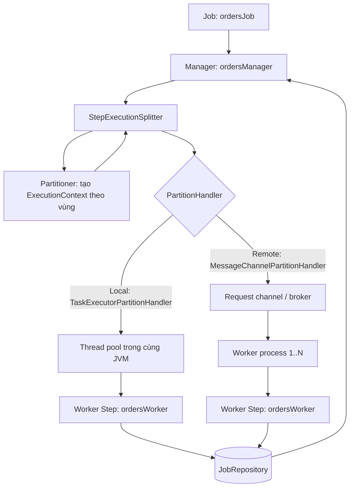
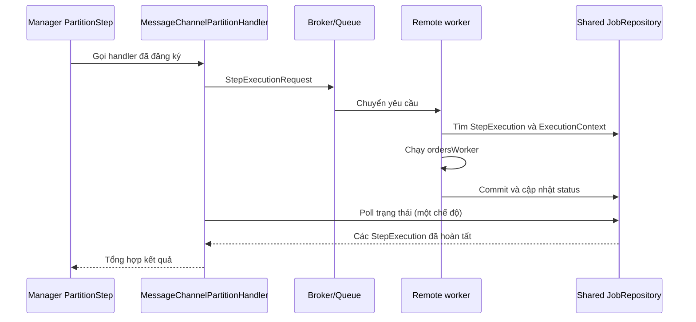

# Đăng ký handler cho partition trong Spring Batch

## Mục tiêu bài học

Trong chương **PartitionStep** của module **SPRING_BATCH_SCALING_OPERATIONS**, chúng ta tìm hiểu cách mở rộng Spring Batch cho workload dữ liệu lớn qua multi-threaded step, parallel steps, partitioning và mô hình xử lý phân tán. Bài này tập trung vào thao tác kiến trúc quan trọng: **đăng ký `PartitionHandler` cho manager `PartitionStep`** để các `StepExecution` con thực sự được giao tới worker.

Sau bài học, bạn có thể:

- Phân biệt trách nhiệm của `Partitioner`, `StepExecutionSplitter`, `PartitionHandler`, worker `Step` và `PartitionStep`.
- Đăng ký `TaskExecutorPartitionHandler` tường minh với `partitionHandler(handler)`, hoặc để builder tạo handler thông qua `step(...)` và `taskExecutor(...)`.
- Nhận diện nơi đặt `MessageChannelPartitionHandler` khi triển khai remote partitioning.
- Cấu hình `gridSize`, thread pool, tên worker, `JobRepository`, transaction và scope của reader/writer một cách nhất quán.
- Thiết kế retry/restart, xử lý lỗi, giám sát và kiểm chứng cấu hình khi vận hành ở production.

> **Phạm vi phiên bản:** Ví dụ Java dùng cách cấu hình điển hình của **Spring Batch 5.2.x**. Spring Batch 6.x có những thay đổi API và yêu cầu tương thích; hãy kiểm tra Javadoc/changelog đúng phiên bản dự án. Ví dụ dưới đây minh họa cách đăng ký và điều phối, còn DataSource, schema và các lớp nghiệp vụ là phần cần triển khai trong ứng dụng thực.

## 1. Vì sao cần `PartitionHandler`?

Giả sử job phải đối soát 8 triệu đơn hàng. Ta chia dữ liệu thành 8 dải ID không chồng lấn. `Partitioner` có thể tạo đủ tám `ExecutionContext`, nhưng **việc chia dữ liệu chưa đồng nghĩa các worker đã chạy**. Manager cần một thành phần quyết định *giao các `StepExecution` con đi đâu và đợi kết quả bằng cách nào*.

Thành phần đó là `PartitionHandler`.



Vai trò chính của các thành phần:

| Thành phần | Trách nhiệm |
| --- | --- |
| `PartitionStep` | Step phía manager điều phối các partition, tổng hợp trạng thái và quyết định thành công/thất bại. |
| `Partitioner` | Trả về `Map<String, ExecutionContext>`; mỗi entry là một vùng dữ liệu và tên partition. |
| `StepExecutionSplitter` | Dựa trên metadata và partitioner để xác định các `StepExecution` con cần chạy, bao gồm khi restart. |
| **`PartitionHandler`** | Nhận công việc từ splitter, thực thi hoặc gửi tới worker, thu kết quả để manager tổng hợp. |
| Worker `Step` | Đọc, xử lý, ghi dữ liệu của một partition với transaction và `ExecutionContext` tương ứng. |
| `JobRepository` | Lưu `JobExecution`, `StepExecution`, checkpoint và metadata hỗ trợ restart. |

Về mặt API, `PartitionHandler` là abstraction với phương thức trọng tâm:

```java
Collection<StepExecution> handle(
        StepExecutionSplitter splitter,
        StepExecution managerStepExecution) throws Exception;
```

Manager gọi handler trong vòng đời của partition step. Handler tương tác với splitter để nhận các step execution cần xử lý rồi trả về tập kết quả. **Bạn thường không gọi `handle(...)` trực tiếp trong mã nghiệp vụ**; việc cần làm là gắn handler vào builder của manager.

### Đăng ký handler khác với đăng ký worker

- **Đăng ký handler:** nói với manager *dùng cơ chế phân phối nào*.
- **Đăng ký worker `Step`:** cung cấp implementation sẽ thực thi một partition.
- **Đăng ký `Partitioner`:** nói *dữ liệu được chia theo quy tắc nào*.

Bỏ một trong ba phần, hoặc đặt tên không nhất quán, có thể khiến job xây dựng không thành công, worker không nhận công việc hoặc xử lý sai phạm vi dữ liệu.

## 2. Hai cách khai báo local partitioning

Trong local partitioning, manager và worker ở cùng JVM. Handler điển hình là **`TaskExecutorPartitionHandler`**. Có hai lựa chọn được sử dụng rộng rãi:

| Cách | Nơi cấu hình handler | Phù hợp |
| --- | --- | --- |
| **Tường minh** | Khai báo bean `TaskExecutorPartitionHandler`, sau đó gọi `partitionHandler(handler)` trên manager builder. | Cần kiểm soát rõ bean/lifecycle, tái sử dụng cấu hình vận hành, theo dõi bean riêng hoặc muốn chuyển handler theo môi trường. |
| **Rút gọn bằng builder** | Gọi `step(workerStep)`, `gridSize(...)`, `taskExecutor(...)` trên `PartitionStepBuilder`; builder tạo `TaskExecutorPartitionHandler` tương ứng. | Local partitioning đơn giản, muốn ít cấu hình và liên kết rõ worker/executor. |

**Chọn một trong hai cách cho cùng manager**. Nếu đã cung cấp `partitionHandler(handler)` thì đặt cấu hình `Step`, executor và `gridSize` cần thiết lên bean handler đó; tránh vừa cung cấp handler riêng vừa mong builder tự xây một handler khác. Trong remote partitioning, handler gửi message thường cần đăng ký tường minh hoặc dùng builder chuyên dụng của Spring Batch Integration.

## 3. Ví dụ A — đăng ký `TaskExecutorPartitionHandler` tường minh

Bài toán: có bảng `orders(id, ...)`, mỗi partition xử lý một dải ID và ghi vào `processed_order`. Ví dụ đặt tên worker `ordersWorker`; manager `ordersManager`.

### 3.1. Tạo partition với dải không chồng lấn

```java
@Bean
Partitioner ordersPartitioner() {
    return gridSize -> {
        long firstId = 1L;
        long lastId = 800_000L; // Minh họa; production cố định snapshot/job input.
        int numberOfPartitions = Math.max(1, gridSize);
        long width = (lastId - firstId + numberOfPartitions)
                / numberOfPartitions;

        Map<String, ExecutionContext> partitions = new LinkedHashMap<>();

        for (int i = 0; i < numberOfPartitions; i++) {
            long fromId = firstId + i * width;
            if (fromId > lastId) {
                break;
            }

            long toId = Math.min(lastId, fromId + width - 1);
            ExecutionContext context = new ExecutionContext();
            context.putLong("fromId", fromId);
            context.putLong("toId", toId);

            partitions.put("partition-" + i, context);
        }

        return partitions;
    };
}
```

Với `gridSize = 8`, ta có tám vùng, mỗi vùng tối đa 100.000 ID. Các khóa `partition-0`, `partition-1`... là tên của **partition**, không phải tên bean handler. `StepExecutionSplitter` mặc định dùng tên worker step kết hợp tên partition để tạo các tên như `ordersWorker:partition-0`.

Số ID không phải số bản ghi thực tế nếu ID bị khuyết. Với dữ liệu lệch tải, có thể dùng phân vùng theo histogram, tenant, shard hoặc một chỉ số gần với khối lượng xử lý hơn.

### 3.2. Tạo worker step và reader theo `StepExecution`

```java
@Bean("ordersWorkerStep")
Step ordersWorkerStep(
        JobRepository jobRepository,
        PlatformTransactionManager transactionManager,
        @Qualifier("ordersReader") ItemReader<Long> reader,
        @Qualifier("ordersWriter") ItemWriter<Long> writer) {

    return new StepBuilder("ordersWorker", jobRepository)
            .<Long, Long>chunk(500, transactionManager)
            .reader(reader)
            .writer(writer)
            .build();
}

@Bean("ordersReader")
@StepScope
JdbcPagingItemReader<Long> ordersReader(
        DataSource dataSource,
        @Value("#{stepExecutionContext['fromId']}") Long fromId,
        @Value("#{stepExecutionContext['toId']}") Long toId) {

    return new JdbcPagingItemReaderBuilder<Long>()
            .name("ordersReader")
            .dataSource(dataSource)
            .selectClause("SELECT id")
            .fromClause("FROM orders")
            .whereClause("WHERE id BETWEEN :fromId AND :toId")
            .sortKeys(Map.of("id", Order.ASCENDING))
            .parameterValues(Map.of("fromId", fromId, "toId", toId))
            .pageSize(500)
            .rowMapper((rs, rowNum) -> rs.getLong("id"))
            .build();
}
```

Vì `ordersReader` mang trạng thái paging, ta dùng **`@StepScope`** để mỗi `StepExecution` con có instance reader và giới hạn ID riêng. Các step con chạy cùng JVM nhưng không được dùng chung cursor mutable của một reader singleton không thread-safe.

Writer nghiệp vụ cần có transaction đúng, khóa duy nhất và cơ chế idempotent. Ví dụ với PostgreSQL, `processed_order(order_id PRIMARY KEY)` có thể ghi bằng `INSERT ... ON CONFLICT DO NOTHING`; nếu sử dụng `JdbcBatchItemWriter`, cần chú ý `assertUpdates` khi SQL chủ động cho phép 0 row do bản ghi đã tồn tại.

> Code trên mới tạo worker step và reader. Writer, schema nghiệp vụ, cấu hình `DataSource` và transaction manager phải do ứng dụng cung cấp. Một writer “chạy được” nhưng không idempotent có thể ghi trùng khi retry hoặc restart.

### 3.3. Cấu hình executor có giới hạn

```java
@Bean("ordersPartitionExecutor")
TaskExecutor ordersPartitionExecutor() {
    ThreadPoolTaskExecutor executor = new ThreadPoolTaskExecutor();
    executor.setCorePoolSize(4);
    executor.setMaxPoolSize(4);
    executor.setQueueCapacity(8);
    executor.setThreadNamePrefix("orders-partition-");
    executor.initialize();
    return executor;
}
```

Ở đây `gridSize` sắp đặt thành 8 partition, nhưng executor chỉ cho tối đa **4 worker task** chạy đồng thời. Bốn partition còn lại có thể chờ trong queue; đây là hành vi được dự kiến. Đừng suy ra `gridSize=8` sẽ chạy 8 luồng.

### 3.4. Khai báo bean handler

```java
@Bean("ordersPartitionHandler")
TaskExecutorPartitionHandler ordersPartitionHandler(
        @Qualifier("ordersWorkerStep") Step workerStep,
        @Qualifier("ordersPartitionExecutor") TaskExecutor executor) {

    TaskExecutorPartitionHandler handler =
            new TaskExecutorPartitionHandler();

    handler.setStep(workerStep);
    handler.setTaskExecutor(executor);
    handler.setGridSize(8);
    return handler;
}
```

Ba cấu hình quan trọng nhất ở đây là:

- **`setStep(workerStep)`:** worker `Step` thực sự được chạy bởi handler.
- **`setTaskExecutor(executor)`:** nơi giao các worker `StepExecution` cho thread pool.
- **`setGridSize(8)`:** gợi ý số partition cho splitter/partitioner trong lượt chạy; không phải số worker chắc chắn chạy đồng thời.

Bean `TaskExecutorPartitionHandler` là một thành phần của **manager**, không phải worker `Step`. Khi được tạo bởi Spring container, các lifecycle callback của bean được áp dụng theo cấu hình Spring thông thường; không cần tự gọi `handle(...)` để khởi động các partition.

### 3.5. Gắn handler vào manager `PartitionStep`

```java
@Bean("ordersManagerStep")
Step ordersManagerStep(
        JobRepository jobRepository,
        Partitioner ordersPartitioner,
        @Qualifier("ordersPartitionHandler") PartitionHandler handler) {

    return new StepBuilder("ordersManager", jobRepository)
            .partitioner("ordersWorker", ordersPartitioner)
            .partitionHandler(handler)
            .build();
}

@Bean
Job ordersJob(
        JobRepository jobRepository,
        @Qualifier("ordersManagerStep") Step manager) {

    return new JobBuilder("ordersJob", jobRepository)
            .start(manager)
            .build();
}
```

**Điểm đăng ký chính xác là `.partitionHandler(handler)`** trên `PartitionStepBuilder`. Sau đó `.build()` tạo manager step được cung cấp cho `Job`.

Các định danh cần nhất quán:

```text
manager Step runtime name         ordersManager
worker Step runtime name          ordersWorker
partitioner(workerStepName, ...)  ordersWorker
handler.setStep(...)              ordersWorker Step
partition key                      partition-0
worker StepExecution name          ordersWorker:partition-0
```

Tên bean `ordersWorkerStep` là tên tra cứu trong Spring IoC. Tên runtime `ordersWorker` mới là phần được dùng để đặt tên các `StepExecution` con trong ví dụ.

### 3.6. Các bước xảy ra khi job chạy

1. `ordersJob` bắt đầu `ordersManager`.
2. `PartitionStep` dùng splitter kết hợp partitioner để xác định các `StepExecution` con; metadata được lưu trong `JobRepository`.
3. Manager gọi handler đã đăng ký. `TaskExecutorPartitionHandler` giao các `StepExecution` cho executor.
4. Từng worker `Step` chạy với `ExecutionContext` riêng, đọc đúng dải ID, commit theo chunk.
5. Handler trả tập kết quả cho manager sau khi các task cần thiết kết thúc.
6. Manager tổng hợp trạng thái: khi có partition thất bại, kết quả toàn manager step không thể coi là thành công chỉ vì các partition khác đã hoàn tất.

Các partition có thể hoàn thành **khác thứ tự tên**, và thread pool không cung cấp ordering toàn cục.

## 4. Ví dụ B — để builder tự tạo local handler

Nếu không cần bean handler riêng, có thể cấu hình ngắn hơn:

```java
@Bean("ordersManagerStep")
Step ordersManagerStep(
        JobRepository jobRepository,
        Partitioner ordersPartitioner,
        @Qualifier("ordersWorkerStep") Step workerStep,
        @Qualifier("ordersPartitionExecutor") TaskExecutor executor) {

    return new StepBuilder("ordersManager", jobRepository)
            .partitioner("ordersWorker", ordersPartitioner)
            .step(workerStep)
            .gridSize(8)
            .taskExecutor(executor)
            .build();
}
```

Với Spring Batch 5.2.x, nhánh cấu hình này tạo `TaskExecutorPartitionHandler` tương ứng để chạy worker. Hai đoạn mã A và B là **hai cách thay thế**; không đăng ký đồng thời hai bean `ordersManagerStep` cho cùng một ứng dụng.

| Mối quan tâm | Đăng ký handler riêng | Cấu hình rút gọn |
| --- | --- | --- |
| Đối tượng handler | Bean do bạn khai báo | Builder tạo |
| Nơi đặt worker | `handler.setStep(workerStep)` | `.step(workerStep)` |
| Nơi đặt executor | `handler.setTaskExecutor(executor)` | `.taskExecutor(executor)` |
| Nơi đặt grid size | `handler.setGridSize(8)` | `.gridSize(8)` |
| Gắn vào manager | `.partitionHandler(handler)` | Builder gắn handler được tạo |
| Hướng mở rộng | Có thể thay implementation `PartitionHandler` | Phù hợp local partitioning thông dụng |

**Điều cần tránh:** Cấu hình handler riêng nhưng tiếp tục gọi `.step(...)`, `.taskExecutor(...)`, `.gridSize(...)` với kỳ vọng chúng sửa cấu hình nội bộ handler đã cung cấp. Khi dùng một handler tường minh, hãy coi bean handler là nơi điều chỉnh runtime của handler, đồng thời kiểm tra hành vi builder theo đúng phiên bản Spring Batch đang chạy.

## 5. Đăng ký trong cấu hình XML

Ở các ứng dụng dùng Spring Batch XML namespace, handler có thể khai báo trực tiếp trong `<partition>`:

```xml
<job id="ordersJob">
    <step id="ordersManager">
        <partition step="ordersWorker"
                   partitioner="ordersPartitioner">
            <handler grid-size="8"
                     task-executor="ordersPartitionExecutor"/>
        </partition>
    </step>
</job>
```

`handler` nội tuyến ở đây là cách cấu hình local partitioning thông dụng. `ordersWorker`, `ordersPartitioner` và `ordersPartitionExecutor` phải được khai báo trong Spring context, cùng namespace/schema tương thích phiên bản.

Nếu muốn **đăng ký handler thành bean riêng**, có thể cấu hình:

```xml
<bean id="ordersPartitionHandler"
      class="org.springframework.batch.core.partition.support.TaskExecutorPartitionHandler">
    <property name="step" ref="ordersWorker"/>
    <property name="taskExecutor" ref="ordersPartitionExecutor"/>
    <property name="gridSize" value="8"/>
</bean>

<job id="ordersJob">
    <step id="ordersManager">
        <partition step="ordersWorker"
                   partitioner="ordersPartitioner">
            <handler ref="ordersPartitionHandler"/>
        </partition>
    </step>
</job>
```

Thẻ `<handler ref="..."/>` trỏ đến một bean implement `PartitionHandler`; `<partition step="...">` chỉ định worker step name. Tên và cách khai báo phụ thuộc phiên bản XSD, nên không trộn một snippet từ Spring Batch cũ với Java API mới mà không kiểm tra tương thích.

**Đăng ký bean trong context không tự làm manager dùng nó.** Trong Java vẫn phải truyền handler qua `.partitionHandler(handler)`; trong XML phải có `<handler ref="..."/>` (hoặc handler nội tuyến) nằm đúng bên trong `<partition>`.

## 6. Remote partitioning: thay handler khi worker ở process khác

`TaskExecutorPartitionHandler` chỉ dùng executor trong **một JVM**. Nếu manager cần gửi các `StepExecution` tới worker ở container hoặc máy khác, triển khai remote partitioning qua Spring Batch Integration, với handler điển hình là **`MessageChannelPartitionHandler`**.



Có hai cơ chế phổ biến để nhận kết quả từ worker:

- **Polling `JobRepository`:** manager tra cứu trạng thái các `StepExecution` con sau khi gửi yêu cầu; không cần reply channel nghiệp vụ riêng.
- **Reply qua message:** worker trả reply và một aggregator ghép kết quả cho manager. Cần correlation, sequence metadata, receive timeout và chính sách xử lý reply thiếu/đến muộn.

### Ví dụ khai báo handler kiểu message với polling

Đây là mẫu cấu hình **phía manager** cho Spring Batch Integration 5.2.x:

```java
@Bean("remoteOrdersPartitionHandler")
MessageChannelPartitionHandler remoteOrdersPartitionHandler(
        @Qualifier("partitionRequests") MessageChannel requests,
        JobExplorer jobExplorer) {

    MessagingTemplate template = new MessagingTemplate();
    template.setDefaultChannel(requests);
    template.setSendTimeout(10_000L);

    MessageChannelPartitionHandler handler =
            new MessageChannelPartitionHandler();

    handler.setStepName("ordersWorker");
    handler.setGridSize(8);
    handler.setMessagingOperations(template);
    handler.setJobExplorer(jobExplorer);
    handler.setPollInterval(2_000L);
    handler.setTimeout(1_800_000L);
    return handler;
}

@Bean("ordersManagerStep")
Step remoteOrdersManagerStep(
        JobRepository jobRepository,
        Partitioner ordersPartitioner,
        @Qualifier("remoteOrdersPartitionHandler") PartitionHandler handler) {

    return new StepBuilder("ordersManager", jobRepository)
            .partitioner("ordersWorker", ordersPartitioner)
            .partitionHandler(handler)
            .build();
}
```

`partitionRequests` là channel nội bộ của Spring Integration. Để giao việc tới JVM khác, **phải kết nối channel với outbound adapter tới broker** và thiết lập inbound adapter ở worker; định nghĩa một `DirectChannel` ở hai JVM không tự truyền message qua mạng. Worker phải đăng ký `StepExecutionRequestHandler`/cấu hình worker integration thích hợp, có `ordersWorker` và truy cập **cùng `JobRepository`** để lấy `StepExecution`.

Mẫu trên dùng **polling**; nếu chuyển sang reply channel, phải cấu hình đường reply và aggregator tương ứng, không chỉ thêm một channel bất kỳ. `setTimeout` phải được tính theo thời gian partition dài nhất có dự phòng; timeout ở manager không nhất thiết dừng worker đang chạy.

Khi dùng Spring Batch Integration, cũng có các builder chuyên dụng (như `RemotePartitioningManagerStepBuilderFactory` ở 5.x) để dựng manager/worker và wiring phù hợp. **Không gắn thêm `.partitionHandler(...) ` theo cách thủ công lên manager builder chuyên dụng nếu API đó đã tự quản lý handler**. Chọn một con đường cấu hình theo phiên bản và kiểm tra Javadoc.

## 7. Các điều kiện để một handler hoạt động đúng

### 7.1. Tên worker phải nhất quán

```text
new StepBuilder("ordersWorker", ...)
.partitioner("ordersWorker", partitioner)
handler.setStep(workerStep)             // local
handler.setStepName("ordersWorker")      // remote
```

Trong local partitioning, tên worker của splitter và tên `Step` thực tế nên khớp. Với remote, tên worker còn cần khớp với step mà worker process tìm thấy. Nếu không, request có thể đến worker nhưng không xác định được bước cần thực thi.

### 7.2. Một `StepExecution` cho từng partition

Mỗi partition được cung cấp `ExecutionContext` riêng (ví dụ `fromId/toId`). `@StepScope` hỗ trợ cấp reader có trạng thái theo từng `StepExecution`. Không truyền chung một cursor, một iterator mutable hay một bộ đệm writer không thread-safe cho nhiều partition cùng chạy.

### 7.3. Dữ liệu phải tách biệt hoặc có đồng bộ

Hai partition cùng ghi vào một nhóm row có thể tranh chấp lock, commit đảo thứ tự hoặc làm mất cập nhật. Cần phân vùng theo khóa không chồng lấn, hoặc dùng optimistic locking, idempotency key và transaction thích hợp. Nếu cần thứ tự toàn cục của file đầu ra, mỗi partition ghi riêng rồi merge có sort sau khi manager thành công.

### 7.4. Handler không thay thế transaction/retry của worker

Handler chịu trách nhiệm **điều phối**. Checkpoint, skip, retry và commit được xử lý ở worker step/chunk; tính đúng đắn của side effect phụ thuộc writer và transaction. Thay `TaskExecutorPartitionHandler` bằng `MessageChannelPartitionHandler` không tự tạo exactly-once cho nghiệp vụ.

### 7.5. Chia việc phải ổn định qua restart

Với cùng `JobInstance` và cùng mục tiêu restart, giữ ổn định tên worker, tên partition, giới hạn dữ liệu, snapshot và phương pháp chia. Đổi `gridSize` hoặc thuật toán partitioner giữa một lần chạy lỗi và restart có thể đổi phạm vi dữ liệu, ngay cả khi một số tên partition vẫn giống nhau.

## 8. Khi một partition thất bại, handler trả về điều gì?

Ví dụ có bốn partition:

| Partition | Kết quả | Tác động đến manager |
| --- | --- | --- |
| `partition-0` | COMPLETED | Đã ghi dữ liệu thành công; thường không cần chạy lại nếu restart chuẩn |
| `partition-1` | COMPLETED | Tương tự, cần writer bảo vệ chống trùng |
| `partition-2` | FAILED | Manager cần phản ánh thất bại; partition có thể được xem xét khi restart |
| `partition-3` | COMPLETED | Có thể đã hoàn thành sau khi partition khác phát sinh lỗi |

`PartitionHandler` thu kết quả thực thi (hoặc các kết quả metadata đã được ghi nhận) để `PartitionStep` tổng hợp. **Không có transaction toàn cục rollback các partition đã commit** chỉ vì một partition fail. Tùy cách fail và cấu hình flow, các worker khác có thể tiếp tục đến khi xong.

Quy trình xử lý khi gặp lỗi:

1. Xác định `JobExecution` và `StepExecution` con nào lỗi qua `JobRepository`.
2. Kiểm tra lỗi ở worker: dữ liệu không hợp lệ, DB deadlock, hết kết nối, timeout broker hoặc cấu hình reader/handler.
3. Xác nhận side effect đã commit của các partition thành công và phân vùng lỗi.
4. Khắc phục nguyên nhân, restart **cùng JobInstance** khi mong muốn tiếp tục một lần xử lý; không gắn identifying JobParameters mới chỉ để né trạng thái lỗi.
5. Kiểm chứng tổng record, khóa duy nhất, checkpoint và trạng thái job cuối cùng trước khi publish downstream.

**Idempotency là yêu cầu độc lập với cách đăng ký handler**: trong trường hợp worker xử lý xong nhưng message/reply bị mất, manager có thể không quan sát được kết quả đúng thời điểm, và thao tác phát lại có thể tạo tác động trùng nếu writer không được bảo vệ.

## 9. Đo throughput để chọn handler và `gridSize`

Đăng ký handler đúng chỉ là điều kiện cần. Handler phù hợp phải đáp ứng giới hạn tài nguyên của job thực tế.

Giả sử 8 partition nhưng executor có 4 thread. Nếu mỗi partition chạy khoảng 5 phút và tải đều, hai đợt công việc có thể hoàn tất trong khoảng 10 phút **chưa tính overhead và tranh chấp tài nguyên**. Nâng pool lên 8 thread không bảo đảm giảm còn 5 phút nếu DB đã bão hòa hoặc các partition không cân bằng.

| Triệu chứng | Nút thắt có thể gặp | Hướng kiểm tra/điều chỉnh |
| --- | --- | --- |
| Executor queue dài, CPU thấp | Số thread quá ít hoặc worker chờ I/O | Đo task active/queued, pool và I/O; tăng có giới hạn |
| CPU 100%, GC tăng | Processor hoặc allocation | Profile CPU/GC, tối ưu xử lý trước khi tăng partition |
| DB pool pending tăng | Connection pool không đủ hoặc DB quá tải | Đo active/pending, query latency, giảm concurrency |
| Partition cuối chạy lâu bất thường | Data skew / chia vùng lệch | Chia lại theo khối lượng thực, tránh các vùng quá lớn |
| Metadata DB tải cao | Quá nhiều step/commit hoặc polling dày | Điều chỉnh `gridSize`, chunk size, poll interval |
| Message queue lag tăng (remote) | Broker, consumer, ack hoặc DB làm chậm | Đo queue depth, consumer throughput, redelivery |
| Restart đọc/ghi trùng | Mapping partition hoặc writer không ổn định | Cố định snapshot, bảo vệ khóa dữ liệu, kiểm tra checkpoint |

### Những metric nên lưu

- Tổng thời gian job, manager step và từng worker partition.
- `readCount`, `writeCount`, `commitCount`, `rollbackCount`, `skipCount`.
- Số partition `COMPLETED/FAILED/STARTED`, partition chậm nhất và phân bố thời gian xử lý.
- Pool thread active/queue, CPU, heap/GC, DB pool active/pending, DB query p95/p99.
- Với remote: queue depth, message redelivery, tốc độ consumer, poll interval và timeout.

**Nguyên tắc tuning:** Tăng `gridSize` trước hết tăng số đơn vị công việc, không trực tiếp tăng khả năng xử lý. Số worker đang hoạt động và năng lực DB/API mới quyết định throughput. Cần benchmark dưới tải thực tế, không chỉ xem thời gian của một partition nhỏ.

## 10. Các lỗi thường gặp khi đăng ký handler

| Lỗi | Biểu hiện | Cách sửa |
| --- | --- | --- |
| Chỉ tạo bean handler, không gắn vào manager | Job không điều phối bằng handler mong muốn | Dùng `.partitionHandler(handler)` hoặc `<handler ref="..."/>` đúng vị trí |
| `handler.setStep(...)` thiếu trong local | Handler không biết worker step cần chạy | Truyền bean worker `Step` đúng tên |
| `setStepName(...)` ở remote không khớp worker | Worker không tìm thấy step theo request | Đồng bộ tên manager, splitter, handler và worker deployment |
| Dùng `SyncTaskExecutor` mặc định nhưng mong chạy song song | Các partition chạy lần lượt | Cấp executor bất đồng bộ với pool đủ thread và đã đo resource |
| Reader singleton có mutable state | Đọc trùng, bỏ sót, lỗi concurrency | `@StepScope`, reader riêng theo partition hoặc bảo vệ thread safety |
| Tăng `gridSize` vượt khả năng DB/API | Pool đầy, lock, timeout, throughput giảm | Giới hạn concurrency và tối ưu nút thắt thực |
| Đổi tên hoặc biên partition khi restart | Không nhận diện đúng phần đã hoàn tất | Giữ mapping ổn định theo JobInstance |
| Remote thiếu transport adapter | Message chỉ đi trong một ApplicationContext | Nối channel với broker và cấu hình inbound worker |
| Manager timeout sớm | Manager báo fail trong khi worker còn chạy | Chọn timeout theo workload, có cơ chế đối soát metadata |
| Writer không idempotent | Re-delivery/restart tạo dữ liệu trùng | Unique constraint, upsert hoặc idempotency key |

## 11. Kiểm chứng trước khi đưa vào production

Một bộ kiểm thử có ý nghĩa nên bao gồm:

1. **Cấu hình:** Context có đúng một manager step dùng handler mong muốn; `workerStepName` khớp tên worker; bean `PartitionHandler` được nối vào builder.
2. **Độ phủ dữ liệu:** Partition 0..N đọc đúng các vùng `ExecutionContext`, không chồng lấn, không bỏ sót; kiểm tra cả khi ID không liên tục và dataset rỗng.
3. **Concurrency:** Chạy với executor một thread và nhiều thread; xác nhận số partition active phù hợp giới hạn, kết quả nghiệp vụ không đổi.
4. **Restart:** Cho một worker lỗi sau commit của vài chunk, restart cùng JobInstance; xác minh các phần hoàn tất không gây tác động trùng.
5. **Thứ tự:** Cố tình cho partition ID cao hoàn tất trước; bảo đảm kết quả không phụ thuộc thứ tự hoàn thành.
6. **Resource budget:** Chạy tải thực với CPU, DB pool, lock wait, GC và throughput; tránh chỉ đo một job khi production thường có nhiều job đồng thời.
7. **Remote (nếu áp dụng):** Ngắt một worker/broker, kiểm tra timeout, redelivery, metadata, idempotency và khả năng phục hồi.
8. **Quan sát:** Truy vấn `BATCH_STEP_EXECUTION` theo `JOB_EXECUTION_ID` để phân biệt manager và các worker; kiểm tra count và trạng thái.

Ví dụ truy vấn kiểm chứng:

```sql
SELECT STEP_EXECUTION_ID,
       STEP_NAME,
       STATUS,
       READ_COUNT,
       WRITE_COUNT,
       COMMIT_COUNT,
       ROLLBACK_COUNT
FROM BATCH_STEP_EXECUTION
WHERE JOB_EXECUTION_ID = :jobExecutionId
ORDER BY STEP_EXECUTION_ID;
```

Với 8 partition, kỳ vọng thấy một `ordersManager` và các tên `ordersWorker:partition-0` đến `ordersWorker:partition-7` trong lượt chạy thường lệ. Khi restart, phạm vi `JobExecution` có thể thay đổi; nếu cần lịch sử đầy đủ của một `JobInstance`, phải liên hệ metadata qua các bảng JobInstance/JobExecution/StepExecution.

## 12. Chọn cách đăng ký nào?

| Tình huống | Đề xuất |
| --- | --- |
| Bắt đầu local partitioning, worker chạy cùng JVM | Dùng builder rút gọn với `.step(workerStep).taskExecutor(executor).gridSize(n)` |
| Cần handler là bean tách biệt để quản trị, kiểm soát cấu hình hoặc thay implementation | Tạo `TaskExecutorPartitionHandler` rồi truyền qua `.partitionHandler(handler)` |
| Dùng Spring Batch XML namespace | Dùng `<handler grid-size="..." task-executor="..."/>` hoặc bean qua `ref` |
| Worker chạy trên nhiều JVM/máy | Dùng `MessageChannelPartitionHandler` / builder remote partitioning và hạ tầng message |
| Một step có các item độc lập nhưng không cần partition | Xem xét multi-threaded step; kiểm tra thread safety |
| Nhiều bước nghiệp vụ khác nhau có thể làm đồng thời | Xem xét parallel steps với `Flow.split(TaskExecutor)` |
| DB/API đã bão hòa | Tối ưu SQL, concurrency, index, pool trước khi tăng partition |

**Điều cần nhớ:** `Partitioner` quyết định **chia việc thế nào**; `PartitionHandler` quyết định **đưa việc đến đâu và nhận kết quả ra sao**; `PartitionStep` là manager sử dụng hai thành phần đó. Đăng ký handler bằng `.partitionHandler(handler)` (hoặc cấu hình builder rút gọn) chỉ đúng khi tên worker, phạm vi dữ liệu, transaction, tài nguyên và chiến lược restart cũng nhất quán.

## Tài liệu tham khảo

- [Spring Batch Reference — Scaling and Parallel Processing](https://docs.spring.io/spring-batch/reference/scalability.html): partitioning, `PartitionStep`, `PartitionHandler`, `TaskExecutorPartitionHandler` và ví dụ XML/Java.
- [Spring Batch 5.2.x API — PartitionHandler](https://docs.spring.io/spring-batch/docs/5.2.x/api/org/springframework/batch/core/partition/PartitionHandler.html): interface điều phối `StepExecution` con.
- [Spring Batch 5.2.x API — PartitionStepBuilder](https://docs.spring.io/spring-batch/docs/5.2.x/api/org/springframework/batch/core/step/builder/PartitionStepBuilder.html): `partitionHandler(...)`, `step(...)`, `gridSize(...)`, `taskExecutor(...)`.
- [Spring Batch 5.2.x API — TaskExecutorPartitionHandler](https://docs.spring.io/spring-batch/docs/5.2.x/api/org/springframework/batch/core/partition/support/TaskExecutorPartitionHandler.html): `setStep(...)`, `setTaskExecutor(...)`, `setGridSize(...)`.
- [Spring Batch Reference — Externalizing Batch Process Execution](https://docs.spring.io/spring-batch/reference/spring-batch-integration/externalizing-execution.html): remote partitioning và thông điệp giữa manager/worker.
