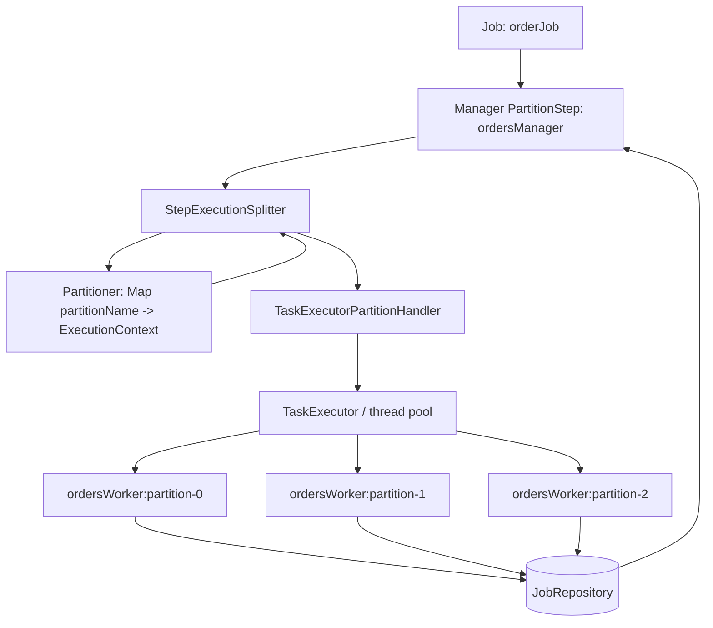

# TaskExecutorPartitionHandler mặc định trong Spring Batch PartitionStep

## Mục tiêu bài học

Trong module **SPRING_BATCH_SCALING_OPERATIONS**, mục tiêu của chúng ta là chọn cách mở rộng Spring Batch cho workload dữ liệu lớn theo giới hạn thực tế của CPU, I/O, database và hạ tầng: multi-threaded step, parallel steps, partitioning hoặc mô hình phân tán. Bài thuộc chương **PartitionStep** này trả lời một câu hỏi rất cụ thể: **khi nào Spring Batch tạo `TaskExecutorPartitionHandler` mặc định, handler đó thực thi partition như thế nào, và làm sao để thực sự chạy song song một cách an toàn?**

Sau bài học, bạn có thể:

- Phân biệt `PartitionStep`, `Partitioner`, `StepExecutionSplitter`, `PartitionHandler` và worker `Step`.
- Giải thích từ “mặc định”: `TaskExecutorPartitionHandler` là triển khai local thường được `PartitionStepBuilder` tạo khi có worker step và chưa cung cấp handler riêng; **không có nghĩa mặc định đã chạy đa luồng**.
- Cấu hình `TaskExecutor` có giới hạn, `gridSize` và worker step bằng Java DSL Spring Batch 5.x.
- So sánh handler do builder tạo với bean `TaskExecutorPartitionHandler` tự đăng ký và handler gửi yêu cầu tới worker từ xa.
- Đảm bảo phân vùng dữ liệu độc lập, reader/writer thread-safe theo `StepExecution`, có checkpoint và idempotency.
- Đo throughput, phát hiện nút thắt và kiểm thử retry/restart khi đưa partitioning vào production.

> **Phiên bản:** Các ví dụ dùng Spring Batch **5.2.x**, Spring Framework 6.x và Java phù hợp với phiên bản này. Nếu dự án dùng Spring Batch 6.x hoặc phiên bản cũ hơn, kiểm tra chữ ký builder, XSD và Javadoc đúng phiên bản. Các đoạn mã mô tả topology và logic chính; import, schema, dependency và cấu hình hạ tầng được bổ sung theo ứng dụng thực tế.

## 1. “Mặc định” nghĩa là gì?

Trong Spring Batch, **partitioning** chia một worker step thành nhiều `StepExecution` con. Mỗi lần thực thi có `ExecutionContext` riêng để đọc một phân vùng dữ liệu. Phía manager, `PartitionHandler` nhận công việc do splitter xác định, thực thi hoặc phân phối và thu kết quả.

**`TaskExecutorPartitionHandler` là triển khai `PartitionHandler` cho local partitioning**: nó sử dụng Spring `TaskExecutor` để chạy nhiều lần thực thi của cùng một worker step trong **cùng JVM**.

Có hai ý phải tách biệt:

1. **Mặc định về loại handler:** Khi cấu hình một manager bằng `PartitionStepBuilder` với `partitioner(...)` và `step(workerStep)`, builder có thể dựng `TaskExecutorPartitionHandler` thích hợp mà bạn không cần khai báo một bean handler riêng.
2. **Mặc định về mức concurrency:** `TaskExecutorPartitionHandler` có một task executor đồng bộ mặc định (điển hình là `SyncTaskExecutor`). Khi không cấu hình executor bất đồng bộ, công việc có thể **chạy tuần tự trong cùng thread**. Muốn nhiều partition thực sự chạy đồng thời, phải cung cấp executor bất đồng bộ có đủ capacity.

Vì thế, “`TaskExecutorPartitionHandler` mặc định” **không đồng nghĩa** “Spring Batch tự phát hiện CPU và chạy `N` partition trên `N` thread”. Cần chủ động chọn số partition, số worker đồng thời và các giới hạn tài nguyên.

### Local partitioning và remote partitioning

| Tiêu chí | `TaskExecutorPartitionHandler` | `MessageChannelPartitionHandler` |
| --- | --- | --- |
| Cách giao việc | Gọi worker `Step` bằng `TaskExecutor` | Gửi `StepExecutionRequest` qua `MessageChannel` tới worker |
| Phạm vi | Cùng JVM với manager | Có thể trải qua nhiều JVM/máy khi đã nối transport |
| Điều kiện cốt lõi | Worker step bean, executor, partitioner | Request transport, worker deployment, metadata repository dùng chung |
| Thu kết quả | Tập kết quả từ các task đã được chờ hoàn tất | Poll `JobRepository` hoặc nhận reply đã aggregate |
| Rủi ro điển hình | Thread safety, nghẽn connection pool/CPU, restart | Messaging, timeout, redelivery, consistency, idempotency |
| Khi dùng | Máy hiện tại còn tài nguyên và dữ liệu chia độc lập được | Cần mở rộng worker ra nhiều process hoặc host |

`TaskExecutorPartitionHandler` **không tự chuyển công việc qua mạng**; tăng `gridSize` trong local handler vẫn chỉ dùng tài nguyên một process.

## 2. Các thành phần phối hợp ra sao?



Quy trình điển hình:

1. Job bắt đầu manager `PartitionStep`.
2. `StepExecutionSplitter` lấy thông tin từ `Partitioner` và `JobRepository`, xác định các `StepExecution` con cần thực thi. Ví dụ mỗi bản ghi trong map được đặt tên `partition-0`, `partition-1`...
3. `TaskExecutorPartitionHandler` nhận danh sách công việc, tạo task cho từng `StepExecution` và giao cho `TaskExecutor`.
4. Executor chạy các worker task theo số thread cho phép. Mỗi task gọi cùng implementation worker `Step` với `StepExecution` tương ứng.
5. Worker đọc/chuyển đổi/ghi dữ liệu của phân vùng, commit theo chunk và cập nhật metadata.
6. Handler chờ kết quả các task; manager tổng hợp trạng thái của các partition và xác định trạng thái cuối.

**Vai trò khác nhau:**

| Thành phần | Câu hỏi mà nó giải quyết | Ví dụ |
| --- | --- | --- |
| `Partitioner` | “Dữ liệu chia thành những vùng nào?” | `id BETWEEN fromId AND toId` |
| `StepExecutionSplitter` | “Partition nào cần chạy trong lần thực thi/restart này?” | `ordersWorker:partition-2` |
| `PartitionHandler` | “Chạy các worker ở đâu và thu kết quả thế nào?” | Dùng thread pool tại JVM hiện tại |
| `TaskExecutor` | “Có bao nhiêu task được thực thi đồng thời?” | Pool tối đa 4 thread |
| Worker `Step` | “Xử lý mỗi vùng bằng transaction/chunk nào?” | Reader theo dải ID, writer idempotent |
| `JobRepository` | “Metadata, checkpoint và trạng thái được lưu ở đâu?” | Các bảng `BATCH_*` |

Với `SimpleStepExecutionSplitter` thông dụng, tên `StepExecution` con thường là `workerStepName + ":" + partitionName`, ví dụ `ordersWorker:partition-0`. Tên worker, tên partition và `ExecutionContext` cần ổn định khi restart.

## 3. Cấu hình rút gọn: builder tạo handler mặc định

Cách điển hình khi bắt đầu local partitioning:

```java
@Bean
Step ordersManagerStep(
        JobRepository jobRepository,
        Partitioner ordersPartitioner,
        @Qualifier("ordersWorkerStep") Step workerStep,
        @Qualifier("ordersPartitionExecutor") TaskExecutor executor) {

    return new StepBuilder("ordersManager", jobRepository)
            .partitioner("ordersWorker", ordersPartitioner)
            .step(workerStep)
            .gridSize(8)
            .taskExecutor(executor)
            .build();
}
```

Trong Spring Batch 5.2.x, việc gọi `step(workerStep)` cùng cấu hình partitioner cho phép `PartitionStepBuilder` thiết lập local `TaskExecutorPartitionHandler` cần thiết khi build, thay vì bắt người dùng phải tạo handler bằng tay.

Các dòng cần hiểu đúng:

- `"ordersManager"` là tên **manager step** được lưu trong metadata.
- `partitioner("ordersWorker", ordersPartitioner)` cung cấp **tên worker** dùng để tạo tên `StepExecution` con và cách chia dữ liệu.
- `step(workerStep)` cung cấp **implementation worker step** cho local handler.
- `gridSize(8)` là thông số **gợi ý** số partition cho splitter/partitioner, không có nghĩa nhất định có tám thread.
- `taskExecutor(executor)` cung cấp cơ chế thực thi bất đồng bộ; mức concurrency do executor và tài nguyên quyết định.

Không gọi `partitionHandler(...)` trong đoạn trên vì builder đang tạo handler local tương ứng. Nếu muốn thay thế handler, chuyển sang cấu hình tường minh ở phần sau.

### Điều gì xảy ra nếu không khai báo `taskExecutor`?

Ví dụ cố tình bỏ executor:

```java
new StepBuilder("ordersManager", jobRepository)
        .partitioner("ordersWorker", ordersPartitioner)
        .step(workerStep)
        .gridSize(8)
        .build();
```

Đây vẫn là cấu hình partitioning có thể dùng để thử tính đúng của chia vùng, nhưng **không nên giả định tám partition chạy cùng lúc**. Với triển khai local handler mặc định của Spring Batch 5.2.x, khi không cung cấp một executor bất đồng bộ, `SyncTaskExecutor` thực thi công việc trực tiếp trên thread gọi. Mức độ song song hiệu dụng có thể là **1**.

Một `SimpleAsyncTaskExecutor` có thể tạo concurrency nhưng không phải lựa chọn mặc định an toàn cho workload lớn do không quản lý pool giống `ThreadPoolTaskExecutor`. Trong production, dùng executor có giới hạn và kiểm soát được lượng công việc đang chờ.

## 4. Ví dụ đầy đủ hơn: xử lý đơn hàng bằng 8 partition

Giả sử có bảng `orders(id BIGINT PRIMARY KEY, ...)`, cần xử lý các ID 1 đến 800.000. Worker đọc ID theo dải và ghi vào `processed_order(order_id PRIMARY KEY, processed_at)`. Các mã dưới đây minh họa một ứng dụng Spring Batch 5.2.x với cơ sở dữ liệu PostgreSQL.

### 4.1. Tạo `Partitioner`

```java
@Bean
Partitioner ordersPartitioner() {
    return gridSize -> {
        long firstId = 1L;
        long lastId = 800_000L; // Demo: production phải đóng băng phạm vi input.
        int requested = Math.max(gridSize, 1);
        long itemCount = lastId - firstId + 1;
        long width = (itemCount + requested - 1) / requested;

        Map<String, ExecutionContext> partitions = new LinkedHashMap<>();
        for (int i = 0; i < requested; i++) {
            long fromId = firstId + i * width;
            if (fromId > lastId) {
                break;
            }

            long toId = Math.min(lastId, fromId + width - 1);
            ExecutionContext context = new ExecutionContext();
            context.putLong("fromId", fromId);
            context.putLong("toId", toId);
            partitions.put("partition-" + i, context);
        }
        return partitions;
    };
}
```

Ở `gridSize=8`, mỗi partition có vùng ID tối đa 100.000:

| Partition | fromId | toId | StepExecution name |
| --- | ---: | ---: | --- |
| `partition-0` | 1 | 100.000 | `ordersWorker:partition-0` |
| `partition-1` | 100.001 | 200.000 | `ordersWorker:partition-1` |
| `partition-2` | 200.001 | 300.000 | `ordersWorker:partition-2` |
| ... | ... | ... | ... |
| `partition-7` | 700.001 | 800.000 | `ordersWorker:partition-7` |

**Lưu ý:**

- `gridSize` là một hint; `Partitioner` quyết định map thực tế và có thể trả ít hoặc nhiều phần khác hint.
- Chia đều **độ rộng dải ID** không bảo đảm chia đều số hàng nếu có nhiều ID bị khuyết hoặc phân bố dữ liệu bị lệch.
- Các giá trị `firstId`, `lastId` ở ví dụ chỉ để trình bày. Với production, hãy cố định tập dữ liệu/snapshot hoặc watermark theo định danh lần xử lý logic và giữ mapping qua restart.
- Có thể giảm số partition nếu dataset rỗng. Việc phân vùng dữ liệu thật cần quy định rõ xử lý tập rỗng, key trùng, insert/update đến muộn và tenant đặc biệt.

### 4.2. Reader scoped theo partition

```java
@Bean("ordersReader")
@StepScope
JdbcPagingItemReader<Long> ordersReader(
        DataSource dataSource,
        @Value("#{stepExecutionContext['fromId']}") Long fromId,
        @Value("#{stepExecutionContext['toId']}") Long toId) {

    return new JdbcPagingItemReaderBuilder<Long>()
            .name("ordersReader")
            .dataSource(dataSource)
            .selectClause("SELECT id")
            .fromClause("FROM orders")
            .whereClause("WHERE id BETWEEN :fromId AND :toId")
            .sortKeys(Map.of("id", Order.ASCENDING))
            .parameterValues(Map.of("fromId", fromId, "toId", toId))
            .pageSize(500)
            .rowMapper((rs, rowNum) -> rs.getLong("id"))
            .build();
}
```

`@StepScope` giúp mỗi `StepExecution` con nhận instance reader/giá trị `fromId`, `toId` của mình. Nếu dùng một reader có cursor hoặc paging state là singleton chung, các worker có thể race, đọc trùng hoặc bỏ sót.

`ORDER BY id` trong reader bảo đảm thứ tự đọc **trong dải của một worker**; nó không buộc partition khác commit theo thứ tự. Cần index trên `orders.id` và test kế hoạch query thực tế.

### 4.3. Writer idempotent

Ví dụ PostgreSQL với unique key `processed_order(order_id)`:

```java
@Bean("ordersWriter")
JdbcBatchItemWriter<Long> ordersWriter(DataSource dataSource) {
    return new JdbcBatchItemWriterBuilder<Long>()
            .dataSource(dataSource)
            .sql("""
                INSERT INTO processed_order (order_id, processed_at)
                VALUES (:orderId, CURRENT_TIMESTAMP)
                ON CONFLICT (order_id) DO NOTHING
                """)
            .itemSqlParameterSourceProvider(
                id -> new MapSqlParameterSource("orderId", id))
            .assertUpdates(false)
            .build();
}
```

Mục đích của `ON CONFLICT DO NOTHING` là cùng ID không ghi trùng khi worker bị retry/restart hoặc đã từng ghi thành công. `assertUpdates(false)` phù hợp trường hợp statement cố tình có thể không cập nhật hàng nào vì khóa đã tồn tại; nếu nghiệp vụ yêu cầu update thay vì bỏ qua, thay bằng upsert có điều kiện thích hợp.

Trong thực tế, không phải mọi side effect (ghi file, gửi API, phát sự kiện) đều nằm chung transaction với `JobRepository`. Cần idempotency key, transactional outbox hoặc chiến lược bù trừ cho side effect ngoài database.

### 4.4. Worker step và transaction

```java
@Bean("ordersWorkerStep")
Step ordersWorkerStep(
        JobRepository jobRepository,
        PlatformTransactionManager transactionManager,
        @Qualifier("ordersReader") ItemReader<Long> ordersReader,
        @Qualifier("ordersWriter") ItemWriter<Long> ordersWriter) {

    return new StepBuilder("ordersWorker", jobRepository)
            .<Long, Long>chunk(500, transactionManager)
            .reader(ordersReader)
            .writer(ordersWriter)
            .build();
}
```

Mỗi worker có `StepExecution`/`ExecutionContext` riêng, commit theo các chunk 500 bản ghi. `PlatformTransactionManager` thường dùng chung bean nhưng transaction được quản lý theo thread trong execution context thích hợp.

Nếu reader/writer cần lưu checkpoint, dùng triển khai hỗ trợ `ItemStream` và cấu hình để Spring Batch mở/đóng/ghi state. `JdbcPagingItemReader` là reader có khả năng lưu trạng thái. Cần kiểm thử restart từ giữa một partition, đặc biệt khi dataset thay đổi trong lúc chạy.

### 4.5. Executor có giới hạn và manager

```java
@Bean("ordersPartitionExecutor")
TaskExecutor ordersPartitionExecutor() {
    ThreadPoolTaskExecutor executor = new ThreadPoolTaskExecutor();
    executor.setCorePoolSize(4);
    executor.setMaxPoolSize(4);
    executor.setQueueCapacity(8);
    executor.setThreadNamePrefix("order-partition-");
    executor.initialize();
    return executor;
}

@Bean("ordersManagerStep")
Step ordersManagerStep(
        JobRepository jobRepository,
        Partitioner ordersPartitioner,
        @Qualifier("ordersWorkerStep") Step workerStep,
        @Qualifier("ordersPartitionExecutor") TaskExecutor executor) {

    return new StepBuilder("ordersManager", jobRepository)
            .partitioner("ordersWorker", ordersPartitioner)
            .step(workerStep)
            .gridSize(8)
            .taskExecutor(executor)
            .build();
}

@Bean
Job ordersJob(JobRepository jobRepository,
              @Qualifier("ordersManagerStep") Step managerStep) {

    return new JobBuilder("ordersJob", jobRepository)
            .start(managerStep)
            .build();
}
```

Cấu hình này có thể tạo **8 partition** nhưng tối đa **4 task worker chạy đồng thời** vì executor có 4 thread. Những task còn lại sẽ đợi lượt. Đây là giới hạn có chủ đích để tránh đồng thời cấp quá nhiều connection hoặc gây tải DB vượt khả năng.

> **Tính chất ví dụ:** Các đoạn code cần import, dependency `spring-batch-core` và `spring-batch-infrastructure` tương thích, DataSource, JobRepository, transaction manager cùng schema bảng `orders`/`processed_order`. Đây là ví dụ cấu hình cách hoạt động, chưa là ứng dụng hoàn chỉnh chỉ cần sao chép vào một file là chạy.

## 5. Nếu muốn đăng ký `TaskExecutorPartitionHandler` tường minh?

Đôi khi cần bean handler riêng để cấu hình theo môi trường, kiểm soát lifecycle hoặc làm rõ dependency. Khi đó tạo handler và gắn vào manager:

```java
@Bean("ordersPartitionHandler")
TaskExecutorPartitionHandler ordersPartitionHandler(
        @Qualifier("ordersWorkerStep") Step workerStep,
        @Qualifier("ordersPartitionExecutor") TaskExecutor executor) {

    TaskExecutorPartitionHandler handler =
            new TaskExecutorPartitionHandler();
    handler.setStep(workerStep);
    handler.setTaskExecutor(executor);
    handler.setGridSize(8);
    return handler;
}

@Bean("ordersManagerStep")
Step ordersManagerStep(
        JobRepository jobRepository,
        Partitioner ordersPartitioner,
        @Qualifier("ordersPartitionHandler") PartitionHandler handler) {

    return new StepBuilder("ordersManager", jobRepository)
            .partitioner("ordersWorker", ordersPartitioner)
            .partitionHandler(handler)
            .build();
}
```

`partitionHandler(handler)` là điểm **đăng ký explicit**. Bean handler quản lý worker step, executor và grid size. Hai ví dụ ở phần 4 và 5 là **hai phương án thay thế**, không đồng thời đăng ký hai bean `ordersManagerStep` cùng tên.

| Khía cạnh | Handler do builder tạo | Handler khai báo tường minh |
| --- | --- | --- |
| Gắn vào manager | `step(workerStep)` cùng `taskExecutor(...)`, `gridSize(...)` | `partitionHandler(handler)` |
| Nơi cấu hình worker | `PartitionStepBuilder.step(...)` | `handler.setStep(...)` |
| Nơi cấu hình executor | `PartitionStepBuilder.taskExecutor(...)` | `handler.setTaskExecutor(...)` |
| Nơi cấu hình grid size | `PartitionStepBuilder.gridSize(...)` | `handler.setGridSize(...)` |
| Bean handler độc lập | Thường không cần | Có |
| Ưu tiên dùng | Local partitioning thông dụng | Muốn quản lý bean/cấu hình handler độc lập |

**Tránh trộn hai cách:** Khi cung cấp `partitionHandler(handler)` tường minh, không mặc định rằng các phương thức `step(...)`, `gridSize(...)` và `taskExecutor(...)` gọi thêm trên builder sẽ sửa bean handler đã cấp. Đặt cấu hình tương ứng trên handler và kiểm tra hành vi theo phiên bản Spring Batch.

## 6. `gridSize`, thread pool và concurrency hiệu dụng

Một nhầm lẫn phổ biến: `gridSize = N` thì sẽ có `N` worker chạy song song. Thực tế có ba số khác nhau:

- **Partition count:** số `ExecutionContext` trả về bởi `Partitioner`.
- **Executor concurrency:** số task tối đa có thể chạy cùng lúc.
- **Resource concurrency:** số công việc DB/API/CPU còn chịu được mà không làm throughput giảm.

Ví dụ 8 partition, pool 4 thread:

```text
Thời điểm       Thread 1       Thread 2       Thread 3       Thread 4
00:00           partition-0    partition-1    partition-2    partition-3
00:05           partition-4    partition-5    partition-6    partition-7
00:10           Kết thúc      Kết thúc      Kết thúc      Kết thúc
```

Bảng trên chỉ mô phỏng **mỗi partition tốn đúng 5 phút**. Trong production có skew, thread có thể được tái sử dụng ngay khi một partition kết thúc và không nhất thiết tạo hai đợt đồng đều. Tên partition không quyết định thứ tự bắt đầu hoặc hoàn thành.

### Các thông số cần cân nhắc

| Thông số | Điều khiển | Rủi ro khi quá cao |
| --- | --- | --- |
| `gridSize` | Số đơn vị chia việc đề xuất | Nhiều overhead StepExecution, partition nhỏ, metadata/queue |
| `corePoolSize`, `maxPoolSize` | Số thread worker có thể hoạt động | CPU contention, nhiều connection cùng lúc |
| `queueCapacity` | Số task chờ executor | Dồn việc trong RAM; task đợi lâu, khó phát hiện quá tải |
| `chunkSize` | Số item mỗi transaction | Rollback nhiều, lock lâu, memory cao |
| JDBC pool size | Số connection phục vụ worker | DB bão hòa dù pool còn mở rộng |
| Remote consumer count | Worker thật ngoài JVM | Không do local `TaskExecutorPartitionHandler` kiểm soát |

Với `ThreadPoolTaskExecutor`, hành vi mở rộng thread còn phụ thuộc `corePoolSize`, `maxPoolSize` và `queueCapacity`: nếu queue còn chỗ, pool thường ưu tiên xếp hàng sau khi đạt core size trước khi tăng tới max. Đừng chỉ nhìn `maxPoolSize` rồi kết luận số thread active thực tế.

### Cách đo thay vì đoán

Trong các lần benchmark, ghi:

- Thời gian end-to-end của job và manager step.
- Thời gian từng worker partition, count đọc/ghi/skip/retry và số lần commit.
- Executor active thread, queue depth, task wait time.
- CPU, GC, heap, database active/pending connection, lock wait và p95/p99 query latency.
- Kích thước và độ cân bằng dữ liệu của từng partition.

Ví dụ giả định: job tuần tự mất 40 phút; 4 worker còn 13 phút; tăng lên 8 worker chỉ còn 12,5 phút nhưng DB pool gần đầy và deadlock tăng. Trường hợp này lợi ích tăng concurrency nhỏ, cần ưu tiên index/SQL, partition balance và transaction scope thay vì tiếp tục tăng thread.

**Quy tắc thực hành:** Chọn `gridSize` đủ để bù lệch tải và giữ executor bận, nhưng điều chỉnh **số thread thực chạy** theo tài nguyên đắt nhất đang bị tranh chấp. Nhiều partition hơn số thread có thể hợp lý; quá nhiều partition siêu nhỏ thường làm tăng overhead.

## 7. Thread safety: một worker Step được gọi nhiều lần

`TaskExecutorPartitionHandler` thực thi cùng cấu hình worker `Step` bằng các `StepExecution` khác nhau. Điều này **không biến tất cả bean bên trong Step thành thread-safe**.

Các rủi ro điển hình:

| Thành phần | Rủi ro | Cách xử lý |
| --- | --- | --- |
| `ItemReader` giữ cursor/index mutable singleton | Hai worker thay đổi cùng vị trí đọc | `@StepScope` và context riêng từng partition |
| `ItemWriter` có buffer mutable hoặc file append chung | Record đan xen, mất dữ liệu hoặc ghi trùng | Writer scoped/đồng bộ, ghi riêng mỗi partition hoặc staging |
| `ItemProcessor` giữ cache mutable không đồng bộ | Race condition, kết quả sai khó tái hiện | Stateless processor, dữ liệu immutable hoặc thread-safe |
| `ExecutionContext` dùng chung thủ công | Partition đọc nhầm bounds/checkpoint | Mỗi StepExecution một context, không truyền mutable map dùng chung |
| `DataSource`/transaction | Hết pool, lock, deadlock, transaction dài | Connection budget, lock ordering, chunk/timeout phù hợp |
| External API client | Rate limit hoặc không idempotent | Concurrency limit, retry có backoff và idempotency key |

### Vì sao `@StepScope` có ích?

`@StepScope` tạo bean trong phạm vi của một `StepExecution`; các giá trị như `#{stepExecutionContext['fromId']}` được resolve khi worker thực thi. Nhờ đó hai partition có thể sử dụng chung **định nghĩa bean** nhưng không chia sẻ cùng instance reader có trạng thái.

Tuy vậy, annotation chỉ giải quyết phạm vi instance; nó không thay thế việc bảo đảm nghiệp vụ đúng khi hai partition cùng tác động lên một tài khoản, một khóa DB hay một file đích. Nếu dữ liệu của hai partition chồng lấn, scoped reader vẫn có thể xử lý trùng.

### Ordering không được bảo đảm

Partition có ID lớn có thể ghi xong trước partition ID nhỏ. Nếu cần file kết quả được sắp toàn cục, worker nên ghi vào **file riêng/staging**, sau đó step merge đọc theo sort key khi manager thành công. Nếu có yêu cầu áp dụng sự kiện theo thứ tự account, hãy phân vùng theo business key và kiểm soát sequence; không dựa vào thứ tự tên partition hay thread pool.

## 8. Retry, restart và quản lý lỗi

### Một partition thất bại trong khi các partition khác đã commit

Giả sử có bốn worker:

| Partition | Trạng thái | Kết quả có thể có |
| --- | --- | --- |
| `partition-0` | COMPLETED | Đã commit các chunk; dữ liệu nghiệp vụ tồn tại |
| `partition-1` | COMPLETED | Tương tự |
| `partition-2` | FAILED | Một số chunk đã commit trước khi lỗi; chunk lỗi rollback |
| `partition-3` | COMPLETED | Có thể xong trước hoặc sau partition lỗi |

Manager tổng hợp các kết quả, và job có thể thất bại do partition-2. **Không có giao dịch phân tán tự rollback dữ liệu đã commit của các partition khác**.

Khi restart đúng `JobInstance`, Spring Batch dựa trên `JobRepository` và `ExecutionContext` để tìm công việc cần tiếp tục. Điều này hữu ích nhưng không bảo đảm exactly-once cho API hoặc file side effect. Writer phải có khóa idempotency hoặc cơ chế tương đương để việc chạy lại không làm trùng kết quả.

### Các điều kiện để restart an toàn

1. **Giữ tên worker ổn định:** ví dụ `ordersWorker`; splitter tạo các tên `ordersWorker:partition-N`.
2. **Giữ khóa partition và phạm vi ổn định:** `partition-0` phải đại diện cùng dải ID khi restart cùng lần xử lý logic.
3. **Giữ snapshot/watermark đầu vào:** tránh pagination thay đổi do insert/update giữa các lần chạy.
4. **Lưu checkpoint:** reader/writer thuộc loại `ItemStream` khi cần restart từ chunk đã commit.
5. **Đảm bảo idempotency:** dùng unique key/upsert hoặc idempotency key với side effect bên ngoài.
6. **Dùng đúng identifying JobParameters:** thay đổi tham số identifying có thể tạo `JobInstance` mới thay vì restart instance bị lỗi.
7. **Kiểm tra tình trạng worker trước khi chạy lại:** một timeout phía manager không phải lúc nào cũng có nghĩa mọi worker đã dừng; tránh hai lần chạy đè lên cùng dữ liệu.

Đổi `gridSize`, chiến lược chia dữ liệu hoặc tên partition giữa lúc job thất bại và restart có thể gây mất khả năng liên kết metadata với phần việc trước đó. Những thay đổi này cần kế hoạch tương thích và kiểm chứng trên dữ liệu giống production.

### Giới hạn của handler mặc định

`TaskExecutorPartitionHandler` chờ task local hoàn thành và trả kết quả cho manager. Nó không tự:

- định nghĩa retry của item/chunk;
- cân bằng phân vùng theo thời gian chạy thực tế;
- tái phân phối task khi một JVM chết sang JVM khác;
- thực hiện distributed transaction giữa các partition;
- bảo đảm xử lý đúng một lần đối với external side effect;
- tạo lại dữ liệu đầu vào tại cùng snapshot sau restart.

Các trách nhiệm này thuộc về worker step, cấu trúc dữ liệu, repository và kiến trúc vận hành.

## 9. Các lỗi cấu hình thường gặp

| Hiện tượng | Nguyên nhân có khả năng | Cách kiểm tra/sửa |
| --- | --- | --- |
| Có 8 partition nhưng chỉ chạy lần lượt | Không cấu hình `TaskExecutor` bất đồng bộ; dùng `SyncTaskExecutor` | Thêm `ThreadPoolTaskExecutor` có giới hạn, đo active threads |
| Job không build hoặc handler không biết worker | Thiếu `step(workerStep)` trong cấu hình rút gọn | Cấp worker step hoặc handler tường minh đã `setStep` |
| Worker đọc lẫn dải ID | Reader singleton mutable, thiếu `@StepScope` | Reader scoped + bounds từ `StepExecutionContext` |
| Chỉ một partition lâu bất thường | Data skew, hot key hoặc query plan xấu | Đo số row và duration theo partition; chia vùng cân bằng |
| Tăng thread lại chậm hơn | DB pool/CPU/API đã bão hòa | Profile contention, giảm concurrency hoặc tối ưu bottleneck |
| Chạy lại tạo trùng dữ liệu | Side effect không idempotent, input thay đổi | Unique constraint, snapshot cố định, checkpoint/restart test |
| Mỗi partition ghi ra cùng CSV | Append xen kẽ, rollback không đồng bộ | File riêng hoặc bảng staging rồi merge có thứ tự |
| Muốn worker chạy trên container khác | Local handler chỉ chạy trong một JVM | Chuyển sang remote partitioning với message transport |
| Gắn handler explicit nhưng vẫn cấu hình kiểu shorthand | Cấu hình mơ hồ hoặc handler không như kỳ vọng | Chọn một cách đăng ký handler theo phiên bản |
| Job log ghi tên partition không như mong muốn | Tên worker và `partitioner(workerStepName,...)` lệch | Đồng bộ tên runtime và partition key |

### Metadata để chẩn đoán

Truy vấn các `StepExecution` của một lần chạy:

```sql
SELECT STEP_EXECUTION_ID,
       STEP_NAME,
       STATUS,
       READ_COUNT,
       WRITE_COUNT,
       COMMIT_COUNT,
       ROLLBACK_COUNT
FROM BATCH_STEP_EXECUTION
WHERE JOB_EXECUTION_ID = :jobExecutionId
ORDER BY STEP_EXECUTION_ID;
```

Với tên trong ví dụ, bạn có thể thấy `ordersManager` và `ordersWorker:partition-0` đến `ordersWorker:partition-7`. Khi restart, lịch sử của **một JobInstance** có thể trải qua nhiều `JobExecution`; cần truy theo metadata JobInstance/JobExecution để đánh giá đầy đủ thay vì chỉ xem một execution ID.

## 10. Checklist kiểm chứng trước production

Một bộ kiểm thử có ý nghĩa nên đánh giá cả **tính đúng** và **khả năng mở rộng**.

### Tính đúng và restart

- [ ] Chạy lần đầu với `gridSize=1` và nhiều partition; tập ID đầu ra phải giống nhau, không thiếu/trùng.
- [ ] Kiểm tra mọi dải `fromId..toId` không chồng lấn; xử lý đúng dữ liệu rỗng, ID khuyết và biên đầu/cuối.
- [ ] Cho một partition lỗi sau vài commit, restart cùng JobInstance; xác minh checkpoint và idempotency.
- [ ] Cố tình làm partition có ID cao xong trước; kết quả nghiệp vụ không phụ thuộc thứ tự hoàn thành.
- [ ] Tạo kịch bản hai job chạy đồng thời; mỗi job có run key/snapshot rõ và không ghi đè dữ liệu của nhau.
- [ ] Xác minh reader/writer/processor không chia sẻ mutable state sai cách khi nhiều thread active.
- [ ] Thử tăng load hoặc thiếu DB connection; đảm bảo timeout/retry có giới hạn, job báo lỗi rõ và không treo vô hạn.

### Hiệu năng và vận hành

- [ ] Đo baseline single-thread và thời gian end-to-end trước khi tăng số partition.
- [ ] Đo executor active/queue, CPU, memory/GC, DB connection pool và p95/p99 query latency.
- [ ] Ghi số partition, kích thước từng partition, step duration, item count và mức lệch tải.
- [ ] Tăng concurrency từng nấc, dừng khi throughput không còn tăng hoặc tỷ lệ lỗi/latency tăng rõ.
- [ ] Kiểm chứng lịch chạy đồng thời nhiều job và tổng ngân sách tài nguyên, không chỉ benchmark một job đơn lẻ.
- [ ] Bổ sung dashboard/alert cho partition FAILED, partition treo, job quá SLA, rollback/skip đột biến.
- [ ] Nếu deploy nhiều JVM, kiểm tra thực sự đang dùng remote handler và broker; không nhầm local thread pool với distributed execution.

## 11. Khi nào chọn handler mặc định?

| Nhu cầu | Lựa chọn phù hợp | Lý do |
| --- | --- | --- |
| Một worker step chia được dữ liệu độc lập, máy hiện tại còn tài nguyên | **`TaskExecutorPartitionHandler` mặc định qua builder** | Cấu hình local đơn giản, mỗi partition có StepExecution riêng |
| Muốn tự quản lý bean handler, thay đổi config theo profile | **`TaskExecutorPartitionHandler` khai báo tường minh** | Rõ lifecycle và nơi đặt executor/grid size |
| Chỉ có một step xử lý item độc lập, không cần phân vùng theo context | **Multi-threaded step** nếu các thành phần thread-safe | Ít metadata phân vùng nhưng cần kiểm soát checkpoint/thread safety |
| Nhiều công đoạn nghiệp vụ khác nhau có thể chạy song song | **Parallel steps** với split flows | Song song hóa các bước logic khác nhau |
| Cần mở rộng sang nhiều JVM/máy | **Remote partitioning** | Local task executor không phân phối công việc ra host khác |
| Input không chia được và manager chịu trách nhiệm đọc từng chunk | **Remote chunking** có thể phù hợp | Khác mô hình remote partitioning; phải đánh giá điểm nghẽn manager |
| DB đã là nút thắt | **Tối ưu SQL/DB hoặc giảm concurrency** | Thêm thread thường tăng tranh chấp, không tăng throughput |

### Câu hỏi tự kiểm tra

**1. `gridSize(8)` và executor 2 thread sẽ chạy mấy partition cùng lúc?** Thông thường tối đa khoảng **2 worker task hoạt động đồng thời**; `Partitioner` có thể tạo 8 đơn vị việc và các phần còn lại đợi.

**2. Nếu bỏ `taskExecutor(...)`, có chắc vẫn có 8 thread không?** **Không.** Handler local mặc định trong Spring Batch 5.2.x có thể thực thi đồng bộ qua `SyncTaskExecutor`.

**3. Nếu muốn sử dụng bean handler đã tạo riêng, điểm gắn vào manager là gì?** `.partitionHandler(handler)` trên `PartitionStepBuilder`, còn `setStep`, `setTaskExecutor` và `setGridSize` nằm trên bean handler.

**4. `@StepScope` có tự bảo đảm các partition không xử lý cùng record không?** **Không.** Scope giúp tách instance, còn `Partitioner` và dữ liệu nguồn phải bảo đảm vùng không chồng lấn.

**5. Có thể dùng `TaskExecutorPartitionHandler` mặc định để chạy worker ở máy khác không?** **Không.** Cần cơ chế remote partitioning như `MessageChannelPartitionHandler`, broker/transport và JobRepository phù hợp.

## Tài liệu tham khảo

- [Spring Batch Reference — Scaling and Parallel Processing](https://docs.spring.io/spring-batch/reference/scalability.html): `PartitionStep`, `PartitionHandler`, `TaskExecutorPartitionHandler`, `gridSize` và local/remote partitioning.
- [Spring Batch 5.2.x API — TaskExecutorPartitionHandler](https://docs.spring.io/spring-batch/docs/5.2.x/api/org/springframework/batch/core/partition/support/TaskExecutorPartitionHandler.html): các setter và cơ chế thực thi task.
- [Spring Batch 5.2.x API — PartitionStepBuilder](https://docs.spring.io/spring-batch/docs/5.2.x/api/org/springframework/batch/core/step/builder/PartitionStepBuilder.html): `partitioner`, `step`, `partitionHandler`, `gridSize`, `taskExecutor`.
- [Spring Batch 5.2.x API — SimpleStepExecutionSplitter](https://docs.spring.io/spring-batch/docs/5.2.x/api/org/springframework/batch/core/partition/support/SimpleStepExecutionSplitter.html): tên StepExecution partition và hành vi khi restart.
- [Spring Batch Reference — Externalizing Batch Process Execution](https://docs.spring.io/spring-batch/reference/spring-batch-integration/externalizing-execution.html): so sánh local với remote partitioning.

**Điều cần nhớ:** `TaskExecutorPartitionHandler` là handler **local** được `PartitionStepBuilder` cung cấp thuận tiện khi đã đăng ký worker step. “Mặc định” nói về **cơ chế điều phối**, không phải bảo đảm chạy đồng thời. Concurrency thực phụ thuộc `TaskExecutor` và tài nguyên, còn tính đúng và khả năng restart phụ thuộc partitioner, worker, transaction, checkpoint và idempotency.
