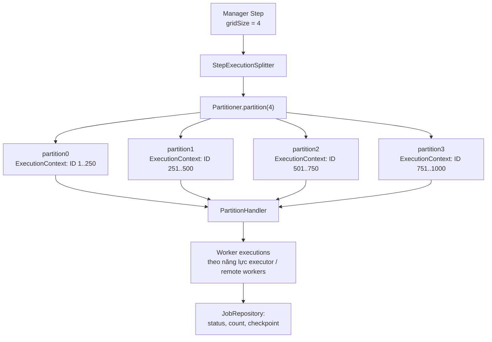
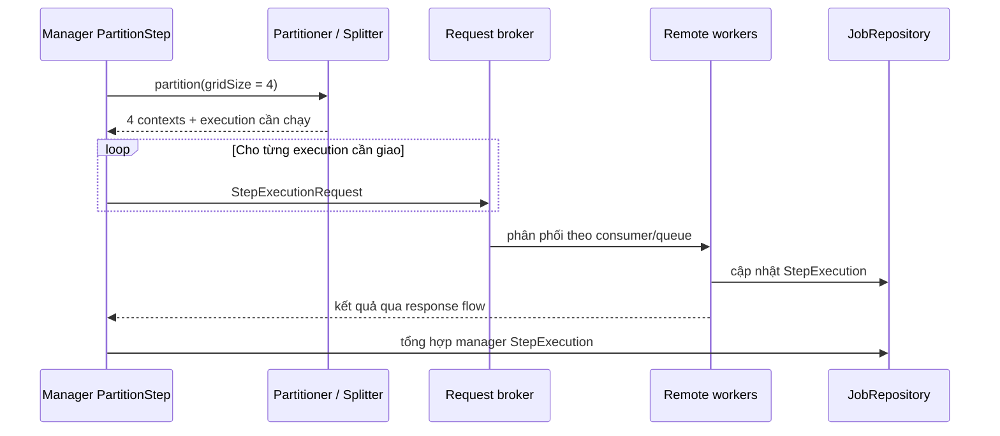

# gridSize kiểm soát lượng request

## 1. Bối cảnh và mục tiêu học tập

Trong chương **PartitionStep** thuộc module **SPRING_BATCH_SCALING_OPERATIONS**, một step xử lý khối dữ liệu lớn được chia thành nhiều phần việc độc lập để các worker có thể xử lý đồng thời. Cấu hình `gridSize` thường xuất hiện khi xây dựng manager step. Vì tên gọi và ví dụ có thể gây hiểu nhầm, cần phân biệt ba câu hỏi:

1. **Dữ liệu được chia thành bao nhiêu partition?**
2. **Manager tạo hoặc gửi bao nhiêu yêu cầu thực thi partition?**
3. **Có bao nhiêu worker thực sự chạy cùng lúc?**

Ba con số này **có liên quan nhưng không nhất thiết bằng nhau**. `gridSize` chủ yếu đóng vai trò **gợi ý kích thước lưới phân vùng** mà manager truyền cho `Partitioner`. Nếu partitioner sử dụng gợi ý đó để tạo các partition, số `StepExecution` và request được tạo hoặc gửi thường thay đổi theo. Tuy nhiên, chính `Partitioner` quyết định số partition; `PartitionHandler`, executor, middleware và worker quyết định nhịp dispatch cũng như mức đồng thời.

Sau bài học, bạn sẽ có thể:

- Giải thích đường đi từ `gridSize` đến `Partitioner.partition(gridSize)`, `StepExecutionSplitter` và `PartitionHandler`.
- Phân biệt **partition**, **logical execution request**, **message gửi qua broker** và **worker đang hoạt động**.
- Cấu hình và quan sát `gridSize` trong local partitioning hoặc remote partitioning.
- Chọn `gridSize` theo số lượng dữ liệu, mức phân tán, chi phí khởi tạo, CPU, I/O và database pool.
- Đánh giá các tình huống restart, request trùng, partition không đều và thay đổi cách chia dữ liệu.

> **Điểm quan trọng:** `gridSize(8)` **không tự bảo đảm** có đúng tám partition, đúng tám message hay tám worker chạy đồng thời. Cần xem `Partitioner` trả về bao nhiêu `ExecutionContext`, bộ splitter chọn những `StepExecution` nào cần chạy và handler giao việc ra sao.

## 2. Các thành phần trong một partition step

### 2.1. Manager và worker

Với partitioning, một **manager step** chia công việc và tổ chức thực thi các **worker step**. Các worker thường có cùng định nghĩa `Step` nhưng mỗi partition có `StepExecution` và `ExecutionContext` riêng.

| Thành phần | Vai trò | Liên quan đến `gridSize` |
| --- | --- | --- |
| `PartitionStep` (manager) | Điều phối việc chia và thực thi các partition | Chuyển cấu hình phân vùng tới splitter/handler |
| `Partitioner` | Trả về map tên partition → `ExecutionContext` | Nhận tham số `gridSize` để quyết định cách chia, **có thể dùng hoặc bỏ qua** |
| `StepExecutionSplitter` | Chuẩn bị hoặc xác định những worker `StepExecution` cần chạy, có xét metadata/restart | Sử dụng thông tin phân vùng để tạo/khôi phục các execution |
| `PartitionHandler` | Giao các worker `StepExecution` để thực thi và thu kết quả | Phụ thuộc implementation local hoặc remote; quản lý dispatch |
| `TaskExecutor` | Cung cấp khả năng chạy song song khi dùng local partitioning | Số thread hoạt động là giới hạn thực tế, độc lập với số partition |
| Message broker/remote workers | Chuyển và thực thi yêu cầu từ manager ở môi trường phân tán | Có queue, số consumer, redelivery và độ trễ riêng |
| `JobRepository` | Lưu trạng thái, số đếm và checkpoint cho từng `StepExecution` | Phục vụ giám sát và quyết định thực thi khi restart |



Sơ đồ cho thấy trường hợp partitioner **chọn tạo đúng bốn partition**. Việc tạo `StepExecution` và chọn execution nào cần xử lý thuộc cơ chế splitter/metadata; khi restart, số partition được gửi thực thi có thể ít hơn tổng số partition logic ban đầu.

### 2.2. `gridSize` là gợi ý, không phải ràng buộc cứng

Hợp đồng `Partitioner` có dạng:

```java
public interface Partitioner {
    Map<String, ExecutionContext> partition(int gridSize);
}
```

Framework truyền giá trị `gridSize` do manager cấu hình cho `partition(...)`. **Không có quy tắc chung buộc `map.size() == gridSize`**. Ví dụ:

- Partitioner chia một bảng có 1.000 ID thành bốn dải khi `gridSize = 4`: có **4 partition**.
- Partitioner luôn tạo một partition cho mỗi khu vực trong ba khu vực: dù `gridSize = 8`, có **3 partition**.
- Partitioner dựa vào 20 file đầu vào: có thể tạo **20 partition** dù manager gợi ý 4.
- Partitioner dùng logic dải ID nhưng chỉ có ba ID hợp lệ: nếu tránh partition rỗng, có **tối đa 3 partition**.

Điều đó hoàn toàn có thể hợp lệ. Quan trọng là **cách partitioner hiện thực hóa gợi ý** và liệu các phần việc có ranh giới rõ, không trùng lấn, đầy đủ dữ liệu hay không.

## 3. `gridSize` tác động đến lượng request ra sao?

### 3.1. Một partition không đồng nghĩa một item hay một chunk

Ví dụ có 1.000 bản ghi và cấu hình:

```text
gridSize = 4
Partitioner trả về 4 context:
  partition0: ID 1..250
  partition1: ID 251..500
  partition2: ID 501..750
  partition3: ID 751..1000
```

Manager có **bốn đơn vị công việc ở cấp partition**. Mỗi worker thực thi nhiều chunk bên trong phạm vi của mình, chẳng hạn `chunkSize = 100`. Khi đó:

- Số **partition**: 4.
- Số **logical partition execution request** khi khởi chạy đầy đủ lần đầu: thường là 4.
- Số **chunk** xử lý tổng cộng: khoảng 12 nếu mỗi dải 250 bản ghi và chunk tối đa 100 (mỗi dải có ba chunk), chưa tính filter, lỗi và item không hiện diện.
- Số worker đồng thời: tùy executor/remote consumers, có thể chỉ 2.

**Đừng dùng `gridSize` để suy trực tiếp ra số chunk.** `gridSize` điều khiển cách phân rã công việc ở cấp partition; `chunkSize` điều khiển nhóm item và giao dịch bên trong worker step.

### 3.2. Local partitioning: yêu cầu thực thi là task, không phải message

Với `TaskExecutorPartitionHandler`, manager giao các `StepExecution` cho executor trong cùng ứng dụng. Nếu có bốn partition và pool chỉ có hai thread, worker có thể chạy theo hai đợt:

```text
                    Thời gian -->
Thread 1:   [partition0] ------ [partition2] ------
Thread 2:   [partition1] ------ [partition3] ------
             2 hoạt động       2 hoạt động

gridSize = 4
Số partition = 4
Số thread worker chạy đồng thời tối đa = 2
```

Ở đây không có broker để đếm message. “Request” nên hiểu là yêu cầu thực thi worker `StepExecution` được giao cho `PartitionHandler`.

### 3.3. Remote partitioning: yêu cầu có thể được gửi qua broker

Trong remote partitioning, handler chuyển yêu cầu thực thi sang worker từ xa, thường dưới dạng `StepExecutionRequest` qua Spring Integration messaging. Theo triển khai thông thường, mỗi worker `StepExecution` cần thực thi được gắn với một yêu cầu logic để worker nhận biết step, `JobExecution` và `StepExecution` liên quan.



Trong **một lần dispatch thành công không retry**, nếu partitioner trả về bốn partition và cả bốn đều cần chạy, thường có bốn yêu cầu logic. Nhưng số **message thực tế quan sát trong broker** có thể khác do:

- Message bị retry, redelivery hoặc được phát lại sau lỗi transport.
- Một số partition `COMPLETED` từ lần chạy trước không cần gửi lại khi restart.
- Cơ chế handler/transport cụ thể có thêm message điều khiển, phản hồi, ack hoặc metadata.
- Hệ thống bị lỗi giữa chừng, nên chỉ một phần yêu cầu đã được publish hoặc nhận.

**Vì vậy `gridSize` không phải bộ giới hạn tốc độ gửi message.** Nó không tự thiết lập rate limit, queue capacity, số consumer hay backpressure. Những thuộc tính đó phải được cấu hình và đo riêng ở executor/broker/worker.

## 4. Các đại lượng phải phân biệt khi đo

Ký hiệu:

- `G` = giá trị `gridSize` mà manager cấu hình.
- `P` = số entry trong map `Partitioner.partition(G)`.
- `E` = số worker `StepExecution` thực tế được chọn để chạy trong lần thực thi hiện tại.
- `Q` = số yêu cầu thực thi logic được handler giao trong lần chạy.
- `C` = số worker có thể chạy đồng thời.
- `D` = số lần giao message thực tế trong broker, kể cả retry/redelivery.

Trong **một lần chạy mới, bình thường**, có thể có `P = E = Q`. Nếu partitioner chia theo grid, `P` thường gần `G`; nếu handler phát một message cho mỗi execution, số request phát đi cũng gần `P`.

Tuy nhiên:

\[
P \text{ không bắt buộc bằng } G,\qquad
E \leq P\ \text{trong một lần chia việc thông thường},\qquad
C \text{ do năng lực thực thi quyết định.}
\]

Khi restart, có thể có `E < P` vì một số partition đã thành công. Với broker có retry, `D` có thể lớn hơn `Q`. Thống kê số message không đồng nghĩa số partition duy nhất đã được xử lý.

| Tình huống | `G` | `P` (partitioner) | `E` cần chạy | `C` tối đa | Ý nghĩa |
| --- | ---: | ---: | ---: | ---: | --- |
| Chia đúng bốn dải | 4 | 4 | 4 | 2 | Bốn partition, hai worker chạy cùng lúc |
| Chia thành 16 dải nhỏ | 16 | 16 | 16 | 4 | Nhiều request hơn, nhưng chỉ bốn worker đồng thời |
| Dữ liệu chỉ có ba vùng | 8 | 3 | 3 | 4 | Partitioner có quyền tạo ít partition hơn gợi ý |
| Restart còn một vùng lỗi | 4 | 4 | 1 | 4 | Chỉ phần cần chạy lại được xử lý |
| Broker redelivery | 4 | 4 | 4 | 2 | Có thể thấy số delivery lớn hơn số request logic |

Các giá trị là **kịch bản minh họa**, không phải cam kết của mọi handler và mọi chính sách restart.

## 5. Ví dụ Java: Partitioner tôn trọng gridSize

Ví dụ Spring Batch **5.x** sau chia ID từ 1 đến 1.000 thành các dải tương đối cân bằng. Với `gridSize(4)`, kết quả tạo bốn partition; nếu đổi thành 8 thì mỗi khoảng nhỏ hơn. Đây là **quyết định của đoạn `Partitioner` bên dưới**, không phải vì Spring Batch mặc định tự cắt ID thành các khoảng.

```java
import java.util.LinkedHashMap;
import java.util.Map;

import org.springframework.batch.core.partition.support.Partitioner;
import org.springframework.batch.item.ExecutionContext;
import org.springframework.context.annotation.Bean;

@Bean
Partitioner paymentPartitioner() {
    return gridSize -> {
        if (gridSize <= 0) {
            throw new IllegalArgumentException("gridSize must be positive");
        }

        final long minId = 1L;
        final long maxId = 1_000L;
        final long total = maxId - minId + 1;
        final int partitions = (int) Math.min((long) gridSize, total);

        long base = total / partitions;
        long remainder = total % partitions;
        long from = minId;

        Map<String, ExecutionContext> result = new LinkedHashMap<>();

        for (int index = 0; index < partitions; index++) {
            long size = base + (index < remainder ? 1 : 0);
            long to = from + size - 1;

            ExecutionContext context = new ExecutionContext();
            context.putLong("fromId", from);
            context.putLong("toId", to);

            result.put("partition" + index, context);
            from = to + 1;
        }

        return result;
    };
}
```

Trong ví dụ:

1. `gridSize` chỉ ra **số partition mục tiêu**.
2. `Math.min(gridSize, total)` tránh tạo partition rỗng khi số bản ghi giả định ít hơn số partition yêu cầu.
3. Mỗi `ExecutionContext` chứa `fromId` và `toId`, đủ cho reader đọc đúng khoảng.
4. Tên `partition0`, `partition1`, ... có quy tắc ổn định **nếu cấu hình grid và tập dữ liệu gốc giữ nguyên**.
5. Các khoảng dùng biên **bao gồm cả hai đầu** và không chồng lấn.

Trong môi trường thực, bảng có thể có ID bị khuyết, phân bố dữ liệu lệch hoặc thay đổi liên tục. Chia đều theo độ rộng dải ID không nhất thiết chia đều số **item thực tế** hoặc chi phí xử lý. Cần dùng thống kê, watermark hoặc snapshot phù hợp với nghiệp vụ.

### Kết quả giả định

| `gridSize` | Số partition trả về | Kích thước dải ID trung bình |
| ---: | ---: | ---: |
| 1 | 1 | 1.000 ID |
| 2 | 2 | 500 ID |
| 4 | 4 | 250 ID |
| 8 | 8 | 125 ID |
| 16 | 16 | Khoảng 62–63 ID |
| 2.000 | 1.000 | 1 ID/partition, rất nhiều metadata và overhead |

`gridSize` quá lớn có thể khiến overhead tạo execution, khởi tạo reader/writer, mở transaction và dispatch vượt lợi ích song song. Trong khi đó `gridSize` quá nhỏ có thể tạo partition quá lớn và làm worker nhanh phải chờ partition nặng hoàn thành.

## 6. Ghép thành local PartitionStep

Đoạn cấu hình tiếp theo minh họa `PartitionStep` dùng `TaskExecutor` và **worker chunk step**. Vì mục tiêu là nghiên cứu `gridSize`, phần processor/writer được khai báo đơn giản; `DataSource` và `JobRepository` được giả định đã có trong ứng dụng.

```java
import java.math.BigDecimal;
import javax.sql.DataSource;

import org.springframework.batch.core.Step;
import org.springframework.batch.core.configuration.annotation.StepScope;
import org.springframework.batch.core.repository.JobRepository;
import org.springframework.batch.core.step.builder.StepBuilder;
import org.springframework.batch.item.database.JdbcBatchItemWriter;
import org.springframework.batch.item.database.JdbcCursorItemReader;
import org.springframework.batch.item.database.builder.JdbcBatchItemWriterBuilder;
import org.springframework.batch.item.database.builder.JdbcCursorItemReaderBuilder;
import org.springframework.batch.core.partition.support.Partitioner;
import org.springframework.beans.factory.annotation.Qualifier;
import org.springframework.beans.factory.annotation.Value;
import org.springframework.context.annotation.Bean;
import org.springframework.context.annotation.Configuration;
import org.springframework.core.task.TaskExecutor;
import org.springframework.jdbc.core.namedparam.MapSqlParameterSource;
import org.springframework.scheduling.concurrent.ThreadPoolTaskExecutor;
import org.springframework.transaction.PlatformTransactionManager;

@Configuration
class PaymentPartitionStepConfiguration {

    record Payment(long id, BigDecimal amount) {}

    @Bean
    @StepScope
    JdbcCursorItemReader<Payment> paymentReader(
            DataSource dataSource,
            @Value("#{stepExecutionContext['fromId']}") Long fromId,
            @Value("#{stepExecutionContext['toId']}") Long toId) {

        return new JdbcCursorItemReaderBuilder<Payment>()
            .name("paymentPartitionReader")
            .dataSource(dataSource)
            .sql("""
                SELECT id, amount
                FROM payment_input
                WHERE id BETWEEN ? AND ?
                ORDER BY id
                """)
            .preparedStatementSetter(ps -> {
                ps.setLong(1, fromId);
                ps.setLong(2, toId);
            })
            .rowMapper((rs, rowNum) ->
                new Payment(
                    rs.getLong("id"),
                    rs.getBigDecimal("amount")))
            .saveState(true)
            .build();
    }

    @Bean
    JdbcBatchItemWriter<Payment> paymentWriter(DataSource dataSource) {
        return new JdbcBatchItemWriterBuilder<Payment>()
            .dataSource(dataSource)
            .sql("""
                INSERT INTO payment_result (id, amount)
                VALUES (:id, :amount)
                """)
            .itemSqlParameterSourceProvider(payment ->
                new MapSqlParameterSource()
                    .addValue("id", payment.id())
                    .addValue("amount", payment.amount()))
            .build();
    }

    @Bean
    Step paymentWorkerStep(
            JobRepository jobRepository,
            PlatformTransactionManager tx,
            JdbcCursorItemReader<Payment> paymentReader,
            JdbcBatchItemWriter<Payment> paymentWriter) {

        return new StepBuilder("paymentWorkerStep", jobRepository)
            .<Payment, Payment>chunk(100, tx)
            .reader(paymentReader)
            .writer(paymentWriter)
            .build();
    }

    @Bean
    TaskExecutor partitionTaskExecutor() {
        ThreadPoolTaskExecutor executor = new ThreadPoolTaskExecutor();
        executor.setCorePoolSize(4);
        executor.setMaxPoolSize(4);
        executor.setQueueCapacity(16);
        executor.setThreadNamePrefix("payment-partition-");
        executor.initialize();
        return executor;
    }

    @Bean
    Step paymentManagerStep(
            JobRepository jobRepository,
            @Qualifier("paymentWorkerStep") Step worker,
            Partitioner paymentPartitioner,
            @Qualifier("partitionTaskExecutor") TaskExecutor executor) {

        return new StepBuilder("paymentManagerStep", jobRepository)
            .partitioner("paymentWorkerStep", paymentPartitioner)
            .step(worker)
            .gridSize(8)
            .taskExecutor(executor)
            .build();
    }
}
```

Với cấu hình trên, partitioner trong mục 5 có thể tạo **tám `ExecutionContext`**, còn executor thường chạy tối đa **bốn task worker đồng thời**. `queueCapacity(16)` là sức chứa hàng đợi executor, **không phải 16 worker bổ sung**. `chunk(100, tx)` là đơn vị đọc/ghi/commit trong mỗi worker, **khác `gridSize(8)`**.

Để tạo job có thể chạy, ứng dụng còn cần bean `Job`, các bảng mẫu, cấu hình datasource và transaction manager. Vì writer dùng `INSERT`, nên đặt khóa duy nhất trên `payment_result.id`, xác định cách ghi lặp an toàn và kiểm thử restart; trong ứng dụng thực tế có thể dùng upsert phù hợp hệ quản trị DB.

### Vì sao reader nên dùng `@StepScope`?

Mỗi partition có `StepExecution` và `ExecutionContext` riêng. `@StepScope` cho phép reader nhận đúng `fromId`/`toId` khi worker bắt đầu, tránh dùng chung cursor có trạng thái giữa các partition.

**`@StepScope` không cấp một reader riêng cho mỗi thread của cùng một `StepExecution`.** Nếu bên trong một worker partition còn bật multi-threaded chunk step, phải xét thread safety một lần nữa.

## 7. Remote partitioning: gridSize, request và broker

Remote partitioning giữ ý tưởng chia việc bằng `Partitioner`, nhưng `PartitionHandler` gửi yêu cầu qua kênh messaging tới các worker nằm ở tiến trình khác. Ví dụ định hướng cho Spring Batch Integration **5.2.x**:

```java
import org.springframework.batch.core.Step;
import org.springframework.batch.core.partition.support.Partitioner;
import org.springframework.batch.integration.partition.RemotePartitioningManagerStepBuilderFactory;
import org.springframework.beans.factory.annotation.Qualifier;
import org.springframework.context.annotation.Bean;
import org.springframework.messaging.MessageChannel;

@Bean
Step remotePaymentManagerStep(
        RemotePartitioningManagerStepBuilderFactory factory,
        Partitioner paymentPartitioner,
        @Qualifier("partitionRequests") MessageChannel requests,
        @Qualifier("partitionReplies") MessageChannel replies) {

    return factory.get("remotePaymentManagerStep")
        .partitioner("paymentWorkerStep", paymentPartitioner)
        .gridSize(8)
        .outputChannel(requests)
        .inputChannel(replies)
        .build();
}
```

Đây là **đoạn cấu hình lõi theo nhánh API 5.x**, cần thêm infrastructure, integration flows, broker adapters, worker step và kết nối `JobRepository`. Các API builder có thể thay đổi giữa các nhánh Spring Batch; hãy đối chiếu Javadoc đúng phiên bản của ứng dụng, không copy nguyên sang Spring Batch 6.x nếu chưa kiểm tra.

Với partitioner trong mục 5, manager thường cần giao **tám `StepExecution`** trong một lần chạy mới bình thường. Tuy nhiên broker có thể chỉ có ba consumer và worker thứ tư bị lỗi. Khi đó có thể chỉ ba partition xử lý đồng thời; phần còn lại chờ trong queue hoặc bị quản lý theo chính sách handler.

**Không nên nhầm số request gửi với số partition đã xử lý thành công.** Một request có thể đang đợi, đang chạy, thất bại, bị redelivery hoặc chưa được cập nhật trạng thái về manager. Hãy đo request thực tế, queue depth, thời gian chờ và trạng thái `StepExecution` trong repository.

### Tối ưu số request ở môi trường phân tán

Với remote partitioning, tạo quá nhiều partition có thể làm tăng:

- Số message request/reply, serialization và chi phí broker.
- Số bản ghi metadata `StepExecution` và cập nhật `ExecutionContext`.
- Chi phí khởi tạo connection, reader/writer, mở giao dịch, nạp cấu hình.
- Khối lượng lưu trạng thái, log, retry và điều tra lỗi.

Ngược lại, nếu `gridSize` quá nhỏ so với số worker sẵn có, nhiều worker sẽ không nhận việc; các partition còn lại có thể lớn và mất cân bằng. Việc **tăng `gridSize` là tăng mức phân rã công việc**, chứ không phải một phương pháp giới hạn trực tiếp request/giây.

## 8. Chọn gridSize theo workload và tài nguyên

### 8.1. So sánh các mức chia

Giả sử 10 triệu item, mỗi worker tối đa xử lý ổn định 2.000 item/s, hệ thống có tám worker và database đủ khả năng phục vụ trong điều kiện lý tưởng:

| `gridSize` | Số partition nếu partitioner tôn trọng hint | Mỗi partition trung bình | Khả năng tận dụng tám worker |
| ---: | ---: | ---: | --- |
| 2 | 2 | 5 triệu item | Tối đa hai worker có việc |
| 8 | 8 | 1,25 triệu item | Tám worker có thể cùng chạy |
| 16 | 16 | 625.000 item | Có khả năng chia đều tải tốt hơn; mỗi worker xử lý nhiều partition nối tiếp |
| 64 | 64 | 156.250 item | Tăng linh hoạt khi dữ liệu lệch, nhưng overhead lớn hơn |
| 10.000 | 10.000 | 1.000 item | Nguy cơ chi phí metadata, request và khởi tạo vượt lợi ích |

Những con số này minh họa **phân hoạch lý tưởng với khối lượng đồng đều**. Năng lực thực còn bị giới hạn bởi CPU, I/O, DB connection pool, lock, network, số worker thực tế và cách xử lý dữ liệu.

### 8.2. Mô hình thời gian gần đúng

Gọi `P` là số partition, `C` là số worker đồng thời, `T_p` là thời gian xử lý trung bình mỗi partition khi không tranh chấp tài nguyên và `T_o` là tổng chi phí khởi tạo/dispatch/quản lý. Với các partition tương đối cân bằng:

\[
T_{\text{job}} \approx
\left\lceil\frac{P}{C}\right\rceil T_p + T_o.
\]

Vì tăng `P` thường làm `T_p` giảm nhưng `T_o` tăng, hiệu năng có thể có một **điểm tối ưu**, không phải “gridSize càng lớn càng tốt”. Khi có dữ liệu lệch, phần việc chậm nhất còn quyết định thời gian kết thúc của cả manager step.

### 8.3. Quy trình chọn thông số có cơ sở

1. Đo **baseline** với một worker và tập dữ liệu đại diện: số item, thời gian read/process/write, DB lock/connection wait.
2. Chọn số worker dựa trên tài nguyên: CPU core, connection pool, I/O, số consumer, hạn mức API.
3. Thử `gridSize` gần số worker, rồi tăng từng mức để kiểm tra giảm lệch tải có bù được overhead không.
4. Thu thập duration theo từng partition, số request gửi, số request pending, broker queue depth và độ trễ commit.
5. Kiểm tra số business key đầu ra duy nhất, số skip/retry và hành vi restart.
6. Giữ lại cấu hình có throughput tốt, độ trễ chấp nhận được và tài nguyên ổn định; tránh tăng tiếp nếu chỉ làm queue dài hơn.

Nếu `gridSize` tăng từ 8 lên 64 mà throughput gần như không đổi, chưa nên tiếp tục tăng. Cần tìm xem database, reader, writer, broker hay CPU đã bão hòa.

## 9. Restart làm thay đổi số request như thế nào?

Mỗi partition thường có `StepExecution` và `ExecutionContext` riêng. Trạng thái của chúng được lưu trong `JobRepository`; khi restart **cùng `JobInstance`**, Spring Batch có thể nhận ra partition đã hoàn tất và những partition cần chạy lại.

Ví dụ lần chạy đầu của bốn partition:

| Partition | Trạng thái |
| --- | --- |
| `paymentWorkerStep:partition0` | `COMPLETED` |
| `paymentWorkerStep:partition1` | `COMPLETED` |
| `paymentWorkerStep:partition2` | `FAILED` |
| `paymentWorkerStep:partition3` | `COMPLETED` |

Nếu restart đúng cấu hình và chính sách mặc định, những partition đã `COMPLETED` thường được bỏ qua; partition còn lỗi được xử lý tiếp hoặc chạy lại theo checkpoint. Vì vậy:

```text
Lần đầu:   gridSize=4 -> 4 partition -> thường 4 request logic
Restart:   gridSize=4 -> còn 1 partition cần chạy -> thường 1 request logic
```

Đây là mô hình **minh họa hành vi thông thường**; số request thực tế phụ thuộc splitter, metadata, trạng thái phần việc và handler. Nếu cấu hình cho phép chạy lại step đã hoàn thành hoặc sử dụng một `JobInstance` mới, số phần việc được xử lý có thể khác.

### Không đổi partition mapping tùy tiện khi restart

Giả sử lần đầu `partition2` đại diện ID 501–750, nhưng sau khi sửa cấu hình `gridSize` hoặc thuật toán chia, `partition2` lại đại diện ID 401–500. Checkpoint cũ và output của partition2 có thể không còn gắn với cùng dữ liệu.

Để restart an toàn:

- Giữ **tên partition ổn định** trong cùng `JobInstance`.
- Giữ ranh giới/phạm vi dữ liệu nhất quán, hoặc bảo đảm context cũ được dùng đúng khi restart.
- Giữ snapshot/watermark nếu dữ liệu nguồn có thể thay đổi.
- Bảo vệ ghi lặp bằng khóa nghiệp vụ, transaction và idempotency.
- Kiểm tra metadata và dữ liệu đích khi worker/broker gặp lỗi.

**`gridSize` không thay thế checkpoint.** Khi tăng số partition, mỗi phần việc có thêm trạng thái cần quản lý; khi đổi cách chia, phải tính đến khả năng khôi phục các job cũ còn dang dở.

### Redelivery không có nghĩa partition mới

Trong remote partitioning, một message `StepExecutionRequest` có thể được phát lại khi broker hoặc worker mất kết nối. Redelivery của **cùng một execution** không phải một partition mới, nhưng nó có thể kích hoạt nguy cơ xử lý lại nếu hệ thống không kiểm soát đồng thời hoặc idempotency. Không dùng số message được nhận làm số partition hoàn thành; dựa vào trạng thái repository và kiểm tra dữ liệu nghiệp vụ.

## 10. Theo dõi request và các StepExecution bằng số liệu

Trong metadata của Spring Batch, bảng `BATCH_STEP_EXECUTION` lưu các execution đã được tạo, `STATUS`, `START_TIME`/`END_TIME` và read/write/commit/rollback counts. Ví dụ:

```sql
SELECT
    STEP_EXECUTION_ID,
    JOB_EXECUTION_ID,
    STEP_NAME,
    STATUS,
    READ_COUNT,
    WRITE_COUNT,
    COMMIT_COUNT,
    ROLLBACK_COUNT,
    START_TIME,
    END_TIME
FROM BATCH_STEP_EXECUTION
WHERE JOB_EXECUTION_ID = ?
ORDER BY STEP_EXECUTION_ID;
```

Trong kết quả, tên worker partition thường có dạng `paymentWorkerStep:partition0`, `paymentWorkerStep:partition1` ... Manager step cũng có `StepExecution` riêng. Để thống kê **số partition**, cần lọc tên worker thay vì đếm toàn bộ step của job.

Khi phân tích restart, một `JobInstance` có thể có nhiều `JobExecution`. Có thể truy vấn theo `JOB_INSTANCE_ID`:

```sql
SELECT
    je.JOB_EXECUTION_ID,
    se.STEP_NAME,
    se.STATUS,
    se.READ_COUNT,
    se.WRITE_COUNT,
    se.START_TIME,
    se.END_TIME
FROM BATCH_STEP_EXECUTION se
JOIN BATCH_JOB_EXECUTION je
    ON je.JOB_EXECUTION_ID = se.JOB_EXECUTION_ID
WHERE je.JOB_INSTANCE_ID = ?
  AND se.STEP_NAME LIKE 'paymentWorkerStep:%'
ORDER BY je.JOB_EXECUTION_ID, se.STEP_NAME;
```

Các truy vấn này cho biết **execution được ghi nhận và trạng thái xử lý**, không trực tiếp cho biết có bao nhiêu request được publish hoặc bị redelivery. Để đo request thật sự, bổ sung metric ở `PartitionHandler`, outbound adapter/broker và worker listener.

| Metric | Nguồn đo | Dùng để xác định |
| --- | --- | --- |
| Số partition trong map | Log/metric tại `Partitioner` | Partitioner có thực sự làm theo `gridSize` không? |
| Số worker `StepExecution` được chọn | Splitter/`JobRepository` | Có bao nhiêu phần việc cần chạy ở lần này? |
| Request publish/ack/retry | Handler và messaging adapter | Mức giao việc, lỗi transport |
| Queue depth, age, DLQ, redelivery | Broker | Worker có tiêu thụ kịp không, có request lặp không? |
| Active workers/threads | Executor hoặc hạ tầng worker | Đồng thời thực tế là bao nhiêu? |
| Read/write/skip/commit/rollback count | `JobRepository` | Tình trạng xử lý và checkpoint |
| Partition duration/p95 | `StepExecution`, APM | Có phân vùng lệch tải hoặc bước quá nặng? |
| DB pool pending, lock wait, I/O | Hạ tầng dữ liệu | Nút thắt ngoài Spring Batch |

### Cảnh báo khi tổng hợp số đếm

Manager có thể tổng hợp số đếm từ các partition thông qua `StepExecutionAggregator`. Nếu dashboard cộng các count ở manager với toàn bộ count của worker, có thể **đếm trùng**. Với số item nghiệp vụ, hãy chọn một nguồn đếm nhất quán và đối chiếu bằng business key ở đích.

## 11. Sai lầm phổ biến

| Nhận định | Vì sao không chính xác | Cách nghĩ đúng |
| --- | --- | --- |
| “`gridSize(8)` tạo đúng tám worker thread.” | Concurrency do executor/worker quyết định | `gridSize` là gợi ý chia partition |
| “`gridSize(8)` luôn có đúng tám message.” | Partitioner có thể tạo khác tám partition, restart/retry làm khác số request | Phân biệt partition count, logical request và delivery |
| “Chỉnh `gridSize` là giới hạn request mỗi giây.” | Không có rate limit hoặc backpressure tự động | Cấu hình broker/executor/producer riêng |
| “`gridSize` chính là chunk size.” | Partition và chunk ở hai cấp khác nhau | Một partition có thể chạy nhiều chunk |
| “Nhiều partition đồng nghĩa throughput cao hơn.” | Overhead và resource contention có thể tăng | Đo throughput, latency và bottleneck |
| “Một partition thành công nghĩa là cả manager step thành công.” | Các partition khác có thể lỗi hoặc chưa chạy | Chờ tổng hợp `StepExecution` của tất cả phần việc |
| “Restart sẽ luôn gửi lại mọi request.” | Partition đã `COMPLETED` thường không cần chạy lại | Dùng metadata và chính sách restart |
| “Đổi gridSize khi restart không ảnh hưởng gì.” | Có thể đổi phạm vi gắn với partition key/checkpoint | Giữ danh tính và ranh giới ổn định |
| “Đếm số message trong broker là đếm số bản ghi đã ghi.” | Message có thể ở queue, thất bại hoặc redelivery | Đếm dữ liệu đã commit và kiểm tra business key |

## 12. Bài thực hành

**Tình huống:** Một hệ thống phải tổng hợp 12 triệu giao dịch. Có sáu worker remote, mỗi worker dùng kết nối DB riêng; broker hỗ trợ competing consumers. Đội vận hành muốn giảm thời gian job nhưng tránh tạo hàng nghìn request và quá nhiều `StepExecution`.

Thực hiện:

1. Viết `Partitioner.partition(gridSize)` chia bảng theo dải ID hoặc ngày, giữ partition key có thể tái tạo khi restart.
2. Chạy với `gridSize=3`: ghi nhận map size, số `StepExecution`, request phát đi, worker hoạt động và tổng thời gian.
3. Giữ sáu worker, thử `gridSize=6`, `12`, `24`. Đo queue depth, thời gian đợi, throughput và thời gian partition chậm nhất.
4. Cố ý làm một partition lỗi và restart cùng `JobInstance`. Đếm request logic cần chạy lần mới và đối chiếu với metadata.
5. Phát lại một message request trong môi trường thử nghiệm; xác nhận không ghi trùng nghiệp vụ và không cho hai worker xử lý phá hỏng trạng thái cùng một partition.
6. Thử partitioner cố định theo ba tenant nhưng cấu hình `gridSize=12`. Giải thích vì sao chỉ có ba partition/request logic nếu cả ba tenant đều cần chạy.
7. Chọn cấu hình cuối dựa trên throughput, độ lệch thời gian các partition, mức chờ DB, lỗi và năng lực restart; ghi lại giả định về lượng dữ liệu và tài nguyên.

**Câu hỏi tự kiểm tra:**

1. `gridSize` được truyền tới interface nào, và interface đó có bắt buộc trả về đúng `gridSize` entry không?
2. Sự khác biệt giữa `gridSize`, `chunkSize` và `poolSize` là gì?
3. Với `gridSize=16`, partitioner tạo 16 phần, pool có bốn thread: tối đa bao nhiêu worker đồng thời?
4. Khi restart, vì sao số `StepExecution` cần chạy có thể ít hơn `gridSize`?
5. Trong remote partitioning, một message bị redelivery có nên tính là một partition mới không?
6. Nếu tăng `gridSize` làm queue dài hơn nhưng item/s không tăng, bạn nên đo những tài nguyên nào?
7. Vì sao tên partition và ranh giới dữ liệu phải giữ ổn định cho cùng `JobInstance`?

## 13. Tài liệu tham khảo

- [Spring Batch Reference — Scaling and Parallel Processing: Partitioning](https://docs.spring.io/spring-batch/reference/scalability.html).
- [Spring Batch 5.2 — Scaling and Parallel Processing](https://docs.spring.io/spring-batch/reference/5.2/scalability.html).
- [Spring Batch Reference — Externalizing Batch Process Execution](https://docs.spring.io/spring-batch/reference/spring-batch-integration/externalizing-execution.html).
- [Spring Batch API — Partitioner](https://docs.spring.io/spring-batch/docs/5.2.0/api/org/springframework/batch/core/partition/support/Partitioner.html).
- [Spring Batch API — TaskExecutorPartitionHandler](https://docs.spring.io/spring-batch/docs/5.2.0/api/org/springframework/batch/core/partition/support/TaskExecutorPartitionHandler.html).

**Ghi nhớ:** `gridSize` giúp manager **gợi ý mức phân rã công việc** cho `Partitioner`. Số partition thực tế do map trả về, số execution cần chạy còn phụ thuộc restart, số request/transport delivery phụ thuộc `PartitionHandler` và broker, còn số worker đồng thời do tài nguyên thực quyết định. Chọn `gridSize` bằng số đo và thiết kế khả năng retry/restart, thay vì kỳ vọng một con số tự động kiểm soát cả số request lẫn throughput.
