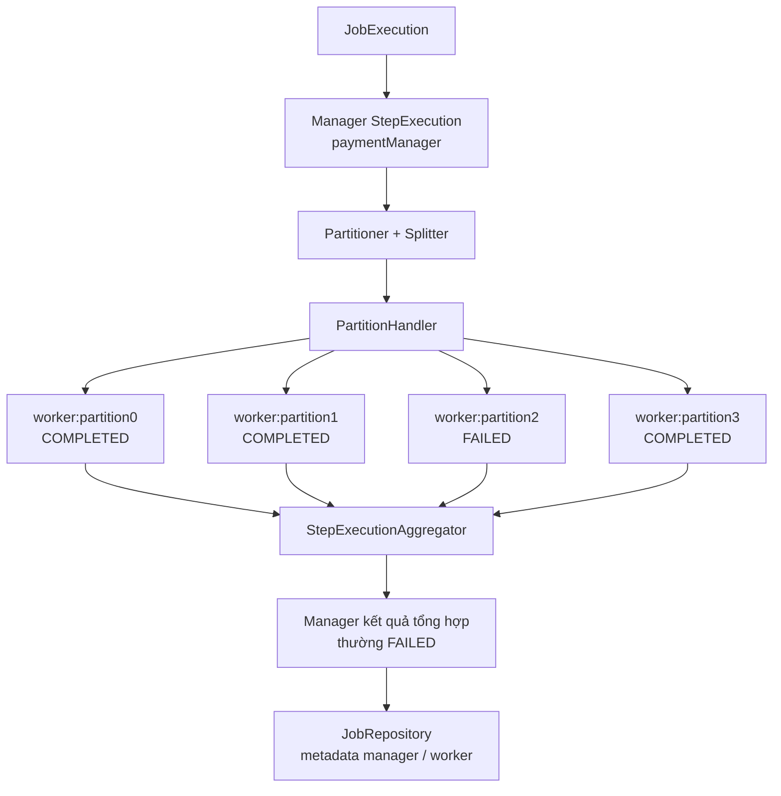
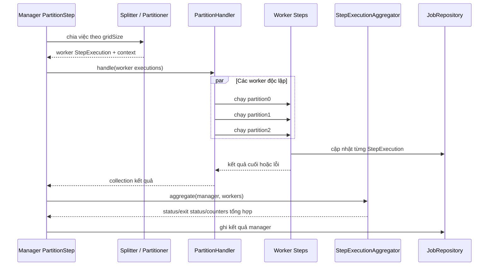

# Tổng hợp BatchStatus từ worker

## 1. Vì sao PartitionStep phải tổng hợp trạng thái worker?

Trong module **SPRING_BATCH_SCALING_OPERATIONS**, partitioning cho phép xử lý workload dữ liệu lớn bằng nhiều worker cùng thực hiện những phần dữ liệu độc lập. Một **PartitionStep** ở phía manager điều phối công việc, còn mỗi worker thực hiện một `StepExecution` riêng. Vấn đề là: nếu một worker đã hoàn thành, ba worker khác vẫn đang xử lý và một worker sau đó thất bại, **manager phải kết luận trạng thái toàn step như thế nào?**

Spring Batch dùng cơ chế **tổng hợp `StepExecution`** từ các worker để cập nhật kết quả của manager. Bộ tổng hợp thông dụng là `DefaultStepExecutionAggregator`, triển khai giao diện `StepExecutionAggregator`. Nó tổng hợp các `BatchStatus`, `ExitStatus` và những bộ đếm thực thi của worker để manager có một kết quả chung phục vụ điều phối job và vận hành.

Sau bài học, bạn có thể:

- Phân biệt `BatchStatus`, `ExitStatus` và `FlowExecutionStatus` trong partitioning.
- Mô tả đường đi từ `Partitioner`, `PartitionHandler` và các `StepExecution` worker tới `StepExecutionAggregator`.
- Giải thích vì sao **một partition thất bại có thể khiến manager thất bại**, dù nhiều partition khác đã hoàn thành.
- Theo dõi từng worker và kết quả tổng hợp của manager trong `JobRepository`, tránh cộng số đếm trùng.
- Cấu hình local partitioning trong Spring Batch 5.x và đọc kết quả ở manager.
- Thiết kế retry/restart an toàn khi một phần dữ liệu đã được worker khác commit thành công.
- Đánh giá tác động của timeout, thiếu phản hồi, custom aggregator và giới hạn tài nguyên thực tế.

> **Nguyên tắc chính:** Trạng thái của **manager PartitionStep** phản ánh kết quả tổng hợp từ các worker execution. `BatchStatus` mô tả vòng đời thực thi, còn `ExitStatus` phục vụ diễn giải kết quả và điều khiển flow. Tổng hợp status **không tạo một transaction chung** và không tự xác nhận dữ liệu nghiệp vụ đã chính xác.

## 2. Những đối tượng nào có trạng thái?

Giả sử cần xử lý 1.000 bản ghi, chia thành bốn dải:

| Đơn vị | Tên step execution minh họa | Dữ liệu | Trạng thái riêng |
| --- | --- | --- | --- |
| Manager | `paymentManager` | Điều phối và tổng hợp | `StepExecution.status` của manager |
| Worker 0 | `paymentWorker:partition0` | ID 1–250 | `StepExecution.status` của partition 0 |
| Worker 1 | `paymentWorker:partition1` | ID 251–500 | `StepExecution.status` của partition 1 |
| Worker 2 | `paymentWorker:partition2` | ID 501–750 | `StepExecution.status` của partition 2 |
| Worker 3 | `paymentWorker:partition3` | ID 751–1.000 | `StepExecution.status` của partition 3 |

Mỗi worker có `ExecutionContext` riêng để giữ ranh giới dữ liệu và checkpoint. `JobRepository` ghi nhận metadata của manager cùng metadata từng worker. Bởi vậy, một `JobExecution` có thể chứa nhiều dòng trong `BATCH_STEP_EXECUTION`, kể cả một dòng manager và các dòng partition.



Sơ đồ thể hiện quan hệ **điều phối**: worker `StepExecution` không trở thành bản ghi con trong một transaction của manager. Mỗi partition vẫn có vòng đời riêng; aggregator nhận các kết quả và ghi nhận tình trạng chung khi handler hoàn tất việc thu thập theo hợp đồng của nó.

### Trách nhiệm của các thành phần

| Thành phần | Trách nhiệm |
| --- | --- |
| `Partitioner` | Sinh map tên partition → `ExecutionContext`; một partition tương ứng một phần việc logic |
| `StepExecutionSplitter` | Xác định các worker `StepExecution` cần khởi tạo hoặc chạy lại dựa trên metadata |
| `PartitionHandler` | Giao các worker execution cho executor hoặc tiến trình remote; thu kết quả theo hợp đồng handler |
| `StepExecutionAggregator` | Tổng hợp trạng thái và bộ đếm từ tập worker execution được cung cấp vào manager execution |
| `JobRepository` | Lưu trạng thái, `ExitStatus`, counters, checkpoint và lịch sử của manager/worker |
| `Job` / flow | Dựa trên kết quả cuối của manager step để quyết định chuyển sang step kế tiếp hoặc xử lý nhánh lỗi |

## 3. BatchStatus và ExitStatus khác nhau thế nào?

### 3.1. `BatchStatus`: trạng thái vòng đời thực thi

`BatchStatus` là enum của Spring Batch dùng cho `JobExecution` và `StepExecution`. Những giá trị hay gặp:

| BatchStatus | Ý nghĩa vận hành |
| --- | --- |
| `STARTING` | Đang chuẩn bị bắt đầu |
| `STARTED` | Đã bắt đầu, còn đang chạy |
| `STOPPING` | Đang xử lý yêu cầu dừng |
| `STOPPED` | Đã dừng trước khi hoàn thành |
| `COMPLETED` | Hoàn thành theo cơ chế thực thi |
| `FAILED` | Thực thi thất bại |
| `ABANDONED` | Execution được đánh dấu bỏ qua theo quản trị/vòng đời đặc biệt |
| `UNKNOWN` | Trạng thái không xác định, cần điều tra |

Không coi `STOPPED`, `ABANDONED` hoặc `UNKNOWN` là thành công. Những trạng thái này cần chính sách vận hành và khôi phục phù hợp.

### 3.2. `ExitStatus`: kết quả dùng cho chuyển tiếp

`ExitStatus` là kết quả cuối của step, có `exitCode` và `exitDescription`. Thông thường một step hoàn tất có mã `COMPLETED`, step thất bại có mã `FAILED`; ứng dụng có thể tạo mã nghiệp vụ tùy biến như `COMPLETED_WITH_WARNINGS`.

Trong partitioning, **`BatchStatus` và `ExitStatus` đều được tổng hợp**, nhưng chúng không phải cùng một trường và không nên dựa vào chuỗi exit code để đoán tuyệt đối vòng đời. Với custom listener/transition, `ExitStatus` có thể được mở rộng hoặc thay đổi.

### 3.3. `FlowExecutionStatus`: kết quả phục vụ flow

Ở cấp job flow, Spring Batch dùng trạng thái điều phối để quyết định đường `.next(...)`, `.on(...).to(...)`, `.fail()` hoặc `.stop()`. Với đường thành công thông thường:

```text
Worker executions -> Aggregator -> Manager StepExecution
                                      |
                                      v
                            Job flow quyết định
                                      |
               +----------------------+------------------+
               |                                         |
            thành công                                thất bại
               |                                         |
        next(validateStep)                      không đi theo next
```

Không nên thiết kế logic kiểu “chỉ cần ba trên bốn worker completed thì publish”, trừ khi nghiệp vụ **chủ động cho phép dữ liệu thiếu** và bạn có định nghĩa status/flow, đối soát, compensation, restart riêng. Mô hình mặc định phải xử lý các partition còn lỗi.

## 4. DefaultStepExecutionAggregator tổng hợp những gì?

Giao diện Spring Batch:

```java
import java.util.Collection;
import org.springframework.batch.core.StepExecution;

public interface StepExecutionAggregator {
    void aggregate(
        StepExecution result,
        Collection<StepExecution> executions
    );
}
```

`result` là manager `StepExecution` cần cập nhật; `executions` là các worker `StepExecution` được cung cấp để tổng hợp. Bộ mặc định `DefaultStepExecutionAggregator` kết hợp:

- **`BatchStatus`:** tạo trạng thái tổng hợp theo quy tắc mức độ ưu tiên của Spring Batch; nếu có worker thất bại, manager không thể được xem là hoàn thành bình thường chỉ vì một số worker khác thành công.
- **`ExitStatus`:** kết hợp các exit status của worker. Spring Batch có phép `ExitStatus.and(...)` để hợp nhất kết quả; mã tùy biến có thể ảnh hưởng cách flow chuyển tiếp.
- **Counters:** cộng số đếm của worker như `readCount`, `writeCount`, `filterCount`, skip counts, `commitCount` và `rollbackCount` vào kết quả manager.

Đây là tổng hợp **metadata của các execution**. Nó không chạy lại business logic, không duyệt từng record đã ghi để phát hiện thiếu/trùng, và không đồng bộ các giao dịch đã commit của worker.

### Trường hợp 1: tất cả thành công

| Worker | `BatchStatus` | Read count | Write count |
| --- | --- | ---: | ---: |
| `partition0` | `COMPLETED` | 250 | 250 |
| `partition1` | `COMPLETED` | 250 | 250 |
| `partition2` | `COMPLETED` | 250 | 250 |
| `partition3` | `COMPLETED` | 250 | 250 |
| **Manager (kết quả tổng hợp)** | **`COMPLETED`** | **1.000** | **1.000** |

Các số là **ví dụ minh họa** cho một worker chunk step đọc/ghi toàn bộ 250 item/partition. Chúng không phải kết quả cố định: processor có thể filter, writer có thể skip/retry, chunk có thể rollback và tổng count có thể phản ánh các lần thực thi cụ thể.

### Trường hợp 2: một worker thất bại

| Worker | `BatchStatus` | Read count | Write count |
| --- | --- | ---: | ---: |
| `partition0` | `COMPLETED` | 250 | 250 |
| `partition1` | `COMPLETED` | 250 | 250 |
| `partition2` | `FAILED` | 180 | 100 |
| `partition3` | `COMPLETED` | 250 | 250 |
| **Manager (kết quả tổng hợp thường thấy)** | **`FAILED`** | **930** | **850** |

Ở ví dụ này, một partition lỗi khiến **trạng thái chung thất bại**. Tuy nhiên những partition đã `COMPLETED` có thể đã commit dữ liệu thành công; các giao dịch ấy không tự rollback khi manager nhận `FAILED`. Số đếm ví dụ cũng chưa đủ để biết chính xác số record cuối cùng trong database sau nhiều lần retry.

### Trường hợp 3: chưa nhận đủ kết quả

Nếu remote worker mất kết nối, broker giữ request hoặc handler timeout, manager có thể **chưa nhận được tập trạng thái cuối đầy đủ**. Kết quả khi đó phụ thuộc `PartitionHandler`, timeout, exception và cơ chế metadata/recovery. Không suy luận rằng “worker không phản hồi” luôn tương đương một `BatchStatus.FAILED` được trả về theo cách bình thường: handler có thể ném lỗi, quản lý timeout hoặc ghi nhận execution chưa kết thúc.

## 5. Trình tự gọi aggregator trong PartitionStep

Một lần xử lý bình thường gồm các giai đoạn:

1. **Manager step bắt đầu** và có `StepExecution` của chính nó.
2. **Splitter/Partitioner chuẩn bị danh sách phân vùng**. Mỗi phần việc có tên và `ExecutionContext` riêng.
3. **PartitionHandler giao việc** cho các worker: trong cùng JVM bằng `TaskExecutorPartitionHandler` hoặc qua messaging bằng handler remote.
4. **Worker thực thi step**, cập nhật status, exit status và counters; `JobRepository` lưu metadata theo vòng đời step và checkpoint.
5. **Handler trả các worker execution** hoặc báo lỗi theo hợp đồng của implementation.
6. **Aggregator cập nhật manager execution** dựa trên những kết quả được cung cấp.
7. **Framework hoàn tất manager step**, lưu kết quả rồi cho job flow quyết định chuyển tiếp.



Các worker có thể hoàn tất **khác thứ tự được giao**. Aggregator không dựa vào thứ tự tên partition để xác định lỗi; kết quả trạng thái phải phản ánh tình trạng chung của tập worker execution liên quan. Trong remote partitioning, cách phát yêu cầu, thu response, poll repository và timeout còn phụ thuộc phiên bản/implementation của handler.

## 6. Ví dụ Java: local partitioning và trạng thái tổng hợp

Ví dụ dưới đây dùng cấu hình Spring Batch **5.x**. Job có một manager step chia ID từ 1 đến 1.000 thành bốn dải; bốn worker dùng chung định nghĩa step nhưng có `StepExecution` riêng.

Để tập trung vào aggregation, worker dưới đây là **Tasklet mô phỏng**. Tasklet chỉ đọc `ExecutionContext`, kiểm tra dải và hoàn thành; nó **không đọc/ghi 1.000 record thật**, nên các `readCount/writeCount` của tasklet mặc định vẫn là 0. Muốn tạo các count giống bảng ở mục 4, phải thay nó bằng chunk step dùng `ItemReader` và `ItemWriter` thực tế.

```java
import java.util.LinkedHashMap;
import java.util.Map;

import org.springframework.batch.core.Job;
import org.springframework.batch.core.Step;
import org.springframework.batch.core.job.builder.JobBuilder;
import org.springframework.batch.core.partition.support.Partitioner;
import org.springframework.batch.core.repository.JobRepository;
import org.springframework.batch.core.step.builder.StepBuilder;
import org.springframework.batch.item.ExecutionContext;
import org.springframework.batch.repeat.RepeatStatus;
import org.springframework.beans.factory.annotation.Qualifier;
import org.springframework.context.annotation.Bean;
import org.springframework.context.annotation.Configuration;
import org.springframework.core.task.TaskExecutor;
import org.springframework.scheduling.concurrent.ThreadPoolTaskExecutor;
import org.springframework.transaction.PlatformTransactionManager;

@Configuration
public class PartitionAggregationConfiguration {

    @Bean
    Partitioner paymentPartitioner() {
        return gridSize -> {
            Map<String, ExecutionContext> parts = new LinkedHashMap<>();
            long minId = 1L;
            long maxId = 1_000L;
            long numberOfIds = maxId - minId + 1;
            int requested = Math.max(1, gridSize);
            long span = (numberOfIds + requested - 1) / requested;
            int partIndex = 0;

            for (long fromId = minId; fromId <= maxId; fromId += span) {
                long toId = Math.min(maxId, fromId + span - 1);
                ExecutionContext context = new ExecutionContext();
                context.putLong("fromId", fromId);
                context.putLong("toId", toId);
                parts.put("partition" + partIndex++, context);
            }
            return parts;
        };
    }

    @Bean
    Step paymentWorker(
            JobRepository jobRepository,
            PlatformTransactionManager transactionManager) {

        return new StepBuilder("paymentWorker", jobRepository)
            .tasklet((contribution, chunkContext) -> {
                ExecutionContext context =
                    contribution.getStepExecution().getExecutionContext();
                long fromId = context.getLong("fromId");
                long toId = context.getLong("toId");

                if (fromId > toId) {
                    throw new IllegalArgumentException("Invalid ID range");
                }

                // Thay bằng logic đọc/xử lý/ghi thực tế.
                // Để thử lỗi: ném exception khi fromId == 501L
                // trong môi trường kiểm thử có chủ đích.
                return RepeatStatus.FINISHED;
            }, transactionManager)
            .build();
    }

    @Bean
    TaskExecutor partitionExecutor() {
        ThreadPoolTaskExecutor executor = new ThreadPoolTaskExecutor();
        executor.setCorePoolSize(4);
        executor.setMaxPoolSize(4);
        executor.setQueueCapacity(4);
        executor.setThreadNamePrefix("payment-part-");
        executor.initialize();
        return executor;
    }

    @Bean
    Step paymentManager(
            JobRepository jobRepository,
            Partitioner paymentPartitioner,
            @Qualifier("paymentWorker") Step worker,
            @Qualifier("partitionExecutor") TaskExecutor executor) {

        return new StepBuilder("paymentManager", jobRepository)
            .partitioner("paymentWorker", paymentPartitioner)
            .step(worker)
            .gridSize(4)
            .taskExecutor(executor)
            .build();
    }

    @Bean
    Job paymentJob(
            JobRepository jobRepository,
            @Qualifier("paymentManager") Step manager) {
        return new JobBuilder("paymentJob", jobRepository)
            .start(manager)
            .build();
    }
}
```

### Đọc cấu hình đúng cách

- `.gridSize(4)` truyền gợi ý chia thành bốn partition; partitioner trong ví dụ chọn tạo bốn dải 250 ID.
- `.partitioner("paymentWorker", paymentPartitioner)` và `.step(worker)` cấu hình tên worker step và định nghĩa step cần thực thi.
- `.taskExecutor(executor)` cho phép local partitioning giao các worker execution cho pool; mức đồng thời tối đa thông thường là bốn task do pool cấu hình.
- `PartitionStepBuilder` sẽ dùng cơ chế tổng hợp mặc định nếu không cung cấp aggregator riêng; không cần viết code tự duyệt từng worker để tính status.
- Worker tasklet chỉ minh họa trạng thái thành công/thất bại, không tạo counters của chunk reader/writer.
- Khi thay bằng worker chunk step thực tế, nên cấu hình reader `@StepScope` để nhận `fromId`/`toId`; reader, writer và tài nguyên đích phải bảo đảm thread safety ở phạm vi được chia sẻ.

Lưu ý: ví dụ không gồm `DataSource`, schema metadata, job launcher và bước xuất bản dữ liệu. Những thành phần đó phải có trong ứng dụng chạy thật. Với Spring Batch 6.x, cần đối chiếu Javadoc và cấu hình tương ứng với nhánh đang dùng.

### Một thay đổi nhỏ để xem kết quả lỗi

Trong lambda worker ở ví dụ, thêm phép kiểm tra mô phỏng:

```java
if (fromId == 501L) {
    throw new IllegalStateException(
        "Simulated partition failure for training");
}
```

Khi dùng `gridSize(4)` và dải ID của ví dụ, partition có `fromId=501` sẽ `FAILED`. Các partition khác có thể đã `COMPLETED`. Sau khi handler trả kết quả, manager có trạng thái thất bại theo logic tổng hợp thông thường; job không đi tiếp theo transition thành công.

**Để kiểm tra restart cùng `JobInstance`**, cần bỏ nguyên nhân gây lỗi và chạy lại với **cùng identifying JobParameters**; không đổi job parameter định danh chỉ để tắt mô phỏng lỗi, vì như vậy có thể tạo `JobInstance` mới. Trong ứng dụng thực tế, nên dùng cách fault injection có kiểm soát riêng cho môi trường test.

## 7. Nếu cần custom StepExecutionAggregator

`DefaultStepExecutionAggregator` thường đủ để tổng hợp trạng thái, exit status và bộ đếm. Khi nghiệp vụ cần các metric bổ sung như số khách hàng hợp lệ theo vùng, có thể dùng một `StepExecutionAggregator` tùy biến.

Ví dụ về hợp đồng và cách ủy quyền việc tổng hợp chuẩn:

```java
import java.util.Collection;
import org.springframework.batch.core.StepExecution;
import org.springframework.batch.core.partition.support.DefaultStepExecutionAggregator;
import org.springframework.batch.core.partition.support.StepExecutionAggregator;

public final class CountingStepExecutionAggregator
        implements StepExecutionAggregator {

    private final DefaultStepExecutionAggregator delegate =
        new DefaultStepExecutionAggregator();

    @Override
    public void aggregate(
            StepExecution result,
            Collection<StepExecution> executions) {

        // Để framework chuẩn hóa status/exit status/counters trước.
        delegate.aggregate(result, executions);

        long finishedWorkers = executions.stream()
            .filter(e -> e.getStatus() ==
                org.springframework.batch.core.BatchStatus.COMPLETED)
            .count();

        result.getExecutionContext()
            .putLong("finishedWorkerCount", finishedWorkers);
    }
}
```

Nếu phiên bản `PartitionStepBuilder` đang dùng hỗ trợ phương thức cấu hình aggregator, có thể đăng ký:

```java
.aggregator(new CountingStepExecutionAggregator())
```

**Cảnh báo kỹ thuật:**

1. Đừng **đặt lại `BatchStatus.COMPLETED` vô điều kiện** trong aggregator để che worker `FAILED` hoặc `STOPPED`.
2. Khi thêm custom counter, hãy xác định rõ nó đếm **số worker executions trong collection** hay **số partition duy nhất của toàn `JobInstance` qua nhiều lần restart**. Hai khái niệm này không tự đồng nhất.
3. `ExecutionContext` phải lưu giá trị có thể serialize theo khả năng repository hiện hành; các field tùy biến cần được quản lý khi restart.
4. Việc thay đổi `ExitStatus` có thể làm thay đổi các transition `.on("...")`. Hãy test flow với mã exit tùy biến.
5. Nếu handler bị timeout hoặc ném exception trước khi tổng hợp, aggregator **không bảo đảm** được gọi trong mọi đường lỗi. Vẫn cần logging, alerting và chính sách recovery riêng.

Việc triển khai custom aggregator chỉ nên thực hiện khi bạn cần nghiệp vụ bổ sung; mặc định đã cung cấp các dữ liệu vận hành cốt lõi.

## 8. BatchStatus tổng hợp ảnh hưởng job flow như thế nào?

Giả sử job có hai bước: `paymentManager` chạy partitioning; `publishResult` chỉ công bố kết quả sau khi tất cả worker thành công.

```java
@Bean
Job processAndPublish(
        JobRepository repository,
        @Qualifier("paymentManager") Step paymentManager,
        @Qualifier("publishResult") Step publishResult) {

    return new JobBuilder("processAndPublish", repository)
        .start(paymentManager)
        .next(publishResult)
        .build();
}
```

Trong flow mặc định:

- Nếu manager kết thúc `COMPLETED`, `publishResult` có thể được thực thi tiếp.
- Nếu một worker `FAILED` khiến manager `FAILED`, `publishResult` **không chạy theo đường `next` thành công**.
- Nếu manager `STOPPED` hoặc có `ExitStatus` tùy biến, kết quả chuyển tiếp phụ thuộc chính sách flow và cách status được cấu hình.

Không nên dùng một listener tự chuyển manager sang `COMPLETED` chỉ để tiếp tục công bố khi thiếu partition; việc đó có thể che lỗi và làm job phát hành dữ liệu chưa đầy đủ.

### Status thành công vẫn cần đối soát nghiệp vụ

`COMPLETED` có nghĩa Spring Batch nhận thấy execution hoàn tất theo quy tắc kỹ thuật; **không phải chứng minh toán học** rằng số bản ghi nguồn và đích trùng nhau. Ví dụ một processor lọc bỏ bản ghi ngoài kỳ xử lý có thể làm `writeCount` nhỏ hơn `readCount` mà vẫn đúng nghiệp vụ. Ngược lại, một writer có side effect ngoài transaction có thể tạo duplicate dù step kết thúc hoàn chỉnh.

Đối với job quan trọng, nên có bước kiểm tra **business key, watermark, checksum hoặc tổng số tiền**, tách khỏi logic tổng hợp metadata của manager.

## 9. Retry, restart và trạng thái của partition đã hoàn thành

Giả sử lần đầu:

| Partition | Kết quả lần đầu | Dữ liệu đã commit |
| --- | --- | --- |
| `partition0` | `COMPLETED` | Toàn bộ khoảng 1–250 |
| `partition1` | `COMPLETED` | Toàn bộ khoảng 251–500 |
| `partition2` | `FAILED` | Một phần khoảng 501–750 |
| `partition3` | `COMPLETED` | Toàn bộ khoảng 751–1.000 |

Khi restart **cùng `JobInstance`** với metadata còn nhất quán:

1. Spring Batch xác định lại những partition execution cần chạy dựa trên tên, `ExecutionContext`, trạng thái và chính sách restart.
2. Các partition đã `COMPLETED` thường không cần chạy lại theo cơ chế mặc định.
3. Partition `FAILED` được chạy lại hoặc tiếp tục từ checkpoint nếu reader/writer hỗ trợ; có thể tạo `JobExecution` và `StepExecution` mới cho lần thực thi mới.
4. Manager tổng hợp lại kết quả theo cơ chế partition/restart của phiên bản đang dùng.
5. Step publish chỉ được chạy khi điều kiện hoàn tất toàn thể và đối soát nghiệp vụ đã được đáp ứng.

Không được tự cộng tất cả `readCount` từ **mọi bản ghi lịch sử trong nhiều lần restart** rồi kết luận đó là tổng dữ liệu duy nhất. Một item có thể được đọc lại sau rollback/restart; các execution lịch sử có thể chứa số đếm của những lần thử thất bại.

### Ba rủi ro cần bảo vệ

**1. Thay đổi mapping partition.** Nếu lần đầu `partition2` là ID 501–750 nhưng lần restart đổi `gridSize` làm nó thành ID 401–600, checkpoint cũ không còn gắn với cùng dữ liệu. Giữ partition key và ranh giới ổn định trong cùng một `JobInstance`.

**2. Ghi trùng khi retry.** Nếu worker commit rồi mất kết nối trước khi manager nhận kết quả, request có thể bị phát lại hoặc trạng thái có thể không rõ ràng. Dùng transaction, ràng buộc unique key, idempotency và đối soát bảng đích.

**3. Phản hồi đến muộn.** Một worker remote có thể vẫn chạy dù manager đã timeout hoặc bị lỗi. Không khởi chạy một worker khác với cùng phần dữ liệu trước khi kiểm tra trạng thái thực tế và ngăn hai worker ghi xung đột.

### Vì sao JobRepository quan trọng?

`JobRepository` cho phép nhìn thấy trạng thái từng worker, thời gian chạy, exception, counts và `ExecutionContext`. Trong local partitioning, nó giúp quyết định phần nào cần chạy lại. Trong remote partitioning, tất cả tiến trình phải nhất quán về metadata và cơ chế kết nối/repository theo kiến trúc được Spring Batch hỗ trợ.

**Aggregator không thay thế JobRepository.** Aggregator chỉ tạo **bức tranh tổng hợp**; chi tiết partition lỗi vẫn nằm ở worker `StepExecution` và các hệ thống hạ tầng liên quan.

## 10. Đọc trạng thái manager và worker từ metadata

Trong cơ sở dữ liệu metadata của Spring Batch, `BATCH_STEP_EXECUTION` chứa `STEP_EXECUTION_ID`, `JOB_EXECUTION_ID`, `STEP_NAME`, `STATUS`, `EXIT_CODE`, `START_TIME`, `END_TIME` và các bộ đếm.

Ví dụ truy vấn toàn bộ step execution trong **một JobExecution**:

```sql
SELECT
    STEP_EXECUTION_ID,
    JOB_EXECUTION_ID,
    STEP_NAME,
    STATUS,
    EXIT_CODE,
    READ_COUNT,
    WRITE_COUNT,
    FILTER_COUNT,
    READ_SKIP_COUNT,
    PROCESS_SKIP_COUNT,
    WRITE_SKIP_COUNT,
    COMMIT_COUNT,
    ROLLBACK_COUNT,
    START_TIME,
    END_TIME
FROM BATCH_STEP_EXECUTION
WHERE JOB_EXECUTION_ID = ?
ORDER BY STEP_EXECUTION_ID;
```

Trong kết quả, `paymentManager` là manager step; `paymentWorker:partition0` ... là worker steps. Kiểm tra **từng worker** trước khi nhìn trạng thái chung.

### Tránh cộng số đếm hai lần

`DefaultStepExecutionAggregator` có thể đưa tổng count của worker lên manager. Nếu một dashboard tính:

```text
totalRead = manager.READ_COUNT + SUM(worker.READ_COUNT)
```

thì kết quả có thể bị **đếm hai lần** cùng một workload. Hãy chọn **một** trong hai cách: đọc tổng số từ manager đã được tổng hợp, hoặc tự tổng hợp các worker execution được chọn đúng phạm vi; đừng cộng cả hai. Đặc biệt cần ghi rõ bạn đang báo cáo số item được xử lý trong một `JobExecution` hay số business key duy nhất của cả `JobInstance` sau nhiều lần restart.

### Truy vấn partition lỗi qua nhiều lần chạy

```sql
SELECT
    je.JOB_EXECUTION_ID,
    se.STEP_EXECUTION_ID,
    se.STEP_NAME,
    se.STATUS,
    se.EXIT_CODE,
    se.READ_COUNT,
    se.WRITE_COUNT,
    se.START_TIME,
    se.END_TIME
FROM BATCH_STEP_EXECUTION se
JOIN BATCH_JOB_EXECUTION je
    ON je.JOB_EXECUTION_ID = se.JOB_EXECUTION_ID
WHERE je.JOB_INSTANCE_ID = ?
  AND se.STEP_NAME LIKE 'paymentWorker:%'
ORDER BY je.JOB_EXECUTION_ID, se.STEP_NAME;
```

Truy vấn này cho phép theo dõi một tên partition qua các lần restart. Không coi `STEP_EXECUTION_ID` là ID ổn định của partition xuyên suốt mọi lần chạy.

## 11. Local partitioning và remote partitioning có gì khác?

| Khía cạnh | Local partitioning | Remote partitioning |
| --- | --- | --- |
| Nơi chạy worker | Thường trong cùng JVM với manager | JVM/máy khác qua messaging |
| Cách dispatch | `TaskExecutorPartitionHandler` hoặc handler local tương ứng | `PartitionHandler` qua messaging/remote infrastructure |
| `StepExecution` | Riêng cho từng partition | Riêng cho từng partition |
| Tổng hợp status | Theo cơ chế `StepExecutionAggregator` | Vẫn cần manager nhận/xác định kết quả rồi tổng hợp |
| Nguy cơ chính | Thread pool, dữ liệu/bean dùng chung, connection pool | Messaging, timeout, redelivery, worker mất kết nối, repository |
| Cách quan sát | `JobRepository`, executor, log trong một ứng dụng | `JobRepository` cộng broker/worker logs và tracing |
| Restart | Phục hồi theo metadata/chunk checkpoint | Phục hồi theo metadata và thêm các điều kiện transport/worker |

Điều đáng nhớ: **`BatchStatus.FAILED` của một worker có ý nghĩa về execution**, nhưng lỗi hạ tầng remote có thể khiến manager **không nhận được status cuối cùng ngay lập tức**. Trạng thái manager có thể bị chi phối bởi handler/timeout trước hoặc trong lúc tổng hợp. Để tìm nguyên nhân, cần đối chiếu repository, log worker và message broker.

## 12. Nút thắt hiệu năng của bước tổng hợp

Với workload lớn, thời gian manager hoàn tất thường chịu ảnh hưởng của **partition chậm nhất** (straggler), không phải thời gian trung bình:

\[
T_{\text{manager}} \gtrsim
\max_{i=1..P}(T_i) + T_{\text{dispatch/aggregate}},
\]

trong đó `P` là số partition, `T_i` là thời gian thực thi từng partition trong môi trường thực và `T_{\text{dispatch/aggregate}}` là chi phí điều phối/tổng hợp tương ứng. Đây là mô hình trực giác; nhiều partition có thể chạy thành **nhiều đợt** nếu pool/remote workers không đủ, khiến tổng thời gian lớn hơn.

### Ví dụ về dữ liệu lệch

| Partition | Item thực tế | Thời gian |
| --- | ---: | ---: |
| `partition0` | 250.000 | 40 giây |
| `partition1` | 250.000 | 42 giây |
| `partition2` | 250.000 nhưng xử lý phức tạp | 180 giây |
| `partition3` | 250.000 | 39 giây |

Dù 3/4 partition xong sau chưa tới một phút, manager vẫn phải chờ kết quả partition 2. Tăng số worker không nhất thiết giải quyết được vấn đề nếu một partition có dữ liệu bất thường hoặc bị khóa database.

### Chỉ số nên thu thập

| Nhóm | Metric | Mục đích |
| --- | --- | --- |
| Trạng thái | Số partition `COMPLETED`/`FAILED`/`STOPPED`/đang chạy | Biết chính xác tình hình và tỷ lệ thành công |
| Thời gian | Duration từng `StepExecution`, p95/p99, thời gian chờ worker chậm nhất | Phát hiện skew và straggler |
| Công việc | Read/write/skip/commit/rollback count từng partition | Phân biệt lỗi nghiệp vụ và lỗi xử lý |
| Executor | Active threads, queue depth, saturation | Có đủ worker cho số partition? |
| Broker | Request/reply latency, redelivery, DLQ, queue age | Worker có nhận hoặc trả kết quả kịp? |
| Repository | Connection wait, thời gian cập nhật/đọc metadata | Metadata có thành nút thắt khi tạo nhiều execution? |
| Database nghiệp vụ | Lock wait, IOPS, connection pool pending | Worker có tranh tài nguyên ghi/đọc? |
| Tính đúng | Số business key riêng, checksum, dữ liệu thiếu/trùng | Tổng hợp status có đi kèm kết quả đáng tin? |

Tăng `gridSize` có thể chia nhỏ partition nặng và giảm lệch tải, **nếu** partitioner chia đúng và chi phí xử lý cân bằng hơn. Nhưng `gridSize` lớn tạo thêm overhead metadata/dispatch/connection; lựa chọn cuối cùng phải dựa trên số đo với dữ liệu đại diện.

## 13. Những sai lầm thường gặp

| Nhận định | Vì sao sai hoặc thiếu | Cách xử lý |
| --- | --- | --- |
| “Chỉ cần một worker `COMPLETED` thì manager thành công.” | Manager cần kết quả tổng hợp của toàn bộ phần việc liên quan | Xem tất cả worker `StepExecution` và trạng thái chung |
| “Manager `COMPLETED` chứng minh DB đích không thiếu record.” | Status chỉ phản ánh thực thi kỹ thuật | Dùng bước đối soát business key/checksum |
| “Manager `FAILED` sẽ rollback dữ liệu các worker khác.” | Transaction của từng worker độc lập | Thiết kế idempotency và dữ liệu staging |
| “`BatchStatus` và `ExitStatus` là một.” | Hai loại trạng thái có vai trò khác nhau | Xem `STATUS` và `EXIT_CODE` riêng |
| “Cứ cộng manager count với worker count.” | Manager có thể đã tổng hợp count của worker | Chọn đúng một nguồn số đếm |
| “Manager `FAILED` thì tất cả worker chắc chắn đã `FAILED`.” | Chỉ một worker thất bại hoặc handler lỗi cũng có thể làm manager thất bại | Kiểm tra từng worker execution |
| “Một worker remote timeout nghĩa là nó đã dừng.” | Có thể còn đang chạy và commit | Đối chiếu log, repository, broker, destination |
| “Restart luôn chạy lại mọi partition.” | Partition đã `COMPLETED` thường được bỏ qua | Dùng metadata, chính sách restart và checkpoint |
| “Custom aggregator có thể luôn ép manager `COMPLETED` để publish.” | Có nguy cơ che lỗi và dữ liệu thiếu | Bảo toàn semantics, kiểm tra đủ partition |
| “Tăng worker sẽ hết thời gian chờ tổng hợp.” | Straggler, DB hoặc broker vẫn có thể chậm | Đo từng partition và nút thắt thực |

## 14. Bài thực hành: kiểm tra trạng thái từ bốn worker

**Tình huống:** Job tổng hợp 4 triệu giao dịch theo bốn phân vùng. Mỗi partition đọc một triệu bản ghi và ghi vào bảng đích theo khóa giao dịch. Job chỉ được phép chạy `publishSummary` sau khi mọi partition hoàn thành và dữ liệu qua bước đối soát.

Thực hiện:

1. Tạo `Partitioner` chia dữ liệu thành bốn phần có key ổn định; ghi lại `fromId`/`toId` cho từng `ExecutionContext`.
2. Tạo worker chunk step thực đọc/ghi, lưu `readCount`, `writeCount` và trạng thái qua `JobRepository`.
3. Chạy cả bốn worker thành công; quan sát worker `COMPLETED` và manager `COMPLETED`. Kiểm tra tổng count manager **không cộng lại** với count của worker.
4. Cố tình gây lỗi ở `partition2`; xác minh worker 2 `FAILED`, manager không hoàn thành bình thường và `publishSummary` không chạy theo đường thành công.
5. Kiểm tra dữ liệu đã commit từ ba partition thành công **vẫn tồn tại**; xác nhận không có rollback toàn job.
6. Sửa lỗi và restart cùng `JobInstance`; kiểm tra partition nào chạy lại, trạng thái sau restart và số business key duy nhất ở bảng đích.
7. Trong môi trường giả lập remote, để worker nhận request nhưng chậm trả reply. Quan sát timeout và so sánh trạng thái manager, worker, broker trước khi quyết định replay.
8. Thử một partition có chi phí xử lý gấp bốn lần các partition khác; so sánh duration, nhận diện straggler và điều chỉnh phạm vi chia mà vẫn giữ khả năng restart an toàn.

**Câu hỏi tự kiểm tra:**

1. Giao diện nào tổng hợp `StepExecution` worker và implementation mặc định thường dùng là gì?
2. Vì sao một worker `FAILED` có thể làm manager `FAILED` dù ba worker còn lại `COMPLETED`?
3. `BatchStatus`, `ExitStatus` và `FlowExecutionStatus` khác nhau ở mục đích nào?
4. Vì sao số đếm tại manager có thể trùng với tổng số đếm ở các worker?
5. Khi restart cùng `JobInstance`, vì sao không nên cộng số read của tất cả execution lịch sử?
6. Nếu một worker timeout nhưng có thể còn chạy, cần kiểm tra những nguồn nào?
7. Tại sao tổng hợp status không bảo đảm thứ tự commit hoặc rollback đồng loạt?
8. Trường hợp một partition rất chậm, metric nào giúp chọn giữa tăng gridSize, tối ưu truy vấn hay tăng worker?

## 15. Tài liệu tham khảo

- [Spring Batch Reference — Scaling and Parallel Processing: Partitioning](https://docs.spring.io/spring-batch/reference/5.2/scalability.html).
- [Spring Batch Reference — JobRepository và metadata](https://docs.spring.io/spring-batch/reference/5.2/job/configuring-repository.html).
- [Spring Batch 5.2 API — StepExecutionAggregator](https://docs.spring.io/spring-batch/docs/5.2.0/api/org/springframework/batch/core/partition/support/StepExecutionAggregator.html).
- [Spring Batch 5.2 API — DefaultStepExecutionAggregator](https://docs.spring.io/spring-batch/docs/5.2.0/api/org/springframework/batch/core/partition/support/DefaultStepExecutionAggregator.html).
- [Spring Batch 5.2 API — BatchStatus](https://docs.spring.io/spring-batch/docs/5.2.0/api/org/springframework/batch/core/BatchStatus.html).

**Ghi nhớ:** `PartitionStep` cần tổng hợp `StepExecution` từ tất cả worker liên quan để có **`BatchStatus`, `ExitStatus` và các counters chung của manager**. `DefaultStepExecutionAggregator` đảm nhận công việc thường gặp, nhưng kết quả tổng hợp không thay thế trạng thái chi tiết từng partition, transaction và dữ liệu thật. Hãy kiểm tra lỗi, timeout, restart, trường hợp worker chậm và tính đúng đắn theo business key trước khi cho step kế tiếp công bố kết quả.
