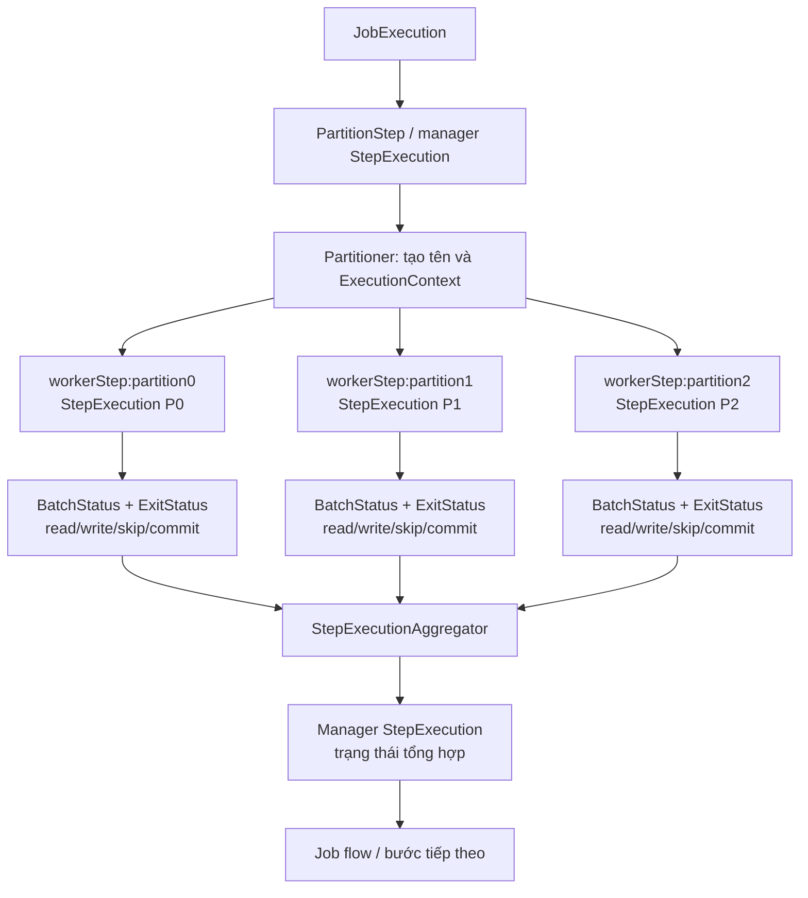
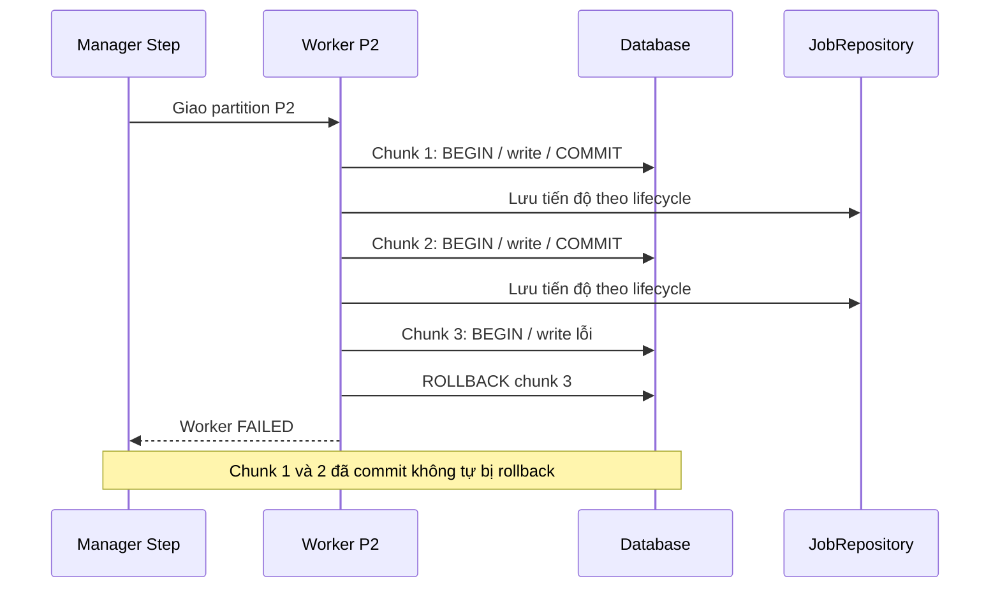
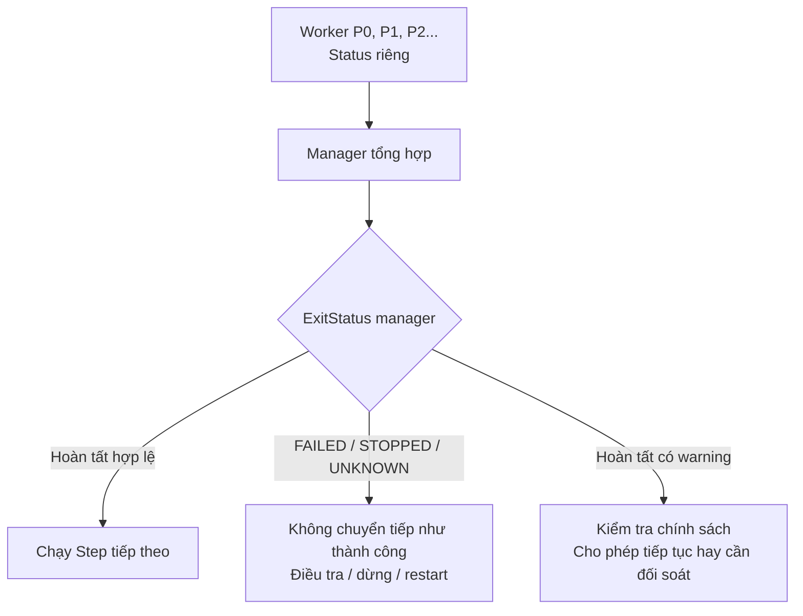

# ExitStatus của từng partition trong Spring Batch PartitionStep

Khi một Spring Batch job chia tập dữ liệu lớn thành nhiều **partition**, mỗi worker Step xử lý một vùng dữ liệu và có **`StepExecution` riêng**. Điều đó đồng nghĩa từng partition có trạng thái chạy, mã kết thúc, số bản ghi đọc/ghi, số lỗi và thông tin restart riêng. Manager Step sau đó phải **tổng hợp** các kết quả này để quyết định toàn bộ bước phân vùng thành công hay thất bại.

Một sai lầm vận hành thường gặp là nhìn thấy manager Step báo `FAILED` rồi kết luận *mọi partition đã rollback*, hoặc thấy hai partition báo `COMPLETED` rồi nghĩ toàn job đã hoàn thành. Trong thực tế, những worker đã commit thành công vẫn giữ dữ liệu; các worker thất bại có thể phải chạy lại, còn ý nghĩa của `ExitStatus` đôi khi khác `BatchStatus`. Để restart an toàn và định tuyến Job flow chính xác, cần hiểu **cả trạng thái của từng partition lẫn trạng thái tổng hợp của manager**.

Bài thuộc chương **PartitionStep** của module **SPRING_BATCH_SCALING_OPERATIONS**. Trong phạm vi mở rộng Spring Batch với multi-threaded step, parallel steps, local/remote partitioning và workload phân tán, ta sẽ học cách theo dõi `ExitStatus` của từng worker, thiết kế status nghiệp vụ, kiểm tra tính đúng đắn và đưa thông tin đó vào giám sát production.

## 1. Từ một Step đến nhiều worker StepExecution

Một `PartitionStep` có vai trò **manager**: dùng `StepExecutionSplitter`/`Partitioner` để xác định tập việc, gửi các worker execution qua `PartitionHandler`, rồi gom kết quả. Trong local partitioning, handler có thể sử dụng `TaskExecutor` để chạy các worker Step song song trong cùng JVM. Với remote partitioning, worker có thể chạy trên các JVM khác thông qua giao thức nhắn tin.



Ở một lần chạy có ba partition, có thể quan sát dạng dữ liệu minh họa:

| StepExecution | `BatchStatus` | `ExitStatus.exitCode` | Đã ghi thành công |
| --- | --- | --- | ---: |
| `workerStep:partition0` | `COMPLETED` | `COMPLETED` | 4.000 |
| `workerStep:partition1` | `COMPLETED` | `COMPLETED` | 3.980 |
| `workerStep:partition2` | `FAILED` | `FAILED` | 2.000 trước khi lỗi |
| `managerStep` | `FAILED` trong tình huống này | Mã tổng hợp theo aggregator | Không tự làm rollback toàn bộ |

Các con số chỉ minh họa: mỗi worker có thể commit nhiều chunk trước khi thất bại. Manager phản ánh kết quả tổng thể, **không mở một transaction chung để đảo ngược mọi chunk đã commit ở từng worker**. Trong ví dụ, 2.000 dòng của partition 2 chỉ được xem là đã ghi nếu thực sự đã commit, không chỉ vì callback writer đã chạy.

Tên như `workerStep:partition0` là dạng thường gặp với splitter mặc định và tên partition tương ứng; tên chính xác có thể thay đổi khi dùng custom partitioner/splitter. Trong vận hành, dựa trên **tên thực được ghi vào JobRepository**, không suy đoán bằng thứ tự thread.

## 2. Phân biệt `BatchStatus`, `ExitStatus` và kết quả nghiệp vụ

Mỗi `StepExecution` có những thông tin khác nhau:

- **`BatchStatus`** từ `getStatus()`: mô tả **trạng thái lifecycle** được framework quản lý, chẳng hạn `STARTED`, `COMPLETED`, `FAILED`, `STOPPED`, `UNKNOWN`. Nó hỗ trợ điều phối và quyết định điều kiện restart.
- **`ExitStatus`** từ `getExitStatus()`: gồm `exitCode` và `exitDescription`. Nó mô tả **cách Step kết thúc** và có thể được điều chỉnh để thể hiện kết quả nghiệp vụ, phục vụ Job flow.
- **`StepExecution` metrics**: `readCount`, `writeCount`, `filterCount`, `skipCount`, `commitCount`, `rollbackCount`… giúp hiểu lượng việc và sự cố.
- **Kết quả dữ liệu**: số khóa đã ghi, checksum, aggregate nghiệp vụ, sự kiện ngoài DB; cần đối soát độc lập, không tự suy ra từ status.

| Tình huống | `BatchStatus` có thể là | `ExitStatus` có thể là | Ý nghĩa |
| --- | --- | --- | --- |
| Worker xử lý bình thường | `COMPLETED` | `COMPLETED` | Hoàn tất theo cơ chế Batch |
| Worker đọc không có item | `COMPLETED` | `COMPLETED` hoặc mã nghiệp vụ riêng | Partition rỗng không nhất thiết là lỗi |
| Worker hoàn tất nhưng có item bị skip hợp lệ | `COMPLETED` | `COMPLETED` hoặc `COMPLETED_WITH_SKIPS` | Có thể muốn báo tình trạng dữ liệu |
| Worker hết retry khi writer lỗi | `FAILED` | Thường `FAILED`, kèm thông tin lỗi | Cần điều tra và cân nhắc restart |
| Worker nhận yêu cầu dừng | `STOPPED` hoặc trạng thái chuyển tiếp | Mã kết thúc theo lifecycle tương ứng | Không được coi như hoàn tất bình thường |
| Worker mất kết nối khi phân tán | Có thể chưa rõ hoặc chưa được cập nhật kịp | Cần kiểm tra metadata, heartbeat/ack | Không kết luận “chưa chạy” chỉ từ thiếu thông báo |

**Mã tùy chỉnh trong `ExitStatus` không tự động thay đổi `BatchStatus`.** Nếu listener trả mã `COMPLETED_WITH_SKIPS`, Step vẫn có thể có `BatchStatus.COMPLETED`. Ngược lại, một exception thực sự khiến worker `FAILED` không nên bị che bằng mã ExitStatus “đẹp” để ép Job chạy tiếp.

### Thành phần của ExitStatus

```java
ExitStatus status = stepExecution.getExitStatus();

String exitCode = status.getExitCode();
String description = status.getExitDescription();
BatchStatus lifecycle = stepExecution.getStatus();
```

Ví dụ `exitCode="FAILED"`, `exitDescription="Deadlock while writing bucket 7"`. `exitDescription` nên giúp điều tra nhưng có thể bị giới hạn độ dài khi lưu vào JobRepository; không dùng để chứa payload lớn hoặc dữ liệu nhạy cảm.

## 3. Một partition xử lý nhiều chunk và có thể commit trước khi fail

Trong worker Step dạng chunk-oriented, mỗi chunk có transaction và checkpoint theo cơ chế Step. Một partition có thể commit các chunk trước rồi lỗi ở chunk sau:



Một worker Step báo `FAILED` **không có nghĩa `writeCount=0`**. `writeCount` và `commitCount` có thể phản ánh những chunk thành công trước khi lỗi. Tuy nhiên các bộ đếm của framework không thay thế việc kiểm tra DB thực tế, đặc biệt khi JobRepository và dữ liệu đích dùng hai resource/transaction manager khác nhau hoặc khi commit gặp lỗi không xác định kết quả.

Tương tự, một worker `COMPLETED` vẫn có thể đã:

- Filter item vì processor trả `null`.
- Skip item lỗi theo chính sách `faultTolerant()`.
- Gọi processor/writer nhiều lần do retry.
- Gửi side effect ở API ngoài transaction mà dữ liệu đích không ghi nhận như kỳ vọng.

Vì thế cần kiểm tra **ngữ nghĩa kết quả**, không chỉ trạng thái hoàn thành.

## 4. Luồng tổng hợp: từ worker đến manager

Trong mô hình partitioning tiêu chuẩn, các thành phần có trách nhiệm khác nhau:

1. **`Partitioner`** tạo tập partition logic và `ExecutionContext` của từng partition (ví dụ `bucketId=0…7`).
2. **`StepExecutionSplitter`** tạo/chọn các `StepExecution` cần chạy và dùng thông tin JobRepository để hỗ trợ restart.
3. **`PartitionHandler`** giao worker execution, đợi/thu thập kết quả theo implementation và trả về các `StepExecution`.
4. **`StepExecutionAggregator`** gom số đếm và trạng thái từ tập worker vào manager `StepExecution`.
5. **Job flow** xem kết quả **manager Step**, không mặc định đọc trực tiếp từng mã `ExitStatus` của worker.

Spring Batch cung cấp `DefaultStepExecutionAggregator` cho việc cộng gộp những số đếm như read/write/skip và tổng hợp trạng thái của các child StepExecution. `BatchStatus` và `ExitStatus` được kết hợp theo logic của aggregator. Vì vậy:

- Nếu worker bị lỗi nghiêm trọng, **manager thường nhận trạng thái không thành công**.
- Nếu một worker có exit code tùy chỉnh, mã tổng hợp của manager **không nhất thiết trùng chuỗi đó**.
- `ExitStatus.and(...)` có quy tắc hợp nhất và so sánh mức độ ưu tiên; không mặc định rằng tập nhiều mã khác nhau sẽ được giữ nguyên như một danh sách có thứ tự.
- Một custom aggregator có thể định nghĩa quy tắc nghiệp vụ khác nhưng **phải bảo toàn lỗi thực sự**, trạng thái stop và thông tin để restart.
- Trường hợp exception ở manager/partition handler trước khi nhận đủ kết quả có thể khiến Step fail mà **chưa đủ child status để tổng hợp**; cần điều tra đường lỗi này riêng.

### Ví dụ ba partition, một worker lỗi

| Partition | Kết quả worker | Manager cần thể hiện |
| --- | --- | --- |
| P0 | `COMPLETED`, 0 skip | Đã xử lý xong |
| P1 | `COMPLETED`, 5 skip hợp lệ | Đã xử lý xong, có cảnh báo chất lượng |
| P2 | `FAILED` do DB timeout hết retry | **Chưa hoàn thành toàn bộ**, cần phục hồi P2 |
| Tổng | Có một worker không thành công | Manager không được báo `COMPLETED` chỉ vì đa số thành công |

**Không dùng quy tắc “đa số partition thành công”** để quyết định Job có thể hoàn tất trong ETL cần xử lý đầy đủ dữ liệu. Nếu nghiệp vụ cho phép partial success, phải có định nghĩa rõ phạm vi dữ liệu được phép bỏ qua, bản ghi/partition được loại và cơ chế reconciliation, thay vì chỉ hạ ExitStatus cho đẹp.

## 5. Local partitioning: cấu hình manager và worker Step

Ví dụ Java với Spring Batch 5.x. Ta giả định các bean `partitionReader`, `partitionProcessor`, `partitionWriter` được định nghĩa theo nghiệp vụ; reader cần nhận thông tin partition (thường qua `@StepScope`). Mục tiêu là quan sát luồng status chứ không ràng buộc một loại reader cụ thể.

### 5.1. Worker Step có listener phân loại kết quả

```java
import org.springframework.batch.core.Step;
import org.springframework.batch.core.StepExecutionListener;
import org.springframework.batch.core.repository.JobRepository;
import org.springframework.batch.core.step.builder.StepBuilder;
import org.springframework.batch.item.ItemProcessor;
import org.springframework.batch.item.ItemReader;
import org.springframework.batch.item.ItemWriter;
import org.springframework.context.annotation.Bean;
import org.springframework.transaction.PlatformTransactionManager;

@Bean
public Step workerStep(
        JobRepository jobRepository,
        PlatformTransactionManager transactionManager,
        ItemReader<InputRow> partitionReader,
        ItemProcessor<InputRow, OutputRow> partitionProcessor,
        ItemWriter<OutputRow> partitionWriter,
        StepExecutionListener partitionExitListener) {

    return new StepBuilder("workerStep", jobRepository)
            .<InputRow, OutputRow>chunk(200, transactionManager)
            .reader(partitionReader)
            .processor(partitionProcessor)
            .writer(partitionWriter)
            .listener(partitionExitListener)
            .build();
}
```

`InputRow` và `OutputRow` là kiểu dữ liệu minh họa. Bài viết này không mặc định mọi writer singleton đều an toàn khi nhiều worker chạy song song; cần kiểm tra implementation và dependency thật.

### 5.2. Manager Step sử dụng TaskExecutor

```java
import org.springframework.batch.core.Step;
import org.springframework.batch.core.partition.support.Partitioner;
import org.springframework.batch.core.repository.JobRepository;
import org.springframework.batch.core.step.builder.StepBuilder;
import org.springframework.context.annotation.Bean;
import org.springframework.core.task.TaskExecutor;

@Bean
public Step managerStep(
        JobRepository jobRepository,
        Step workerStep,
        Partitioner orderPartitioner,
        TaskExecutor partitionExecutor) {

    return new StepBuilder("managerStep", jobRepository)
            .partitioner(workerStep.getName(), orderPartitioner)
            .step(workerStep)
            .gridSize(8)
            .taskExecutor(partitionExecutor)
            .build();
}
```

Ý nghĩa chính:

- Manager xác định partition cần chạy qua `orderPartitioner`.
- `gridSize(8)` là gợi ý số phần cho partitioner/handler, **không phải cam kết cứng rằng một custom `Partitioner` chỉ trả tám phần**.
- `partitionExecutor` điều khiển số worker chạy đồng thời và hàng đợi trong local JVM.
- Mỗi worker Step có `StepExecution`, `ExecutionContext` và chuỗi chunk transaction riêng.
- Manager tổng hợp kết quả worker thành trạng thái của `managerStep`; việc một worker hoàn tất **không khiến manager hoàn tất sớm**.

Trong production, giới hạn worker phải tương thích với số connection DB, CPU, bộ nhớ, rate limit API và queue capacity. Không nhầm mức đồng thời (ví dụ 8 thread) với tổng số partition logic (có thể lớn hơn 8).

## 6. Gắn ExitStatus có ý nghĩa nghiệp vụ cho từng partition

Một worker `COMPLETED` nhưng xử lý **partition rỗng** hoặc có **skip** vẫn có thể được coi là thành công về lifecycle, trong khi dashboard cần phân biệt. Có thể sử dụng `StepExecutionListener.afterStep` để trả một `ExitStatus` bổ sung.

```java
import org.springframework.batch.core.BatchStatus;
import org.springframework.batch.core.ExitStatus;
import org.springframework.batch.core.StepExecution;
import org.springframework.batch.core.StepExecutionListener;
import org.springframework.context.annotation.Bean;

@Bean
public StepExecutionListener partitionExitListener() {
    return new StepExecutionListener() {

        @Override
        public ExitStatus afterStep(StepExecution execution) {

            // Không che trạng thái lỗi hoặc stop đã có.
            if (execution.getStatus() != BatchStatus.COMPLETED) {
                return null;
            }

            if (execution.getReadCount() == 0) {
                return new ExitStatus("COMPLETED_EMPTY")
                        .addExitDescription("No input in partition");
            }

            if (execution.getSkipCount() > 0) {
                return new ExitStatus("COMPLETED_WITH_SKIPS")
                        .addExitDescription(
                                "skipCount=" + execution.getSkipCount());
            }

            return null; // Giữ ExitStatus framework đã thiết lập.
        }
    };
}
```

**Đọc code đúng ngữ nghĩa:**

- Kiểm tra `getStatus() == BatchStatus.COMPLETED` trước, để **không thay thế** kết quả `FAILED`/`STOPPED` của worker bằng một nhãn “thành công”.
- `readCount == 0` đánh dấu partition không có item; tùy nghiệp vụ đó có thể là bình thường.
- `skipCount > 0` đánh dấu hoàn tất với các item đã được bỏ qua theo chính sách; cần cảnh báo hoặc đối soát nếu dữ liệu bắt buộc đầy đủ.
- `afterStep` trả về `ExitStatus`; Spring Batch **kết hợp** giá trị trả về với ExitStatus hiện có theo lifecycle listener. Không giả định chuỗi cuối cùng sẽ đúng nguyên văn `COMPLETED_WITH_SKIPS` trong mọi cách kết hợp/phiên bản.
- Chỉ gọi `getExitCode()` trên worker sau khi Step kết thúc để xác nhận chuỗi thực sự được persist; nếu sử dụng cho job flow, phải kiểm thử cả mã tổng hợp ở manager.

**Không xem listener là nơi cứu một Step đã thất bại.** Exception bị ném ngay trong `afterStep` có thể không được xử lý như lỗi nghiệp vụ chính của chunk; hãy giữ listener đơn giản, không thực hiện I/O rủi ro và không gửi side effect không idempotent trong callback.

### Phân loại filter, skip và lỗi

| Sự kiện | Worker có thể vẫn `COMPLETED`? | Nên ghi nhận |
| --- | --- | --- |
| Processor trả `null` để filter | Có | `filterCount` và lý do filter theo nghiệp vụ |
| Item lỗi được skip đúng giới hạn | Có | `processSkipCount` / `readSkipCount` / `writeSkipCount` |
| DB transient lỗi, sau retry thành công | Có | Số retry, thời gian, tín hiệu backend |
| Lỗi vượt giới hạn retry/skip | Thường không | Exception, `FAILED`, partition cần restart |
| Partition không có input | Có | `readCount=0`, khóa partition, lý do rỗng |

Filter không phải skip. Một `ExitStatus` tùy chỉnh chỉ có ý nghĩa nếu tên mã được định nghĩa thống nhất và dashboard hiểu rõ khi nào nó phản ánh warning hay lỗi thực sự.

## 7. Khi nào cần custom StepExecutionAggregator?

**Không cần custom aggregator** nếu mục tiêu là dùng logic mặc định, tổng số đếm và thông tin lỗi chuẩn của Spring Batch. Chỉ tùy chỉnh khi có yêu cầu tổng hợp nghiệp vụ cụ thể, ví dụ số partition rỗng, tỷ lệ skip, hoặc cảnh báo chất lượng dữ liệu của toàn bộ batch.

Một mẫu an toàn là **giữ nguyên aggregator mặc định, chỉ bổ sung exit description**:

```java
import java.util.Collection;

import org.springframework.batch.core.BatchStatus;
import org.springframework.batch.core.StepExecution;
import org.springframework.batch.core.partition.StepExecutionAggregator;
import org.springframework.batch.core.partition.support.DefaultStepExecutionAggregator;
import org.springframework.context.annotation.Bean;

@Bean
public StepExecutionAggregator diagnosticAggregator() {
    DefaultStepExecutionAggregator delegate =
            new DefaultStepExecutionAggregator();

    return (StepExecution manager,
            Collection<StepExecution> partitions) -> {
        // Giữ logic tổng hợp status và metrics của framework.
        delegate.aggregate(manager, partitions);

        long withSkips = partitions.stream()
                .filter(p -> p.getSkipCount() > 0)
                .count();

        long empty = partitions.stream()
                .filter(p -> p.getStatus() == BatchStatus.COMPLETED)
                .filter(p -> p.getReadCount() == 0)
                .count();

        manager.setExitStatus(
                manager.getExitStatus()
                        .addExitDescription("partitionsWithSkips=" + withSkips)
                        .addExitDescription("emptyPartitions=" + empty)
        );
    };
}
```

Đây là ví dụ triển khai `StepExecutionAggregator` để minh họa quy tắc giữ trạng thái. Khi gắn aggregator vào manager `PartitionStep`, dùng API của phiên bản Spring Batch thực tế (ví dụ khả năng cấu hình aggregator qua partition builder hoặc PartitionStep) và kiểm thử kết quả sau restart. Không được thay `BatchStatus.FAILED` thành `COMPLETED` chỉ để Job flow chạy tiếp.

**Vì sao chỉ thêm description?** Mã exit tổng hợp đang gắn với logic của Spring Batch và Job flow. Thay mã bằng một custom code kiểu `PARTIAL_SUCCESS` mà không định nghĩa độ ưu tiên, pattern chuyển bước và điều kiện restart có thể khiến Job vô tình coi lỗi worker là thành công.

Nếu cần **một exit code nghiệp vụ duy nhất ở manager**, hãy có quy tắc quyết định tường minh:

1. Nếu còn worker `FAILED`, `UNKNOWN` hoặc `STOPPED`, **không trả kết quả thành công**.
2. Nếu tất cả worker hoàn tất nhưng có skip được phép, gắn nhãn warning phù hợp.
3. Nếu mọi worker hoàn tất, không có skip và tất cả checksum/đối soát đạt, cho phép thành công.
4. Trường hợp không nhận đủ kết quả worker, timeout hoặc partition handler lỗi: ưu tiên fail/stop có thể điều tra, không gán success theo mặc định.

Sau đó **kiểm thử với Job flow thật**, vì thứ tự kết hợp mã `ExitStatus` và wildcard matching có thể ảnh hưởng nhánh được chọn.

## 8. Job flow dựa vào ExitStatus của manager, không phải từng worker

Trong Spring Batch flow, các chuyển bước kiểu `.on("FAILED")` hay `.on("COMPLETED")` xét **exit code của Step trong flow**. Với partitioning, đó là **manager Step**, không mặc định là từng `workerStep:partitionN`.



Một flow thực tế cần được thiết kế sao cho khi có **một worker thất bại** thì job không chạy bước publish/export vốn yêu cầu dữ liệu đầy đủ. Tuy nhiên cần nhớ:

- `ExitStatus` có thể được tùy chỉnh; mã cuối của manager có thể khác mã gốc của worker.
- Pattern của Job flow được match theo **chuỗi exit code** và quy tắc pattern của framework.
- Một exit code tùy chỉnh thiếu mapping có thể dẫn đến flow không như kỳ vọng.
- `BatchStatus.COMPLETED` của manager và `exitCode` nghiệp vụ không phải lúc nào cũng là cùng một khái niệm.

Ví dụ quy tắc nghiệp vụ: chỉ khi **mọi partition hoàn tất**, số bản ghi kỳ vọng khớp và dữ liệu hợp lệ thì mới chạy Step đối soát cuối hoặc publish. Nếu nghiệp vụ cho phép skip, phải quy định điều kiện warning được cho phép và xử lý minh bạch trong Job flow.

Không dùng `"*"` làm nhánh “tiếp tục thành công” nếu wildcard đó có thể nhận cả mã lỗi chưa lường trước. Đối với các mã tùy chỉnh, cần test các tổ hợp `COMPLETED`, `COMPLETED_WITH_SKIPS`, `FAILED`, `STOPPED` và tình huống thông tin worker không đầy đủ.

## 9. Ví dụ: một partition rỗng có phải thất bại?

Không phải lúc nào. Một PartitionStep chia theo 32 hash bucket có thể có bucket không có dữ liệu, nhất là khi số item nhỏ hoặc phân bố không đều. Nếu worker không đọc item nào nhưng Step hoàn tất hợp lệ:

- `BatchStatus` thường là `COMPLETED`.
- `readCount` và `writeCount` có thể bằng 0.
- `ExitStatus` có thể được đánh dấu `COMPLETED_EMPTY` để quan sát, nếu doanh nghiệp muốn.
- Manager vẫn có thể hoàn tất nếu **tập partition bao phủ đúng dữ liệu** và không có worker lỗi.

Nhưng nếu lẽ ra mỗi partition phải có dữ liệu (ví dụ một file khách hàng đã tồn tại, hoặc một vùng khóa được contract bảo đảm không rỗng), `readCount=0` có thể cho thấy lỗi phân vùng, sai `JobParameter`, nhầm datasource hoặc snapshot không đúng. Khi đó phải có bước **validation/đối soát riêng** và chính sách fail rõ ràng; không chỉ đổi `ExitStatus` trong listener rồi kết luận đã phát hiện đầy đủ lỗi.

### Đọc đủ không có nghĩa ghi đủ

Worker có `readCount=1.000` nhưng `writeCount=950` có thể vì:

- 40 item được filter.
- 10 item được skip hợp lệ.
- Output hợp lệ được gom/tách khác tỷ lệ 1:1 theo nghiệp vụ.
- Hoặc có lỗi thiết kế khiến kết quả bị thiếu.

Muốn phân biệt, cần biết hợp đồng nghiệp vụ và đối soát khóa đầu vào/đầu ra. Các metrics của Step là **dấu hiệu**, không phải bằng chứng độc lập rằng dữ liệu cuối chính xác.

## 10. Restart: trạng thái nào quyết định partition chạy lại?

Khi một JobInstance được restart theo cơ chế Spring Batch, framework có thể dựa vào các `StepExecution` trước và partition name/context để xác định những worker cần thực thi tiếp. Với cách phân vùng mặc định phù hợp, các partition đã hoàn tất có thể được bỏ qua, còn partition thất bại hoặc chưa hoàn thành cần được xử lý lại theo điều kiện restart.

Các nguyên tắc quan trọng:

1. **Tên partition phải ổn định** giữa các lần chạy lại cùng JobInstance. Ví dụ `partition0` phải còn đại diện cùng phạm vi dữ liệu, không đổi từ bucket 0 sang bucket 9.
2. **ExecutionContext và dữ liệu nguồn phải nhất quán**: `batchId`, khoảng ID, hàm hash, số bucket, version business rule và snapshot cần giữ nguyên hoặc có kế hoạch phục hồi cụ thể.
3. **Không đánh dấu partition thất bại thành `COMPLETED` thủ công** để “bỏ qua” nó. Việc này có thể làm mất dữ liệu.
4. **Đừng coi mỗi `ExitStatus` custom là điều kiện restart**: quá trình restart dựa vào trạng thái Batch và metadata Step/Job, không chỉ chuỗi exit code.
5. **Writer phải idempotent hoặc có phương án reconciliation**, vì crash tại biên commit có thể khiến hệ thống cần xử lý lại dữ liệu đã ghi.

### Ví dụ restart theo bucket

| Bucket | Lần đầu | Hành vi cần xác minh khi restart |
| --- | --- | --- |
| 0 | `COMPLETED`, 8.000 bản ghi | Không xử lý lại không cần thiết nếu metadata cho phép |
| 1 | `FAILED` sau khi commit 4.000/8.000 | Tiếp tục/phục hồi theo checkpoint và writer idempotent |
| 2 | `COMPLETED`, không có input | Giữ kết quả hoàn tất, không mặc định coi là lỗi |
| 3 | Worker crash, kết quả chưa chắc chắn | Kiểm tra StepExecution/DB; không tự suy luận từ ack bị mất |

**Tính đúng đắn restart phụ thuộc contract của reader**. Reader dùng cursor/offset và dữ liệu đầu vào thay đổi có thể bỏ sót hoặc đọc trùng; khi Step xử lý trong nhiều thread, thứ tự commit giữa các chunk càng làm checkpoint khó chứng minh. Local partitioning có StepExecution riêng theo partition giúp cô lập tiến độ, nhưng không tự xử lý mọi vấn đề về transaction và dữ liệu biến động.

Nếu worker thực thi ở remote JVM, cần phân biệt worker thực sự đã commit với manager đã nhận được kết quả. Mất message kết quả hoặc timeout có thể gây trạng thái không chắc chắn, cần cơ chế retry/redelivery và idempotency theo kiến trúc.

## 11. Đọc trạng thái từng partition bằng JobExplorer và JobRepository

Sau một JobExecution, các worker `StepExecution` có thể được quan sát thông qua API metadata của Spring Batch hoặc truy vấn JobRepository. Một đoạn Java minh họa khi đã có `JobExecution`:

```java
import java.util.Comparator;

import org.springframework.batch.core.JobExecution;
import org.springframework.batch.core.StepExecution;

public void reportPartitionExecutions(JobExecution jobExecution) {
    jobExecution.getStepExecutions().stream()
            .filter(se -> se.getStepName().startsWith("workerStep:"))
            .sorted(Comparator.comparing(StepExecution::getStepName))
            .forEach(se -> {
                String line = String.format(
                        "%s status=%s exit=%s read=%d write=%d skip=%d "
                                + "commit=%d rollback=%d",
                        se.getStepName(),
                        se.getStatus(),
                        se.getExitStatus().getExitCode(),
                        se.getReadCount(),
                        se.getWriteCount(),
                        se.getSkipCount(),
                        se.getCommitCount(),
                        se.getRollbackCount()
                );
                System.out.println(line);
            });
}
```

Trong ví dụ này, `workerStep:` là tiền tố tên của các worker StepExecution do cấu hình minh họa tạo ra. Với ứng dụng thực, đặt logging có cấu trúc và dùng tên đúng từ JobRepository. API lấy JobExecution/StepExecution của `JobExplorer` thích hợp cho việc đọc thông tin sau khi Job chạy; khi quan sát **đang chạy**, dữ liệu ở repository có thể có độ trễ so với trạng thái thực của thread/remote worker.

Một truy vấn metadata SQL mang tính minh họa cho schema Spring Batch quan hệ:

```sql
SELECT
    STEP_EXECUTION_ID,
    STEP_NAME,
    STATUS,
    EXIT_CODE,
    EXIT_MESSAGE,
    READ_COUNT,
    WRITE_COUNT,
    FILTER_COUNT,
    READ_SKIP_COUNT,
    PROCESS_SKIP_COUNT,
    WRITE_SKIP_COUNT,
    COMMIT_COUNT,
    ROLLBACK_COUNT
FROM BATCH_STEP_EXECUTION
WHERE JOB_EXECUTION_ID = :jobExecutionId
ORDER BY STEP_EXECUTION_ID;
```

Tên bảng/cột ở ví dụ dựa trên schema repository quan hệ thường gặp; hãy kiểm tra vendor/schema/version ứng dụng. **Chỉ đọc** metadata khi điều tra; không sửa `STATUS` hoặc `EXIT_CODE` trực tiếp bằng SQL để ép restart, vì có thể phá bất biến điều phối Spring Batch.

### Có thể rút ra gì từ các trường này?

| Trường | Câu hỏi giải đáp |
| --- | --- |
| `STEP_NAME` | Partition logic nào? Có tên ổn định không? |
| `STATUS` | Worker đã hoàn tất, thất bại, dừng hay chưa xác định? |
| `EXIT_CODE` | Mã kết thúc theo framework/business listener? |
| `EXIT_MESSAGE` | Có mô tả lỗi/cảnh báo? |
| `READ_COUNT / WRITE_COUNT` | Đã xử lý lượng dữ liệu nào theo metadata Step? |
| `*_SKIP_COUNT` | Bỏ qua item tại bước read/process/write? |
| `COMMIT_COUNT / ROLLBACK_COUNT` | Có nhiều lần rollback hoặc transaction bất thường? |

**Lưu ý:** status metadata có thể được ghi ở các thời điểm checkpoint/Step lifecycle. Không nên dùng bản ghi StepExecution như hệ thống telemetry thời gian thực duy nhất; kết hợp log worker, pool metrics và metrics downstream.

## 12. Thiết kế log/metric cho mỗi partition

Với workload lớn, có thể có hàng trăm hoặc hàng nghìn partition. Nên giám sát:

- **Tổng số partition** dự kiến, đã bắt đầu, `COMPLETED`, `FAILED`, `STOPPED`, chưa có kết quả.
- **Thời gian chạy** và p95/p99 mỗi partition để phát hiện skew (phân bố dữ liệu không đều).
- **Read/write/filter/skip** theo partition, cùng tổng số output dự kiến.
- **Số retry/rollback**, loại lỗi, tỷ lệ timeout, deadlock và lỗi DB.
- **Executor**: active worker, queue wait, task rejection, shutdown.
- **DB/API**: connection pool wait, lock wait, throughput ghi, rate limit.
- **Tính đúng đắn**: checksum, số khóa thiếu/trùng và số item bị xử lý ngoài phạm vi partition.

Metric time-series nên dùng nhãn cardinality thấp (`jobName`, `stepName`, `workerPool`, `resultClass`). Tránh gắn `jobExecutionId`, `partitionId` hoặc mã item riêng vào tất cả series nếu số lượng lớn; thông tin chi tiết đó phù hợp với log có kiểm soát và report theo đợt.

Một dashboard hữu ích hiển thị **số partition theo BatchStatus** kèm “worst partition”, p95 duration và số partition có skip. Nếu manager `FAILED` nhưng mọi worker gần nhất hiển thị `COMPLETED`, cần xem có lỗi handler, thiếu kết quả, trạng thái metadata chưa cập nhật hoặc khác biệt lần chạy/restart không; không kết luận ngay framework sai.

## 13. Các tình huống nguy hiểm khi tùy chỉnh ExitStatus

| Sai lầm | Hậu quả | Cách phòng tránh |
| --- | --- | --- |
| Trả `COMPLETED` trong `afterStep` cho worker `FAILED` | Che lỗi khi tổng hợp/routing | Không ghi đè lỗi; kiểm tra BatchStatus trước |
| Xem `ExitStatus` của một worker là mã của manager | Job flow rẽ nhánh sai | Kiểm tra aggregator và mã exit thực của manager |
| Bật warning custom code mà không test `ExitStatus.and(...)` | Mã tổng hợp bất ngờ, wildcard match sai | Test mọi tổ hợp status trong Job flow |
| Coi `COMPLETED` nghĩa là `writeCount == readCount` | Bỏ qua filter, skip và quy tắc output khác | Đối soát theo nghiệp vụ |
| Coi worker `FAILED` nghĩa là chưa ghi gì | Dữ liệu commit trước đó có thể tồn tại | Tra cứu chunk đã commit và DB thật |
| Đổi tên/mapping partition khi restart | Có thể bỏ sót hoặc xử lý lặp dữ liệu | Giữ partition name và snapshot ổn định |
| Sửa JobRepository bằng SQL để “đánh dấu xong” | Sai restart và metadata không nhất quán | Dùng API/luồng phục hồi được hỗ trợ |
| Mặc định `gridSize` là số partition cố định | Đếm thiếu worker với Partitioner tùy chỉnh | Đếm `StepExecution` thực và kiểm soát partitioner |
| Không tính trạng thái `STOPPED/UNKNOWN` | Có thể publish dữ liệu chưa đủ | Quy tắc fail-safe, không chuyển tiếp khi chưa rõ |
| Chỉ báo cáo số lượng worker `COMPLETED` | Không biết partition nào thiếu, trùng hoặc bị skip | Báo cáo key, checksum và số liệu từng partition |

### Có nên lưu “partial success” bằng ExitStatus?

Có thể, nếu nghiệp vụ thật sự chấp nhận thiếu một số phần và **có chính sách rõ ràng** cho những phần chưa hoàn tất. Tuy nhiên cần phân biệt:

- **Partial processing:** một số partition không thành công; không nên đánh dấu job hoàn thành như thể dữ liệu đầy đủ.
- **Completed with warning:** tất cả worker hoàn tất, nhưng có skip được cho phép hoặc cảnh báo chất lượng; có thể báo warning và đi qua bước đối soát.
- **No data:** không có input; có thể là kết quả hợp lệ hoặc lỗi nguồn, tùy hợp đồng.

Hãy thiết kế một bước validation/reconciliation độc lập thay vì chỉ dựa vào mã exit của worker. Nếu partial result sẽ được publish, thông tin phạm vi dữ liệu chưa xử lý phải bền vững và hiển thị cho downstream; không được ẩn sau một exit code chung chung.

## 14. Kiểm thử ExitStatus và restart theo ma trận

Chỉ chạy một lần trên dữ liệu tốt không đủ. Nên kiểm thử các trạng thái sau với cùng snapshot và ánh xạ partition ổn định.

| Kịch bản | Kỳ vọng về child status | Kỳ vọng về manager / dữ liệu |
| --- | --- | --- |
| Tất cả worker thành công | Tất cả `COMPLETED` | Manager thành công; checksum đúng |
| Có một partition rỗng hợp lệ | Worker đó `COMPLETED`, có thể `COMPLETED_EMPTY` | Không tự fail nếu quy tắc cho phép |
| Worker có 3 item được skip | `COMPLETED` và metrics skip đúng | Warning theo policy, đối soát danh sách skip |
| Một worker lỗi processor không retry | Worker `FAILED` | Manager không thể publish như thành công |
| Một worker lỗi DB, retry thành công | Worker cuối `COMPLETED` | Output không trùng, retry metric ghi đúng |
| Worker rollback sau một số chunk đã commit | Worker `FAILED` và có tiến độ trước đó | Không rollback chunk khác; restart đúng phần |
| Worker bị STOP | Trạng thái stop theo cơ chế thực tế | Manager/Job không bị gán thành completed giả |
| Executor reject task | Có thể thiếu worker execution thành công | Lỗi điều phối rõ ràng, không bỏ task im lặng |
| Remote worker commit nhưng mất ack | Metadata có thể chưa phản ánh kết quả cuối | Xử lý redelivery/idempotency và đối soát |
| Restart với partition name không đổi | Chỉ phần cần xử lý lại theo framework | Tổng đầu ra đúng, không nhân đôi |
| Tùy chỉnh ExitStatus code | Child có code mới | Manager aggregate và Job flow match đúng |
| Custom aggregator có worker FAILED | Ít nhất một child `FAILED` | Manager vẫn fail, không che lỗi |

### Test listener đơn giản

Một unit test Java có thể kiểm tra quy tắc custom status tại mức StepExecution, trước khi làm integration test tổng hợp manager:

```java
import static org.junit.jupiter.api.Assertions.assertEquals;
import static org.junit.jupiter.api.Assertions.assertNull;

import org.junit.jupiter.api.Test;
import org.springframework.batch.core.BatchStatus;
import org.springframework.batch.core.ExitStatus;
import org.springframework.batch.core.StepExecution;
import org.springframework.batch.core.JobExecution;

class PartitionExitListenerTest {

    @Test
    void marksEmptySuccessfulPartition() {
        var listener = new PartitionStatusPolicy();
        var step = new StepExecution(
                "workerStep:partition0", new JobExecution(1L));
        step.setStatus(BatchStatus.COMPLETED);

        ExitStatus returned = listener.afterStep(step);

        assertEquals("COMPLETED_EMPTY", returned.getExitCode());
    }

    @Test
    void neverConvertsFailureIntoSuccess() {
        var listener = new PartitionStatusPolicy();
        var step = new StepExecution(
                "workerStep:partition1", new JobExecution(2L));
        step.setStatus(BatchStatus.FAILED);

        assertNull(listener.afterStep(step));
    }
}
```

`PartitionStatusPolicy` ở ví dụ test là lớp ứng dụng triển khai `StepExecutionListener` với logic như mục 6; nếu sử dụng bean ẩn danh ở `@Bean`, hãy tạo lớp hoặc helper có thể test riêng. Unit test này chỉ kiểm tra **giá trị listener trả về**, chưa xác nhận mã ExitStatus cuối được Spring Batch kết hợp và persist. Cần thêm integration test chạy thật `PartitionStep` và truy vấn metadata manager/worker.

### Tiêu chí chấp nhận kết quả

Với job mỗi input tạo đúng một output và không filter/skip, số khóa đầu ra cuối cùng phải bằng số khóa đầu vào đã chốt. Nếu có filter, skip hoặc aggregate thì phải dùng một phép kiểm nghiệp vụ phù hợp, không ép `readCount == writeCount`. Với dữ liệu giá trị tiền/điểm, đối soát cả tổng theo nhóm và khóa bị thiếu; số hàng đúng chưa chắc giá trị đúng.

## 15. Runbook khi manager FAILED

1. **Xác định JobExecution và manager StepExecution thực tế**: tên job, parameter, thời điểm, trạng thái hiện tại.
2. **Liệt kê mọi worker StepExecution**, nhóm theo `STATUS`, `EXIT_CODE` và số rollback/skip, không chỉ đọc log của manager.
3. **Phân biệt lỗi worker với lỗi handler/manager**: missing result, timeout, executor rejection, lỗi giao tiếp hoặc exception tổng hợp.
4. **Xác định phần đã commit**: truy vấn database đích theo `batchId`/khóa partition; không coi `FAILED` là 0 kết quả.
5. **Kiểm tra side effect** ở API, broker, file nếu chúng không nằm trong transaction chunk.
6. **Xác nhận tính ổn định của partition mapping và snapshot** trước khi restart.
7. **Sửa nguyên nhân, kiểm tra idempotency và retry budget**; nếu dữ liệu đang bất nhất, xử lý reconciliation theo runbook nghiệp vụ.
8. **Restart qua cơ chế Spring Batch được hỗ trợ** nếu hợp lệ, rồi so sánh metadata và kết quả cuối.
9. **Không publish downstream** cho đến khi manager và bước validation đáp ứng điều kiện dữ liệu đầy đủ.

### Gợi ý báo cáo sự cố

```text
JobExecution: 412
Manager: managerStep — FAILED
Worker results:
  workerStep:partition0  COMPLETED  read=8000  write=8000  skip=0
  workerStep:partition1  COMPLETED  read=8000  write=7988  skip=12
  workerStep:partition2  FAILED     read=5000  write=4000  rollback=3
  workerStep:partition3  COMPLETED  read=8000  write=8000  skip=0
Action:
  - Đối soát 4 partition theo batchId và khóa nghiệp vụ.
  - Phân tích lỗi partition2, xác minh 4000 output đã commit.
  - Restart phần cần thiết khi checkpoint/snapshot đã được chứng minh.
  - Chạy lại bước validation trước publish.
```

Báo cáo trên minh họa định dạng vận hành; con số `write=4000` là metadata Step và vẫn cần đối soát với dữ liệu đích. Không tự kết luận 1.000 dòng còn lại của P2 cần chạy lại chỉ bằng phép trừ `read-write`, bởi có thể có filter, skip, rollback hoặc đơn vị output khác.

## 16. Checklist production về ExitStatus của partition

- [ ] Mỗi partition có `StepExecution` riêng, tên và `ExecutionContext` ổn định.
- [ ] Đã phân biệt `BatchStatus` (lifecycle) với `ExitStatus` (mã kết thúc).
- [ ] Đã xác định cách `PartitionHandler` nhận kết quả và `StepExecutionAggregator` tổng hợp vào manager.
- [ ] Job flow kiểm tra **manager ExitStatus** và không cho publish khi còn worker thất bại/chưa rõ.
- [ ] Custom exit code có quy ước thống nhất, không che `FAILED` hay `STOPPED`.
- [ ] Listener `afterStep` không phát side effect nguy hiểm, không tự ép Step thành công.
- [ ] Test mã `ExitStatus` cuối của worker/manager sau khi Spring Batch kết hợp.
- [ ] Có theo dõi worker `COMPLETED`, `FAILED`, `STOPPED`, `UNKNOWN` và missing results.
- [ ] Có metric read/write/filter/skip/commit/rollback và thời gian từng partition.
- [ ] Có báo cáo partition rỗng, partition có skip và partition xử lý chậm.
- [ ] Input snapshot, partition name, hash/range/key và business rule giữ ổn định khi restart.
- [ ] Reader checkpoint đúng, writer idempotent và có đối soát theo khóa nghiệp vụ.
- [ ] Đã thử lỗi chunk, worker crash, executor rejection và remote message redelivery (nếu áp dụng).
- [ ] Không chỉnh trực tiếp metadata JobRepository để làm đẹp kết quả.
- [ ] Tổng số bản ghi, checksum và phạm vi dữ liệu cuối được kiểm tra độc lập với `ExitStatus`.
- [ ] Có runbook xử lý manager FAILED mà vẫn giữ an toàn dữ liệu đã commit.

## 17. Câu hỏi và bài tập vận dụng

1. Một `PartitionStep` có 7 worker `COMPLETED` và 1 worker `FAILED`. Manager có nên `COMPLETED` không? Vì sao?
2. `BatchStatus` và `ExitStatus` khác nhau ở mục đích nào? Một worker có `BatchStatus.COMPLETED` nhưng `ExitStatus.COMPLETED_WITH_SKIPS` có hợp lý không?
3. Vì sao listener `afterStep` không nên trả mã thành công khi `getStatus() == FAILED`?
4. Nếu `Job` chuyển Step dựa trên `managerStep`, vì sao không thể mặc định dùng exit code của `workerStep:partition3` để rẽ nhánh?
5. Một custom `StepExecutionAggregator` bỏ qua tất cả partition lỗi và trả `COMPLETED`. Những rủi ro về restart và publish là gì?
6. Partition P2 commit ba chunk rồi lỗi ở chunk thứ tư. Khi restart, có thể giả định P2 chưa ghi gì và xóa toàn bộ output không?
7. Vì sao `readCount=0` của một bucket không nhất thiết là lỗi, nhưng cũng không đủ chứng minh đầu vào đúng?
8. Khi một worker có `writeCount < readCount`, cần xem thêm những số đếm và kiểm tra nghiệp vụ nào?
9. Trong remote partitioning, worker đã commit nhưng manager không nhận response. Làm sao xử lý trạng thái không chắc chắn mà không ghi trùng?
10. Hãy viết một phép thử integration có bốn partition: một rỗng, một có skip, một thất bại, một thành công. Kiểm tra child ExitStatus, manager ExitStatus và dữ liệu đích sau restart.

## Kết luận

**`ExitStatus` của từng partition cho biết cách worker Step kết thúc, nhưng quyết định hoàn tất Job phải dựa trên trạng thái tổng hợp của manager và tính đúng đắn dữ liệu.** Một worker `FAILED` có thể đã commit nhiều chunk, trong khi worker `COMPLETED` có thể có filter hoặc skip hợp lệ. Hãy lưu tên partition ổn định, không che lỗi khi tùy chỉnh status, kiểm chứng aggregation và Job flow bằng integration test, rồi đối soát dữ liệu sau retry/restart. Chỉ khi tất cả phần việc bắt buộc được xác nhận an toàn, hệ thống Spring Batch mới nên cho phép bước publish tiếp theo.
