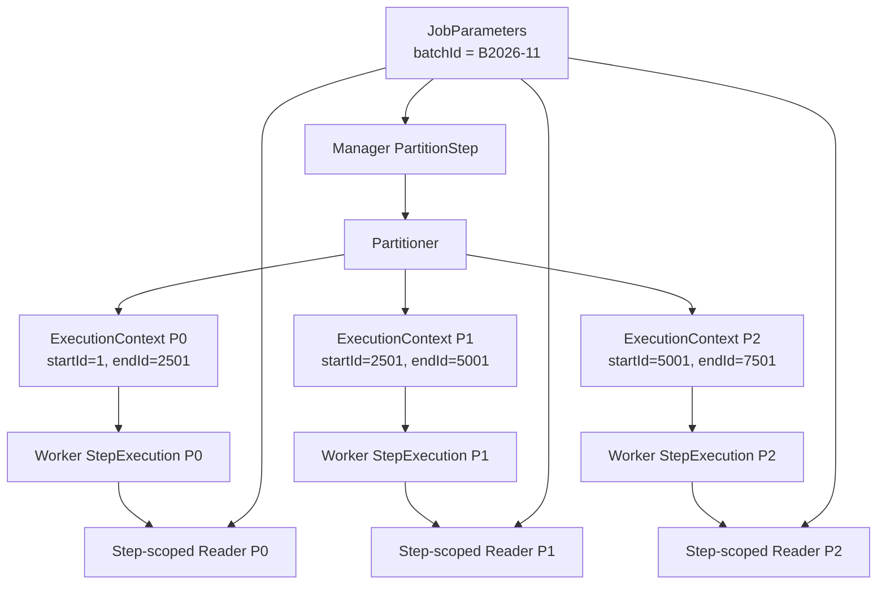
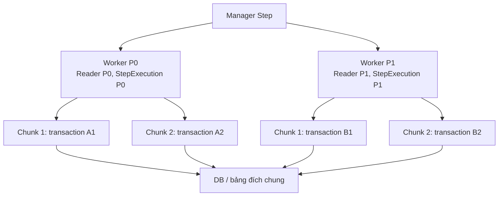

# Late binding input từ ExecutionContext trong Spring Batch PartitionStep

Khi chia một bộ dữ liệu lớn thành nhiều **partition**, mọi worker có thể chạy cùng một định nghĩa `Step` nhưng phải nhận **input khác nhau**: khoảng khóa, bucket hash, mã tenant, tên file hoặc ngày xử lý. Nếu reader được tạo như một singleton với tham số cố định, các worker có nguy cơ đọc cùng dữ liệu; nếu thay đổi tham số của một singleton ngay trước mỗi lần thực thi, các thread có thể ghi đè cấu hình của nhau.

**Late binding input từ `ExecutionContext`** là cách Spring Batch giải quyết bài toán này: manager tạo metadata riêng cho từng partition, worker có `StepExecution` và `ExecutionContext` tương ứng, rồi Spring tạo các bean `@StepScope` và giải các biểu thức SpEL **khi worker Step bắt đầu**, thay vì khi khởi tạo toàn bộ ứng dụng.

Bài thuộc chương **PartitionStep** của module **SPRING_BATCH_SCALING_OPERATIONS**. Mục tiêu của module là mở rộng Spring Batch với multi-threaded step, parallel steps, partitioning và mô hình phân tán một cách có kiểm soát: đo bottleneck, giữ thread safety, retry/restart đúng và lựa chọn mức song song phù hợp tài nguyên thực tế.

**Bạn sẽ học được:**

- Phân biệt `JobParameters`, `JobExecutionContext` và **`StepExecutionContext` của partition**.
- Hiểu đường đi của dữ liệu: `Partitioner` → `ExecutionContext` → worker `StepExecution` → `@StepScope` → reader/processor.
- Viết cấu hình Java Spring Batch 5.x dùng SpEL để late bind khoảng ID vào `JdbcCursorItemReader`.
- Giữ input không chồng lấn, snapshot ổn định, checkpoint và restart đúng.
- Chẩn đoán lỗi scope, sai tham số, chồng lấn partition và giới hạn của late binding khi nhiều thread/JVM hoạt động.

## 1. Vì sao PartitionStep cần late binding?

Giả sử bảng `staging_orders` có 10.000 đơn hàng đã được chốt theo `batch_id = "B2026-11"`, với khóa `id` từ 1 đến 10.000. Ta muốn tạo bốn partition theo khoảng ID:

| Partition | `startId` bao gồm | `endId` không bao gồm | Điều kiện đọc |
| --- | ---: | ---: | --- |
| `range-000` | 1 | 2.501 | `id >= 1 AND id < 2501` |
| `range-001` | 2.501 | 5.001 | `id >= 2501 AND id < 5001` |
| `range-002` | 5.001 | 7.501 | `id >= 5001 AND id < 7501` |
| `range-003` | 7.501 | 10.001 | `id >= 7501 AND id < 10001` |

Bốn worker đều dùng mã Java của cùng một `workerStep`, nhưng **không được cùng đọc một truy vấn thiếu điều kiện partition**. Input của từng worker sẽ là bộ ba `batchId`, `startId` và `endId`.

- `batchId` chung cho toàn Job: phù hợp với `jobParameters['batchId']`.
- `startId`/`endId` riêng mỗi partition: phù hợp với `stepExecutionContext['startId']` và `stepExecutionContext['endId']`.
- Reader lấy các giá trị này tại thời điểm worker Step thực thi, dùng chúng để xây điều kiện truy vấn.

Với các khoảng **nửa mở** `[startId, endId)`, một ID nằm đúng biên của hai khoảng chỉ thuộc khoảng bên phải. Miễn mọi khoảng được tạo nhất quán và bao phủ phạm vi nguồn cần xử lý, cách chia này tránh chồng lấn do điều kiện biên. Tuy nhiên, **khoảng không chồng lấn không tự bảo đảm đủ bản ghi**: vẫn phải lọc đúng `batch_id`, chốt dữ liệu nguồn và kiểm tra trường hợp khóa nằm ngoài phạm vi đã tính.

## 2. Late binding là gì — và không phải là gì?

**Early binding:** tạo reader tại lúc Spring khởi tạo `ApplicationContext`, gắn sẵn đường dẫn file hoặc khoảng khóa. Giá trị không còn phân biệt được partition nếu mọi worker dùng chung một reader.

**Late binding:** Spring lắp một **scoped proxy** vào cấu hình Step. Đến khi có `StepExecution` đang hoạt động, proxy mới truy xuất bean thật và giải các biểu thức `@Value` theo ngữ cảnh hiện tại.



Trong sơ đồ, partition thứ tư hoạt động tương tự. Mỗi worker có thể chạy trên thread riêng; điều quan trọng là **mỗi worker `StepExecution` có context và reader instance phù hợp**, không phải tên thread cụ thể.

Late binding **không** có nghĩa:

- Framework tự biết cách chia input; chính `Partitioner` phải tạo đúng các metadata.
- Input được đọc lại mỗi khi `process()` chạy; tham số bean thường được giải **khi bean step-scoped được khởi tạo**.
- Mọi field của reader tự được checkpoint; phải dùng `ItemStream` đúng contract.
- `ExecutionContext` là một message broker hoặc kho chứa hàng triệu item; nó là **metadata nhỏ, có thể persist** để định danh và phục hồi việc xử lý.
- Có thể thay đổi tùy tiện context giữa chừng rồi kỳ vọng reader tự đổi phạm vi; điều đó phá giả định về tính ổn định của partition.

## 3. Phân biệt ba nguồn tham số

| Nguồn | Phạm vi sở hữu | Ví dụ | Dùng khi nào? |
| --- | --- | --- | --- |
| `jobParameters` | `JobExecution`/định danh JobInstance theo quy tắc parameter | `batchId`, phiên bản dữ liệu, ngày snapshot | Giá trị đầu vào chung, phải ổn định cho lần thực thi/restart |
| `jobExecutionContext` | `JobExecution` | Metadata chung được Step trước ghi vào context | Có dữ liệu chung đã persist theo job, không phải trạng thái mutable của từng worker |
| **`stepExecutionContext`** | **`StepExecution`** | `startId`, `endId`, `bucketId`, `inputFile` | **Dữ liệu riêng của worker partition** |

Ví dụ SpEL thường dùng trong bean `@StepScope`:

```java
@Value("#{jobParameters['batchId']}") String batchId

@Value("#{stepExecutionContext['startId']}") Long startId

@Value("#{stepExecutionContext['endId']}") Long endId

@Value("#{stepExecutionContext['inputFile']}") String inputFile

@Value("#{jobExecutionContext['dataVersion']}") String dataVersion
```

Các dòng này là ví dụ **tham số phương thức** chứ không phải một file Java độc lập. Kiểu Java phải phù hợp với giá trị thật trong context; một `Long` được lưu bằng `putLong(...)` không nên được dùng như một `String` mà không có chuyển kiểu rõ ràng.

**Đừng nhầm manager và worker context.** `Partitioner` tạo các `ExecutionContext` **để gắn vào worker StepExecution**. Khi một bean `@StepScope` được tạo trong **manager StepExecution**, biểu thức `stepExecutionContext` lấy context của **manager**, không tự lấy một partition bất kỳ. Đặt reader/processor cần metadata partition ở **worker Step**.

### ExecutionContext không đồng nghĩa với Scope

- `ExecutionContext` là **dữ liệu** được quản lý bởi Spring Batch, có thể được persist để restart.
- `@StepScope` là **cơ chế vòng đời bean** cho phép resolve dữ liệu đó đúng `StepExecution`.
- Một `ExecutionContext` có nhiều key **không tự tạo** bean mới nếu bean vẫn là singleton.
- Một bean step-scoped **không tự biết** cần query theo cột nào nếu `Partitioner` và SQL không truyền/sử dụng các key đó.

## 4. Các giai đoạn từ Partitioner đến ItemReader

```mermaid
sequenceDiagram
    participant M as Manager PartitionStep
    participant P as Partitioner
    participant S as StepExecutionSplitter
    participant H as PartitionHandler
    participant W as Worker StepExecution
    participant R as Scoped proxy / Reader
    participant DB as Database
    M->>S: Tạo/chọn partition cần thực thi
    S->>P: partition(gridSize) khi cần tạo tập partition
    P-->>S: Map<String, ExecutionContext>
    S-->>M: Các worker StepExecution và context
    M->>H: handle(worker StepExecutions)
    H->>W: Thực thi một worker Step
    W->>R: Lần đầu truy cập bean @StepScope
    R->>R: Resolve jobParameters và stepExecutionContext
    R->>DB: SQL với batchId, startId, endId
    DB-->>R: Các item thuộc phạm vi
    W-->>H: BatchStatus / ExitStatus / counts
    H-->>M: Kết quả worker
    Note over M,DB: Manager tổng hợp trạng thái; không tạo global transaction
```

Thứ tự chi tiết có thể khác giữa handler/local và remote hoặc khi restart; sơ đồ diễn tả **trách nhiệm dữ liệu**, không phải lời hứa về lịch chạy thread. Điểm cần giữ là: khi worker reader được mở, context của worker đã chứa thông tin phân vùng cần thiết.

Một **partition name ổn định** như `range-000` giúp Spring Batch liên kết việc xử lý lại với đúng phần việc. Tên thread như `pool-1-thread-3` thì không ổn định và **không dùng làm khóa partition**.

## 5. Ví dụ thực hành: tạo bốn partition theo khoảng ID

Ví dụ Java 17+, Spring Batch 5.x, JDBC/PostgreSQL. Giả định:

- Bảng nguồn `staging_orders(batch_id, id, amount)`.
- Tập dữ liệu ứng với `batchId` được chốt, không biến động trong JobInstance.
- `id` là khóa sắp xếp xác định trong từng `batchId`; nếu `id` có lỗ hổng vẫn không sao, miễn range bao phủ.
- Bảng đích `processed_orders(batch_id, order_id, amount)` có unique key phù hợp.
- Tham số Job `batchId` là chuỗi không rỗng.

### 5.1. Model input/output

```java
import java.math.BigDecimal;

public record RawOrder(long id, BigDecimal amount) {}

public record ProcessedOrder(
        String batchId, long id, BigDecimal amount) {}
```

Khi đưa vào project Java, đặt hai `public record` trong các file riêng tương ứng. Đơn giản hóa model giúp nhìn rõ cơ chế partition, không có yêu cầu đặc biệt từ framework đối với `record`.

### 5.2. Partitioner: tạo các khoảng nửa mở, tên ổn định

```java
import java.util.LinkedHashMap;
import java.util.Locale;
import java.util.Map;

import org.springframework.batch.core.partition.support.Partitioner;
import org.springframework.batch.item.ExecutionContext;

public final class FixedRangePartitioner implements Partitioner {

    private final long minIdInclusive;
    private final long maxIdExclusive;
    private final int partitionCount;

    public FixedRangePartitioner(
            long minIdInclusive, long maxIdExclusive, int partitionCount) {
        long total = Math.subtractExact(maxIdExclusive, minIdInclusive);
        if (total <= 0 || partitionCount <= 0 || total < partitionCount) {
            throw new IllegalArgumentException("Invalid fixed partition plan");
        }
        this.minIdInclusive = minIdInclusive;
        this.maxIdExclusive = maxIdExclusive;
        this.partitionCount = partitionCount;
    }

    @Override
    public Map<String, ExecutionContext> partition(int gridSize) {
        // Cố định số phần logic cho JobInstance; gridSize chỉ là gợi ý.
        long total = maxIdExclusive - minIdInclusive;
        long baseSize = total / partitionCount;
        long remainder = total % partitionCount;
        long start = minIdInclusive;

        Map<String, ExecutionContext> result = new LinkedHashMap<>();

        for (int i = 0; i < partitionCount; i++) {
            long size = baseSize + (i < remainder ? 1 : 0);
            long end = start + size;

            ExecutionContext context = new ExecutionContext();
            context.putLong("startId", start);
            context.putLong("endId", end);

            String partitionName = String.format(
                    Locale.ROOT, "range-%03d", i);
            result.put(partitionName, context);

            start = end;
        }
        return result;
    }
}
```

Ví dụ tạo plan:

```java
FixedRangePartitioner p = new FixedRangePartitioner(
        1L, 10_001L, 4);

Map<String, ExecutionContext> ranges = p.partition(4);
// range-000: [1, 2501)
// range-001: [2501, 5001)
// range-002: [5001, 7501)
// range-003: [7501, 10001)
```

**Vì sao constructor nhận `partitionCount` cố định thay vì dựa hoàn toàn vào `gridSize`?** Với restart, số partition logic và mapping tên→phạm vi phải giữ ổn định cho cùng JobInstance. Số thread chạy đồng thời có thể được điều chỉnh độc lập, nhưng **không được đổi cách chia dữ liệu đã chốt** một cách tùy tiện. Đối với hệ thống thực, `minIdInclusive`, `maxIdExclusive`, `partitionCount` cần đến từ **kế hoạch snapshot/partition đã lưu bền vững**, hoặc các JobParameters không đổi được kiểm soát.

Không dùng ví dụ hard-code `1..10001` cho mọi batch trong production. Nếu dữ liệu có tenant hoặc phân vùng theo thời gian, plan còn phải chốt tenant/date/version theo đúng hợp đồng dữ liệu.

### 5.3. Kiểm tra tính rời nhau và bao phủ

Giả sử các khoảng được tạo như trên:

\[
P_i = \{x \mid start_i \le x < end_i\}
\]

Với `end_i = start_{i+1}`, mỗi cặp khoảng kề nhau không chồng lấn. Nếu khoảng đầu bắt đầu tại `minIdInclusive` và khoảng cuối kết thúc tại `maxIdExclusive`, hợp các khoảng bao phủ **toàn bộ miền ID đã chọn**.

Nhưng từ “bao phủ miền ID” không tự suy ra:

- `minIdInclusive`/`maxIdExclusive` lấy đúng từ batch snapshot.
- SQL có đúng `batch_id` và filter nghiệp vụ.
- Không có bản ghi bị xóa hoặc thêm sau khi checkpoint được ghi.
- Writer không nhân đôi hoặc bỏ sót dữ liệu do lỗi transaction.

Các điều kiện này phải được kiểm tra riêng.

## 6. Bean @StepScope nhận khoảng ID qua SpEL

Bước quan trọng nhất là khai báo reader **step-scoped**. `@StepScope` cho phép method `@Bean` được late bind khi có `StepExecution` của worker.

```java
import javax.sql.DataSource;

import org.springframework.batch.core.configuration.annotation.StepScope;
import org.springframework.batch.item.database.JdbcCursorItemReader;
import org.springframework.batch.item.database.builder.JdbcCursorItemReaderBuilder;
import org.springframework.beans.factory.annotation.Value;
import org.springframework.context.annotation.Bean;

@Bean
@StepScope
public JdbcCursorItemReader<RawOrder> rangeOrderReader(
        DataSource dataSource,
        @Value("#{jobParameters['batchId']}") String batchId,
        @Value("#{stepExecutionContext['startId']}") Long startId,
        @Value("#{stepExecutionContext['endId']}") Long endId) {

    if (batchId == null || batchId.isBlank()
            || startId == null || endId == null
            || startId >= endId) {
        throw new IllegalArgumentException(
                "Missing or invalid partition input");
    }

    return new JdbcCursorItemReaderBuilder<RawOrder>()
            .name("rangeOrderReader")
            .dataSource(dataSource)
            .sql("""
                SELECT id, amount
                FROM staging_orders
                WHERE batch_id = ?
                  AND id >= ?
                  AND id < ?
                ORDER BY id
                """)
            .preparedStatementSetter(ps -> {
                ps.setString(1, batchId);
                ps.setLong(2, startId);
                ps.setLong(3, endId);
            })
            .rowMapper((rs, rowNum) -> new RawOrder(
                    rs.getLong("id"),
                    rs.getBigDecimal("amount")))
            .saveState(true)
            .build();
}
```

Điểm cần hiểu:

1. `@StepScope` gắn bean với **worker `StepExecution`** và cho phép Spring tạo proxy trong lúc lắp Step.
2. `jobParameters['batchId']` là tham số **chung** của Job.
3. `stepExecutionContext['startId']` và `['endId']` lấy từ `ExecutionContext` do `Partitioner` tạo cho **partition đang chạy**.
4. Reader được khởi tạo bằng bộ tham số **bất biến của partition**, nên không cần setter thay đổi khoảng ID giữa các worker.
5. `.saveState(true)` bật cơ chế lưu state của `JdbcCursorItemReader` phục vụ restart; **không** bảo đảm restart đúng nếu nguồn đầu vào biến động hoặc checkpoint nằm ngoài ranh giới transaction phù hợp.
6. `ORDER BY id` cần thứ tự xác định. Nếu `id` không duy nhất trong phạm vi `batch_id`, dùng thêm khóa tie-breaker để thứ tự ổn định.
7. Các tham số SQL dùng `PreparedStatement`, tránh ghép chuỗi từ input để tạo điều kiện WHERE.

**Lưu ý quan trọng về kiểu bean:** nên khai báo return type bộc lộ `ItemStream` của reader có trạng thái (ví dụ `JdbcCursorItemReader<RawOrder>`), thay vì chỉ khai báo `ItemReader<RawOrder>` một cách làm framework không thể nhận diện lifecycle `open/update/close` trong một số cách dựng scoped proxy/Step. Khi sử dụng custom stream/listener, đăng ký các interface/callback cần thiết rõ ràng theo cấu hình thực.

### Nếu @StepScope bị bỏ quên

```java
// Anti-pattern: singleton bean nhưng tham số đòi StepExecutionContext.
@Bean
public JdbcCursorItemReader<RawOrder> incorrectReader(
        @Value("#{stepExecutionContext['startId']}") Long startId) {
    // ...
}
```

Singleton thường được tạo khi chưa có StepExecution đang hoạt động, khiến biểu thức không resolve được đúng hoặc binding xảy ra sai vòng đời. Đừng sửa bằng cách đặt `startId` vào static field rồi thay đổi trước khi submit worker; các partition chạy đồng thời sẽ tranh chấp field đó.

## 7. Processor có cần @StepScope không?

**Không bắt buộc.** Nếu `ItemProcessor` chỉ thực hiện phép biến đổi stateless, không cần metadata partition, một bean singleton an toàn đồng thời có thể đủ.

Nếu processor cần một JobParameter hoặc config riêng partition, ta có thể late bind tương tự reader. Ví dụ output cần gắn `batchId` chung:

```java
import org.springframework.batch.core.configuration.annotation.StepScope;
import org.springframework.batch.item.ItemProcessor;
import org.springframework.beans.factory.annotation.Value;
import org.springframework.context.annotation.Bean;

@Bean
@StepScope
public ItemProcessor<RawOrder, ProcessedOrder> rangeOrderProcessor(
        @Value("#{jobParameters['batchId']}") String batchId) {

    if (batchId == null || batchId.isBlank()) {
        throw new IllegalArgumentException("Missing batchId");
    }

    return item -> new ProcessedOrder(
            batchId,
            item.id(),
            item.amount());
}
```

Đây là một **lambda stateless theo item** nhưng đóng trên `batchId` của bean instance. Có thể dùng `@StepScope` để lấy giá trị khi worker chạy; nếu `batchId` đã được truyền vào qua cấu hình bất biến khác, hoặc processor không cần nó, có thể không cần scope này.

Muốn processor dùng thêm `stepExecutionContext['tenantId']` hoặc `['factor']` thì `Partitioner` phải đặt key đó vào **từng context** và processor phải nhận bằng `@Value` đúng tên/kiểu. Cấu hình riêng từng partition nên được giữ `final` hoặc chỉ đọc, không lưu trên singleton mutable.

**Đừng nhầm Step scope với thread scope:** trong **multi-threaded step** có nhiều thread xử lý chunk của **cùng một `StepExecution`**, chúng vẫn có thể dùng chung một bean `@StepScope`. Với **local partitioning**, mỗi worker partition thường có `StepExecution` riêng, nên bean scope giúp cô lập reader state. Dù vậy, singleton service/repository/cache được inject vẫn có thể chia sẻ giữa các worker và phải thread-safe.

## 8. Writer và Worker Step: đóng vòng dữ liệu

Để nhìn rõ luồng đầu cuối, ta tạo writer JDBC sử dụng output `ProcessedOrder`. Ví dụ PostgreSQL với khóa duy nhất `(batch_id, order_id)` để xử lý lại không tạo dòng trùng.

```sql
CREATE TABLE processed_orders (
    batch_id varchar(80) NOT NULL,
    order_id bigint NOT NULL,
    amount numeric(18, 2) NOT NULL,
    PRIMARY KEY (batch_id, order_id)
);
```

```java
import javax.sql.DataSource;

import org.springframework.batch.item.database.JdbcBatchItemWriter;
import org.springframework.batch.item.database.builder.JdbcBatchItemWriterBuilder;
import org.springframework.context.annotation.Bean;

@Bean
public JdbcBatchItemWriter<ProcessedOrder> rangeOrderWriter(
        DataSource dataSource) {

    return new JdbcBatchItemWriterBuilder<ProcessedOrder>()
            .dataSource(dataSource)
            .sql("""
                INSERT INTO processed_orders(batch_id, order_id, amount)
                VALUES (?, ?, ?)
                ON CONFLICT (batch_id, order_id)
                DO UPDATE SET amount = EXCLUDED.amount
                """)
            .itemPreparedStatementSetter((item, ps) -> {
                ps.setString(1, item.batchId());
                ps.setLong(2, item.id());
                ps.setBigDecimal(3, item.amount());
            })
            .build();
}
```

`ON CONFLICT` là cú pháp PostgreSQL; bảng thực phải có constraint tương ứng. Upsert hỗ trợ idempotency trong ví dụ **mỗi đơn là một trạng thái hiện tại**, nhưng không phù hợp nếu nghiệp vụ cần append sự kiện, ghi lịch sử hoặc cộng dồn tiền mỗi lần chạy. Khi nhiều partition ghi chung bảng đích, cần chứng minh các khóa nghiệp vụ không giao nhau và transaction/writer thực sự an toàn dưới mức song song dự kiến.

Worker Step dùng reader và processor step-scoped ở trên:

```java
import org.springframework.batch.core.Step;
import org.springframework.batch.core.repository.JobRepository;
import org.springframework.batch.core.step.builder.StepBuilder;
import org.springframework.batch.item.ItemProcessor;
import org.springframework.batch.item.database.JdbcBatchItemWriter;
import org.springframework.batch.item.database.JdbcCursorItemReader;
import org.springframework.context.annotation.Bean;
import org.springframework.transaction.PlatformTransactionManager;

@Bean
public Step workerStep(
        JobRepository jobRepository,
        PlatformTransactionManager transactionManager,
        JdbcCursorItemReader<RawOrder> rangeOrderReader,
        ItemProcessor<RawOrder, ProcessedOrder> rangeOrderProcessor,
        JdbcBatchItemWriter<ProcessedOrder> rangeOrderWriter) {

    return new StepBuilder("workerStep", jobRepository)
            .<RawOrder, ProcessedOrder>chunk(200, transactionManager)
            .reader(rangeOrderReader)
            .processor(rangeOrderProcessor)
            .writer(rangeOrderWriter)
            .build();
}
```

Khi Spring lắp cấu hình `workerStep`, reader/processor được đưa vào qua **scoped proxy**. Khi mỗi worker partition chạy, proxy resolve đối tượng thật từ `StepExecution` đang hoạt động.

Transaction của `chunk(200, transactionManager)` được quản lý theo **từng chunk**; các partition không có một transaction toàn cục. Nếu partition 2 lỗi sau khi commit ba chunk, dữ liệu đã commit ở partition 0, 1, 3 không bị đảo ngược chỉ vì worker 2 thất bại.

## 9. Manager Step và mức đồng thời

Ví dụ manager sử dụng `TaskExecutor` để chạy tối đa bốn worker partition đồng thời. `FixedRangePartitioner` vẫn tạo bốn partition logic dù grid size trong builder có thể được xem như gợi ý điều phối.

```java
import java.util.concurrent.ThreadPoolExecutor;

import org.springframework.batch.core.Step;
import org.springframework.batch.core.repository.JobRepository;
import org.springframework.batch.core.step.builder.StepBuilder;
import org.springframework.context.annotation.Bean;
import org.springframework.scheduling.concurrent.ThreadPoolTaskExecutor;

@Bean
public FixedRangePartitioner fixedRangePartitioner() {
    // Chỉ là plan demo đã chốt cho input [1, 10001).
    return new FixedRangePartitioner(1L, 10_001L, 4);
}

@Bean
public ThreadPoolTaskExecutor partitionExecutor() {
    ThreadPoolTaskExecutor executor = new ThreadPoolTaskExecutor();
    executor.setCorePoolSize(4);
    executor.setMaxPoolSize(4);
    executor.setQueueCapacity(8);
    executor.setThreadNamePrefix("partition-worker-");
    executor.setRejectedExecutionHandler(
            new ThreadPoolExecutor.AbortPolicy());
    return executor;
}

@Bean
public Step managerStep(
        JobRepository jobRepository,
        Step workerStep,
        FixedRangePartitioner fixedRangePartitioner,
        ThreadPoolTaskExecutor partitionExecutor) {

    return new StepBuilder("managerStep", jobRepository)
            .partitioner(workerStep.getName(), fixedRangePartitioner)
            .step(workerStep)
            .gridSize(4)
            .taskExecutor(partitionExecutor)
            .build();
}
```

Trong ứng dụng thật, đặt các method `@Bean` này vào một class `@Configuration` và kết hợp với bean cho reader/processor/writer/Job. Cấu hình ví dụ minh họa kiến trúc; cần chọn plan range theo dữ liệu thực và đưa plan đó vào cấu hình bền vững của đúng JobInstance.

**`gridSize` khác `partitionCount` và khác `maxPoolSize`:**

| Khái niệm | Ý nghĩa trong ví dụ | Khi thay đổi |
| --- | --- | --- |
| `partitionCount=4` trong `FixedRangePartitioner` | Số phần dữ liệu logic, tên và ranh giới | **Không đổi** khi restart cùng JobInstance |
| `gridSize(4)` | Gợi ý cho splitter/partitioner/handler theo cấu hình | Không mặc định là trần cứng của mọi custom Partitioner |
| `maxPoolSize=4` | Trần worker thread trong executor cụ thể | Có thể tuning năng lực chạy mà không đổi cách chia dữ liệu, nếu logic handler cho phép |
| `queueCapacity=8` | Chỗ đợi task trong executor | Chỉ hấp thụ burst; không thêm năng lực DB |

Với dữ liệu rất lớn, nên phân biệt **số partition logic** (ví dụ 64 hoặc 256) và **số worker chạy đồng thời** (ví dụ 8) để giúp cân bằng tải và restart theo phần. Tuy nhiên quá nhiều partition nhỏ sẽ làm tăng overhead StepExecution, JobRepository và điều phối; benchmark theo workload thực.

## 10. Context của một partition phải chứa những gì?

Mỗi `ExecutionContext` nên là **metadata tối thiểu** đủ để xác định phần việc một cách ổn định.

| Key | Kiểu gợi ý | Công dụng | Lưu ý |
| --- | --- | --- | --- |
| `startId` | `long` | Biên dưới của range | Inclusive |
| `endId` | `long` | Biên trên của range | Exclusive |
| `bucketId` | `int` | Phân vùng hash | Thuật toán và số bucket phải chốt |
| `tenantId` | `String` | Giới hạn theo tenant | Không nhầm tenant của partition khác |
| `inputFile` | `String` | Đường dẫn nguồn cho worker file reader | File và nội dung cần ổn định; kiểm soát path |
| `snapshotVersion` | `String` | Xác nhận snapshot / phiên bản | Không tự lấy lại “latest” khi restart |
| `outputFile` | `String` | File riêng theo partition | Tránh nhiều writer ghi cùng file |
| `partitionLabel` | `String` | Log/đối soát và truy vết | Không dùng làm khóa nếu không ổn định |

**Không lưu toàn bộ danh sách item hoặc payload nhạy cảm** vào `ExecutionContext`. Context thường được serialize vào JobRepository, nên đối tượng lớn, không tương thích serializer hoặc chứa bí mật có thể gây lỗi hiệu năng, restart và bảo mật. Ưu tiên số, chuỗi, giá trị đơn giản, có thể persist và tương thích giữa các phiên bản worker.

Không lưu JDBC `Connection`, `ResultSet`, `InputStream`, Spring bean hay đối tượng không thể khôi phục vào context. Context chứa **mô tả công việc**, reader mở tài nguyên cần thiết trong lifecycle của worker.

### Ví dụ partition theo file

Với mỗi file đầu vào có đường dẫn cố định, `Partitioner` có thể tạo:

```java
ExecutionContext fileContext = new ExecutionContext();
fileContext.putString("inputFile", "/data/import/B2026-11/orders-01.csv");
fileContext.putString("fileChecksum", "sha256:<giá-trị-đã-chốt>");
```

Worker `@StepScope` có thể late bind file:

```java
@Bean
@StepScope
public FlatFileItemReader<RawOrder> fileReader(
        @Value("#{stepExecutionContext['inputFile']}") String inputFile) {
    return new FlatFileItemReaderBuilder<RawOrder>()
            .name("partitionFileReader")
            .resource(new FileSystemResource(inputFile))
            .delimited()
            .names("id", "amount")
            .fieldSetMapper(fieldSet -> new RawOrder(
                    fieldSet.readLong("id"),
                    fieldSet.readBigDecimal("amount")))
            .saveState(true)
            .build();
}
```

Đây là một **biến thể độc lập** so với JDBC reader của ví dụ trước: cần import `FlatFileItemReader`, `FlatFileItemReaderBuilder`, `FileSystemResource` phù hợp và chỉ sử dụng loại reader phù hợp dữ liệu thật. Nếu không có file tại path, hoặc nội dung file thay đổi khi restart, late binding đúng cú pháp vẫn không bảo đảm tính đúng đắn.

Với remote worker, path local `/data/import/...` phải có ý nghĩa **trên máy worker**, không chỉ trên manager. Thường nên dùng URI storage chung, hoặc bảo đảm mount tương ứng và kiểm chứng quyền truy cập.

## 11. Định danh JobInstance và tính ổn định khi restart

Late binding giúp worker **lấy đúng input được giao**, nhưng không thay thế yêu cầu ổn định của kế hoạch phân vùng.

### 11.1. Không tái tính khoảng trên dữ liệu động khi restart

Giả sử lần đầu một job xử lý tập đơn hàng từ ID 1 đến 10.000, chia bốn range. Sau đó nguồn được chèn thêm 2.000 đơn; nếu khi restart lại dùng `MAX(id)` mới để tính range, `range-001` có thể đổi từ `[2501,5001)` thành một khoảng khác. Khi đó:

- Một tên partition cũ có thể đại diện dữ liệu khác.
- Metadata checkpoint của partition cũ có thể được áp cho tập item mới.
- Một số ID có thể bị bỏ sót hoặc xử lý trùng.
- Worker `COMPLETED` trong lần trước có thể bị bỏ qua dù khoảng mới chứa item chưa chạy.

**Giải pháp:** chốt snapshot nguồn và partition plan theo JobInstance. Có thể lưu plan trong bảng điều phối được version, hoặc bảo đảm cùng JobParameters định danh batch và toàn bộ thuật toán/range được tái tạo **y hệt**.

### 11.2. Không thay đổi số bucket khi restart

Với partition theo hash:

\[
bucketId = \operatorname{floorMod}(hash(key), bucketCount)
\]

Nếu `bucketCount` đổi từ 8 sang 16, phần lớn key có thể chuyển bucket; dù tên `bucket-003` còn giống nhau, tập dữ liệu của nó không còn như trước. Cần lưu và giữ nguyên thuật toán hash, charset/normalization của key và `bucketCount` cho cùng JobInstance.

### 11.3. Restart không đơn giản là chạy lại mọi thứ từ đầu

Spring Batch lưu trạng thái `JobExecution`/`StepExecution` và `ExecutionContext`. Khi restart theo cơ chế được hỗ trợ, các partition đã hoàn tất có thể được bỏ qua, còn partition chưa hoàn thành được chạy lại hoặc tiếp tục dựa trên checkpoint, tùy trạng thái và cấu hình.

Do đó, phải kết hợp:

1. Tên partition và phạm vi dữ liệu ổn định.
2. Reader có contract `ItemStream`/checkpoint đúng.
3. Nguồn dữ liệu bất biến hoặc có snapshot cô lập.
4. Writer idempotent cho tình huống cùng item/chunk được xử lý lại.
5. JobRepository lưu metadata bền vững; không tự sửa status bằng SQL.

Một `ExecutionContext` có đúng `startId/endId` vẫn chưa bảo đảm restart nếu reader lưu checkpoint dựa trên thứ tự không ổn định hoặc writer đã commit qua resource khác.

## 12. Transaction và thread safety của late-bound reader

Với **local partitioning**, mỗi worker `StepExecution` thường có reader `@StepScope` riêng. Mỗi worker chạy các chunk và commit/rollback theo transaction của worker Step; **không có transaction chung** bao trùm toàn bộ partition hoặc tất cả worker.



Một worker P1 thất bại **không làm rollback** các chunk đã commit ở P0. Đồng thời, hai worker vẫn có thể dùng chung singleton service, writer, cache, datasource hoặc bảng đích; những dependency này phải được kiểm tra thread safety và transaction riêng.

### Scope không phải cơ chế đồng bộ

- `@StepScope` tạo bean theo `StepExecution`, **không phải mỗi thread hoặc mỗi chunk**.
- Nếu một worker Step bật multi-threaded chunk bên trong, nhiều thread có thể chia sẻ **cùng một reader step-scoped**.
- `JdbcCursorItemReader` và nhiều reader stateful không nên được gọi đồng thời nếu chưa có contract và kiểm thử phù hợp.
- `@JobScope` tạo bean theo JobExecution, không thích hợp để giữ mutable config riêng từng worker trong cùng Job.

Khi cần song song, kiến trúc **một reader riêng cho mỗi partition, worker Step xử lý chunk tuần tự** thường dễ kiểm chứng checkpoint hơn việc cho nhiều thread dùng chung một reader stateful.

### Transaction manager và output không nguyên tử xuyên hệ thống

`JdbcCursorItemReader` có thể dùng connection riêng để giữ cursor và writer dùng datasource/transaction khác. Đừng suy ra rằng đọc input, ghi output và lưu JobRepository luôn commit nguyên tử chỉ vì chúng nằm trong một Step. Kiểm tra cách reader/writer tham gia transaction, isolation, connection pool và checkpoint trên ứng dụng thực.

Nếu processor gọi API hoặc writer gửi message ngoài transaction DB, retry/restart có thể tạo side effect lặp. Dùng unique key/idempotency hoặc outbox/ack protocol theo yêu cầu nghiệp vụ.

## 13. Làm gì khi input không khớp context?

Giả sử worker `range-002` có `startId=5001` và `endId=7501`, nhưng query trả về item ID 9.000. Đó là lỗi vượt phạm vi, không nên âm thầm xử lý. Có thể bổ sung bước kiểm tra đơn giản trong processor hoặc reader validation, đặc biệt ở giai đoạn rollout.

```java
@Bean
@StepScope
public ItemProcessor<RawOrder, RawOrder> assertPartitionRange(
        @Value("#{stepExecutionContext['startId']}") Long startId,
        @Value("#{stepExecutionContext['endId']}") Long endId) {

    if (startId == null || endId == null || startId >= endId) {
        throw new IllegalArgumentException("Invalid range");
    }

    return item -> {
        if (item.id() < startId || item.id() >= endId) {
            throw new IllegalStateException(
                    "Out-of-range order id=" + item.id());
        }
        return item;
    };
}
```

Đây là **phương án processor validation độc lập**, không được nối trực tiếp vào ví dụ worker Step đã có `rangeOrderProcessor` nếu chưa dùng composite processor hoặc thay pipeline phù hợp. Mục tiêu là phát hiện sớm bug phân vùng, không phải thay thế câu `WHERE` đúng.

Với partition theo `tenantId`, có thể kiểm tra tenant của item khớp tenant được gắn vào `ExecutionContext`. Đối với một job phải giữ dữ liệu đúng tuyệt đối, fail-fast khi context sai thường an toàn hơn tự sửa vùng xử lý ở giữa Job.

### Khi key bị thiếu

Không nên thay `null` thành biên mặc định như `Long.MIN_VALUE`/`Long.MAX_VALUE` chỉ để reader chạy tiếp, vì điều đó có thể khiến worker **đọc cả bảng**. Luôn validate các key bắt buộc khi bean được tạo hoặc trước khi reader mở.

Một số lỗi thường gặp:

- Partitioner dùng key `minId`, reader lại đọc `startId`.
- Partitioner `putInt("startId", ...)` nhưng bean kỳ vọng kiểu khác mà không kiểm thử chuyển đổi.
- `@Value` trỏ tới `jobExecutionContext` trong khi giá trị chỉ tồn tại ở **step context của worker**.
- Job chạy không truyền `batchId`, SQL nhận null và trả 0 hàng.
- Tên StepExecution thực khác tên giả định, khiến log khó truy dấu.
- Gọi factory method của bean scoped trực tiếp ngoài Spring container làm mất vòng đời proxy.

## 14. Khác biệt giữa local và remote partitioning

Late binding vẫn có vai trò tương tự trong **remote partitioning**, nhưng đường chuyển metadata và hạ tầng phải được thiết kế đúng.

| Yếu tố | Local partitioning | Remote partitioning |
| --- | --- | --- |
| Vị trí worker | Các thread trong cùng JVM | Một hoặc nhiều process/JVM |
| `ExecutionContext` của partition | Gắn với worker StepExecution local | Cần được giao/khôi phục qua cơ chế worker và JobRepository |
| `@StepScope` | Resolve trong Step context của thread worker | Resolve tại Step context **trên JVM worker** |
| DataSource/config | Có thể cùng ApplicationContext | Worker có datasource, beans, transaction manager và quyền truy cập riêng |
| File path | Cùng không gian file local | Path/URI phải truy cập được từ worker tương ứng |
| Điều phối lỗi | Executor/handler và JobRepository | Thêm network, broker, timeout, redelivery |
| Restart | Metadata + checkpoint theo partition | Metadata + checkpoint và xử lý trạng thái message không chắc chắn |

**Không gửi một instance `JdbcCursorItemReader`/`Connection` từ manager sang worker remote.** Chỉ truyền phần metadata định danh công việc (hoặc tham chiếu tới metadata bền vững); bean reader thật được tạo trong worker context.

Nếu dùng remote chunking (manager đọc/chia các chunk rồi gửi tới worker), vị trí reader và cơ chế truyền dữ liệu khác remote partitioning. Không mặc định thuật ngữ “worker” trong hai kiến trúc có cùng trách nhiệm.

## 15. Kiểm thử late binding cho từng partition

Test logic của `FixedRangePartitioner` riêng, sau đó kiểm thử bean step-scoped và kết quả trên database. Không chỉ test syntax SpEL mà bỏ qua dữ liệu thực.

### 15.1. Unit test kế hoạch partition

```java
import static org.junit.jupiter.api.Assertions.*;
import org.junit.jupiter.api.Test;

class FixedRangePartitionerTest {

    @Test
    void rangesAreStableDisjointAndCoverInput() {
        var partitioner =
                new FixedRangePartitioner(1L, 10_001L, 4);
        var result = partitioner.partition(4);

        assertEquals(4, result.size());
        assertEquals(1L,
                result.get("range-000").getLong("startId"));
        assertEquals(2_501L,
                result.get("range-000").getLong("endId"));
        assertEquals(2_501L,
                result.get("range-001").getLong("startId"));
        assertEquals(10_001L,
                result.get("range-003").getLong("endId"));

        assertEquals(result.keySet(),
                partitioner.partition(8).keySet());
    }
}
```

Test này xác nhận một số biên và tên ổn định của ví dụ. Với hệ thống production, cần thêm property-based test cho toàn bộ khoảng: không chồng lấn, không tạo khoảng rỗng và tổng độ dài bằng miền đầu vào.

### 15.2. Integration test với dữ liệu cố định

Khởi chạy Job với `batchId="B2026-11"` và đúng dữ liệu snapshot. Kiểm tra:

1. Manager tạo đúng bốn worker StepExecution với tên `workerStep:range-000` ... `workerStep:range-003` theo cấu hình hiện tại.
2. Mỗi worker nhận đúng `ExecutionContext` và reader chỉ đọc các ID thuộc range của nó.
3. Không có input ID nào xuất hiện đồng thời ở hai worker; tập hợp khóa bằng tập đầu vào dự kiến.
4. Mỗi worker có `readCount`/`writeCount` và trạng thái tương ứng; manager tổng hợp hợp lý.
5. Kết quả bảng `processed_orders` có cùng số khóa/giá trị so với baseline tuần tự.
6. Khi một worker bị lỗi ở chunk giữa chừng, phần đã commit không bị mất; restart hoàn thành phần còn lại và không tạo dữ liệu trùng.

Nếu dùng `spring-batch-test`, có thể sử dụng `StepScopeTestUtils` hoặc các tiện ích test Step scope tương ứng với phiên bản thư viện để dựng `StepExecution`/`ExecutionContext` giả lập và thử bean riêng; tuy nhiên **chỉ integration test chạy Job/PartitionStep thật** mới chứng minh được worker context, transaction và checkpoint phối hợp đúng.

### 15.3. Ma trận thử nghiệm

| Kịch bản | Lỗi có thể phát hiện | Kỳ vọng |
| --- | --- | --- |
| Thiếu `startId` hoặc `endId` | Partitioner không cấp đủ metadata | Fail rõ ràng, không đọc toàn bảng |
| `startId >= endId` | Khoảng không hợp lệ | Báo lỗi trước khi reader chạy |
| Hai range chồng nhau | Bug ở kế hoạch phân vùng | Test báo duplicate/mapping sai |
| Một range không có hàng | Dữ liệu phân bố thưa | Worker có thể `COMPLETED` với 0 read; đối soát tổng |
| Chạy 1 và 4 worker | Có race ở bean/dependency | Output và checksum như nhau |
| Reader mở lại sau rollback | State/checkpoint không nhất quán | Xử lý lại đúng phần chưa commit |
| Kill JVM trước/sau commit | Metadata và dữ liệu đích không đồng bộ | Idempotency và restart phục hồi an toàn |
| Đổi input snapshot giữa restart | Phân vùng thay đổi | Phát hiện vi phạm, không chạy mù |
| Thay `gridSize` nhưng giữ plan | Nhầm concurrency với partitionCount | Tên/range logic không đổi |
| Worker chạy remote không thấy file | Đường dẫn chỉ có trên manager | Lỗi được phát hiện; cấu hình storage chung |
| Partitioner có nhiều partition nóng | Skew theo dữ liệu | Đo duration theo partition, điều chỉnh kế hoạch ở job mới |

### Truy vấn kiểm tra ID thiếu/trùng (PostgreSQL)

```sql
-- Kiểm tra khóa đầu ra không thuộc batch snapshot.
SELECT o.order_id
FROM processed_orders o
LEFT JOIN staging_orders s
  ON s.batch_id = o.batch_id
 AND s.id = o.order_id
WHERE o.batch_id = :batchId
  AND s.id IS NULL;

-- Kiểm tra khóa nguồn chưa có kết quả.
-- Chỉ dùng trực tiếp nếu mọi input đều phải tạo đúng một output.
SELECT s.id
FROM staging_orders s
LEFT JOIN processed_orders o
  ON o.batch_id = s.batch_id
 AND o.order_id = s.id
WHERE s.batch_id = :batchId
  AND o.order_id IS NULL;

-- Kiểm tra tổng số và tổng giá trị theo đợt.
SELECT COUNT(*) AS output_count, SUM(amount) AS output_amount
FROM processed_orders
WHERE batch_id = :batchId;
```

Nếu processor filter, skip hoặc aggregate, phải điều chỉnh phép đối soát theo quy tắc nghiệp vụ. Một bảng đã có unique key luôn không có row trùng khóa, nhưng vẫn có thể **thiếu key hoặc sai amount** vì phạm vi input không đúng.

## 16. Đo hiệu năng và bottleneck

Late binding chỉ giúp phân công **đúng dữ liệu**; nó không làm database nhanh hơn. Khi tăng partition count hoặc số worker đồng thời, cần quan sát:

| Nhóm | Metric cần theo dõi | Dấu hiệu |
| --- | --- | --- |
| Partition | Số lượng, trạng thái, duration p95/p99, số item từng partition | Range quá lệch hoặc một worker rất chậm |
| Worker / executor | Active threads, queue depth/wait, rejected tasks | Hàng đợi đầy hay worker thiếu |
| Database | Connection pool pending, lock wait, query latency, I/O | Đã chạm giới hạn DB |
| Chunk | Commit/rollback count, chunk latency | Transaction quá lớn hoặc lỗi lặp |
| Reader | Read latency, cursor/open time, throughput | Truy vấn range thiếu index |
| Writer | Write latency, deadlock, upsert conflict | Tranh chấp ghi đích |
| Restart | Số partition cần chạy lại, retry count | Recovery có quá nhiều công việc lặp |
| Đối soát | ID thiếu/trùng, checksum, tổng amount | Scaling có làm dữ liệu sai không |

Với query `WHERE batch_id=? AND id>=? AND id<? ORDER BY id`, index thường cần được xem xét trên `(batch_id, id)`. Hãy đo query plan thực tế, vì partitioning không thể chữa một truy vấn full scan tốn I/O khi số worker tăng.

### Range cân đều theo ID chưa chắc cân đều theo dữ liệu

Bốn khoảng độ rộng 2.500 ID có thể chứa số bản ghi rất khác nhau nếu ID thưa hoặc một miền chứa item xử lý đắt hơn. Partition có nhiều item/tác vụ nặng sẽ quyết định thời gian hoàn tất Job.

Có thể cân nhắc:

- Chia nhiều partition logic nhỏ hơn số worker để giảm skew, nhưng giữ tên/mapping cố định suốt JobInstance.
- Tạo range theo histogram/snapshot số lượng bản ghi thay vì chỉ theo độ rộng ID.
- Partition theo tenant/bucket nếu phù hợp dữ liệu và tránh tranh chấp khóa.
- Tách workload CPU-heavy và I/O-heavy nếu cùng pool làm nghẽn tài nguyên.

Không thay thuật toán partition giữa **lần đầu và restart** để chữa skew tức thời; muốn đổi chiến lược, nên lên kế hoạch cho JobInstance mới và xử lý dữ liệu cũ rõ ràng.

## 17. Những lỗi cấu hình thường gặp

| Sai lầm | Triệu chứng | Hướng xử lý |
| --- | --- | --- |
| Không thêm `@StepScope` cho reader dùng SpEL step context | Lỗi resolve bean hoặc mọi worker nhận sai input | Đặt scope trên `@Bean`, inject qua Spring |
| Dùng `jobParameters['startId']` cho khoảng riêng partition | Mọi worker nhận cùng biên | Dùng `stepExecutionContext['startId']` |
| Partitioner đặt key `fromId` nhưng reader đọc `startId` | Binding null, reader thất bại | Chuẩn hóa schema context và validate |
| Sửa field singleton trước khi dispatch worker | Race, các partition dùng chung cấu hình | Constructor config riêng qua step-scoped bean |
| Gọi trực tiếp factory method thay vì qua container | Không có scoped proxy và đúng Step context | Spring inject bean vào worker Step |
| Dùng `@StepScope` như thread scope | Multi-threaded Step vẫn chia sẻ state | Audit concurrency, chọn partitioning đúng |
| Thay đổi bucket/range khi restart | ID được gán lại, checkpoint sai | Chốt partition plan, snapshot, tên ổn định |
| Dùng `<= endId` cho mọi range kề nhau | ID biên được xử lý hai lần | Dùng khoảng nửa mở `[start,end)` |
| Chỉ lọc theo range, quên `batch_id` | Đọc lẫn dữ liệu của đợt khác | Gắn batchId trong SQL và kiểm thử |
| Để nguồn thay đổi trong lúc chạy | Restart không tái hiện đúng | Snapshot/version/pinning dữ liệu |
| Hai writer ghi cùng file | Dòng bị xen kẽ hoặc hỏng file | Một output riêng từng partition, merge sau |
| Lưu object lớn/nhạy cảm trong context | Repository phình to, lỗi serializer, lộ dữ liệu | Chỉ lưu metadata đơn giản/an toàn |
| Remote worker nhận path local của manager | Không tìm thấy nguồn | Dùng storage chung, cấu hình đúng trên worker |
| Bỏ qua DB pool khi tăng worker | Chờ connection, timeout, throughput giảm | Tuning tổng concurrency theo tài nguyên |
| Tin `BatchStatus.COMPLETED` là đủ | Không phát hiện thiếu/trùng/sai giá trị | Đối soát dữ liệu đầu ra |

## 18. Checklist production: late binding từ ExecutionContext

- [ ] Manager tạo `ExecutionContext` riêng cho **mọi worker partition** cần chạy.
- [ ] Tên partition, kế hoạch range/bucket/tenant và input snapshot ổn định trong JobInstance.
- [ ] Key/kiểu `startId`, `endId`, `bucketId`, `inputFile` được chuẩn hóa và validate fail-fast.
- [ ] Bean reader cần dữ liệu partition dùng `@StepScope`; binding được resolve trong worker StepExecution.
- [ ] Phân biệt rõ `jobParameters`, `jobExecutionContext` và `stepExecutionContext`.
- [ ] Reader có `ItemStream`/checkpoint phù hợp và tên ổn định khi restart.
- [ ] Điều kiện truy vấn/input source dùng đúng phạm vi partition, không đọc chồng lấn.
- [ ] Phạm vi các partition bao phủ toàn bộ dữ liệu được yêu cầu, không bỏ vùng biên.
- [ ] Không nhầm `@StepScope` với tạo bean theo thread; dependency chia sẻ được audit thread safety.
- [ ] Writer có khóa nghiệp vụ/idempotency thích hợp với retry/restart.
- [ ] Không đặt credential, payload lớn hoặc resource không serializable trong ExecutionContext.
- [ ] Với file input, path/URI và checksum/snapshot truy cập được từ worker JVM thực tế.
- [ ] Đã thử lỗi khi context thiếu key/sai kiểu/range rỗng và khi nguồn thay đổi.
- [ ] Đã thử rollback, worker crash, restart và đối soát key/checksum/output.
- [ ] Đã đo DB connection pool, lock, throughput, độ lệch duration giữa các partition.
- [ ] Có runbook điều tra partition lỗi và ngăn publish khi data reconciliation chưa đạt.

## 19. Bài tập và câu hỏi tự kiểm tra

1. Vì sao một singleton `JdbcCursorItemReader` gắn biến `startId` mutable không phù hợp khi bốn partition chạy đồng thời?
2. Trong `@StepScope`, `stepExecutionContext['startId']` được đọc từ context của manager hay worker? Vì sao?
3. Nếu `gridSize=8` nhưng `FixedRangePartitioner` cố định bốn phần, có bao nhiêu partition logic? Có nhất thiết tám worker đồng thời không?
4. Tại sao dùng khoảng `[startId,endId)` dễ kiểm soát biên hơn dùng điều kiện `BETWEEN start AND end` ở các khoảng liền nhau?
5. Một Job restart và `MAX(id)` của bảng nguồn đã tăng. Điều gì có thể xảy ra nếu Partitioner tự tạo lại range?
6. `@StepScope` có bảo đảm một instance reader **mỗi thread** trong multi-threaded Step không?
7. Khi nhận input file path từ `ExecutionContext`, remote worker cần những điều kiện gì để đọc đúng file?
8. Một worker lỗi sau khi commit ba chunk. Việc late bind range đúng có bảo đảm writer không ghi trùng sau restart không?
9. Bốn range đều độ rộng 2.500 ID, nhưng một worker chạy lâu hơn mười lần. Những metric nào giúp phân biệt skew dữ liệu với bottleneck database?
10. Hãy thiết kế integration test xác nhận mỗi input ID của `batchId` được phân cho đúng một partition và output sau restart khớp baseline tuần tự.

## Kết luận

**Late binding input từ `ExecutionContext` là mắt xích nối kế hoạch phân vùng của manager với reader/processor trong từng worker `StepExecution`.** `Partitioner` phải định nghĩa phần việc đúng và ổn định; `@StepScope`/SpEL giúp mỗi worker nhận đúng metadata khi thực thi. Cơ chế này không tự giải quyết đồng bộ thread, transaction xuyên partition, checkpoint hay idempotency. Để mở rộng Spring Batch an toàn, hãy cố định input snapshot, kiểm tra phạm vi không chồng lấn, thử restart và đối soát dữ liệu cuối cùng ở mức song song dự kiến.
