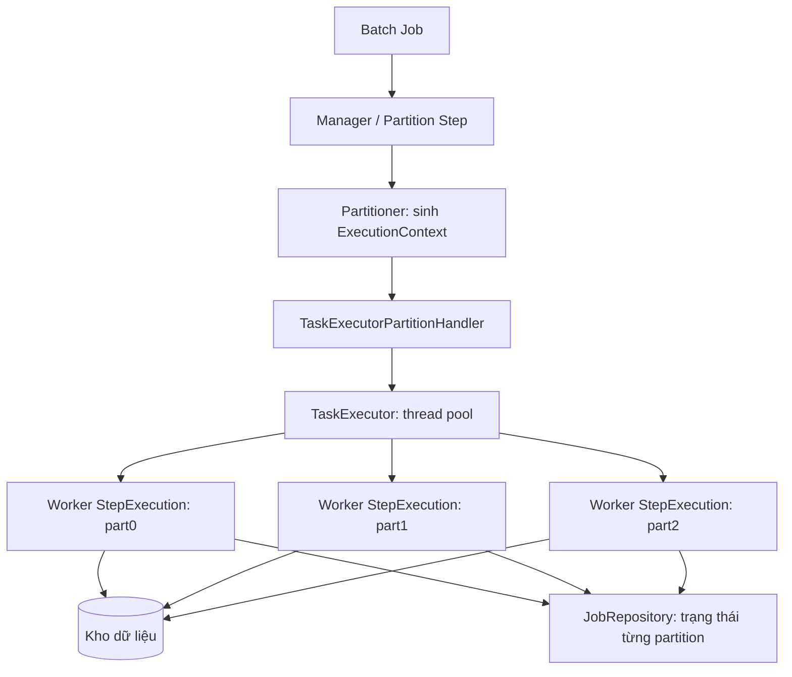

# Cấu hình `TaskExecutorPartitionHandler` trong Spring Batch

Khi một batch job phải xử lý hàng triệu bản ghi, tăng `chunkSize` thường không đủ để rút ngắn thời gian chạy. Một cách mở rộng trong **Spring Batch Scaling Operations** là chia tập dữ liệu thành các **partition độc lập**, rồi giao các partition cho nhiều luồng xử lý trên cùng một JVM. `TaskExecutorPartitionHandler` là thành phần thực thi mô hình này: nó điều phối các `StepExecution` của worker thông qua một `TaskExecutor`.

Bài này tập trung vào cách cấu hình `TaskExecutorPartitionHandler`, liên kết nó với `Partitioner`, `Step` và thread pool; sau đó phân tích khả năng restart, thread safety, retry và các nút thắt tài nguyên. Ví dụ sử dụng Java 17+, Spring Batch 5.x/Spring Boot 3.x và PostgreSQL; với phiên bản khác, cần đối chiếu API tương ứng.

## 1. Hiểu đúng vai trò của `TaskExecutorPartitionHandler`

Trong partitioning, một **manager step** tạo hoặc nhận tập các phân vùng thông qua `Partitioner`. Mỗi phân vùng có tên riêng và một `ExecutionContext` chứa thông số dữ liệu mà worker phải xử lý. `TaskExecutorPartitionHandler` nhận các worker `StepExecution` từ cơ chế chia step, lập lịch chạy chúng trên các luồng do `TaskExecutor` cung cấp và thu thập kết quả để manager step xác định trạng thái cuối cùng.



Ba thành phần dễ nhầm lẫn có nhiệm vụ khác nhau:

| Thành phần | Trách nhiệm | Ví dụ cấu hình |
| --- | --- | --- |
| `Partitioner` | Xác định các phần dữ liệu không chồng lấp và gắn `ExecutionContext` cho từng phần | `minId`, `maxId` của từng khoảng ID |
| `TaskExecutorPartitionHandler` | Thực thi worker step trên các luồng cục bộ và chờ kết quả | `setStep`, `setTaskExecutor`, `setGridSize` |
| `TaskExecutor` | Quản lý số luồng, hàng đợi, vòng đời thread | `ThreadPoolTaskExecutor` với pool 4 luồng |

**Lưu ý về phạm vi:** Handler này xử lý song song *trong một tiến trình ứng dụng*. Nó không tự gửi công việc đến các JVM hay máy chủ từ xa. Với nhiều node thực thi, cần kiến trúc remote partitioning và cơ chế truyền thông thích hợp.

### `gridSize` khác số luồng

Giả sử `gridSize = 8` và thread pool có 4 worker, `Partitioner` có thể tạo 8 `StepExecution`, nhưng tại một thời điểm chỉ tối đa 4 worker chạy đồng thời. Các partition còn lại đợi trong hàng đợi. `gridSize` là kích thước mục tiêu khi chia dữ liệu, **không phải** cấu hình trực tiếp số luồng và cũng không bảo đảm rằng `Partitioner` luôn trả về đúng từng ấy partition (ví dụ bảng ít bản ghi hoặc rỗng).

Không nên đặt `gridSize` bằng số bản ghi. Mỗi partition có chi phí khởi tạo, kết nối, lưu metadata và scheduling; các partition quá nhỏ có thể khiến overhead lớn hơn thời gian xử lý hữu ích.

## 2. Ví dụ nghiệp vụ và điều kiện tiên quyết

Giả sử job đọc bảng `orders`, ghi các đơn hàng đã xử lý vào `processed_orders`. Mỗi ID đơn hàng được giao cho duy nhất một partition; các partition độc lập, vì thế có thể chạy song song.

```sql
-- PostgreSQL: hai bảng dùng để minh họa, không phải schema hệ thống Spring Batch.
CREATE TABLE orders (
    id BIGINT PRIMARY KEY,
    amount NUMERIC(18, 2) NOT NULL
);

CREATE TABLE processed_orders (
    order_id BIGINT PRIMARY KEY,
    amount NUMERIC(18, 2) NOT NULL
);
```

Giả sử miền ID thực tế là `1..10_000`. Khi chia thành bốn partition, có thể nhận các khoảng `[1,2500]`, `[2501,5000]`, `[5001,7500]`, `[7501,10000]`. ID bị khuyết không làm sai tính đúng đắn, nhưng nếu dữ liệu phân bố không đều, các khoảng ID bằng nhau có thể có thời gian xử lý khác nhau.

Ứng dụng cần có `DataSource`, `PlatformTransactionManager` và `JobRepository` hợp lệ, cùng các bảng metadata Spring Batch. Trong ví dụ, các bean hạ tầng này được Spring Boot/Spring Batch cung cấp; không gọi `@EnableBatchProcessing` chỉ để kích hoạt job trong một ứng dụng Boot đã tự cấu hình Batch.

## 3. Cấu hình Java hoàn chỉnh

Đoạn dưới đây minh họa cách **khai báo `TaskExecutorPartitionHandler` tường minh** thay vì chỉ dùng cú pháp rút gọn của `PartitionStepBuilder`. Nó dùng một `Step` worker theo chunk, một reader có scope riêng cho mỗi partition, một writer an toàn khi ghi lại cùng ID, và một manager step.

```java
package example.batch;

import java.math.BigDecimal;
import java.util.LinkedHashMap;
import java.util.Map;
import javax.sql.DataSource;

import org.springframework.batch.core.Job;
import org.springframework.batch.core.Step;
import org.springframework.batch.core.configuration.annotation.StepScope;
import org.springframework.batch.core.job.builder.JobBuilder;
import org.springframework.batch.core.partition.PartitionHandler;
import org.springframework.batch.core.partition.support.Partitioner;
import org.springframework.batch.core.partition.support.TaskExecutorPartitionHandler;
import org.springframework.batch.core.repository.JobRepository;
import org.springframework.batch.core.step.builder.StepBuilder;
import org.springframework.batch.item.ExecutionContext;
import org.springframework.batch.item.database.JdbcBatchItemWriter;
import org.springframework.batch.item.database.JdbcCursorItemReader;
import org.springframework.batch.item.database.builder.JdbcBatchItemWriterBuilder;
import org.springframework.batch.item.database.builder.JdbcCursorItemReaderBuilder;
import org.springframework.beans.factory.annotation.Qualifier;
import org.springframework.beans.factory.annotation.Value;
import org.springframework.context.annotation.Bean;
import org.springframework.context.annotation.Configuration;
import org.springframework.core.task.TaskExecutor;
import org.springframework.dao.TransientDataAccessException;
import org.springframework.jdbc.core.JdbcTemplate;
import org.springframework.scheduling.concurrent.ThreadPoolTaskExecutor;
import org.springframework.transaction.PlatformTransactionManager;

@Configuration
public class OrderPartitionJobConfig {

    record OrderRow(long id, BigDecimal amount) {}
    record IdBounds(Long minId, Long maxId) {}

    // 1. Tạo tối đa 4 worker chạy đồng thời; đủ chỗ xếp hàng cho 8 partition.
    @Bean("partitionTaskExecutor")
    public ThreadPoolTaskExecutor partitionTaskExecutor() {
        ThreadPoolTaskExecutor executor = new ThreadPoolTaskExecutor();
        executor.setCorePoolSize(4);
        executor.setMaxPoolSize(4);
        executor.setQueueCapacity(8);
        executor.setThreadNamePrefix("batch-part-");
        return executor; // Spring khởi tạo và quản lý vòng đời bean.
    }

    // 2. Đọc MIN/MAX một lần; chia các khoảng ID liên tiếp, không chồng lấp.
    @Bean("orderPartitioner")
    public Partitioner orderPartitioner(DataSource dataSource) {
        JdbcTemplate jdbc = new JdbcTemplate(dataSource);
        return gridSize -> {
            if (gridSize < 1) {
                throw new IllegalArgumentException("gridSize must be positive");
            }

            IdBounds bounds = jdbc.queryForObject(
                "SELECT MIN(id) AS min_id, MAX(id) AS max_id FROM orders",
                (rs, rowNum) -> new IdBounds(
                    rs.getObject("min_id", Long.class),
                    rs.getObject("max_id", Long.class))
            );

            Map<String, ExecutionContext> partitions = new LinkedHashMap<>();
            if (bounds == null || bounds.minId() == null) {
                return partitions; // Không có bản ghi cần xử lý.
            }

            long min = bounds.minId();
            long max = bounds.maxId();
            long count = max - min + 1;
            long width = count / gridSize + (count % gridSize == 0 ? 0 : 1);
            long start = min;
            int index = 0;

            while (start <= max) {
                long end = Math.min(max, start + width - 1);
                ExecutionContext context = new ExecutionContext();
                context.putLong("minId", start);
                context.putLong("maxId", end);
                partitions.put("part" + index++, context);
                if (end == max) break;
                start = end + 1;
            }
            return partitions;
        };
    }

    // 3. Mỗi worker StepExecution nhận reader riêng từ @StepScope.
    @Bean("orderReader")
    @StepScope
    public JdbcCursorItemReader<OrderRow> orderReader(
            DataSource dataSource,
            @Value("#{stepExecutionContext['minId']}") Long minId,
            @Value("#{stepExecutionContext['maxId']}") Long maxId) {

        return new JdbcCursorItemReaderBuilder<OrderRow>()
            .name("orderReader")
            .dataSource(dataSource)
            .sql("SELECT id, amount FROM orders "
                + "WHERE id BETWEEN ? AND ? ORDER BY id")
            .preparedStatementSetter(ps -> {
                ps.setLong(1, minId);
                ps.setLong(2, maxId);
            })
            .rowMapper((rs, rowNum) ->
                new OrderRow(rs.getLong("id"), rs.getBigDecimal("amount")))
            .saveState(true)
            .build();
    }

    // 4. PostgreSQL UPSERT: ghi lặp một ID vẫn cho kết quả nhất quán.
    @Bean("orderWriter")
    public JdbcBatchItemWriter<OrderRow> orderWriter(DataSource dataSource) {
        return new JdbcBatchItemWriterBuilder<OrderRow>()
            .dataSource(dataSource)
            .sql("INSERT INTO processed_orders (order_id, amount) "
                + "VALUES (?, ?) ON CONFLICT (order_id) "
                + "DO UPDATE SET amount = EXCLUDED.amount")
            .itemPreparedStatementSetter((item, ps) -> {
                ps.setLong(1, item.id());
                ps.setBigDecimal(2, item.amount());
            })
            .build();
    }

    // 5. Worker xử lý tuần tự từng chunk bên trong partition của mình.
    @Bean("orderWorkerStep")
    public Step orderWorkerStep(
            JobRepository jobRepository,
            PlatformTransactionManager transactionManager,
            @Qualifier("orderReader") JdbcCursorItemReader<OrderRow> reader,
            @Qualifier("orderWriter") JdbcBatchItemWriter<OrderRow> writer) {

        return new StepBuilder("orderWorkerStep", jobRepository)
            .<OrderRow, OrderRow>chunk(200, transactionManager)
            .reader(reader)
            .writer(writer)
            .faultTolerant()
            .retry(TransientDataAccessException.class)
            .retryLimit(3)
            .build();
    }

    // 6. Handler thực thi các worker StepExecution trong cùng JVM.
    @Bean("orderPartitionHandler")
    public TaskExecutorPartitionHandler orderPartitionHandler(
            @Qualifier("orderWorkerStep") Step workerStep,
            @Qualifier("partitionTaskExecutor") TaskExecutor executor) {

        TaskExecutorPartitionHandler handler = new TaskExecutorPartitionHandler();
        handler.setStep(workerStep);
        handler.setTaskExecutor(executor);
        handler.setGridSize(8);
        return handler;
    }

    // 7. Manager step kết nối Partitioner với PartitionHandler.
    @Bean("orderManagerStep")
    public Step orderManagerStep(
            JobRepository jobRepository,
            @Qualifier("orderPartitioner") Partitioner partitioner,
            @Qualifier("orderPartitionHandler") PartitionHandler handler) {

        return new StepBuilder("orderManagerStep", jobRepository)
            .partitioner("orderWorkerStep", partitioner)
            .partitionHandler(handler)
            .build();
    }

    // 8. Job bắt đầu tại manager step.
    @Bean
    public Job processOrdersJob(
            JobRepository jobRepository,
            @Qualifier("orderManagerStep") Step managerStep) {

        return new JobBuilder("processOrdersJob", jobRepository)
            .start(managerStep)
            .build();
    }
}
```

Đây là cấu hình mẫu tập trung vào cơ chế partitioning. Chạy thực tế cần cấu hình kết nối PostgreSQL, tạo schema metadata Spring Batch và bảo đảm các phiên bản dependency tương thích. SQL `ON CONFLICT` đặc thù PostgreSQL; nếu dùng cơ sở dữ liệu khác, thay bằng cơ chế upsert/khử trùng lặp tương đương. Công thức tính khoảng ID cũng giả định hiệu `max - min + 1` nằm trong miền `long`.

### Luồng chạy của ví dụ

1. Job gọi `orderManagerStep`.
2. Manager yêu cầu `orderPartitioner` chia miền ID với `gridSize = 8`.
3. Mỗi partition mang `minId`, `maxId` trong một `ExecutionContext` riêng; tên `part0`, `part1`... cần ổn định giữa các lần chạy lại của cùng một job instance.
4. `orderPartitionHandler` giao các worker `StepExecution` cho pool tối đa 4 luồng, nhận kết quả khi worker hoàn tất.
5. Mỗi worker có reader `@StepScope` riêng và thực hiện các chunk 200 bản ghi trong transaction tương ứng.
6. `JobRepository` lưu metadata của từng `StepExecution`; manager tổng hợp trạng thái để xác định kết quả step/job.

**Vì sao cần `@StepScope`?** Các `JdbcCursorItemReader` có trạng thái vị trí đọc (`ItemStream`) và không được chia sẻ cùng một instance cho nhiều thread. Scope theo `StepExecution` cho phép cùng một cấu hình reader được khởi tạo thành các instance riêng, nhận đúng `minId`/`maxId` và lưu trạng thái đọc trong context của từng worker. `JdbcBatchItemWriter` của ví dụ không giữ con trỏ đọc hoặc state thay đổi theo bản ghi và dùng được dưới dạng bean dùng chung; custom writer có state phải được kiểm tra hoặc đưa về step scope.

## 4. Ý nghĩa các cấu hình quan trọng

| Cấu hình | Trong ví dụ | Ý nghĩa và điểm cần kiểm tra |
| --- | --- | --- |
| `handler.setStep(workerStep)` | `orderWorkerStep` | Step được thực thi một lần cho mỗi worker `StepExecution` |
| `handler.setTaskExecutor(...)` | `ThreadPoolTaskExecutor` | Cách lập lịch công việc, số luồng tối đa và cách xếp hàng |
| `handler.setGridSize(8)` | 8 | Gợi ý số partition cho splitter/partitioner; không giới hạn trực tiếp số thread |
| `corePoolSize` / `maxPoolSize` | 4 / 4 | Tối đa 4 worker hoạt động đồng thời trong pool này |
| `queueCapacity` | 8 | Có chỗ nhận partition chưa đến lượt; tránh từ chối tác vụ chỉ vì pool bận |
| `chunk(200, txManager)` | 200 | Mỗi worker commit theo chunk; không có một transaction toàn cục cho mọi partition |
| `retryLimit(3)` | 3 | Tổng số lần thử cho lỗi được chọn, bao gồm lần thử ban đầu; không thay thế restart cả job |

Không nên chỉ tăng `maxPoolSize` khi `queueCapacity` còn lớn và `corePoolSize` nhỏ: `ThreadPoolTaskExecutor` ưu tiên lấp core thread, rồi xếp hàng; nó thường chỉ mở rộng đến max khi queue đã đầy. Nếu đặt `queueCapacity = 0`, các partition vượt quá sức chứa đồng thời có thể bị từ chối ngay, tùy rejection policy. Với ví dụ 8 partition và 4 worker, hàng đợi 8 phần tử là lựa chọn khởi đầu dễ kiểm soát.

`TaskExecutorPartitionHandler` cũng có thể dùng `SimpleAsyncTaskExecutor` trong ví dụ nhỏ, nhưng thread pool có giới hạn giúp bảo vệ CPU, connection pool và DB tốt hơn. Số luồng Spring Batch không thể cao hơn năng lực thực của DB hoặc hệ thống đích một cách bền vững.

## 5. Thiết kế partition để không thiếu hoặc nhân đôi dữ liệu

Một `Partitioner` tốt cần thỏa mãn ba điều kiện:

- **Bao phủ:** mỗi bản ghi cần xử lý nằm trong ít nhất một partition.
- **Không chồng lấp:** một bản ghi chỉ được giao cho một partition trong cùng lần xử lý.
- **Tái lập khi restart:** cùng job instance có thể xác định lại partition theo khóa và tập dữ liệu đã chốt, tránh đổi ranh giới hoặc bỏ sót sau lỗi.

Ví dụ dùng `BETWEEN ? AND ?` là khoảng **đóng** ở cả hai đầu, nên partition tiếp theo phải bắt đầu tại `end + 1`. Một lỗi thường gặp là để `part0 = [1,2500]` và `part1 = [2500,5000]`: bản ghi 2500 sẽ bị xử lý hai lần. Nếu dùng quy ước `[start, end)` thì SQL phải là `id >= ? AND id < ?`, và ranh giới cũng phải đi theo quy ước đó.

Tính `MIN/MAX(id)` tại đầu lần chạy chỉ phù hợp khi dữ liệu đầu vào ổn định hoặc nghiệp vụ chấp nhận snapshot được xác định như vậy. Với bảng đang có insert/update/delete, hãy dùng mốc snapshot (ví dụ `created_at <= :cutoff`), một danh sách ID cố định, phạm vi ID xác nhận bởi job parameters hoặc staging table. Tránh để các partition đang chạy nhìn thấy những tập bản ghi khác nhau theo thời điểm. Nếu bảng rất thưa hoặc phân phối lệch, có thể partition theo danh sách khóa, hash hoặc nhóm thời gian thay vì chia khoảng ID đều nhau.

## 6. Restart, retry và nhất quán dữ liệu

Partitioning tạo nhiều `StepExecution` độc lập trong cùng job instance. Khi một partition lỗi, thông tin thành công/thất bại được lưu trong `JobRepository`; trong lần **restart** hợp lệ của cùng job instance, Spring Batch dùng metadata để quyết định partition nào cần chạy lại. Không nên đồng nhất restart với khởi chạy một job instance mới bằng JobParameters khác: job mới thường được xử lý như một lần chạy đầy đủ.

Các quy tắc cần tuân thủ trong môi trường production:

1. **Giữ tên partition ổn định**, ví dụ `part0`, `part1`, và giữ logic phân chia nhất quán khi restart. Nếu đầu vào biến động mạnh, đóng băng danh sách hoặc ranh giới partition cho job instance.
2. **Lưu checkpoint đúng scope:** reader/writer có trạng thái phải dùng `ItemStream` và state theo từng worker `StepExecution`; không dùng biến `static`, bộ đếm singleton hoặc cursor dùng chung.
3. **Thiết kế thao tác ghi idempotent:** ví dụ `processed_orders.order_id` có khóa duy nhất và lệnh upsert. Khi retry/restart hoặc khi xảy ra sự cố ở ranh giới commit, xử lý lại một ID không tạo bản ghi trùng.
4. **Retry có chọn lọc:** chỉ retry lỗi tạm thời (`TransientDataAccessException`, timeout kết nối có thể phục hồi). Lỗi schema, dữ liệu sai cấu trúc hoặc vi phạm nghiệp vụ thường cần điều tra và xử lý trực tiếp. `retryLimit` không đồng nghĩa với số lần restart job.
5. **Xác nhận giới hạn transaction:** commit/rollback diễn ra theo chunk của từng partition. Không có transaction bao trùm tất cả partition; nếu job thất bại sau khi ba partition đã hoàn tất, dữ liệu đã commit ở ba partition vẫn tồn tại.

Ví dụ writer dùng upsert để chống ghi trùng ở bảng kết quả, nhưng upsert không giải quyết mọi side effect. Nếu worker gọi API gửi email, ghi file không thể rollback hoặc đẩy message tới hệ thống khác, cần cơ chế idempotency key, outbox hoặc quy trình bù riêng.

### Minh họa tình huống restart

| Partition | Lần chạy đầu | Lần restart cùng job instance |
| --- | --- | --- |
| `part0` | `COMPLETED` | Thông thường không chạy lại |
| `part1` | `FAILED` ở chunk giữa | Có thể chạy lại từ trạng thái/checkpoint phù hợp |
| `part2` | `COMPLETED` | Thông thường không chạy lại |
| `part3` | `FAILED` do timeout DB | Có thể retry/restart tùy cấu hình và lỗi |

Hành vi chính xác còn tùy metadata lưu được, trạng thái hiện tại và logic `Partitioner`; vì vậy phải **kiểm chứng restart bằng lỗi chủ động** trước khi dùng với dữ liệu quan trọng.

## 7. Hiệu năng: đo trước khi tăng concurrency

Tăng từ 1 lên 4 thread không bảo đảm throughput tăng gấp bốn. Nếu CPU chưa bận nhưng DB đã đạt giới hạn I/O, tạo thêm worker chỉ làm tăng wait time, contention và số kết nối. Nếu dữ liệu lệch nặng, worker xử lý partition lớn nhất có thể khiến các thread khác rảnh từ sớm.

Một quy trình tuning hợp lý:

1. Đo baseline với một worker: số bản ghi/giây, thời gian job, tỷ lệ đọc/ghi, thời gian truy vấn, CPU, RAM, IOPS, connection pool wait và số lần rollback.
2. Thử lần lượt `poolSize = 2`, `4`, `8`, cùng các giá trị `gridSize` đủ để phân bổ công việc; giữ dữ liệu thử nghiệm và cấu hình DB tương đương.
3. Quan sát cả **thời gian partition chậm nhất**, không chỉ throughput trung bình. Nếu một partition quá lớn, đổi chiến lược chia dữ liệu hoặc tăng số partition vừa phải.
4. Điều chỉnh `chunkSize` độc lập với số luồng. Chunk quá nhỏ tăng transaction overhead; chunk quá lớn tăng thời gian giữ khóa, RAM và chi phí xử lý lại khi lỗi.
5. Chọn mức concurrency mà throughput còn tăng và tài nguyên vẫn có dự phòng, rồi chạy thử restart, cancellation và shutdown.

Theo dõi các chỉ số: `readCount`, `writeCount`, `filterCount`, `skipCount`, `rollbackCount`, `exitStatus`, thời gian chạy từng worker `StepExecution`, số thread active/queued/rejected, JDBC pool active/idle/pending, DB CPU/I/O/lock wait. Với 4 worker dùng `JdbcCursorItemReader`, mỗi reader có thể giữ một connection riêng trong thời gian đọc, ngoài kết nối mà transaction ghi sử dụng; cần đo pool JDBC và dự trữ kết nối cho metadata cũng như hoạt động khác.

### Các lỗi vận hành phổ biến

| Hiện tượng | Nguyên nhân thường gặp | Cách kiểm tra và xử lý |
| --- | --- | --- |
| `TaskRejectedException` khi bắt đầu | Pool và queue không nhận đủ task | Xem `gridSize`, `core/maxPoolSize`, `queueCapacity` và rejection policy |
| Throughput không tăng dù thêm thread | DB/đĩa/CPU đã bão hòa; partition lệch | So sánh elapsed time, truy vấn chậm và thời gian từng partition |
| Lỗi reader hoặc dữ liệu lẫn giữa partition | Reader/processor stateful bị dùng chung; thiếu `@StepScope` | Kiểm tra bean scope và trạng thái mutable |
| Bản ghi bị xử lý hai lần | Khoảng ID chồng lấp, retry/restart không idempotent | Kiểm tra điều kiện biên, khóa duy nhất và logic writer |
| Hết connection / lock timeout | Nhiều worker cùng giữ connection hoặc khóa | Giảm concurrency, tối ưu SQL/index, kiểm tra JDBC pool và transaction |
| Job restart cho kết quả bất thường | Phân vùng thay đổi khi nguồn dữ liệu biến động | Chốt tập dữ liệu, giữ tên và ranh giới partition ổn định |

## 8. Khi nào chọn `TaskExecutorPartitionHandler`?

| Mô hình | Đặc điểm | Phù hợp khi |
| --- | --- | --- |
| Single-threaded chunk step | Một worker chạy lần lượt các chunk | Dữ liệu nhỏ, yêu cầu đơn giản |
| Multi-threaded step | Nhiều chunk của **cùng một step** được xử lý đồng thời | Reader/processor/writer và state tương thích với concurrency; cần kiểm tra thread safety kỹ |
| **Local partitioning** với `TaskExecutorPartitionHandler` | Mỗi partition có `StepExecution` và `ExecutionContext` riêng; nhiều thread cùng JVM | Dữ liệu tách rõ theo ID, file, tenant, khoảng thời gian; đủ CPU/RAM/DB cho nhiều worker |
| Parallel flows/steps | Chạy đồng thời các step hoặc luồng nghiệp vụ khác nhau | Các nhánh xử lý độc lập, không nhất thiết là cùng loại dữ liệu |
| Remote partitioning | Manager phân phối partition tới tiến trình/node khác qua middleware | Một JVM không đủ tài nguyên hoặc cần phân tán qua nhiều máy |

Mô hình local partitioning là điểm khởi đầu tốt khi dữ liệu chia được thành những phần độc lập và cần checkpoint rõ theo từng phần. Nếu bottleneck nằm ở một nguồn DB duy nhất đã bão hòa, chuyển sang remote partitioning không tự khắc phục được nút thắt đó; trước hết cần tối ưu truy vấn, index, batch write hoặc kiến trúc dữ liệu.

## 9. Checklist kiểm chứng cấu hình

Trước khi triển khai, hãy thực hiện tối thiểu các kiểm chứng sau:

- **Tính đúng đắn:** dữ liệu có ID liên tục, ID khuyết, bảng rỗng, ít bản ghi hơn `gridSize`, và các bản ghi tại đúng biên partition.
- **Tính độc lập:** từng worker chỉ đọc đúng tập bản ghi của mình; không dùng chung reader có state; output có ràng buộc khóa duy nhất.
- **Tài nguyên:** pool thread, queue, số kết nối JDBC, timeout và giới hạn DB phù hợp với khối lượng thực tế.
- **Khả năng phục hồi:** cố ý làm một partition thất bại giữa chừng; kiểm chứng lần restart không bỏ sót hoặc ghi trùng và các partition đã hoàn tất được xử lý theo metadata.
- **Quan sát:** có log chứa `jobExecutionId`, `stepExecutionId`, tên partition và metric thời gian/đọc/ghi/lỗi để lần ngược khi sự cố xảy ra.

### Bài tập tự thực hành

1. Nạp 100.000 đơn hàng thử nghiệm, chạy với `gridSize = 1`, `4`, `8`, `16` và pool 4 thread. Lập bảng so sánh thời gian job, số bản ghi/giây, mức sử dụng DB và thời gian partition chậm nhất.
2. Tạo dữ liệu lệch: 90% bản ghi ở 10% miền ID. So sánh partition theo khoảng ID với partition dựa trên các nhóm có số bản ghi xấp xỉ nhau.
3. Cố tình ném một `TransientDataAccessException` ở partition thứ hai sau vài chunk, rồi restart cùng job instance. Kiểm tra metadata và bảng kết quả để giải thích chính xác những phần nào được chạy lại.

`TaskExecutorPartitionHandler` giải quyết phần **thực thi song song các partition cục bộ**. Hiệu quả và độ tin cậy của giải pháp phụ thuộc trực tiếp vào cách chia dữ liệu, phạm vi state của reader/writer, chính sách transaction/retry/restart và việc lựa chọn thread pool theo tài nguyên đo được.
