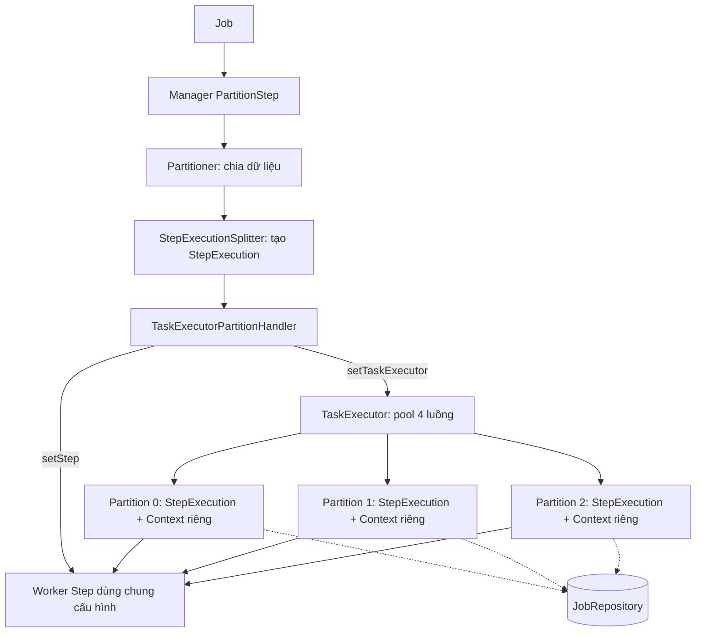
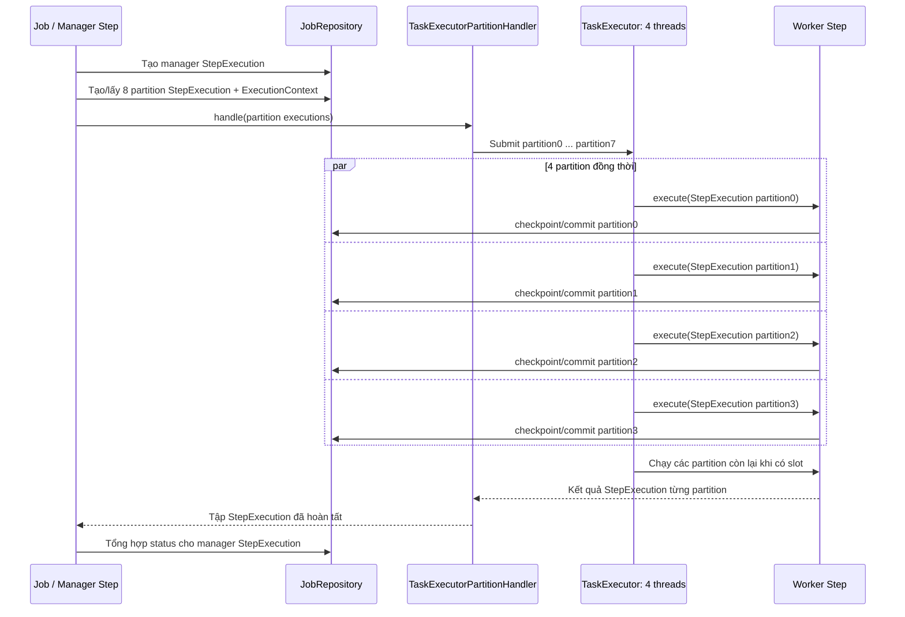

# Liên kết `TaskExecutor` với worker step qua `TaskExecutorPartitionHandler`

Trong module **SPRING_BATCH_SCALING_OPERATIONS**, mục tiêu mở rộng Spring Batch là tăng throughput của workload dữ liệu lớn bằng multi-threaded step, parallel steps, partitioning và những phương án phân tán phù hợp, đồng thời giữ kết quả chính xác, thread safety, retry/restart và khả năng vận hành. Ở chương **TaskExecutorPartitionHandler**, câu hỏi trọng tâm là: **làm thế nào để manager giao nhiều partition cho một worker step thực thi song song bằng `TaskExecutor` ngay trong cùng JVM?**

Câu trả lời là liên kết **ba thành phần khác nhau**: `Partitioner` quyết định phạm vi dữ liệu, `TaskExecutorPartitionHandler` nhận các `StepExecution` và lên lịch chúng, còn **worker `Step`** chứa logic đọc/xử lý/ghi của từng partition. Trong Spring Batch 5.2.x, hai lời gọi quan trọng nhất của handler là `setTaskExecutor(...)` và `setStep(...)`; manager step sử dụng `.partitionHandler(handler)` để nối vào quy trình partitioning.

## 1. Cần phân biệt executor, handler và worker step

| Thành phần | Trách nhiệm | Không có trách nhiệm |
| --- | --- | --- |
| Manager `PartitionStep` | Điều phối một lần chạy có nhiều partition, nhận kết quả tổng hợp | Trực tiếp đọc và ghi dữ liệu của từng partition |
| `Partitioner` | Tạo ánh xạ `partitionName -> ExecutionContext`, ví dụ các khoảng ID không giao nhau | Tự khởi động thread hoặc xử lý item |
| `StepExecutionSplitter` | Tạo hoặc khôi phục các `StepExecution` cho các partition thông qua metadata | Cấu hình số thread của executor |
| `TaskExecutorPartitionHandler` | Đưa từng partition `StepExecution` vào `TaskExecutor` và gọi **worker `Step`** tương ứng | Tự chia miền dữ liệu hoặc làm thay processor/writer |
| `TaskExecutor` | Chạy task trên luồng, thực thi chính sách pool và hàng đợi | Tự hiểu transaction/checkpoint của Spring Batch |
| Worker `Step` | Thực thi read/process/write hoặc tasklet bằng `ExecutionContext` của partition | Tự quyết định số partition toàn job |
| `JobRepository` | Ghi trạng thái manager/worker, metadata và thông tin restart | Tự giải quyết mọi tác dụng phụ không idempotent ở hệ thống ngoài |



Mũi tên `setStep` diễn tả handler biết **đối tượng `Step` nào để gọi**. Nó **không** tạo một bản sao bean `Step` cho mỗi thread. Các partition có `StepExecution` và `ExecutionContext` riêng; bean worker `Step` có thể là cùng một instance được gọi nhiều lần. Những resource có trạng thái theo partition, đặc biệt reader, nên được cấu hình bằng `@StepScope` để tạo instance thực tế riêng cho từng `StepExecution`.

## 2. Ba đường nối quyết định có chạy song song được không

```text
managerStep
    .partitioner("orders.worker", orderRangePartitioner)
    .partitionHandler(localPartitionHandler)

localPartitionHandler
    .setStep(workerStep)             // Worker Step thực thi từng partition
    .setTaskExecutor(partitionExecutor) // Pool lên lịch partition
    .setGridSize(8)                  // Gợi ý số partition được tạo
```

Trong đó:

1. **`.partitioner("orders.worker", ...)`** chỉ ra tên worker step dùng khi tạo metadata `StepExecution` cho các partition. Nó không thay cho việc truyền đối tượng worker step vào handler. Tên phải nhất quán với worker `Step` đã định nghĩa.
2. **`handler.setStep(workerStep)`** đăng ký đúng **`Step` cần được thực thi**. Worker step có cấu hình transaction, reader, processor, writer, listener như một step Spring Batch thông thường.
3. **`handler.setTaskExecutor(partitionExecutor)`** quyết định cách lên lịch nhiều lần thực thi worker step. Không cung cấp executor bất đồng bộ thì handler mặc định dùng `SyncTaskExecutor`, nên các partition chạy tuần tự.
4. **`handler.setGridSize(8)`** truyền *gợi ý* số phần việc cho splitter/partitioner. Con số 8 không tự sinh 8 thread; `Partitioner` có thể trả ít partition hơn, và pool chỉ chạy số thread được cấp.
5. **`.partitionHandler(localPartitionHandler)`** nối manager `PartitionStep` với handler đã cấu hình. Thiếu đường nối này thì manager không dùng handler bạn vừa tạo.

Phân biệt cách này với cấu hình `.taskExecutor(...)` **trực tiếp trên một chunk worker step**: cách đó biến bản thân chunk step thành một multi-threaded step, là **một tầng concurrency khác**. Khi đã chạy nhiều worker partition song song, thường nên để mỗi worker step chạy chunk tuần tự trước; chỉ bật thêm multi-threading *bên trong* worker nếu đo được lợi ích và đã kiểm chứng thread safety, transaction và ngân sách kết nối.

## 3. Ví dụ hoàn chỉnh về đường liên kết: Spring Batch 5.2.x

Giả sử bảng nguồn `source_order(id BIGINT PRIMARY KEY, amount DECIMAL(...))` có 10.000 bản ghi với ID liên tục từ 1 đến 10.000. Bảng đích `processed_order` có khóa duy nhất theo `id`. Ta muốn chia thành **8 partition**, tối đa **4 partition chạy đồng thời** trong một JVM. Ví dụ sử dụng API **Spring Batch 5.2.x** và Spring Framework; các import Java được lược bỏ để tập trung vào wiring. Ứng dụng cần cấu hình `DataSource`, `JobRepository`, `PlatformTransactionManager` và Spring Batch context/`StepScope` như bình thường.

### Bước A — Tạo pool dành cho partition

```java
@Bean
public ThreadPoolTaskExecutor partitionExecutor() {
    ThreadPoolTaskExecutor executor = new ThreadPoolTaskExecutor();
    executor.setCorePoolSize(4);
    executor.setMaxPoolSize(4);
    executor.setQueueCapacity(8);
    executor.setThreadNamePrefix("orders-partition-");
    executor.initialize();
    return executor;
}
```

Với pool cố định 4 thread, tại một thời điểm tối đa 4 task partition chạy, các task còn lại chờ queue khi còn sức chứa. Queue capacity là giới hạn của **executor**, không bảo đảm worker sẽ tự giảm tốc độ phát nếu pool đầy; cần chọn chính sách xử lý rejection/timeout phù hợp. Tránh `SimpleAsyncTaskExecutor` không giới hạn khi số partition hoặc số job đồng thời lớn.

### Bước B — Chia dữ liệu không chồng lấn

```java
@Bean
public Partitioner orderRangePartitioner() {
    return gridSize -> {
        long min = 1L;
        long max = 10_000L;
        long total = max - min + 1;
        int partitions = Math.max(1, gridSize);
        long blockSize = (total + partitions - 1) / partitions;

        Map<String, ExecutionContext> result = new LinkedHashMap<>();
        int index = 0;
        for (long from = min; from <= max; from += blockSize) {
            long to = Math.min(max, from + blockSize - 1);
            ExecutionContext context = new ExecutionContext();
            context.putLong("fromId", from);
            context.putLong("toId", to);
            result.put("partition" + index++, context);
        }
        return result;
    };
}
```

Với `gridSize = 8`, ví dụ tạo 8 khoảng, mỗi khoảng 1.250 ID. `partition0` nhận `[1, 1250]`, `partition1` nhận `[1251, 2500]` và cứ thế đến `partition7` nhận `[8751, 10000]`. Các context được gắn vào những `StepExecution` có tên tương tự `orders.worker:partition0`, `orders.worker:partition1`, ... trong metadata.

**Giả định quan trọng:** ID 1–10.000 được chốt trước khi chạy và dữ liệu nguồn giữ tính nhất quán qua restart. Đoạn chia ID cố định chỉ dùng để minh họa. Trong production, cần lấy min/max hoặc danh sách phân vùng từ dữ liệu được chốt theo job instance, xử lý trường hợp bảng rỗng, ID không liên tục, ranh giới quá lớn và thay đổi dữ liệu trong lúc job đang chạy. Khi restart phải giữ **tên partition và ý nghĩa ranh giới ổn định**.

### Bước C — Reader lấy dữ liệu theo `StepExecutionContext`

```java
record OrderRow(long id, BigDecimal amount) {}

@Bean
@StepScope
public JdbcCursorItemReader<OrderRow> orderRangeReader(
        DataSource dataSource,
        @Value("#{stepExecutionContext['fromId']}") Long fromId,
        @Value("#{stepExecutionContext['toId']}") Long toId) {

    return new JdbcCursorItemReaderBuilder<OrderRow>()
            .name("orderRangeReader")
            .dataSource(dataSource)
            .sql("SELECT id, amount FROM source_order "
                    + "WHERE id BETWEEN ? AND ? ORDER BY id")
            .preparedStatementSetter(ps -> {
                ps.setLong(1, fromId);
                ps.setLong(2, toId);
            })
            .rowMapper((rs, rowNum) -> new OrderRow(
                    rs.getLong("id"), rs.getBigDecimal("amount")))
            .build();
}
```

`@StepScope` là mắt xích quan trọng khi **một bean worker `Step` dùng chung** thực thi nhiều `StepExecution` song song. Tại lúc Spring tạo cấu hình job, `fromId` và `toId` chưa phải giá trị cố định. Khi worker step thực sự chạy partition, scoped reader được tạo cho `StepExecution` tương ứng, lấy hai tham số qua SpEL. Mỗi partition có cursor và checkpoint state riêng, thay vì các thread cùng tranh một cursor.

Một `@StepScope` bean có phạm vi theo **`StepExecution`**, không phải mỗi chunk hoặc mỗi Java thread. Khi dùng scoped proxy cho `ItemStream`, nên khai báo kiểu trả về của `@Bean` đủ cụ thể như `JdbcCursorItemReader` ở ví dụ, để những phương thức lifecycle `open/update/close` được framework nhận diện và gọi đúng.

### Bước D — Worker step thực hiện nghiệp vụ

```java
@Bean
public JdbcBatchItemWriter<OrderRow> processedOrderWriter(
        DataSource dataSource) {
    return new JdbcBatchItemWriterBuilder<OrderRow>()
            .dataSource(dataSource)
            .sql("INSERT INTO processed_order (id, amount) VALUES (?, ?)")
            .itemPreparedStatementSetter((item, ps) -> {
                ps.setLong(1, item.id());
                ps.setBigDecimal(2, item.amount());
            })
            .build();
}

@Bean
public Step workerStep(
        JobRepository jobRepository,
        PlatformTransactionManager transactionManager,
        @Qualifier("orderRangeReader") JdbcCursorItemReader<OrderRow> reader,
        JdbcBatchItemWriter<OrderRow> writer) {

    return new StepBuilder("orders.worker", jobRepository)
            .<OrderRow, OrderRow>chunk(100, transactionManager)
            .reader(reader)
            .writer(writer)
            .build();
}
```

Worker step **không cần** `.taskExecutor(partitionExecutor)`: handler bên ngoài đã chạy nhiều lần gọi worker step trên nhiều thread. Worker dùng chunk size 100, một reader theo partition và writer có thể được chia sẻ nếu đúng hợp đồng thread-safe (Javadoc của `JdbcBatchItemWriter` 5.2 cho biết nó thread-safe sau khi cấu hình hoàn tất). Trong production, transaction manager phải phù hợp `DataSource`, SQL phải tương thích database, và cần một cơ chế xử lý trùng theo ID nếu có retry hoặc tác dụng phụ bên ngoài. Ví dụ này chủ yếu chứng minh wiring; chưa bao gồm schema/migration, dữ liệu mẫu, cấu hình kết nối, logging và chính sách skip/retry.

Nếu từng item cần transform, có thể thêm `.processor(itemProcessor)`; processor phải không có shared mutable state, hoặc mọi dependency dùng chung phải được đánh giá về thread safety.

### Bước E — Liên kết executor với worker step trong handler

```java
@Bean
public PartitionHandler localPartitionHandler(
        @Qualifier("workerStep") Step workerStep,
        @Qualifier("partitionExecutor") TaskExecutor partitionExecutor) {

    TaskExecutorPartitionHandler handler =
            new TaskExecutorPartitionHandler();
    handler.setStep(workerStep);                 // Worker Step cần chạy
    handler.setTaskExecutor(partitionExecutor);  // Pool chạy partition
    handler.setGridSize(8);                     // Gợi ý 8 partition
    return handler;
}

@Bean
public Step managerStep(
        JobRepository jobRepository,
        @Qualifier("orderRangePartitioner") Partitioner partitioner,
        @Qualifier("localPartitionHandler") PartitionHandler handler) {

    return new StepBuilder("orders.manager", jobRepository)
            .partitioner("orders.worker", partitioner)
            .partitionHandler(handler)
            .build();
}

@Bean
public Job partitionedOrdersJob(
        JobRepository jobRepository,
        @Qualifier("managerStep") Step managerStep) {

    return new JobBuilder("partitionedOrdersJob", jobRepository)
            .start(managerStep)
            .build();
}
```

Ba nơi cùng dùng `orders.worker` theo đúng nghĩa: **(1)** tên `Step` được khai báo bằng `new StepBuilder("orders.worker", ...)`, **(2)** tên truyền vào `partitioner("orders.worker", ...)` để splitter tạo partition execution, và **(3)** instance worker step được truyền vào `handler.setStep(workerStep)`. Thực tế `setStep` nhận object bean; nó không tìm bean chỉ dựa trên chuỗi tên của `partitioner`.

### Các import cần dùng (Spring Batch 5.2.x)

```java
import java.math.BigDecimal;
import java.util.LinkedHashMap;
import java.util.Map;
import javax.sql.DataSource;

import org.springframework.batch.core.Job;
import org.springframework.batch.core.Step;
import org.springframework.batch.core.configuration.annotation.StepScope;
import org.springframework.batch.core.job.builder.JobBuilder;
import org.springframework.batch.core.partition.PartitionHandler;
import org.springframework.batch.core.partition.support.Partitioner;
import org.springframework.batch.core.partition.support.TaskExecutorPartitionHandler;
import org.springframework.batch.core.repository.JobRepository;
import org.springframework.batch.core.step.builder.StepBuilder;
import org.springframework.batch.item.ExecutionContext;
import org.springframework.batch.item.database.JdbcBatchItemWriter;
import org.springframework.batch.item.database.JdbcCursorItemReader;
import org.springframework.batch.item.database.builder.JdbcBatchItemWriterBuilder;
import org.springframework.batch.item.database.builder.JdbcCursorItemReaderBuilder;
import org.springframework.beans.factory.annotation.Qualifier;
import org.springframework.beans.factory.annotation.Value;
import org.springframework.context.annotation.Bean;
import org.springframework.context.annotation.Configuration;
import org.springframework.core.task.TaskExecutor;
import org.springframework.scheduling.concurrent.ThreadPoolTaskExecutor;
import org.springframework.transaction.PlatformTransactionManager;
```

Đặt các bean và `record OrderRow` cùng một class `@Configuration` (hoặc những class Spring quản lý với cùng bean names); ứng dụng cần Spring Batch JDBC và Spring JDBC tương ứng phiên bản 5.2.x. Có thể dùng Spring Boot Batch autoconfiguration hoặc cấu hình Batch infrastructure phù hợp; tránh cấu hình chồng lấn nhiều `JobRepository`/`StepScope`. Đoạn mã tập trung vào **liên kết handler-executor-worker**, nên việc cung cấp hạ tầng database và dữ liệu thử nghiệm nằm ở ứng dụng chạy ví dụ.

> **Khác biệt phiên bản:** phần Java trên dùng `TaskExecutorPartitionHandler()` không tham số và `.setStep(...)`, `.setTaskExecutor(...)` theo API 5.2.x. Tài liệu Spring Batch 6.x có những ví dụ dùng constructor nhận `Step` và `TaskExecutor`; các package/API reader/writer cũng có thay đổi. Khi chuyển phiên bản, hãy tra đúng Javadoc của dependency đang cài và điều chỉnh imports, builder cùng transaction configuration. Không giả định các snippet 5.2.x sẽ biên dịch nguyên trạng trên 6.x.

## 4. Điều gì xảy ra khi job bắt đầu chạy?

Giả sử 8 partition, pool 4 thread:



Đây là cách nhìn logic về lifecycle; Spring Batch có các chi tiết triển khai nội bộ như `FutureTask`, splitter và aggregator. Mỗi worker step có `StepExecution` riêng để đếm read/write/skip và lưu checkpoint. Thứ tự hoàn tất **không được bảo đảm**: partition nhỏ có thể hoàn thành trước dù được submit sau.

Trong ví dụ, `gridSize = 8` còn pool có 4 thread. Có 8 phần việc nhưng **không có 8 worker chạy cùng lúc**. Thời gian thực thi gần đúng chịu ảnh hưởng số thread và partition dài nhất; thêm partition có thể giúp san đều tải nếu các phân vùng mất thời gian khác nhau, nhưng cũng tăng chi phí tạo step execution, reader, transaction và metadata.

## 5. `gridSize`, số thread và chunk size ảnh hưởng khác nhau

| Tham số | Điều thực sự kiểm soát | Ví dụ | Bẫy thường gặp |
| --- | --- | --- | --- |
| `handler.setGridSize(8)` | Gợi ý số partition mà splitter yêu cầu `Partitioner` tạo | 8 khoảng ID | Không có nghĩa 8 Java thread |
| `executor.setCorePoolSize(4)` | Số thread lõi trong pool | 4 worker threads | Không tự chia dữ liệu thành 4 phần |
| `executor.setMaxPoolSize(4)` | Giới hạn số thread tối đa | Không vượt 4 task đang chạy | Không tính đến số job/pool khác tranh DB |
| `executor.setQueueCapacity(8)` | Số task tối đa chờ trong queue pool | 4 đang chạy, 4 chờ với 8 partition | Khi nhiều job cùng dùng pool, queue có thể đầy, gây reject |
| `chunk(100, transactionManager)` | Số item mục tiêu trong mỗi transaction chunk | Khoảng 13 chunk cho mỗi partition 1.250 item | Không liên quan trực tiếp số partition hoặc số thread |

`gridSize` thường được đặt gần số thread khi partition tương đối cân bằng. Có thể đặt lớn hơn số thread nếu cần chia nhỏ miền dữ liệu để giảm **skew** (partition lớn/nhỏ khác nhau), nhưng `Partitioner` có quyền quyết định số lượng thực tế và **trên restart việc phân chia cũ phải được bảo toàn**. Không thể thay `gridSize` rồi mặc định các partition đã ghi metadata sẽ bị chia lại an toàn.

Một trường hợp đáng đo: 8 partition, trong đó một partition chứa 70% bản ghi do ID phân bố lệch. Dù có 4 thread, đa số worker sẽ nhàn rỗi chờ partition nặng nhất. Cần chia theo khối lượng thực tế, theo thời gian, file, hash key ổn định hoặc chia nhiều partition nhỏ hơn, không chỉ tăng pool size.

## 6. Lưu ý về thread safety và `@StepScope`

**Local partitioning** có thể khiến cùng một bean `Step` chạy nhiều `StepExecution` đồng thời. Điều này khác một step tuần tự chạy chỉ một execution. Hãy phân biệt:

- **State theo partition:** `ExecutionContext`, cursor, checkpoint, file nguồn/đích và bộ đệm tạm nên thuộc từng `StepExecution` hoặc được quản lý bằng giao dịch/cô lập rõ ràng. `@StepScope` giúp tạo reader/processor/writer riêng theo partition khi cần.
- **State dùng chung:** bean singleton như service, cache, writer hoặc client được chia sẻ giữa nhiều partition phải an toàn luồng nếu có thể bị gọi đồng thời.
- **Transaction:** mỗi worker chunk có transaction của step tương ứng; một field Java hoặc `AtomicLong` không phải dữ liệu transaction và không tự rollback khi chunk thất bại.
- **ThreadLocal:** không dùng như nguồn dữ liệu nghiệp vụ hoặc checkpoint. Thread pool tái sử dụng thread, còn restart có thể chạy partition trên thread khác.

Ví dụ **sai** nếu dùng singleton reader giữ cursor cho nhiều partition:

```java
@Bean
public JdbcCursorItemReader<OrderRow> wrongSingletonReader(DataSource ds) {
    // Không lấy fromId/toId từ StepExecutionContext,
    // nhiều partition có thể cùng tranh cursor, trùng hoặc thiếu bản ghi.
    return new JdbcCursorItemReaderBuilder<OrderRow>()
            .name("sharedReader")
            .dataSource(ds)
            .sql("SELECT id, amount FROM source_order ORDER BY id")
            .rowMapper((rs, n) -> new OrderRow(
                    rs.getLong("id"), rs.getBigDecimal("amount")))
            .build();
}
```

Chuyển reader sang `@StepScope` và bind khoảng ID thực tế của từng partition, như ở bước C. `@StepScope` tự nó không biến **mọi dependency** thành thread-safe: nếu service dùng chung có `ArrayList` mutable hoặc một cache không đồng bộ, vẫn có race condition. Đồng thời, nếu hai partition viết cùng ID, scoped writer cũng không thay thế unique constraint/locking của database.

## 7. Restart, checkpoint và tránh xử lý trùng

Một ưu điểm của partitioning là mỗi partition có **`StepExecution` và trạng thái riêng**. Ví dụ 8 partition, 6 thành công, 1 thất bại khi đọc, 1 thất bại khi ghi: manager step thường bị đánh dấu thất bại; khi restart cùng `JobInstance` theo cơ chế Spring Batch, những partition đã hoàn tất có thể được giữ nguyên còn partition chưa thành công được chạy lại từ trạng thái lưu. Kết quả thực tế phụ thuộc trạng thái metadata, cấu hình restart và khả năng lưu checkpoint của reader/writer.

Cần bảo vệ các tính chất sau:

1. **Partition names và boundaries ổn định.** Không thay đổi cách phân dải ID một cách tùy tiện giữa lần chạy đầu và restart. Nếu muốn tạo dải mới cho job mới, phân biệt bằng `JobParameters`/`JobInstance` phù hợp.
2. **Checkpoint lưu được.** Reader là `ItemStream` được Spring Batch mở/cập nhật/đóng đúng lifecycle; không giấu cursor trong singleton ngoài cơ chế metadata.
3. **Nguồn dữ liệu ổn định.** Cursor reader restart theo vị trí đọc có thể gặp vấn đề nếu bảng nguồn có thêm/xóa/sửa dòng hoặc thứ tự query thay đổi. Chọn snapshot/dataset cố định và `ORDER BY` ổn định.
4. **Ghi đích idempotent.** Chunk đã commit có thể được nhìn thấy khi một cơ chế gửi message/side effect thất bại. Với insert, dùng unique key và chính sách upsert/dedup nếu nghiệp vụ cần cho phép chạy lại; không mặc định nuốt mọi lỗi duplicate.
5. **Xử lý lỗi không làm mất item.** Executor reject vì queue đầy phải được chuyển thành lỗi có thể quan sát và phục hồi theo cấu hình, không bị bắt rồi bỏ qua khiến manager báo thành công giả.

**Phân biệt đúng:** an toàn luồng cho reader/processor/writer không bảo đảm **exactly-once** đối với tác dụng phụ ngoài transaction. Khi worker gọi API hoặc xuất file bên ngoài database, phải thiết kế idempotency key, staging/atomic rename, outbox hoặc quy trình đối soát phù hợp.

## 8. Lỗi wiring thường gặp và cách chẩn đoán

| Triệu chứng | Nguyên nhân thường gặp | Cách xác minh/sửa |
| --- | --- | --- |
| Chỉ thấy một thread dù có nhiều partition | Handler chưa được truyền executor bất đồng bộ; đang dùng `SyncTaskExecutor` mặc định; hoặc chỉ có 1 partition | Kiểm tra `setTaskExecutor`, tên thread, số `StepExecution` thực tế |
| `TaskExecutorPartitionHandler` lỗi khởi tạo thiếu `Step` | Quên `setStep` hoặc truyền null | Inject bean worker step và kiểm tra `handler.getStep()` |
| Manager chạy nhưng worker chưa đúng dữ liệu | `partitioner(...)` truyền tên sai; `StepExecutionContext` thiếu key; `@StepScope` chưa bật | So sánh tên `Step`, log `stepExecutionId`, `fromId`/`toId`, metadata partition |
| Các partition cùng đọc một dải ID | Reader singleton hoặc biểu thức SpEL không lấy đúng context | Dùng `@StepScope`; kiểm tra SQL params và tập ID đọc theo partition |
| Duplicate hoặc thiếu output | Partition ranges chồng nhau; source thay đổi; reader state bị chia sẻ | Kiểm tra min/max, `ORDER BY`, snapshot và unique key đích |
| Pool đầy và task bị từ chối | `gridSize` cao, queue nhỏ, nhiều job dùng chung pool | Đo active/queue/rejected, điều chỉnh hạn mức và handling failure |
| Thêm thread nhưng job không nhanh hơn | DB connection pool, lock, writer, disk hoặc một partition quá nặng | Benchmark theo partition, đo wait time và skew; điều chỉnh partitioning |
| Chạy lại lỗi `DuplicateKeyException` | Side effect đã commit nhưng checkpoint/restart hoặc tải lại chạm cùng business ID | Xác minh transaction, trạng thái job và idempotency; không tắt unique constraint |
| Có `@StepScope` nhưng vẫn bị race | Một dependency singleton mà scoped bean gọi vào không thread-safe | Kiểm tra toàn bộ call chain, không chỉ annotation trên reader |

## 9. Kiểm thử có ý nghĩa trước khi đưa vào production

Với ví dụ 10.000 ID và 8 partition, nên kiểm tra theo **dữ liệu đã commit** và **metadata**:

1. **Happy path:** `Job` kết thúc `COMPLETED`, có đúng 8 `StepExecution` worker theo những tên/ID dự kiến; hợp tập ID đầu ra bằng chính xác tập nguồn, không trùng, không thiếu. Tổng `readCount`/`writeCount` có ý nghĩa theo dữ liệu mẫu và filter/skip đã cấu hình.
2. **Kiểm tra song song thật:** log tên thread, `stepExecutionId`, `partitionName`, thời điểm bắt đầu/kết thúc; phải quan sát tối đa khoảng 4 worker hoạt động cùng lúc. Thay executor thành `SyncTaskExecutor` trong test đối chứng để thấy sự khác biệt.
3. **Kiểm tra boundary:** dải ID chồng nhau hoặc bỏ trống phải khiến test thất bại; thử dataset có lỗ ID, dữ liệu lệch, ít bản ghi hơn `gridSize` và partition rỗng.
4. **Kiểm tra lỗi:** tạo lỗi ghi tại một partition sau vài chunk, xác minh manager không báo thành công giả; restart đúng job instance và đối chiếu dữ liệu kết quả cùng checkpoint.
5. **Kiểm tra tài nguyên:** thử 2, 4, 8 worker với cùng dataset, đo item/giây commit, job duration, CPU, heap/GC, connection pool wait, locks, queue depth/rejection và độ dài partition chậm nhất.
6. **Kiểm tra shutdown/cancel:** dừng job trong lúc nhiều worker đang chạy, xác minh signal lỗi/trạng thái và khả năng phục hồi; không để task chạy không được quản lý sau khi manager hoàn tất giả.

Một kết quả đáng tin cậy không chỉ là `BatchStatus.COMPLETED`: nếu 10.000 nguồn đầu vào không filter, đích cần có **10.000 business ID duy nhất**, giá trị chính xác và không có ID ngoài phạm vi. Một job có trạng thái hoàn tất nhưng thiếu 500 ID vì partitioner sai vẫn là thất bại nghiệp vụ.

## 10. Chọn số partition và thread theo tài nguyên thực tế

Không có quy tắc `gridSize = số CPU × N` phù hợp mọi workload. Với 4 worker chunks đồng thời và mỗi chunk dùng một DB connection, pool DB cần đủ kết nối cho cả worker, `JobRepository` và các ứng dụng khác; nếu worker call API, quota API có thể là giới hạn nhỏ hơn.

**Ví dụ đo giả định** (không phải kết quả benchmark chính thức):

| `gridSize` | Thread pool | Thời gian | Quan sát | Quyết định |
| ---: | ---: | ---: | --- | --- |
| 1 | 1 | 40 phút | Baseline, CPU nhàn | Có thể thử scale |
| 4 | 4 | 14 phút | DB còn khả năng, các vùng tương đối đều | Có lợi |
| 8 | 4 | 12 phút | Một số partition nhỏ chạy xen kẽ, giảm tail | Ứng viên tốt |
| 16 | 4 | 12 phút | Metadata/checkpoint tăng, throughput không cải thiện | Không cần thêm partition |
| 16 | 8 | 13 phút | DB connection wait/lock tăng | Quá mức tại DB |

Trước khi thay đổi cấu hình, cần hỏi: dữ liệu có phân bố đồng đều không, từng partition có mở cursor lâu không, writer có tranh cùng bảng/khóa không, thời gian job bị chi phối bởi CPU, DB, I/O hay API nào? Một số partition với mỗi partition tương đối lớn có thể dễ restart và vận hành hơn hàng nghìn partition rất nhỏ.

Nếu workload cần **nhiều JVM/máy**, `TaskExecutorPartitionHandler` trực tiếp chỉ thực thi local trong một JVM. Hãy cân nhắc **remote partitioning** với broker và `MessageChannelPartitionHandler` thay vì tưởng tăng `gridSize` sẽ tự phân công sang máy khác. Nếu cần song song nhiều flow hoàn toàn độc lập, dùng **parallel steps**; nếu chỉ muốn nhiều chunk cùng chạy trong một step, đó là một mô hình khác với **local partitioning**. Chọn theo ranh giới dữ liệu, transaction và nút thắt được đo.

## 11. Checklist liên kết `TaskExecutor` với worker step

- [ ] Manager được tạo bằng `partitioner(workerStepName, partitioner)` và `.partitionHandler(handler)`.
- [ ] Tên worker trong metadata nhất quán với `Step` đã tạo; `handler.setStep(actualWorkerStep)` nhận đúng object `Step`.
- [ ] `handler.setTaskExecutor(boundedExecutor)` nhận đúng pool; không còn chạy đồng bộ ngoài ý muốn.
- [ ] `gridSize` phù hợp cách chia dữ liệu; không nhầm số partition với số thread.
- [ ] Reader và state liên quan tới partition được cách ly bằng `StepExecutionContext` và `@StepScope` khi cần.
- [ ] Writer/processor/service singleton chịu được các partition chạy đồng thời hoặc được tách scope/đồng bộ hợp lý.
- [ ] Bản ghi metadata, `JobRepository`, transaction manager và dữ liệu nguồn/đích có khả năng restart đúng.
- [ ] Đã xác minh queue đầy, worker lỗi, rollback và restart không làm mất hoặc ghi trùng nghiệp vụ.
- [ ] Chạy benchmark với throughput **đã commit**, mức sử dụng connection pool, queue, CPU/GC và partition skew.
- [ ] Cấu hình và imports đã được kiểm tra theo đúng phiên bản Spring Batch đang chạy.

**Ghi nhớ:** mối liên kết quyết định trong local partitioning là `managerStep → PartitionHandler → (TaskExecutor + worker Step)`. `TaskExecutor` chạy các **partition `StepExecution`**, `Step` chứa logic nghiệp vụ, còn `ExecutionContext` tách dữ liệu của từng partition. Cấu hình đúng ba đường nối ấy, rồi kiểm chứng scope, transaction, checkpoint và tài nguyên, mới biến partitioning thành cách scale an toàn.

## Tài liệu tham khảo chính thức

- [Spring Batch 5.2 — Scaling and Parallel Processing](https://docs.spring.io/spring-batch/reference/5.2/scalability.html): cấu hình manager `PartitionStep`, `TaskExecutorPartitionHandler`, `gridSize`, `Partitioner` và `@StepScope`.
- [Spring Batch 5.2 — `TaskExecutorPartitionHandler` API](https://docs.spring.io/spring-batch/docs/5.2.0/api/org/springframework/batch/core/partition/support/TaskExecutorPartitionHandler.html): `setStep`, `setTaskExecutor`, `afterPropertiesSet` và `doHandle`.
- [Spring Batch 5.2 — `Partitioner` API](https://docs.spring.io/spring-batch/docs/5.2.2/api/org/springframework/batch/core/partition/support/Partitioner.html): quy ước tạo context và tên partition.
- [Spring Batch — `StepScope` API](https://docs.spring.io/spring-batch/docs/current/api/org/springframework/batch/core/scope/StepScope.html): lifecycle scope theo `StepExecution` và late binding context.
- [Spring Batch — `JdbcBatchItemWriter` API](https://docs.spring.io/spring-batch/docs/current/api/org/springframework/batch/item/database/JdbcBatchItemWriter.html): contract thread safety của writer sau khi cấu hình hoàn tất.
