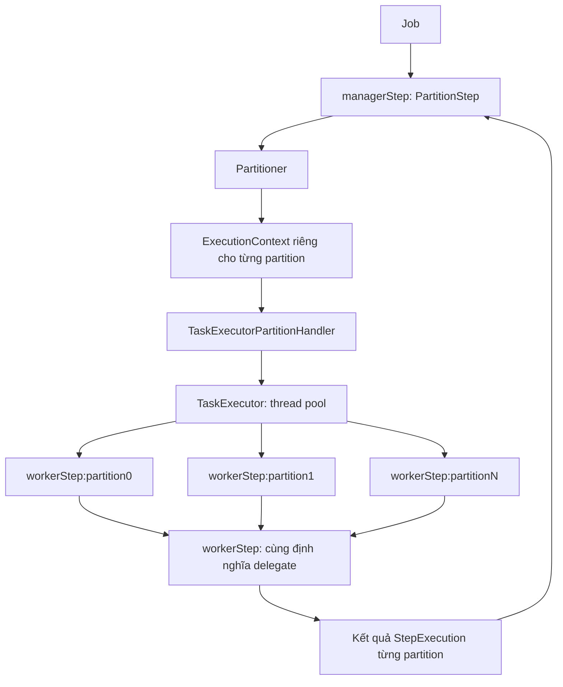

# Liên kết step delegate trong `TaskExecutorPartitionHandler`

## 1. Vấn đề cần giải quyết

Khi một job Spring Batch phải xử lý hàng triệu bản ghi, ta có thể chia dữ liệu thành nhiều **partition** rồi cho các luồng xử lý các phần dữ liệu độc lập. Trong mô hình **local partitioning**, `TaskExecutorPartitionHandler` nhận những `StepExecution` của các partition và giao chúng cho một `TaskExecutor` chạy ngay trong cùng JVM.

Điểm mấu chốt của cấu hình là **liên kết đúng worker step (delegate step)**: handler phải biết *Step nào thực hiện nghiệp vụ* cho mỗi partition. Nếu chỉ tạo `Partitioner` và thread pool mà không gắn delegate, chưa có bước xử lý dữ liệu nào được giao cho các luồng.

Sau bài này, bạn có thể:

- Phân biệt `managerStep`, `Partitioner`, `TaskExecutorPartitionHandler`, `TaskExecutor` và `workerStep`.
- Liên kết một `Step` cụ thể với handler qua `setStep(...)`, đồng thời khai báo đúng tên delegate trong `partitioner(...)`.
- Truyền vùng dữ liệu riêng cho từng lần chạy worker qua `StepExecutionContext` và `@StepScope`.
- Kiểm tra các partition có thực sự chạy, có thể restart và không giẫm dữ liệu của nhau.

> **Phạm vi phiên bản:** ví dụ Java dưới đây dùng API Spring Batch **5.x** (`StepBuilder(name, jobRepository)`, `JobBuilder(name, jobRepository)`). Khi triển khai trên Spring Batch 6.x, kiểm tra chữ ký API và package theo phiên bản đang dùng.

## 2. Delegate step là gì?

Trong partitioning, **manager step** là một `PartitionStep` điều phối. Nó không tự đọc và ghi từng bản ghi nghiệp vụ. Nó tạo hoặc lấy các `StepExecution` cho những partition, sau đó gọi `PartitionHandler` để thực thi chúng.

**Delegate step** (hay **worker step**) là định nghĩa `Step` chứa logic xử lý thực tế: tasklet hoặc chuỗi reader–processor–writer. `TaskExecutorPartitionHandler` giữ tham chiếu đến định nghĩa `Step` này, và mỗi lần xử lý sẽ gọi nó với **một `StepExecution` khác nhau**. Vì thế, *cùng một bean `Step`* có thể phục vụ nhiều partition, trong khi tên execution, `ExecutionContext`, trạng thái, số liệu và transaction của từng execution được quản lý riêng.

| Thành phần | Trách nhiệm | Cấu hình chính |
| --- | --- | --- |
| `Partitioner` | Chia dữ liệu thành các `ExecutionContext`, mỗi context là một phần công việc | `partition(int gridSize)` |
| `managerStep` (`PartitionStep`) | Tạo/theo dõi các partition và tổng hợp kết quả | `.partitioner("workerStep", partitioner)` |
| `TaskExecutorPartitionHandler` | Nhận các worker `StepExecution`, giao chạy cục bộ và đợi kết quả | `setStep(workerStep)`, `setTaskExecutor(...)` |
| `TaskExecutor` | Quyết định những tác vụ được chạy đồng thời trên các thread nào | `ThreadPoolTaskExecutor` |
| `workerStep` (delegate) | Chạy logic nghiệp vụ cho vùng dữ liệu ghi trong context của partition | `Tasklet` hoặc chunk step, thành phần `@StepScope` |

Luồng xử lý tổng quát:



Các hộp `workerStep:partition0`, `workerStep:partition1` biểu diễn **những lần thực thi khác nhau**, không phải những bean `Step` riêng biệt. Ký hiệu mũi tên quay về manager nhằm diễn đạt quá trình thu thập và tổng hợp kết quả, không phải từng worker gọi trực tiếp manager.

## 3. Liên kết delegate bằng Java configuration

Giả sử bảng `staging_event(id, processed)` chứa các bản ghi có khóa `id` và cờ Boolean `processed`. Một job cần đánh dấu đã xử lý cho các ID từ **1 đến 10.000**. Ta chia thành bốn vùng không trùng nhau và chạy tối đa bốn worker song song.

Ví dụ minh họa dưới đây giả định ứng dụng đã cấu hình `JobRepository`, `PlatformTransactionManager`, `DataSource` và `JdbcTemplate` (chẳng hạn với Spring Boot). Trước khi chạy, bảng `staging_event` phải tồn tại và phạm vi ID phải phù hợp dữ liệu thật.

```java
import java.util.LinkedHashMap;
import java.util.Map;

import org.springframework.batch.core.Job;
import org.springframework.batch.core.Step;
import org.springframework.batch.core.StepContribution;
import org.springframework.batch.core.configuration.annotation.StepScope;
import org.springframework.batch.core.job.builder.JobBuilder;
import org.springframework.batch.core.partition.PartitionHandler;
import org.springframework.batch.core.partition.support.Partitioner;
import org.springframework.batch.core.partition.support.TaskExecutorPartitionHandler;
import org.springframework.batch.core.repository.JobRepository;
import org.springframework.batch.core.scope.context.ChunkContext;
import org.springframework.batch.core.step.builder.StepBuilder;
import org.springframework.batch.core.step.tasklet.Tasklet;
import org.springframework.batch.item.ExecutionContext;
import org.springframework.batch.repeat.RepeatStatus;
import org.springframework.beans.factory.annotation.Qualifier;
import org.springframework.beans.factory.annotation.Value;
import org.springframework.context.annotation.Bean;
import org.springframework.context.annotation.Configuration;
import org.springframework.core.task.TaskExecutor;
import org.springframework.jdbc.core.JdbcTemplate;
import org.springframework.scheduling.concurrent.ThreadPoolTaskExecutor;
import org.springframework.transaction.PlatformTransactionManager;

@Configuration
public class LocalPartitionJobConfig {

    @Bean
    public Partitioner idRangePartitioner() {
        return gridSize -> {
            if (gridSize <= 0) {
                throw new IllegalArgumentException("gridSize must be positive");
            }

            long firstId = 1L;
            long lastId = 10_000L;
            long totalIds = lastId - firstId + 1;
            long partitionSize = Math.max(1L, (totalIds + gridSize - 1) / gridSize);

            Map<String, ExecutionContext> partitions = new LinkedHashMap<>();
            int index = 0;
            for (long fromId = firstId; fromId <= lastId; fromId += partitionSize) {
                long toId = Math.min(fromId + partitionSize - 1, lastId);
                ExecutionContext context = new ExecutionContext();
                context.putLong("fromId", fromId);
                context.putLong("toId", toId);
                partitions.put("partition" + index++, context);
            }
            return partitions;
        };
    }

    // Tasklet được tạo riêng theo StepExecution của từng partition.
    @Bean
    @StepScope
    public RangeUpdateTasklet rangeUpdateTasklet(
            JdbcTemplate jdbcTemplate,
            @Value("#{stepExecutionContext['fromId']}") Long fromId,
            @Value("#{stepExecutionContext['toId']}") Long toId) {
        return new RangeUpdateTasklet(jdbcTemplate, fromId, toId);
    }

    public static class RangeUpdateTasklet implements Tasklet {
        private final JdbcTemplate jdbcTemplate;
        private final long fromId;
        private final long toId;

        public RangeUpdateTasklet(JdbcTemplate jdbcTemplate, long fromId, long toId) {
            this.jdbcTemplate = jdbcTemplate;
            this.fromId = fromId;
            this.toId = toId;
        }

        @Override
        public RepeatStatus execute(StepContribution contribution, ChunkContext chunkContext) {
            int updated = jdbcTemplate.update(
                    "UPDATE staging_event SET processed = TRUE " +
                    "WHERE id BETWEEN ? AND ? AND processed = FALSE",
                    fromId, toId);
            contribution.incrementWriteCount(updated);
            return RepeatStatus.FINISHED;
        }
    }

    @Bean
    public Step workerStep(
            JobRepository jobRepository,
            PlatformTransactionManager transactionManager,
            RangeUpdateTasklet rangeUpdateTasklet) {
        return new StepBuilder("workerStep", jobRepository)
                .tasklet(rangeUpdateTasklet, transactionManager)
                .build();
    }

    @Bean
    public ThreadPoolTaskExecutor partitionTaskExecutor() {
        ThreadPoolTaskExecutor executor = new ThreadPoolTaskExecutor();
        executor.setCorePoolSize(4);
        executor.setMaxPoolSize(4);
        executor.setQueueCapacity(16);
        executor.setThreadNamePrefix("partition-");
        return executor;
    }

    @Bean
    public TaskExecutorPartitionHandler partitionHandler(
            @Qualifier("workerStep") Step workerStep,
            @Qualifier("partitionTaskExecutor") TaskExecutor executor) {
        TaskExecutorPartitionHandler handler = new TaskExecutorPartitionHandler();
        handler.setStep(workerStep);         // Liên kết delegate thực thi nghiệp vụ
        handler.setTaskExecutor(executor);   // Cho phép chạy các partition song song
        handler.setGridSize(4);              // Gợi ý số partition tạo ra
        return handler;
    }

    @Bean
    public Step managerStep(
            JobRepository jobRepository,
            Partitioner idRangePartitioner,
            PartitionHandler partitionHandler) {
        return new StepBuilder("managerStep", jobRepository)
                .partitioner("workerStep", idRangePartitioner)
                .partitionHandler(partitionHandler)
                .build();
    }

    @Bean
    public Job localPartitionJob(
            JobRepository jobRepository,
            @Qualifier("managerStep") Step managerStep) {
        return new JobBuilder("localPartitionJob", jobRepository)
                .start(managerStep)
                .build();
    }
}
```

Trong đoạn mã trên, có **ba vị trí phải khớp ý nghĩa với nhau**:

1. Bean `workerStep` có tên Step là `"workerStep"` và thực sự chứa nghiệp vụ cập nhật dữ liệu.
2. `.partitioner("workerStep", idRangePartitioner)` thông báo cho manager biết tên worker dùng khi tạo các `StepExecution`, ví dụ `workerStep:partition0`.
3. `handler.setStep(workerStep)` đưa **đúng đối tượng worker Step đó** cho handler gọi ở mỗi partition.

Lời gọi `setStep(...)` là chỗ **liên kết delegate** trực tiếp. `setTaskExecutor(...)` chỉ chọn cách phân phối tác vụ, không thay thế delegate. Để dễ bảo trì, nên đặt tên worker nhất quán trong `StepBuilder`, `partitioner(...)` và khai báo bean; chú ý cả chữ hoa, chữ thường.

## 4. Vì sao dùng `@StepScope` cho logic của worker?

Trong ví dụ, `idRangePartitioner` tạo các context sau với `gridSize = 4`:

| Partition | `fromId` | `toId` | Tên `StepExecution` dự kiến |
| --- | ---: | ---: | --- |
| `partition0` | 1 | 2.500 | `workerStep:partition0` |
| `partition1` | 2.501 | 5.000 | `workerStep:partition1` |
| `partition2` | 5.001 | 7.500 | `workerStep:partition2` |
| `partition3` | 7.501 | 10.000 | `workerStep:partition3` |

Tất cả worker sử dụng cùng **định nghĩa** `workerStep`, nhưng mỗi worker có `StepExecutionContext` chứa cặp giới hạn ID riêng. `@StepScope` cho phép Spring tạo `RangeUpdateTasklet` đúng thời điểm một `StepExecution` bắt đầu và lấy giá trị qua:

```java
@Value("#{stepExecutionContext['fromId']}") Long fromId
@Value("#{stepExecutionContext['toId']}") Long toId
```

Nếu thay hai giá trị trên bằng mutable field của một singleton tasklet, các thread có thể ghi đè giới hạn của nhau và cập nhật nhầm bản ghi. Vì vậy, hãy **giữ `Step` là bean thông thường**, còn những thành phần cần dữ liệu riêng cho từng partition (reader, processor có state, writer có state, tasklet...) mới dùng `@StepScope` hoặc thiết kế độc lập theo execution. Không đánh dấu chính bean `Step` là `@StepScope`.

Với xử lý dữ liệu rất lớn, một tasklet chạy một lệnh `UPDATE` trên toàn vùng như ví dụ chỉ phù hợp nếu DB xử lý được transaction đó. Trong hệ thống thật, có thể thay bằng **chunk-oriented worker step** để đọc/ghi từng lô, giới hạn transaction và triển khai skip/retry theo từng item. Cách **gắn delegate** của handler vẫn giữ nguyên.

## 5. Kết nối tự động qua `PartitionStepBuilder` là lựa chọn khác

Khi không cần tạo bean handler riêng, Spring Batch hỗ trợ cấu hình local partitioning ngắn hơn:

```java
return new StepBuilder("managerStep", jobRepository)
        .partitioner("workerStep", idRangePartitioner)
        .step(workerStep)
        .gridSize(4)
        .taskExecutor(partitionTaskExecutor)
        .build();
```

Ở cách này, builder dùng `.step(workerStep)` và `.taskExecutor(...)` để tạo handler phù hợp. Còn khi bạn **đã truyền một `partitionHandler(...)` tường minh**, hãy cấu hình `setStep(...)`, `setTaskExecutor(...)` và `setGridSize(...)` **trên chính handler đó**. Theo API của `PartitionStepBuilder`, `taskExecutor(...)` trên builder không được dùng khi đã cung cấp `PartitionHandler` tường minh. Tránh trộn hai kiểu rồi kỳ vọng cấu hình thread pool ở builder sẽ tự ghi đè handler.

## 6. Thread safety, hiệu năng và restart

### Thread safety và transaction

- Các partition phải sở hữu vùng dữ liệu **không chồng lấn**, hoặc việc ghi phải có cơ chế chống xung đột rõ ràng. Trong ví dụ, các khoảng `BETWEEN` phân chia theo ID và không trùng nhau.
- `JdbcTemplate` có thể được chia sẻ giữa các thread; các đối tượng giữ con trỏ đọc, biến đếm, cache hoặc buffer thay đổi theo partition cần tách theo `StepExecution` hoặc bảo vệ đồng bộ đúng cách.
- Mỗi `TaskletStep` chạy transaction theo cấu hình `PlatformTransactionManager`. Transaction của partition này **không phải** transaction chung với partition khác; một partition lỗi không đồng nghĩa các cập nhật đã commit ở partition khác được rollback.
- Việc dùng bốn thread không bảo đảm tăng tốc bốn lần. Đo giới hạn connection pool, độ tranh chấp khóa/IO, CPU, thời gian truy vấn và kích thước partition trước khi tăng song song.
- `gridSize` là **gợi ý** cho splitter/partitioner về số partition; `ThreadPoolTaskExecutor` mới giới hạn số tác vụ chạy cùng lúc. Custom `Partitioner` có thể trả về số partition khác `gridSize`.

### Restart và idempotency

Spring Batch lưu trạng thái từng `StepExecution` trong `JobRepository`. Khi restart **cùng `JobInstance`** sau khi job thất bại, các partition đã `COMPLETED` thường không cần chạy lại; các partition thất bại hoặc chưa hoàn thành sẽ được xử lý theo cơ chế restart của framework. Tên partition ổn định giúp đối chiếu kết quả giữa các lần chạy.

Ví dụ dùng điều kiện `AND processed = FALSE`: chạy lại cùng khoảng ID sẽ không cập nhật lại dòng đã được đánh dấu. Đây là một hình thức **idempotency ở tầng SQL**, hữu ích nếu tác vụ bị thử lại. Với xử lý có side effect ngoài DB (gửi email, gọi API, ghi file), phải thêm khóa idempotency hoặc cơ chế phát lại an toàn cho từng đầu việc; metadata của Spring Batch không tự bảo vệ các hệ thống bên ngoài khỏi side effect trùng.

Phạm vi chia partition cần ổn định trong cùng một lần xử lý/restart. Không tự ý tính lại min/max theo dữ liệu đã thay đổi hoặc phát sinh partition với tên khác, vì có thể bỏ sót hoặc xử lý trùng. Với dữ liệu biến động, hãy chốt watermark/snapshot theo job parameter hoặc lưu ranh giới thích hợp.

## 7. Kiểm chứng liên kết delegate

Sau khi chuẩn bị metadata Spring Batch và dữ liệu thử, kiểm tra theo trình tự:

1. **Chạy job:** với tập ID 1–10.000, handler dùng bốn luồng tối đa; dữ liệu phải được chia thành bốn khoảng như bảng ở mục 4.
2. **Kiểm tra metadata:** tìm các execution có tên `workerStep:partition0` đến `workerStep:partition3`, bên cạnh `managerStep`. `WRITE_COUNT` của worker phản ánh số dòng đã được cập nhật trong ví dụ (nếu ban đầu tất cả `processed = FALSE` thì tổng dự kiến là 10.000).
3. **Kiểm tra dữ liệu:** không còn dòng nào trong khoảng ID mục tiêu có `processed = FALSE`; những ID ngoài khoảng không thay đổi do job này.
4. **Kiểm tra restart:** cố ý làm một partition lỗi trong môi trường thử nghiệm, chạy lại cùng identifying job parameters, rồi kiểm tra partition hoàn thành trước đó không bị xử lý lại và phần còn lỗi được tiếp tục đúng cách.
5. **Kiểm tra tải:** thử mức song song 1, 2 và 4 trên cùng dữ liệu, so sánh throughput, thời gian xử lý, CPU, DB connection pool và thời gian chờ lock; không tăng thread tùy tiện nếu DB đã bão hòa.

Truy vấn tham khảo để kiểm tra các StepExecution của một job execution (tên bảng/cột theo schema metadata chuẩn của Spring Batch):

```sql
SELECT STEP_NAME, STATUS, READ_COUNT, WRITE_COUNT
FROM BATCH_STEP_EXECUTION
WHERE JOB_EXECUTION_ID = :jobExecutionId
ORDER BY STEP_NAME;
```

Với worker dạng tasklet thực hiện `UPDATE`, `READ_COUNT` có thể bằng 0; bài này tăng `WRITE_COUNT` thông qua `StepContribution.incrementWriteCount(updated)`. Các giá trị thực tế còn phụ thuộc dữ liệu ban đầu và trạng thái job.

### Các lỗi cấu hình thường gặp

| Triệu chứng | Nguyên nhân thường gặp | Cách xử lý |
| --- | --- | --- |
| Handler lỗi khởi tạo hoặc không thực thi worker | Chưa gọi `setStep(workerStep)` hoặc truyền sai Step | Inject đúng bean delegate và cấu hình `setStep(...)` trước khi chạy job |
| Chỉ một thread xử lý | Không gắn executor bất đồng bộ; handler mặc định có thể chạy đồng bộ | Dùng `ThreadPoolTaskExecutor` và gọi `handler.setTaskExecutor(...)` |
| Đã cấu hình thread pool ở builder nhưng không có tác dụng | Sử dụng `.partitionHandler(...)` tường minh | Cấu hình executor trực tiếp trên handler |
| Mọi partition cùng xử lý một khoảng ID | Bean xử lý dùng state chung hoặc không đọc context của partition | Dùng `@StepScope` cho thành phần cần `fromId`/`toId`, kiểm tra key và kiểu dữ liệu |
| Chạy lại gây cập nhật/truyền dữ liệu trùng | Side effect không idempotent hoặc ranh giới partition thay đổi | Dùng khóa idempotency, ranh giới ổn định và kiểm tra restart |
| Nhiều thread nhưng job chậm hơn | DB pool, lock hoặc I/O bị bão hòa | Đo bottleneck, điều chỉnh số partition, pool và kích thước mỗi phần |

## 8. Ghi nhớ khi thiết kế

`TaskExecutorPartitionHandler` là một cách **mở rộng local partitioning** bằng nhiều thread trong cùng JVM. Điều kiện để nó thực thi đúng là handler phải được **liên kết với delegate worker Step**; tên worker trong `.partitioner(...)` phải chỉ đúng vai trò của Step đó; và dữ liệu theo partition phải được truyền qua `StepExecutionContext` cho thành phần xử lý an toàn trong môi trường đồng thời. Hãy bắt đầu với phạm vi chia dữ liệu không giao nhau, giới hạn thread theo tài nguyên thật, kiểm tra restart rồi mới mở rộng workload.

**Tài liệu tham khảo chính thức:**

- [Spring Batch Reference — Scaling and Parallel Processing / Partitioning](https://docs.spring.io/spring-batch/reference/scalability.html).
- [Spring Batch 5.2 API — TaskExecutorPartitionHandler](https://docs.spring.io/spring-batch/docs/5.2.x/api/org/springframework/batch/core/partition/support/TaskExecutorPartitionHandler.html).
- [Spring Batch 5.2 API — PartitionStepBuilder](https://docs.spring.io/spring-batch/docs/5.2.x/api/org/springframework/batch/core/step/builder/PartitionStepBuilder.html).
- [Spring Batch Reference 5.2 — Late Binding of Job and Step Attributes](https://docs.spring.io/spring-batch/reference/5.2/step/late-binding.html).
