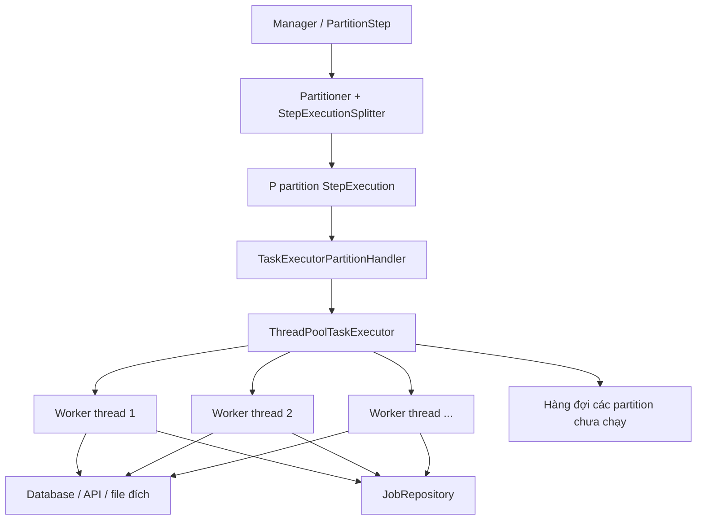

# Grid size so với pool size trong TaskExecutorPartitionHandler

Trong Spring Batch, tăng `gridSize` từ 4 lên 32 **không đồng nghĩa** job có 32 thread chạy song song. `gridSize` xác định số partition mà manager yêu cầu chia; còn **pool size** của `TaskExecutor` giới hạn lượng công việc có thể thực thi đồng thời. Hai cấu hình liên quan nhưng phục vụ hai mục đích khác nhau: chia nhỏ workload và cấp tài nguyên xử lý.

Bài thuộc chương **TaskExecutorPartitionHandler** của module **SPRING_BATCH_SCALING_OPERATIONS**. Mục tiêu là hiểu đúng hai tham số để mở rộng Spring Batch cho dữ liệu lớn, tìm nút thắt CPU/DB/I/O, thiết kế step thread-safe, dự trù tài nguyên, vận hành retry/restart và chọn mức song song dựa trên phép đo thực tế.

## 1. Bức tranh tổng thể: ai chia việc, ai chạy việc?

Với **local partitioning**, một manager step phân chia workload thành nhiều phân đoạn. Mỗi phân đoạn có một `StepExecution` riêng và thường có `ExecutionContext` riêng, ví dụ chứa `minId`/`maxId`. `TaskExecutorPartitionHandler` gửi các partition đến một `TaskExecutor` để thực thi worker step **trong cùng JVM**.

| Thành phần | Chịu trách nhiệm | Cần nhớ |
| --- | --- | --- |
| `Partitioner` | Tạo các partition cùng `ExecutionContext` | Nhận `gridSize` như thông tin đề xuất; số partition thực tế phụ thuộc mã partitioner. |
| `StepExecutionSplitter` | Biến partition thành các `StepExecution`, tham gia xử lý trạng thái/restart | Mỗi partition được theo dõi độc lập trong metadata. |
| `TaskExecutorPartitionHandler` | Điều phối thực thi các partition bằng `TaskExecutor` và chờ kết quả | Dùng thread/process của ứng dụng manager, không tạo worker từ xa. |
| `gridSize` | Quy mô phân chia công việc được yêu cầu | Không phải giới hạn thread. |
| `ThreadPoolTaskExecutor` | Quản lý worker threads và hàng đợi | Mức song song thực tế phụ thuộc `corePoolSize`, `maxPoolSize`, `queueCapacity` và tải chung. |
| `JobRepository` | Lưu metadata của job/partition | Nhiều partition tạo thêm metadata và giao dịch cập nhật. |
| Database, API, disk và broker (nếu có) | Cấp năng lực cho đọc/ghi | Có thể là nút thắt trước khi CPU/thread đạt giới hạn. |

Mối quan hệ của các thành phần:



**Từ khóa:** `gridSize` nói về **độ mịn của việc chia dữ liệu**; pool size nói về **khả năng cấp worker đồng thời**. Một partition thường được xử lý như một nhiệm vụ của executor; worker hoàn tất thì thread có thể nhận partition tiếp theo.

## 2. Ý nghĩa chính xác của gridSize

Trong cơ chế partitioning, manager truyền giá trị `gridSize` cho logic chia việc. Thông thường một `Partitioner.partition(int gridSize)` tạo ra xấp xỉ `gridSize` phần. Nhưng tham số này **không ép** partitioner phải trả về chính xác từng ấy phần.

Ví dụ:

- `gridSize = 8` và partitioner chia ID thành tám khoảng: có tám `StepExecution` partition.
- `gridSize = 8` nhưng dữ liệu chỉ có năm file: partitioner có thể tạo năm partition, mỗi file một phần.
- `gridSize = 8` nhưng partitioner luôn tạo một partition cho mỗi tenant, hiện có 20 tenant: số partition thực tế có thể là 20.
- `gridSize = 8` và partitioner cố định trả về một map duy nhất: chỉ một partition thực thi.

Do đó:

\[
P_{\text{actual}}=\left|\text{partitioner.partition(gridSize)}\right|
\]

Đây là mô hình khái niệm cho lần chia mới; khi **restart**, framework còn áp dụng cơ chế quản lý metadata và tên partition, không nên tự tính lại mà bỏ qua trạng thái lưu trong `JobRepository`.

Với các bài toán tạo một partition cho một khoảng dữ liệu, `gridSize` chủ yếu quyết định **độ lớn trung bình mỗi partition**, không quyết định thread nào sẽ xử lý partition đó.

Nếu `N` item được chia đều thành `P` phần:

\[
N_{\text{items/partition}}\approx \frac{N}{P}
\]

Ví dụ 1.600.000 item chia 16 phần sẽ có trung bình 100.000 item/partition. Nhưng số item đồng đều không bảo đảm thời gian xử lý đồng đều nếu có item nặng CPU, nhiều phép lookup hoặc vùng dữ liệu thưa.

## 3. Pool size là gì và “đồng thời” được quyết định ra sao?

Pool size là cách gọi chung cho lượng thread executor có thể huy động. Với `ThreadPoolTaskExecutor` của Spring, cần đọc **ba** cấu hình:

| Thuộc tính | Vai trò |
| --- | --- |
| `corePoolSize` | Số worker core executor duy trì theo nhu cầu; khi có task mới, thường tạo worker đến mức core trước. |
| `maxPoolSize` | Giới hạn tối đa thread khi executor cần mở rộng sau khi hàng đợi đạt ngưỡng. |
| `queueCapacity` | Số task có thể xếp hàng chờ; ảnh hưởng trực tiếp việc có mở thêm thread vượt core hay không. |

Theo cơ chế phổ biến của `ThreadPoolExecutor` mà `ThreadPoolTaskExecutor` sử dụng:

1. Khi số worker hiện có ít hơn `corePoolSize`, executor ưu tiên tạo worker để chạy task.
2. Khi đã đạt core, task tiếp theo thường **vào hàng đợi**.
3. Khi hàng đợi đầy và số worker còn dưới `maxPoolSize`, executor có thể tạo thêm worker.
4. Khi cả pool và hàng đợi không nhận thêm được task, executor áp dụng chính sách **rejection**.

Vì vậy, cấu hình `corePoolSize=4`, `maxPoolSize=16`, `queueCapacity=100` với 16 partition **thường chỉ chạy khoảng bốn partition đồng thời**: 4 chạy, 12 xếp hàng; chưa cần mở rộng đến 16 worker. Đặt `maxPoolSize=16` không bảo đảm sử dụng 16 thread.

**Phân biệt:**

- `gridSize = 16`: manager **đề xuất** chia thành 16 công việc.
- `corePoolSize = 4, maxPoolSize = 4`: tối đa 4 công việc từ executor chạy đồng thời, nếu không bị giới hạn ở nơi khác.
- `queueCapacity = 32`: các công việc còn lại có thể chờ trong hàng đợi.
- **Concurrency quan sát được**: có thể nhỏ hơn 4 vì thiếu dữ liệu, chờ I/O, worker bị chiếm bởi job khác, hoặc bottleneck của hệ thống đích.

Nếu sử dụng `SyncTaskExecutor`, các partition chạy tuần tự dù `gridSize` lớn. Nếu dùng executor cấp thread không giới hạn, việc tạo nhiều partition có thể kéo theo quá nhiều thread/connection. Vì vậy, khi dùng local partitioning để tăng throughput, hãy cấu hình executor **có giới hạn rõ ràng** và kiểm tra kết quả đo.

## 4. Bốn cấu hình điển hình và kết quả thực tế

Giả sử partitioner thực sự tạo đúng 16 partition và tất cả các task có thời lượng tương tự:

| Grid size | Executor | Số partition thực tế | Mức song song dự kiến | Điều xảy ra |
| ---: | --- | ---: | ---: | --- |
| 16 | core=max=4, queue đủ chỗ | 16 | Tối đa 4 | Bốn partition chạy, phần còn lại chờ và nhận thread khi có slot. |
| 16 | core=max=8, queue đủ chỗ | 16 | Tối đa 8 | Có thể chạy hai đợt, mỗi đợt tám partition. |
| 4 | core=max=16, queue đủ chỗ | 4 | Tối đa 4 | Có 12 slot thread không được dùng cho job này. |
| 16 | core=4, max=16, queueCapacity=100 | 16 | Thường 4 | Queue còn chỗ nên executor chưa tăng vượt core. |
| 16 | executor đồng bộ | 16 | 1 | Mọi partition chạy nối tiếp. |

Kết quả trên là **mô hình lý tưởng**. Nếu executor dùng chung với job khác, có task bị từ chối, partitioner tạo số phần khác hoặc DB bị giới hạn, trạng thái quan sát sẽ thay đổi.

### Ví dụ theo “đợt” thực thi

Cho 12 partition, mỗi partition mất khoảng 30 giây khi chạy độc lập:

\[
T_{\text{ideal}}\approx
\left\lceil\frac{P}{C}\right\rceil\times t
\]

| `P` partitions | `C` threads chạy đồng thời | Thời gian lý tưởng |
| ---: | ---: | ---: |
| 12 | 3 | 120 giây |
| 12 | 6 | 60 giây |
| 12 | 12 | 30 giây |
| 12 | 24 | 30 giây |

Công thức chỉ có ý nghĩa nếu các partition **đồng đều**, task chạy độc lập, không có contention và chi phí chia/gom kết quả không đáng kể. Trong thực tế, tăng `C` có thể làm từng partition **chậm đi** vì chúng cạnh tranh cùng DB, disk và connection pool.

Một cận dưới hữu ích cho thời gian xử lý, khi thời lượng mỗi partition đã biết và không đổi theo mức concurrency:

\[
T_{\text{work}}\geq
\max\left(\frac{\sum_{i=1}^{P}t_i}{C},\;\max_i t_i\right)
\]

Nếu một partition mất 12 phút, toàn bước không thể xong dưới 12 phút dù có rất nhiều thread. Đây là lý do đo **data skew** quan trọng ngang với đo số lượng partition.

## 5. Cấu hình Spring Batch 5.x minh họa

Có thể dùng `PartitionStepBuilder` (qua `StepBuilder.partitioner(...)`) để tạo local partitioning; bên dưới framework dùng `TaskExecutorPartitionHandler`. Ví dụ sau xác định **gridSize = 16** và executor cố định **4 worker threads**.

```java
import org.springframework.batch.core.Step;
import org.springframework.batch.core.configuration.annotation.StepScope;
import org.springframework.batch.core.partition.support.Partitioner;
import org.springframework.batch.core.repository.JobRepository;
import org.springframework.batch.core.step.builder.StepBuilder;
import org.springframework.beans.factory.annotation.Qualifier;
import org.springframework.context.annotation.Bean;
import org.springframework.context.annotation.Configuration;
import org.springframework.core.task.TaskExecutor;
import org.springframework.scheduling.concurrent.ThreadPoolTaskExecutor;

@Configuration
public class LocalPartitioningConfiguration {

    @Bean
    public ThreadPoolTaskExecutor partitionExecutor() {
        ThreadPoolTaskExecutor executor = new ThreadPoolTaskExecutor();
        executor.setThreadNamePrefix("order-partition-");
        executor.setCorePoolSize(4);
        executor.setMaxPoolSize(4);
        executor.setQueueCapacity(32);
        return executor; // Spring quản lý initialize/shutdown cho bean.
    }

    @Bean
    public Step orderManagerStep(
            JobRepository jobRepository,
            @Qualifier("orderWorkerStep") Step workerStep,
            Partitioner orderPartitioner,
            @Qualifier("partitionExecutor") TaskExecutor executor) {

        return new StepBuilder("orderManagerStep", jobRepository)
            .partitioner("orderWorkerStep", orderPartitioner)
            .step(workerStep)
            .gridSize(16)
            .taskExecutor(executor)
            .build();
    }
}
```

Giả định ứng dụng đã có bean `orderWorkerStep`, bean `orderPartitioner`, `JobRepository` và transaction manager. Đây là **cấu hình phần manager và executor**, chưa gồm reader/processor/writer hay kết nối nguồn/đích. Bài tập trung vào cơ chế chia partition và quản trị thread.

Ở đây:

- `.gridSize(16)` đặt **số phần được đề xuất** cho partitioner.
- `.taskExecutor(executor)` cho phép chạy các partition qua pool riêng.
- `corePoolSize=maxPoolSize=4` làm giới hạn đồng thời của pool dễ dự đoán hơn.
- `queueCapacity=32` đủ chứa 12 partition đang chờ từ job này trong kịch bản 16 phần, nhưng cần cân nhắc khi nhiều job cùng chia sẻ executor.
- Vì `TaskExecutorPartitionHandler` xử lý các partition **local**, bốn worker dùng chung giới hạn CPU, heap, database pool và tài nguyên JVM của ứng dụng.

Nếu cấu hình handler trực tiếp, logic tương đương là gọi `setStep(workerStep)`, `setTaskExecutor(executor)` và `setGridSize(16)` trên `TaskExecutorPartitionHandler` rồi gắn handler vào partition step. Tránh vừa đặt grid size tại nhiều nơi vừa kỳ vọng framework chọn ra một “giá trị lớn nhất”; hãy kiểm tra đường cấu hình thực sự tạo handler.

## 6. Partition thực tế phụ thuộc Partitioner, không chỉ gridSize

Một partitioner theo khoảng ID có thể dùng `gridSize` để tính số khoảng. Ví dụ Java sau dùng khoảng ID đầu/cuối được cung cấp trước:

```java
import java.util.LinkedHashMap;
import java.util.Map;
import org.springframework.batch.core.partition.support.Partitioner;
import org.springframework.batch.item.ExecutionContext;

public final class IdRangePartitioner implements Partitioner {
    private final long firstId;
    private final long lastId;

    public IdRangePartitioner(long firstId, long lastId) {
        if (lastId < firstId) {
            throw new IllegalArgumentException("Invalid ID range");
        }
        this.firstId = firstId;
        this.lastId = lastId;
    }

    @Override
    public Map<String, ExecutionContext> partition(int gridSize) {
        if (gridSize < 1) {
            throw new IllegalArgumentException("gridSize must be positive");
        }

        long totalIds = lastId - firstId + 1;
        long idsPerPartition = (totalIds + gridSize - 1) / gridSize;
        Map<String, ExecutionContext> partitions = new LinkedHashMap<>();

        int index = 0;
        for (long offset = 0; offset < totalIds; offset += idsPerPartition) {
            long minId = firstId + offset;
            long maxId = Math.min(lastId, minId + idsPerPartition - 1);

            ExecutionContext context = new ExecutionContext();
            context.putLong("minId", minId);
            context.putLong("maxId", maxId);
            partitions.put("partition" + index++, context);
        }
        return partitions;
    }
}
```

Trong ví dụ:

- Khi khoảng ID có 1.000.000 giá trị và `gridSize=10`, map thường có 10 partition, mỗi phần khoảng 100.000 giá trị.
- Nếu chỉ có 6 giá trị ID và `gridSize=10`, hàm tạo **6 partition**, không phải 10.
- Các khoảng [`minId`, `maxId`] không giao nhau; worker reader phải dùng đúng phạm vi này để tránh đếm/ghi lặp.

Mẫu này cố ý đơn giản hóa: giả định ID dương, khoảng hữu hạn không gây tràn `long`, dữ liệu có thể chia bằng range. Với ID không liên tục hoặc dataset rất lệch, **khoảng ID bằng nhau không đồng nghĩa số bản ghi bằng nhau**. Trong production, hãy đo phân bố thật và có thể chia theo histogram, file, tenant hoặc khóa phù hợp.

Quan trọng: tên partition ổn định và `ExecutionContext` nhất quán là yếu tố của retry/restart. Không đổi công thức partition giữa một lần chạy đang dở rồi mặc định metadata cũ sẽ khớp với phạm vi mới.

## 7. Grid size lớn hơn pool size: khi nào hợp lý?

Việc đặt `gridSize=24`, pool size=6 có thể là một lựa chọn tốt. Manager tạo 24 đơn vị việc và executor xử lý khoảng sáu đơn vị tại một thời điểm. Khi một partition hoàn tất, thread rảnh nhận phần tiếp theo.

Lợi ích của việc có **nhiều partition hơn worker**:

1. **Cân bằng tải linh hoạt hơn:** Partition ngắn kết thúc sớm sẽ nhường slot cho partition khác.
2. **Giảm tác động của lệch dữ liệu:** Nhiều phần nhỏ thường giảm nguy cơ một vùng quá lớn, nếu cách chia phù hợp.
3. **Theo dõi và phục hồi theo phạm vi nhỏ:** Từng partition có trạng thái và metadata riêng, có thể hỗ trợ xử lý lại phần bị lỗi theo semantics restart.
4. **Giới hạn concurrency:** Dù số partition nhiều, pool vẫn chặn mức thực thi đồng thời khỏi tăng vô hạn.

Chi phí đánh đổi:

- Nhiều bản ghi `StepExecution` và `ExecutionContext` hơn, tăng tải metadata repository.
- Nhiều lượt mở/đóng reader, transaction, query và khởi tạo step.
- Phân đoạn quá nhỏ có thể làm thời gian startup/điều phối lớn hơn thời gian xử lý thực.
- Nhiều partition bị queue có thể tạo áp lực lên memory hoặc kích hoạt rejection nếu hàng đợi quá nhỏ.
- Khi nhiều job cùng dùng pool, một job chia quá nhiều partition có thể chiếm hàng đợi, khiến job khác chậm.

**Gợi ý để bắt đầu thí nghiệm:** thử số partition gấp khoảng 2–4 lần concurrency dự kiến **nếu** chi phí chia việc nhỏ và workload có skew; đây là heuristic thử nghiệm, không phải quy tắc của Spring Batch. Với xử lý rất nặng trên từng partition hoặc JobRepository đã quá tải, số phần bằng số worker hoặc chỉ nhỉnh hơn có thể phù hợp hơn.

## 8. Grid size nhỏ hơn pool size: điều gì bị giới hạn?

Nếu `gridSize=4` và pool tối đa 16 thread, nhưng partitioner trả về bốn phần, manager chỉ tạo bốn nhiệm vụ. **Tối đa bốn partition** có thể được xử lý đồng thời cho bước này.

Các thread còn lại chỉ hữu ích khi:

- Executor dùng chung với những tác vụ khác cần xử lý cùng lúc.
- Các partition tự dùng mô hình xử lý đồng thời khác ở bên trong; khi đó tính an toàn thread và số kết nối phải xem xét riêng.
- Một job khác đang chia partition cùng executor.

Thấy CPU chỉ chạy 25% không đủ để khẳng định cần nâng `gridSize`: có thể CPU rảnh vì step bị giới hạn bởi network/DB. Nhưng nếu CPU còn dư, DB còn dư và mỗi partition xử lý CPU-bound thì tăng số partition **đến đủ nuôi pool** có thể cải thiện throughput.

## 9. Queue và rejection: một lỗi sizing dễ bỏ sót

Ví dụ pool cấu hình:

```java
executor.setCorePoolSize(4);
executor.setMaxPoolSize(4);
executor.setQueueCapacity(8);
```

Nếu có 20 partition được submit gần như cùng lúc vào một executor không có công việc khác:

- Khoảng **4** task chạy trên worker threads.
- Tối đa **8** task chờ trong queue.
- Những task còn lại có nguy cơ **bị từ chối** khi pool và queue đều đầy, tùy chính sách rejection.

Hậu quả không chỉ là chậm hơn: việc submit partition có thể phát sinh `TaskRejectedException` hoặc lỗi liên quan và manager step thất bại. Cần kiểm tra cấu hình rejection khi tải đạt đỉnh và khi các batch job chạy chồng lịch.

Với `ThreadPoolTaskExecutor`, `queueCapacity=0` thường dùng hàng đợi chuyển giao trực tiếp; cấu hình này có thể đẩy executor tăng số thread nhanh tới `maxPoolSize`, nhưng sẽ dễ gặp rejection nếu cùng lúc gửi nhiều partition hơn số worker nhận được. Không đặt queue bằng 0 chỉ để “ép max pool được sử dụng” mà chưa thiết kế giới hạn nhận việc.

Có thể sử dụng một `RejectedExecutionHandler` khác (ví dụ chính sách chạy task trên thread gọi) trong những tình huống được kiểm chứng. Tuy nhiên, nó có thể làm manager chạy partition trực tiếp và thay đổi latency/concurrency quan sát được; không coi đó là cách chữa mặc định cho mọi trường hợp thiếu capacity.

## 10. Kích thước pool phải xét tài nguyên thật, không chỉ CPU

Với một Step đọc/ghi database, mỗi partition có thể cần connection đọc, connection ghi, transaction và các kết nối dùng cho metadata. Tổng concurrency còn có thể bị giới hạn bởi thread pool JDBC, API rate limit, DB lock, heap và network bandwidth.

Công thức khái niệm:

\[
C_{\text{effective}}\leq
\min(P_{\text{actual}},\ C_{\text{executor}},\ C_{\text{available resources}})
\]

Ở đây `C_available resources` là **mức song song bền vững đo được** từ nguồn/đích, không phải một giá trị Spring Batch tự tính. Ví dụ một pool 12 thread nhưng DB chỉ đáp ứng ổn định 5 truy vấn nặng song song thì tăng `gridSize` từ 12 lên 64 khó làm job chạy nhanh hơn.

### 10.1. Connection pool là một giới hạn khác

Giả sử:

- `gridSize=16`.
- Partition executor cho phép 8 partition chạy đồng thời.
- DataSource chỉ có 5 connection tối đa, lại còn được dùng bởi manager, JobRepository hoặc tác vụ khác.

Các worker có thể chờ connection, dẫn đến thời gian từng partition tăng hoặc timeout. Không nhất thiết phải cấu hình `HikariCP.maximumPoolSize = gridSize` hay `= pool size`: mỗi partition có thể cần nhiều loại kết nối, có lúc giữ connection lâu, có lúc không dùng DB; repository và các ứng dụng khác cùng tạo tải. Cần đo **active/pending connections, thời gian chờ và mức sử dụng theo thời gian**.

### 10.2. CPU-bound, I/O-bound và bottleneck ở đích

| Loại workload | Dấu hiệu | Hướng thử |
| --- | --- | --- |
| CPU-bound | CPU gần bão hòa, DB/IO còn dư | Tăng worker tới mức phù hợp CPU cores; đo GC/heap và độ tăng throughput. |
| I/O-bound | Nhiều thread chờ mạng hoặc disk; CPU còn rảnh | Điều chỉnh concurrency có giới hạn, đo latency/bandwidth và các queue. |
| DB-bound | DB CPU/IO/lock cao; query latency tăng khi thêm thread | Tối ưu query/index, chunk, transaction, partition key trước khi tăng worker. |
| API rate-limited | HTTP 429 hoặc timeout tăng khi thêm worker | Giới hạn request/s, backoff, bulkhead và retry phù hợp. |
| Metadata-bound | `BATCH_STEP_EXECUTION` cập nhật chậm, DB repository nghẽn | Giảm partition quá nhỏ, kiểm tra storage/DB cho JobRepository và chi phí update. |

**Điểm quan trọng:** `pool size` đặt mức thread sẵn có; throughput là số item thực sự được xử lý an toàn mỗi giây. Một lượng thread lớn không bảo đảm throughput cao hơn.

## 11. Bảo đảm thread safety khi chạy nhiều partition local

Trong local partitioning, các `StepExecution` có `ExecutionContext` khác nhau nhưng cùng JVM. Nhiều worker có thể dùng cùng các bean Spring nếu chúng được khai báo singleton.

| Thành phần | Rủi ro | Cách thiết kế |
| --- | --- | --- |
| Stateful `ItemReader` | Con trỏ, file offset, trạng thái trang đọc có thể bị chia sẻ giữa partition. | Tạo instance theo `@StepScope` và lấy range từ `stepExecutionContext`. |
| Stateful `ItemWriter` | Buffer và trạng thái commit có thể bị lẫn giữa partition. | Step scope hoặc đồng bộ/thiết kế thread-safe; kiểm tra idempotency. |
| `ItemProcessor` | Cache mutable, biến đếm, formatter không an toàn thread. | Ưu tiên stateless; nếu có state, cô lập hoặc đồng bộ có chủ đích. |
| `ExecutionContext` | Ghi đè checkpoint của partition khác. | Mỗi partition lưu key và state của chính nó; hạn chế context lớn. |
| Connection/session | Chia sẻ connection không an toàn hoặc exhaustion. | Transaction/resource lifecycle theo step và giới hạn pool thực tế. |

Mẫu injection cho reader riêng theo partition:

```java
@Bean
@StepScope
public ItemReader<Order> orderReader(
        @Value("#{stepExecutionContext['minId']}") Long minId,
        @Value("#{stepExecutionContext['maxId']}") Long maxId) {

    // Tạo reader mới cho StepExecution này, áp điều kiện ID trong [minId, maxId].
    // Hàm buildRangeReader là factory do ứng dụng hiện thực.
    return buildRangeReader(minId, maxId);
}
```

Đoạn trên là **mẫu minh họa phạm vi bean**; `buildRangeReader(...)` phải do ứng dụng cung cấp để truy vấn/đọc đúng khoảng ID, chưa phải đoạn mã tự chạy. Với `JdbcPagingItemReader` hoặc `JdbcCursorItemReader`, cần kiểm tra cấu hình restart/checkpoint và thread safety của instance tương ứng. `@StepScope` giúp cô lập state theo `StepExecution` nhưng không tự đảm bảo writer an toàn với retry hoặc transaction ở hệ thống ngoài.

## 12. Retry và restart: số partition ảnh hưởng khả năng phục hồi ra sao?

Khi một partition lỗi, metadata của `StepExecution` lưu trạng thái và có thể lưu checkpoint phục vụ restart. Manager step sẽ tổng hợp kết quả partition để quyết định kết quả chung. Số partition càng nhiều, phạm vi dữ liệu của mỗi partition thường càng nhỏ, nhưng **không có nghĩa** mọi lỗi đều có thể restart an toàn.

Cần phân biệt ba lớp:

1. **Retry trong chunk:** dùng chính sách retry/skip giới hạn cho lỗi tạm thời; ranh giới transaction quyết định phần nào được commit.
2. **Retry ở mức execution/job:** sau khi lỗi đã được chẩn đoán, Spring Batch có thể tạo execution mới cho cùng JobInstance để khởi động lại các phần cần thiết theo metadata và cấu hình restart.
3. **Chạy lại cùng dữ liệu như một job mới:** có thể xử lý trùng nếu thay identifying JobParameters hoặc thay đổi tên/biên partition.

Rủi ro khi đổi `gridSize` sau khi job lỗi:

- Partitioner có thể chia lại khoảng dữ liệu với các tên partition/`ExecutionContext` khác trước.
- Các khoảng mới có thể không khớp checkpoint cũ, khiến một phần dữ liệu bị xử lý lặp hoặc bỏ sót nếu thiết kế kém.
- Framework có cơ chế nhận diện partition và restart; ứng dụng cần giữ partition key/naming và semantics ổn định, đặc biệt khi custom partitioner.

Rủi ro khi tăng pool size khi retry:

- Nhiều retry diễn ra đồng thời có thể đẩy DB/API vốn đang lỗi vào trạng thái quá tải.
- Side effect ngoài transaction như HTTP hoặc ghi file có thể đã xảy ra trước khi exception.
- Nếu writer không idempotent, chạy lại sau timeout có thể gây ghi trùng dù metadata nói lỗi.

Một cấu hình restart tốt phải xác định rõ phạm vi partition, checkpoint, chính sách transaction, idempotency và giới hạn concurrency trong thời gian recovery.

## 13. Đo số liệu để chọn grid size và pool size

Thay vì chọn `gridSize = 2 × CPU` theo cảm tính, hãy bắt đầu với workload đại diện và đo từng mức:

| Metric | Nguồn quan sát | Nó trả lời điều gì? |
| --- | --- | --- |
| Số partition được tạo | `BATCH_STEP_EXECUTION`, log splitter | Partitioner có thực sự tôn trọng `gridSize` không? |
| Active thread, pool size, queue depth | Metrics `ThreadPoolTaskExecutor` | Pool đang làm việc, chờ việc hay quá tải? |
| Duration/throughput theo partition | `StepExecution` counters, step logs | Partition nào lệch tải hoặc bị block? |
| Tổng read/write/s | Job metric, dữ liệu đích | Công suất end-to-end có tăng không? |
| DB active/pending connection, query P95 | HikariCP, DB metrics/APM | Tăng concurrency có gây chờ kết nối/lock không? |
| CPU, GC, memory, I/O, network | JVM/host monitoring | Nút thắt tài nguyên chuyển đi đâu? |
| Retry, rollback, skip, thời gian chờ | Batch metadata/log | Có đánh đổi throughput bằng nhiều lỗi hơn không? |
| Job duration và kết quả restart | JobRepository | Cấu hình có đáp ứng SLA và phục hồi tin cậy? |

Truy vấn SQL minh họa với schema metadata Spring Batch thường dùng:

```sql
SELECT
    STEP_EXECUTION_ID,
    STEP_NAME,
    STATUS,
    READ_COUNT,
    WRITE_COUNT,
    COMMIT_COUNT,
    ROLLBACK_COUNT,
    START_TIME,
    END_TIME,
    LAST_UPDATED
FROM BATCH_STEP_EXECUTION
WHERE JOB_EXECUTION_ID = :jobExecutionId
ORDER BY STEP_EXECUTION_ID;
```

Các partition thường có tên step gồm hậu tố partition. Số bản ghi và thời gian theo partition giúp thấy chênh lệch, nhưng hãy xác minh cách đặt tên thực tế của ứng dụng. Truy vấn chỉ đọc không thay trạng thái và có thể thực hiện định kỳ ở tần suất phù hợp với JobRepository.

### 13.1. Bảng thí nghiệm sizing

Giữ nguyên dataset, batch window, JVM/DB, chunk size, index và các điều kiện tải; thử từng cặp cấu hình:

| Lần thử | `gridSize` | `core=max pool` | Cần đo |
| --- | ---: | ---: | --- |
| A | 4 | 4 | Baseline throughput, duration, tài nguyên, skew. |
| B | 8 | 4 | Việc chia nhỏ có giảm tail latency không? |
| C | 16 | 4 | Có lợi thêm hay overhead metadata/queue tăng? |
| D | 16 | 8 | DB/API có chịu được mức song song cao hơn không? |
| E | 32 | 8 | Tăng độ mịn còn giúp hay chỉ tốn điều phối? |

Không điền trước số liệu “tăng gấp đôi” vào kết quả. Chỉ nâng pool khi còn headroom, và chỉ nâng grid khi partition chưa cân bằng hoặc còn nhu cầu chia nhỏ. Theo dõi hiện tượng **diminishing returns**: throughput tăng ít, duration giảm không đáng kể trong khi DB wait, memory hoặc rollback tăng.

Tính **speedup** từ thời gian cùng workload:

\[
S_C=\frac{T_1}{T_C}
\]

Nếu một worker mất 40 phút và bốn worker mất 14 phút thì `S_4 = 40/14 ≈ 2,86`, không phải 4. Hiệu quả theo slot thread là `E_4 = S_4/4 ≈ 71,4%`. Việc thêm thread cần được cân nhắc theo chi phí và giới hạn nguồn/đích.

## 14. Bài toán công suất: chọn cấu hình từ SLA

Một hệ thống có 2.400.000 giao dịch cần xử lý trong 20 phút. Khi chạy thử một partition trên một worker, tốc độ trung bình đo được 550 item/giây; ở mức concurrency cao, dự kiến mỗi worker chỉ giữ khoảng 80% tốc độ đó do tranh chấp I/O.

**Bước 1 — Throughput tối thiểu:**

\[
T_{\min}=\frac{2.400.000}{20\times60}
=2.000\text{ item/giây}
\]

Nếu muốn giữ 20% công suất dự phòng tính theo tỉ lệ sử dụng tối đa 80%, công suất mục tiêu là:

\[
T_{\text{target}}=\frac{2.000}{0,8}
=2.500\text{ item/giây}
\]

**Bước 2 — Số worker sơ bộ:**

\[
C_{\text{estimate}}=
\left\lceil\frac{2.500}{550\times0,8}\right\rceil
=\lceil5,68\rceil=6
\]

Đây là **ước lượng để lập benchmark**, không có nghĩa sáu worker chắc chắn xử lý được 2.500 item/s. Cần đo đúng load với sáu worker và tính thời gian split/aggregation, transaction, skew, timeouts và thời gian cuối job.

**Bước 3 — Grid size thử nghiệm:** Chọn `gridSize=12` hoặc 18 để có nhiều partition hơn số slot chạy đồng thời, rồi so với `gridSize=6` trong cùng điều kiện. Nếu dữ liệu chia đều, overhead mỗi partition lớn và skew thấp, grid 6 có thể tốt hơn. Nếu dữ liệu lệch tải nhiều, grid 18 có thể rút ngắn thời gian chờ phần cuối.

**Bước 4 — Kiểm tra capacity ngoài JVM:** Nếu DB chỉ chịu ổn định 1.800 item/s, tăng số thread không thể giúp đạt SLA. Cần tối ưu SQL/index/IO, giảm lượng việc, tăng năng lực DB hoặc điều chỉnh batch window trước khi chốt kiến trúc.

## 15. Chẩn đoán các hiện tượng phổ biến

| Hiện tượng | Nguyên nhân có thể | Cách kiểm tra |
| --- | --- | --- |
| `gridSize=32` nhưng chỉ bốn partition chạy cùng lúc | Core pool=4, queue còn chỗ; hoặc executor đồng bộ. | Xem loại executor, core/max/queue, active thread và stack trace. |
| Pool tối đa tám nhưng active chỉ hai | Partitioner trả về hai phần; CPU/IO wait; job khác chiếm tài nguyên. | Đếm StepExecution, queue, trạng thái task và runtime. |
| Tăng grid từ 8 lên 64 nhưng duration không giảm | Concurrency vẫn 4; DB-bound; overhead partition tăng. | So sánh throughput, queue, DB wait và duration mỗi phần. |
| Tăng pool từ 4 lên 16 thì job chậm hơn | Contention DB, CPU throttling, GC, connection shortage. | Đo CPU, pool, locks, IOPS, query latency. |
| Một partition chạy rất lâu sau khi các phần khác xong | Data skew hoặc vùng dữ liệu khó xử lý. | So sánh item, byte, retry và thời gian theo partition. |
| Job lỗi ngay lúc dispatch | Queue/pool đầy, task bị reject. | Đọc log rejection, giới hạn executor, nhiều job cùng lịch. |
| Restart rồi xuất hiện dữ liệu trùng | Partition boundary/naming đổi hoặc writer không idempotent. | Kiểm tra JobInstance, ExecutionContext, checkpoint và dữ liệu đích. |
| `StepExecution` báo `STARTED` rất lâu | Task bị chờ DB, deadlock, step còn chạy, hoặc JVM chết đột ngột. | Kết hợp metadata, thread dump, worker health, DB/lock và commit. |

**Quy trình vận hành ngắn:** xác nhận số partition thực tế → quan sát active threads/queue → kiểm tra throughput và skew → đo giới hạn DB/CPU/IO → đánh giá lỗi/retry/restart → chỉ khi đã có bằng chứng mới chỉnh grid, pool hoặc chunk.

Trong môi trường nhiều job, hãy tính đến tổng tài nguyên: bốn job mỗi job có pool 8 có thể tạo tới 32 worker nếu dùng executor riêng. Khi chúng chia sẻ cùng một `ThreadPoolTaskExecutor`, giới hạn pool áp dụng cho **tổng các job dùng chung**, làm concurrency thực tế của mỗi job biến động theo lịch chạy.

## 16. Bài thực hành tự đánh giá

Giả sử hệ thống nhập dữ liệu ngày có 1.200.000 item. Partition chia theo khoảng ID, mỗi partition có workload tương đương, mỗi worker xử lý ổn định 250 item/giây khi chạy đồng thời. Job phải hoàn tất trong 20 phút; overhead split/finish là 2 phút.

**Cấu hình A:** `gridSize=12`, `core=max=3`, `queueCapacity=12`.

**Cấu hình B:** `gridSize=12`, `core=max=6`, `queueCapacity=12`.

**Cấu hình C:** `gridSize=6`, `core=max=12`, `queueCapacity=12`.

Câu hỏi:

1. Mỗi cấu hình tối đa có bao nhiêu partition chạy đồng thời?
2. Nếu throughput mỗi worker giữ nguyên 250 item/s, ước tính thời gian xử lý payload và tổng thời gian sau overhead?
3. Cấu hình nào đáp ứng batch window 20 phút theo mô hình lý tưởng?
4. Nếu DB chỉ đạt 900 item/s tổng, kết luận thay đổi thế nào?
5. Nếu partitioner trả về 15 partition thay vì 12, số thread có tăng theo không?

**Gợi ý giải:**

- A: đồng thời 3, thông lượng tối đa 750 item/s; payload ≈ 1.600 giây (26 phút 40 giây), cộng 2 phút overhead ≈ 28 phút 40 giây.
- B: đồng thời 6, throughput tối đa 1.500 item/s; payload ≈ 800 giây (13 phút 20 giây), tổng ≈ 15 phút 20 giây.
- C: chỉ sáu partition nên đồng thời tối đa 6; throughput và thời gian lý tưởng giống B dù pool có thể cấp 12 thread.
- Nếu DB bị giới hạn ở 900 item/s, thời gian payload tối thiểu ≈ 1.333 giây (22 phút 13 giây), cộng overhead hơn 24 phút; không cấu hình nào đạt SLA nếu không cải thiện nút thắt này.
- Với partitioner trả về 15 phần, executor ở A/B vẫn giới hạn lần lượt 3/6 worker; nhiều phần hơn chỉ thay số đợt và overhead, không làm tăng pool size.

Các kết quả dựa trên giả định throughput không đổi, workload chia đều và không có retry. Khi làm thí nghiệm thực, thêm độ phân tán thời gian partition, thời gian khởi tạo step, DB wait và một kịch bản failure/restart.

## 17. Checklist cấu hình và vận hành

Trước khi đưa local partitioning vào production, xác nhận:

- [ ] Biết rõ partitioner thực sự tạo bao nhiêu partition với `gridSize` đã chọn.
- [ ] `TaskExecutor` đã được cấu hình rõ `corePoolSize`, `maxPoolSize`, `queueCapacity` và chính sách rejection.
- [ ] Số worker đồng thời không vượt giới hạn CPU, heap, connection pool, DB/API và giới hạn tải của job khác.
- [ ] Reader, processor và writer an toàn khi nhiều `StepExecution` chạy trên cùng JVM; state theo partition được cô lập.
- [ ] Khoảng dữ liệu không chồng lấn ngoài chủ đích; checkpoint và tên partition ổn định khi restart.
- [ ] Có metric active thread, queue depth, partition duration, throughput, rollback và độ lệch tải.
- [ ] Đã thử nhiều cặp grid/pool với workload đại diện và xét cả sự cố, xử lý lại/backlog.
- [ ] Không thay đổi đồng thời nhiều tham số khi chưa có baseline để so sánh.

## 18. Tài liệu tham khảo

- [Spring Batch Reference — Scaling and Parallel Processing](https://docs.spring.io/spring-batch/reference/scalability.html): mô hình partitioning, manager/worker và ví dụ cấu hình local partitioning.
- [TaskExecutorPartitionHandler API](https://docs.spring.io/spring-batch/docs/current/api/org/springframework/batch/core/partition/support/TaskExecutorPartitionHandler.html): handler thực thi partition qua TaskExecutor.
- [Partitioner API](https://docs.spring.io/spring-batch/docs/current/api/org/springframework/batch/core/partition/support/Partitioner.html): hợp đồng `partition(int gridSize)`.
- [Spring Framework — Task Execution and Scheduling](https://docs.spring.io/spring-framework/reference/integration/scheduling.html): TaskExecutor và thread pool.
- [ThreadPoolTaskExecutor API](https://docs.spring.io/spring-framework/docs/current/javadoc-api/org/springframework/scheduling/concurrent/ThreadPoolTaskExecutor.html): `corePoolSize`, `maxPoolSize`, `queueCapacity` và giám sát executor.
- [Spring Batch — Step Scope](https://docs.spring.io/spring-batch/reference/step/late-binding.html): bean theo `StepExecution` và cách lấy tham số từ `ExecutionContext`.

> **Ghi nhớ:** `gridSize` là **gợi ý về số phần chia dữ liệu**; pool size là **giới hạn năng lực chạy các phần đó đồng thời**. Muốn tăng tốc Spring Batch, phải kiểm chứng số partition thực tế, thread active, queue, data skew và công suất của nguồn/đích. Chọn cấu hình dựa trên throughput, SLA, thread safety và khả năng retry/restart thay vì mặc định “grid lớn hơn thì chạy nhanh hơn”.
