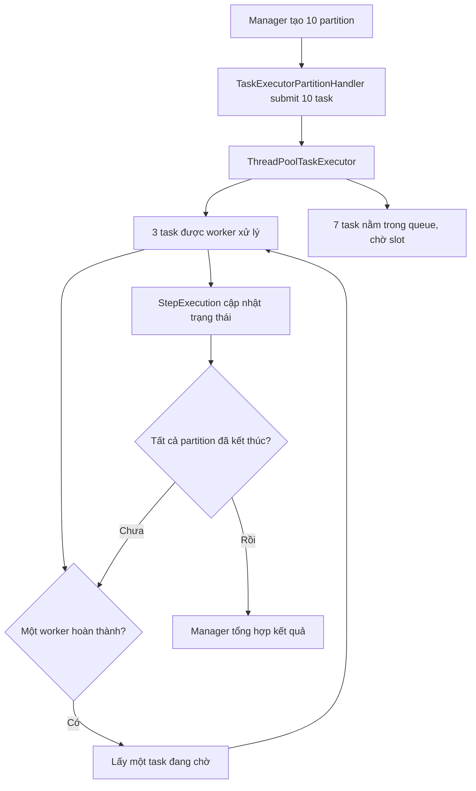

# Grid size lớn hơn số thread trong TaskExecutorPartitionHandler

Trong Spring Batch, cấu hình **`gridSize = 24`** và executor có **6 worker threads** là một tình huống hoàn toàn hợp lệ: manager có thể tạo 24 partition, nhưng tối đa khoảng 6 partition được thực thi cùng lúc trong executor này. Phần việc còn lại chờ trong hàng đợi, rồi được các thread rảnh nhận tiếp. Cơ chế này hữu ích khi cần chia nhỏ dữ liệu để cân bằng tải, đồng thời giới hạn số tác vụ truy cập database hay API tại một thời điểm.

Bài học thuộc chương **TaskExecutorPartitionHandler** của module **SPRING_BATCH_SCALING_OPERATIONS**, tập trung vào câu hỏi thực tế: **khi số partition nhiều hơn số thread, Spring Batch sẽ thực thi thế nào, lúc nào có lợi, và khi nào cấu hình đó làm job chậm hoặc thất bại?** Các ví dụ gắn với mục tiêu mở rộng workload dữ liệu lớn bằng partitioning, thread safety, retry/restart và quan sát nút thắt tài nguyên.

## 1. Vì sao có thể chia nhiều partition hơn số thread?

Giả sử một job mỗi ngày phải xử lý **1.200.000 bản ghi**. Ứng dụng chỉ dành được **4 thread** cho step vì database đích đã gần giới hạn số giao dịch song song.

Có ít nhất hai cách chia:

| Phương án | Số partition được tạo | Thread có thể xử lý đồng thời | Dữ liệu trung bình mỗi partition |
| --- | ---: | ---: | ---: |
| A | 4 | 4 | 300.000 bản ghi |
| B | 12 | 4 | 100.000 bản ghi |

Ở phương án B, không có 12 thread hoạt động cùng lúc. Manager đưa 12 partition vào luồng thực thi; bốn partition chạy trước, các phần còn lại chờ slot. Khi một partition xong, thread tương ứng nhận phần tiếp theo.

Phương án B có thể hữu ích nếu các khoảng dữ liệu không đều: những partition hoàn tất sớm tạo cơ hội xử lý công việc còn lại, giúp giảm thời gian chờ một partition quá lớn. Ngược lại, nếu mọi item có chi phí gần như bằng nhau, chia nhỏ hơn có thể chỉ làm tăng số lần khởi tạo reader, ghi metadata và điều phối.

**Kết luận cần rút ra từ ví dụ:** số partition biểu thị **độ chia nhỏ của workload**, còn số thread đồng thời biểu thị **năng lực thực thi tại một thời điểm**. Đây là hai trục có thể điều chỉnh độc lập.

## 2. Vai trò các thành phần trong local partitioning

Khi dùng local partitioning với Spring Batch:

| Thành phần | Trách nhiệm |
| --- | --- |
| `PartitionStep` (manager) | Tổ chức chia việc và tổng hợp kết quả các partition. |
| `Partitioner` | Tạo map tên partition → `ExecutionContext`, có thể tham khảo `gridSize`. |
| `StepExecutionSplitter` | Chuẩn bị/tra cứu `StepExecution` cho từng partition, áp dụng semantics restart. |
| `TaskExecutorPartitionHandler` | Gửi từng partition tới `TaskExecutor` và tập hợp kết quả hoàn tất. |
| `ThreadPoolTaskExecutor` | Quản lý thread, queue và việc nhận/chạy task. |
| Worker `Step` | Thực thi reader–processor–writer (hoặc tasklet) cho phạm vi partition. |
| `JobRepository` | Lưu metadata riêng cho các partition phục vụ giám sát và khởi động lại. |

`TaskExecutorPartitionHandler` xử lý partition **trong cùng JVM**. Nếu muốn phân phối công việc sang nhiều tiến trình hoặc máy khác nhau, cần kiến trúc **remote partitioning** với giao thức request/reply và repository chung; chỉ tăng `gridSize` không biến một executor cục bộ thành hệ thống phân tán.

### Grid size không bắt buộc bằng số partition thực tế

Hợp đồng của `Partitioner.partition(int gridSize)` cho phép dùng `gridSize` như **gợi ý** về độ chia nhỏ. Partitioner có thể tạo ít hoặc nhiều partition tùy dữ liệu và thuật toán.

Ví dụ `gridSize = 12` nhưng nguồn chỉ có 7 file cần xử lý thì partitioner theo file có thể chỉ tạo 7 partition. Vì vậy trong công thức dưới đây, ký hiệu:

- `G`: giá trị cấu hình `gridSize`.
- `P`: số partition **thực tế** được tạo, có thể khác `G`.
- `C`: số partition **được executor thực thi đồng thời**, trong điều kiện hiện hành.
- `Q`: số task partition đang nằm trong hàng đợi executor.

Ta luôn có:

\[
C \le P
\]

Nếu executor dùng pool cố định `T` worker, với các task partition thông thường:

\[
C \le \min(P,T)
\]

Đây là **giới hạn số task đang thực thi**, không phải cam kết throughput. Chờ database lock, network, thiếu connection hoặc các task khác chia sẻ executor vẫn có thể làm mức song song hữu ích thấp hơn.

## 3. Dòng chảy khi G lớn hơn T

Giả sử partitioner tạo đúng 10 partition: `p0` đến `p9`. Executor cho phép 3 worker chạy đồng thời và queue đủ chỗ.



Luồng xử lý thường gặp:

1. Partitioner tạo các `ExecutionContext` như khoảng ID hoặc file path.
2. Manager tạo/chuẩn bị `StepExecution` cho từng partition trong `JobRepository`.
3. Handler gửi task thực thi partition đến `TaskExecutor`.
4. Executor cấp worker cho một số task; các task chưa có thread tiếp tục chờ.
5. Worker chạy step và cập nhật metadata của partition, kể cả trạng thái và các bộ đếm đọc/ghi.
6. Khi worker rảnh, executor lấy thêm task đang chờ; manager chờ để tập hợp toàn bộ kết quả theo cơ chế handler.
7. Một partition thất bại vẫn phải được manager ghi nhận và xử lý trong kết quả tổng hợp; đủ số kết quả chưa có nghĩa tất cả thành công.

**Không giả định** partition được hoàn thành theo thứ tự `p0 → p1 → ...`. Thứ tự submit, dequeue và hoàn thành chịu ảnh hưởng của loại queue, lịch thread, thời lượng xử lý, và những job khác có thể chia sẻ executor. Logic nghiệp vụ phải dựa trên định danh/phạm vi partition, không dựa trên thứ tự hoàn tất.

## 4. Hình dung tiến độ bằng các “đợt” thực thi

Nếu có 12 partition, mỗi partition mất đúng 30 giây khi chạy độc lập và executor có 3 thread cố định, lịch lý tưởng có thể trông như sau:

```text
Thời điểm       Thread 1           Thread 2           Thread 3
00–30 giây      p0                 p1                 p2
30–60 giây      p3                 p4                 p5
60–90 giây      p6                 p7                 p8
90–120 giây     p9                 p10                p11
```

Thời gian xử lý lý tưởng:

\[
T_{\text{ideal}} =
\left\lceil \frac{P}{C}\right\rceil \times t
\]

Với `P=12`, `C=3`, `t=30` giây:

\[
T_{\text{ideal}} =
\left\lceil \frac{12}{3}\right\rceil\times30
=120\text{ giây}
\]

Công thức chỉ đúng với **partition đồng đều**, khả năng xử lý độc lập, chi phí khởi tạo và tổng hợp không đáng kể. Trong thực tế, executor thường hoạt động theo **slot được giải phóng**; một partition xong sớm thì slot có thể nhận phần mới ngay, không cần đợi toàn bộ “đợt” trước kết thúc.

Nếu thời lượng partition khác nhau, hai cận dưới hữu ích trong mô hình không có overhead và mức song song C cố định là:

\[
T_{\text{finish}}\ge
\max\left(
\frac{\sum_{i=1}^{P} t_i}{C},
\max_i t_i
\right)
\]

Tổng công việc chia cho số thread là giới hạn về công suất. Partition chậm nhất là giới hạn về **tail latency**. Chia nhỏ hợp lý có thể giảm partition lớn nhất, nhưng không phá được rào cản CPU/DB/network của toàn hệ thống.

## 5. Khi nhiều partition hơn thread giúp job hoàn tất sớm hơn

### 5.1. Giảm ảnh hưởng của data skew

Giả sử dữ liệu chia thành bốn vùng lớn, có thời lượng lần lượt 2, 2, 2 và 12 phút trên bốn thread. Toàn manager step cần tối thiểu khoảng **12 phút**, vì phải chờ vùng cuối.

Nếu có thể chia riêng vùng 12 phút thành sáu phần độc lập, mỗi phần khoảng 2 phút, và giữ bốn thread thì tổng 9 phần có khoảng 18 worker-minutes; thời gian lý tưởng xấp xỉ **6 phút** (ba lượt song song, còn phụ thuộc thứ tự và số phần thực tế). Nhờ partition nhỏ hơn, không còn một task duy nhất giữ worker tới 12 phút.

Tuy nhiên, cách chia chỉ có ích nếu vùng 12 phút **có thể thực sự tách ra**. Nếu vùng đó bị chặn bởi một truy vấn độc quyền hoặc API hạn chế một request tại một thời điểm, chia thành sáu task không nhất thiết giảm thời gian.

### 5.2. Dễ giới hạn tải lên nguồn và đích

Khi `G=32` và pool cố định `T=8`, ứng dụng có thể chia dữ liệu thành các phạm vi nhỏ để thuận tiện giám sát, nhưng đồng thời chỉ cho một số worker nhất định đánh vào DB/API đích.

Lợi ích là **độc lập giữa chia việc và cấp tài nguyên**. Tăng số partition để phân bổ workload không buộc phải tăng số kết nối cùng lúc. Ngược lại, nâng số worker cần dựa trên khả năng chịu tải của CPU, DB, pool JDBC, disk và downstream.

### 5.3. Hỗ trợ quan sát và phục hồi theo đơn vị việc nhỏ

Mỗi partition có `StepExecution` riêng, nên có thể thấy partition nào chậm, nhiều retry, rollback hoặc thất bại. Nếu một phần lỗi, metadata có thể hỗ trợ restart đúng phần chưa hoàn tất **theo semantics Spring Batch và cách thiết kế partitioner**.

Đây là lợi ích về **khả năng vận hành**, không phải bằng chứng rằng nhiều partition luôn tăng tốc. Quá nhiều đơn vị việc cũng làm số bản ghi metadata, số lần khởi tạo reader và chi phí checkpoint tăng lên.

## 6. Khi G lớn hơn T nhưng thời gian job không cải thiện

Xét 1.200.000 item, mỗi worker xử lý **500 item/giây**, tối đa bốn worker có ích và toàn bộ dữ liệu phân bố đều.

| Số partition | Item/partition | Số thread chạy | Thời gian xử lý lý tưởng |
| ---: | ---: | ---: | ---: |
| 4 | 300.000 | 4 | 600 giây |
| 8 | 150.000 | 4 | 600 giây |
| 12 | 100.000 | 4 | 600 giây |
| 24 | 50.000 | 4 | 600 giây |

Với dữ liệu hoàn toàn đồng đều và không overhead, tổng thời gian không đổi vì executor luôn có đủ việc cho bốn thread. Khi tính thêm thời gian khởi tạo step, chuẩn bị reader, update metadata và tổng hợp kết quả, chia thành 24 partition còn có thể chậm hơn.

**Không nên hiểu** bảng này là kết quả benchmark thực tế. Đây là mô hình toán học cho thấy tăng độ chia nhỏ **không tăng số thread**, do đó không tự tăng tổng công suất xử lý.

Thêm partition thường ít giúp khi:

- Worker đã saturate CPU cores hoặc bộ nhớ.
- Query nguồn không tận dụng index/partition pruning, nên mỗi partition vẫn phải scan nhiều dữ liệu.
- Database đích đang giới hạn transaction throughput, lock hoặc IOPS.
- API downstream áp rate limit chung cho mọi worker.
- Overhead khởi tạo một partition lớn so với thời gian xử lý của chính partition đó.
- Cùng một vùng dữ liệu có phụ thuộc thứ tự/đồng bộ bắt buộc, không thể xử lý độc lập.

## 7. ThreadPoolTaskExecutor: core, max và queue mới quyết định hành vi

Với Spring Framework `ThreadPoolTaskExecutor`, các thuộc tính quan trọng là:

| Thuộc tính | Ý nghĩa |
| --- | --- |
| `corePoolSize` | Mức worker core mà executor thường cấp trước khi ưu tiên xếp hàng. |
| `maxPoolSize` | Giới hạn thread tối đa nếu queue đã đầy và executor cần cấp thêm worker. |
| `queueCapacity` | Dung lượng hàng đợi task chưa có worker nhận. |
| Chính sách từ chối (rejection) | Cách xử lý khi pool và queue không nhận thêm task. |
| Các job cùng dùng executor | Có thể chiếm thread/queue ngoài các partition của job đang đo. |

Trường hợp dễ gây hiểu nhầm:

```java
executor.setCorePoolSize(4);
executor.setMaxPoolSize(16);
executor.setQueueCapacity(100);
```

Với 24 partition được submit trong lúc pool đang rảnh, executor thông thường có thể chạy **khoảng bốn partition đồng thời** và đưa phần còn lại vào queue. Vì queue chưa đầy, `maxPoolSize=16` có thể không được sử dụng. Nâng `maxPoolSize` từ 16 lên 32 trong tình huống này cũng khó thay đổi thời gian chạy.

Để có mức song song cố định và dễ dự báo, có thể đặt `corePoolSize = maxPoolSize = 6` và queue đủ cho lượng task chờ dự kiến. Nếu muốn pool linh hoạt giữa core và max, phải hiểu rõ cơ chế queue, quan sát lượng task active và đo sự thay đổi theo tải.

**Công thức hữu ích:**

\[
C_{\text{observed}}\le
\min\big(P,\ C_{\text{executor available}}\big)
\]

Giới hạn thực tế còn chịu tác động của khả năng nguồn/đích. `C_executor available` là số worker **sẵn có** tại thời điểm xét, không nhất thiết bằng `maxPoolSize` hay một số cố định xuyên suốt job.

## 8. Khi queue không đủ: lỗi xảy ra trước cả khi worker xử lý xong

Một điểm đặc biệt quan trọng khi `G>T`: handler có thể submit nhiều partition tới executor trong một đợt. Executor **không tự bảo đảm** rằng số task vượt quá khả năng nhận sẽ đợi bên ngoài queue mà không gặp lỗi.

Giả sử partitioner tạo 20 partition, executor được cấu hình:

```java
executor.setCorePoolSize(4);
executor.setMaxPoolSize(4);
executor.setQueueCapacity(8);
```

Nếu 20 task được submit nhanh hơn tốc độ hoàn thành:

- 4 task ban đầu có thể chạy trên worker threads.
- 8 task tiếp theo có thể nằm trong queue.
- Những task sau đó **có nguy cơ bị từ chối** vì pool và queue đầy.

Với chính sách mặc định tương ứng, việc submit có thể ném `TaskRejectedException` hoặc exception liên quan và làm manager step thất bại. Mô hình `gridSize > thread count` chỉ an toàn về mặt dispatch nếu executor thực sự **nhận được các task** hoặc đã có cơ chế giới hạn/điều tiết việc submit phù hợp.

Một công thức sizing sơ bộ, **chỉ trong tình huống** executor dành riêng cho job, pool cố định T và P task được submit gần như tức thời, chưa có task nào hoàn tất, là:

\[
Q_{\text{required}}\gtrsim \max(0,P-T)
\]

Ví dụ `P=20` và `T=4` thì queue cần chứa khoảng **16 task** để không từ chối vì thiếu chỗ ngay ở đợt submit đó. Đây không phải quy tắc chung cho mọi executor: pool dùng chung, thời điểm task hoàn thành, kiểu queue, chính sách rejection và các hoạt động khác đều làm năng lực thực tế thay đổi.

### Điều gì xảy ra nếu đặt queueCapacity = 0?

Với `ThreadPoolTaskExecutor`, queue zero thường sử dụng cơ chế giao task trực tiếp. Executor có thể cố tăng thread đến `maxPoolSize` khi có thêm task, nhưng nếu tất cả worker đều bận và không thể mở thêm, task mới có thể bị từ chối ngay. Đặt queue bằng 0 chỉ để “kích hoạt max pool” không giải quyết được việc submit nhiều partition hơn tài nguyên sẵn có.

Chính sách như `CallerRunsPolicy` có thể tạo backpressure bằng việc chạy task trên thread gọi submit, nhưng cũng có thể khiến manager phải tự chạy một partition và thay đổi kỳ vọng về latency/số thread. Hãy dùng khi đã kiểm chứng an toàn lifecycle, transaction và khả năng quan sát. Không tự đổi chính sách rejection nhằm che giấu tình trạng quá tải.

## 9. Cấu hình Java Spring Batch 5.x: 18 partition, 6 worker threads

Ví dụ sau mô tả **local partitioning**. `gridSize=18` là số phần gợi ý cho `Partitioner`; `ThreadPoolTaskExecutor` có pool cố định sáu thread và queue chứa các task còn lại trong một đợt submit.

```java
import org.springframework.batch.core.Step;
import org.springframework.batch.core.partition.support.Partitioner;
import org.springframework.batch.core.repository.JobRepository;
import org.springframework.batch.core.step.builder.StepBuilder;
import org.springframework.beans.factory.annotation.Qualifier;
import org.springframework.context.annotation.Bean;
import org.springframework.context.annotation.Configuration;
import org.springframework.core.task.TaskExecutor;
import org.springframework.scheduling.concurrent.ThreadPoolTaskExecutor;

@Configuration
public class OrderPartitionConfig {

    @Bean
    public ThreadPoolTaskExecutor orderPartitionExecutor() {
        ThreadPoolTaskExecutor executor = new ThreadPoolTaskExecutor();
        executor.setThreadNamePrefix("order-partition-");
        executor.setCorePoolSize(6);
        executor.setMaxPoolSize(6);
        executor.setQueueCapacity(24);
        return executor;
    }

    @Bean
    public Step orderManagerStep(
            JobRepository jobRepository,
            @Qualifier("orderWorkerStep") Step workerStep,
            @Qualifier("orderPartitioner") Partitioner partitioner,
            @Qualifier("orderPartitionExecutor") TaskExecutor executor) {

        return new StepBuilder("orderManagerStep", jobRepository)
            .partitioner("orderWorkerStep", partitioner)
            .step(workerStep)
            .gridSize(18)
            .taskExecutor(executor)
            .build();
    }
}
```

Đây là **phần cấu hình manager**, không phải dự án chạy độc lập. Ứng dụng thực tế còn phải định nghĩa `orderWorkerStep`, `orderPartitioner`, `JobRepository`, `PlatformTransactionManager`, reader/processor/writer và kết nối tới nguồn/đích.

Nếu partitioner tạo đúng 18 partition, executor dành riêng cho job và không có lỗi dispatch, kịch bản thông thường là sáu worker chạy task, những task còn lại đợi; khi có thread rảnh thì tiếp tục xử lý. Queue 24 tạo khoảng dự trữ cho 12 task chờ ban đầu; trong ứng dụng có nhiều job, cần xét tổng số task được submit cùng lúc, không chỉ một job.

Cấu hình này **không đặt 18 thread**, và cũng không hứa hoàn tất trong đúng ba “đợt”: partition có thời lượng khác nhau và slot được tái sử dụng khi từng task hoàn tất.

### Nếu muốn dùng TaskExecutorPartitionHandler trực tiếp

Có thể cấu hình `TaskExecutorPartitionHandler` với worker step, `TaskExecutor` và `gridSize`, rồi gắn handler vào partition step qua API của phiên bản Spring Batch đang dùng. Dù dùng builder hay cấu hình handler trực tiếp, vẫn phải phân biệt số partition thực tế do partitioner tạo với mức đồng thời do executor cấp. Không nên cấu hình trùng hai đường mà không biết giá trị nào thực sự được sử dụng.

## 10. Dữ liệu của từng partition phải độc lập và có ranh giới rõ ràng

Khi nhiều partition xếp hàng, manager đã tạo phạm vi dữ liệu từ trước. Mỗi worker chỉ được xử lý vùng dữ liệu gắn với `ExecutionContext` của mình.

Ví dụ đối với range partitioning:

| Partition | minId | maxId | Trạng thái có thể quan sát |
| --- | ---: | ---: | --- |
| `p0` | 1 | 100.000 | `COMPLETED` |
| `p1` | 100.001 | 200.000 | `STARTED` |
| `p2` | 200.001 | 300.000 | `STARTING` hoặc chưa được worker bắt đầu |
| `p3` | 300.001 | 400.000 | Đang chờ slot |
| ... | ... | ... | ... |

Đây là bảng minh họa về trạng thái và hàng đợi; **không có cam kết** rằng một partition chưa chạy nhất thiết có `BatchStatus=STARTING`. Trạng thái cụ thể phụ thuộc thời điểm tạo `StepExecution`, cập nhật metadata và cách handler/worker step thực thi. Không suy ra queue depth chỉ bằng cách đếm các `StepExecution` chưa ở `STARTED`.

Worker có thể sử dụng reader theo step scope:

```java
@Bean
@StepScope
public ItemReader<Order> orderReader(
        @Value("#{stepExecutionContext['minId']}") Long minId,
        @Value("#{stepExecutionContext['maxId']}") Long maxId) {

    // Hàm này là factory giả định do ứng dụng hiện thực.
    // Reader phải chỉ đọc ID trong [minId, maxId].
    return buildOrderReaderForRange(minId, maxId);
}
```

Để dùng ví dụ cần import `@Bean`, `@StepScope`, `@Value`, `ItemReader` và định nghĩa `Order` cùng factory `buildOrderReaderForRange` trong ứng dụng. Mã chỉ minh họa cách cô lập phạm vi dữ liệu.

**Điểm cần kiểm tra:**

- Các range có chồng lấn không? Có bỏ sót ID hoặc dữ liệu mới xuất hiện khi job đang chạy không?
- Reader, writer, processor có state mutable dùng chung giữa các partition không?
- Metadata `ExecutionContext` có lưu đủ checkpoint để khởi động lại an toàn không?
- Các partition có cùng ghi một khóa/đối tượng, khiến tranh chấp lock hoặc overwrite không?
- Việc thay đổi số partition qua lần restart có làm biến động ranh giới dữ liệu không?

`@StepScope` giúp tạo instance theo `StepExecution`, nhưng không tự biến truy vấn SQL hay external API thành idempotent. Retry sau partial commit vẫn cần ràng buộc dữ liệu đích phù hợp.

## 11. Grid lớn hơn số thread tác động thế nào đến thread safety?

Local partitioning chạy nhiều partition trong một JVM, nên rất dễ vô tình chia sẻ singleton bean có state.

| Thành phần | Vấn đề khi đồng thời | Cách giảm rủi ro |
| --- | --- | --- |
| `ItemReader` stateful | Một con trỏ đọc chung bị hai partition thay đổi. | Tạo reader theo `@StepScope`, truyền tham số từ `ExecutionContext`. |
| `ItemProcessor` stateful | Cache mutable và counter không an toàn thread. | Thiết kế stateless hoặc cô lập state theo partition. |
| `ItemWriter` stateful | Buffer chung làm lẫn dữ liệu và commit. | Tách instance hoặc đồng bộ đúng ranh giới transaction. |
| Connection/transaction | Giữ kết nối quá lâu; nhiều step cùng chờ pool. | Mỗi step dùng transaction boundary thích hợp, đo pool active/pending. |
| Biến toàn cục dùng đánh dấu tiến độ | Worker này ghi đè checkpoint worker khác. | Lưu checkpoint trong `StepExecution`/`ExecutionContext` riêng. |

Ngay cả khi `G=100` và `T=4`, **bốn thread đồng thời** vẫn đủ để gây race condition nếu bean stateful được dùng chung. Giảm thread từ 8 xuống 4 có thể giảm xác suất lỗi nhưng không chứng minh code thread-safe.

Nếu mỗi partition còn tự chạy multi-threaded step, mức song song tổng cộng có thể lớn hơn số thread của partition handler. Khi đó phải tính cả thread con, số connection, mức tải và tác động lên reader/writer ở từng tầng.

## 12. JobRepository, transaction và chi phí của partition nhỏ

Mỗi `StepExecution` có trạng thái, bộ đếm và context riêng. Khi `G` tăng, số bản ghi/đợt cập nhật metadata có thể tăng tương ứng với số partition thực tế.

Một số dạng overhead:

1. Tạo và lưu `StepExecution`, `ExecutionContext` cho nhiều partition.
2. Khởi tạo reader/writer và resource cho mỗi partition.
3. Commit/rollback, cập nhật counter và metadata theo chunk.
4. Tổng hợp status/exit status của các partition ở manager.
5. Nhiều connection và query metadata cạnh tranh với DB nghiệp vụ nếu dùng chung hạ tầng.

Ví dụ 1.000.000 item chia thành 20 partition, mỗi partition 50.000 item, thường có ý nghĩa nếu mỗi phần chạy vài phút. Chia cùng dữ liệu thành **20.000 partition**, trung bình chỉ 50 item/partition, rất có thể overhead step startup/metadata áp đảo thời gian xử lý, dù pool vẫn chỉ có sáu worker.

**Tối ưu** dựa trên thời gian end-to-end và tài nguyên thực, không chỉ thông lượng của processor. Nên ưu tiên mỗi partition đủ lớn để tận dụng transaction/batching, nhưng đủ nhỏ để tránh một task quá nặng ở cuối. Không có ngưỡng cố định áp dụng cho mọi workload.

## 13. Retry/restart khi còn partition nằm trong queue

Trong một lần chạy, một số partition có thể hoàn tất, một số đang chạy, số khác chưa có thread thực thi. Manager step cần dựa vào kết quả và metadata để kết thúc chính xác.

Khi có sự cố:

- Một partition đang chạy có thể đã commit vài chunk trước khi lỗi.
- Một partition chưa bắt đầu thực thi có thể chưa ghi dữ liệu nghiệp vụ nào.
- Một partition hoàn tất có metadata `COMPLETED`; nếu mất kết nối hoặc JVM crash đúng thời điểm, cần đối chiếu dữ liệu đích và repository.
- Một số task có thể vẫn chạy trong khi manager đang xử lý tình huống lỗi. Không kích hoạt job trùng trước khi xác nhận worker cũ dừng an toàn.

Để restart đúng `JobInstance`, Spring Batch dùng `JobRepository` và `ExecutionContext` theo lifecycle restart, cùng thuật toán `StepExecutionSplitter`/partitioner của phiên bản tương ứng. **Không tự xem queue còn những partition nào rồi gửi lại toàn bộ dữ liệu**: task còn chờ, đã chạy, retry thành công hay partial commit có thể không khớp suy luận đó.

### Vì sao không nên đổi gridSize tùy tiện giữa các lần restart?

Giả sử lần đầu có các tên `partition0` đến `partition11` với phạm vi ID đã checkpoint. Khi restart, tăng `gridSize` từ 12 lên 24 có thể khiến partitioner tạo bộ tên và range khác. Nếu thuật toán và tên partition không ổn định, việc đối chiếu trạng thái cũ có thể trở nên khó dự đoán, nguy cơ xử lý trùng hoặc bỏ sót xuất hiện.

**Nguyên tắc:** giữ naming, ranh giới partition, identifying `JobParameters` và checkpoint nhất quán trong quá trình restart. Nếu cần đổi kiến trúc/partitioning strategy, thiết kế quy trình migrate/backfill rõ ràng, kiểm tra idempotency và kết quả nghiệp vụ.

Retry trong chunk dành cho lỗi tạm thời (ví dụ timeout kết nối có thể thử lại) cần giới hạn và backoff. Tăng worker hoặc grid trong lúc hệ thống đích đã quá tải có thể làm nhiều partition retry cùng lúc, khiến lỗi lan rộng hơn.

## 14. Quan sát đồng thời ba lớp: partition, executor và hệ thống đích

Để xác nhận “`gridSize > threads` đang vận hành như mong đợi”, nên thu thập theo ba lớp:

| Lớp | Chỉ số cần đo | Câu hỏi |
| --- | --- | --- |
| Partition/Batch | Số partition được tạo, trạng thái, duration, `readCount`, `writeCount`, skip, rollback, commit | Có partition nào chậm bất thường hoặc lỗi? |
| Executor | `poolSize`, `activeCount`, `queueSize`, completed tasks, số rejection | Có task chờ? Executor thực sự cấp bao nhiêu worker? |
| Nguồn/đích | DB CPU/IO, connection pending, locks, API latency/rate limit, network | Có tài nguyên nào chặn tốc độ dù worker đang bận? |

Với `ThreadPoolTaskExecutor`, các API quan sát như `getActiveCount()`, `getPoolSize()`, `getQueueSize()` là những điểm bắt đầu hữu ích (tùy phiên bản Spring Framework). Khi đưa vào Micrometer, tránh tạo một time series mới cho từng `stepExecutionId` vì cardinality cao. Dùng step/job name làm nhãn tổng hợp và log có cấu trúc cho ID chi tiết.

### Ví dụ truy vấn metadata partition

```sql
SELECT
    STEP_EXECUTION_ID,
    STEP_NAME,
    STATUS,
    READ_COUNT,
    WRITE_COUNT,
    COMMIT_COUNT,
    ROLLBACK_COUNT,
    START_TIME,
    END_TIME,
    LAST_UPDATED
FROM BATCH_STEP_EXECUTION
WHERE JOB_EXECUTION_ID = :jobExecutionId
ORDER BY STEP_EXECUTION_ID;
```

Tên partition thường có dạng `workerStep:partitionN`, nhưng phụ thuộc cách đặt tên thật. Truy vấn chỉ giúp xem metadata, **không cho biết chính xác queue đang chứa task nào**. Queue phải được giám sát tại executor; đồng thời cần đối chiếu progress của worker và công suất DB.

Khi `LAST_UPDATED` cũ, không mặc định worker chết. Một chunk dài hoặc tasklet ít cập nhật metadata có thể đang chạy hợp lệ. Xem thêm thread dump, metric CPU/I/O, transaction duration và log.

## 15. Tính toán capacity: có cần tăng thread hay chỉ cần tăng grid?

Giả sử 2.400.000 item phải xử lý trong 20 phút. Một worker đạt 500 item/giây trong benchmark độc lập. Hệ thống đích chịu được tối đa khoảng 2.100 item/giây khi chạy đồng thời.

Throughput tối thiểu cần có:

\[
R_{\text{required}}=\frac{2.400.000}{20\times60}
=2.000\text{ item/giây}
\]

Bốn worker lý tưởng đạt:

\[
R_{\text{ideal}}=4\times500
=2.000\text{ item/giây}
\]

Tức là chỉ vừa chạm mức tối thiểu, **chưa có headroom**, chưa tính startup, split/aggregation và retry. Nếu thực tế bị tranh chấp khiến mỗi worker chỉ còn 450 item/giây, tốc độ tổng chỉ khoảng 1.800 item/giây; tăng `gridSize` từ 4 lên 20 **không giải quyết** thiếu throughput khi vẫn chỉ có bốn worker.

Tăng pool lên năm worker sẽ có mục tiêu lý tưởng 2.500 item/giây, nhưng giới hạn đích 2.100 item/giây làm throughput thực không thể tăng tuyến tính. Phải đo xem 2.100 item/giây có ổn định trong 20 phút và đáp ứng headroom hay không, cũng như xem có cách giảm workload bằng incremental load/partition pruning.

### Ma trận thử nghiệm

| Lần thử | `gridSize` | Pool cố định | Điều muốn kiểm tra |
| --- | ---: | ---: | --- |
| A | 4 | 4 | Baseline: một partition/thread, đo skew và overhead. |
| B | 12 | 4 | Chia nhỏ có giảm thời gian partition chậm nhất? |
| C | 24 | 4 | Grid tăng tiếp có lợi hay metadata/queue tốn hơn? |
| D | 12 | 6 | Tăng concurrency có giảm duration mà DB vẫn ổn? |
| E | 24 | 6 | So sánh hiệu quả của cả hai thay đổi khi đã có baseline. |

Chạy trên dữ liệu và mức tải đại diện, điều kiện nhất quán; đo `job duration`, P95/max partition duration, throughput đầu cuối, active/queued executor tasks, DB/API latency, GC, lỗi, retry/restart. Không suy ra kết quả từ bảng mà chưa chạy benchmark.

**Mốc dừng tăng pool**: khi duration gần như không giảm nhưng DB lock/pool wait/CPU/GC hoặc rollback tăng rõ rệt. **Mốc dừng tăng grid**: khi mức chia nhỏ không còn giảm skew và overhead partition/queue bắt đầu chiếm ưu thế.

## 16. Các trường hợp lỗi và cách điều tra

| Hiện tượng | Nguyên nhân khả dĩ | Cách xác minh và xử lý |
| --- | --- | --- |
| `gridSize=24` nhưng chỉ 6 partition chạy cùng lúc | Pool cố định 6 thread — đúng thiết kế. | Xem `getActiveCount()` và queue; không xem đây là lỗi. |
| `gridSize=24` nhưng chỉ 4 partition tồn tại | Partitioner tạo đúng 4 phần hoặc restart áp dụng logic chia cũ. | Kiểm tra map partition thực tế, `StepExecution` và naming. |
| `maxPoolSize=16` nhưng active chỉ 4 | `corePoolSize=4`, queue chưa đầy hoặc thiếu việc. | Đọc core/max/queue và active count. |
| Job lỗi ngay sau khi submit partition | Pool/queue đầy, task bị reject; hoặc thiếu tài nguyên khởi tạo. | Xem exception, rejection, queue, tải từ job khác. |
| Tăng grid nhưng thời gian không giảm | Concurrency không tăng; DB/API bão hòa; overhead tăng. | So sánh duration, throughput, DB wait và CPU. |
| Một partition vẫn `STARTED` khi phần khác đã xong | Data skew, deadlock, kết nối chờ hoặc worker bị lỗi. | Xem delta counter, thread dump, DB locks và log. |
| Thường xuyên rollback/timeout khi tăng pool | Too many concurrent connections/transactions hoặc giới hạn API. | Giảm concurrency, tối ưu query/chunk, giới hạn retry. |
| Restart dẫn tới bản ghi trùng | Checkpoint/range không ổn định hoặc writer thiếu idempotency. | Đối chiếu JobInstance, partition name, metadata và dữ liệu đích. |
| Queue liên tục đầy dù pool chưa đạt `maxPoolSize` | Core nhỏ, queue lớn, hoặc policy enqueue ưu tiên. | Đo runtime, hiểu semantics executor, chỉnh sau benchmark. |

Khi nhiều job cùng chia sẻ executor, hàng đợi có thể chứa task của các job khác nhau. Một job có `gridSize=24` và pool size 6 không được bảo đảm luôn sở hữu cả sáu thread; mức concurrent hữu ích phụ thuộc scheduler và cạnh tranh tài nguyên. Nếu cần isolation hoặc SLA độc lập, cân nhắc pool riêng có giới hạn rõ ràng hoặc lịch chạy không chồng lấn.

## 17. Bài thực hành: tối ưu lô theo ba cấu hình

Một job có **960.000 item**. Partitioner tạo chính xác số partition bằng `gridSize`, phạm vi chia đều. Một worker xử lý ổn định **400 item/giây**, pool không có task từ job khác và chưa có contention. Giả sử không có overhead, mỗi partition chạy trọn trên một worker.

| Cấu hình | `gridSize` | `core=max pool` | `queueCapacity` |
| --- | ---: | ---: | ---: |
| A | 6 | 3 | 16 |
| B | 12 | 3 | 16 |
| C | 12 | 6 | 16 |

Câu hỏi:

1. Mỗi cấu hình có bao nhiêu task partition có thể chạy đồng thời?
2. Thời lượng của một partition theo giả định đã cho là bao nhiêu?
3. Thời gian lý tưởng để hoàn tất tất cả partition trong từng cấu hình?
4. Nếu `queueCapacity` ở B giảm xuống 4, có nguy cơ gì khi manager submit nhanh cả 12 task?
5. Nếu một partition ở A chiếm nhiều dữ liệu gấp bốn lần partition khác, tăng `gridSize` có chắc giải quyết được không?

**Gợi ý giải:**

- A: 6 phần, 160.000 item/phần → mỗi phần **400 giây**; 3 worker → **800 giây** (13 phút 20 giây).
- B: 12 phần, 80.000 item/phần → mỗi phần **200 giây**; 3 worker → **800 giây**. Grid tăng nhưng tổng công suất không đổi.
- C: 12 phần, 80.000 item/phần → mỗi phần **200 giây**; 6 worker → **400 giây** (6 phút 40 giây).
- B với pool 3 và queue 4 chỉ nhận được khoảng **7 task cùng lúc** khi chưa task nào hoàn thành; những task tiếp theo có nguy cơ bị reject.
- Nếu dữ liệu lệch nặng, chia lại dựa trên **số bản ghi/byte/chi phí xử lý thực** có thể giảm straggler. Chỉ tăng grid mà thuật toán vẫn tạo vùng bất cân xứng thì chưa chắc hữu ích.

Các kết quả là ước lượng lý tưởng. Trong thực tế, dùng benchmark để kiểm tra cả chi phí khởi tạo partition, transactions, metadata, DB contention và retry.

## 18. Checklist trước khi chọn gridSize lớn hơn số thread

- [ ] Hiểu `gridSize` là **gợi ý cho Partitioner**, xác minh số partition thực tế qua metadata/log.
- [ ] Biết executor nào được handler dùng, pool có cố định hay co giãn, có chia sẻ giữa các job không.
- [ ] Queue đủ cho đợt submit dự kiến hoặc có cơ chế backpressure được kiểm chứng; đã kiểm tra rejection.
- [ ] Số thread đồng thời nằm trong khả năng chịu tải của CPU, heap, JDBC pool, DB, API và I/O.
- [ ] Reader, processor, writer an toàn khi nhiều `StepExecution` chạy đồng thời trong cùng JVM.
- [ ] Partition có ranh giới không chồng lấn và tên ổn định cho mục tiêu restart.
- [ ] Đã đo duration, throughput, data skew, queue depth, active threads, commit/rollback và lỗi.
- [ ] Có chính sách retry/stop/restart không tạo ghi trùng khi worker đã commit một phần.
- [ ] Đã thử các cặp grid/pool với workload đại diện và biết ngưỡng bão hòa của downstream.
- [ ] Có quy trình ứng phó khi executor reject task, worker bị treo hoặc manager step không hoàn tất.

## 19. Tài liệu tham khảo

- [Spring Batch Reference — Scaling and Parallel Processing](https://docs.spring.io/spring-batch/reference/scalability.html): local partitioning, manager/worker, TaskExecutor và khả năng mở rộng.
- [TaskExecutorPartitionHandler API](https://docs.spring.io/spring-batch/docs/current/api/org/springframework/batch/core/partition/support/TaskExecutorPartitionHandler.html): điều phối partition qua `TaskExecutor`.
- [Partitioner API](https://docs.spring.io/spring-batch/docs/current/api/org/springframework/batch/core/partition/support/Partitioner.html): hợp đồng `partition(int gridSize)`.
- [ThreadPoolTaskExecutor API](https://docs.spring.io/spring-framework/docs/current/javadoc-api/org/springframework/scheduling/concurrent/ThreadPoolTaskExecutor.html): core/max pool, queue, active thread và cơ chế nhận việc.
- [Spring Framework Reference — Task Execution](https://docs.spring.io/spring-framework/reference/integration/scheduling.html): các kiểu executor và đặc tính thread pool.
- [Spring Batch Reference — Late Binding and Step Scope](https://docs.spring.io/spring-batch/reference/step/late-binding.html): nhận `ExecutionContext` và cô lập bean theo từng `StepExecution`.

> **Ghi nhớ:** **`gridSize > số thread` là một cấu hình thường gặp và có thể rất hữu ích**: số partition đủ nhỏ để cân bằng/quan sát công việc, trong khi executor giữ concurrency vừa sức hệ thống. Tăng số partition không tự tăng thread hay throughput. Cần đồng thời kiểm tra partitioner, queue/rejection, công suất nguồn/đích, thread safety và restart để job hoạt động nhanh **và** đúng.
