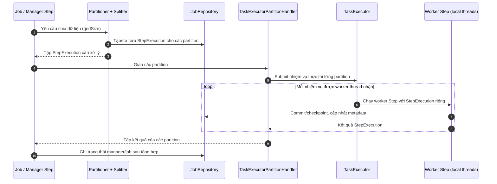

# Partition handler chạy local với TaskExecutorPartitionHandler

Trong Spring Batch, **`TaskExecutorPartitionHandler`** cho phép một manager step chia dữ liệu thành các partition và chạy các worker step **song song ngay trong cùng JVM** thông qua một `TaskExecutor`. Đây là cách mở rộng rất thực dụng khi một máy còn đủ CPU, RAM và khả năng truy cập nguồn/đích nhưng một worker step tuần tự đã không đáp ứng batch window.

Chủ đề thuộc chương **TaskExecutorPartitionHandler** của module **SPRING_BATCH_SCALING_OPERATIONS**. Bài học đi sâu vào cơ chế *local partition handler*, cách cấu hình thực tế với Spring Batch 5.x, mô hình trạng thái và giao dịch, thread safety, cách đo nút thắt, retry/restart và điều kiện chuyển sang xử lý phân tán. Mục đích là chọn kiến trúc dựa trên tài nguyên đo được khi workload lớn dần, chứ không chỉ tăng số thread theo cảm tính.

## 1. “Chạy local” có nghĩa gì?

Một job thông thường có thể chỉ sử dụng một luồng để đọc, xử lý và ghi dữ liệu. Với **local partitioning**, manager tạo nhiều `StepExecution` từ một bước công việc logic; một `TaskExecutorPartitionHandler` giao từng execution cho các thread trong **cùng tiến trình ứng dụng**.

| Thuộc tính | Local partitioning |
| --- | --- |
| Nơi chạy manager và worker | Cùng JVM của ứng dụng Spring Batch. |
| Cơ chế điều phối | `TaskExecutor` (ví dụ `ThreadPoolTaskExecutor`). |
| Vận chuyển request qua broker | Không cần. |
| Metadata | `JobRepository` quản lý `JobExecution` và `StepExecution` cho các partition. |
| Dữ liệu mỗi partition | `ExecutionContext` riêng, ví dụ `minId` và `maxId`. |
| Mở rộng tài nguyên | Chủ yếu giới hạn bởi CPU, heap, thread, connection pool và I/O của một JVM/máy. |
| Thu hồi lỗi | Theo trạng thái step, checkpoint và cơ chế restart của Spring Batch. |

Chữ **local** mô tả *nơi worker thực thi*, không bắt buộc database nguồn/đích phải nằm trên cùng máy. Ứng dụng có thể chạy tại một host, đọc PostgreSQL và ghi một API từ xa; các partition vẫn là **local partitioning** vì worker step chạy trong JVM đó.

### Phân biệt ba cơ chế dễ nhầm

- **Multi-threaded step:** Một `StepExecution` có thể dùng nhiều thread để xử lý các chunk của chính step đó. Tính an toàn thread của reader/writer và semantics thứ tự đọc cần được xem xét rất kỹ.
- **Local partitioning:** Có **nhiều `StepExecution`**, mỗi cái giữ `ExecutionContext` và phạm vi dữ liệu riêng, được chạy qua task executor trong một JVM.
- **Remote partitioning:** Manager gửi `StepExecutionRequest` cho các worker ở JVM/máy khác (thường qua messaging middleware); việc trao đổi reply hoặc polling repository phục vụ tổng hợp kết quả. Đây là hạ tầng khác với `TaskExecutorPartitionHandler`.

Một ứng dụng có thể kết hợp partitioning với các kiểu concurrency khác, nhưng mức song song và tiêu thụ tài nguyên sẽ trở nên phức tạp hơn. Chỉ kết hợp sau khi đã có phép đo và xác nhận tính an toàn của component.

## 2. Những thành phần hợp tác với TaskExecutorPartitionHandler

| Thành phần | Vai trò trong một local partitioned step |
| --- | --- |
| `PartitionStep` / manager step | Khởi động splitter, gọi handler, nhận kết quả tổng hợp. |
| `Partitioner` | Sinh map tên partition → `ExecutionContext`, dựa trên khóa/range/file/tenant. |
| `StepExecutionSplitter` | Tạo hoặc tra cứu `StepExecution` cho từng partition, xử lý các điều kiện restart theo framework. |
| `TaskExecutorPartitionHandler` | Submit nhiệm vụ chạy worker step vào task executor và thu thập kết quả. |
| `TaskExecutor` | Quyết định task chạy ngay, chờ trong queue hay bị từ chối khi quá tải. |
| Worker `Step` | Thực thi tasklet hoặc chunk-oriented reader–processor–writer cho từng partition. |
| `StepExecutionAggregator` | Tổng hợp trạng thái và bộ đếm của các partition vào kết quả của manager. |
| `JobRepository` | Lưu `JobInstance`, `JobExecution`, `StepExecution`, `ExecutionContext` và checkpoint. |

Trong local partitioning, manager thường sử dụng **cùng một định nghĩa worker `Step`** cho nhiều partition, nhưng mỗi lần thực thi đi với **một `StepExecution` riêng**. Nếu reader hoặc writer có state, phải tạo state theo partition thay vì dùng chung một singleton mutable.

### Trình tự xử lý



Các partition có thể hoàn thành **khác thứ tự submit**. Việc một worker báo `COMPLETED` không đồng nghĩa manager hoàn tất: manager còn phải nhận kết quả những partition còn lại và áp quy tắc tổng hợp trạng thái. Khi một partition thất bại, kết quả tổng hợp thông thường khiến manager step thất bại, trừ khi ứng dụng có cấu hình xử lý trạng thái đặc biệt.

## 3. Local partitioning xử lý được những bài toán nào?

Mô hình đặc biệt hữu ích khi dữ liệu có thể chia thành những vùng **độc lập**:

| Dạng dữ liệu | Cách chia thường dùng | Điểm phải kiểm chứng |
| --- | --- | --- |
| Bảng đơn hàng lớn | Khoảng ID không giao nhau | Có index phù hợp; số row theo khoảng có bị lệch? |
| Giao dịch theo ngày | Theo ngày hoặc khoảng thời gian | Sử dụng ranh giới [from, to), thống nhất timezone. |
| File trong thư mục | Mỗi file hoặc nhóm file một partition | Kích thước file, file đang được ghi dở, khả năng retry. |
| Nhiều tenant | Mỗi tenant hoặc nhóm tenant | Tenant lớn có thể thành partition chậm nhất. |
| Object storage | Theo danh sách object/key range | Snapshot danh sách và tránh xử lý trùng khi dữ liệu thay đổi. |

Nếu dữ liệu phải xử lý theo thứ tự toàn cục hoặc nhiều partition cùng cập nhật một bản ghi, việc chia có thể tạo race condition, lock contention hay sai nghiệp vụ. Không có lợi ích concurrency nào bù được dữ liệu sai.

Ví dụ: xử lý 4 triệu giao dịch trong một buổi tối. Nếu mọi record có ID độc lập và có thể cập nhật theo phạm vi riêng, local partitioning là lựa chọn hợp lý. Nếu toàn bộ việc ghi phải cập nhật một tổng số dư chung dưới một lock duy nhất, tăng partition dễ khiến thời gian chờ lock tăng thay vì làm job nhanh hơn.

## 4. Grid size, số partition thật và số worker thread

Ba con số thường bị lẫn:

- `gridSize` (G): tham số manager truyền như **gợi ý** cho partitioner.
- `P`: số partition **thực sự được tạo**. `Partitioner.partition(gridSize)` không bắt buộc trả về chính xác G partition.
- `T`: số task có thể chạy đồng thời bởi executor tại thời điểm đó; chịu giới hạn thread pool, queue, tải chung và khả năng tài nguyên.

Nếu partitioner tạo P phần và executor có T worker threads cố định:

\[
C_{\mathrm{running}}\leq\min(P,T)
\]

Đây là cận trên cho số **task partition đang chạy** trong executor. Với `gridSize=16` và pool cố định 4 thread, phần nhiều sẽ có tối đa 4 partition chạy đồng thời, các phần còn lại chờ nếu queue cho phép.

| Grid size | Partitioner tạo thực tế | Worker threads | Mức chạy đồng thời tối đa của job |
| ---: | ---: | ---: | ---: |
| 4 | 4 | 8 | 4 |
| 16 | 16 | 4 | 4 |
| 16 | 10 | 6 | 6 |
| 32 | 24 | 8 | 8 |

Các giá trị này giả định executor dành riêng cho job, mọi partition sẵn sàng và không có giới hạn phụ khác. Một pool được chia sẻ giữa nhiều job có thể cấp ít worker hơn cho từng job.

**Quan trọng:** Không nên mặc định đặt `gridSize` bằng số CPU core. Chia việc theo kích thước/độ lệch dữ liệu, còn mức concurrency theo năng lực đo được của CPU, heap, DB, API, transaction và network.

## 5. Cấu hình mẫu local partitioning trong Spring Batch 5.x

Ví dụ này dùng một job xử lý đơn hàng trong PostgreSQL, chia dải ID `1..1_000_000` thành tám partition. Mỗi partition đánh dấu các dòng `NEW` thành `PROCESSED` trong phạm vi của mình.

Để tập trung giải thích handler chạy local, worker dùng **một câu SQL UPDATE trong một transaction cho mỗi partition**. Cách này dễ nhìn, có tính idempotent đối với việc đổi trạng thái `NEW → PROCESSED`, nhưng không phù hợp cho những partition rất lớn cần chunk/checkpoint chi tiết. Trong production, thay bằng chunk-oriented step có reader/writer theo `@StepScope` nếu cần kiểm soát commit size và tài nguyên.

### 5.1. Partitioner chia ID theo khoảng

```java
import java.util.LinkedHashMap;
import java.util.Map;
import org.springframework.batch.core.partition.support.Partitioner;
import org.springframework.batch.item.ExecutionContext;

public class OrderIdPartitioner implements Partitioner {

    private final long firstId;
    private final long lastId;

    public OrderIdPartitioner(long firstId, long lastId) {
        if (firstId < 1 || lastId < firstId) {
            throw new IllegalArgumentException("ID range is invalid");
        }
        this.firstId = firstId;
        this.lastId = lastId;
    }

    @Override
    public Map<String, ExecutionContext> partition(int gridSize) {
        if (gridSize < 1) {
            throw new IllegalArgumentException("gridSize must be positive");
        }

        long total = lastId - firstId + 1;
        long width = (total + gridSize - 1L) / gridSize;
        Map<String, ExecutionContext> partitions = new LinkedHashMap<>();

        for (int i = 0; i < gridSize; i++) {
            long minId = firstId + i * width;
            if (minId > lastId) {
                break;
            }
            long maxId = Math.min(lastId, minId + width - 1);

            ExecutionContext context = new ExecutionContext();
            context.putLong("minId", minId);
            context.putLong("maxId", maxId);
            partitions.put("partition" + i, context);
        }
        return partitions;
    }
}
```

Mỗi entry tương ứng một partition có tên ổn định và phạm vi ID không giao nhau. Đoạn mã giả định dải ID nhỏ đến mức không gây tràn số học của `long`. Khoảng ID bằng nhau không bảo đảm số row thực tế bằng nhau nếu ID bị khuyết hoặc dữ liệu phân bố lệch.

### 5.2. Cấu hình executor, worker step, manager step và job

```java
import org.springframework.batch.core.Job;
import org.springframework.batch.core.Step;
import org.springframework.batch.core.configuration.annotation.StepScope;
import org.springframework.batch.core.job.builder.JobBuilder;
import org.springframework.batch.core.partition.support.Partitioner;
import org.springframework.batch.core.repository.JobRepository;
import org.springframework.batch.core.step.builder.StepBuilder;
import org.springframework.batch.core.step.tasklet.Tasklet;
import org.springframework.batch.repeat.RepeatStatus;
import org.springframework.beans.factory.annotation.Qualifier;
import org.springframework.beans.factory.annotation.Value;
import org.springframework.context.annotation.Bean;
import org.springframework.context.annotation.Configuration;
import org.springframework.core.task.TaskExecutor;
import org.springframework.jdbc.core.JdbcTemplate;
import org.springframework.scheduling.concurrent.ThreadPoolTaskExecutor;
import org.springframework.transaction.PlatformTransactionManager;

@Configuration
public class LocalOrderBatchConfiguration {

    @Bean
    public Partitioner orderPartitioner() {
        return new OrderIdPartitioner(1L, 1_000_000L);
    }

    @Bean
    public ThreadPoolTaskExecutor localPartitionExecutor() {
        ThreadPoolTaskExecutor executor = new ThreadPoolTaskExecutor();
        executor.setThreadNamePrefix("order-part-");
        executor.setCorePoolSize(4);
        executor.setMaxPoolSize(4);
        executor.setQueueCapacity(16);
        return executor;
    }

    @Bean
    @StepScope
    public Tasklet orderPartitionTasklet(
            @Value("#{stepExecutionContext['minId']}") Long minId,
            @Value("#{stepExecutionContext['maxId']}") Long maxId,
            JdbcTemplate jdbcTemplate) {

        return (contribution, chunkContext) -> {
            int updated = jdbcTemplate.update(
                "UPDATE orders SET status = 'PROCESSED' "
                    + "WHERE id BETWEEN ? AND ? AND status = 'NEW'",
                minId,
                maxId);
            contribution.incrementWriteCount(updated);
            return RepeatStatus.FINISHED;
        };
    }

    @Bean
    public Step orderWorkerStep(
            JobRepository repository,
            PlatformTransactionManager transactionManager,
            @Qualifier("orderPartitionTasklet") Tasklet tasklet) {

        return new StepBuilder("orderWorkerStep", repository)
            .tasklet(tasklet, transactionManager)
            .build();
    }

    @Bean
    public Step orderManagerStep(
            JobRepository repository,
            @Qualifier("orderPartitioner") Partitioner partitioner,
            @Qualifier("orderWorkerStep") Step workerStep,
            @Qualifier("localPartitionExecutor") TaskExecutor executor) {

        return new StepBuilder("orderManagerStep", repository)
            .partitioner("orderWorkerStep", partitioner)
            .step(workerStep)
            .gridSize(8)
            .taskExecutor(executor)
            .build();
    }

    @Bean
    public Job orderProcessingJob(
            JobRepository repository,
            @Qualifier("orderManagerStep") Step managerStep) {

        return new JobBuilder("orderProcessingJob", repository)
            .start(managerStep)
            .build();
    }
}
```

Đây là ví dụ ứng dụng của Spring Batch 5.x theo kiểu builder. Cần có dependency `spring-batch-core`, Spring JDBC, cấu hình `JobRepository`, `DataSource`, `JdbcTemplate`, transaction manager phù hợp với cùng nguồn dữ liệu và bảng `orders` thực tế. Khi dùng Spring Boot, phần auto-configuration phụ thuộc phiên bản Boot và cách ứng dụng thiết lập batch infrastructure.

**Điểm liên quan trực tiếp đến local handler:**

1. `.partitioner("orderWorkerStep", partitioner)` xác định worker step logic và cách chia dữ liệu.
2. `.step(workerStep)` cung cấp step được thực thi cho mỗi partition.
3. `.gridSize(8)` yêu cầu partitioner tạo số phần phù hợp với tám.
4. `.taskExecutor(executor)` cấu hình thực thi local song song thông qua executor; builder dùng cơ chế `TaskExecutorPartitionHandler`.
5. Executor có **bốn thread tối đa**, nên tám partition có thể chạy theo các đợt, không có tám worker chạy cùng lúc.
6. `@StepScope` tạo proxy và bean tasklet theo `StepExecution`, cho phép lấy đúng `minId`/`maxId` của từng partition.

**Giới hạn cố ý của ví dụ:** Một SQL UPDATE lớn là một giao dịch tương đối dài, có thể gây lock và WAL lớn; dữ liệu cập nhật trong DB và metadata trong JobRepository không nhất thiết cùng một transaction vật lý nếu hai DataSource khác nhau. Với workload thực, thiết kế chunk, checkpoint, retry và idempotency theo yêu cầu nghiệp vụ, rồi đo thời gian/locks trước khi nâng concurrency.

## 6. Khi chạy, các thread thực hiện những gì?

Giả sử có tám partition từ `partition0` đến `partition7` và executor bốn thread:

```text
JVM của ứng dụng Spring Batch
┌──────────────────────────────────────────────────┐
│ Manager: orderManagerStep                        │
│  └─ TaskExecutorPartitionHandler                 │
│      ├─ order-part-1: partition0  [đang chạy]    │
│      ├─ order-part-2: partition1  [đang chạy]    │
│      ├─ order-part-3: partition2  [đang chạy]    │
│      ├─ order-part-4: partition3  [đang chạy]    │
│      └─ queue: partition4..partition7 [đang chờ] │
│                                                  │
│ Mỗi partition có StepExecution/ExecutionContext │
│ riêng; mọi worker chia sẻ CPU, heap, DB/API.     │
└──────────────────────────────────────────────────┘
```

Khi `partition2` hoàn tất trước, worker thread rảnh có thể nhận `partition4` mà không đợi các partition 0, 1 và 3 kết thúc. Do vậy, các partition nhỏ thường giúp phân bổ tải tốt hơn khi dữ liệu không đồng đều.

**Không nên nhầm** queue của `ThreadPoolTaskExecutor` với message broker. Queue này sống trong tiến trình Java, không cung cấp durable delivery độc lập. Khi JVM chết, các task đang chờ trong memory biến mất; khả năng khôi phục phải dựa vào `JobRepository` và semantics restart, không phải khôi phục queue cũ.

## 7. Transaction boundary và JobRepository trong local partitioning

Một local partitioned step không phải một giao dịch khổng lồ bao phủ toàn bộ manager và tất cả worker. Mỗi worker step thực thi theo transaction policy của chính nó.

Với **chunk-oriented step**, luồng thường là:

```text
Partition A: read items -> process -> write chunk -> commit -> checkpoint
Partition B: read items -> process -> write chunk -> commit -> checkpoint
Partition C: read items -> process -> write chunk -> rollback/retry -> commit
Manager:    chờ kết quả các partition rồi tổng hợp status
```

Các partition có thể commit độc lập. Nếu partition C thất bại sau khi A/B đã ghi dữ liệu thành công, framework không tự rollback những gì A/B đã commit. Một lần restart cần xác định phần đã hoàn tất và phần chưa hoàn tất dựa trên `JobRepository`, đồng thời bảo đảm thao tác ghi dữ liệu có tính idempotent.

Đối với tasklet ở ví dụ SQL, phần UPDATE của một partition dùng transaction manager của worker step. Nếu dữ liệu nguồn/đích ở nhiều nguồn khác nhau hoặc tác dụng phụ qua HTTP, không được suy ra toàn bộ thao tác có tính atomic chỉ vì tasklet hoàn tất mà không báo lỗi.

| Cấp dữ liệu | Lưu ở đâu | Tác dụng |
| --- | --- | --- |
| `JobExecution` | JobRepository | Lifecycle của một lượt chạy job. |
| Manager `StepExecution` | JobRepository | Kết quả step điều phối và tổng hợp. |
| Partition `StepExecution` | JobRepository | Trạng thái, counters, thời điểm từng partition. |
| `ExecutionContext` partition | JobRepository | Phạm vi dữ liệu, checkpoint và thông tin phục vụ restart. |
| Dữ liệu nghiệp vụ | DB/file/API đích | Kết quả thực sự của quá trình xử lý. |

Vận hành an toàn đòi hỏi đối chiếu **metadata và dữ liệu nghiệp vụ**, nhất là sau sự cố hoặc retry.

## 8. Thread safety: cùng JVM có thể cùng dùng singleton bean

Các partition có `StepExecution` riêng, nhưng không có nghĩa tất cả bean trong Spring container đều được tạo mới cho từng partition. Nếu reader giữ con trỏ đọc mutable dưới dạng singleton, hai worker có thể cùng sửa state và đọc trùng/bỏ sót dữ liệu.

| Component | Rủi ro trong local partitioning | Cách giảm thiểu |
| --- | --- | --- |
| `ItemReader` có state | Offset/con trỏ/chỉ số trang bị ghi chồng. | Tạo reader riêng theo `@StepScope`; dùng context để chọn đúng range. |
| `ItemWriter` có buffer | Hai partition cùng thêm vào buffer mutable. | Cô lập theo step hoặc thiết kế thread-safe; ràng buộc dữ liệu đích. |
| `ItemProcessor` giữ cache mutable | Dữ liệu bị lẫn giữa worker hoặc race trên cache. | Ưu tiên stateless; nếu có state, cô lập/đồng bộ. |
| `ExecutionContext` | Checkpoint không đúng partition. | Mỗi worker cập nhật context của chính `StepExecution`. |
| JDBC connection/session | Chia sẻ connection hoặc session không an toàn. | Để Spring quản lý transaction; không giữ connection mutable dùng chung. |
| File output | Nhiều worker ghi cùng file, đảo thứ tự/mất dữ liệu. | Mỗi partition ghi file riêng rồi merge có kiểm soát, hoặc dùng writer an toàn. |

Mẫu chunk-oriented reader theo partition:

```java
@Bean
@StepScope
public ItemReader<Order> orderReader(
        @Value("#{stepExecutionContext['minId']}") Long minId,
        @Value("#{stepExecutionContext['maxId']}") Long maxId) {

    // Factory do ứng dụng cài đặt.
    // Reader truy vấn đúng vùng [minId, maxId] và giữ state riêng.
    return buildOrderReader(minId, maxId);
}
```

Mã minh họa cách late-binding range, **không phải một reader đã triển khai hoàn chỉnh**. Reader thực cần paging/cursor, sort key ổn định, checkpoint và xử lý dữ liệu thay đổi trong lúc job chạy. `@StepScope` cô lập instance theo partition, nhưng không tự làm I/O ngoài transaction an toàn khi retry.

Nếu worker step tự chạy đa luồng bên trong partition, mỗi partition lại có thêm concurrency. Khi đó, scope theo StepExecution chưa đủ để chứng minh reader an toàn khi **nhiều thread cùng dùng một StepExecution**; phải kiểm tra thread safety thêm ở tầng nội bộ.

## 9. Cách chọn Partitioner và tránh trùng hoặc thiếu bản ghi

Một partitioner tốt cần đáp ứng các điều kiện:

1. **Ranh giới chính xác:** Các khoảng dữ liệu không giao nhau nếu mỗi bản ghi chỉ xử lý một lần. Ví dụ ID [1, 100.000] và [100.001, 200.000].
2. **Đọc hiệu quả:** SQL phải tận dụng index/range scan hoặc partition pruning; tránh cho mọi worker full scan cùng một bảng.
3. **Tải tương đối cân bằng:** Đo số dòng/byte/chi phí xử lý thực, không chỉ độ rộng khoảng ID.
4. **Tên ổn định:** Partition name nhất quán và có ý nghĩa khi restart.
5. **Snapshot phù hợp:** Nếu dữ liệu nguồn thay đổi khi job chạy, phải có watermark/snapshot/logic chấp nhận late-arrival để không bỏ sót.
6. **Checkpoint nhỏ:** `ExecutionContext` chứa phạm vi và cursor, không lưu cả danh sách hàng triệu bản ghi.

Ví dụ sai thường gặp: chia 10 triệu ID thành mười khoảng bằng nhau, nhưng 90% bản ghi nằm ở khoảng cuối. Khi chín worker xử lý xong, một worker vẫn bận quá lâu; tăng số thread không giúp vì chỉ còn một partition. Cần cải thiện cách chia dựa trên phân bố.

Đối với dữ liệu mutable, nếu partitioner đo `MAX(id)` một lần ở đầu job thì đó là **high-water mark** cho lần chạy; dữ liệu xuất hiện sau mốc ấy nên được xử lý ở lần chạy tiếp hoặc theo chính sách đến muộn rõ ràng. Không tự “mở rộng” range của worker đang chạy mà thiếu kiểm soát idempotency.

## 10. Pool, queue và những giới hạn của handler local

Với `ThreadPoolTaskExecutor`, ba tham số chính là:

- `corePoolSize`: lượng thread core executor cố gắng cấp trước khi ưu tiên queue.
- `maxPoolSize`: giới hạn mở rộng thread khi queue đã đầy.
- `queueCapacity`: sức chứa task chờ thread.

**Trường hợp dễ hiểu sai:** `corePoolSize=4`, `maxPoolSize=16`, `queueCapacity=100` và `gridSize=16`. Nếu submit vào pool trống, thường chỉ có khoảng **4 worker chạy**, còn 12 task được queue nhận; chưa có lý do để executor mở đến 16 thread. `maxPoolSize` không phải concurrency thực tế mặc định.

Nếu dùng pool cố định 4 thread, queue capacity 4 và tạo 20 partition, trong đợt submit nhanh có thể nhận bốn task chạy + bốn task chờ, rồi **từ chối các task tiếp theo**. Handler có thể nhận `TaskRejectedException` và khiến manager step thất bại. Vì thế phải sizing cả **pool và queue** hoặc có backpressure/rejection policy có chủ đích.

Đối với kịch bản pool cố định T, P partition đều được submit gần như tức thời, executor không chia sẻ và chưa task nào hoàn tất, sức chứa queue sơ bộ cần:

\[
Q_{\mathrm{needed}}\gtrsim\max(0,P-T)
\]

Đây là ước lượng theo điều kiện, **không phải** quy tắc cho mọi loại `TaskExecutor`. Lựa chọn `queueCapacity=0` hoặc `CallerRunsPolicy` thay đổi cách task được giao và có thể làm manager tự chạy partition. Cần thử tải thực tế để xác định hiệu ứng.

Một nguồn quá tải thường thấy trong production là **nhiều job dùng chung pool**. Hai job mỗi job có 12 partition cùng chạy không có nghĩa mỗi job sở hữu đủ 8 thread trong một pool có `maxPoolSize=8`; chúng phải chia sẻ khả năng thực thi và queue.

## 11. Tính toán công suất và mức concurrency phù hợp

Giả sử mỗi ngày có 2,4 triệu item và batch window là **20 phút**. Throughput tối thiểu phải đạt:

\[
R_{\min}=\frac{2.400.000}{20\times60}
=2.000\ \text{item/giây}
\]

Một worker xử lý ổn định 600 item/giây khi chạy một mình. Nếu có bốn worker mà throughput chỉ giữ được 80% vì tranh chấp tài nguyên thì tổng kỳ vọng:

\[
R_{\mathrm{total}}\approx4\times600\times0,8
=1.920\ \text{item/giây}
\]

Do đó bốn worker chưa đáp ứng 2.000 item/giây, chưa tính split/aggregation, startup, retry và tail latency. Tăng `gridSize` từ 4 lên 16 nhưng giữ bốn thread **không tự sửa** thiếu hụt throughput này. Tăng worker cũng chỉ hiệu quả nếu CPU, DB, network, nguồn và đích còn headroom.

Nếu đích có giới hạn ổn định 2.100 item/giây, dù nâng lên tám worker cũng không bảo đảm có dự phòng đủ lớn. Cần tối ưu nghiệp vụ/SQL, giảm dữ liệu phải xử lý hoặc điều chỉnh batch window.

### Mô hình thời gian ideal cho partition có độ dài bằng nhau

Với P partition, T thread, mỗi partition mất t giây khi chạy độc lập:

\[
D_{\mathrm{ideal}}\approx
\left\lceil\frac{P}{T}\right\rceil t
\]

Ví dụ 8 partition, mỗi phần mất 5 phút, executor có 4 thread → khoảng 10 phút, **nếu** chúng thực sự chạy song song và không tranh chấp. Con số không phản ánh startup, scheduling, commit, GC, query lock, số hàng lệch và thời gian tổng hợp trạng thái.

Với thời lượng khác nhau, cận dưới:

\[
D\geq
\max\left(\frac{\sum_{i=1}^{P}t_i}{T},\ \max_i t_i\right)
\]

Thành phần `max_i t_i` cho thấy lý do một partition “đuôi dài” có thể quyết định toàn bộ thời gian job.

## 12. Giám sát local partitioning bằng gì?

Một job local partitioning cần giám sát cả manager, các partition và executor:

| Lớp | Chỉ số quan trọng | Giải thích |
| --- | --- | --- |
| Manager `JobExecution`/`StepExecution` | `BatchStatus`, start/end time, duration | Job còn chạy, hoàn tất hay thất bại? |
| Worker `StepExecution` | `readCount`, `writeCount`, `commitCount`, skip, rollback | Partition nào chậm hoặc lỗi? |
| `ThreadPoolTaskExecutor` | Active thread count, pool size, queue size, rejection | Có đủ worker nhận partition không? |
| JVM | CPU, heap, GC, thread dump | Worker bị CPU-bound, GC hoặc chờ lock? |
| DB nguồn/đích | CPU, IOPS, query P95, pool pending, locks | Tăng concurrency có làm DB nghẽn? |
| Dữ liệu nghiệp vụ | Tổng bản ghi hoàn tất, bản ghi trùng, thời điểm watermark | Kết quả có đúng và đủ không? |

Ví dụ SQL tra cứu metadata Spring Batch (tên schema/prefix cần điều chỉnh theo ứng dụng):

```sql
SELECT
    STEP_EXECUTION_ID,
    JOB_EXECUTION_ID,
    STEP_NAME,
    STATUS,
    READ_COUNT,
    WRITE_COUNT,
    FILTER_COUNT,
    COMMIT_COUNT,
    ROLLBACK_COUNT,
    START_TIME,
    END_TIME,
    LAST_UPDATED
FROM BATCH_STEP_EXECUTION
WHERE JOB_EXECUTION_ID = :jobExecutionId
ORDER BY STEP_EXECUTION_ID;
```

Các partition thường có tên step với hậu tố tên partition, nhưng phụ thuộc cấu hình framework. Nhìn vào counter/duration của từng `StepExecution` sẽ giúp tìm partition lệch tải. SQL này **không** thể đo chính xác queue depth; phải quan sát `TaskExecutor` tại runtime.

Ví dụ log cho từng worker có thể ghi `jobExecutionId`, `stepExecutionId`, tên partition, khoảng ID và duration. Khi log từ nhiều thread đan xen, những ID này giúp ghép sự kiện đúng partition. Tránh log toàn bộ `ExecutionContext` nếu có dữ liệu nhạy cảm.

## 13. Phân tích lỗi: partition thất bại thì các partition khác ra sao?

Mỗi partition có lifecycle riêng. Nếu một partition lỗi, những partition khác có thể đang `STARTED`, đã `COMPLETED` hoặc chưa nhận được thread. Không giả định toàn bộ các partition tự rollback chỉ vì một partition failed.

Một vài tình huống thường gặp:

| Tình huống | Điều có thể thấy | Cách xử lý |
| --- | --- | --- |
| Worker ném exception | `StepExecution` của partition có thể `FAILED`; manager tổng hợp thất bại. | Xem exception gốc, chunk đã commit và điều kiện restart. |
| Worker chờ DB lock | Metadata có thể vẫn `STARTED`, counter ít thay đổi. | Kiểm tra thread dump, DB locks, transaction duration. |
| Executor reject task | Một số partition có thể chưa được chạy; manager lỗi khi dispatch. | Kiểm tra queue/pool, nhiều job đồng thời và exception. |
| JVM chết | Task queued/in-flight mất; metadata có thể còn `STARTED`. | Xác nhận không còn worker cũ, kiểm tra DB và thực hiện recovery an toàn. |
| Writer xử lý xong nhưng metadata chưa commit | Dữ liệu đích có thể đã thay đổi trong khi repository báo chưa xong. | Cần idempotency, đối soát và checkpoint đáng tin cậy. |
| Một partition rất chậm | Các partition khác hoàn tất nhưng manager còn chờ. | Đo data skew, query plans và resource contention. |

### Retry và restart không tự động đồng nghĩa “chạy lại tất cả”

Trường hợp một partition thất bại sau khi đã commit nhiều chunk: lần restart hợp lệ cho cùng `JobInstance` thường dựa trên `JobRepository` và trạng thái `StepExecution` để xác định phần việc cần chạy lại. Kết quả chính xác phụ thuộc cấu hình step, partitioner, `ExecutionContext` và khả năng restart của reader/writer.

**Không đổi tên partition hoặc ranh giới dữ liệu tùy tiện khi restart.** Nếu lần đầu partition 3 xử lý ID 300.001–400.000, nhưng sau khi tăng gridSize partition cùng tên lại đại diện ID khác, trạng thái và checkpoint cũ có thể không còn tương ứng dữ liệu mới.

Cần cân nhắc idempotency: ví dụ câu SQL ở trên dùng `WHERE status='NEW'` nên việc chạy lại không cập nhật những đơn hàng đã `PROCESSED`; nhưng với nghiệp vụ cộng số dư, gửi email hoặc gọi API thanh toán, cần khóa nghiệp vụ/unique constraint hoặc cơ chế bù trừ riêng.

### Đừng sửa metadata trực tiếp để “giải phóng” job

Sau crash, một execution có thể còn `STARTED` trong `JobRepository`. Không tự update bảng metadata thành `FAILED` bằng SQL chỉ để cho job chạy tiếp. Cần xác minh tiến trình cũ thực sự đã dừng, kiểm tra dữ liệu đích và thực hiện quy trình phục hồi theo phiên bản Spring Batch đang dùng. Nếu không, execution mới có thể chạy chồng với worker chưa dừng.

## 14. Khi nào local handler tốt hơn remote partitioning?

| Tiêu chí | Local `TaskExecutorPartitionHandler` | Remote partitioning |
| --- | --- | --- |
| Vị trí worker | Cùng JVM với manager. | Nhiều JVM/máy, có thể ở nhiều instance. |
| Giao việc | Executor và queue trong tiến trình. | Broker/messaging adapter hoặc mô hình điều phối phân tán. |
| Hạ tầng ban đầu | Đơn giản hơn, không cần broker cho partitioning. | Cần cơ chế request/reply hoặc repository polling, worker deployment. |
| Giới hạn scale | CPU, memory và tài nguyên của một host/JVM. | Có thể thêm worker instance; vẫn giới hạn bởi DB/đích. |
| Tracing lỗi | Thread dumps, logs và metrics tập trung trong một JVM. | Cần correlation xuyên tiến trình và giám sát broker/worker. |
| Khả năng chịu lỗi manager host | Worker cũng bị ảnh hưởng vì cùng JVM. | Worker có thể còn chạy khi manager lỗi; cần xử lý nhất quán khi phục hồi. |
| Quản trị concurrency | TaskExecutor pool/queue. | Số worker instance/consumer và giới hạn concurrency ở mỗi worker. |

**Lựa chọn local khi** một máy còn năng lực, các partition độc lập, cần cấu hình tương đối gọn và không muốn tăng độ phức tạp điều phối phân tán. Chọn remote khi một JVM đã thực sự chạm giới hạn tài nguyên và workload có thể chia qua nhiều host **mà** nguồn/đích chịu được concurrency cao hơn.

Không có ngưỡng số lượng bản ghi cố định như “trên 10 triệu phải remote”. Nếu nút thắt nằm ở một database nguồn dùng chung, chuyển worker từ local sang remote có thể không giúp tăng throughput và còn thêm chi phí messaging.

## 15. Quy trình tuning để local partitioning hoạt động ổn định

Thử nghiệm cần giữ dataset và điều kiện tải tương đương, rồi thay đổi từng biến một. Ví dụ ma trận:

| Lần chạy | gridSize | Executor fixed threads | Câu hỏi |
| --- | ---: | ---: | --- |
| A | 1 | 1 | Baseline một worker: throughput, CPU, DB, GC. |
| B | 4 | 4 | Bốn partition có giảm duration, throughput tăng ra sao? |
| C | 8 | 4 | Chia nhỏ hơn có giảm straggler? Chi phí metadata thế nào? |
| D | 8 | 8 | Tăng thread có cải thiện hay DB/API nghẽn? |
| E | 16 | 8 | Độ mịn cao hơn có giảm đuôi dài hay chỉ làm overhead tăng? |

Đo ít nhất:

- **End-to-end job duration**, không chỉ tốc độ trong reader.
- **Throughput thực:** item/s, byte/s, commits/s và kết quả dữ liệu đích.
- **Distribution:** thời gian P50/P95/max theo partition, độ lệch số record/byte.
- **JVM/executor:** active threads, queue depth, CPU, heap/GC, context switching.
- **Nguồn/đích:** query latency, connection wait, DB lock, I/O, API rate limit.
- **Độ đúng:** skip, rollback, retry, kết quả sau restart và trùng lặp dữ liệu.

Một dấu hiệu đã đến giới hạn là thêm thread nhưng duration gần như không giảm, trong khi DB lock/connection wait hoặc GC tăng. Khi đó nên điều chỉnh SQL, partition key, chunk size, connection lifecycle hoặc giảm lượng dữ liệu cần chạy thay vì tiếp tục nâng thread.

## 16. Tình huống thực hành: local partitioning bị chậm

Một job có **960.000 item**. Partitioner tạo 12 partition đều nhau; executor có pool cố định 4 thread, queue capacity 16. Mỗi worker đạt 400 item/giây nếu không có tranh chấp; overhead tổng hợp và khởi tạo là 2 phút.

**Câu hỏi 1:** Mỗi partition có bao nhiêu item?

\[
N_{\mathrm{partition}}=\frac{960.000}{12}=80.000\ \text{item}
\]

**Câu hỏi 2:** Thời gian lý tưởng mỗi partition và toàn job là bao lâu?

\[
t_{\mathrm{partition}}=\frac{80.000}{400}
=200\ \text{giây}
\]

Bốn thread chạy ba “đợt” giả định:

\[
D_{\mathrm{work}}=3\times200=600\ \text{giây}=10\ \text{phút}
\]

Thêm overhead 2 phút, tổng khoảng **12 phút**.

**Câu hỏi 3:** Nếu tăng gridSize lên 24 nhưng giữ bốn thread, mỗi worker vẫn đạt 400 item/giây, thời gian lý tưởng có đổi không?

Mỗi partition chỉ còn 40.000 item, mất 100 giây, cần sáu đợt trên bốn worker: vẫn khoảng **600 giây xử lý**. Tổng thực tế còn phụ thuộc overhead, skew và DB contention.

**Câu hỏi 4:** Nếu tăng pool lên tám thread nhưng database chỉ chịu tổng 2.000 item/giây, có đạt lý tưởng 3.200 item/giây không?

Không. Cần ít nhất:

\[
D_{\mathrm{DB}}\ge \frac{960.000}{2.000}
=480\ \text{giây}
\]

Thời gian end-to-end còn phải cộng chi phí khởi tạo, tổng hợp và phần hạn chế khác. Thực tế có thể còn chậm hơn vì DB transaction/lock.

**Câu hỏi 5:** Nếu một partition liên tục rollback, nên tăng thread hay điều tra nguyên nhân?

Nên đọc exception, lock, giới hạn connection, dữ liệu cụ thể và bước ghi có idempotent hay không. Tăng thread khi đã có contention thường làm số retry và thời gian chờ tăng thêm.

## 17. Checklist trước khi đưa TaskExecutorPartitionHandler local vào production

- [ ] Workload chia được thành partition độc lập, có ranh giới dữ liệu rõ ràng.
- [ ] Partitioner thực sự dùng `gridSize` theo chủ đích; tên và phạm vi partition ổn định khi restart.
- [ ] Worker step đã cấu hình reader/processor/writer hoặc tasklet đúng phạm vi `ExecutionContext`.
- [ ] Stateful bean được cô lập theo `@StepScope` hoặc có bảo đảm thread safety rõ ràng.
- [ ] TaskExecutor có giới hạn core/max, queue capacity và chính sách rejection phù hợp lượng task submit.
- [ ] Pool JDBC, DB/API và CPU/heap đủ headroom khi các partition chạy đồng thời.
- [ ] Có kiểm soát transaction, chunk/checkpoint và tính idempotent của writer khi retry/restart.
- [ ] JobRepository được cấu hình ổn định và đủ tài nguyên để lưu metadata nhiều partition.
- [ ] Có metric theo manager, partition, executor và hệ thống đích; đã thử load test với dữ liệu đại diện.
- [ ] Đã thực hành tình huống partition fail, JVM crash, timeout và restart để xác minh không ghi trùng/bỏ sót.
- [ ] Biết khi nào local đạt giới hạn và cần đánh giá remote partitioning thay vì tăng thread vô hạn.

## 18. Tài liệu tham khảo

- [Spring Batch Reference — Scaling and Parallel Processing](https://docs.spring.io/spring-batch/reference/scalability.html): local/remote partitioning, manager–worker, ví dụ builder.
- [TaskExecutorPartitionHandler API](https://docs.spring.io/spring-batch/docs/5.2.2/api/org/springframework/batch/core/partition/support/TaskExecutorPartitionHandler.html): handler thực thi partition qua `TaskExecutor`.
- [Partitioner API](https://docs.spring.io/spring-batch/docs/5.2.2/api/org/springframework/batch/core/partition/support/Partitioner.html): hợp đồng `partition(int gridSize)`.
- [Spring Batch — Late Binding and Step Scope](https://docs.spring.io/spring-batch/reference/step/late-binding.html): gắn tham số theo `StepExecution` và `ExecutionContext`.
- [Spring Framework — Task Execution and Scheduling](https://docs.spring.io/spring-framework/reference/integration/scheduling.html): các loại executor và cấu hình thread pool.
- [ThreadPoolTaskExecutor API](https://docs.spring.io/spring-framework/docs/current/javadoc-api/org/springframework/scheduling/concurrent/ThreadPoolTaskExecutor.html): core/max, queue, active thread và monitoring.

> **Điểm cần nhớ:** `TaskExecutorPartitionHandler` thực thi partition **trong cùng JVM**; mỗi partition có `StepExecution` và `ExecutionContext` riêng, còn thread, heap và connection pool là tài nguyên chia sẻ. Khả năng mở rộng phụ thuộc cách partition dữ liệu, kích thước pool/queue, thread safety, transaction/restart và throughput đo được trên nguồn–đích. Hãy bắt đầu với local khi tài nguyên một máy còn đủ và chỉ chuyển sang remote khi đã xác định rõ giới hạn cần vượt qua.
