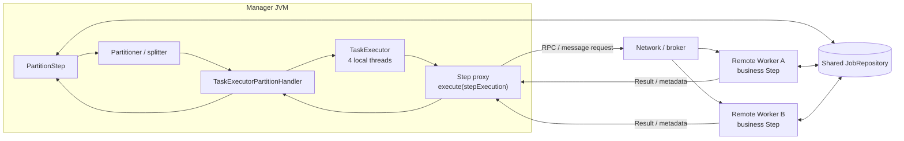
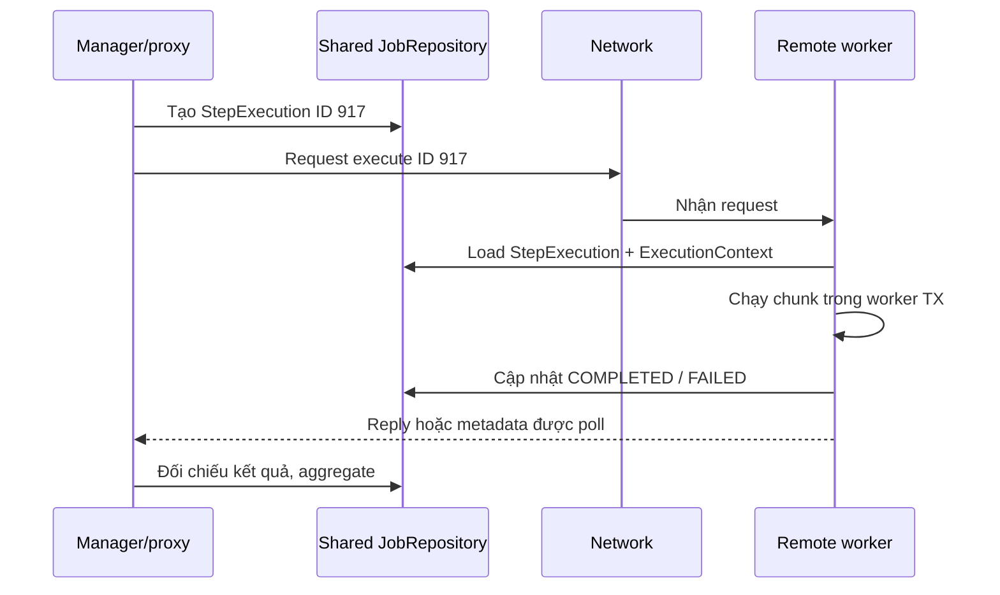

# Proxy step cho remote invocation với TaskExecutorPartitionHandler

> **Chương:** TaskExecutorPartitionHandler  
> **Phạm vi:** Tìm hiểu cách đặt một `Step` proxy tại phía manager để chuyển lời gọi thực thi partition đến worker ở tiến trình khác; phân biệt rõ cơ chế này với local partitioning mặc định, và lựa chọn giải pháp remote partitioning phù hợp khi mở rộng Spring Batch cho workload dữ liệu lớn.

## 1. Vấn đề: Partition đã chia xong nhưng công việc cần chạy ở máy khác

Giả sử job xử lý 20 triệu bản ghi giao dịch theo `transaction_id`. Manager chia miền khóa thành tám partition. Mỗi partition có `ExecutionContext` chứa khoảng ID, ví dụ:

| Partition | `minId` | `maxId` | Worker dự kiến |
| --- | ---: | ---: | --- |
| `partition0` | 1 | 2.500.000 | Worker A |
| `partition1` | 2.500.001 | 5.000.000 | Worker B |
| `partition2` | 5.000.001 | 7.500.000 | Worker C |
| `partition3` | 7.500.001 | 10.000.000 | Worker A |
| ... | ... | ... | ... |

Nếu dùng `TaskExecutorPartitionHandler` với một `Step` nghiệp vụ thông thường, các partition được chạy trên những thread **trong JVM của manager**. Để tận dụng CPU, bộ nhớ hoặc kết nối nguồn dữ liệu trên các máy khác, ta có thể cung cấp cho handler một `Step` đặc biệt: **proxy step**.

Proxy step không đọc/ghi dữ liệu nghiệp vụ. Khi handler gọi `proxyStep.execute(partitionStepExecution)`, proxy gửi yêu cầu đến remote worker, **chờ kết quả**, đồng bộ trạng thái thực thi và trả quyền điều khiển cho handler.

Đây là khả năng mở rộng được tài liệu Spring Batch nhắc đến: `TaskExecutorPartitionHandler` có thể nhận một `Step` đóng vai trò proxy cho remote invocation. Tuy vậy, **remote transport, giao thức xử lý trạng thái và tính đúng đắn khi lỗi không được handler này triển khai tự động**.

## 2. Trách nhiệm của từng thành phần

Trong partitioning, ba thành phần có nhiệm vụ khác nhau:

- **`Partitioner`:** Quyết định chia input như thế nào, tạo `Map<String, ExecutionContext>` để mỗi partition có tham số công việc độc lập.
- **`PartitionStep` / `StepExecutionSplitter`:** Quản lý phân tách các `StepExecution`, phối hợp với metadata phục vụ restart.
- **`PartitionHandler`:** Quyết định **cách và nơi thực thi** các partition, thu thập kết quả để manager đánh giá trạng thái.

`TaskExecutorPartitionHandler` là một implementation của `PartitionHandler`. Nó nhận một `TaskExecutor` và một `Step` thông qua `setTaskExecutor(...)` và `setStep(...)`, rồi tạo các tác vụ chạy `Step.execute(...)` cho những `StepExecution` được giao.

Khi `Step` là **worker step thực**, công việc chạy trong process cục bộ. Khi `Step` là **remote proxy**, thao tác gọi method vẫn chạy trên thread cục bộ, còn công việc nghiệp vụ được thực hiện ở worker từ xa theo cách proxy định nghĩa.



**Quan trọng:** Sơ đồ minh họa một **mẫu thiết kế tùy biến**. `TaskExecutorPartitionHandler` không tự tạo broker, RPC endpoint hay remote worker. Nếu muốn một giải pháp có sẵn phần quản lý message, Spring Batch Integration cung cấp `MessageChannelPartitionHandler` và các builder remote partitioning.

### Phân biệt bốn đối tượng dễ bị nhầm

| Đối tượng | Ý nghĩa | Có chạy nghiệp vụ từ xa không? |
| --- | --- | --- |
| `StepExecution` | Trạng thái **một lượt thực thi step**: ID, status, counts, context | Không; là metadata |
| Worker `Step` | Code nghiệp vụ reader/processor/writer hoặc tasklet | Có, nếu worker triển khai trên máy khác |
| Proxy `Step` | Adapter nhận `execute(StepExecution)` rồi gọi remote endpoint | Bản thân proxy chỉ điều phối |
| `TaskExecutorPartitionHandler` | Gửi các lời gọi `Step.execute` lên thread cục bộ và gom kết quả | Không tự chuyển RPC |

## 3. Hợp đồng của Step proxy

Trong Spring Batch **5.2.x**, interface `org.springframework.batch.core.Step` có hai method cốt lõi:

```java
String getName();
void execute(StepExecution stepExecution) throws JobInterruptedException;
```

`getName()` trả về tên step; `execute(...)` nhận đối tượng `StepExecution` mà framework đã tạo cho partition. Một triển khai `Step` thông thường chịu trách nhiệm cập nhật tiến độ, trạng thái và metadata của lần thực thi ấy.

Proxy cần đáp ứng hợp đồng đó theo hướng **không tự thực hiện nghiệp vụ**, đồng thời:

1. Xác định đúng worker step name và **ID của `StepExecution`** đã được manager tạo.
2. Gửi lời gọi cho remote worker bằng giao thức đã thống nhất, với correlation ID ổn định.
3. Không trả về `COMPLETED` ngay khi request chỉ mới được gửi.
4. Chờ worker kết thúc hoặc xác định trạng thái terminal qua `JobRepository`.
5. Đảm bảo đối tượng `StepExecution` phục vụ aggregation phản ánh **trạng thái cuối và các counter liên quan**, không chỉ kết quả gửi request. Có thể refresh dữ liệu từ repository bằng `RemoteStepExecutionAggregator` trước khi tổng hợp.
6. Xử lý timeout, unreachable worker, duplicate request và interruption có chủ đích.
7. Không lưu execution đang chạy vào field mutable dùng chung khi proxy được gọi đồng thời.

### Vì sao chỉ trả HTTP 200 là sai?

`HTTP 200` cho biết endpoint đã nhận request hoặc xử lý HTTP thành công, **không chứng minh chunk đã commit hay partition đã COMPLETED**. Nếu proxy kết thúc ngay khi worker chỉ xếp lịch làm việc, `TaskExecutorPartitionHandler` có thể gom một kết quả chưa hoàn tất; bước tiếp theo của job có thể chạy khi dữ liệu đích còn thiếu.

Nếu proxy chạy theo kiểu asynchronous messaging, phải có cơ chế **await reply**, **poll metadata**, hoặc một implementation `PartitionHandler` phù hợp với mô hình ấy.

## 4. Mẫu Java: Manager cấu hình TaskExecutorPartitionHandler với proxy Step

Ví dụ dưới đây dùng **Spring Batch 5.2.x, Java 17**. Nó minh họa chính xác điểm thay thế worker `Step` bằng proxy. Phần remote gateway là **SPI do ứng dụng phải tự triển khai**; đây là skeleton tích hợp, chưa phải một ứng dụng RPC hoàn chỉnh.

```java
package com.example.batch.partition;

import org.springframework.batch.core.JobInterruptedException;
import org.springframework.batch.core.Step;
import org.springframework.batch.core.StepExecution;

// Proxy không giữ StepExecution trong field dùng chung.
public final class RemoteInvoiceProxyStep implements Step {

    private final String stepName;
    private final RemotePartitionGateway gateway;

    public RemoteInvoiceProxyStep(
            String stepName, RemotePartitionGateway gateway) {
        this.stepName = stepName;
        this.gateway = gateway;
    }

    @Override
    public String getName() {
        return stepName;
    }

    @Override
    public void execute(StepExecution stepExecution)
            throws JobInterruptedException {
        // Bắt buộc BLOCK đến trạng thái terminal,
        // đồng bộ kết quả và lỗi về StepExecution nhận vào.
        gateway.executeAndSynchronize(stepExecution);
    }

    public interface RemotePartitionGateway {
        void executeAndSynchronize(StepExecution stepExecution)
                throws JobInterruptedException;
    }
}
```

**`executeAndSynchronize(...)` chỉ là hợp đồng giao diện tùy biến.** Chưa có implementation, lệnh gọi này không thể thực hiện remote invocation. Một implementation sản xuất phải đảm bảo:

- Từ `StepExecution` trích xuất `jobExecutionId`, `stepExecutionId`, tên worker step và key của partition. Không coi đó là dữ liệu được phép tùy ý thay đổi từ người gọi.
- Worker lấy thông tin thực thi từ **`JobRepository` dùng chung**, áp dụng `ExecutionContext` đã được manager lưu, chạy step nghiệp vụ tương ứng và cập nhật metadata.
- Manager/proxy xác định kết quả cuối; đối tượng `StepExecution` trả về cho handler phải được đồng bộ nhất quán với bản ghi repository, gồm `BatchStatus`, `ExitStatus` và những bộ đếm cần aggregation.
- Nếu worker đã hoàn tất nhưng network timeout, gateway không được mù quáng khởi chạy thêm một execution cùng ID; trước tiên phải kiểm tra repository và giao thức idempotency/fencing.
- Nếu worker thất bại, kết quả phải là **trạng thái thất bại hoặc lỗi được báo lên**, không được coi là hoàn thành.

Việc đồng bộ một đối tượng `StepExecution` mutable nhận từ manager với bản ghi vừa được remote worker cập nhật là phần khó. Không đơn giản gọi `stepExecution.setStatus(COMPLETED)` để “cho handler đi tiếp”; điều đó có thể che giấu lỗi và làm mất counters. Vì vậy với yêu cầu phân tán phổ biến, nên ưu tiên các thành phần remote partitioning chính thức ở phần 8.

### Bean manager dùng proxy

```java
package com.example.batch.partition;

import java.util.LinkedHashMap;
import java.util.Map;

import org.springframework.batch.core.Step;
import org.springframework.batch.core.explore.JobExplorer;
import org.springframework.batch.core.partition.PartitionHandler;
import org.springframework.batch.core.partition.support.Partitioner;
import org.springframework.batch.core.partition.support.RemoteStepExecutionAggregator;
import org.springframework.batch.core.partition.support.TaskExecutorPartitionHandler;
import org.springframework.batch.core.repository.JobRepository;
import org.springframework.batch.core.step.builder.StepBuilder;
import org.springframework.batch.item.ExecutionContext;
import org.springframework.beans.factory.annotation.Qualifier;
import org.springframework.context.annotation.Bean;
import org.springframework.context.annotation.Configuration;
import org.springframework.scheduling.concurrent.ThreadPoolTaskExecutor;

@Configuration(proxyBeanMethods = false)
public class InvoicePartitionManagerConfig {

    @Bean
    public Partitioner invoiceRangePartitioner() {
        return gridSize -> {
            if (gridSize <= 0) {
                throw new IllegalArgumentException("gridSize must be > 0");
            }

            // 1..1_000_000 chỉ là dữ liệu minh họa.
            final long maxId = 1_000_000L;
            long size = (maxId + gridSize - 1) / gridSize;
            Map<String, ExecutionContext> result = new LinkedHashMap<>();

            for (int i = 0; i < gridSize; i++) {
                long min = i * size + 1;
                if (min > maxId) {
                    break;
                }
                long max = Math.min(maxId, min + size - 1);
                ExecutionContext ctx = new ExecutionContext();
                ctx.putLong("minId", min);
                ctx.putLong("maxId", max);
                result.put("partition" + i, ctx);
            }
            return result;
        };
    }

    @Bean
    public ThreadPoolTaskExecutor proxyInvocationExecutor() {
        ThreadPoolTaskExecutor executor = new ThreadPoolTaskExecutor();
        executor.setCorePoolSize(4);
        executor.setMaxPoolSize(4);
        executor.setQueueCapacity(16);
        executor.setThreadNamePrefix("partition-proxy-");
        return executor;
    }

    @Bean
    public Step remoteInvoiceProxyStep(
            RemoteInvoiceProxyStep.RemotePartitionGateway gateway) {
        return new RemoteInvoiceProxyStep("invoiceWorkerStep", gateway);
    }

    @Bean
    public PartitionHandler invoicePartitionHandler(
            @Qualifier("remoteInvoiceProxyStep") Step proxy,
            @Qualifier("proxyInvocationExecutor")
                    ThreadPoolTaskExecutor executor) {
        TaskExecutorPartitionHandler handler =
                new TaskExecutorPartitionHandler();
        handler.setStep(proxy);
        handler.setTaskExecutor(executor);
        handler.setGridSize(8);
        return handler;
    }

    @Bean
    public Step invoiceManagerStep(
            JobRepository repository,
            JobExplorer jobExplorer,
            @Qualifier("invoiceRangePartitioner") Partitioner partitioner,
            @Qualifier("invoicePartitionHandler") PartitionHandler handler) {
        return new StepBuilder("invoiceManagerStep", repository)
                .partitioner("invoiceWorkerStep", partitioner)
                .partitionHandler(handler)
                // Đọc lại StepExecution từ repository khi tổng hợp:
                // proxy có thể đang giữ bản metadata cũ trong bộ nhớ.
                .aggregator(new RemoteStepExecutionAggregator(jobExplorer))
                .build();
    }
}
```

Đọc cấu hình theo thứ tự:

1. `invoiceRangePartitioner` chia miền ID thành các khoảng **không giao nhau** rồi đặt `minId`/`maxId` vào `ExecutionContext` của mỗi partition.
2. `invoiceManagerStep` là `PartitionStep`. Framework tạo những `StepExecution` có tên dạng `invoiceWorkerStep:partition0`, `invoiceWorkerStep:partition1`,...
3. `TaskExecutorPartitionHandler` gọi **cùng proxy Step bean** trên nhiều thread trong manager; proxy phải stateless hoặc an toàn đồng thời.
4. Mỗi lời gọi proxy thực hiện một **remote invocation có chờ kết quả**. Nếu dùng blocking gateway, bốn thread manager chỉ có thể chờ tối đa khoảng bốn request đồng thời theo cấu hình executor.
5. `RemoteStepExecutionAggregator(jobExplorer)` đọc lại trạng thái/counters từ repository tại bước tổng hợp. Nó **không thay việc đợi worker kết thúc** và không tự giải quyết timeout hoặc request trùng.
6. `gridSize=8` là gợi ý về số partition; số worker remote có thể ít hơn hoặc nhiều hơn, tùy cấu hình load balancing và năng lực hạ tầng.
7. Worker thật phải triển khai step có **tên logic phù hợp** `invoiceWorkerStep` và đọc cùng key `minId`, `maxId`; không đọc toàn bộ dải dữ liệu ở mọi worker.

**Hạn chế:** Ví dụ chưa khai báo bean gateway, broker/RPC, worker-side listener, job đầy đủ hay datasource. Cấu hình chỉ chứng minh cách gắn **Step proxy** vào handler. Không đưa nguyên skeleton này lên production khi chưa triển khai giao thức trạng thái và kiểm thử mất kết nối.

## 5. Nội dung yêu cầu remote invocation phải có gì?

Mẫu message/DTO tham khảo (định dạng minh họa, **không phải** contract tự động của Spring Batch):

```json
{
  "requestId": "invoiceJob-410-step-917",
  "jobExecutionId": 410,
  "stepExecutionId": 917,
  "workerStepName": "invoiceWorkerStep",
  "correlationId": "invoiceJob-410-step-917",
  "schemaVersion": 1
}
```

**Không cần gửi toàn bộ `StepExecution` hoặc business payload lớn** nếu worker đọc được metadata từ `JobRepository`. Request có thể chỉ mang các ID cần thiết, để worker tra cứu partition context được lưu sẵn. Với `StepExecutionRequest` của Spring Batch Integration, Spring Batch có giao thức riêng; DTO trên chỉ giúp hình dung cấu trúc mà một custom gateway có thể cần.

| Trường | Mục đích | Quy tắc |
| --- | --- | --- |
| `requestId` | Định danh lần yêu cầu để dedup | Ổn định khi gửi lại cùng execution |
| `jobExecutionId` | Xác định lượt job | Tồn tại trong repository |
| `stepExecutionId` | Xác định partition execution | Bắt buộc thuộc job tương ứng |
| `workerStepName` | Tìm đúng Spring Batch Step tại worker | Dùng whitelist, không thực thi tên tùy ý |
| `correlationId` | Ghép request và result/log | Không dùng làm bằng chứng commit |
| `schemaVersion` | Hỗ trợ tương thích giao thức | Validate trước khi chạy |

Phần `minId` và `maxId` được manager tạo trong `ExecutionContext` của partition và lưu bởi hạ tầng batch. Worker lấy context từ `StepExecution` được load từ repository, tránh tin một dải ID tùy ý do người gọi cung cấp.

Response cuối nên đủ thông tin để xác định trạng thái, ví dụ:

```json
{
  "requestId": "invoiceJob-410-step-917",
  "stepExecutionId": 917,
  "status": "COMPLETED",
  "exitCode": "COMPLETED",
  "readCount": 125000,
  "writeCount": 124980,
  "skipCount": 20
}
```

Các số chỉ để minh họa. `BatchStatus` và `ExitStatus` có ý nghĩa khác nhau; không dựa chỉ vào một mã string đơn giản khi aggregate. **Repository là nguồn trạng thái chính**, còn response nhằm thông báo và liên kết kết quả.

## 6. Worker nhận request và thực thi business Step

Worker cần chạy một `Step` xử lý dữ liệu thật, ví dụ:

```java
@Bean
@StepScope
public ItemReader<Invoice> partitionReader(
        @Value("#{stepExecutionContext['minId']}") Long minId,
        @Value("#{stepExecutionContext['maxId']}") Long maxId,
        DataSource dataSource) {
    // Tạo reader JDBC paging với WHERE id BETWEEN minId AND maxId
    // và ORDER BY khóa duy nhất, ổn định. Phần này do ứng dụng cung cấp.
    return createPagingReader(dataSource, minId, maxId);
}
```

**Đoạn trên chỉ minh họa điểm gắn context:** `Invoice` và `createPagingReader` là thành phần phải triển khai. Phạm vi `@StepScope` giúp mỗi partition có reader theo `StepExecution` của mình. Worker vẫn cần cấu hình quản lý transaction, writer, checkpoint và job repository nhất quán.

Khi remote request đến, worker nên:

1. Xác thực yêu cầu và tên step nằm trong whitelist.
2. Tra cứu `StepExecution` theo `jobExecutionId` + `stepExecutionId` từ `JobRepository`.
3. Đảm bảo execution chưa chạy/hoàn tất trái với ý nghĩa request; ngăn hai worker cùng xử lý một partition khi message được gửi lại.
4. Lấy business Step tương ứng (ví dụ qua `StepLocator`), thực thi với đúng `ExecutionContext`.
5. Cập nhật metadata và kết quả chính xác, trả response/correlation tương ứng.
6. Nếu process chết giữa chừng, dùng metadata/restart protocol để phân biệt execution còn chạy, lỗi và chưa bắt đầu.

Không tự viết toàn bộ quy trình từ đầu nếu đã có Spring Batch Integration. `StepExecutionRequestHandler` là thành phần nhận `StepExecutionRequest` và thực thi worker step trong mô hình remote partitioning qua Spring Integration.

## 7. Transaction, restart và thất bại mạng: Ba điều không được nhầm

Một proxy chạy trên thread manager **không mang transaction của manager sang worker**. Worker mở transaction riêng cho những chunk/tasklet của mình, theo `PlatformTransactionManager` ở phía worker.



### Các sự cố quan trọng

| Sự cố | Điều **có thể** xảy ra | Cách ứng phó |
| --- | --- | --- |
| Manager timeout trước khi worker xong | Worker vẫn chạy và có thể commit sau timeout | Tra cứu repository; không mặc định timeout là worker đã dừng |
| Request bị gửi hai lần | Hai worker cố nhận cùng `StepExecution` | Dedupe request, claim/lease/fencing; writer idempotent |
| Worker commit dữ liệu rồi chết trước reply | Dữ liệu đã ghi, manager chưa thấy kết quả | Dùng repository để phân biệt commit và trạng thái; restart có kiểm soát |
| Worker cập nhật repository nhưng mạng mất reply | Job có thể ở trạng thái terminal dù proxy chưa nhận message | Poll/readback metadata, không tự ghi đè thành FAILED/COMPLETED |
| Manager crash trong lúc xử lý | Một số partition hoàn thành, số khác chưa rõ | Restart `JobInstance`, kiểm tra StepExecution từng partition |
| RPC bị từ chối vì pool đầy | Một partition chưa được thực thi | Backpressure, retry dispatch có giới hạn, báo lỗi rõ ràng |
| Hai partition có dải dữ liệu giao nhau | Ghi trùng hoặc xung đột bản ghi | Kiểm chứng `Partitioner`, business key và ranh giới phân vùng |

**Restart không phải exactly-once cho mọi side effect.** Spring Batch sử dụng `JobRepository` để theo dõi execution và tránh chạy lại các step đã hoàn thành theo quy tắc restart, nhưng nếu remote worker gây side effect ngoài transaction (HTTP, email, message) thì vẫn phải thiết kế idempotency, outbox, deduplication và khả năng đối soát.

Nếu remote invocation đang chạy mà manager **hết thời gian chờ**, không có một thao tác Java `cancel()` nào bảo đảm dừng được transaction ở máy khác. Cơ chế dừng phải là một giao thức hỗ trợ cancellation, heartbeat và trạng thái được lưu rõ ràng.

## 8. Giải pháp nên chọn cho remote partitioning thông thường

Trong các hệ thống dùng Spring Batch Integration, một giải pháp có sẵn giúp tránh tự triển khai hoàn toàn `Step` proxy là:

- **Manager:** `RemotePartitioningManagerStepBuilder` tạo manager step với `MessageChannelPartitionHandler`. Yêu cầu được gửi qua Spring Integration channel; kết quả nhận bằng reply aggregation hoặc polling repository.
- **Worker:** `StepExecutionRequestHandler` phối hợp `StepLocator` để tìm và chạy worker step, dùng shared `JobRepository` để quản lý trạng thái.
- **Transport:** JMS, AMQP hoặc hạ tầng thông điệp phù hợp, kèm cấu hình channel adapter, correlation, timeout và cách xử lý lỗi.

Ví dụ skeleton manager dùng **Spring Batch Integration 5.2.x**:

```java
import org.springframework.batch.core.Step;
import org.springframework.batch.core.partition.support.Partitioner;
import org.springframework.batch.core.repository.JobRepository;
import org.springframework.batch.integration.partition.RemotePartitioningManagerStepBuilder;
import org.springframework.messaging.MessageChannel;

// requests và replies là các Spring Integration channels đã được
// kết nối tới message broker qua adapter, không chỉ là bean tên kênh.
@Bean
Step remoteInvoiceManager(
        JobRepository repository,
        Partitioner invoiceRangePartitioner,
        @Qualifier("outgoingRequests") MessageChannel requests,
        @Qualifier("incomingReplies") MessageChannel replies) {

    return new RemotePartitioningManagerStepBuilder(
                    "remoteInvoiceManager", repository)
            .partitioner("invoiceWorkerStep", invoiceRangePartitioner)
            .gridSize(8)
            .outputChannel(requests)
            .inputChannel(replies)
            .build();
}
```

Đoạn này **chưa tự chạy được**: cần `spring-batch-integration` và Spring Integration transport, channels, worker process, shared database, cấu hình reply correlation và timeout phù hợp. Bên worker cần đưa request tới `StepExecutionRequestHandler`, khai báo bean `invoiceWorkerStep` có tên đúng, và gửi reply về manager.

Trong mô hình reply aggregation, correlation headers cần được bảo toàn qua broker adapter. Trong mô hình repository polling, manager cần truy cập metadata của workers, đặt `pollInterval`/`timeout` phù hợp và hiểu thế nào là trạng thái terminal. Không thiết kế retry message vô hạn khi worker đã làm xong mà reply bị mất.

### Khi nào proxy tùy biến vẫn hợp lý?

Proxy Step vẫn có giá trị khi:

- Hạ tầng dùng **RPC nội bộ có sẵn** (gRPC, HTTP service đặc thù) và có contract đáng tin cậy để đợi kết quả cuối.
- Nền tảng có cơ chế điều phối worker riêng mà Spring Integration adapter không đáp ứng.
- Cần giao tiếp một hệ thống xử lý ngoài Spring Batch nhưng vẫn muốn manager sử dụng mô hình partitioning; lúc ấy cần contract chuyển status/counters tương đương.

Đổi lại, ứng dụng tự chịu trách nhiệm timeout, dedup, lease/fencing, đồng bộ `StepExecution` và quan sát lỗi. Nếu chỉ muốn phân phối Spring Batch worker step qua queue, `MessageChannelPartitionHandler` thường giảm đáng kể công việc triển khai và bảo trì.

### Spring Batch 6 còn có RemoteStep

Từ Spring Batch 6.0, framework bổ sung `RemoteStep` cho **remote step execution** qua Spring Integration. Đó là khả năng chạy **một step từ xa** như step bình thường trong job; không đồng nhất với việc chia **một step thành nhiều partition**. Khi thiết kế với Spring Batch 6, cần xem cả `RemoteStep` và remote partitioning để chọn đúng nhu cầu, đồng thời kiểm tra API theo phiên bản 6.x đang dùng.

## 9. Tuning: Grid size, số thread và số remote worker

`gridSize` không phải luôn là số remote worker. Ví dụ `gridSize=16`, manager có bốn thread proxy và cluster có tám worker: manager có thể gửi/chờ tối đa khoảng bốn lời gọi đồng thời nếu gateway là **blocking**. Mười sáu partition sẽ được xếp lịch theo năng lực của handler và hạ tầng.

Ba mức giới hạn phải đánh giá đồng thời:

1. **Manager executor:** số thread proxy đang chờ remote response, queue và tình trạng từ chối task.
2. **Remote worker:** số task/partition chạy đồng thời, CPU, RAM, connection pool và giới hạn API.
3. **Dữ liệu:** cách chia dải, độ lệch số record/chi phí xử lý, tranh chấp row lock, I/O và kích thước partition.

```text
Tổng thời gian job ≈ thời gian partition chậm nhất theo lịch dispatch
                  + overhead điều phối / network / aggregation
                  + thời gian chờ tài nguyên
```

Đây là ước lượng định tính. Nếu một partition chứa các ID có dữ liệu cực nhiều còn partition khác gần như trống, thêm worker sẽ ít giúp giảm **critical path**. Với nguồn dữ liệu phân bố không đều, cân nhắc partition theo volume/ước lượng chi phí, hash key hoặc dải động có checkpoint rõ ràng.

### Ví dụ đo với số liệu giả định

| Grid size | Manager proxy threads | Remote workers | Thời gian giả định | Điểm đáng kiểm tra |
| ---: | ---: | ---: | ---: | --- |
| 4 | 4 | 4 | 18 phút | Baseline partitioning |
| 8 | 4 | 4 | 16 phút | Partition nhỏ hơn, nhưng đồng thời không đổi |
| 8 | 8 | 8 | 10 phút | Có thêm worker/tài nguyên |
| 32 | 8 | 8 | 13 phút | Overhead dispatch, repo/DB, network tăng |

Các con số không phải benchmark. Không tăng `gridSize`, pool và số worker cùng lúc rồi kết luận nguyên nhân cải thiện. Thay từng tham số, đo cùng tập dữ liệu và so sánh throughput **bản ghi đã commit thành công**.

## 10. Thread safety và bảo vệ tài nguyên

Với `TaskExecutorPartitionHandler` + proxy, manager có thể gọi `execute(...)` đồng thời trên **cùng instance proxy Step**. Bởi vậy:

- Proxy không giữ `currentStepExecution`, `lastRequest` hay `currentPartition` trong field mutable chung.
- Gateway/RPC client phải thread-safe; nếu không, dùng client theo invocation hoặc pool có giới hạn.
- Từng request dùng correlation ID riêng, không lấy request hiện tại từ `ThreadLocal` nếu thread pool chuyển tác vụ.
- Worker step không chia sẻ reader cursor state giữa partition. `@StepScope` hữu ích để tạo state theo `StepExecution` của partition, nhưng không thay thế kiểm soát thread safety bên trong một step đa luồng.
- Transaction manager của worker quản lý transaction trong process/thread worker. JDBC connection và `EntityManager` không được “gửi” từ manager qua RPC.
- Không ghi log toàn bộ payload, secret hoặc PII trong message; xác thực worker và giới hạn step được phép gọi.
- Khi worker và manager cùng ghi metadata, phải thống nhất một nguồn sở hữu từng lượt cập nhật, tránh overwriting stale status/counters.

**Lưu ý hợp đồng `Step`:** Javadoc nhắc không nên giả định mọi instance `Step` đều an toàn để tái sử dụng cho nhiều lần execute đồng thời. Proxy minh họa được thiết kế **stateless**, nhưng mọi gateway và lifecycle hook liên quan cũng phải đáp ứng concurrency. Các worker step thực chạy trên các máy/process khác nên có instance và context độc lập.

## 11. Quan sát remote invocation theo StepExecution ID

Một partition cần liên kết được ba loại tín hiệu:

| Tín hiệu | Trường nên ghi | Mục đích |
| --- | --- | --- |
| Manager log | `jobExecutionId`, `stepExecutionId`, partition name, `requestId`, destination | Tìm invocation, timeout, dispatch queue |
| Worker log | Cùng `stepExecutionId`, worker node, exception class, thời gian chunk | Điều tra xử lý nghiệp vụ |
| Batch metadata | `BatchStatus`, `ExitStatus`, read/write/skip/rollback counters, start/end | Xác minh kết quả và restart |
| Metrics | queue depth, active threads, p95 RPC, partition duration, retry/timeout, throughput | Tìm bottleneck của hệ thống |
| Traces (nếu có) | trace/span IDs nối các tiến trình | Phân biệt chờ mạng với xử lý DB |

Ví dụ log:

```text
2026-11-26T02:00:00Z INFO  manager stepExecutionId=917 partition=partition0
                           requestId=invoiceJob-410-step-917 event=dispatch
2026-11-26T02:00:01Z INFO  worker-A stepExecutionId=917 event=step_start
2026-11-26T02:00:16Z INFO  worker-A stepExecutionId=917 read=125000 write=124980
                           skip=20 status=COMPLETED
2026-11-26T02:00:16Z INFO  manager stepExecutionId=917 event=aggregate status=COMPLETED
```

Các giá trị chỉ là ví dụ. Không đưa `stepExecutionId` hoặc `requestId` làm **Prometheus metric label** vì cardinality rất cao; giữ ID trong structured logs hoặc trace attributes và dùng metric tag ổn định như `jobName`, `stepName`, `status`, `workerRole`.

Theo dõi riêng thời gian **chờ dispatch** và **remote processing**. Nếu manager có nhiều thread bận chờ nhưng worker không sử dụng CPU, nút thắt có thể nằm ở broker, client RPC, connection pool hoặc cách chặn chờ, chứ không nằm trong xử lý chunk.

## 12. Chọn TaskExecutorPartitionHandler + proxy hay phương án khác?

| Kiến trúc | Nên dùng khi | Giá phải trả |
| --- | --- | --- |
| `TaskExecutorPartitionHandler` + local worker `Step` | Một JVM đủ tài nguyên; step chia partition độc lập | Giới hạn ở một process, vẫn phải quản lý thread safety |
| `TaskExecutorPartitionHandler` + custom proxy `Step` | Đã có remote invocation fabric và cần adapter tương thích `Step.execute` | Tự thiết kế toàn bộ contract trạng thái, timeout và recovery |
| Spring Batch Integration remote partitioning | Cần phân phối worker Spring Batch qua message channels | Cấu hình broker, correlation, shared repository và vận hành workers |
| `RemoteStep` (Spring Batch 6+) | Cần chạy **một step** từ xa mà không cần chia thành nhiều partition | API/điều phối phụ thuộc phiên bản và messaging |
| Remote chunking | Muốn reader tại manager, chuyển chunk tới worker processor/writer | Manager có thể là bottleneck đọc và quản lý delivery |
| Multi-threaded step | Workload có các chunk độc lập trên cùng JVM | Reader/writer thread safety và restart cần thử nghiệm |

**Lựa chọn thực tế:** Nếu dữ liệu chia theo dải ID, mỗi worker có thể đọc nguồn và ghi đích độc lập, remote partitioning là mô hình tự nhiên. Nếu worker chỉ nhận một chunk đã được manager đọc và không tự tạo reader, đó gần với remote chunking hơn. Nếu chỉ có vài nhánh nghiệp vụ độc lập, parallel steps có thể đơn giản hơn.

## 13. Quy trình kiểm chứng và bài thực hành

**Bài 1 — Local baseline.** Tạo `Partitioner` chia ID thành bốn dải cố định. Dùng `TaskExecutorPartitionHandler` với worker Step cục bộ, pool bốn thread. Kiểm chứng bốn `StepExecution` riêng biệt, đọc/ghi đúng dải và có thể commit độc lập.

**Bài 2 — Thay Step bằng proxy.** Thay `handler.setStep(workerStep)` bằng `handler.setStep(proxyStep)`. Tạo gateway giả lập: mỗi request đi vào một worker test độc lập, có latency, trả trạng thái terminal. Kiểm chứng manager **không aggregate trước** khi toàn bộ invocation kết thúc; StepExecution trả về phải có status/counters khớp.

**Bài 3 — Mất reply.** Cho worker commit xong rồi cố ý chặn reply. Manager timeout; kiểm tra shared JobRepository trước khi quyết định retry, không chạy một partition trùng chỉ vì lỗi mạng.

**Bài 4 — Duplicate request.** Gửi hai message có cùng `jobExecutionId`/`stepExecutionId`. Dùng unique business key, claim/fencing hoặc cơ chế idempotency phù hợp để đảm bảo không xử lý side effect hai lần.

**Bài 5 — Worker crash/restart.** Dừng một worker khi chunk đang chạy; các partition khác hoàn thành. Restart cùng JobInstance, đối soát toàn bộ ID nguồn/đích, kiểm tra StepExecution chưa hoàn tất được xử lý lại và những partition đã COMPLETED không bị ghi lặp.

**Bài 6 — Load test.** Với 1 triệu item, chạy các tổ hợp `gridSize=4/8/16`, manager pool `2/4/8` và remote workers `2/4/8`; đo thời gian, DB connection pool, CPU, RPC latency, queue depth và số partition retry. Chọn cấu hình bằng dữ liệu đo.

### Checklist để nghiệm thu

- [ ] Proxy là adapter của `Step.execute(...)`, không thực hiện trực tiếp logic đọc/ghi nếu mục tiêu là remote.
- [ ] Manager và worker thống nhất `JobRepository`, step name, partition name và `ExecutionContext`.
- [ ] Gateway chỉ trả kết quả khi remote execution đã terminal hoặc lỗi được biểu diễn rõ ràng.
- [ ] Timeout không bị hiểu là “worker chắc chắn đã dừng”.
- [ ] Request có correlation và cơ chế chống xử lý trùng; writer idempotent.
- [ ] Proxy và RPC client an toàn khi nhiều thread gọi đồng thời.
- [ ] Có log `stepExecutionId` ở cả manager/worker, metrics pool/broker/DB và cảnh báo partition treo.
- [ ] Đã kiểm tra failure/restart, mất reply, gửi trùng và lệch trạng thái repository.
- [ ] Đã cân nhắc `MessageChannelPartitionHandler` trước khi tự làm proxy hoàn chỉnh.

## 14. Tài liệu chính thức

- [Spring Batch 5.2 — Scaling and Parallel Processing: Partitioning / TaskExecutorPartitionHandler](https://docs.spring.io/spring-batch/reference/5.2/scalability.html)
- [Spring Batch 5.2 — TaskExecutorPartitionHandler Javadoc](https://docs.spring.io/spring-batch/docs/5.2.0/api/org/springframework/batch/core/partition/support/TaskExecutorPartitionHandler.html)
- [Spring Batch 5.2 — Step interface Javadoc](https://docs.spring.io/spring-batch/docs/5.2.x/api/org/springframework/batch/core/Step.html)
- [Spring Batch 5.2 — RemoteStepExecutionAggregator Javadoc](https://docs.spring.io/spring-batch/docs/5.2.x/api/org/springframework/batch/core/partition/support/RemoteStepExecutionAggregator.html)
- [Spring Batch 5.2 — Spring Batch Integration, remote partitioning package](https://docs.spring.io/spring-batch/docs/5.2.x/api/org/springframework/batch/integration/partition/package-summary.html)
- [Spring Batch 5.2 — RemotePartitioningManagerStepBuilder API](https://docs.spring.io/spring-batch/docs/5.2.x/api/org/springframework/batch/integration/partition/RemotePartitioningManagerStepBuilder.html)
- [Spring Batch 6 — Externalizing Batch Process Execution](https://docs.spring.io/spring-batch/reference/spring-batch-integration/externalizing-execution.html)
- [Spring Batch 6 — Remote Step execution](https://docs.spring.io/spring-batch/reference/scalability.html)

> **Lưu ý phiên bản:** Bài dùng Spring Batch **5.2.x** để minh họa `Step`, `TaskExecutorPartitionHandler` và `RemotePartitioningManagerStepBuilder`. Spring Batch 6 bổ sung `RemoteStep` và có thay đổi package/API. Các ví dụ gateway/DTO được ghi rõ là **mẫu thiết kế**, chưa phải implementation có thể chạy end-to-end; hãy dùng đúng dependency và Javadoc của phiên bản triển khai.

**Ghi nhớ:** `TaskExecutorPartitionHandler` điều phối **lời gọi Step trên thread cục bộ**. Nếu cung cấp một `Step` proxy, lời gọi ấy có thể trở thành remote invocation, nhưng ứng dụng phải bảo đảm worker hoàn tất, cập nhật `StepExecution` chính xác và phục hồi an toàn khi mất mạng. Với remote partitioning phổ biến, bộ công cụ Spring Batch Integration là lựa chọn đã có sẵn cơ chế điều phối message để đánh giá trước khi tự xây dựng proxy.
