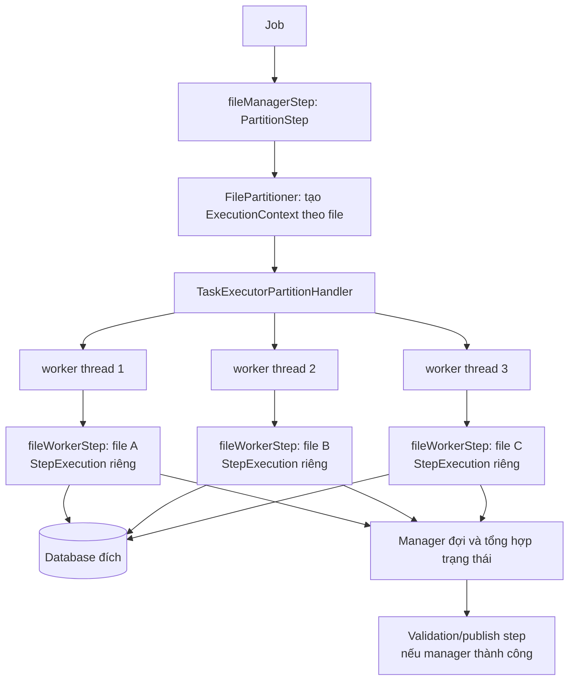
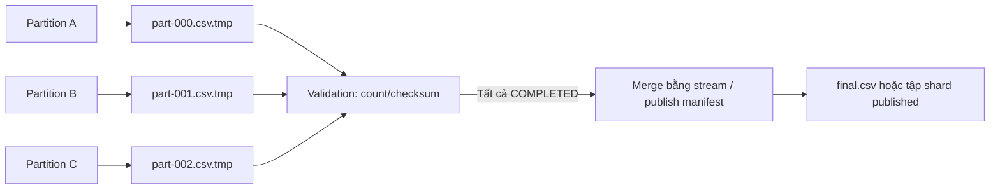

# Partition handler cho thao tác file lớn trong Spring Batch

> **Chương:** TaskExecutorPartitionHandler  
> **Mục tiêu:** Chia workload file lớn thành các partition độc lập, dùng `TaskExecutorPartitionHandler` chạy các worker step trong cùng JVM, kiểm soát reader/writer, I/O, transaction, retry/restart và lựa chọn cách mở rộng theo tài nguyên thực tế. Ví dụ sử dụng **Java 17 và Spring Batch 5.2.x**.

## 1. Bài toán: Nhiều file lớn cần nhập trong một batch job

Một hệ thống nhận hàng trăm file CSV mỗi ngày, mỗi file chứa vài trăm nghìn đến hàng triệu bản ghi giao dịch. Job cần đọc file, kiểm tra định dạng, chuẩn hóa dữ liệu và ghi vào database.

Một cách triển khai tuần tự là tạo một step đọc hết file A, rồi file B, sau đó file C. Khi mỗi file độc lập và database còn dư khả năng ghi, tuần tự có thể khiến tổng thời gian job quá dài.

**Partitioning** cho phép manager tạo nhiều đơn vị công việc độc lập. Mỗi partition có một `StepExecution` và `ExecutionContext` chứa chỉ dẫn đọc dữ liệu. `TaskExecutorPartitionHandler` đưa các partition đến một pool thread **cục bộ**; mỗi worker step mở reader riêng, xử lý từng chunk và ghi kết quả.

Ví dụ tập đầu vào:

| File đầu vào | Kích thước giả định | Partition | Đầu ra |
| --- | ---: | --- | --- |
| `invoice-2026-11-01.csv` | 750 MB | `file00000` | Các dòng hợp lệ được ghi vào DB |
| `invoice-2026-11-02.csv` | 620 MB | `file00001` | Các dòng hợp lệ được ghi vào DB |
| `invoice-2026-11-03.csv` | 980 MB | `file00002` | Các dòng hợp lệ được ghi vào DB |
| `invoice-2026-11-04.csv` | 400 MB | `file00003` | Các dòng hợp lệ được ghi vào DB |

Các dung lượng trên chỉ minh họa. Thời gian hoàn thành không nhất thiết tỷ lệ thuận với số byte: file có nhiều dòng ngắn, dòng cần xử lý nặng hoặc dữ liệu trùng khóa có thể tốn nhiều tài nguyên hơn.

**Quyết định thiết kế đầu tiên:** Nếu các file độc lập và dữ liệu không cần xử lý theo thứ tự giữa các file, **mỗi file một partition** là cách bắt đầu dễ lập luận về an toàn luồng và restart.

## 2. TaskExecutorPartitionHandler làm gì và không làm gì?

`TaskExecutorPartitionHandler` là `PartitionHandler` cho **local partitioning**. Nó nhận một worker `Step` và một `TaskExecutor` để thực thi nhiều `StepExecution` trên các thread cục bộ, sau đó chờ và gom kết quả.



| Thành phần | Trách nhiệm | Chú ý khi xử lý file |
| --- | --- | --- |
| `Partitioner` | Tạo danh sách partition và `ExecutionContext` | Phải phân chia file/vùng dữ liệu không giao nhau, có định danh ổn định |
| `PartitionStep` | Quản lý splitter, partition executions và kết quả tổng | Một manager step trong job |
| `TaskExecutorPartitionHandler` | Dispatch worker step bằng `TaskExecutor` | Không tự tìm file, chia dòng hoặc gửi việc sang JVM khác |
| Worker `Step` | Đọc, xử lý, ghi dữ liệu của **một partition** | Có transaction, reader/writer và checkpoint tương ứng |
| `JobRepository` | Lưu metadata, counters, trạng thái từng execution | Cần bền vững để restart sau crash |
| `TaskExecutor` | Giới hạn số thread thực thi cùng lúc | Không vượt khả năng CPU, đĩa, DB và connection pool |

Trong cùng một partition, worker step xử lý từng **chunk** theo cấu hình thông thường; giữa các partition, các worker **có thể chạy đồng thời**. Đây là hai cấp độ tổ chức khác nhau:

- **Partition** quyết định ai chịu trách nhiệm về tập dữ liệu nào.
- **Chunk** quyết định nhóm item nào đi vào một transaction trong một step.

Không nhầm `TaskExecutorPartitionHandler` với `FlowBuilder.split(executor)` (nhiều flow nghiệp vụ) hoặc `StepBuilder.taskExecutor(executor)` (multi-threaded chunk trong **cùng** một StepExecution).

## 3. Một file một partition: Vì sao dễ an toàn hơn share reader?

Với multi-threaded step thông thường, nhiều chunk/thread có thể dùng chung reader có con trỏ. Điều đó đặt áp lực lên thread safety và checkpoint, đặc biệt khi chunk commit khác thứ tự đọc.

Khi chia theo file:

- Partition A chỉ đọc file A; partition B chỉ đọc file B.
- Mỗi partition có **StepExecution riêng** và `ExecutionContext` riêng.
- Bean reader `@StepScope` được tạo cho từng `StepExecution`, nên state/con trỏ của file không bị các partition chia sẻ.
- Mỗi worker chạy các chunk của riêng nó (nếu worker step không bật multi-threaded chunk), nên thứ tự chunk/checkpoint **bên trong partition** đơn giản hơn.
- Khi lỗi ở file C, partition A/B đã `COMPLETED` có thể được bỏ qua theo cơ chế restart mặc định; việc xử lý lại tập trung vào phần chưa hoàn thành.

```text
Manager: fileManagerStep
  fileWorkerStep:file00000 --> file A --> StepExecution #501
  fileWorkerStep:file00001 --> file B --> StepExecution #502
  fileWorkerStep:file00002 --> file C --> StepExecution #503
  fileWorkerStep:file00003 --> file D --> StepExecution #504
```

Số ID chỉ là ví dụ. **`@StepScope` tạo bean theo StepExecution, không phải theo thread**. Trong mô hình đang xét, mỗi partition có StepExecution riêng nên đạt được cách ly reader mong muốn. Nếu tiếp tục bật multi-threaded chunk **bên trong worker step**, một reader step-scoped vẫn có thể bị nhiều thread của **cùng partition** truy cập.

## 4. Thiết kế Partitioner cho danh sách file

Một `Partitioner` tạo `Map<String, ExecutionContext>`. Mỗi entry mang tên partition và metadata cần để worker mở đúng tài nguyên. Với file lớn, nên chỉ đưa **đường dẫn, khóa, checksum hoặc offset nhỏ** vào `ExecutionContext`; không đọc toàn bộ file vào bộ nhớ của manager.

Ví dụ Java dưới đây dùng một thư mục có sẵn file CSV. Nó phù hợp cho tập input giới hạn số file. Để restart an toàn trên production, hãy thay việc quét thư mục động bằng **manifest đầu vào bất biến** (giải thích ở phần 8).

```java
package com.example.batch.files;

import java.io.IOException;
import java.nio.file.Files;
import java.nio.file.Path;
import java.util.Comparator;
import java.util.LinkedHashMap;
import java.util.List;
import java.util.Map;
import java.util.stream.Stream;

import org.springframework.batch.core.partition.support.Partitioner;
import org.springframework.batch.item.ExecutionContext;

public final class CsvFilePartitioner implements Partitioner {

    // Giới hạn rõ ràng cho ví dụ để tránh enqueue quá nhiều task.
    public static final int MAX_FILES = 128;

    private final Path directory;

    public CsvFilePartitioner(Path directory) {
        this.directory = directory.toAbsolutePath().normalize();
    }

    @Override
    public Map<String, ExecutionContext> partition(int gridSize) {
        List<Path> files;
        try (Stream<Path> entries = Files.list(directory)) {
            files = entries
                    .filter(Files::isRegularFile)
                    .filter(path -> path.getFileName().toString()
                            .endsWith(".csv"))
                    .sorted(Comparator.comparing(
                            path -> path.getFileName().toString()))
                    .toList();
        } catch (IOException error) {
            throw new IllegalStateException(
                    "Cannot list CSV input files: " + directory, error);
        }

        if (files.isEmpty()) {
            throw new IllegalStateException("No CSV files in " + directory);
        }
        if (files.size() > MAX_FILES) {
            throw new IllegalStateException(
                    "Too many partitions for this bounded example: "
                            + files.size());
        }

        Map<String, ExecutionContext> result = new LinkedHashMap<>();
        for (int i = 0; i < files.size(); i++) {
            ExecutionContext context = new ExecutionContext();
            context.putString(
                    "filePath",
                    files.get(i).toAbsolutePath().normalize().toString());

            String partitionName = "file%05d".formatted(i);
            result.put(partitionName, context);
        }
        return result;
    }
}
```

**Ý nghĩa của các lựa chọn:**

1. `Files.list(...)` chỉ liệt kê entry trực tiếp trong thư mục, không đọc từng file vào RAM.
2. `sorted(...)` tạo thứ tự ổn định **nếu tập file không đổi**. Nếu file mới xuất hiện giữa các lần chạy/restart, chỉ số `file00003` có thể trỏ sang file khác. Production phải đóng băng danh sách input bằng manifest.
3. `gridSize` là số lượng được manager **gợi ý** cho partitioner. Trong ví dụ này, partitioner cố ý tạo **một partition cho mỗi file**, nên số entry trả về có thể khác `gridSize`. `gridSize=4` không tự làm thư mục 40 file thành bốn partition.
4. `MAX_FILES` là giới hạn minh họa tương ứng với queue/pool bên dưới. Nếu phải xử lý hàng chục nghìn file nhỏ, cần gom file thành các nhóm partition hoặc dùng chiến lược dispatch khác thay vì tạo lượng task khổng lồ một lần.
5. Đường dẫn file chỉ là dữ liệu đầu vào của worker; cần kiểm tra quyền truy cập, đường dẫn hợp lệ, symlink, định dạng và tính bất biến của nguồn trong hệ thống thật.

Với manifest thực tế, có thể sử dụng file JSON/CSV chứa danh sách đường dẫn (hoặc URI object storage), kích thước, checksum và phiên bản snapshot, rồi đưa **manifest ID bất biến** vào `JobParameters`. Khi restart, dùng lại cùng manifest và mapping partition name → file.

## 5. Cấu hình worker step: Reader theo file và writer JDBC

Worker được gọi với `ExecutionContext['filePath']` của partition. `FlatFileItemReader` cần instance riêng cho từng `StepExecution`; `@StepScope` cho phép bind resource sau khi context của worker đã có.

Ví dụ dùng file CSV có header `invoiceId,amount`. Database PostgreSQL có bảng:

```sql
CREATE TABLE invoice_import (
    invoice_id BIGINT PRIMARY KEY,
    amount NUMERIC(18, 2) NOT NULL
);
```

Bean reader, writer và worker step:

```java
package com.example.batch.files;

import java.math.BigDecimal;
import javax.sql.DataSource;

import org.springframework.batch.core.Step;
import org.springframework.batch.core.configuration.annotation.StepScope;
import org.springframework.batch.core.repository.JobRepository;
import org.springframework.batch.core.step.builder.StepBuilder;
import org.springframework.batch.item.database.JdbcBatchItemWriter;
import org.springframework.batch.item.database.builder.JdbcBatchItemWriterBuilder;
import org.springframework.batch.item.file.FlatFileItemReader;
import org.springframework.batch.item.file.builder.FlatFileItemReaderBuilder;
import org.springframework.beans.factory.annotation.Qualifier;
import org.springframework.beans.factory.annotation.Value;
import org.springframework.context.annotation.Bean;
import org.springframework.context.annotation.Configuration;
import org.springframework.core.io.FileSystemResource;
import org.springframework.jdbc.core.namedparam.MapSqlParameterSource;
import org.springframework.transaction.PlatformTransactionManager;

@Configuration(proxyBeanMethods = false)
public class InvoiceFileWorkerConfig {

    public record Invoice(long invoiceId, BigDecimal amount) {}

    @Bean
    @StepScope
    public FlatFileItemReader<Invoice> invoiceFileReader(
            @Value("#{stepExecutionContext['filePath']}") String filePath) {
        return new FlatFileItemReaderBuilder<Invoice>()
                .name("invoiceFileReader")
                .resource(new FileSystemResource(filePath))
                .linesToSkip(1)
                .delimited()
                .names("invoiceId", "amount")
                .fieldSetMapper(fs -> new Invoice(
                        fs.readLong("invoiceId"),
                        fs.readBigDecimal("amount")))
                .build();
    }

    @Bean
    public JdbcBatchItemWriter<Invoice> invoiceJdbcWriter(
            DataSource dataSource) {
        return new JdbcBatchItemWriterBuilder<Invoice>()
                .dataSource(dataSource)
                .sql("""
                    INSERT INTO invoice_import (invoice_id, amount)
                    VALUES (:invoiceId, :amount)
                    ON CONFLICT (invoice_id) DO NOTHING
                    """)
                .itemSqlParameterSourceProvider(item ->
                        new MapSqlParameterSource()
                                .addValue("invoiceId", item.invoiceId())
                                .addValue("amount", item.amount()))
                .build();
    }

    @Bean
    public Step fileWorkerStep(
            JobRepository repository,
            PlatformTransactionManager transactionManager,
            @Qualifier("invoiceFileReader") FlatFileItemReader<Invoice> reader,
            @Qualifier("invoiceJdbcWriter") JdbcBatchItemWriter<Invoice> writer) {
        return new StepBuilder("fileWorkerStep", repository)
                .<Invoice, Invoice>chunk(500, transactionManager)
                .reader(reader)
                .writer(writer)
                .build();
    }
}
```

**Các điều kiện để ví dụ hoạt động đúng:**

- Ứng dụng phải cấu hình `JobRepository`, `PlatformTransactionManager`, `DataSource`, file CSV và một job gọi manager step. Đoạn này là thành phần cấu hình **worker**, chưa phải application hoàn chỉnh.
- `reader` là **step-scoped**. Mỗi partition có một instance reader với resource và checkpoint riêng; không dùng một `FlatFileItemReader` singleton cho tất cả file.
- Worker step ở đây **không** khai báo `taskExecutor(...)`: mỗi partition chạy chunk tuần tự, còn các partition chạy song song qua handler ở manager.
- `JdbcBatchItemWriter` dùng một cấu hình SQL cố định và không giữ buffer mutable chia sẻ theo invocation. Các insert từ nhiều worker vẫn có thể tranh chấp key/index/connection.
- `ON CONFLICT DO NOTHING` chỉ là chiến lược chống chèn trùng phù hợp khi `invoice_id` và dữ liệu **bất biến**. Nếu cùng ID xuất hiện với amount khác nhau, ví dụ này sẽ giữ dòng đầu tiên, có thể che giấu lỗi dữ liệu. Production cần kiểm tra/đối soát trùng khóa, version và chính sách upsert có chủ đích.
- Transaction manager phải quản lý connection của writer để rollback chunk hoạt động như dự kiến. Mã không bảo đảm nguyên tử với side effect ở hệ thống khác.
- `FlatFileItemReader` lưu state theo tên reader trong `ExecutionContext`; tên reader ổn định và số lượng reader nhất quán giúp checkpoint/restart được quản lý theo từng partition. Nguồn phải còn nguyên qua restart.

Đặt input validation ở processor (nếu có) hoặc bước tiền kiểm riêng sẽ dễ phân biệt dữ liệu sai với lỗi ghi DB. Không cấu hình skip mọi exception chỉ để cho job hoàn tất.

## 6. Cấu hình manager với TaskExecutorPartitionHandler

Sau khi có `Partitioner` và worker `Step`, manager dùng handler để thực thi các partition trên thread pool.

```java
package com.example.batch.files;

import java.nio.file.Path;

import org.springframework.batch.core.Step;
import org.springframework.batch.core.partition.support.Partitioner;
import org.springframework.batch.core.partition.support.TaskExecutorPartitionHandler;
import org.springframework.batch.core.repository.JobRepository;
import org.springframework.batch.core.step.builder.StepBuilder;
import org.springframework.beans.factory.annotation.Qualifier;
import org.springframework.context.annotation.Bean;
import org.springframework.context.annotation.Configuration;
import org.springframework.core.env.Environment;
import org.springframework.scheduling.concurrent.ThreadPoolTaskExecutor;

@Configuration(proxyBeanMethods = false)
public class InvoiceFileManagerConfig {

    @Bean
    public Partitioner invoiceFilePartitioner(Environment environment) {
        String directory = environment.getRequiredProperty(
                "batch.input-directory");
        return new CsvFilePartitioner(Path.of(directory));
    }

    @Bean
    public ThreadPoolTaskExecutor filePartitionExecutor() {
        ThreadPoolTaskExecutor executor = new ThreadPoolTaskExecutor();
        executor.setCorePoolSize(4);
        executor.setMaxPoolSize(4);
        // Bài mẫu giới hạn tối đa 128 partition.
        executor.setQueueCapacity(128);
        executor.setThreadNamePrefix("file-partition-");
        return executor;
    }

    @Bean
    public TaskExecutorPartitionHandler filePartitionHandler(
            @Qualifier("fileWorkerStep") Step workerStep,
            @Qualifier("filePartitionExecutor") ThreadPoolTaskExecutor executor) {
        TaskExecutorPartitionHandler handler =
                new TaskExecutorPartitionHandler();
        handler.setStep(workerStep);
        handler.setTaskExecutor(executor);
        handler.setGridSize(4);
        return handler;
    }

    @Bean
    public Step fileManagerStep(
            JobRepository repository,
            @Qualifier("invoiceFilePartitioner") Partitioner partitioner,
            @Qualifier("filePartitionHandler")
                    TaskExecutorPartitionHandler handler) {
        return new StepBuilder("fileManagerStep", repository)
                .partitioner("fileWorkerStep", partitioner)
                .partitionHandler(handler)
                .build();
    }
}
```

Cấu hình property đầu vào (ví dụ):

```yaml
batch:
  input-directory: "/data/import/invoices"
```

Cần một job gọi `fileManagerStep`, ví dụ đoạn sau trong bean Job (với `repository` và `fileManagerStep` đã inject):

```java
return new JobBuilder("invoiceFileImportJob", repository)
        .start(fileManagerStep)
        .build();
```

**Trình tự chạy:** `PartitionStep` yêu cầu splitter tạo các `StepExecution` theo mapping của partitioner; handler gửi chúng đến executor; worker step xử lý file tương ứng; handler chờ kết quả và manager tổng hợp kết quả cuối. Theo mặc định, khi partition quan trọng thất bại, manager step/job không được coi là hoàn thành thành công.

### Grid size có phải số thread hay số file?

Không. Có ba đại lượng khác nhau:

| Tham số | Quyết định | Trong ví dụ |
| --- | --- | --- |
| `gridSize` | Kích thước được gợi ý cho `Partitioner.partition(int)` | 4, nhưng partitioner trả về một entry mỗi file |
| Số partition thực | Số `ExecutionContext` được tạo | Bằng số file, tối đa 128 |
| Pool executor | Số lời gọi worker step có thể thực thi đồng thời | Tối đa 4 thread cục bộ |

Đặt `gridSize=16` không tự chia file 20 GB thành 16 đoạn. Nó cũng không tự khiến concurrency đạt 16 nếu pool chỉ có bốn worker.

Queue trong `ThreadPoolTaskExecutor` lưu các tác vụ **chưa được chạy**. Queue quá ngắn có thể gây `TaskRejectedException` khi manager submit nhiều partition cùng lúc; queue quá lớn làm tăng overhead và có thể che giấu tải kéo dài. Số partition, pool/queue và phương thức dispatch phải được thiết kế cùng nhau.

## 7. Nếu chỉ có một file cực lớn thì sao?

Một file 200 GB không trở thành nhiều partition chỉ nhờ `TaskExecutorPartitionHandler`. Cần **tự thiết kế cách chia** công việc.

### Cách 1: Tách file trước thành nhiều file độc lập

Đây thường là lựa chọn dễ triển khai nhất:

1. Snapshot file nguồn theo version/checksum.
2. Tách file thành các shard có định danh ổn định, mỗi shard gồm các bản ghi CSV hoàn chỉnh.
3. Tạo manifest chứa `shardPath`, kích thước, checksum và thứ tự (nếu nghiệp vụ yêu cầu).
4. Dùng **một shard một partition** với cấu hình reader tương tự phần trên.
5. Chỉ publish kết quả khi các partition và bước kiểm tra cuối thành công.

Nếu CSV có trường **xuống dòng trong dấu nháy kép**, không thể tách đơn giản theo mỗi ký tự newline. Cần parser CSV có nhận thức về record boundary. File gzip thông thường cũng không cho phép seek giải nén ở offset bất kỳ; nên tách/decompress trước hoặc dùng định dạng splittable được hạ tầng hỗ trợ.

### Cách 2: Range theo byte/record (chỉ khi định dạng cho phép)

Với định dạng dòng đơn giản không có record nhiều dòng, có thể xây partition theo `startByte/endByte`:

```text
File:  [0........................................................end]
P0:    [0..................b1)
P1:                       [b1..................b2)
P2:                                           [b2.................end)
```

Khi đọc, phải:

- Tìm **ranh giới record hoàn chỉnh** quanh offset, tránh cắt giữa dòng.
- Không cắt một mã UTF-8 đa byte, BOM hoặc escape sequence.
- Chỉ định rõ partition nào chịu trách nhiệm về record ở ranh giới để không trùng/mất bản ghi.
- Dùng reader thực sự hỗ trợ seek theo byte/record, **không** suy rằng `FlatFileItemReader` tự tìm đến `startByte`.
- Lưu offset, version/checksum và checkpoint để restart đúng partition.

**Cảnh báo về giải pháp “skip N dòng”:** Nếu mỗi partition đều mở file từ đầu rồi gọi logic bỏ qua `N` dòng, tổng lượng đọc bỏ qua có thể tăng rất lớn. Mô hình đó có thể tệ hơn chạy tuần tự dù có nhiều thread; chưa kể CSV quoting và newline phức tạp.

### Cách 3: Chia theo khóa nghiệp vụ ở nguồn dữ liệu có chỉ mục

Nếu dữ liệu đã nằm trong database/object store được index, một `Partitioner` theo range ID, hash hoặc ngày có thể hiệu quả hơn chia file. Khi đó worker sử dụng `JdbcPagingItemReader` hoặc reader theo partition phù hợp. Chọn cách chia dựa vào **khả năng định vị dữ liệu**, không chỉ dung lượng.

## 8. Restart: Đóng băng input và tên partition

Spring Batch lưu metadata theo `JobInstance`, `JobExecution` và từng `StepExecution`. Khi restart cùng JobInstance, các partition đã `COMPLETED` thường được bỏ qua theo cơ chế mặc định, còn phần chưa hoàn thành được xử lý lại theo trạng thái/checkpoint.

Đối với file, điểm dễ gây sai nhất là **thay đổi mapping partitionName → filePath giữa các lần chạy**.

Ví dụ ban đầu:

```text
file00000 -> a.csv
file00001 -> c.csv
file00002 -> d.csv
```

Nếu trước lúc restart có thêm `b.csv` và partitioner liệt kê/sắp xếp lại:

```text
file00000 -> a.csv
file00001 -> b.csv   // trước đây là c.csv
file00002 -> c.csv   // trước đây là d.csv
file00003 -> d.csv
```

Một partition `COMPLETED` có tên `file00001` trước đó **không đồng nghĩa** `b.csv` đã được xử lý. Vì vậy **chỉ sort danh sách file là chưa đủ**.

**Thiết kế production nên:**

1. Tạo manifest đầu vào **bất biến** trước khi job bắt đầu, với danh sách file/shard, phiên bản và checksum.
2. Dùng manifest ID làm một tham số định danh của `JobInstance`.
3. Khi restart, dùng đúng manifest trước đó và **giữ nguyên partition name/mapping**.
4. Đảm bảo file nguồn không bị chỉnh sửa, thay thế hoặc xóa trước khi restart xong; cân nhắc object storage versioning.
5. Xác thực checksum/size trước khi đọc lại; nếu dữ liệu nguồn đã đổi, fail rõ ràng thay vì tiếp tục bằng checkpoint cũ.
6. Cấu hình output idempotent và đối soát các row đã commit.
7. Kiểm thử restart khi worker đang xử lý, khi đã commit một số chunk và khi job bị kill đột ngột.

Không dùng `saveState(false)` trên reader như cách “chữa” lỗi checkpoint nếu chưa quyết định rằng bắt đầu lại từ đầu **và** ghi lặp dữ liệu là an toàn.

### Lỗi của một partition ảnh hưởng toàn job ra sao?

Giả sử bốn partition chạy đồng thời:

- A đã commit hết và `COMPLETED`.
- B thất bại vì CSV lỗi ở dòng 10.000.
- C đang xử lý, có thể đã commit một vài chunk.
- D hoàn thành sau khi B báo lỗi.

Transaction của A/D **không tự rollback** vì B lỗi. Manager cần chờ/đánh giá kết quả các partition và job báo thất bại theo luồng trạng thái phù hợp. Khi restart, worker không tự tái nhập mọi file đã hoàn thành. Chính sách skip/retry trong worker phải được cấu hình có chủ đích, không mặc định áp dụng vô hạn cho lỗi nguồn.

## 9. Thread safety, transaction và file I/O

### Vì sao partitioning an toàn hơn một reader chia sẻ?

Trong ví dụ, mỗi worker step có reader `@StepScope` được mở riêng, nên không cạnh tranh con trỏ đọc. Nhưng vẫn có tài nguyên chia sẻ:

| Tài nguyên | Nguy cơ | Cách khắc phục |
| --- | --- | --- |
| Cùng thư mục input | File đang được upload/ghi dở | Dùng staging + atomic rename hoặc manifest phát hành sau khi upload xong |
| Cùng ổ đĩa/NFS/object storage | Băng thông I/O nghẽn, throttling | Giới hạn worker; đặt file gần worker/cache khi phù hợp |
| Writer JDBC chung cấu hình | DB lock, unique key conflict | Unique key, transaction ngắn, tách khóa dữ liệu và policy duplicate |
| Reader/processor có field mutable singleton | Race, con trỏ/state lẫn giữa partition | `@StepScope`, immutable config, tránh state dùng chung |
| Transaction/connection pool | Hết connection khi nhiều partition đồng thời | Chọn pool phù hợp và chừa tài nguyên cho metadata/job khác |
| `ExecutionContext` | Trạng thái restart sai nếu tự ghi chung key | Chỉ ghi checkpoint trong đúng StepExecution; không dùng static map |
| Log context/MDC | Log worker bị gắn ID của partition khác | Set/clear MDC trên thread worker, gắn `stepExecutionId` thực |
| File đích dùng chung | Ghi xen kẽ, file hỏng | Tạo output riêng theo partition rồi merge ở bước sau |

**Thread-bound transaction:** Mỗi worker step dùng transaction manager tại **thread thực thi chunk**. Một chunk commit rồi thì lỗi ở chunk khác không rollback nó. Transaction JDBC không tự bao trùm việc ghi file ngoài database hoặc thao tác qua HTTP/API.

## 10. Nếu đầu ra cũng là file lớn: Mỗi partition một file đích

Mẫu an toàn thường là:



**Tránh** để nhiều `FlatFileItemWriter` cùng mở **một file đích** rồi ghi append. Các thread có thể chen byte, chồng offset và gây hỏng dữ liệu; lock toàn bộ ghi file lại biến bước write thành nút thắt.

Với `@StepScope`, có thể lấy tên file đích từ partition context:

```java
@Bean
@StepScope
FlatFileItemWriter<Invoice> partitionWriter(
        @Value("#{stepExecutionContext['outputPath']}") String outputPath) {
    return new FlatFileItemWriterBuilder<Invoice>()
            .name("partitionInvoiceWriter")
            .resource(new FileSystemResource(outputPath))
            .lineAggregator(invoice ->
                    invoice.invoiceId() + "," + invoice.amount())
            .build();
}
```

**Phải** để `Partitioner` tạo `outputPath` duy nhất, bất biến theo partition. Trong ví dụ cấu hình chính, worker đang ghi JDBC; đoạn writer file ở trên là **phương án thay thế**, không tự đồng thời chạy với writer JDBC.

Lưu ý:

- File writer có state/checkpoint; không xóa hoặc thay thế file tạm đang cần cho restart một cách tùy tiện.
- Spring Batch quản lý transaction/chunk cho item stream writer, nhưng hệ thống file không có tính nguyên tử giống JDBC. Crash hoặc thao tác ngoài framework vẫn có thể để lại file tạm dở.
- Thiết kế bước **validate** đầu ra sau khi mọi partition thành công: tổng số bản ghi, checksum, version nguồn và ngưỡng skip.
- Merge file lớn bằng streaming, không `Files.readAllBytes(...)` rồi ghép trong RAM.
- Publish bằng rename/manifest theo khả năng hệ thống file/object storage; **atomic rename** không được bảo đảm giống nhau giữa các hệ thống hoặc storage backend, cần hiểu semantics cụ thể.
- Nếu thứ tự file cuối quan trọng, merge **theo manifest và khóa nghiệp vụ**, không theo thời điểm partition hoàn thành.

Với object storage, nhiều lúc giữ output thành **tập shard có manifest** hiệu quả hơn tạo một file cuối khổng lồ.

## 11. Retry, skip và xử lý lỗi file

Không nên gom mọi exception thành skippable. Nhiều lỗi trong thao tác file biểu thị **resource hỏng hoặc không thể tiếp tục đọc**, khác với một dòng dữ liệu lỗi.

| Lỗi | Cách xử lý đề xuất | Lý do |
| --- | --- | --- |
| Một dòng CSV không parse được và reader có thể tiến tiếp | Skip có giới hạn, quarantine | Chấp nhận loại một item lỗi nếu nghiệp vụ cho phép |
| Dữ liệu nghiệp vụ không hợp lệ | Process skip có quota hoặc fail | Bảo toàn chất lượng dữ liệu |
| Không tìm thấy file hoặc không có quyền đọc | Fail partition | Không có cách tiếp tục an toàn |
| File bị thay đổi checksum giữa job/restart | Fail, yêu cầu nguồn snapshot ổn định | Checkpoint không còn đáng tin |
| Lỗi network storage thoáng qua | Retry có giới hạn nếu reader/writer hỗ trợ phục hồi | Tránh retry vô hạn và log bão |
| Database deadlock khi ghi | Retry hữu hạn với backoff và idempotency | Lỗi giao dịch tạm thời |
| Hết dung lượng đĩa ở file output | Fail và cảnh báo hạ tầng | Skip item không giải quyết được |
| Lỗi schema/encoding của cả file | Fail/quarantine toàn file | Không phải chỉ một record lỗi |

Cấu hình chunk fault tolerance (ví dụ Java rút gọn) chỉ phù hợp khi các exception có thể phục hồi an toàn:

```java
.faultTolerant()
.skip(FlatFileParseException.class)
.skipLimit(20)
.retry(TransientDataAccessException.class)
.retryLimit(3)
```

`skipLimit(20)` giới hạn tổng các skip read/process/write theo **mỗi StepExecution**, tức theo **mỗi partition** trong mô hình này. Nếu doanh nghiệp đặt quota tối đa **20 bản ghi lỗi cho toàn job**, cần **bước tổng hợp kiểm tra sau manager**, vì 10 partition với quota 20 mỗi partition có thể bỏ tới 200 item.

Không che giấu lỗi file bằng `catch(Exception)` bên trong reader rồi trả về `null`: `null` nghĩa là **hết dữ liệu**, có thể làm mất phần còn lại của file mà job vẫn báo COMPLETED.

## 12. Tuning grid size và I/O cho file lớn

Có thể xem thời gian job chịu ảnh hưởng của ba nhóm chi phí:

```text
T_job ≈ T_phân vùng + T_chờ partition chậm nhất
                  + T_kiểm tra/publish
                  + T_điều phối/overhead

Throughput = số bản ghi ghi thành công / thời gian thực tế
Speedup     = thời gian tuần tự / thời gian chia partition
```

Đây là quan hệ định tính; khi files không đồng đều, worker rảnh vẫn có thể phải chờ một partition rất lớn. Nếu DB đã bão hòa, tăng số thread có thể giảm thông lượng.

Bảng dữ liệu **giả định** với cùng tập input:

| Worker threads | Số partition | Thời gian | Record/s | Quan sát |
| ---: | ---: | ---: | ---: | --- |
| 1 | 16 | 120 phút | 10.000 | Baseline tuần tự |
| 2 | 16 | 67 phút | 17.910 | Tăng tốc khi nguồn I/O còn dư |
| 4 | 16 | 39 phút | 30.769 | Cải thiện rõ |
| 8 | 16 | 43 phút | 27.907 | Storage hoặc DB bị tranh chấp |

Các số không phải benchmark. Hãy đo:

1. **Độ lệch phân vùng:** dung lượng, số record, thời gian của partition chậm nhất và tổng thời gian worker rảnh chờ.
2. **Throughput đọc/ghi:** disk IOPS, băng thông network filesystem, latency object storage, SQL latency.
3. **Pool:** active worker, queue depth, connection pool pending, DB locks/deadlocks.
4. **Transaction:** chunk duration, commit/rollback/skip count, thời gian retry.
5. **Bộ nhớ:** `chunkSize × số worker × kích thước item` (xấp xỉ, chưa tính buffers và metadata).
6. **Recovery:** thời gian restart, số item bị replay, tính đúng đắn sau lỗi.

**Điều chỉnh từng tham số:** tăng worker 1 → 2 → 4 trước, giữ nguyên input và chunk size; sau đó thử chunk size. Với file nhỏ nhưng rất nhiều, overhead mỗi partition có thể chi phối: hãy nhóm nhiều file vào một partition với reader theo danh sách resource. Với một file cực lớn, chia shard/range đúng record boundary thay vì chỉ tăng grid size.

## 13. Quan sát, log và kiểm chứng kết quả

Mỗi partition có một `StepExecution` độc lập. Log nên chứa `jobExecutionId`, `stepExecutionId`, `stepName`, partition name, file ID và worker thread.

Ví dụ:

```text
INFO  [file-partition-1] stepExecutionId=501 partition=file00000 file=invoice-a.csv - started
INFO  [file-partition-2] stepExecutionId=502 partition=file00001 file=invoice-b.csv - started
WARN  [file-partition-2] stepExecutionId=502 readSkipCount=1 - malformed record
INFO  [file-partition-1] stepExecutionId=501 read=800000 write=800000 status=COMPLETED
INFO  [file-partition-2] stepExecutionId=502 read=600000 write=599999 status=COMPLETED
```

Các dòng và số đếm chỉ minh họa. Đừng log từng record của file nhiều triệu dòng hoặc đưa thông tin nhạy cảm của khách hàng vào log.

| Đối tượng quan sát | Mục đích |
| --- | --- |
| `StepExecution.readCount/writeCount` | Số item từng partition đọc/ghi thành công theo semantics của Batch |
| `readSkipCount/processSkipCount/writeSkipCount` | Theo dõi các loại dữ liệu bị bỏ qua |
| `commitCount/rollbackCount` | Nhận diện lỗi ghi, retry tốn kém, transaction lớn |
| `startTime/endTime/exitStatus` | Tìm partition chậm hoặc thất bại |
| File size/checksum/record count trong manifest | Phát hiện nguồn đổi và thiếu dữ liệu |
| Connection pool, disk/network throughput | Phân biệt giới hạn I/O với CPU |
| Output count/unique key đối chiếu | Xác nhận end-to-end, nhất là sau restart |

**Không đưa `stepExecutionId` hay path từng file vào nhãn metric Prometheus**, vì cardinality tăng theo job và số file. Giữ ID và đường dẫn được làm sạch trong structured logs/trace; metric dùng tag ổn định như job, step, status và loại lỗi.

### Phát hiện nút thắt bằng kết quả đo

- Một partition mất 80% tổng thời gian, các worker khác rảnh: **data skew**, nên chia nhỏ file đó.
- Mọi worker đều chờ đọc NFS: storage I/O là nút thắt.
- `DB pool pending` cao, lock wait tăng, CPU không dùng hết: database/write contention.
- Quá nhiều partition nhỏ, log start/end dày và queue liên tục: chi phí scheduling/metadata lớn hơn xử lý hữu ích.
- `rollbackCount` cao: kiểm tra validation sớm, transaction size, timeout, giới hạn retry.

## 14. Các lỗi thường gặp và cách xử lý

| Hiện tượng | Nguyên nhân | Cách xử lý |
| --- | --- | --- |
| Đặt `gridSize=8` mà chỉ có 1 partition | Partitioner trả về một entry cho một file | Chia file thành shard, viết partitioner theo range hoặc input group |
| Tăng pool nhưng job không nhanh | Disk/NFS/DB bão hòa hoặc data skew | Đo I/O, connection pool, độ lệch kích thước file |
| Hai partition đọc chung một file ngoài ý muốn | Mapping `ExecutionContext` sai, đường dẫn cố định trong reader | Dùng `@StepScope` và bind `filePath` theo từng partition |
| Đọc thiếu/trùng dữ liệu sau restart | File thay đổi, mapping partition bị đảo, checkpoint không phù hợp | Manifest bất biến, version/checksum, business key idempotent |
| File output bị hỏng | Nhiều writer cùng ghi một path | Mỗi partition một file đích, merge/publish sau thành công |
| Một file sai định dạng làm cả job FAILED | Reader không thể bỏ qua lỗi hoặc skip limit thấp | Tách lỗi record và lỗi file; quyết định quota và quarantine |
| Nhiều file nhưng executor báo rejected task | Queue quá nhỏ so với số partition submit | Giới hạn số partition, nhóm file, cấu hình dispatch/pool |
| Job COMPLETED nhưng thiếu file nguồn | Partitioner chỉ quét tập file tại thời điểm chạy | Khóa manifest và kiểm tra số file/record đầu vào |
| DB ghi trùng sau restart | Writer không idempotent | Unique key, upsert có điều kiện, đối soát nguồn/đích |
| StepScoped reader vẫn bị race | Worker step bên trong bật multi-threaded chunk | Giữ worker step tuần tự hoặc kiểm chứng reader thread safety |
| File nén đơn khối không chia được | Gzip không hỗ trợ seek ở byte offset tùy ý | Pre-split/format splittable hoặc chiến lược decompress phù hợp |

## 15. Bài thực hành

**Bài 1 — Chia file theo partition.** Tạo bốn file CSV mỗi file 1.000 dòng có `invoiceId` khác nhau. Dùng `CsvFilePartitioner`, `TaskExecutorPartitionHandler` pool 2 thread. Quan sát có bốn `StepExecution` và hai partition có thể chạy đồng thời.

**Bài 2 — Đo throughput.** Giữ nguyên 100.000 dòng, lần lượt chạy pool 1, 2, 4. Theo dõi elapsed time, số dòng ghi, CPU, disk throughput, DB connection pending. Kết luận mức concurrency phù hợp dựa trên số liệu.

**Bài 3 — Test bất biến manifest.** Để một partition fail, sau đó thêm file mới vào thư mục input. Quan sát cách mapping tên partition có thể đổi khi quét lại. Sửa thiết kế bằng manifest cố định và restart lại cùng JobInstance trong môi trường test.

**Bài 4 — Kiểm tra restart.** Gây lỗi DB ở giữa một file sau vài chunk đã commit. Restart, kiểm tra metadata của partition và đối chiếu tập `invoiceId` nguồn/đích. Chứng minh không mất/trùng bản ghi.

**Bài 5 — Tạo output file theo partition.** Thay JDBC writer bằng `FlatFileItemWriter` step-scoped, cấp `outputPath` riêng cho từng partition. Sau khi toàn bộ partition thành công, stream-merge file và xác nhận checksum/số dòng; tuyệt đối không dùng một output path chung cho các worker.

**Bài 6 — Một file 20 GB.** Phân tích vì sao cách “`gridSize=8` và giữ nguyên `FlatFileItemReader`” chỉ có một partition. Đề xuất cách shard theo record hợp lệ, quy tắc xử lý CSV multiline và thiết kế resume theo manifest.

### Checklist trước khi vận hành

- [ ] Các partition chia dữ liệu không giao nhau và dùng ID ổn định.
- [ ] Input được snapshot/đóng băng trong suốt job và restart.
- [ ] Mỗi partition có reader stateful/`ExecutionContext` riêng; writer chịu được retry.
- [ ] Pool executor được giới hạn theo CPU, I/O, DB pool và số partition.
- [ ] Đã thử lỗi file, DB, worker crash và restart theo metadata thực.
- [ ] File output của từng partition có path riêng, chỉ publish khi toàn bộ job đạt điều kiện.
- [ ] Có kiểm tra tổng record, checksum, duplicate/missing key và skip quota toàn job.
- [ ] Log có StepExecution ID; dashboard theo dõi throughput, rollback, DB/storage waits.
- [ ] Đã lựa chọn có chủ đích giữa local partitioning và worker phân tán.

## 16. Khi nào nên chuyển khỏi TaskExecutorPartitionHandler?

Local partitioning là bước mở rộng tương đối đơn giản nếu một JVM còn đủ tài nguyên. Tuy nhiên khi nhu cầu vượt giới hạn máy đơn:

| Kiến trúc | Khi nên chọn |
| --- | --- |
| Local `TaskExecutorPartitionHandler` | Nhiều file/shard độc lập, CPU/I/O/DB có thể mở rộng trong cùng JVM |
| Parallel flows (`split`) | Các nhánh **nghiệp vụ** khác nhau cần chạy đồng thời, không phải hàng trăm file cùng logic |
| Multi-threaded step | Các chunk độc lập và reader/writer đã an toàn khi truy cập đồng thời |
| Local partitioning có nhóm file | Rất nhiều file nhỏ, cần giảm chi phí metadata và scheduling |
| Remote partitioning | Nhiều máy/worker phải tự đọc file/shard; dữ liệu có thể truy cập từ các worker |
| Remote chunking | Manager giữ reader và phân phối chunk sang worker xử lý/ghi |

`TaskExecutorPartitionHandler` chỉ chạy `Step.execute(...)` trên thread cục bộ; nó **không tự tạo remote worker**. Nếu dùng `Step` proxy để gọi từ xa, phải tự quản lý request/reply, timeout, đồng bộ trạng thái và idempotency. Với remote partitioning thông dụng, nên xem các thành phần Spring Batch Integration như `MessageChannelPartitionHandler` trước khi xây dựng một giao thức riêng.

## 17. Tài liệu tham khảo chính thức

- [Spring Batch 5.2 — Scaling and Parallel Processing / Partitioning](https://docs.spring.io/spring-batch/reference/5.2/scalability.html)
- [Spring Batch 5.2 — TaskExecutorPartitionHandler API](https://docs.spring.io/spring-batch/docs/5.2.0/api/org/springframework/batch/core/partition/support/TaskExecutorPartitionHandler.html)
- [Spring Batch 5.2 — StepBuilder / PartitionStep configuration](https://docs.spring.io/spring-batch/docs/5.2.x/api/org/springframework/batch/core/step/builder/StepBuilder.html)
- [Spring Batch 5.2 — FlatFileItemReader](https://docs.spring.io/spring-batch/reference/5.2/readers-and-writers/flat-files/file-item-reader.html)
- [Spring Batch 5.2 — ItemStream and Restart](https://docs.spring.io/spring-batch/reference/5.2/step/chunk-oriented-processing/restart.html)
- [Spring Batch 5.2 — Late Binding of Job and Step Attributes](https://docs.spring.io/spring-batch/reference/5.2/step/late-binding.html)
- [Spring Framework — ThreadPoolTaskExecutor](https://docs.spring.io/spring-framework/docs/current/javadoc-api/org/springframework/scheduling/concurrent/ThreadPoolTaskExecutor.html)

> **Phạm vi phiên bản:** Ví dụ dùng Spring Batch **5.2.x** với `TaskExecutorPartitionHandler`, `StepBuilder.chunk(size, transactionManager)` và `@StepScope`. Khi sử dụng Spring Batch 6, cần đối chiếu package và builder API theo phiên bản thực tế; không trộn import từ nhiều phiên bản vào cùng project. Phần chia file theo byte offset và publish object storage là mô hình thiết kế, không phải tính năng tự động của `FlatFileItemReader`.

**Ghi nhớ:** Đối với thao tác file lớn, `TaskExecutorPartitionHandler` hiệu quả khi **phần dữ liệu được chia thành những partition độc lập** và mỗi partition có reader, state cùng checkpoint riêng. Mỗi file một partition là điểm bắt đầu dễ kiểm chứng; một file khổng lồ cần được chia shard/range theo record boundary. Tính đúng đắn phụ thuộc manifest bất biến, transaction, idempotency, restart và khả năng chịu tải thực tế của storage và database.
