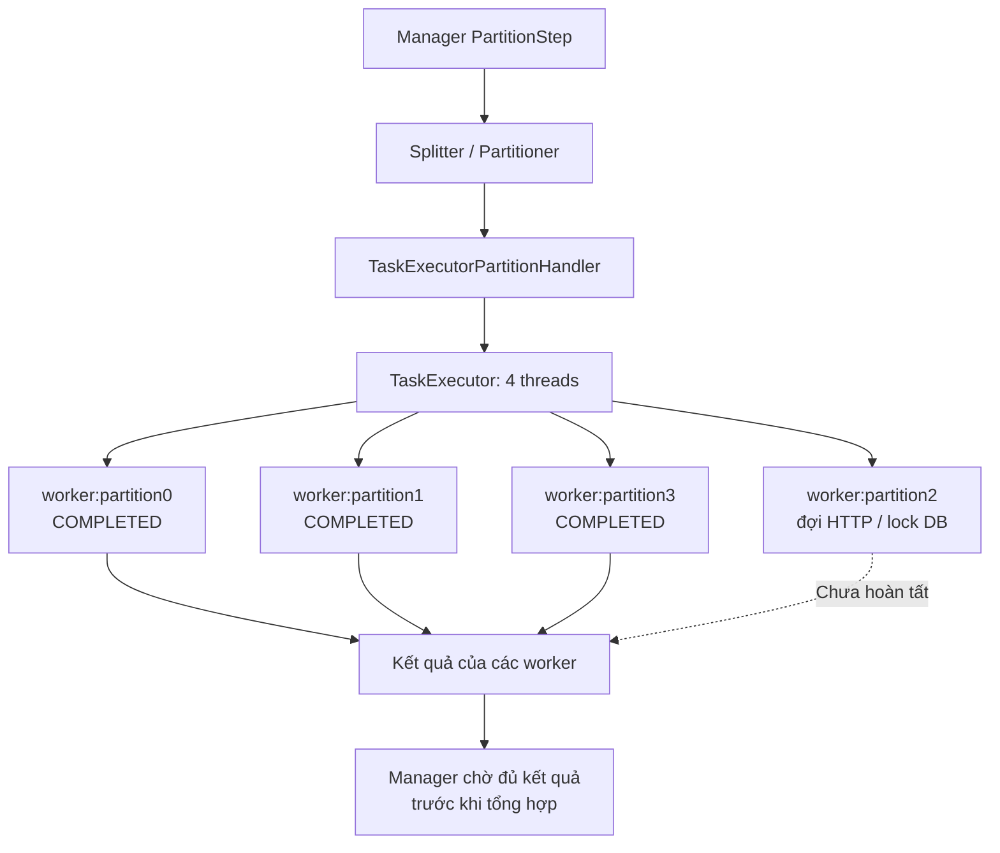
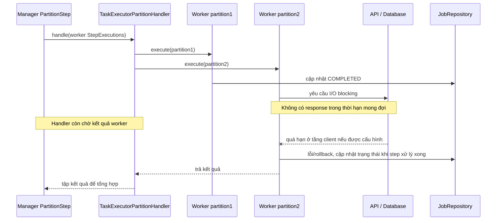

# Xử lý worker timeout

## 1. Bối cảnh: một worker bị kẹt có thể giữ cả PartitionStep

Trong chương **TaskExecutorPartitionHandler** thuộc module **SPRING_BATCH_SCALING_OPERATIONS**, manager chia một step thành nhiều partition và dùng `TaskExecutorPartitionHandler` để chạy các worker `StepExecution` **ngay trong JVM**, thông qua một `TaskExecutor`. Đây là cách mở rộng Spring Batch rất hữu ích khi khối lượng dữ liệu lớn, có thể chia theo dải ID, thời gian hoặc tenant.

Tình huống nguy hiểm xuất hiện khi một worker không kết thúc đúng thời gian dự kiến. Chẳng hạn job xử lý tám partition, bảy partition đã `COMPLETED` nhưng partition cuối đang chờ một HTTP endpoint không phản hồi hoặc một truy vấn JDBC bị khóa. Manager không thể kết luận toàn bộ partition step thành công khi còn worker chưa có kết quả cuối. Về vận hành, job trông như **bị treo**, dù những worker khác đã làm xong.

Điều quan trọng là **`TaskExecutorPartitionHandler` không cung cấp một cam kết timeout/hủy worker tự động chỉ bằng `gridSize` hay số thread trong pool**. Timeout của HTTP client, database, transaction, executor shutdown và SLA của job là **những cơ chế khác nhau**. Xử lý worker timeout đúng đắn đòi hỏi định nghĩa thời hạn, phát hiện worker quá hạn, giới hạn thao tác I/O, dừng có kiểm soát và bảo vệ restart.

Bài học này tập trung vào:

- Phân biệt worker **chạy chậm**, worker **kẹt I/O**, **đợi task trong queue** và worker **đã lỗi nhưng metadata chưa được quan sát**.
- Hiểu đường chờ kết quả của `TaskExecutorPartitionHandler` và những giới hạn của việc hủy thread.
- Cấu hình timeout tại tầng HTTP/JDBC và xử lý lỗi qua chunk retry/rollback.
- Thiết kế watchdog/alert cho `StepExecution` mà không phá trạng thái trong `JobRepository`.
- Dừng job một cách có kiểm soát, đối chiếu dữ liệu sau lỗi rồi restart đúng `JobInstance`.
- Tối ưu pool, `gridSize`, chunk size và tài nguyên DB/API thay vì tăng concurrency vô hạn.

> **Nguyên tắc cốt lõi:** *Hết thời gian chờ* không có nghĩa *worker đã dừng an toàn*. Ngay cả khi caller ngừng đợi hoặc `Future` bị yêu cầu hủy, thread có thể vẫn đang thực hiện I/O hoặc commit. Không chạy lại một partition đang nghi ngờ còn hoạt động nếu chưa đánh giá trạng thái thực tế và khả năng ghi lặp an toàn.

## 2. Luồng điều phối của TaskExecutorPartitionHandler

Một local partition step thường có:

1. `Partitioner` tạo map tên partition → `ExecutionContext`.
2. `StepExecutionSplitter` chuẩn bị các worker `StepExecution` cần chạy dựa trên metadata và chính sách restart.
3. `TaskExecutorPartitionHandler` giao chúng cho một `TaskExecutor`.
4. Worker gọi `Step.execute(stepExecution)`, chạy các chunk và cập nhật `JobRepository`.
5. Handler thu kết quả từ các task; manager tổng hợp `BatchStatus`, `ExitStatus` và counters của những worker liên quan.



Với local partitioning, các worker nằm **trong cùng JVM**; handler không dùng broker để phát request như remote partitioning. Nói một worker “timeout” ở đây thường là kết luận của **giám sát hoặc tầng I/O**, không phải một bản tin timeout được framework tự tạo cho mọi partition.

### 2.1. `gridSize`, số partition và pool khác nhau

Ví dụ có tám partition nhưng executor chỉ có bốn thread:

```text
Thời gian ---->
Thread A: [partition0] ----- [partition4] -----
Thread B: [partition1] ----- [partition5] -----
Thread C: [partition2 -- mắc kẹt I/O ........]
Thread D: [partition3] ----- [partition6] --- [partition7]

Manager: đang chờ kết quả partition2
```

`gridSize(8)` chỉ gợi ý mức chia cho `Partitioner`; nếu partitioner tạo đúng tám phần thì handler có tám đơn vị công việc. `poolSize=4` quyết định khả năng chạy tối đa bốn task cùng lúc trong ví dụ. Một worker kẹt giữ mất một slot, khiến những phần việc khác có thể chậm theo.

**Không nên dùng tổng thời gian từ khi manager bắt đầu để suy một worker đã chạy quá lâu:** partition nằm trong queue có thể **chưa được bắt đầu**. Cần phân biệt thời gian đợi được giao việc với thời gian thực thi thực tế.

## 3. “Timeout” gồm những loại nào?

| Loại thời hạn | Đối tượng áp dụng | Tình huống điển hình | Cách xử lý |
| --- | --- | --- | --- |
| **Connection acquisition timeout** | JDBC/HTTP pool | Worker đợi connection rảnh quá lâu | Giới hạn pool wait, đo pending connections |
| **Connect timeout** | Socket/network | TCP connection không thiết lập được | Cấu hình HTTP/database client |
| **Read/response timeout** | Một request I/O | HTTP endpoint chậm hoặc không phản hồi | Client timeout, retry có chọn lọc |
| **SQL statement/query timeout** | Truy vấn JDBC | Query bị lock hoặc chạy lâu | JDBC/driver/database statement timeout |
| **Transaction timeout** | Transaction chunk | Chunk vượt ngân sách giao dịch | Transaction manager/resource; không coi là hủy mọi I/O |
| **Worker execution deadline** | Một worker `StepExecution` | Partition chạy quá SLA | Watchdog/điều phối, stop và xác minh trạng thái |
| **Job deadline** | Toàn bộ `JobExecution` | Job trễ giờ chốt số liệu | Giám sát, yêu cầu dừng, escalation |
| **Executor shutdown wait** | Vòng đời executor/JVM | Ứng dụng đang tắt | Cấu hình shutdown, **không phải** timeout khi worker đang chạy |

Đặc biệt:

- `ThreadPoolTaskExecutor#setAwaitTerminationSeconds(...)` liên quan việc **chờ executor kết thúc khi shutdown**. Nó không đặt hạn mức chạy cho từng partition.
- `setWaitForTasksToCompleteOnShutdown(...)` cũng là lựa chọn về shutdown; không phải deadline của `TaskExecutorPartitionHandler`.
- `gridSize(...)` không phải timeout, và tăng `corePoolSize` không giải quyết một API đã ngừng phản hồi.
- Transaction timeout không nhất thiết ngắt ngay một lời gọi HTTP đang blocking; hiệu lực phụ thuộc transaction manager, driver và resource được sử dụng.

Để diễn giải chính xác timeout, luôn ghi rõ nó áp dụng ở **tầng nào**, **đơn vị thời gian** và **hành động sau khi hết hạn**.

## 4. Điều gì xảy ra khi một worker không hoàn tất?

Với cơ chế thực thi thông dụng, handler giao task rồi **đợi kết quả** của các worker. Nếu một task không trả về vì kẹt I/O, manager có thể tiếp tục đợi, dù các task khác đã hoàn thành. Không mặc định rằng `TaskExecutorPartitionHandler` sẽ tạo một `BatchStatus.FAILED` sau N giây.



Nếu API client **không có timeout hữu hạn**, đoạn chờ có thể kéo dài không đoán trước. Nếu JDBC driver/socket **không phản ứng với interrupt**, việc gọi `Thread.interrupt()` cũng không chắc kết thúc ngay. Đó là lý do chiến lược đáng tin nhất bắt đầu từ **giới hạn I/O ở đúng client** và thiết kế tài nguyên phù hợp.

### Worker lỗi và worker kẹt là hai tình huống khác nhau

- **Lỗi có phản hồi:** HTTP client ném exception, chunk có thể retry/rollback theo cấu hình, `Step.execute(...)` hoàn tất và trạng thái thường trở thành `FAILED` nếu lỗi không được xử lý thành công.
- **Kẹt không phản hồi:** Lời gọi I/O không kết thúc, step có thể vẫn `STARTED` và handler chưa thu được kết quả.
- **Worker bị yêu cầu dừng:** Framework có thể ghi nhận yêu cầu stop và thực hiện dừng tại ranh giới phù hợp, nhưng không thể đảm bảo mọi I/O blocking dừng ngay lập tức.
- **Manager hỏng/ứng dụng bị kill:** Các transaction đang chạy và metadata có thể ở trạng thái cần điều tra; kết luận restart phải dựa trên trạng thái repository và dữ liệu thật.

## 5. Ưu tiên phòng ngừa timeout ở tầng I/O

### 5.1. HTTP client: kết nối và đọc đều cần giới hạn

Với một worker gọi dịch vụ rủi ro, ví dụ cấu hình Java/Spring Framework 6.1+ bằng `RestClient`:

```java
import org.springframework.context.annotation.Bean;
import org.springframework.http.client.SimpleClientHttpRequestFactory;
import org.springframework.web.client.RestClient;

@Bean
RestClient riskRestClient() {
    SimpleClientHttpRequestFactory requestFactory =
        new SimpleClientHttpRequestFactory();

    requestFactory.setConnectTimeout(2_000); // 2 giây thiết lập kết nối
    requestFactory.setReadTimeout(5_000);    // 5 giây đọc phản hồi

    return RestClient.builder()
        .baseUrl("https://risk.example.internal")
        .requestFactory(requestFactory)
        .build();
}
```

URL ở trên là **địa chỉ minh họa**, cần thay bằng endpoint nội bộ thật. Trong sản xuất, còn phải cấu hình authentication, giới hạn connection pool/đồng thời, metric và chính sách xử lý lỗi. **Read timeout không nhất thiết là deadline tuyệt đối cho toàn bộ nghiệp vụ**: tùy client/transport, nó có thể giới hạn thời gian đợi I/O cụ thể, không bao phủ nhiều lần retry, xếp hàng và toàn bộ chu kỳ chunk.

Một processor chỉ-đọc:

```java
record Invoice(long id, java.math.BigDecimal amount) {}
record RiskResult(int score) {}
record ScoredInvoice(
    long id, java.math.BigDecimal amount, int riskScore) {}

@Bean
ItemProcessor<Invoice, ScoredInvoice> riskProcessor(
        RestClient riskRestClient) {
    return invoice -> {
        RiskResult response = riskRestClient.get()
            .uri("/risk/{id}", invoice.id())
            .retrieve()
            .body(RiskResult.class);

        if (response == null) {
            throw new IllegalStateException(
                "Missing risk response for invoice " + invoice.id());
        }

        return new ScoredInvoice(
            invoice.id(), invoice.amount(), response.score());
    };
}
```

Ví dụ giả định API `GET` **không tạo side effect**, phù hợp với việc retry có chọn lọc. Nếu gọi `POST` để tạo đơn hàng hoặc thanh toán, một timeout **không chứng minh request chưa được server xử lý**; phải có idempotency key hoặc giao thức xác nhận.

### 5.2. JDBC: timeout của query, connection và transaction

Với partition reader/writer dùng database:

- Đặt giới hạn **lấy connection từ pool** để worker không chờ vô hạn.
- Đặt **query/statement timeout** nơi driver và framework hỗ trợ; kiểm tra driver/database có thực thi và cách hủy query.
- Giữ transaction chunk ngắn, tối ưu index cho predicate phân vùng.
- Theo dõi **row lock / deadlock / connection wait**; giảm concurrency khi đã bão hòa.
- Tránh giữ connection đọc/cursor quá lâu khi xử lý HTTP chậm; cân nhắc thiết kế staging nếu cần.

**Không có một lệnh timeout JDBC phù hợp mọi driver.** Ví dụ `Statement.setQueryTimeout(...)` được JDBC cung cấp nhưng khả năng áp dụng, đơn vị và cách phản ứng thực tế phụ thuộc driver và hệ quản trị database. Đừng dùng query timeout thay thế cho connection pool timeout.

### 5.3. Retry không được làm worker chậm vô hạn

Một worker gặp lỗi mạng tạm thời có thể retry chunk/item bằng fault tolerance của Spring Batch 5.x. Ví dụ nối vào phần cấu hình chunk step:

```java
new StepBuilder("riskWorkerStep", jobRepository)
    .<Invoice, ScoredInvoice>chunk(20, transactionManager)
    .reader(reader)
    .processor(processor)
    .writer(writer)
    .faultTolerant()
    .retry(org.springframework.web.client.ResourceAccessException.class)
    .retryLimit(3)
    .build();
```

Chỉ retry **lỗi thực sự tạm thời**; `ResourceAccessException` là ví dụ cho sự cố I/O client, không bao hàm tất cả mã HTTP hay lỗi hệ thống. Mỗi lần retry có thể tiêu tốn thêm thời gian timeout, connection và số request. Với hệ thống có rate limit, bổ sung backoff/jitter và giới hạn tổng ngân sách retry phù hợp.

Nếu một item luôn làm server treo, tăng `retryLimit` đơn thuần khiến partition giữ thread lâu hơn. Nếu lỗi là `4xx` do dữ liệu sai, retry liên tục thường vô ích. Định nghĩa rõ lỗi **retryable**, lỗi **skippable** và lỗi phải dừng partition.

## 6. Ví dụ Spring Batch 5.x: local partitioning có I/O timeout

Ví dụ hoàn chỉnh về **khung cấu hình** dưới đây chia 4.000 hóa đơn thành tám partition. Mỗi worker đọc một dải ID, gọi API rủi ro và ghi bảng kết quả. Executor chỉ có tối đa bốn worker chạy đồng thời; các partition còn lại chờ trong queue.

Các bean `riskRestClient` và `riskProcessor` được định nghĩa ở mục trước; trong một dự án thực tế, chuyển các record DTO và bean vào class/package chung để các phương thức có thể import. Ví dụ yêu cầu Java 17+, Spring Batch 5.x và Spring Framework 6.1+ cho `RestClient`.

```java
import java.util.LinkedHashMap;
import java.util.Map;
import javax.sql.DataSource;

import org.springframework.batch.core.Job;
import org.springframework.batch.core.Step;
import org.springframework.batch.core.configuration.annotation.StepScope;
import org.springframework.batch.core.job.builder.JobBuilder;
import org.springframework.batch.core.partition.support.Partitioner;
import org.springframework.batch.core.repository.JobRepository;
import org.springframework.batch.core.step.builder.StepBuilder;
import org.springframework.batch.item.ExecutionContext;
import org.springframework.batch.item.ItemProcessor;
import org.springframework.batch.item.database.JdbcBatchItemWriter;
import org.springframework.batch.item.database.JdbcCursorItemReader;
import org.springframework.batch.item.database.builder.JdbcBatchItemWriterBuilder;
import org.springframework.batch.item.database.builder.JdbcCursorItemReaderBuilder;
import org.springframework.beans.factory.annotation.Qualifier;
import org.springframework.beans.factory.annotation.Value;
import org.springframework.context.annotation.Bean;
import org.springframework.core.task.TaskExecutor;
import org.springframework.jdbc.core.namedparam.MapSqlParameterSource;
import org.springframework.scheduling.concurrent.ThreadPoolTaskExecutor;
import org.springframework.transaction.PlatformTransactionManager;

// Đặt các @Bean trong một @Configuration class.

@Bean
Partitioner invoicePartitioner() {
    return gridSize -> {
        long minId = 1L;
        long maxId = 4_000L;
        int count = Math.max(1, gridSize);
        long span = (maxId - minId + count) / count;

        Map<String, ExecutionContext> contexts = new LinkedHashMap<>();
        int partition = 0;
        for (long from = minId; from <= maxId; from += span) {
            long to = Math.min(maxId, from + span - 1);
            ExecutionContext context = new ExecutionContext();
            context.putLong("fromId", from);
            context.putLong("toId", to);
            contexts.put("partition" + partition++, context);
        }
        return contexts;
    };
}

@Bean
@StepScope
JdbcCursorItemReader<Invoice> invoiceReader(
        DataSource dataSource,
        @Value("#{stepExecutionContext['fromId']}") Long fromId,
        @Value("#{stepExecutionContext['toId']}") Long toId) {
    return new JdbcCursorItemReaderBuilder<Invoice>()
        .name("invoiceReader")
        .dataSource(dataSource)
        .sql("""
            SELECT id, amount
            FROM invoice_source
            WHERE id BETWEEN ? AND ?
            ORDER BY id
            """)
        .preparedStatementSetter(ps -> {
            ps.setLong(1, fromId);
            ps.setLong(2, toId);
        })
        .rowMapper((rs, rowNum) -> new Invoice(
            rs.getLong("id"), rs.getBigDecimal("amount")))
        .saveState(true)
        .build();
}

@Bean
JdbcBatchItemWriter<ScoredInvoice> invoiceWriter(
        DataSource dataSource) {
    return new JdbcBatchItemWriterBuilder<ScoredInvoice>()
        .dataSource(dataSource)
        .sql("""
            INSERT INTO invoice_risk (invoice_id, amount, risk_score)
            VALUES (:id, :amount, :riskScore)
            """)
        .itemSqlParameterSourceProvider(item ->
            new MapSqlParameterSource()
                .addValue("id", item.id())
                .addValue("amount", item.amount())
                .addValue("riskScore", item.riskScore()))
        .build();
}

@Bean
Step riskWorkerStep(
        JobRepository repository,
        PlatformTransactionManager tx,
        JdbcCursorItemReader<Invoice> reader,
        ItemProcessor<Invoice, ScoredInvoice> processor,
        JdbcBatchItemWriter<ScoredInvoice> writer) {
    return new StepBuilder("riskWorkerStep", repository)
        .<Invoice, ScoredInvoice>chunk(20, tx)
        .reader(reader)
        .processor(processor)
        .writer(writer)
        .faultTolerant()
        .retry(org.springframework.web.client.ResourceAccessException.class)
        .retryLimit(3)
        .build();
}

@Bean
TaskExecutor localPartitionExecutor() {
    ThreadPoolTaskExecutor executor = new ThreadPoolTaskExecutor();
    executor.setCorePoolSize(4);
    executor.setMaxPoolSize(4);
    executor.setQueueCapacity(8);
    executor.setThreadNamePrefix("risk-partition-");
    executor.initialize();
    return executor;
}

@Bean
Step riskManagerStep(
        JobRepository repository,
        @Qualifier("riskWorkerStep") Step worker,
        Partitioner invoicePartitioner,
        @Qualifier("localPartitionExecutor") TaskExecutor executor) {
    return new StepBuilder("riskManagerStep", repository)
        .partitioner("riskWorkerStep", invoicePartitioner)
        .step(worker)
        .gridSize(8)
        .taskExecutor(executor)
        .build();
}

@Bean
Job riskJob(
        JobRepository repository,
        @Qualifier("riskManagerStep") Step manager) {
    return new JobBuilder("riskJob", repository)
        .start(manager)
        .build();
}
```

### Cách các tầng timeout phối hợp

| Cấu hình trong ví dụ | Tác dụng | Không có tác dụng |
| --- | --- | --- |
| HTTP connect timeout 2 giây | Giới hạn pha thiết lập kết nối theo HTTP client | Không giới hạn tổng thời gian partition |
| HTTP read timeout 5 giây | Giới hạn đợi đọc phản hồi theo client | Không đảm bảo toàn bộ HTTP retry kết thúc trong 5 giây |
| Retry tối đa theo `retryLimit(3)` | Tránh retry vô hạn với loại lỗi đã chọn | Không thay thế read timeout hoặc deadline job |
| `chunk(20)` | Nhóm tối đa 20 item mỗi chunk thông thường | Không phải 20 giây timeout |
| `gridSize(8)` | Gợi ý cho partitioner chia tám vùng | Không tạo tám thread đồng thời hay timeout |
| Pool bốn thread | Giới hạn worker task đồng thời trong executor này | Không hủy worker đã kẹt |

**Giới hạn của ví dụ:** Đây là cấu hình học thuật thể hiện các lớp bảo vệ. Chưa có cấu hình pool JDBC, query timeout, rate limiter, backoff, circuit breaker, broker hoặc cơ chế báo động SLA. Câu `INSERT` yêu cầu khóa duy nhất `invoice_risk.invoice_id` và chiến lược ghi lặp an toàn nếu có nguy cơ replay; không nên coi mọi rollback/restart là idempotent mặc định.

### Tính ngân sách thời gian thực tế

Giả sử một worker xử lý 500 item trong partition, API cần trung bình 200 ms/item và có nhiều lần retry. **Một timeout 5 giây trên mỗi HTTP call không có nghĩa toàn partition chỉ chạy tối đa 5 giây**. Trong trường hợp xấu, nhiều item liên tiếp có thể dùng hết thời gian chờ và retry. Do đó, nếu SLA của partition là 10 phút, phải có giám sát riêng cho `StepExecution` và quy tắc xử lý khi quá hạn.

## 7. Thiết kế giám sát worker quá thời hạn

Không có một ngưỡng chung cho mọi partition. Một partition có 50.000 bản ghi có thể hợp lệ khi chạy lâu hơn partition có 500 bản ghi; một partition đang queue cũng không nên bị đánh dấu timeout như partition đã bắt đầu.

### 7.1. Những tín hiệu nên kết hợp

| Tín hiệu | Nguồn | Ý nghĩa |
| --- | --- | --- |
| `StepExecution.START_TIME` | `JobRepository` | Worker bắt đầu khi nào |
| `STATUS` | `BATCH_STEP_EXECUTION` | `STARTED`, `COMPLETED`, `FAILED`, `STOPPED`... |
| `READ_COUNT`, `WRITE_COUNT`, `COMMIT_COUNT` | `JobRepository` | Worker có tiến triển qua các chunk không |
| `LAST_UPDATED` | Metadata | Thời điểm cập nhật metadata gần nhất, **không phải** heartbeat chắc chắn của I/O |
| Active threads / queue | `ThreadPoolTaskExecutor`, metrics | Worker đang chạy hay còn xếp hàng |
| HTTP client latency và timeout | HTTP client/APM | Worker có bị kẹt ở endpoint nào |
| JDBC pool pending, query/lock wait | Database / pool | Thiếu connection hay bị khóa |
| Thread dump, stack trace | JVM diagnostic | Thread đang chờ socket, lock hoặc code nào |
| Business progress | Số business ID hoàn tất ở đích | Metadata có phản ánh kết quả thật không |

**Không kết luận worker bị treo chỉ vì `LAST_UPDATED` không đổi trong 30 giây.** Một chunk xử lý I/O lâu có thể chưa đến ranh giới cập nhật checkpoint. Kết hợp thêm latency, stack trace, mức chờ connection và ngân sách thời gian của partition.

### 7.2. Truy vấn metadata kiểm tra tiến độ

```sql
SELECT
    STEP_EXECUTION_ID,
    JOB_EXECUTION_ID,
    STEP_NAME,
    STATUS,
    START_TIME,
    END_TIME,
    LAST_UPDATED,
    READ_COUNT,
    WRITE_COUNT,
    COMMIT_COUNT,
    ROLLBACK_COUNT,
    EXIT_CODE
FROM BATCH_STEP_EXECUTION
WHERE JOB_EXECUTION_ID = ?
ORDER BY START_TIME, STEP_EXECUTION_ID;
```

Kết quả thường có manager `riskManagerStep` và các worker `riskWorkerStep:partition0`, `riskWorkerStep:partition1` ... Nếu cần đếm partition đang chạy, lọc **worker step names**, tránh nhầm manager cũng là một worker.

Đối với cùng `JobInstance` qua nhiều restart, cần xem nhiều `JobExecution`; mỗi lần thử có thể tạo các `StepExecution` mới. Đừng dùng một `STEP_EXECUTION_ID` cụ thể làm định danh ổn định của partition qua toàn bộ lịch sử.

### 7.3. Thiết kế SLA theo lượng việc

Một quy tắc giám sát có thể xét:

```text
Worker cần xem xét khi:
    STATUS = STARTED
    AND thời gian chạy > ngân sách cho partition
    AND không có tiến triển commit/read/write trong một khoảng hợp lý

Sau cảnh báo:
    kiểm tra HTTP/DB/GC/thread dump
    -> yêu cầu dừng có kiểm soát nếu cần
    -> xác minh worker thực sự kết thúc
    -> khôi phục bằng checkpoint và kiểm tra dữ liệu đích
```

Đây là **logic giám sát bên ngoài framework**, không phải một thuật toán timeout có sẵn của `TaskExecutorPartitionHandler`. Ngưỡng cần được điều chỉnh theo loại partition, khối lượng item và latency P95/P99 thực tế.

## 8. Dừng một worker đang kẹt: làm được gì và không làm được gì?

### 8.1. Yêu cầu dừng job qua JobOperator

Khi vận hành Spring Batch, một cách được hỗ trợ là **yêu cầu dừng `JobExecution`**, ví dụ qua `JobOperator` hoặc giao diện quản trị ứng dụng. Đây là **stop request**, không phải lệnh giết thread ngay lập tức.

```java
import org.springframework.batch.core.launch.JobOperator;

// jobExecutionId là ID của JobExecution đang chạy.
// Lệnh stop là yêu cầu dừng, không phải xác nhận mọi worker đã dừng.
jobOperator.stop(jobExecutionId);
```

Không truyền `STEP_EXECUTION_ID` thay cho `JOB_EXECUTION_ID`. Cần giám sát metadata đến khi job/step thật sự rời trạng thái đang chạy và thực thi các bước kiểm tra dữ liệu đích. Trong nhiều tình huống, Spring Batch nhận tín hiệu stop tại những ranh giới xử lý phù hợp; **một lời gọi I/O đang blocking có thể chưa thể dừng ngay**.

### 8.2. Thread interruption là tín hiệu hợp tác

`Thread.interrupt()` hoặc `Future.cancel(true)` chủ yếu **phát tín hiệu ngắt**, không đảm bảo hủy được mọi công việc:

- `Thread.sleep(...)` và một số thao tác có khả năng interrupt có thể ném `InterruptedException`.
- HTTP/JDBC client hoặc driver có thể phản ứng khác nhau; việc cancel ở client cần được kiểm chứng.
- Transaction có thể đang ở giai đoạn commit/rollback, và side effect ngoài transaction có thể đã xảy ra.
- Việc bỏ qua interrupt flag trong code ứng dụng có thể khiến worker tiếp tục chạy.

Trong một task tự viết có đoạn đợi interruptible:

```java
try {
    performInterruptibleOperation();
} catch (InterruptedException ex) {
    Thread.currentThread().interrupt(); // giữ tín hiệu
    throw new IllegalStateException(
        "Worker bị ngắt khi thực hiện thao tác có thể hủy", ex);
}
```

Đây là ví dụ **một nhánh xử lý interrupt của ứng dụng**, không phải API chuyên dụng để hủy partition. Với Spring Batch, exception xảy ra ở worker còn phải đi qua lifecycle `StepExecution` để metadata/transaction được xử lý nhất quán.

### 8.3. Tại sao không nên “ép COMPLETED/FAILED” bằng SQL khi thread còn sống?

Giả sử watchdog nhận thấy partition 2 quá hạn và cập nhật thẳng `BATCH_STEP_EXECUTION.STATUS='FAILED'`. Worker 2 có thể **vẫn đang xử lý**, tiếp tục ghi DB và cập nhật repository sau đó. Điều này tạo hai nguồn sự thật xung đột, làm restart có thể chạy song song với worker cũ.

Không sửa metadata trực tiếp để “giải phóng” job khi còn worker chưa dừng hoặc trạng thái thực chưa được đối chiếu. Nếu tiến trình bị crash khiến metadata kẹt `STARTED`, cần **quy trình khôi phục có kiểm soát** và công cụ/khả năng quản trị được Spring Batch hỗ trợ, kèm kiểm tra transaction và dữ liệu nghiệp vụ.

## 9. Khi nào cần một timeout cứng cho toàn partition?

`TaskExecutorPartitionHandler` không nên được xem như một `ExecutorService` tùy ý có phương thức setter `setWorkerTimeout(...)` phổ quát. Trong các API Spring Batch 5.x thông dụng, nó cho phép cấu hình `Step`, `TaskExecutor` và `gridSize`; **không có cấu hình deadline per-partition mặc định chỉ bằng một setter**.

Nếu sản phẩm thực sự bắt buộc mỗi partition phải kết thúc trước một deadline:

1. **Đầu tiên**, đặt timeout hữu hạn ở mọi I/O client và bound retry để worker có đường kết thúc xác định được trong điều kiện lỗi thường gặp.
2. **Tiếp theo**, đặt SLA và giám sát riêng theo `StepExecution`: thời gian bắt đầu, khối lượng, tiến độ, external call, thread dump.
3. **Sau đó**, dùng stop request/cooperative cancellation và chờ xác nhận kết thúc; không thay metadata tùy tiện.
4. **Nếu cần điều phối custom**, có thể cân nhắc `PartitionHandler` riêng hoặc một cơ chế supervisor có giới hạn thời gian, nhưng phải triển khai đầy đủ hợp đồng quản lý `StepExecution`, hủy, cập nhật trạng thái và restart. Đây không phải tính năng thay thế an toàn chỉ bằng một dòng `Future.get(timeout)`.
5. **Nếu cần cô lập tuyệt đối công việc có thể treo**, xem xét **remote partitioning** với tiến trình worker riêng để có thể quản lý sự cố của tiến trình; vẫn phải bảo vệ tác dụng phụ và metadata khi worker bị terminate.

Ví dụ Java cơ bản về `Future.get(timeout)` chỉ cho biết caller hết thời gian đợi:

```java
try {
    future.get(30, java.util.concurrent.TimeUnit.SECONDS);
} catch (java.util.concurrent.TimeoutException ex) {
    future.cancel(true); // best effort: yêu cầu interrupt, KHÔNG đảm bảo đã dừng
    throw ex;
}
```

**Không đưa snippet này vào handler rồi coi như đã có một giải pháp production.** Đây chỉ minh họa ngữ nghĩa `Future`; `TaskExecutorPartitionHandler` không cung cấp công khai một danh sách `Future` để tùy ý gọi như trên. Một handler tùy chỉnh phải phối hợp với transaction/lifecycle của Step, bảo toàn metadata và tránh cho cùng partition chạy hai lần. Việc ném `TimeoutException` ở manager **không chứng minh worker đã rollback hay ngừng ghi dữ liệu**.

## 10. Retry/restart sau worker timeout

### 10.1. Vì sao timeout dễ gây lỗi ghi trùng?

Kịch bản:

1. Worker A đọc 100 item trong partition0, xử lý và chuẩn bị ghi.
2. HTTP endpoint hoặc database kéo dài bất thường; watchdog báo timeout.
3. Operator yêu cầu dừng hoặc ứng dụng manager bị restart.
4. Worker A có thể vẫn đang chạy, hoặc đã commit một phần chunk nhưng metadata chưa được quan sát đầy đủ.
5. Manager mới giao lại partition0 khi chưa xác nhận worker cũ đã dừng.
6. Hai worker có thể cùng ghi một số business key, tạo duplicate, lock hoặc dữ liệu không nhất quán.

Đây là lý do chỉ dựa vào `BatchStatus` ở một thời điểm là chưa đủ. Cần đối chiếu **trạng thái worker thực tế, transaction, các bản ghi đích và checkpoint** trước khi replay.

### 10.2. Các nguyên tắc phục hồi

- **Giữ partition key ổn định** qua các lần restart cùng `JobInstance`. Không đổi phạm vi `fromId/toId` ngẫu nhiên sau sự cố.
- Dùng `@StepScope` cho reader/writer có state, để mỗi worker `StepExecution` có context riêng.
- Đảm bảo reader checkpoint với `ItemStream` và `ExecutionContext` phù hợp; nguồn dữ liệu phải đủ ổn định để resume.
- Ghi dữ liệu đích theo **business key** bất biến và thiết kế idempotent/upsert/deduplication khi có khả năng replay.
- Với HTTP **POST** hoặc tác dụng phụ ngoài JDBC transaction, dùng idempotency key, outbox hoặc cơ chế bù.
- Không cho hai execution của **cùng partition** ghi đồng thời nếu nghiệp vụ không thiết kế concurrency/fencing rõ ràng.
- Chỉ publish kết quả khi mọi partition hợp lệ và bước đối soát dữ liệu hoàn tất.

### 10.3. Một partition lỗi không rollback những partition đã hoàn thành

Nếu tám worker đã được giao việc, bảy `COMPLETED` và một `FAILED`:

- Các giao dịch đã commit ở bảy worker thành công **không tự rollback** khi manager báo lỗi.
- Manager thường kết thúc `FAILED` sau khi handler trả tập kết quả và aggregator đánh giá trạng thái.
- Khi restart cùng `JobInstance`, các partition `COMPLETED` thường được bỏ qua theo chính sách mặc định; phần lỗi được chạy lại hoặc tiếp tục theo checkpoint.
- Nếu lỗi là **worker bị kẹt chưa có kết quả cuối** chứ không phải `FAILED` đã ghi nhận, phải giải quyết tình trạng kẹt/không rõ trạng thái trước khi quyết định restart.

Đối với restart, `JobRepository` giúp xác định phần việc cần chạy lại nhưng không thay thế unique constraint, transaction và reconciliation ở dữ liệu đích.

## 11. Phân biệt TaskExecutorPartitionHandler và remote partitioning

| Tiêu chí | TaskExecutorPartitionHandler (local) | Remote partitioning |
| --- | --- | --- |
| Nơi chạy worker | Trong cùng JVM với manager | JVM/host khác qua messaging |
| Cách giao việc | `TaskExecutor`/task trong cùng tiến trình | `StepExecutionRequest` và cơ chế messaging/handler |
| Nếu một worker block I/O | Giữ thread JVM; manager có thể chờ | Worker tiến trình khác có thể block; manager cần cơ chế timeout/reply/polling tương ứng |
| Khả năng cô lập sự cố | Khó dừng riêng một thread đang kẹt | Có thể quản lý tiến trình/container riêng, nhưng phải xử lý metadata và side effect |
| JobRepository | Theo dõi `StepExecution` của manager và worker | Cũng cần repository tương thích để theo dõi execution |
| Nguy cơ mới | Thread/connection starvation, app shutdown chậm | Broker timeout, redelivery, mất kết nối, worker mất tích |
| Restart | Dựa trên trạng thái và checkpoint từng partition | Dựa trên metadata cộng giao thức transport và khả năng replay |

**Không suy luận rằng chuyển sang remote sẽ tự khắc phục timeout.** Nếu endpoint HTTP vẫn treo, worker remote cũng có thể treo. Remote partitioning chủ yếu giúp **tách lỗi và tài nguyên theo tiến trình**, còn timeout tại client, rate limit, restart/idempotency vẫn cần thiết kế như local partitioning.

## 12. Đo tài nguyên và điều chỉnh concurrency để giảm timeout

Một worker timeout đôi khi không phải do mạng lỗi mà do **quá nhiều worker cùng tranh tài nguyên**. Ví dụ tăng pool từ bốn lên 32 nhưng database có tối đa 12 connection, mỗi worker mở cursor và thực hiện transaction ghi. Nhiều worker đợi connection, làm latency tăng, dẫn đến timeout dây chuyền.

| Chỉ số | Tín hiệu quan trọng | Hướng xử lý |
| --- | --- | --- |
| Active/queued executor tasks | Queue dài, nhiều task chưa bắt đầu | Điều chỉnh pool/queue và gridSize |
| HTTP P95/P99 latency | Tail latency tăng khi concurrency tăng | Rate limit, bounded concurrency, timeout |
| HTTP 429/503 | Dịch vụ phía sau quá tải | Backoff, quota, circuit breaker |
| JDBC active/pending connections | Nhiều thread chờ pool | Cân đối worker, pool và số job |
| Row lock/statement duration | DB giữ khóa lâu | Tối ưu query/index/transaction |
| `StepExecution` duration | Một partition lâu hơn phần lớn còn lại | Kiểm tra skew, tài nguyên theo partition |
| `READ_COUNT`/`COMMIT_COUNT` | Không tiến triển dù worker `STARTED` | Kiểm tra I/O, thread dump và checkpoint |
| Retry/rollback count | Retry storm/rollback tăng | Phân loại lỗi, giới hạn retry |
| GC pauses/heap | JVM mất thời gian GC hoặc thiếu bộ nhớ | Giảm chunk, queue hoặc concurrency |
| Số record đích duy nhất | Đầy đủ và không trùng sau restart | Unique key, đối soát |

### Thực nghiệm minh họa

Giả sử tám partition trên một JVM có bốn worker và HTTP endpoint cho phép 40 request/s. Hãy thử:

| Thử nghiệm | `gridSize` | Pool thread | Kỳ vọng cần kiểm chứng |
| --- | ---: | ---: | --- |
| A | 4 | 2 | Baseline, ít concurrency |
| B | 8 | 4 | Có thể che lấp latency tốt hơn |
| C | 16 | 4 | Nhiều partition hơn, chưa tăng worker |
| D | 16 | 8 | Có thể nhanh hơn hoặc làm API/DB quá tải |
| E | 32 | 16 | Nguy cơ timeout/rate limit cao nếu đích không chịu được |

Ghi lại **item/s thành công**, thời gian chờ queue, HTTP P95/P99, connection pool pending, số worker quá hạn, số retry và số business ID duy nhất. Khi tăng pool mà throughput không tăng còn timeout tăng, hãy **giảm concurrency**, tối ưu điểm nghẽn hoặc chia lại partition thay vì tăng tiếp.

### Đừng tính nhầm thời gian queue là thời gian worker xử lý

Một partition có `StepExecution` được tạo sớm nhưng nằm trong queue có thể chưa có một thread thực thi. Kết hợp `START_TIME`, task executor metrics và log “worker entered/exited” để phân biệt:

```text
Thời gian hoàn tất partition
    = thời gian đợi được giao task
    + thời gian thực thi thực
    + overhead cập nhật metadata
```

Tùy thời điểm framework đánh dấu start, chỉ đọc `START_TIME` từ một nguồn có thể chưa đủ để bóc tách ba phần này. Muốn đo chính xác, instrument lúc task bắt đầu và kết thúc, đồng thời không lưu state không thread-safe giữa các worker.

## 13. Quy trình runbook khi worker quá hạn

Khi dashboard báo một worker đã `STARTED` quá lâu:

1. **Định vị:** ghi nhận `JOB_EXECUTION_ID`, `STEP_EXECUTION_ID`, `STEP_NAME`, partition key, thời gian bắt đầu và config concurrency.
2. **Phân loại:** worker còn trong queue, đang HTTP/JDBC blocking, đang commit, đang retry hay thực ra đã lỗi?
3. **Quan sát:** kiểm tra `JobRepository`, thread dump, executor queue, HTTP timeout/429, JDBC pool và bảng đích.
4. **Giảm tác động:** tránh khởi chạy thêm job/partition cùng phạm vi; giảm tải đầu vào hoặc concurrency theo chính sách vận hành.
5. **Dừng có kiểm soát:** nếu cần, yêu cầu dừng job; theo dõi cho tới khi worker thực sự kết thúc. Không coi riêng việc gửi stop request là bằng chứng đã dừng.
6. **Xác minh dữ liệu:** đối chiếu chunk đã commit và side effect bên ngoài transaction, business keys và checkpoint.
7. **Khôi phục:** chỉ restart đúng `JobInstance` khi không còn worker cũ đang ghi xung đột, điều kiện nguồn ổn định và idempotency được bảo đảm.
8. **Phòng tái phát:** sửa timeout tại client, query/index, retry/backoff, pool size và alert threshold; chạy thử fault injection.

Nếu không thể dừng thread blocked hoặc manager không rõ trạng thái đã commit, nên **escalate theo quy trình sự cố** và xử lý dữ liệu trước khi replay. Việc kill JVM có thể cần thiết trong tình huống cực đoan nhưng là biện pháp ảnh hưởng toàn job/tiến trình, không phải cancellation an toàn cho riêng partition.

## 14. Các lỗi cấu hình và ngộ nhận thường gặp

| Ngộ nhận | Vì sao sai | Cách đúng |
| --- | --- | --- |
| “`gridSize(8)` nghĩa là worker timeout sau 8 giây.” | `gridSize` gợi ý số partition | Cấu hình timeout ở client/giám sát |
| “Tăng thread sẽ sửa worker đang kẹt HTTP.” | Không giải quyết request đã block | Giới hạn HTTP timeout, tìm nguyên nhân |
| “`setAwaitTerminationSeconds(30)` là timeout cho partition.” | Chỉ áp dụng khi shutdown executor | Định nghĩa deadline execution riêng |
| “`Future.cancel(true)` chứng minh DB đã rollback.” | Interrupt mang tính hợp tác | Xác minh trạng thái và transaction |
| “`JobOperator.stop` dừng mọi I/O ngay lập tức.” | Stop request không bảo đảm abort blocking I/O | Quan sát completion và timeout tại client |
| “`LAST_UPDATED` không đổi 10 giây là worker chết.” | Chunk có thể đang xử lý hợp lệ | Dùng nhiều tín hiệu và SLA theo workload |
| “`FAILED` manager sẽ rollback mọi partition đã `COMPLETED`.” | Transaction worker độc lập | Dùng staging/idempotency và restart |
| “Sửa STATUS trực tiếp trong DB để thoát treo.” | Worker còn sống có thể tiếp tục ghi | Dùng quy trình recovery và kiểm tra dữ liệu |
| “HTTP 504 nghĩa là server chưa thực hiện POST.” | Server có thể đã xử lý request | Idempotency key, xác minh trạng thái nghiệp vụ |
| “Chuyển sang remote partitioning sẽ hết mọi timeout.” | Endpoint và DB vẫn có thể kẹt | Cấu hình giới hạn I/O và quan sát end-to-end |

## 15. Bài thực hành: dựng và xử lý worker timeout

**Tình huống:** Một job có tám partition, mỗi partition chứa 500 hóa đơn. Processor gọi API tra cứu rủi ro. Khi tăng pool lên tám thread, hai worker thường xuyên bị timeout; có một lần job kẹt ở trạng thái `STARTED` rất lâu.

Thực hiện:

1. Tạo local `PartitionStep` với `TaskExecutorPartitionHandler` (thông qua builder) và `gridSize=8`, executor bốn thread.
2. Đặt HTTP connect timeout 2 giây, read timeout 5 giây, retry giới hạn và log partition key trên mỗi lỗi.
3. Dùng API giả lập cố ý chậm 10 giây cho một số ID. Quan sát thời điểm lỗi client, retry và status worker/manager.
4. Chạy lại mà cố ý **không cấu hình timeout trong môi trường thử nghiệm cô lập** để thấy worker bị giữ lâu; sau đó khôi phục timeout. Không áp dụng tình huống này lên production.
5. Kiểm tra `BATCH_STEP_EXECUTION`, active/queued threads và thread dump để phân biệt “chưa được giao thread” với “đang chờ socket”.
6. Gửi stop request qua kênh quản trị; xác minh job và từng worker **đã thực sự dừng** trước khi restart.
7. Cố tình tạo lỗi sau khi một số chunk đã commit, restart cùng `JobInstance` và so sánh tập business key đầu ra: không trùng, không thiếu.
8. Tăng pool từ 4 lên 8 rồi 16, giữ API quota cố định. So sánh throughput, P95 latency, `429`, pending JDBC connections và số timeout.
9. Lập runbook một trang nêu ngưỡng cảnh báo, thông tin cần thu thập, điều kiện dừng, điều kiện an toàn để restart và phương án escalation.

**Câu hỏi tự kiểm tra:**

1. `TaskExecutorPartitionHandler` có tự áp deadline cố định cho mọi worker chỉ vì `gridSize` hay không?
2. Vì sao `setAwaitTerminationSeconds` không giải quyết một worker đang chạy quá SLA?
3. HTTP read timeout khác worker execution deadline ở điểm nào?
4. Khi một worker bị kẹt nhưng các worker khác đã `COMPLETED`, manager có thể kết thúc thành công ngay không?
5. Vì sao `Future.cancel(true)` và stop request không chứng minh worker đã ngừng ghi database?
6. Những metric nào giúp phân biệt worker đợi queue với worker đợi connection pool?
7. Khi restart, vì sao phải giữ partition key/`ExecutionContext` và bảo đảm idempotent writes?
8. Khi nào nên cân nhắc custom `PartitionHandler` hoặc chuyển sang remote partitioning để cô lập sự cố?

## 16. Tài liệu tham khảo

- [Spring Batch Reference — Scaling and Parallel Processing / Partitioning](https://docs.spring.io/spring-batch/reference/5.2/scalability.html).
- [Spring Batch 5.2 API — TaskExecutorPartitionHandler](https://docs.spring.io/spring-batch/docs/5.2.0/api/org/springframework/batch/core/partition/support/TaskExecutorPartitionHandler.html).
- [Spring Batch 5.2 API — PartitionHandler](https://docs.spring.io/spring-batch/docs/5.2.0/api/org/springframework/batch/core/partition/PartitionHandler.html).
- [Spring Batch Reference — Configuring Retry Logic](https://docs.spring.io/spring-batch/reference/5.2/step/chunk-oriented-processing/retry-logic.html).
- [Spring Batch Reference — JobOperator](https://docs.spring.io/spring-batch/reference/job/advanced-meta-data.html).
- [Spring Framework API — ThreadPoolTaskExecutor](https://docs.spring.io/spring-framework/docs/current/javadoc-api/org/springframework/scheduling/concurrent/ThreadPoolTaskExecutor.html).

**Ghi nhớ:** Xử lý worker timeout trong `TaskExecutorPartitionHandler` bắt đầu bằng **timeout hữu hạn ở I/O client**, retry có giới hạn, executor/connection pool hợp lý và giám sát tiến độ `StepExecution`. `gridSize`, timeout shutdown của executor và stop request **không tự hủy an toàn một worker đang kẹt**. Khi sự cố xảy ra, phải xác minh worker thực sự kết thúc, bảo vệ metadata và dữ liệu đã commit, rồi restart có checkpoint/idempotency để mở rộng mà vẫn vận hành tin cậy.
