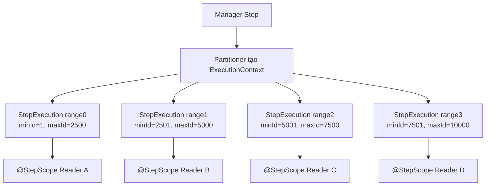

# Vì sao cần Step Scope khi partition trong Spring Batch?

## 1. Bối cảnh: nhiều partition cùng chạy một định nghĩa Step

Khi một job phải xử lý hàng triệu bản ghi, một cách mở rộng phổ biến là chia dữ liệu thành các **partition** độc lập và cho nhiều worker xử lý đồng thời. Ví dụ, bảng `orders` có 10.000 đơn hàng; thay vì một reader duyệt toàn bộ, ta chia thành bốn khoảng ID:

| Partition | `minId` | `maxId` | Công việc |
|---|---:|---:|---|
| `range0` | 1 | 2.500 | Đọc và xử lý ID từ 1 đến 2.500 |
| `range1` | 2.501 | 5.000 | Đọc và xử lý ID từ 2.501 đến 5.000 |
| `range2` | 5.001 | 7.500 | Đọc và xử lý ID từ 5.001 đến 7.500 |
| `range3` | 7.501 | 10.000 | Đọc và xử lý ID từ 7.501 đến 10.000 |

Các khoảng ở đây chỉ để minh họa. Trong thực tế, khoảng ID cần phản ánh dữ liệu và phải được thiết kế sao cho không trùng lặp, không bỏ sót.

Spring Batch tạo một **`StepExecution` riêng cho mỗi partition**; mỗi execution có `ExecutionContext` của chính nó. Các execution có thể dùng chung **định nghĩa worker Step** trong cấu hình ứng dụng. Đây là hai khái niệm khác nhau:

- **Định nghĩa Step** mô tả cách đọc, xử lý, ghi, cấu hình chunk và transaction.
- **StepExecution của partition** là một lần thực thi cụ thể, mang tên partition, trạng thái, bộ đếm, checkpoint và dữ liệu ngữ cảnh riêng.

Một cấu hình worker Step được tái sử dụng **không có nghĩa** các worker nên chia sẻ cùng một instance reader có trạng thái. Chẳng hạn, nếu cả bốn partition dùng một `JdbcCursorItemReader` duy nhất, chúng có nguy cơ dùng chung con trỏ hoặc trạng thái đọc. Mỗi partition cũng cần gắn đúng `minId` và `maxId` của mình tại thời điểm thực thi.

Đó chính là lý do `@StepScope` xuất hiện trong bài toán partitioning.

## 2. Step Scope giải quyết điều gì?

`@StepScope` của Spring Batch tạo ra bean theo **phạm vi một `StepExecution`**. Spring cung cấp một scoped proxy cho nơi sử dụng bean; đối tượng đích thực sự được tạo khi execution tương ứng đang hoạt động.

Đối với partitioning, cơ chế đó mang lại hai lợi ích thiết yếu:

1. **Late binding:** bean lấy cấu hình từ `stepExecutionContext` của partition hiện tại, ví dụ `minId`, `maxId` hoặc đường dẫn input, thay vì cố xác định các giá trị ấy khi ứng dụng khởi động.
2. **Cô lập trạng thái:** mỗi `StepExecution` có instance bean step-scoped riêng. Reader có cursor, bộ đếm, tài nguyên hoặc trạng thái checkpoint của partition A không bị dùng chung với partition B thông qua cùng một bean đích.

Sơ đồ sau thể hiện mối quan hệ:



Bên trong manager, một `Partitioner` thiết lập các đầu vào khác nhau cho từng partition. Khi một worker thực thi, scoped proxy tìm đúng đối tượng của `StepExecution` hiện tại. Vì vậy một phương thức khai báo bean có thể được cấu hình một lần nhưng sinh ra nhiều reader độc lập theo từng partition.

**Phân biệt quan trọng:** `@StepScope` chỉ bảo đảm phạm vi bean theo `StepExecution`; nó **không tự động biến mọi thành phần thành thread-safe**, cũng không bảo đảm transaction, retry, restart hoặc ghi dữ liệu không trùng lặp. Những thuộc tính này cần được thiết kế và kiểm thử riêng.

## 3. Các scope và context dễ nhầm lẫn

| Khái niệm | Phạm vi | Cách dùng khi partition |
|---|---|---|
| Singleton Spring bean (mặc định) | Một instance trong application context | Phù hợp cho thành phần **stateless** hoặc an toàn khi dùng chung; không phù hợp với reader giữ cursor rồi bị các partition chia sẻ |
| `@StepScope` | Một đối tượng đích theo `StepExecution` | Phù hợp nhất cho reader, tasklet, processor hoặc writer cần tham số hay trạng thái riêng của partition |
| `@JobScope` | Một đối tượng theo `JobExecution` | Có thể đọc giá trị cấp job, nhưng **không cô lập từng partition**; cũng cần thận trọng với cấu hình job-scoped bean trong xử lý đa luồng |
| `jobParameters` | Bộ tham số đầu vào của `JobExecution` | Các partition thường nhìn thấy cùng một giá trị, ví dụ ngày nghiệp vụ |
| `jobExecutionContext` | Ngữ cảnh chung của một `JobExecution` | Dùng cho dữ liệu cấp job, không dùng thay nơi chứa tham số riêng từng partition |
| `stepExecutionContext` | Ngữ cảnh của **một** `StepExecution` | Chứa các khóa `minId`/`maxId`, tên file hoặc shard tương ứng partition |

Ví dụ cú pháp SpEL khi khai báo một bean `@StepScope`:

```java
@Value("#{stepExecutionContext['minId']}") Long minId
@Value("#{stepExecutionContext['maxId']}") Long maxId
@Value("#{jobParameters['businessDate']}") String businessDate
@Value("#{jobExecutionContext['tenant']}") String tenant
```

`businessDate` và `tenant` có thể giống nhau giữa các partition; `minId` và `maxId` được lấy từ `StepExecution` hiện tại nên có thể khác nhau.

Một lỗi phổ biến là dùng `@JobScope` cho reader của nhiều partition vì nghĩ rằng mỗi worker là một job khác nhau. Trên thực tế, chúng là nhiều `StepExecution` thuộc cùng một `JobExecution`. Do đó `@JobScope` không thay thế được `@StepScope`.

## 4. Ví dụ hoàn chỉnh: partition theo dải ID

Ví dụ dưới đây minh họa **local partitioning**, sử dụng API Spring Batch 5.x và Java 17. Một manager chia khoảng ID; bốn worker có thể chạy trên các thread khác nhau. Mỗi reader dùng cursor JDBC riêng, giới hạn bởi `minId` và `maxId` mà partition nhận được.

Giả sử bảng dữ liệu có dạng:

```sql
CREATE TABLE orders (
    id        BIGINT PRIMARY KEY,
    processed BOOLEAN NOT NULL DEFAULT FALSE
);
```

Trong ví dụ, ta cập nhật cờ `processed` theo ID. Đây là một hiệu ứng ghi **lặp lại an toàn**: cập nhật một ID thành `true` nhiều lần vẫn cho cùng trạng thái cuối. Cách ghi này phù hợp cho việc trình bày restart và retry; các nghiệp vụ phát tiền, gửi email hay gọi API phải có cơ chế chống trùng bổ sung.

### 4.1. Partitioner tạo dữ liệu cho mỗi StepExecution

```java
import java.util.LinkedHashMap;
import java.util.Map;

import org.springframework.batch.core.partition.support.Partitioner;
import org.springframework.batch.item.ExecutionContext;
import org.springframework.context.annotation.Bean;
import org.springframework.context.annotation.Configuration;

@Configuration
class OrderPartitionConfiguration {

    record Order(long id) {}

    @Bean
    Partitioner orderPartitioner() {
        return gridSize -> {
            // Cố định để dễ hiểu. Production cần xác định dải ID
            // từ một tập dữ liệu ổn định cho lần chạy/restart.
            long firstId = 1L;
            long lastId = 10_000L;

            int partitionsRequested = Math.max(gridSize, 1);
            long total = lastId - firstId + 1;
            long size = (total + partitionsRequested - 1)
                    / partitionsRequested;

            Map<String, ExecutionContext> result = new LinkedHashMap<>();
            int partitionNumber = 0;

            for (long from = firstId; from <= lastId; from += size) {
                long to = Math.min(from + size - 1, lastId);

                ExecutionContext context = new ExecutionContext();
                context.putLong("minId", from);
                context.putLong("maxId", to);

                result.put("range" + partitionNumber++, context);
            }
            return result;
        };
    }
}
```

Mỗi entry của `Map<String, ExecutionContext>` cung cấp **tên partition** và **ngữ cảnh riêng**. Với `gridSize = 4`, ví dụ sinh bốn khoảng như bảng đầu bài. Ở đây `gridSize` là gợi ý về số partition do manager yêu cầu; số partition thực tế còn phụ thuộc logic `Partitioner`.

Điểm cần lưu ý về phạm vi:

- `Partitioner` có thể là singleton nếu không giữ trạng thái thay đổi giữa các lần gọi.
- Không cất `minId`/`maxId` vào field mutable của `Partitioner` hoặc bean singleton để worker đọc chung.
- Chỉ để giá trị nhỏ, có thể tuần tự hóa và cần thiết trong `ExecutionContext`; không đặt connection, cursor, stream hoặc object lớn vào đó.

### 4.2. Reader lấy đúng khoảng ID bằng @StepScope

Thêm hai bean sau vào **cùng class cấu hình** ở trên:

```java
import javax.sql.DataSource;

import org.springframework.batch.core.configuration.annotation.StepScope;
import org.springframework.batch.item.database.JdbcCursorItemReader;
import org.springframework.batch.item.database.builder.JdbcCursorItemReaderBuilder;
import org.springframework.beans.factory.annotation.Value;
import org.springframework.context.annotation.Bean;

// Đặt trong OrderPartitionConfiguration
@Bean
@StepScope
JdbcCursorItemReader<Order> orderReader(
        DataSource dataSource,
        @Value("#{stepExecutionContext['minId']}") Long minId,
        @Value("#{stepExecutionContext['maxId']}") Long maxId) {

    return new JdbcCursorItemReaderBuilder<Order>()
            .name("orderReader")
            .dataSource(dataSource)
            .sql("""
                 SELECT id
                   FROM orders
                  WHERE id BETWEEN ? AND ?
                  ORDER BY id
                 """)
            .preparedStatementSetter(ps -> {
                ps.setLong(1, minId);
                ps.setLong(2, maxId);
            })
            .rowMapper((rs, rowNum) -> new Order(rs.getLong("id")))
            .saveState(true)
            .build();
}
```

Khi ứng dụng dựng định nghĩa worker Step, Spring có thể inject **proxy** của `orderReader` mà chưa khởi tạo cursor thực sự. Khi partition `range2` chạy, nó cung cấp `minId = 5001` và `maxId = 7500`; chỉ lúc đó reader đích của partition này mới được tạo với hai tham số phù hợp.

Trả về kiểu cụ thể `JdbcCursorItemReader<Order>` trong phương thức `@Bean` giúp Spring Batch nhìn thấy các giao diện cần thiết của reader, bao gồm vòng đời `ItemStream` để mở, cập nhật checkpoint và đóng tài nguyên. Reader có trạng thái nên cần một instance đích riêng cho mỗi `StepExecution`.

Nếu bỏ `@StepScope` mà vẫn inject `stepExecutionContext` tại lúc tạo singleton, ứng dụng thường không có step context đang hoạt động để giải quyết biểu thức, hoặc reader bị thiết kế theo kiểu dùng chung dữ liệu sai partition.

### 4.3. Writer và worker Step

Writer ví dụ là stateless, cập nhật trạng thái theo khóa chính. Ta có thể dùng singleton writer nếu toàn bộ cơ chế của nó an toàn để tái sử dụng giữa các worker; driver, nguồn kết nối và transaction manager phải được cấu hình đúng.

```java
import javax.sql.DataSource;

import org.springframework.batch.core.Step;
import org.springframework.batch.core.repository.JobRepository;
import org.springframework.batch.core.step.builder.StepBuilder;
import org.springframework.batch.item.database.JdbcBatchItemWriter;
import org.springframework.batch.item.database.JdbcCursorItemReader;
import org.springframework.batch.item.database.builder.JdbcBatchItemWriterBuilder;
import org.springframework.context.annotation.Bean;
import org.springframework.transaction.PlatformTransactionManager;

// Đặt trong OrderPartitionConfiguration
@Bean
JdbcBatchItemWriter<Order> orderWriter(DataSource dataSource) {
    return new JdbcBatchItemWriterBuilder<Order>()
            .dataSource(dataSource)
            .sql("UPDATE orders SET processed = true WHERE id = ?")
            .itemPreparedStatementSetter(
                    (order, ps) -> ps.setLong(1, order.id()))
            .assertUpdates(true)
            .build();
}

@Bean
Step workerStep(
        JobRepository jobRepository,
        PlatformTransactionManager transactionManager,
        JdbcCursorItemReader<Order> orderReader,
        JdbcBatchItemWriter<Order> orderWriter) {

    return new StepBuilder("workerStep", jobRepository)
            .<Order, Order>chunk(100, transactionManager)
            .reader(orderReader)
            .writer(orderWriter)
            .build();
}
```

Phương thức `workerStep` nhận proxy của reader. Worker step có thể được sử dụng bởi nhiều `StepExecution`, nhưng khi mỗi partition cần đọc, proxy định tuyến tới reader đích thuộc step context của chính partition đó.

Chú ý: `saveState(true)` cho phép reader ghi trạng thái vào `ExecutionContext` ở các checkpoint. Để restart có nghĩa, truy vấn đầu vào phải có thứ tự ổn định và không bị thay đổi theo cách làm dịch chuyển vị trí cursor. Trong ví dụ, truy vấn đọc **theo dải ID, không lọc `processed = false`**; nếu lọc theo cờ vừa được writer thay đổi, kết hợp với checkpoint theo số lượng đã đọc có thể khiến lần restart bỏ qua bản ghi.

### 4.4. Manager Step phân phối các partition

```java
import org.springframework.batch.core.Step;
import org.springframework.batch.core.partition.support.Partitioner;
import org.springframework.batch.core.repository.JobRepository;
import org.springframework.batch.core.step.builder.StepBuilder;
import org.springframework.context.annotation.Bean;
import org.springframework.core.task.TaskExecutor;
import org.springframework.scheduling.concurrent.ThreadPoolTaskExecutor;

// Đặt trong OrderPartitionConfiguration
@Bean
TaskExecutor partitionExecutor() {
    ThreadPoolTaskExecutor executor = new ThreadPoolTaskExecutor();
    executor.setCorePoolSize(4);
    executor.setMaxPoolSize(4);
    executor.setQueueCapacity(8);
    executor.setThreadNamePrefix("orders-partition-");
    executor.initialize();
    return executor;
}

@Bean
Step managerStep(
        JobRepository jobRepository,
        Partitioner orderPartitioner,
        Step workerStep,
        TaskExecutor partitionExecutor) {

    return new StepBuilder("managerStep", jobRepository)
            .partitioner("workerStep", orderPartitioner)
            .step(workerStep)
            .gridSize(4)
            .taskExecutor(partitionExecutor)
            .build();
}
```

Sau đó một `Job` thông thường sẽ chạy `managerStep`. Các snippet được tách theo trách nhiệm để dễ đọc; khi ghép vào một ứng dụng phải để các phương thức `@Bean` trong class cấu hình, bổ sung import tương ứng và cấu hình `DataSource`, `JobRepository`, `PlatformTransactionManager`, bảng metadata Spring Batch.

Trong ứng dụng Spring Boot, nên sử dụng cơ chế tự cấu hình Spring Batch phù hợp với phiên bản đang dùng. Không cần thêm `@EnableBatchProcessing` chỉ để sử dụng `@StepScope` trong cấu hình Boot đã tự đăng ký các scope.

**Điểm mấu chốt của ví dụ:** bốn partition cùng tham chiếu định nghĩa `workerStep`, trong khi `@StepScope` bảo đảm mỗi partition có một `JdbcCursorItemReader` độc lập và mỗi reader nhận đúng khoảng ID.

## 5. Những gì xảy ra theo vòng đời thực thi

Luồng thực thi được hiểu theo thứ tự sau:

1. **Khởi tạo ứng dụng:** Spring đăng ký định nghĩa manager Step, worker Step và scoped proxy cho reader. Chưa có `minId`/`maxId` của partition cụ thể.
2. **Job bắt đầu:** manager gọi `Partitioner`, nhận các cặp tên partition và `ExecutionContext`, rồi tạo/chuẩn bị `StepExecution` cho từng partition.
3. **Worker được kích hoạt:** `StepExecution` hiện tại được gắn với môi trường thực thi của worker; Spring Batch cung cấp step context để các scope biểu thức có thể truy cập.
4. **Đối tượng đích được tạo:** lần đầu worker dùng reader proxy, `@StepScope` tạo reader đích của partition đó và resolve `stepExecutionContext['minId']`/`['maxId']`.
5. **Đọc và checkpoint:** mỗi worker xử lý chunk trong transaction của nó; thông tin `ItemStream` và trạng thái `StepExecution` được ghi qua `JobRepository` theo chính sách của step.
6. **Kết thúc:** mỗi partition có trạng thái hoàn thành hoặc thất bại; manager tổng hợp kết quả, và các tài nguyên step-scoped được dọn theo vòng đời step.

Vì đây là các `StepExecution` khác nhau, việc một partition thất bại không có nghĩa mọi partition đã hoàn thành đều phải làm lại khi restart. Tuy nhiên hành vi restart chính xác còn phụ thuộc cấu hình job, partition handler, trạng thái metadata và tính ổn định của dữ liệu được phân vùng.

## 6. @StepScope có đồng nghĩa với thread safety không?

**Không.** Phải phân biệt hai cách tăng song song rất dễ bị nhầm:

| Mô hình | Các thread / worker dùng `StepExecution` nào? | Vai trò của `@StepScope` |
|---|---|---|
| **Partitioned Step** (local hoặc remote) | Mỗi partition có `StepExecution` riêng | Reader step-scoped có instance riêng cho từng partition; phù hợp để cô lập cursor, tài nguyên và tham số phân vùng |
| **Multi-threaded Step** (một Step gắn `TaskExecutor` để xử lý nhiều chunk) | Nhiều thread cùng thực thi **một `StepExecution`** | Các thread vẫn thuộc **cùng một scope step**, nên có thể chia sẻ cùng reader step-scoped; `@StepScope` **không** làm reader trở thành thread-safe |
| **Parallel Steps** qua split flow | Mỗi Step trong flow có `StepExecution` của mình | Bean theo step được cô lập giữa các execution cần state, nhưng vẫn phải kiểm tra các tài nguyên bên ngoài được chia sẻ |

Trong local partitioning, các worker có thể nằm trên các thread khác nhau, nhưng `StepScope` cô lập theo **`StepExecution`**, không phải theo thread một cách tùy ý. Đây là điểm phân biệt giúp lựa chọn đúng kiến trúc.

Các điểm cần đánh giá ngoài scope gồm:

- **Reader/processor/writer:** thành phần có bộ đệm, con trỏ, file handle, bộ tích lũy, bộ đếm hoặc cache mutable nên được tạo riêng nếu trạng thái mang ý nghĩa của một partition. Với writer stateless, dùng chung có thể hợp lý.
- **Tài nguyên ngoài ứng dụng:** hai reader riêng vẫn có thể cạnh tranh cùng bảng, khóa dòng, file output hoặc dịch vụ bên ngoài. Bảo đảm phạm vi dữ liệu không chồng lấn và tránh ghi đồng thời vào cùng một đích không hỗ trợ.
- **Kết nối và transaction:** số worker hiệu dụng phải được cân đối với connection pool, lưu lượng I/O, CPU, khả năng khóa của database và giới hạn dịch vụ đích. Tăng `gridSize` không bảo đảm throughput tăng tương ứng.
- **Side effect:** gọi API thanh toán, gửi email hoặc ghi thông điệp có thể lặp khi retry/restart. Cần khóa idempotency, outbox, unique constraint hoặc thiết kế đầu ra có thể tái chạy.

## 7. Retry, restart và thiết kế partition ổn định

`@StepScope` giúp mỗi partition nhận lại tham số của mình khi thực thi, nhưng để xử lý dữ liệu lớn tin cậy cần đáp ứng thêm các điều kiện sau.

### Ranh giới dữ liệu không chồng lấn

Nếu chia theo ID, hãy dùng các khoảng loại trừ lẫn nhau và bao phủ đầy đủ dữ liệu cần xử lý. Dùng `BETWEEN minId AND maxId` cho mỗi khoảng đóng; khoảng kế tiếp phải bắt đầu ở `maxId + 1`. Với dữ liệu phân bố thưa, khoảng ID bằng nhau có thể tạo workload mất cân bằng; cân nhắc chia theo số lượng bản ghi, hash bucket, ngày hoặc shard phù hợp.

Nếu chia theo file, đưa **tên file riêng** vào từng `ExecutionContext` và dùng reader `@StepScope` lấy tài nguyên từ khóa đó. Không để nhiều partition cùng di chuyển một file pointer.

### Tính ổn định khi restart

`Partitioner` nên sinh tên và phạm vi partition ổn định cho cùng một job instance, hoặc sử dụng cơ chế lưu lại snapshot/phạm vi đầu vào. Việc tùy ý tính lại partition từ `MAX(id)` hay lượng dữ liệu hiện tại có thể tạo vùng mới, tên mới hoặc giao nhau sau một lần chạy lỗi. Một partition đã hoàn thành cần được nhận diện nhất quán bằng metadata `StepExecution`; cấu hình restart phải xem xét cả partition đã chạy và partition đang lỗi.

Checkpoint `ItemStream` dựa trên trạng thái reader. Vì thế, không nên thay đổi tập kết quả hoặc thứ tự duyệt theo tiến độ ghi nếu reader sẽ tiếp tục từ vị trí cũ. Cần xác định rõ logic cập nhật dữ liệu, thứ tự đọc, transaction, isolation và dữ liệu mới phát sinh trong khi job chạy.

### Retry và idempotency

Giả sử writer đã gọi hệ thống bên ngoài nhưng chunk bị rollback trong database. Khi retry, side effect bên ngoài có thể xảy ra lần thứ hai. `@StepScope` không ngăn việc đó. Thiết kế tốt thường dùng một hoặc nhiều cơ chế:

- Unique key cho từng thao tác nghiệp vụ, upsert hoặc ghi theo khóa xác định.
- Idempotency key khi gọi dịch vụ ngoài.
- Transactional outbox để tách việc ghi dữ liệu và phát sự kiện.
- Retry/skip policy rõ ràng cho lỗi tạm thời và lỗi dữ liệu; log partition ID để truy vết.

Không tùy tiện tắt `saveState` chỉ để tránh lỗi restart; cần xác định việc lưu checkpoint có phù hợp loại reader và tính ổn định của nguồn dữ liệu hay không.

## 8. Khi nào cần đánh dấu @StepScope?

| Thành phần | Có nên dùng `@StepScope`? | Lý do |
|---|---|---|
| `FlatFileItemReader` lấy tên file từ `stepExecutionContext` | **Có** | Mỗi partition mở file riêng, giữ vị trí đọc riêng |
| `JdbcCursorItemReader` lấy ranh giới ID từ context | **Có** | Cần late binding và cursor riêng |
| `ItemProcessor` giữ trạng thái theo partition | **Có, hoặc thiết kế lại thành stateless** | Tránh trạng thái mutable bị chia sẻ |
| `ItemWriter` giữ buffer hay tài nguyên output theo partition | **Thường có** | Cần tài nguyên và checkpoint riêng |
| `ItemWriter` stateless, thread-safe, dùng pool kết nối chuẩn | **Không bắt buộc** | Có thể dùng singleton nếu an toàn |
| `Partitioner` tính các khoảng và trả về `Map` | **Thường không** | Chạy tại manager; có thể stateless |
| `Tasklet` nhận tham số riêng của partition từ context | **Có** | Dùng late binding đúng execution |
| Utility thuần hàm hoặc mapper immutable | **Không bắt buộc** | Không có trạng thái phụ thuộc partition |

Một cách thay thế hợp lệ là để thành phần nhận `StepExecution` qua listener hoặc truy cập context trong quá trình thực thi; cách này có thể cần thiết cho một số thuật toán. `@StepScope` thường ngắn gọn và dễ bảo trì hơn khi mục tiêu chính là **truyền tham số cho bean** và cô lập tài nguyên.

## 9. Những lỗi dễ gặp và cách tìm nguyên nhân

| Triệu chứng | Nguyên nhân cần kiểm tra | Cách xử lý |
|---|---|---|
| Không resolve được `stepExecutionContext` lúc khởi động | Bean được tạo như singleton, hoặc scope chưa được đăng ký | Dùng `@StepScope` và cấu hình Batch đúng phiên bản |
| Mọi partition đọc cùng một vùng ID | Đọc nhầm `jobParameters`/field shared; không truyền `minId`/`maxId` riêng | Kiểm tra `ExecutionContext` do `Partitioner` tạo và biểu thức SpEL của reader |
| `Scope 'step' is not active` | Truy cập target scoped bean ngoài lúc có `StepExecution` | Truy cập qua worker step khi job chạy; trong test dùng môi trường step scope phù hợp |
| Dữ liệu bị đọc lặp hoặc cursor hỏng | Reader có state được chia sẻ, partition chồng lấn, hoặc nguồn đọc không ổn định | Cô lập reader bằng `@StepScope`, kiểm tra khoảng dữ liệu và thứ tự truy vấn |
| Restart bỏ sót bản ghi | Dataset/query thay đổi sau checkpoint, partition được tính lại khác trước | Ổn định input và tên partition; đánh giá lại checkpoint, transaction, idempotency |
| Worker bị chờ, throughput không tăng | Quá nhiều partition cho DB pool, khóa bảng, I/O hoặc API đích | Đo read/write/commit time, DB pool, lock wait; giảm concurrency hoặc điều chỉnh chia partition |
| Bean có `@StepScope` vẫn race khi multi-threaded step | Nhiều thread thuộc chung một `StepExecution` | Sử dụng reader thread-safe, đồng bộ phù hợp hoặc cân nhắc partitioning |

Trong quá trình vận hành, nên quan sát `readCount`, `writeCount`, `commitCount`, `rollbackCount`, thời gian mỗi partition và trạng thái lỗi của từng `StepExecution` trong metadata Spring Batch. Gắn tên partition vào log giúp phát hiện partition quá nặng hoặc dữ liệu bị chia không đều.

## 10. Checklist kiểm chứng một thiết kế partition

Trước khi tăng `gridSize` hoặc chuyển sang xử lý phân tán, hãy tự kiểm tra:

1. Mỗi partition có tên ổn định và `ExecutionContext` chứa đúng nguồn dữ liệu/phạm vi độc lập chưa?
2. Reader hoặc writer có trạng thái đã được cô lập theo `StepExecution` chưa? Các singleton còn lại có thực sự an toàn khi chạy song song không?
3. Các giá trị ở `stepExecutionContext` chỉ được resolve **khi step chạy** qua `@StepScope` hoặc cơ chế tương đương chưa?
4. Có bảo đảm input, thứ tự duyệt và checkpoint nhất quán khi restart không?
5. Kết quả ghi và side effect có thể retry hoặc chạy lại mà không tạo lỗi nghiệp vụ không?
6. Số worker đã phù hợp với connection pool, giới hạn I/O, lock contention và tài nguyên thực tế chưa?
7. Đã thử các tình huống chạy đủ partition, cố ý làm lỗi một partition rồi restart, và so sánh kết quả với xử lý tuần tự chưa?

**Ghi nhớ:** Trong partitioning, `StepExecution` mới là đơn vị cô lập dữ liệu và vòng đời. `@StepScope` nối các giá trị của `ExecutionContext` với **instance bean dành riêng cho execution đó**. Nhờ vậy một định nghĩa worker Step có thể xử lý nhiều partition đồng thời mà không bắt các reader có trạng thái chia sẻ cùng cursor hoặc cùng tham số. Để hệ thống mở rộng an toàn, phải kết hợp thêm phân vùng đúng, kiểm soát tài nguyên, checkpoint ổn định, retry/restart và idempotency.
