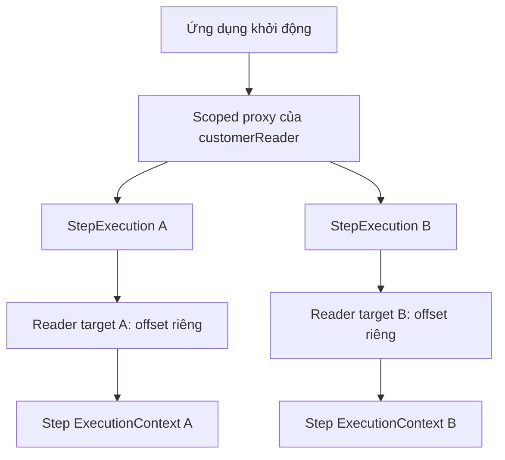
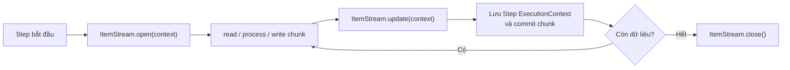
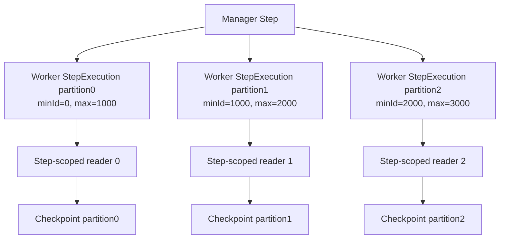

# Bean stateful theo từng StepExecution với Spring Batch Step Scope

Một `ItemReader` thường giữ vị trí đọc hiện tại; `ItemWriter` có thể giữ bộ đệm, tên tệp đầu ra hoặc trạng thái tài nguyên đang mở. Nếu đưa các thành phần này vào Spring singleton và cho nhiều lần chạy Job dùng chung, một lần chạy có thể thay đổi trạng thái của lần chạy khác. **`@StepScope` giúp tạo một đối tượng bean mục tiêu riêng cho mỗi `StepExecution`**, đồng thời hỗ trợ lấy JobParameters, Job ExecutionContext và Step ExecutionContext ngay lúc Step thực sự chạy.

Trong module **SPRING_BATCH_SCALING_OPERATIONS**, cơ chế này rất quan trọng khi một Job xử lý dữ liệu lớn bằng parallel steps và partitioning: các StepExecution cần trạng thái riêng, ranh giới phục hồi rõ ràng và không được vô tình dùng chung con trỏ đọc hoặc đường dẫn xuất dữ liệu. Nhưng cần nhớ ngay từ đầu: **một bean riêng theo StepExecution không có nghĩa là một bean riêng cho mỗi thread**, và **trạng thái trường Java của bean không tự được lưu để restart**.

Bài học đi từ vòng đời của Step Scope đến cấu hình Java, checkpoint, phân vùng, thread safety và cách kiểm tra.

## 1. Mục tiêu học tập

Sau bài này, bạn có thể:

1. Giải thích phạm vi của `@StepScope` và phân biệt nó với singleton, prototype và `@JobScope`.
2. Phân biệt `Step` (cấu hình), `StepExecution` (một lần thực thi) và trạng thái thực thi của bean.
3. Tạo `ItemReader` stateful theo từng StepExecution, lấy tham số chạy bằng `@Value` và Spring Expression Language (SpEL).
4. Giải thích cách proxy của Step Scope và `ItemStream.open/update/close` kết hợp với `ExecutionContext` khi checkpoint và restart.
5. Dùng Step Scope trong partitioning hoặc các Flow song song mà không nhầm lẫn về khả năng thread-safe.
6. Nhận diện lỗi do tên context, phạm vi tài nguyên, chia sẻ bean và vòng đời kiểm thử.

## 2. Vì sao singleton không phù hợp cho nhiều thành phần stateful?

Giả sử `readOrdersStep` cần đọc file CSV và đang giữ offset hiện tại. Nếu trạng thái mutable được khai báo mặc định là singleton:

```java
public static class MutableCursorState {
    private long offset;

    public long nextOffset() {
        return offset++;
    }
}

@Bean
public MutableCursorState sharedCursorState() {
    return new MutableCursorState(); // Singleton theo mặc định.
}
```

Ví dụ trên minh họa một bean giữ cursor nhưng không tách phạm vi; phương thức `nextOffset()` cũng không thread-safe. Khi bean được khai báo singleton, một instance có thể bị nhiều lần thực thi cùng Step cùng truy cập. Điều đó đặc biệt rủi ro nếu nhiều JobExecution, nhiều partition hoặc Flow khác nhau dùng lại reader có trạng thái tương tự.

Các trường hợp không mong muốn:

- **Chạy hai JobExecution đồng thời:** một reader cùng lưu con trỏ, file hiện tại hoặc tài nguyên mở cho cả hai lần chạy.
- **Chạy partition:** mỗi partition cần dải dữ liệu riêng, nhưng một instance nhận cấu hình của partition này rồi bị partition kia dùng chung.
- **Restart:** một StepExecution mới có thể sử dụng bean vẫn mang trạng thái trong bộ nhớ của lần chạy khác; không có gì bảo đảm đối tượng đã reset đúng.
- **Late binding:** đọc tham số Job ở lúc Spring tạo singleton có thể xảy ra trước khi JobExecution/StepExecution tồn tại.

Giải pháp thông thường là khai báo reader hoặc writer stateful bằng `@StepScope`, rồi thiết kế checkpoint thông qua `ItemStream` và Step ExecutionContext.

## 3. Step, StepExecution và Step Scope

Ba khái niệm sau không thể thay thế cho nhau:

| Khái niệm | Vai trò | Ví dụ |
| --- | --- | --- |
| `Step` | Định nghĩa công việc, thường là bean cấu hình được dùng lại | `importOrdersStep` |
| `StepExecution` | Một lần thực thi Step cụ thể trong một `JobExecution`; có trạng thái, counter và context riêng | Lần chạy đầu `importOrdersStep` thất bại, lần restart có StepExecution khác |
| **Step-scoped target bean** | Instance bean được tạo cho phạm vi **một StepExecution đang hoạt động** | Reader xử lý riêng file hoặc range của StepExecution đó |

Với `@StepScope`, Spring đăng ký một **scoped proxy** cho bean. Những Step/Job được cấu hình lúc ứng dụng khởi động có thể giữ tham chiếu đến proxy, còn bean **mục tiêu** được khởi tạo khi Step thực sự chạy và Step Scope đang hoạt động.



**Điều cần hiểu:** proxy là điểm tham chiếu được cấu hình và có thể được dùng lại; khi gọi bean trong Step Scope đang hoạt động, proxy tìm target tương ứng với **StepExecution hiện tại**. Vì thế nhìn qua injection bạn có thể thấy một proxy, nhưng các lần thực thi Step lại làm việc với các target khác nhau.

### 3.1. So sánh các scope

| Scope | Thời điểm/vùng tồn tại của target | Hợp với thành phần nào? | Giới hạn cần nhớ |
| --- | --- | --- | --- |
| Singleton (mặc định) | Một instance trong ApplicationContext | Service không trạng thái, mapper dùng chung an toàn | State mutable có thể bị nhiều execution dùng chung |
| Prototype | Thường tạo mới mỗi lần container được yêu cầu lấy bean | Đối tượng dùng ngắn hạn, được quản lý rõ lifecycle | Không tự có ngữ cảnh Step, không tự thay target theo mỗi StepExecution khi inject một lần vào singleton |
| **`@StepScope`** | Một target trên mỗi StepExecution đang hoạt động | Reader/writer stateful, tasklet cần JobParameters và Step context | Không tự thread-safe; state trong RAM không tự checkpoint |
| `@JobScope` | Một target cho mỗi JobExecution | Trạng thái cấp Job, thành phần được late bind theo Job | Không phù hợp để tùy tiện dùng trong các worker thread mà framework không kiểm soát |

**Scope được xác định theo execution, không theo tên Step.** Cùng tên `importOrdersStep` nhưng ở hai JobExecution khác nhau có hai StepExecution khác nhau, vì vậy các target Step Scope cũng khác nhau. Khi restart đúng JobInstance, Step được thực thi lại thường có StepExecution mới.

### 3.2. Có phải mọi bean trong Step đều cần `@StepScope`?

Không. Một `ItemProcessor` thuần hàm, một `DataSource` được quản lý tốt hoặc service stateless có thể là singleton để tái sử dụng. Chỉ thêm Step Scope khi thực sự cần **trạng thái riêng theo StepExecution** hoặc **late binding** theo tham số/context của Step.

Lạm dụng scope làm tăng độ phức tạp kiểm thử và khó theo dõi vòng đời; việc khai báo `@StepScope` cho một service không có state cũng không tự làm Job chạy nhanh hơn.

## 4. Cấu hình stateful reader theo từng StepExecution

Ví dụ sau minh họa một Job đọc CSV khách hàng và ghi vào bảng staging. `FlatFileItemReader` là thành phần giữ vị trí đọc và tài nguyên file nên được cấu hình `@StepScope`; writer ghi DB theo chunk. Ví dụ sử dụng Spring Batch 5.x, Java 17+ và giả định Spring Batch/transaction/database đã được cấu hình.

File input minh họa:

```csv
id,email
101,alice@example.test
102,bob@example.test
```

Bảng đích minh họa:

```sql
CREATE TABLE customer_staging (
    customer_id BIGINT PRIMARY KEY,
    email VARCHAR(255) NOT NULL
);
```

### 4.1. Java Configuration

```java
import javax.sql.DataSource;

import org.springframework.batch.core.Job;
import org.springframework.batch.core.Step;
import org.springframework.batch.core.configuration.annotation.StepScope;
import org.springframework.batch.core.job.builder.JobBuilder;
import org.springframework.batch.core.repository.JobRepository;
import org.springframework.batch.core.step.builder.StepBuilder;
import org.springframework.batch.item.database.JdbcBatchItemWriter;
import org.springframework.batch.item.database.builder.JdbcBatchItemWriterBuilder;
import org.springframework.batch.item.file.FlatFileItemReader;
import org.springframework.batch.item.file.builder.FlatFileItemReaderBuilder;
import org.springframework.beans.factory.annotation.Qualifier;
import org.springframework.beans.factory.annotation.Value;
import org.springframework.context.annotation.Bean;
import org.springframework.context.annotation.Configuration;
import org.springframework.core.io.FileSystemResource;
import org.springframework.jdbc.core.namedparam.MapSqlParameterSource;
import org.springframework.transaction.PlatformTransactionManager;

@Configuration
public class ScopedCustomerImportConfig {

    public record Customer(long id, String email) {}

    @Bean
    @StepScope
    public FlatFileItemReader<Customer> customerReader(
            @Value("#{jobParameters['inputFile']}") String inputFile) {

        if (inputFile == null || inputFile.isBlank()) {
            throw new IllegalArgumentException(
                    "Cần JobParameter inputFile");
        }

        return new FlatFileItemReaderBuilder<Customer>()
                .name("customerCsvReader")
                .resource(new FileSystemResource(inputFile))
                .linesToSkip(1)
                .delimited()
                .names("id", "email")
                .fieldSetMapper(fields -> new Customer(
                        fields.readLong("id"),
                        fields.readString("email")))
                .build();
    }

    @Bean
    public JdbcBatchItemWriter<Customer> customerWriter(
            DataSource dataSource) {
        return new JdbcBatchItemWriterBuilder<Customer>()
                .dataSource(dataSource)
                .sql("INSERT INTO customer_staging " +
                     "(customer_id, email) VALUES (:id, :email)")
                .itemSqlParameterSourceProvider(customer ->
                        new MapSqlParameterSource()
                                .addValue("id", customer.id())
                                .addValue("email", customer.email()))
                .build();
    }

    @Bean
    public Step importCustomersStep(
            JobRepository jobRepository,
            PlatformTransactionManager transactionManager,
            @Qualifier("customerReader")
            FlatFileItemReader<Customer> reader,
            @Qualifier("customerWriter")
            JdbcBatchItemWriter<Customer> writer) {

        return new StepBuilder("importCustomersStep", jobRepository)
                .<Customer, Customer>chunk(500, transactionManager)
                .reader(reader)
                .writer(writer)
                .build();
    }

    @Bean
    public Job importCustomersJob(
            JobRepository jobRepository,
            @Qualifier("importCustomersStep") Step step) {
        return new JobBuilder("importCustomersJob", jobRepository)
                .start(step)
                .build();
    }
}
```

**Các điểm quan trọng:**

1. `customerReader` được khai báo `@StepScope`; mỗi StepExecution có target reader với cursor riêng.
2. Biểu thức `@Value("#{jobParameters['inputFile']}")` được đánh giá **khi target được khởi tạo trong Step Scope**, nên lấy đúng tham số của lần thực thi tương ứng.
3. Bean `Step` chứa proxy của reader; việc cấu hình Job/Step lúc ứng dụng khởi động không cần mở file.
4. Reader có `.name("customerCsvReader")` để định danh trạng thái của `ItemStream` trong Step ExecutionContext. Tên phải ổn định qua các lần restart và tránh xung đột với stream khác trong cùng Step.
5. `FlatFileItemReader` hỗ trợ checkpoint bằng `ItemStream`; khi Step đăng ký reader đúng cách và `saveState` được bật (mặc định), framework có thể lưu vị trí đọc theo chu kỳ chunk.
6. Writer trong ví dụ chỉ dùng state cấu hình cố định và có thể là singleton nếu đáp ứng hợp đồng thread safety. Nếu writer cần đường dẫn file, buffer hoặc tham số riêng của từng StepExecution thì cân nhắc `@StepScope` cho writer.

**Giới hạn của ví dụ:** bảng `customer_staging` và chính sách chống trùng chưa được thiết kế đầy đủ cho production. Nếu phải xử lý lại bản ghi hoặc ghi ra hệ thống khác transaction của checkpoint, dùng khóa nghiệp vụ duy nhất, upsert/idempotency và đối soát dữ liệu; Step Scope không tự bảo đảm exactly-once.

## 5. Late binding: giá trị chỉ biết khi Step chạy

Spring Batch hỗ trợ đọc ba nguồn dữ liệu thường gặp qua SpEL trong bean step-scoped:

| Biểu thức | Đọc từ đâu? | Ví dụ sử dụng |
| --- | --- | --- |
| `#{jobParameters['businessDate']}` | JobParameters của lần chạy | Ngày nghiệp vụ đầu vào |
| `#{jobExecutionContext['snapshotPath']}` | Context cấp Job | Artifact do Step trước chuẩn bị |
| `#{stepExecutionContext['minId']}` | Context của StepExecution đang chạy | Ranh giới dữ liệu của một partition |

Bạn có thể dùng nhiều tham số trên cùng một bean:

```java
@Bean
@StepScope
public SomeStatefulReader reader(
        @Value("#{jobParameters['businessDate']}") String businessDate,
        @Value("#{stepExecutionContext['partitionId']}")
        String partitionId) {
    return new SomeStatefulReader(businessDate, partitionId);
}
```

`SomeStatefulReader` ở đây là **lớp giả định để minh họa cách inject**, cần được thay bằng reader thật trong dự án. Không nên gọi trực tiếp phương thức `reader(...)` để tự tạo đối tượng ngoài Spring; như vậy có thể bỏ qua proxy và cơ chế Step Scope.

**Nếu một key không tồn tại:** giá trị có thể là `null` và khiến cấu hình hỏng khi sử dụng. Hãy kiểm tra đầu vào và báo lỗi có ngữ cảnh. Đừng để reader âm thầm dùng toàn bộ dữ liệu khi thiếu `minId/maxId` hoặc đường dẫn file vì một partition có thể vô tình đọc lại mọi bản ghi.

### 5.1. Bật Step Scope như thế nào?

Trong ứng dụng Spring Batch đã cấu hình bằng `@EnableBatchProcessing` hoặc cơ chế Spring Boot phù hợp, scope thường được đăng ký theo cấu hình batch. Không tự khai báo nhiều bean `StepScope` trùng nhau nếu framework đã đăng ký. Khi viết ứng dụng Spring thuần, hãy kiểm tra cơ chế bật scope của phiên bản đang dùng trước khi tạo bean step-scoped.

Step Scope là một **scope đặc biệt**, khác với constructor injection của bean singleton thông thường. Nó yêu cầu `StepExecution` đang được framework quản lý khi target được truy cập. Nếu thử lấy target ở lúc khởi động ứng dụng hoặc trong một thread tự tạo không có Step context, bạn có thể gặp lỗi không có scope hoạt động.

### 5.2. Vì sao nên trả về kiểu triển khai của ItemStream?

Khi dùng `@Bean @StepScope` cho reader hoặc writer có `ItemStream`, **chữ ký phương thức bean phải biểu lộ khả năng ItemStream**. Trả về `FlatFileItemReader<Customer>` như ví dụ là an toàn. Trả về giao diện chung `ItemReader<Customer>` có thể làm scoped proxy không lộ giao diện `ItemStream` trong quá trình Spring Batch đăng ký callback `open/update/close`.

Nếu Step không nhận ra reader như ItemStream, vị trí checkpoint có thể không được lưu/khôi phục đúng. Có thể trả về kiểu triển khai hoặc giao diện `ItemStreamReader<T>`; cũng cần bảo đảm các stream phụ được đăng ký với Step.

## 6. Stateful theo StepExecution không đồng nghĩa tự checkpoint

Một bean step-scoped có thể chứa field Java như sau:

```java
@Component
@StepScope
public class SimpleCounter {
    private long seen;

    public void increment() {
        seen++;
    }

    public long value() {
        return seen;
    }
}
```

Biến `seen` là **trạng thái trong RAM của một target Step Scope**. Khi StepExecution kết thúc hoặc JVM mất tiến trình, trạng thái đó không được Spring Batch tự ghi xuống `JobRepository` chỉ vì class có `@StepScope`.

Muốn phục hồi trong một Step chunk-oriented, component cần tuân thủ hợp đồng checkpoint:



Trong thực tế, thứ tự và tần suất callback còn tùy loại Step và transaction manager; sơ đồ biểu diễn trách nhiệm chính, không phải mô tả từng câu lệnh nội bộ của framework.

- `open(ExecutionContext)`: mở tài nguyên/khôi phục vị trí từ checkpoint đã được lưu.
- `update(ExecutionContext)`: ghi **trạng thái cần phục hồi** vào Step context trong các thời điểm cập nhật phù hợp.
- `close()`: giải phóng tài nguyên sau khi xử lý.
- `JobRepository` duy trì metadata để Step có thể tiếp tục từ trạng thái phù hợp khi restart.

**Điểm cốt lõi:** `@StepScope` quyết định **ai sở hữu instance**; `ItemStream` và `ExecutionContext` quyết định **trạng thái nào được lưu và phục hồi**. Hai cơ chế giải quyết hai vấn đề khác nhau.

### 6.1. Tự viết ItemStream thì cần gì?

Một component custom có thể triển khai `ItemStream`, lưu offset hoặc mã trang trong `ExecutionContext`:

```java
import org.springframework.batch.item.ExecutionContext;
import org.springframework.batch.item.ItemStream;

public class PageCheckpoint implements ItemStream {
    private static final String KEY = "pageCheckpoint.nextPage";
    private long nextPage;

    @Override
    public void open(ExecutionContext context) {
        nextPage = context.getLong(KEY, 0L);
    }

    @Override
    public void update(ExecutionContext context) {
        context.putLong(KEY, nextPage);
    }

    @Override
    public void close() {
        // Đóng các tài nguyên nếu component có mở.
    }

    public long nextPage() {
        return nextPage++;
    }
}
```

Đây là **minh họa trách nhiệm checkpoint**, không phải thuật toán đọc trang production. Cần gọi `nextPage()` tại thời điểm phù hợp với transaction, kiểm soát rollback và cập nhật checkpoint sau khi xử lý thành công. Nếu tăng offset trong RAM trước khi writer commit rồi chunk thất bại, offset và dữ liệu đã commit có thể lệch nhau. Với `ItemStream` custom không tự là reader/writer của Step, phải đăng ký nó qua `.stream(pageCheckpoint)` để framework gọi lifecycle methods.

Nếu component đã được Step tự đăng ký như reader/writer có `ItemStream`, thường không cần thêm một lần `.stream(...)`. Tránh đăng ký trùng vì có thể làm callback chạy hai lần.

### 6.2. Restart tạo instance mới nhưng đọc checkpoint cũ

Giả sử:

1. `StepExecution #100` đọc và commit dữ liệu tới checkpoint trang 30.
2. Step tiếp tục đọc trang 31 nhưng thất bại trước khi commit chunk tương ứng.
3. Restart **cùng JobInstance** tạo `StepExecution #101` mới cho Step cần chạy lại.
4. Scoped proxy tìm target mới của `StepExecution #101`; `ItemStream.open(...)` đọc checkpoint bền đã lưu và tiếp tục theo hợp đồng reader.

Target Java mới **không được sao chép field** từ target cũ; giá trị cần phục hồi đến từ Step ExecutionContext. Những ghi ra nguồn ngoài không nằm trong cùng transaction với checkpoint vẫn cần idempotency.

## 7. Áp dụng Step Scope trong partitioning

Partitioning thường có một manager Step phân công nhiều worker `StepExecution`. Mỗi worker sở hữu một vùng dữ liệu được đặt vào Step ExecutionContext của nó, chẳng hạn `minId` và `maxIdExclusive`.



Ví dụ reader truy vấn một vùng ID theo tham số do `Partitioner` cung cấp:

```java
@Bean
@StepScope
public JdbcCursorItemReader<Customer> partitionCustomerReader(
        DataSource dataSource,
        @Value("#{stepExecutionContext['minId']}") Long minId,
        @Value("#{stepExecutionContext['maxIdExclusive']}")
        Long maxIdExclusive) {

    if (minId == null || maxIdExclusive == null
            || minId >= maxIdExclusive) {
        throw new IllegalArgumentException(
                "Khoảng ID của partition không hợp lệ");
    }

    return new JdbcCursorItemReaderBuilder<Customer>()
            .name("partitionCustomerReader")
            .dataSource(dataSource)
            .sql("SELECT customer_id, email FROM customers " +
                 "WHERE customer_id >= ? " +
                 "AND customer_id < ? ORDER BY customer_id")
            .preparedStatementSetter(ps -> {
                ps.setLong(1, minId);
                ps.setLong(2, maxIdExclusive);
            })
            .rowMapper((rs, rowNum) -> new Customer(
                    rs.getLong("customer_id"),
                    rs.getString("email")))
            .build();
}
```

Mã này **nối tiếp** ví dụ `Customer` và Java Configuration ở mục 4; cần bổ sung các import `JdbcCursorItemReader`, `JdbcCursorItemReaderBuilder` tương ứng và định nghĩa `Partitioner`/manager-worker Step trong dự án. Nó tập trung vào đặc điểm mỗi StepExecution được inject dải ID khác nhau.

Để partitioning đúng và tái chạy ổn định:

- Chia dải **không chồng lấn** bằng biên dưới bao gồm và biên trên loại trừ, chẳng hạn `[0, 1000)`, `[1000, 2000)`.
- Đảm bảo mọi bản ghi thuộc **đúng một vùng**, kể cả các khoảng trống ID và dữ liệu biên.
- Các worker có Step ExecutionContext **riêng**, nên checkpoint của worker này không ghi đè checkpoint worker khác chỉ vì cùng tên reader.
- Tập dữ liệu nên ổn định trong suốt lần xử lý hoặc có quy tắc snapshot; thay đổi dữ liệu nguồn giữa các lần restart có thể dẫn đến bỏ sót/lặp.
- Không giả định mỗi partition có cùng thời lượng: hot key và dữ liệu lệch có thể khiến một partition chậm vượt trội.

**Remote partitioning:** Step Scope cũng thuộc ngữ cảnh StepExecution **tại tiến trình worker**. Không coi bean hoặc biến RAM ở manager là trạng thái chia sẻ sang các JVM khác; dùng metadata, message và storage bền theo thiết kế của hệ thống.

## 8. Cảnh báo quan trọng: multi-threaded Step vẫn chia sẻ một target

Một **StepExecution** có thể xử lý chunk trên nhiều thread khi Step được cấu hình chạy đồng thời. Trong tình huống đó, nếu các thread cùng truy cập một reader step-scoped của chính StepExecution ấy, chúng **có thể dùng chung một target bean**.

| Tình huống | Số StepExecution | Số target step-scoped của một bean | Hệ quả |
| --- | ---: | ---: | --- |
| Một Step tuần tự | 1 | 1 | Reader giữ cursor riêng cho Step đó |
| Hai Flow có hai StepExecution độc lập | 2 | 2 | Target tách theo StepExecution |
| Hai partition/worker StepExecution | 2 | 2 | Mỗi partition có reader riêng |
| Một multi-threaded Step dùng 4 thread | **1** | **1** | Các thread có thể tranh nhau state của cùng reader |

Vì vậy, khai báo `@StepScope` cho `FlatFileItemReader` **không biến nó thành thread-safe**. Nếu đưa cùng reader không thread-safe vào multi-threaded Step, có thể gặp cursor sai, đọc trùng/bỏ sót hoặc checkpoint không nhất quán.

Khi cần xử lý song song:

1. Ưu tiên partitioning nếu dữ liệu có thể chia thành các vùng độc lập, để mỗi worker có StepExecution và reader riêng.
2. Nếu chọn multi-threaded Step, kiểm tra các bảo đảm thread safety cụ thể của reader, processor, writer và cách Spring Batch phiên bản đang dùng điều phối chunk.
3. Đồng bộ hóa một reader có thể giúp tránh race trong một số trường hợp, nhưng có thể làm reader thành nút thắt; việc đồng bộ **không tự giải quyết** tính đúng của restart nếu thứ tự xử lý khác thứ tự checkpoint.
4. Không tự tạo các thread gọi bean step-scoped bên ngoài Step context. Framework cần thiết lập và truyền ngữ cảnh thực thi phù hợp; tùy mô hình, thread mới không có context hoặc không được hỗ trợ scope đúng cách.

Một singleton processor stateless có thể dùng an toàn hơn một reader giữ cursor. **Scope** và **thread safety** là hai đặc tính độc lập.

## 9. Khi dùng parallel steps và Flow

Với split flow, Spring Batch điều phối các **Flow độc lập**. Nếu mỗi Flow chứa Step của mình, các StepExecution tách biệt có target step-scoped riêng; không phải vì Flow chạy song song mà toàn bộ target Step Scope được chia sẻ.

Nhưng vẫn còn tài nguyên chung ngoài scope:

- Hai reader khác target nhưng truy vấn **cùng bản ghi DB** có thể gặp lock hoặc đọc không ổn định.
- Hai writer khác target nhưng xuất **cùng đường dẫn file** có thể ghi đè kết quả.
- Hai service singleton được reader gọi chung có thể chứa state mutable không thread-safe.
- Các Flow có thể cùng sửa **Job ExecutionContext**; đọc–sửa–ghi lên cùng key không phải phép cộng nguyên tử.
- Connection pool, bộ nhớ, file handle, CPU và quota API vẫn là giới hạn chung.

Ví dụ, hai StepExecution có hai target `reportWriter` step-scoped nhưng cùng inject `outputPath=/tmp/report.csv` thì **vẫn ghi chung một file**. Cần đặt đường dẫn riêng theo partition/run hoặc hợp nhất dữ liệu ở Step sau điểm join.

## 10. Kiểm thử bean stateful theo StepExecution

Kiểm thử scope không chỉ là khởi tạo context Spring. Cần chạy trong một `StepExecution` giả lập hoặc thực tế để xác nhận bean lấy được tham số và lưu checkpoint.

### 10.1. Kiểm thử late binding

Spring Batch Test cung cấp tiện ích như `@SpringBatchTest`, `StepScopeTestExecutionListener` và `MetaDataInstanceFactory` để hỗ trợ kiểm thử các bean cần Step Scope. Một kịch bản kiểm thử:

1. Tạo `StepExecution A` với JobParameters `inputFile=A.csv`.
2. Kích hoạt Step Scope theo cơ chế kiểm thử; lấy target `customerReader` và xác nhận đọc A.
3. Tạo `StepExecution B` với `inputFile=B.csv`; xác nhận target nhận giá trị B, không giữ cursor hoặc tham số của A.
4. Trong từng StepExecution, gọi các lifecycle methods qua Step hoặc test fixture đúng cách; tránh tự gọi target ở ngoài scope đang hoạt động.

### 10.2. Kiểm thử checkpoint và restart

- Chuẩn bị 1.000 dòng, chunk size 100, cố ý gây lỗi sau khi một số chunk đã commit.
- Xác nhận các StepExecution metadata và Step ExecutionContext có checkpoint hợp lệ.
- Restart **cùng JobInstance**; StepExecution mới phải dùng target reader mới và khôi phục trạng thái đã lưu.
- Kiểm tra tổng bản ghi đích và khóa nghiệp vụ, không chỉ số `readCount`.
- Với partitioning, gây lỗi chỉ một worker rồi xác minh đúng chính sách restart của các worker đã `COMPLETED`.

Để quan sát vòng đời của target trong môi trường thử, có thể ghi log tạo/đóng reader cùng `stepExecutionId` tại nơi có context thực thi. **Không** coi `System.identityHashCode(...)` là định danh nghiệp vụ hoặc kết luận duy nhất về object vì mã hash có thể trùng; dùng nó nhiều nhất như tín hiệu debug bổ sung.

### 10.3. Tải lớn và tài nguyên

Khi có 100 partition, Step Scope có thể tạo nhiều target reader/writer đồng thời. Hãy đo số kết nối mở, handle file, heap, thời gian `ItemStream.open/close` và tốc độ commit. Scope đúng giúp tách trạng thái, nhưng **không tự giới hạn** số worker hoặc resource mà chúng tiêu thụ.

Một phép thử đạt yêu cầu phải đồng thời: xử lý đúng dữ liệu, đáp ứng SLA, restart đúng và không vượt giới hạn của DB/heap/API khi nhiều worker chạy.

## 11. Các lỗi thường gặp và cách sửa

| Dấu hiệu | Nguyên nhân có thể | Hướng kiểm tra/sửa |
| --- | --- | --- |
| `jobParameters['inputFile']` thành `null` lúc startup | Bean được tạo sớm hoặc thiếu Step Scope | Kiểm tra `@StepScope`, cấu hình scope và tham số Job |
| Lỗi không có Step Scope đang hoạt động | Target được truy cập ngoài StepExecution | Để Spring Batch gọi trong Step, dùng Batch Test fixture khi kiểm thử |
| Partition cùng đọc toàn bộ bảng | Không nhận `minId/maxIdExclusive` đúng từng StepExecution | Kiểm tra Partitioner, Step context và tham số query |
| Restart đọc lại từ đầu | Reader không triển khai/không đăng ký `ItemStream`, sai name hoặc `saveState=false` | Kiểm tra kiểu trả về proxy, callback `open/update`, trạng thái repository |
| Restart tạo output trùng | Tác dụng phụ không idempotent hoặc nguồn/đích không nằm trong cùng transaction | Thiết kế khóa nghiệp vụ, upsert, staging và reconciliation |
| Dùng `@StepScope` nhưng multi-threaded Step vẫn lỗi | Cùng StepExecution chia sẻ target giữa nhiều thread | Xem lại thread safety và lựa chọn partitioning |
| Hai Flow xuất trùng file | Scope tách instance nhưng không tách tài nguyên | Đặt path theo run/partition, hợp nhất sau join |
| Lỗi khi nâng phiên bản reader | Serialized context thay đổi hoặc key checkpoint đổi | Đặt tên stream ổn định, kiểm tra tương thích trước deploy |
| Bean custom có state nhưng restart mất số đếm | Chỉ lưu field Java, không có checkpoint | Sử dụng `ItemStream`/Step ExecutionContext đúng transaction |

## 12. Bài thực hành

Hãy tạo Job nhập CSV khách hàng dựa trên ví dụ ở mục 4. Mục tiêu là nhìn thấy **cách Step Scope tách state**, không chỉ nhận một kết quả chạy thành công.

**Phần A — Một StepExecution:**

1. Chuẩn bị hai file `customers-A.csv` và `customers-B.csv` có nội dung khác nhau.
2. Chạy Job lần đầu với `inputFile=A.csv`; ghi lại JobExecution ID, StepExecution ID, số đọc/ghi và kết quả.
3. Chạy một JobInstance khác với `inputFile=B.csv`; xác nhận reader dùng B chứ không giữ cursor hoặc file A.
4. Quan sát bean proxy và target trong các lần chạy (qua log thực thi ở trong Step), giải thích tại sao proxy vẫn được inject vào cùng định nghĩa Step.

**Phần B — Restart:**

1. Cho reader đọc 1.000 dòng theo chunk size 100; tạo lỗi có chủ đích sau một số chunk thành công.
2. Khởi chạy lại **cùng JobInstance** và kiểm tra checkpoint được khôi phục cho StepExecution mới.
3. Đối soát bảng đích theo khóa nghiệp vụ. Nếu gặp trùng, xác định transaction và chiến lược idempotency cần bổ sung.

**Phần C — Partitioning:**

1. Định nghĩa ba partition `[0,1000)`, `[1000,2000)`, `[2000,3000)`.
2. Cấp `minId`, `maxIdExclusive` qua Step ExecutionContext, dùng reader ở mục 7.
3. Xác nhận mỗi partition có StepExecution/context riêng, tổng đầu ra đúng, không trùng ranh giới.
4. Thử tăng worker rồi đo thời gian và connection pool. Đánh giá hiệu năng cùng với tính đúng và restart.

### Câu hỏi tự kiểm tra

1. Vì sao hai JobExecution cùng dùng một bean `Step` vẫn có thể dùng hai target `@StepScope` khác nhau?
2. Nếu một multi-threaded Step chạy 8 thread, `@StepScope` có tạo 8 target reader không?
3. Vì sao field `private long offset` trong bean stateful không đủ để restart?
4. Khi nào nên dùng `#{stepExecutionContext['minId']}` thay vì `#{jobParameters['minId']}`?
5. Điều gì có thể xảy ra nếu phương thức `@Bean @StepScope` trả về `ItemReader<T>` nhưng bean thực tế có `ItemStream`?
6. Nếu hai target writer khác nhau cùng ghi file `result.csv`, Step Scope có tự chống tranh chấp không?
7. Partition worker thất bại sau khi ghi dữ liệu ngoài DB: ngoài Step Scope, bạn cần điều kiện gì để chạy lại an toàn?

## Tài liệu tham khảo

- [Spring Batch Reference — Late Binding of Job and Step Attributes](https://docs.spring.io/spring-batch/reference/step/late-binding.html).
- [Spring Batch Reference — ItemStream](https://docs.spring.io/spring-batch/reference/readers-and-writers/item-stream.html).
- [Spring Batch Reference — Scaling and Parallel Processing](https://docs.spring.io/spring-batch/reference/scalability.html).
- [Spring Batch Reference — Configuring a Step for Restart](https://docs.spring.io/spring-batch/reference/step/chunk-oriented-processing/restart.html).
- [Spring Batch Reference — Testing](https://docs.spring.io/spring-batch/reference/testing.html).
