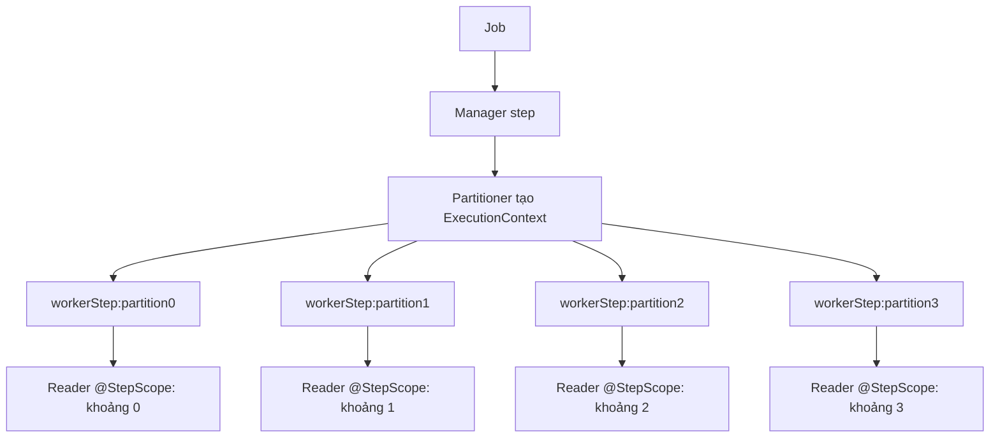

# `@StepScope` cho reader trong partition của Spring Batch

## Mục tiêu học tập

Sau bài này, bạn có thể:

- Giải thích vì sao mỗi partition cần reader có trạng thái độc lập và `@StepScope` giúp giải quyết vấn đề đó.
- Truyền ranh giới dữ liệu của từng partition từ `StepExecutionContext` vào reader bằng cơ chế **late binding**.
- Cấu hình một job có manager step, worker step, `Partitioner` và nhiều reader chạy song song trên một JVM.
- Phân biệt cô lập theo `StepExecution` với thread safety; nhận biết các rủi ro về restart, dữ liệu thay đổi, kết nối cơ sở dữ liệu và ghi trùng.
- Chẩn đoán các lỗi thường gặp khi đưa `@StepScope` vào luồng partitioning.

## 1. Bài toán: một worker step, nhiều miền dữ liệu

Với workload lớn, Spring Batch có thể chia tập bản ghi thành nhiều **partition**. Mỗi partition là một lần thực thi riêng của cùng một **worker step**, có `StepExecution` và `ExecutionContext` của chính nó. Một **manager step** tạo hoặc điều phối các partition; các worker có thể chạy song song tùy `PartitionHandler` và tài nguyên triển khai.

Ví dụ bảng `source_order` có các ID từ `1` đến `1_000_000`. Ta chia thành bốn khoảng không giao nhau; giới hạn trên được quy ước là **exclusive**:

| Partition | `startId` (bao gồm) | `endId` (không bao gồm) | Điều kiện SQL |
| --- | ---: | ---: | --- |
| `partition0` | 1 | 250001 | `id >= 1 AND id < 250001` |
| `partition1` | 250001 | 500001 | `id >= 250001 AND id < 500001` |
| `partition2` | 500001 | 750001 | `id >= 500001 AND id < 750001` |
| `partition3` | 750001 | 1000001 | `id >= 750001 AND id < 1000001` |

Mỗi worker phải đọc **đúng khoảng ID được giao**, không đọc toàn bộ bảng rồi lọc ở processor. Đồng thời, các reader kiểu cursor/paging có trạng thái như vị trí hiện tại, số bản ghi đã đọc và trạng thái phục hồi; dùng chung một instance reader có thể dẫn tới ghi đè trạng thái hoặc đọc sai dữ liệu khi chạy đồng thời.



Trong module mở rộng Spring Batch, partitioning là một lựa chọn quan trọng khi một bước đọc/ghi dữ liệu có thể chia thành các phần độc lập. `@StepScope` là cơ chế bảo đảm mỗi lần chạy worker step nhận được cấu hình reader phù hợp với partition đó.

## 2. `@StepScope` thực sự tạo phạm vi nào?

`@StepScope` là scope của Spring Batch gắn với một **`StepExecution`**. Khi khai báo bean reader bằng `@StepScope`:

1. Spring đưa một **scoped proxy** vào cấu hình singleton của `Step`; chưa cần tạo reader thật khi ứng dụng khởi động.
2. Khi worker step thực thi, Spring Batch kích hoạt ngữ cảnh của `StepExecution` hiện tại.
3. Lần sử dụng reader đầu tiên trong ngữ cảnh đó sẽ khởi tạo reader thật và đánh giá các biểu thức `@Value`.
4. Một partition khác có `StepExecution` khác sẽ nhận **instance reader riêng**, với thông số và trạng thái riêng.

Điểm mấu chốt là **một reader trên mỗi `StepExecution`**, không phải một reader trên mỗi bản ghi, mỗi chunk hay tự động một reader trên mỗi thread. Trong mô hình partitioning thông thường, mỗi partition tương ứng một `StepExecution`, nên sự cô lập này phù hợp với bài toán.

| Cách khai báo | Dữ liệu partition có sẵn khi tạo bean? | Hệ quả với reader có trạng thái |
| --- | --- | --- |
| Singleton `@Bean` thông thường | Không có `StepExecutionContext` tại thời điểm tạo bean | Dễ chia sẻ trạng thái giữa các partition nếu giữ một reader thật |
| `@Bean` + `@StepScope` | Có, khi worker đang chạy | Tạo reader và gắn thông số riêng theo `StepExecution` |
| `@JobScope` | Có ngữ cảnh job, nhưng không mang ranh giới riêng của mỗi partition | Không phù hợp để tạo reader khác nhau theo `StepExecutionContext` |

`@StepScope` giải quyết vòng đời và late binding. Nó **không** tự làm một đối tượng dùng chung trở nên thread-safe. Nếu bên trong reader vẫn tham chiếu đến bộ đếm `static`, cache mutable dùng chung hoặc một delegate singleton không an toàn, trạng thái vẫn có thể xung đột.

## 3. Dữ liệu đi từ `Partitioner` tới reader như thế nào?

`Partitioner.partition(gridSize)` trả về `Map<String, ExecutionContext>`: key là tên partition, value là dữ liệu phục vụ worker. Ví dụ:

```java
ExecutionContext context = new ExecutionContext();
context.putLong("startId", 250001L);
context.putLong("endId", 500001L);
partitions.put("partition1", context);
```

Spring Batch gắn `ExecutionContext` này vào `StepExecution` của worker tương ứng. Bean reader nhận lại bằng Spring Expression Language (SpEL):

```java
@Bean
@StepScope
JdbcCursorItemReader<OrderRow> partitionReader(
        DataSource dataSource,
        @Value("#{stepExecutionContext['startId']}") Long startId,
        @Value("#{stepExecutionContext['endId']}") Long endId) {
    // Bean được tạo khi worker StepExecution đang hoạt động.
    // startId/endId thuộc partition hiện tại.
    // ...
}
```

Ba nguồn giá trị dễ nhầm lẫn:

- `stepExecutionContext['startId']`: dữ liệu riêng của từng worker partition; đây là nguồn phù hợp cho ranh giới đọc.
- `jobParameters['businessDate']`: tham số của job, dùng chung cho tất cả partition của cùng job execution.
- `jobExecutionContext['snapshotId']`: dữ liệu thuộc job execution; có thể dùng cho mốc dữ liệu chung, nhưng không thay thế context riêng của từng partition.

Vì biểu thức được đánh giá khi reader thật được tạo, việc inject các giá trị này vào singleton lúc khởi động thường dẫn tới thiếu ngữ cảnh hoặc giá trị không đúng. Các bean theo step scope cũng không nên được gọi thủ công bằng `@Bean` method hay truy cập trực tiếp từ luồng không có `StepExecution` đang hoạt động.

## 4. Ví dụ: partition theo khoảng ID, mỗi reader giữ cursor riêng

Ví dụ dưới đây dùng Spring Batch với API builder nhận `JobRepository` và transaction manager (kiểu cấu hình phổ biến ở Spring Batch 5.x), Spring Framework, JDBC và PostgreSQL. Giả sử đã cấu hình `DataSource`, `JdbcTemplate`, `JobRepository`, `PlatformTransactionManager` cùng bảng `source_order(id BIGINT PRIMARY KEY, payload TEXT)` và `target_order(id BIGINT PRIMARY KEY, payload TEXT)`.

> Đây là ví dụ học tập trên một JVM: `TaskExecutor` chạy các partition song song. Phần chia khoảng truy vấn `MIN/MAX(id)` trực tiếp từ bảng để dễ hiểu. Khi vận hành thật, cần cố định tập đầu vào và ranh giới partition cho toàn bộ lần chạy và các lần restart; xem mục 6.

```java
import java.util.LinkedHashMap;
import java.util.Map;
import javax.sql.DataSource;

import org.springframework.batch.core.Job;
import org.springframework.batch.core.Step;
import org.springframework.batch.core.configuration.annotation.StepScope;
import org.springframework.batch.core.job.builder.JobBuilder;
import org.springframework.batch.core.partition.support.Partitioner;
import org.springframework.batch.core.repository.JobRepository;
import org.springframework.batch.core.step.builder.StepBuilder;
import org.springframework.batch.item.ExecutionContext;
import org.springframework.batch.item.ItemWriter;
import org.springframework.batch.item.database.JdbcCursorItemReader;
import org.springframework.batch.item.database.builder.JdbcCursorItemReaderBuilder;
import org.springframework.beans.factory.annotation.Qualifier;
import org.springframework.beans.factory.annotation.Value;
import org.springframework.context.annotation.Bean;
import org.springframework.context.annotation.Configuration;
import org.springframework.core.task.TaskExecutor;
import org.springframework.jdbc.core.JdbcTemplate;
import org.springframework.scheduling.concurrent.ThreadPoolTaskExecutor;
import org.springframework.transaction.PlatformTransactionManager;

record OrderRow(long id, String payload) {}

@Configuration
class PartitionedOrderJobConfig {

    @Bean
    Job orderImportJob(JobRepository repository,
                       @Qualifier("orderManagerStep") Step managerStep) {
        return new JobBuilder("orderImportJob", repository)
                .start(managerStep)
                .build();
    }

    @Bean
    Step orderManagerStep(JobRepository repository,
                          @Qualifier("orderWorkerStep") Step workerStep,
                          @Qualifier("orderPartitioner") Partitioner partitioner,
                          @Qualifier("partitionExecutor") TaskExecutor executor) {
        return new StepBuilder("orderManagerStep", repository)
                .partitioner("orderWorkerStep", partitioner)
                .step(workerStep)
                .gridSize(4)
                .taskExecutor(executor)
                .build();
    }

    @Bean
    Step orderWorkerStep(JobRepository repository,
                         PlatformTransactionManager transactionManager,
                         JdbcCursorItemReader<OrderRow> partitionReader,
                         ItemWriter<OrderRow> targetWriter) {
        return new StepBuilder("orderWorkerStep", repository)
                .<OrderRow, OrderRow>chunk(200, transactionManager)
                .reader(partitionReader)
                .writer(targetWriter)
                .build();
    }

    @Bean
    @StepScope
    JdbcCursorItemReader<OrderRow> partitionReader(
            DataSource dataSource,
            @Value("#{stepExecutionContext['startId']}") Long startId,
            @Value("#{stepExecutionContext['endId']}") Long endId) {

        if (startId == null || endId == null || startId >= endId) {
            throw new IllegalArgumentException("Invalid partition ID range");
        }

        return new JdbcCursorItemReaderBuilder<OrderRow>()
                .name("partitionOrderReader")
                .dataSource(dataSource)
                .sql("SELECT id, payload FROM source_order "
                   + "WHERE id >= ? AND id < ? ORDER BY id")
                .preparedStatementSetter(ps -> {
                    ps.setLong(1, startId);
                    ps.setLong(2, endId);
                })
                .rowMapper((rs, rowNum) -> new OrderRow(
                        rs.getLong("id"), rs.getString("payload")))
                .saveState(true)
                .build();
    }

    @Bean
    Partitioner orderPartitioner(JdbcTemplate jdbc) {
        return gridSize -> {
            if (gridSize <= 0) {
                throw new IllegalArgumentException("gridSize must be positive");
            }

            Long min = jdbc.queryForObject(
                    "SELECT MIN(id) FROM source_order", Long.class);
            Long max = jdbc.queryForObject(
                    "SELECT MAX(id) FROM source_order", Long.class);

            Map<String, ExecutionContext> partitions = new LinkedHashMap<>();
            if (min == null || max == null) {
                return partitions; // Bảng rỗng: không có phần dữ liệu cần xử lý.
            }
            if (min < 0 || max == Long.MAX_VALUE) {
                throw new IllegalStateException(
                        "Demo expects non-negative IDs below Long.MAX_VALUE");
            }

            long endExclusive = max + 1;
            long span = endExclusive - min;
            long width = span / gridSize + (span % gridSize == 0 ? 0 : 1);
            long start = min;

            for (int i = 0; i < gridSize && start < endExclusive; i++) {
                long end = start + Math.min(width, endExclusive - start);
                ExecutionContext context = new ExecutionContext();
                context.putLong("startId", start);
                context.putLong("endId", end);
                partitions.put("partition" + i, context);
                start = end;
            }
            return partitions;
        };
    }

    @Bean
    TaskExecutor partitionExecutor() {
        ThreadPoolTaskExecutor executor = new ThreadPoolTaskExecutor();
        executor.setCorePoolSize(4);
        executor.setMaxPoolSize(4);
        executor.setQueueCapacity(16);
        executor.setThreadNamePrefix("batch-partition-");
        executor.initialize();
        return executor;
    }

    @Bean
    ItemWriter<OrderRow> targetWriter(JdbcTemplate jdbc) {
        // Cú pháp ON CONFLICT dành cho PostgreSQL.
        // Ghi có tính lặp lại an toàn theo primary key id.
        return chunk -> {
            for (OrderRow row : chunk) {
                jdbc.update(
                        "INSERT INTO target_order (id, payload) VALUES (?, ?) "
                      + "ON CONFLICT (id) DO UPDATE "
                      + "SET payload = EXCLUDED.payload",
                        row.id(), row.payload());
            }
        };
    }
}
```

**Luồng chạy của ví dụ:**

1. Manager gọi `orderPartitioner.partition(4)` để tạo tối đa bốn `ExecutionContext` với các cặp `startId`/`endId`.
2. Spring Batch tạo các `StepExecution` tên dạng `orderWorkerStep:partition0`, `orderWorkerStep:partition1`… rồi điều phối chúng qua `TaskExecutor`.
3. Mỗi worker sử dụng proxy `partitionReader` trong `orderWorkerStep`. Proxy lấy đúng reader thật của `StepExecution` đang hoạt động và inject ranh giới riêng.
4. SQL lọc theo khoảng ID và `ORDER BY id`. Mỗi reader có cursor và trạng thái `ItemStream` của riêng partition; mỗi worker commit sau tối đa 200 item.
5. Nếu một worker lỗi, trạng thái của các `StepExecution` và dữ liệu cần thiết cho restart được ghi trong JobRepository theo cơ chế Spring Batch.

Trong `@Bean` reader, **khai báo kiểu trả về cụ thể** `JdbcCursorItemReader<OrderRow>` giúp Spring Batch nhìn thấy các hành vi `ItemStream` (`open`, `update`, `close`) để quản lý checkpoint. Nếu chỉ khai báo return type `ItemReader<OrderRow>` mà che mất `ItemStream` qua proxy, reader có thể không được đăng ký quản lý trạng thái đúng cách.

### Vì sao không tạo reader trong `Partitioner`?

`Partitioner` chỉ nên xác định **phạm vi công việc** và đưa các giá trị đơn giản, có thể tuần tự hóa vào `ExecutionContext`: ID, đường dẫn file, mã tenant, ngày nghiệp vụ, v.v. Reader cần được tạo tại worker vì vòng đời, kết nối và checkpoint thuộc `StepExecution` của worker. Chuyển một đối tượng reader hoặc `DataSource` vào `ExecutionContext` là sai mục đích và có thể gây lỗi serialization hoặc restart.

### Vì sao chọn `JdbcCursorItemReader` trong ví dụ?

Cursor cho thấy rõ reader có trạng thái gắn với một worker. Với tập dữ liệu rất lớn, có thể cân nhắc `JdbcPagingItemReader` để kiểm soát page size; khi đó vẫn áp dụng `@StepScope` và điều kiện `WHERE id >= :startId AND id < :endId`, đồng thời cần khóa sort duy nhất, ổn định (ví dụ `id`). Lựa chọn cursor hay paging phụ thuộc driver JDBC, khả năng dùng connection, mức cô lập dữ liệu và phép đo thực tế.

## 5. Những giới hạn của thread safety

`@StepScope` cô lập reader theo `StepExecution`, nhưng **toàn bộ pipeline** phải được đánh giá:

| Thành phần | Tình huống | Khuyến nghị |
| --- | --- | --- |
| Reader `@StepScope` | Mỗi partition có `StepExecution` riêng | Phù hợp cho cursor/paging reader có trạng thái |
| Processor singleton | Không có mutable state, chỉ tính toán dựa trên input | Thường có thể dùng chung; kiểm tra mọi dependency |
| Processor hoặc writer có bộ đếm/cache mutable | Nhiều worker cùng gọi một instance | Dùng trạng thái riêng theo step, đồng bộ thích hợp hoặc thiết kế stateless |
| JDBC writer qua `JdbcTemplate` | Dùng connection theo transaction, không giữ cursor/biến đếm dùng chung | Có thể chia sẻ nếu logic writer an toàn khi chạy đồng thời |
| Reader của một worker step còn được đa luồng hóa bằng task executor khác | Nhiều thread truy cập **cùng** `StepExecution`/reader | `@StepScope` **không đủ**; cân nhắc bỏ đa luồng trong worker hoặc chọn cơ chế đọc thread-safe |

Trong ví dụ, `targetWriter` là singleton nhưng không có biến trạng thái dùng chung; các lệnh JDBC được thực hiện trong transaction của chunk. Vì code gọi `jdbc.update` theo từng row nên nó ưu tiên tính dễ hiểu. Với tải ghi lớn, hãy đánh giá `JdbcBatchItemWriter` hoặc JDBC batch update, song vẫn phải bảo đảm idempotency và khả năng retry/restart.

**Lưu ý quan trọng:** partitioning không có nghĩa là dữ liệu luôn không bị trùng khi ghi. Nếu writer gọi API bên ngoài hoặc ghi sang hệ khác không tham gia cùng transaction, một chunk có thể bị thực hiện lại sau lỗi. Thiết kế key duy nhất, thao tác upsert, hoặc cơ chế deduplication phù hợp với đích ghi.

## 6. Restart và tính ổn định của miền dữ liệu

`JdbcCursorItemReader` có thể lưu vị trí đã đọc vào `ExecutionContext` nhờ `saveState(true)`. Spring Batch lưu checkpoint ở ranh giới commit và có thể khởi tạo lại reader khi restart. Để việc tiếp tục có ý nghĩa, các điều kiện sau phải được giữ:

1. **Tên partition ổn định:** cùng một công việc logic cần có tên partition nhất quán; đổi tên tùy ý giữa các lần chạy có thể khiến framework không khớp được trạng thái cũ.
2. **Ranh giới partition tái lập được:** `startId`/`endId` phải nhất quán khi phục hồi. Truy vấn lại `MIN/MAX(id)` như demo có thể cho kết quả khác nếu bảng nguồn thay đổi. Trong hệ thật, cố định snapshot hoặc watermark, lưu khoảng chia ở metadata/`ExecutionContext`, hoặc tính ranh giới từ tham số job bất biến.
3. **Thứ tự đọc ổn định:** `ORDER BY id` cần một khóa duy nhất hoặc bộ khóa tạo thứ tự duy nhất. Nếu bản ghi được thêm/xóa/sửa trong lúc chạy, vị trí cursor/paging lưu trước đó có thể không còn chỉ tới cùng tập dữ liệu.
4. **Trạng thái writer và transaction phù hợp:** các side effect bên ngoài transaction cần cơ chế chống ghi lặp; lỗi không tự động đảm bảo exactly-once.
5. **Reader có tên ổn định:** `name("partitionOrderReader")` giúp xây dựng key checkpoint. Các partition đã có `ExecutionContext` riêng nên có thể dùng cùng tên reader; nhưng trong **cùng một step** có nhiều `ItemStream` thì tên cần tránh đụng nhau.

Giả sử `partition2` đọc được 30.000 bản ghi và đã commit 29.800 bản ghi trước khi lỗi. Khi restart, Spring Batch dùng checkpoint đã commit cho partition này để tiếp tục theo chính sách của reader; các partition đã hoàn thành thường không bị thực hiện lại, tùy cấu hình job và điều kiện restart. Nếu bảng nguồn thay đổi làm vị trí đọc dịch chuyển, kết quả vẫn có thể sai dù framework phục hồi đúng checkpoint kỹ thuật.

Khi cần retry hoặc skip ở cấp chunk, phân biệt lỗi **tạm thời** (ví dụ deadlock, time-out) với dữ liệu **không hợp lệ**. Cấu hình retry/skip phải phù hợp với tính lặp lại của phép ghi và tránh skip âm thầm những bản ghi bắt buộc xử lý.

## 7. Điều chỉnh hiệu năng theo tài nguyên thực tế

`gridSize(4)` mô tả mức chia công việc dự kiến; số worker chạy đồng thời còn phụ thuộc `TaskExecutor`/partition handler, CPU, connection pool và khả năng chịu tải của DB. Tăng số partition không bảo đảm tăng throughput tuyến tính.

Các điểm nên đo khi load test:

| Tín hiệu | Diễn giải có thể gặp | Hướng điều chỉnh |
| --- | --- | --- |
| CPU thấp, worker chờ DB lâu | Nghẽn đọc, mạng, index hoặc connection pool | Xem execution plan, chỉ mục `id`, số connection, I/O |
| CPU cao, DB còn dư tài nguyên | Processor tốn CPU | Điều chỉnh số worker theo số core, tối ưu processor |
| Một partition kéo dài hơn hẳn | Phân phối ID không đều hoặc bản ghi có chi phí khác nhau | Chia theo histogram/range cân bằng, keyset hoặc bucket phù hợp |
| Nhiều connection mở, lỗi timeout | Quá nhiều worker/cursor hoặc pool thiếu | Giới hạn concurrency, dự trù reader connection và transaction connection |
| JobRepository có nhiều lần ghi metadata | Quá nhiều partition nhỏ hoặc chunk quá ngắn | Điều chỉnh grid size, chunk size, mức song song |
| Ghi đích chậm, lock contention | Nhiều worker tranh chấp chỉ mục/hàng | Dùng batch write, phân vùng khóa ghi, đo xung đột |

Reader cursor có thể giữ kết nối trong thời gian xử lý step; tùy cấu hình reader/transaction, một worker có thể cần thêm kết nối cho phần ghi. Vì vậy không nên giả định `poolSize == số worker` luôn đủ. Ngoài ra, `gridSize` lớn hơn số thread có thể tạo hàng đợi partition; điều này bình thường nếu hệ thống cần khống chế tải.

Không phải dữ liệu nào cũng nên partition theo ID. Khoảng ID có nhiều lỗ hổng sẽ khiến số lượng bản ghi giữa các partition lệch nhau. Với file, có thể chia theo file; với dữ liệu nhiều tenant, có thể chia theo tenant; với bảng lớn, có thể tính biên theo số lượng bản ghi thực tế hoặc theo hash nếu nghiệp vụ cho phép. Dù dùng cách nào, các tập dữ liệu phải bao phủ đúng phạm vi và không chồng lấn.

## 8. Lỗi thường gặp và cách kiểm tra

| Triệu chứng | Nguyên nhân thường gặp | Cách xử lý |
| --- | --- | --- |
| `Scope 'step' is not active` | Truy cập bean step-scoped ngoài luồng step; scope chưa được đăng ký | Để framework tạo/resolve proxy khi worker chạy; bảo đảm hạ tầng Batch đăng ký step scope |
| `stepExecutionContext['startId']` là `null` | Sai key, không đưa key vào context, hoặc bean được tạo ngoài worker | Kiểm tra `Partitioner`, tên key và thời điểm resolve scoped bean |
| Mọi worker đều đọc cùng khoảng | Reader singleton hoặc dùng `jobParameters` thay vì context partition | Đặt `@StepScope` đúng trên reader và inject `stepExecutionContext` |
| Một số bản ghi xuất hiện hai lần | Khoảng ID chồng lấn; writer bị retry/restart; dữ liệu nguồn thay đổi | Kiểm tra quy ước ranh giới exclusive, tính idempotency, cố định snapshot |
| Restart đọc từ đầu | Reader không tham gia `ItemStream` lifecycle, `saveState(false)` hoặc tên state thay đổi | Dùng return type thể hiện `ItemStream`, kiểm tra checkpoint và reader name |
| Partition chạy chậm không đều | Phân bố dữ liệu lệch, SQL không dùng index, lock hoặc I/O | Đo số bản ghi/thời gian theo partition, tối ưu cách chia và SQL |

Để xác minh một job partitioning nhỏ trước khi chạy ở quy mô lớn:

1. Dùng dữ liệu thử có ID biên, ID bị khuyết và bảng rỗng. Kiểm tra **hợp của các khoảng** bao phủ toàn bộ dữ liệu cần xử lý và **giao của mọi cặp khoảng** rỗng.
2. Log `StepExecution` name, `startId`, `endId`, read count và write count cho từng partition; không chỉ dựa vào tổng kết của manager.
3. Chạy với `gridSize = 1`, sau đó tăng lên vài partition, đối chiếu tập ID đầu ra và throughput; kỳ vọng kết quả dữ liệu giống nhau.
4. Chủ động gây lỗi ở giữa một partition sau một số chunk đã commit, restart với **cùng JobInstance** và xác minh không mất hoặc ghi trùng dữ liệu.
5. Thử thay đổi dữ liệu nguồn trong lúc chạy để xác định yêu cầu nghiệp vụ về snapshot/watermark và khóa sort. Chỉ nâng concurrency sau khi kiểm chứng tính đúng đắn.

## 9. Partitioning khác gì với các cách scale khác?

| Mô hình | Đơn vị song song | `@StepScope` cho reader partition có phù hợp? |
| --- | --- | --- |
| **Multi-threaded step** | Nhiều thread xử lý trong cùng `StepExecution` | Không đủ để cô lập reader giữa các thread; cần reader an toàn với concurrent access hoặc kiến trúc khác |
| **Parallel steps** | Nhiều `StepExecution` của các step khác nhau | Có thể dùng `@StepScope` nếu mỗi step cần giá trị late binding; không tự chia dữ liệu của một step |
| **Local partitioning** | Nhiều `StepExecution` của cùng worker step trên một JVM | Rất phù hợp: một reader thực theo `StepExecution` của từng partition |
| **Remote partitioning** | Manager gửi yêu cầu partition cho worker ở JVM/process khác | Vẫn phù hợp ở worker: step scope được kích hoạt khi worker thực thi `StepExecution` tương ứng |
| **Remote chunking** | Reader ở manager; processor/writer ở các worker từ xa | Không dùng `@StepScope` theo partition để chia reader vì luồng đọc không được partition theo mô hình này |

Trong remote partitioning, phải truyền được thông tin partition đến worker và thiết kế hạ tầng metadata, messaging, lỗi mạng và khởi chạy lại phù hợp. Không thể chỉ thêm `@StepScope` rồi kỳ vọng công việc tự phân tán giữa nhiều máy.

## Ghi nhớ

`@StepScope` làm cho reader được **khởi tạo trễ theo `StepExecution`**, nhờ đó `@Value("#{stepExecutionContext['...']}")` lấy đúng ranh giới được `Partitioner` giao. Đây là nền tảng để reader có trạng thái chạy độc lập trên mỗi partition. Tính đúng đắn cuối cùng còn phụ thuộc cách chia dữ liệu không chồng lấn, thứ tự đọc ổn định, checkpoint/restart có thể tái lập, writer idempotent và mức song song phù hợp với tài nguyên thực tế.
