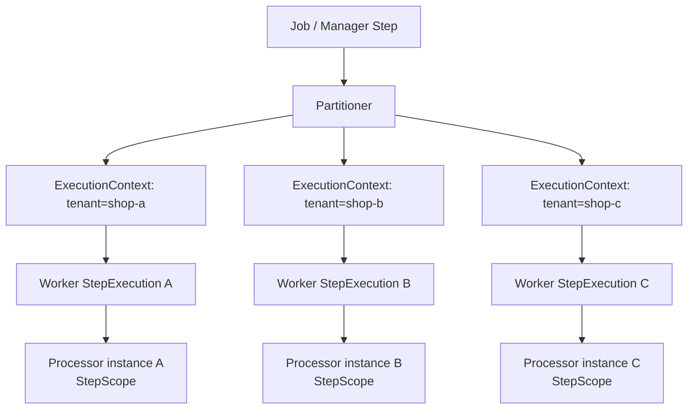

# @StepScope cho processor partition trong Spring Batch

Trong một job Spring Batch xử lý lượng dữ liệu lớn, **partitioning** chia dữ liệu thành nhiều phần rồi chạy các worker Step đồng thời. Mỗi worker có thể cần thông tin riêng: mã tenant, vùng khóa, phiên bản quy tắc xử lý hoặc một tham số nghiệp vụ của partition. Nếu `ItemProcessor` là singleton và lưu những thông tin đó vào field mutable, các partition chạy cùng lúc có thể ghi đè cấu hình của nhau và tạo kết quả sai dù job vẫn báo thành công.

**`@StepScope`** cho phép tạo **một instance bean theo từng `StepExecution`**, đồng thời nạp tham số từ `stepExecutionContext` và `jobParameters` khi Step thực sự chạy. Đây là cơ chế phù hợp để đưa cấu hình riêng của partition vào processor, miễn là vẫn bảo đảm thread safety, transaction, retry và restart.

Bài thuộc chương **Step scope** của module **SPRING_BATCH_SCALING_OPERATIONS**. Trong phạm vi mở rộng Spring Batch bằng multi-threaded step, parallel steps, partitioning và worker phân tán, ta sẽ học chính xác khi nào processor cần `@StepScope`, cách khai báo và kiểm chứng cấu hình, cũng như giới hạn của scope trong môi trường nhiều thread.

## 1. Vấn đề: một bean singleton nhưng nhiều partition

Giả sử job nhập đơn hàng từ ba cửa hàng:

- `shop-a`: nhân số tiền với hệ số `0.95`.
- `shop-b`: nhân số tiền với hệ số `0.90`.
- `shop-c`: nhân số tiền với hệ số `1.00`.

Manager Step tạo ba partition. Worker Step ở mỗi partition đọc dữ liệu cửa hàng tương ứng, xử lý từng đơn hàng và ghi kết quả. Nếu dùng một singleton processor với field `tenantId` hoặc `factor` rồi cập nhật field theo partition:

```java
// Ví dụ sai: một singleton mutable được nhiều partition cùng sử dụng.
public final class UnsafeOrderProcessor
        implements ItemProcessor<OrderRow, OutputOrder> {

    private String currentTenant;
    private BigDecimal currentFactor;

    public void configure(String tenant, BigDecimal factor) {
        this.currentTenant = tenant;
        this.currentFactor = factor;
    }

    @Override
    public OutputOrder process(OrderRow order) {
        // Partition khác có thể vừa gọi configure(...).
        // Hàm có thể dùng currentTenant/currentFactor của cửa hàng khác.
        return new OutputOrder(
                "demo", order.id(), currentTenant,
                order.grossAmount().multiply(currentFactor));
    }
}
```

Vấn đề không nằm ở `ItemProcessor` interface mà ở **quyền sở hữu trạng thái**: các partition cùng dùng một đối tượng mutable. Kể cả khi field được khai báo `volatile`, các lần đọc `currentTenant` và `currentFactor` không bảo đảm cùng thuộc một cấu hình logic. Thêm `synchronized` có thể làm mất lợi ích chạy song song mà vẫn không giải quyết đầy đủ lỗi ở dữ liệu đích hoặc checkpoint.

Giải pháp thường đơn giản hơn: mỗi `StepExecution` sở hữu cấu hình bất biến và một processor instance riêng.

## 2. Chính xác `@StepScope` tạo phạm vi nào?

`@StepScope` là một specialization của Spring `@Scope("step")`, thường được đăng ký kèm **scoped proxy** để một bean được tham chiếu trong cấu hình Step trước khi Step bắt đầu thực thi. Spring trì hoãn tạo đối tượng thật đến lúc có step context đang hoạt động. Trong local partitioning, các worker partition có **`StepExecution` riêng**, nên các bean step-scoped được tạo riêng theo worker StepExecution.



| Scope | Thông thường có bao nhiêu instance? | Có phù hợp với tham số riêng từng partition? |
| --- | --- | --- |
| `singleton` (mặc định) | Một bean instance cho `ApplicationContext` | Chỉ khi cấu hình được chia sẻ một cách an toàn; không gắn field mutable riêng mỗi partition |
| `@JobScope` | Một instance theo `JobExecution` | Không thích hợp để giữ mutable state khác nhau cho từng partition trong cùng job |
| **`@StepScope`** | Một instance theo `StepExecution` | **Có**, khi mỗi partition được chạy bằng worker StepExecution riêng |
| `prototype` | Tạo instance mới theo lần yêu cầu bean từ container | Không tự gắn lifecycle hoặc context với worker StepExecution |

**Giới hạn rất quan trọng:** `@StepScope` **không phải thread scope**. Trong **multi-threaded step**, nhiều thread có thể xử lý các chunk khác nhau thuộc **cùng một StepExecution**, và do đó vẫn dùng **chung** một step-scoped processor. Bean chỉ an toàn nếu bản thân nó reentrant/thread-safe hoặc cách gọi đã được bảo vệ đúng.

Một partition bình thường có một worker StepExecution, nhưng đừng suy từ đó ra “mỗi thread có một bean” hoặc “mỗi item/chunk sẽ tạo bean mới”. Bean step-scoped không được tạo lại cho từng lần gọi `process()`.

## 3. Cơ chế late binding từ ExecutionContext

Spring Batch cung cấp các ngữ cảnh được truy cập bằng SpEL trong lúc Step hoạt động:

| Biểu thức trong `@Value` | Nguồn | Trường hợp sử dụng |
| --- | --- | --- |
| `#{stepExecutionContext['tenantId']}` | `ExecutionContext` của worker `StepExecution` | Tenant, bucket, range, đường dẫn file của partition |
| `#{stepExecutionContext['startId']}` | `ExecutionContext` của worker | Điểm bắt đầu của vùng dữ liệu |
| `#{jobParameters['batchId']}` | Job parameter của job hiện tại | Định danh snapshot/đợt dữ liệu |
| `#{jobParameters['factor']}` | Job parameter của job | Cấu hình nhất quán giữa các partition |
| `#{jobExecutionContext['version']}` | Job `ExecutionContext` | Metadata chung của job nếu được thiết kế bất biến và sử dụng đúng lifecycle |

`stepExecutionContext` được cấp khi worker Step thực thi. Vì vậy, code như sau chỉ phù hợp khi bean được đăng ký step-scoped và không bị lấy instance thực quá sớm:

```java
@Bean
@StepScope
public ItemProcessor<OrderRow, OutputOrder> partitionProcessor(
        @Value("#{stepExecutionContext['tenantId']}") String tenantId,
        @Value("#{jobParameters['batchId']}") String batchId,
        @Value("#{jobParameters['factor']}") String factorText) {
    return new PartitionOrderProcessor(
            tenantId,
            batchId,
            new BigDecimal(factorText)
    );
}
```

Đặt `@StepScope` trên phương thức khai báo `@Bean` giúp Spring tạo proxy phù hợp với bước cấu hình. Các dependency như `tenantId` chỉ được giải khi có StepExecution thực tế, thay vì tại thời điểm ApplicationContext được khởi tạo. Hệ ứng dụng cần đăng ký StepScope bằng cấu hình Spring Batch tương ứng (ví dụ cơ chế batch configuration hoặc auto-configuration); không tạo context scope bằng cách gọi trực tiếp Java method của bean.

**Không tự ý dùng `@Value("#{stepExecutionContext[...]}")` trong một bean singleton** rồi mong Spring biết partition nào đang thực thi. Singleton thường được tạo khi Step context chưa có, hoặc sẽ mang một cấu hình cố định dùng chung cho nhiều Step.

## 4. Ví dụ xuyên suốt: mỗi partition xử lý một cửa hàng

Dưới đây là ví dụ sử dụng Spring Batch 5+, Java 17+, JDBC và một bảng staging cố định theo `batch_id`. Mỗi partition đọc đơn hàng của một tenant. Processor kiểm tra tenant của item và áp dụng hệ số tiền của job. Ví dụ nhấn mạnh **scope và định tuyến dữ liệu**; khi đưa vào ứng dụng cần tạo bảng, migration, cấu hình `Job` và cơ chế đối soát phù hợp.

### 4.1. Kiểu dữ liệu và processor với cấu hình bất biến

```java
import java.math.BigDecimal;
import java.math.RoundingMode;
import java.util.Objects;
import org.springframework.batch.item.ItemProcessor;

public record OrderRow(
        long id, String tenantId, BigDecimal grossAmount) {}

public record OutputOrder(
        String batchId, long id, String tenantId, BigDecimal amount) {}

public final class PartitionOrderProcessor
        implements ItemProcessor<OrderRow, OutputOrder> {

    private final String tenantId;
    private final String batchId;
    private final BigDecimal factor;

    public PartitionOrderProcessor(
            String tenantId, String batchId, BigDecimal factor) {
        this.tenantId = Objects.requireNonNull(tenantId);
        this.batchId = Objects.requireNonNull(batchId);
        this.factor = Objects.requireNonNull(factor);
    }

    @Override
    public OutputOrder process(OrderRow item) {
        if (!tenantId.equals(item.tenantId())) {
            throw new IllegalStateException(
                    "Sai partition cho order id=" + item.id());
        }

        BigDecimal amount = item.grossAmount()
                .multiply(factor)
                .setScale(2, RoundingMode.HALF_UP);

        return new OutputOrder(
                batchId, item.id(), tenantId, amount);
    }
}
```

Ba field của processor là `final`; mỗi lời gọi `process` dùng dữ liệu đầu vào và cấu hình bất biến, không lưu lại kết quả của item trước. Với thiết kế này, lợi ích trực tiếp của `@StepScope` là **gắn đúng cấu hình của partition tại lúc khởi chạy Step**, đồng thời giữ instance tách biệt để sau này có thể bổ sung dependency riêng từng worker nếu cần.

Một processor hoàn toàn stateless, không cần dữ liệu từ `StepExecutionContext` và chỉ dùng các dependency thread-safe **không bắt buộc** phải dùng `@StepScope`. Dùng scope khi có nhu cầu gắn tham số/lifecycle riêng, không mặc định gắn mọi processor với StepScope.

### 4.2. Partitioner tạo ExecutionContext cho từng tenant

```java
import java.util.LinkedHashMap;
import java.util.List;
import java.util.Map;
import org.springframework.batch.core.partition.support.Partitioner;
import org.springframework.batch.item.ExecutionContext;

public final class TenantPartitioner implements Partitioner {

    // Ví dụ: danh sách này được chốt cho cả job instance.
    private final List<String> tenantIds =
            List.of("shop-a", "shop-b", "shop-c");

    @Override
    public Map<String, ExecutionContext> partition(int gridSize) {
        Map<String, ExecutionContext> result = new LinkedHashMap<>();

        for (String tenantId : tenantIds) {
            ExecutionContext context = new ExecutionContext();
            context.putString("tenantId", tenantId);
            result.put("tenant-" + tenantId, context);
        }
        return result;
    }
}
```

`gridSize` là gợi ý cho `Partitioner`; ví dụ này cố định ba partition để minh họa và không dùng `gridSize` để quyết định số phần. Trong production, danh sách tenant phải được lấy từ **snapshot/đầu vào đã chốt** và có quy tắc đặt tên ổn định. Không để tập tenant hay ánh xạ tên partition thay đổi tùy thời điểm khi restart cùng một job instance.

**Lưu ý về tính đúng đắn:** `@StepScope` không tự phân tách bản ghi ở database. Chính reader phải lấy đúng dữ liệu tương ứng `tenantId` được phân cho worker. Nếu hai partition đọc chồng lên nhau, dù mỗi processor có instance riêng, dữ liệu vẫn có thể được ghi trùng.

### 4.3. Reader cũng có scope riêng và cùng dùng tenantId

Để ví dụ hoạt động như một mô hình thống nhất, worker reader lọc theo `batchId` và `tenantId`. Mỗi worker StepExecution có reader riêng:

```java
import javax.sql.DataSource;
import org.springframework.batch.core.configuration.annotation.StepScope;
import org.springframework.batch.item.database.JdbcCursorItemReader;
import org.springframework.batch.item.database.builder.JdbcCursorItemReaderBuilder;
import org.springframework.beans.factory.annotation.Value;
import org.springframework.context.annotation.Bean;

@Bean
@StepScope
public JdbcCursorItemReader<OrderRow> tenantReader(
        DataSource dataSource,
        @Value("#{stepExecutionContext['tenantId']}") String tenantId,
        @Value("#{jobParameters['batchId']}") String batchId) {

    return new JdbcCursorItemReaderBuilder<OrderRow>()
            .name("tenantReader")
            .dataSource(dataSource)
            .sql("""
                SELECT id, tenant_id, gross_amount
                FROM staging_orders
                WHERE batch_id = ? AND tenant_id = ?
                ORDER BY id
                """)
            .preparedStatementSetter(ps -> {
                ps.setString(1, batchId);
                ps.setString(2, tenantId);
            })
            .rowMapper((rs, rowNum) -> new OrderRow(
                    rs.getLong("id"),
                    rs.getString("tenant_id"),
                    rs.getBigDecimal("gross_amount")))
            .saveState(true)
            .build();
}
```

SQL giả định `staging_orders` có các cột `batch_id`, `tenant_id`, `id` và `gross_amount`. Cần có index phù hợp với `(batch_id, tenant_id, id)` và `id` là khóa sắp xếp xác định, không trùng trong phạm vi reader. `saveState(true)` hỗ trợ checkpoint của reader nhưng **không bảo đảm restart đúng nếu nguồn thay đổi**: dữ liệu staging cần giữ ổn định trong toàn bộ job instance.

### 4.4. Khai báo processor step-scoped dưới dạng bean

Đoạn cấu hình sau sử dụng processor ở phần 4.1. Các bean `@Bean` được đặt trong một lớp `@Configuration` của ứng dụng:

```java
import java.math.BigDecimal;
import org.springframework.batch.core.configuration.annotation.StepScope;
import org.springframework.batch.item.ItemProcessor;
import org.springframework.beans.factory.annotation.Value;
import org.springframework.context.annotation.Bean;

@Bean
@StepScope
public ItemProcessor<OrderRow, OutputOrder> tenantProcessor(
        @Value("#{stepExecutionContext['tenantId']}") String tenantId,
        @Value("#{jobParameters['batchId']}") String batchId,
        @Value("#{jobParameters['factor']}") String factorText) {

    return new PartitionOrderProcessor(
            tenantId, batchId, new BigDecimal(factorText));
}
```

Với `jobParameters['factor'] = "0.95"`, processor của từng tenant đều dùng `0.95` trong ví dụ. Nếu từng tenant cần hệ số **khác nhau**, hãy đặt `factor` tương ứng vào **ExecutionContext của từng partition**, chứ không thay đổi field chung sau khi bean đã tạo:

```java
// Bên trong TenantPartitioner, khi mỗi tenant có factor riêng:
context.putString("factor", factorForThisTenant);

// Bên trong phương thức @Bean @StepScope:
@Value("#{stepExecutionContext['factor']}") String factorText
```

Hai đoạn trên mô tả **phương án thay thế** cho ví dụ dùng job parameter chung; không thêm cả hai cấu hình `factor` mà không có quy tắc ưu tiên. Trong production, quy tắc tính `factor` phải được xác định, xác thực và chốt trước khi xử lý. Ví dụ `shop-a` có `0.95`, `shop-b` có `0.90`, `shop-c` có `1.00` thì mỗi `ExecutionContext` mang đúng giá trị của tenant đó.

### 4.5. Writer và worker Step

Writer ví dụ ghi vào PostgreSQL và dùng khóa duy nhất `(batch_id, id)` để thao tác được lặp lại mà không nhân bản bản ghi. Đây là ví dụ idempotency ở tầng DB; hệ thống thực cần quyết định upsert có phù hợp quy tắc nghiệp vụ không.

```java
import javax.sql.DataSource;
import org.springframework.batch.item.database.JdbcBatchItemWriter;
import org.springframework.batch.item.database.builder.JdbcBatchItemWriterBuilder;
import org.springframework.context.annotation.Bean;

@Bean
public JdbcBatchItemWriter<OutputOrder> outputWriter(
        DataSource dataSource) {
    return new JdbcBatchItemWriterBuilder<OutputOrder>()
            .dataSource(dataSource)
            .sql("""
                INSERT INTO processed_orders
                    (batch_id, id, tenant_id, amount)
                VALUES (?, ?, ?, ?)
                ON CONFLICT (batch_id, id)
                DO UPDATE SET
                    tenant_id = EXCLUDED.tenant_id,
                    amount = EXCLUDED.amount
                """)
            .itemPreparedStatementSetter((item, ps) -> {
                ps.setString(1, item.batchId());
                ps.setLong(2, item.id());
                ps.setString(3, item.tenantId());
                ps.setBigDecimal(4, item.amount());
            })
            .build();
}
```

Câu `ON CONFLICT` yêu cầu unique constraint/index thực tế trên `(batch_id, id)`, sử dụng cú pháp PostgreSQL. Trong một số nghiệp vụ nên dùng `DO NOTHING` hoặc phát hiện sai lệch khi trùng khóa thay vì cập nhật; phải quyết định dựa trên yêu cầu tính đúng đắn. Writer dùng chung chỉ an toàn khi implementation, cấu hình và dependency của nó hỗ trợ dùng đồng thời; việc processor có `@StepScope` **không biến writer thành thread-safe**.

Worker Step sử dụng Spring Batch 5+:

```java
import org.springframework.batch.core.Step;
import org.springframework.batch.core.repository.JobRepository;
import org.springframework.batch.core.step.builder.StepBuilder;
import org.springframework.batch.item.ItemProcessor;
import org.springframework.batch.item.database.JdbcBatchItemWriter;
import org.springframework.batch.item.database.JdbcCursorItemReader;
import org.springframework.context.annotation.Bean;
import org.springframework.transaction.PlatformTransactionManager;

@Bean
public Step tenantWorkerStep(
        JobRepository jobRepository,
        PlatformTransactionManager transactionManager,
        JdbcCursorItemReader<OrderRow> tenantReader,
        ItemProcessor<OrderRow, OutputOrder> tenantProcessor,
        JdbcBatchItemWriter<OutputOrder> outputWriter) {

    return new StepBuilder("tenantWorkerStep", jobRepository)
            .<OrderRow, OutputOrder>chunk(200, transactionManager)
            .reader(tenantReader)
            .processor(tenantProcessor)
            .writer(outputWriter)
            .build();
}
```

Lúc tạo bean `tenantWorkerStep`, Spring có thể lắp các **scoped proxy** của reader và processor vào cấu hình Step. Khi mỗi partition thực thi, proxy giải ra đối tượng thực gắn với StepExecution đó.

### 4.6. Manager Step điều phối các worker

```java
import org.springframework.batch.core.Step;
import org.springframework.batch.core.repository.JobRepository;
import org.springframework.batch.core.step.builder.StepBuilder;
import org.springframework.context.annotation.Bean;
import org.springframework.scheduling.concurrent.ThreadPoolTaskExecutor;

@Bean
public ThreadPoolTaskExecutor tenantExecutor() {
    ThreadPoolTaskExecutor executor = new ThreadPoolTaskExecutor();
    executor.setCorePoolSize(3);
    executor.setMaxPoolSize(3);
    executor.setQueueCapacity(3);
    executor.setThreadNamePrefix("tenant-worker-");
    executor.initialize();
    return executor;
}

@Bean
public Step tenantManagerStep(
        JobRepository jobRepository,
        Step tenantWorkerStep,
        TenantPartitioner tenantPartitioner,
        ThreadPoolTaskExecutor tenantExecutor) {

    return new StepBuilder("tenantManagerStep", jobRepository)
            .partitioner(tenantWorkerStep.getName(), tenantPartitioner)
            .step(tenantWorkerStep)
            .gridSize(3)
            .taskExecutor(tenantExecutor)
            .build();
}
```

Để sử dụng code trên, đăng ký `TenantPartitioner` là bean và đặt `tenantManagerStep` vào một `Job`. Ba tenant trong ví dụ tạo ba worker StepExecution; executor chạy tối đa ba tác vụ đồng thời. Khi tăng số tenant, cần đánh giá số partition được submit, sức chứa queue, database connection pool và cách điều tiết tải. `gridSize` không phải trần thread safety hay cam kết rằng mọi `Partitioner` chỉ tạo đúng số phần này.

**Lưu ý về transaction:** Nếu reader và writer dùng nguồn dữ liệu khác nhau, không được mặc định transaction manager của worker sẽ commit nguyên tử ở cả hai hệ thống. Hãy xác định ranh giới transaction, checkpoint và idempotency theo kiến trúc thực.

## 5. Quan sát vòng đời bean trong các worker

Mô hình khởi tạo có thể hình dung như sau:

1. Spring khởi tạo `ApplicationContext`, tạo cấu hình `Job` và Step với proxy của processor.
2. Manager chạy `Partitioner`, sinh tên partition ổn định và một `ExecutionContext` cho mỗi partition.
3. Mỗi worker StepExecution được gắn với context của mình khi bắt đầu chạy.
4. Lần đầu worker gọi proxy, Spring tạo `PartitionOrderProcessor` với `tenantId`/`factor` dành riêng cho StepExecution hiện tại.
5. Worker gọi `process(item)` nhiều lần trên **cùng instance** trong phạm vi StepExecution đó.
6. Khi Step kết thúc, bean step-scoped và lifecycle tương ứng kết thúc; khi StepExecution khác thực thi, instance khác được tạo.

Sơ đồ này giải thích vì sao field `final` giữ cấu hình theo partition là phù hợp: worker không phải liên tục đọc metadata từ nơi khác và không có bước “đổi cấu hình processor” giữa các item.

**Mức cô lập được bảo đảm nằm ở bean instance của StepExecution**, không phải tự động tạo một transaction mới cho mỗi processor, hoặc tự động bảo vệ static field, cache toàn ứng dụng và database dùng chung.

## 6. Khi nào cần cấu hình từ partition thay vì job parameter?

| Thông tin | Nguồn phù hợp | Lý do |
| --- | --- | --- |
| `batchId` chung của lần xử lý | `jobParameters` | Mọi partition đọc cùng snapshot và cùng đợt |
| `tenantId`, `bucketId`, `startId`, `endId` | `stepExecutionContext` | Mỗi worker xử lý vùng dữ liệu khác nhau |
| Phiên bản thuật toán chung bất biến | Job parameter hoặc cấu hình được đóng băng theo job instance | Restart phải áp dụng lại cùng quy tắc |
| Hệ số/quy tắc riêng từng tenant | `stepExecutionContext` nếu chốt theo partition | Mỗi processor phải nhận đúng quy tắc, không lấy một field singleton |
| Tiến độ đọc/ghi và offset | Cơ chế checkpoint của reader/writer qua `ExecutionContext` | Khôi phục an toàn theo phạm vi StepExecution |
| Số lần gọi `process()` tạm thời | Metric thread-safe, nếu cần | Chỉ để quan sát, không dùng làm checkpoint nghiệp vụ |

Cần **phân biệt metadata bất biến** với tiến độ mutable. Cấu hình được chốt có thể đưa vào constructor. Với trạng thái cần persist, phải dùng cơ chế lưu `ExecutionContext` đúng lifecycle hoặc thiết kế dữ liệu bền vững; field trong processor sẽ mất khi process dừng.

Một số worker dùng processor để lấy token/API client riêng tenant. Scope giúp cô lập instance nhưng **không tự giới hạn concurrency hoặc đảm bảo client thư viện thread-safe**. Nếu nhiều partition cùng truy cập dịch vụ downstream, cần rate limit, bounded queue và retry/backoff riêng.

## 7. `@StepScope` không giải quyết tất cả lỗi concurrency

### 7.1. Multi-threaded step vẫn chia sẻ processor

Giả sử chỉ có **một** StepExecution nhưng cấu hình worker Step gọi xử lý chunk trên 8 thread. `@StepScope` vẫn cho **một processor instance** chung cho StepExecution này. Nếu processor lưu trạng thái cập nhật qua từng item, race condition vẫn xuất hiện.

**Cách tiếp cận:** ưu tiên processor stateless; hoặc nếu thật sự có mutable state thì thiết kế đồng bộ phù hợp, xem lại throughput và tính đúng đắn khi chunk commit đảo thứ tự. Nếu cần trạng thái riêng theo nhóm dữ liệu, partition theo khóa nghiệp vụ với StepExecution độc lập thường dễ kiểm chứng hơn.

### 7.2. Singleton dependency vẫn có thể bị chia sẻ

Processor step-scoped có thể inject một singleton service:

```java
public final class PartitionOrderProcessor {
    private final PricingService pricingService; // Có thể là singleton.
    // ...
}
```

Nếu `PricingService` giữ `currentTenant` mutable mà các worker gọi đồng thời, vấn đề vẫn còn. Scope của **bean phụ thuộc** phải được kiểm tra theo cách sử dụng thật; một bean step-scoped không thay đổi scope của tất cả dependency mà nó gọi.

### 7.3. Static field và tài nguyên dùng chung nằm ngoài StepScope

`static Map`, file đầu ra chung, cùng khóa ghi DB, connection/cursor chia sẻ và broker message không được cô lập bởi `@StepScope`. Ngay cả khi mỗi partition có processor riêng, hai partition vẫn có thể ghi cùng tài nguyên và tranh chấp.

### 7.4. Scope không bảo đảm idempotency hoặc thứ tự

Nếu một transaction thất bại, processor có thể được gọi lại. Với partitioning/remote worker, cùng item có thể được xử lý lại sau crash hoặc message redelivery. Một instance mới theo StepExecution không ngăn side effect nhân đôi nếu processor gọi API hoặc writer ghi ngoài transaction. Thứ tự xử lý giữa các partition cũng không được bảo đảm.

**Khuyến nghị:** giữ `process()` càng thuần và không side effect càng tốt; ràng buộc ghi vào writer có transaction và/hoặc thiết kế idempotency theo khóa nghiệp vụ.

## 8. Retry, rollback và restart với processor step-scoped

### Trước khi chạy

Cố định `batchId`, phạm vi dữ liệu, mapping partition, phiên bản thuật toán và tham số nghiệp vụ. Bảo đảm mỗi partition đọc một tập dữ liệu xác định, không chồng lấn.

### Khi xử lý

Trong một `StepExecution`, processor instance có thể được dùng cho nhiều chunk. Nếu một chunk rollback, dữ liệu của chunk có thể được đọc/xử lý lại tùy reader, cấu hình retry/skip và trạng thái transaction. Không giả định `process()` sẽ chạy đúng một lần cho mỗi item.

### Khi restart

JobRepository quản lý trạng thái `StepExecution`/`ExecutionContext`. Với partitioned Step, trạng thái từng partition giúp xác định các phần cần xử lý tiếp, tùy cấu hình và kết quả trước đó. **Processor step-scoped được tạo theo StepExecution của lần thực thi**, nên field cache/counter nội bộ **không tự phục hồi** từ lần chạy trước.

Nếu processor cần dữ liệu cấu hình để tái hiện kết quả, hãy lấy lại từ job parameter và partition context ổn định hoặc nguồn cấu hình đã được version. Đừng truy vấn “mức giá hiện tại” mà không đóng băng version: restart vào ngày hôm sau có thể tạo kết quả khác khi cùng item được xử lý lại.

### Lựa chọn cho trạng thái mutable

- Bộ đếm dùng để quan sát: dùng metric, không xem là dữ liệu được checkpoint.
- Tổng hợp theo khóa: dùng bước aggregate rõ ràng, hoặc DB transaction/lock với partitioning phù hợp; không dùng field cộng dồn tùy ý.
- Tiến độ đọc: để reader checkpoint qua `ItemStream` và `ExecutionContext`.
- Trạng thái nghiệp vụ phải phục hồi: thiết kế lưu bền vững và nhất quán transaction; không chỉ giữ trong processor.
- Các side effect có thể chạy lại: dùng khóa idempotency, unique constraint, upsert hoặc outbox theo kiến trúc.

## 9. Lỗi thường gặp và dấu hiệu nhận biết

| Lỗi | Hệ quả | Cách sửa |
| --- | --- | --- |
| Quên `@StepScope` nhưng dùng `stepExecutionContext` trong bean singleton | Binding sai thời điểm hoặc scope không hoạt động | Đăng ký step-scoped bean và để framework resolve khi Step chạy |
| Đặt `@StepScope` trên processor nhưng nghĩ mỗi thread có instance mới | Race trong multi-threaded step | Nhận diện cùng StepExecution; thiết kế reentrant/thread-safe |
| Inject bean step-scoped rồi tự gọi factory method ngoài container | Không qua proxy/context, dễ nhận cấu hình sai | Lấy bean qua Spring container và inject vào Step bình thường |
| Gán field `tenantId` mutable sau khi tạo singleton | Partition này có thể dùng tenant của partition khác | Constructor với cấu hình riêng từ StepExecutionContext |
| Một listener/service singleton giữ state theo partition | Cấu hình bị ghi đè | Chuyển state vào phạm vi phù hợp hoặc truyền dữ liệu như tham số |
| Lưu tiến độ vào field processor | Crash làm mất tiến độ; restart không đúng | Checkpoint qua ItemStream/ExecutionContext hoặc kho bền vững |
| Thay tenant list/hash/range khi restart | Tập dữ liệu partition thay đổi | Giữ mapping ổn định cho cả job instance |
| Processor gọi API có side effect | Retry có thể gọi API hai lần | Tách side effect hoặc bổ sung idempotency/transaction boundary |
| Hai partition cùng đọc một bản ghi | Ghi trùng dù processor được tách instance | Chứng minh tập dữ liệu rời nhau và đối soát |
| Gắn tenantId của từng tenant vào mọi metric tag | Cardinality tăng theo số tenant | Metric tổng hợp ổn định, chi tiết tenant/partition trong log có kiểm soát |

### Lưu ý về lifecycle interface

Nếu processor tự triển khai thêm `ItemStream` hoặc listener như `StepExecutionListener`, hãy kiểm tra rằng Step thực sự **đăng ký và gọi** các lifecycle callback cần thiết. Với scoped proxy hoặc return type chỉ là `ItemProcessor`, không nên mặc định mọi interface bổ sung đều được Step phát hiện tự động. Tùy cấu hình, trả về kiểu bean thể hiện đúng interface hoặc đăng ký rõ với `.stream(...)` / `.listener(...)` theo API đang dùng.

Processor thông thường chỉ cần `ItemProcessor`; không nên triển khai `ItemStream` để lưu các counter tạm nếu nghiệp vụ không yêu cầu checkpoint.

## 10. Kiểm thử processor theo StepExecution

Unit test của `PartitionOrderProcessor` có thể gọi constructor trực tiếp, không cần Spring. Mục tiêu là xác nhận logic theo tenant, factor và sai phân vùng:

```java
import static org.junit.jupiter.api.Assertions.*;
import java.math.BigDecimal;
import org.junit.jupiter.api.Test;

class PartitionOrderProcessorTest {
    @Test
    void appliesTheFixedConfigurationAndRejectsOtherTenant() {
        var processor = new PartitionOrderProcessor(
                "shop-a", "batch-01", new BigDecimal("0.95"));

        OutputOrder result = processor.process(new OrderRow(
                7L, "shop-a", new BigDecimal("100.00")));

        assertEquals("batch-01", result.batchId());
        assertEquals("shop-a", result.tenantId());
        assertEquals(new BigDecimal("95.00"), result.amount());

        assertThrows(IllegalStateException.class, () ->
                processor.process(new OrderRow(
                        8L, "shop-b", new BigDecimal("100.00"))));
    }
}
```

Unit test trên kiểm tra logic nhưng **chưa chứng minh Spring inject đúng `tenantId` vào mỗi scoped bean**. Cần integration test hoặc Spring Batch test context để chạy hai hay nhiều `StepExecution` với `ExecutionContext` khác nhau và xác nhận processor nhận cấu hình độc lập. Với dự án dùng `spring-batch-test`, có thể sử dụng các tiện ích kiểm thử Step scope tương ứng phiên bản, ví dụ `StepScopeTestUtils` hoặc chạy Step qua job test.

### Ma trận thử nghiệm đáng có

| Kịch bản | Kết quả cần chứng minh |
| --- | --- |
| Một partition, một worker | Reader đúng tenant; factor đúng; output đúng |
| Hai partition chạy song song | Không lẫn `tenantId`/factor; checksum mỗi tenant bằng baseline |
| Tăng số partition và số worker | Không mất/trùng dữ liệu; pool/API/DB không quá tải |
| Chạy lại cùng input với job instance mới | Kết quả nhất quán theo version cấu hình |
| Restart sau lỗi ở giữa một chunk | Checkpoint đúng; output cuối không thiếu/trùng |
| Thay đổi cấu hình bên ngoài giữa lúc job chạy | Quy tắc xử lý vẫn dùng snapshot/version đã chốt |
| Processor ném exception ở tenant không khớp | Lỗi được quan sát và xử lý theo retry/skip policy, không âm thầm ghi sai |
| Multi-threaded step dùng cùng step-scoped processor | Không nhầm cơ chế scope với thread safety; logic an toàn khi gọi đồng thời nếu cấu hình cho phép |

**Đối soát độc lập:** so số khóa đầu vào/đầu ra, bản ghi thiếu/trùng, checksum/tổng tiền từng tenant và trạng thái hoàn tất mỗi StepExecution. `BatchStatus.COMPLETED` chỉ là trạng thái điều phối, không thay thế việc xác minh dữ liệu.

### Dấu hiệu quan sát trong production

Ghi log cấu hình worker khi Step bắt đầu với `jobExecutionId`, `stepExecutionId`, tên partition, `tenantId`, phiên bản thuật toán và khoảng dữ liệu được giao; cẩn trọng với dữ liệu nhạy cảm. Các metric latency/throughput theo `read/process/write` và mức sử dụng CPU/DB giúp phát hiện bottleneck, nhưng không nên dùng identifier có cardinality lớn làm tag cho mọi time series.

Không cần ghi log từng item để chứng minh tách instance; log một lần tại worker start và dùng kiểm thử đối soát để kiểm tra hiệu quả.

## 11. Checklist trước khi đưa lên production

- [ ] Mỗi worker partition có `StepExecution` và `ExecutionContext` đúng với vùng dữ liệu độc lập.
- [ ] Các key như `tenantId`, `bucketId`, `factor`, `batchId` có tên rõ ràng và kiểu dữ liệu được kiểm tra.
- [ ] `@StepScope` được đặt trên bean cần late binding; proxy được inject qua Spring container.
- [ ] Đã chứng minh không nhầm Step scope với thread scope; nếu worker Step chạy nhiều thread, processor vẫn thread-safe.
- [ ] Processor giữ cấu hình partition bất biến, không có mutable singleton/static state không được bảo vệ.
- [ ] Dependency như service, client, cache và writer đã được audit riêng về thread safety.
- [ ] Cấu hình, snapshot và partition mapping được cố định khi restart.
- [ ] Reader có checkpoint chính xác; processor không dùng field tạm để thay cho trạng thái bền vững.
- [ ] Writer/side effect có chiến lược idempotency khi retry hoặc worker bị chạy lại.
- [ ] Đã chạy song song, chủ động lỗi, restart và đối soát dữ liệu theo từng partition.
- [ ] Đã đo throughput, CPU, DB connection wait, queue wait và lỗi ở concurrency dự kiến.
- [ ] Có log/metric đủ để truy ra partition và tham số cấu hình khi xảy ra sự cố.

## 12. Câu hỏi tự kiểm tra

1. Vì sao một processor `@StepScope` có thể vẫn **không thread-safe** trong multi-threaded step?
2. Trong local partitioning, điều gì khiến hai worker khác nhau lấy được hai instance step-scoped processor?
3. Khi nào nên lấy `factor` từ `jobParameters`, khi nào nên lấy từ `stepExecutionContext`?
4. Một singleton `PricingService` có field `currentTenant` mutable được inject vào các processor step-scoped. Lỗi có còn tồn tại không?
5. Nếu factor thay đổi trên hệ thống giá giữa lần chạy đầu và lần restart, làm thế nào bảo đảm đầu ra có thể tái hiện?
6. Tại sao số bản ghi đúng không đủ để chứng minh hai partition không dùng nhầm factor? Bạn sẽ đối soát thêm thông tin nào?
7. Nếu processor phải cập nhật một API bên ngoài, scope có giúp tránh side effect bị lặp do retry không? Cần bổ sung gì?

**Ghi nhớ:** `@StepScope` là công cụ **cô lập bean theo StepExecution và nạp tham số khi Step chạy**. Với partitioning, nó giúp mỗi worker processor nhận đúng metadata, nhưng không tự đảm bảo thread safety bên trong cùng StepExecution, tính rời nhau của dữ liệu, checkpoint hay idempotency. Hãy chốt cấu hình theo job instance, giữ processor đơn giản, rồi kiểm chứng bằng chạy song song, retry/restart và đối soát đầu ra.
