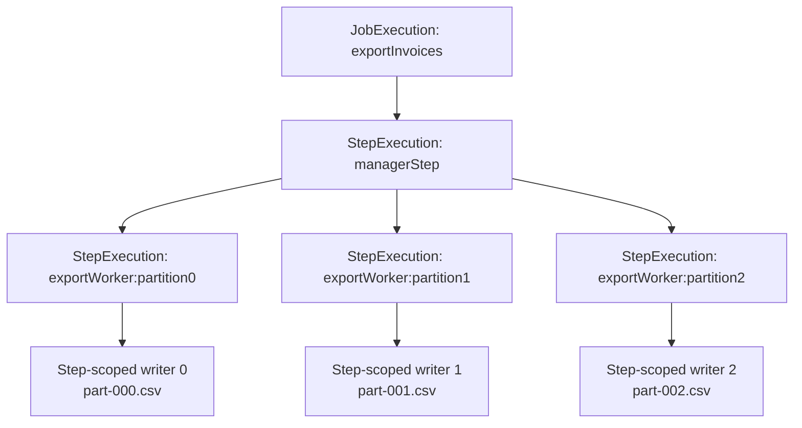
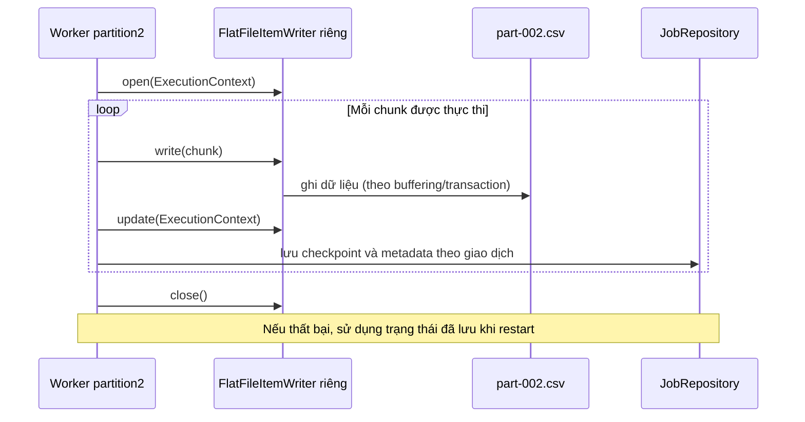

# @StepScope cho writer partition

## 1. Vì sao writer của mỗi partition cần scope riêng?

Trong chương **Step scope** của module **SPRING_BATCH_SCALING_OPERATIONS**, mục tiêu là mở rộng Spring Batch cho workload dữ liệu lớn mà vẫn kiểm soát thread safety, checkpoint, retry/restart và hiệu năng. Khi chia một step thành nhiều **partition**, mỗi partition thường xử lý một tập dữ liệu khác nhau: dải ID, ngày giao dịch, tenant hoặc một shard. Nếu tất cả cùng dùng một writer có trạng thái và cùng một đầu ra, chương trình dễ gặp xung đột về buffer, vị trí tệp, checkpoint hoặc khóa ghi.

Annotation **`@StepScope`** giải quyết nhu cầu thường gặp: tạo một **đối tượng writer riêng cho mỗi `StepExecution`**, đồng thời lấy cấu hình của partition hiện tại từ `stepExecutionContext` bằng *late binding*. Ví dụ partition 0 ghi `part-000.csv`, partition 1 ghi `part-001.csv`; hai writer có resource và trạng thái ghi độc lập.

Sau bài này, bạn có thể:

- Phân biệt scope của một `StepExecution` với scope của thread, job hoặc JVM.
- Dùng `@StepScope` và `@Value("#{stepExecutionContext['...']}")` để cấu hình writer theo từng partition.
- Xây dựng một ví dụ local partitioning với file writer riêng, reader riêng và transaction theo chunk.
- Hiểu vì sao `ItemStream`/`open()`/`update()`/`close()` và kiểu trả về của bean ảnh hưởng restart.
- Tránh lỗi nhiều partition cùng ghi một tệp, dùng sai state, đổi tên partition giữa các lần chạy hoặc ghi đè dữ liệu khi restart.
- Biết khi nào cần kiểm thử thêm thread safety, nhất là khi chạy **multi-threaded chunk** bên trong một worker partition.

> **Điểm cốt lõi:** `@StepScope` là **một instance theo `StepExecution`**, không phải “một instance theo thread”. Partitioning thông thường có `StepExecution` riêng cho mỗi partition, nên writer step-scoped được cấu hình độc lập cho mỗi partition. Nếu cùng một `StepExecution` còn tạo nhiều luồng để xử lý chunk, các luồng đó vẫn có thể chia sẻ writer scoped của chính execution ấy.

## 2. Hiểu đúng StepScope và StepExecution

Spring Batch phân biệt:

| Khái niệm | Ý nghĩa | Liên quan đến writer |
| --- | --- | --- |
| `JobInstance` | Một job logic được định danh bởi tên và identifying job parameters | Giúp phân biệt kỳ chạy và chọn đường dẫn đầu ra ổn định khi restart |
| `JobExecution` | Một lần thực thi hoặc restart của `JobInstance` | Có thể chứa nhiều `StepExecution` |
| `StepExecution` | Một lần thực thi step, có tên, status, số đếm và context | **Đơn vị mà `@StepScope` gắn với** |
| `ExecutionContext` của step | Dữ liệu trạng thái/checkpoint của một `StepExecution` | Truyền `outputFile`, `fromId`, `toId` cho bean và lưu thông tin restart |
| `@StepScope` | Scope bean được Spring Batch cung cấp và kích hoạt trong step | Đối tượng thật được khởi tạo/resolve khi một `StepExecution` đang chạy |

Giả sử manager chia dữ liệu 1–1.000 thành bốn khoảng:

| Partition | Tên `StepExecution` minh họa | `fromId`–`toId` | `outputFile` |
| --- | --- | --- | --- |
| `partition0` | `exportWorker:partition0` | 1–250 | `/exports/run-42/part-000.csv` |
| `partition1` | `exportWorker:partition1` | 251–500 | `/exports/run-42/part-001.csv` |
| `partition2` | `exportWorker:partition2` | 501–750 | `/exports/run-42/part-002.csv` |
| `partition3` | `exportWorker:partition3` | 751–1.000 | `/exports/run-42/part-003.csv` |



Sơ đồ lược bớt partition 3 để dễ quan sát. Các worker execution thuộc cùng một `JobExecution` và được manager điều phối, nhưng **mỗi execution có `ExecutionContext` và writer riêng**. Bốn writer có thể ghi vào bốn file khác nhau cùng lúc, tùy pool luồng và khả năng của hệ thống lưu trữ.

### Singleton và StepScope khác gì?

```java
// Bean mặc định là singleton: một object được các partition tham chiếu.
@Bean
FlatFileItemWriter<Invoice> sharedWriter() {
    // Cấu hình một resource cố định: rất dễ bị tranh chấp.
}

// Bean step-scoped: một target thực tế được tạo cho mỗi StepExecution.
@Bean
@StepScope
FlatFileItemWriter<Invoice> partitionWriter(
        @Value("#{stepExecutionContext['outputFile']}") String outputFile) {
    // Resource được xác định khi partition hiện tại thực thi.
}
```

Với `@StepScope`, Spring đưa **scoped proxy** vào những nơi inject bean. Proxy được đăng ký khi application khởi động; target writer được tạo/tra cứu khi có `StepContext` đang hoạt động. Vì vậy `@Value("#{stepExecutionContext['outputFile']}")` không được resolve như thuộc tính global ngay lúc tạo application context.

Không gọi phương thức của scoped proxy từ một thread tự tạo nằm ngoài ngữ cảnh step rồi mặc định nó sẽ truy cập được `stepExecutionContext`. Với thread không được Spring Batch đăng ký context, bạn có thể nhận lỗi kiểu “Scope 'step' is not active”. Hãy để framework điều phối thực thi step hoặc có cơ chế truyền context được hỗ trợ.

## 3. Khi nào writer cần @StepScope?

| Tình huống | Có nên dùng `@StepScope` cho writer? | Vì sao |
| --- | --- | --- |
| Mỗi partition xuất một tệp CSV riêng | **Rất phù hợp** | Tên tệp, vị trí ghi và checkpoint khác nhau |
| Mỗi partition ghi vào shard, tenant hoặc bảng riêng | **Phù hợp** | Chọn resource/đích theo context |
| Writer giữ buffer, số dòng, vị trí file hoặc mutable state | **Thường cần** khi dùng trong partitioning | Không chia sẻ state giữa các execution |
| `JdbcBatchItemWriter` stateless ghi cùng một bảng | **Có thể không cần**, nếu writer hỗ trợ concurrent use | Mỗi transaction vẫn có kết nối và trạng thái thực thi riêng; cần xét lock của DB |
| Một step một luồng, writer cố định | Không bắt buộc | Singleton có thể đơn giản hơn nếu an toàn |
| Multi-threaded step không dùng partitioning | **Không đủ để bảo đảm thread safety** | Các chunk có thể thuộc **cùng StepExecution** và chia sẻ một writer |

**`@StepScope` không tự biến writer không thread-safe thành thread-safe.** Nó tách state giữa các `StepExecution`. Bên trong mỗi execution, nếu vẫn có nhiều thread cùng gọi `write()`, bạn phải đánh giá lại writer và đối tượng phụ thuộc.

## 4. Truyền cấu hình writer từ Partitioner vào StepScope

Trong mô hình partitioning, `Partitioner.partition(gridSize)` trả về `Map<String, ExecutionContext>`:

- **Map key** xác định tên partition; nên ổn định qua các lần restart.
- **Map value** mang tham số riêng như `fromId`, `toId`, `outputFile`.
- Worker chỉ cần biết ngữ cảnh của nó, không tự suy đoán file từ số thread hoặc thứ tự được scheduler cấp phát.

Ví dụ một partition context:

```java
ExecutionContext partitionContext = new ExecutionContext();
partitionContext.putLong("fromId", 1);
partitionContext.putLong("toId", 250);
partitionContext.putString("outputFile", "/exports/run-42/part-000.csv");
```

Tại bean writer:

```java
@Bean
@StepScope
FlatFileItemWriter<Invoice> partitionWriter(
        @Value("#{stepExecutionContext['outputFile']}") String outputFile) {
    // outputFile là đường dẫn dành riêng cho StepExecution hiện tại.
}
```

Nếu cấu hình `@Value("#{jobParameters['exportDir']}")` trong writer, mọi partition sẽ nhận **cùng một tham số job**. Đây là lý do cần để `Partitioner` bổ sung tên file riêng cho từng context. Có thể dùng job parameter làm **thư mục gốc của một lần chạy** và dùng step context làm **đường dẫn file cụ thể của partition**.

### Chọn khóa partition và đường dẫn ổn định

Tránh đặt tên file bằng:

```java
Thread.currentThread().getName()
System.currentTimeMillis()
UUID.randomUUID()
```

Những giá trị này có thể thay đổi khi restart, khi pool gán một partition sang thread khác hoặc khi worker được chuyển sang máy khác. Hãy dùng tên từ partition key/ID miền dữ liệu và identifying job parameters ổn định. Với hệ thống ghi file thực tế, cần có chính sách **một thư mục đầu ra riêng cho từng `JobInstance`**; chạy job mới không vô tình ghi đè file của job trước.

## 5. Ví dụ Spring Batch 5.x: một writer CSV cho mỗi partition

Mẫu dưới đây dùng API Java của **Spring Batch 5.x**. Nó xuất `invoice_source(id, amount)` thành các file CSV theo dải ID. Ví dụ cố định miền ID 1–1.000 để nhìn rõ cơ chế; trong production, cần tính miền từ dữ liệu/snapshot ổn định và định nghĩa quy tắc chia miền không chồng lấn.

Ứng dụng giả định đã cấu hình `DataSource`, `JobRepository`, `PlatformTransactionManager` và đã tạo thư mục xuất trước khi chạy. Job nhận identifying parameter `exportDir` là đường dẫn **dành riêng cho job instance**; khi restart cần giữ nguyên parameter đó. Dùng đường dẫn phù hợp với máy đang chạy và quyền ghi của tiến trình.

```java
import java.math.BigDecimal;
import java.nio.file.Path;
import java.util.LinkedHashMap;
import java.util.Map;
import javax.sql.DataSource;

import org.springframework.batch.core.Job;
import org.springframework.batch.core.Step;
import org.springframework.batch.core.configuration.annotation.StepScope;
import org.springframework.batch.core.job.builder.JobBuilder;
import org.springframework.batch.core.partition.support.Partitioner;
import org.springframework.batch.core.repository.JobRepository;
import org.springframework.batch.core.step.builder.StepBuilder;
import org.springframework.batch.item.ExecutionContext;
import org.springframework.batch.item.database.JdbcCursorItemReader;
import org.springframework.batch.item.database.builder.JdbcCursorItemReaderBuilder;
import org.springframework.batch.item.file.FlatFileItemWriter;
import org.springframework.batch.item.file.builder.FlatFileItemWriterBuilder;
import org.springframework.beans.factory.annotation.Qualifier;
import org.springframework.beans.factory.annotation.Value;
import org.springframework.context.annotation.Bean;
import org.springframework.context.annotation.Configuration;
import org.springframework.core.task.TaskExecutor;
import org.springframework.core.io.FileSystemResource;
import org.springframework.scheduling.concurrent.ThreadPoolTaskExecutor;
import org.springframework.transaction.PlatformTransactionManager;

@Configuration
class InvoiceExportPartitionConfig {

    record Invoice(long id, BigDecimal amount) {}

    @Bean
    @StepScope
    Partitioner invoicePartitioner(
            @Value("#{jobParameters['exportDir']}") String exportDir) {

        return gridSize -> {
            long minId = 1L;
            long maxId = 1_000L;
            int partitionsRequested = Math.max(1, gridSize);
            long count = maxId - minId + 1;
            long rangeSize = (count + partitionsRequested - 1)
                           / partitionsRequested;

            Map<String, ExecutionContext> result =
                    new LinkedHashMap<>();
            int partitionIndex = 0;

            for (long from = minId; from <= maxId; from += rangeSize) {
                long to = Math.min(maxId, from + rangeSize - 1);
                ExecutionContext context = new ExecutionContext();
                context.putLong("fromId", from);
                context.putLong("toId", to);
                context.putString(
                    "outputFile",
                    Path.of(exportDir,
                        "part-%03d.csv".formatted(partitionIndex))
                        .toString()
                );
                result.put("partition" + partitionIndex, context);
                partitionIndex++;
            }
            return result;
        };
    }

    @Bean
    @StepScope
    JdbcCursorItemReader<Invoice> partitionReader(
            DataSource dataSource,
            @Value("#{stepExecutionContext['fromId']}") Long fromId,
            @Value("#{stepExecutionContext['toId']}") Long toId) {

        return new JdbcCursorItemReaderBuilder<Invoice>()
            .name("invoicePartitionReader")
            .dataSource(dataSource)
            .sql("""
                SELECT id, amount
                FROM invoice_source
                WHERE id BETWEEN ? AND ?
                ORDER BY id
                """)
            .preparedStatementSetter(ps -> {
                ps.setLong(1, fromId);
                ps.setLong(2, toId);
            })
            .rowMapper((rs, rowNum) ->
                new Invoice(
                    rs.getLong("id"),
                    rs.getBigDecimal("amount")))
            .saveState(true)
            .build();
    }

    @Bean
    @StepScope
    FlatFileItemWriter<Invoice> partitionWriter(
            @Value("#{stepExecutionContext['outputFile']}")
                String outputFile) {

        return new FlatFileItemWriterBuilder<Invoice>()
            .name("invoicePartitionWriter")
            .resource(new FileSystemResource(Path.of(outputFile)))
            .encoding("UTF-8")
            .lineAggregator(row ->
                row.id() + "," + row.amount().toPlainString())
            .shouldDeleteIfExists(false)
            .saveState(true)
            .build();
    }

    @Bean
    Step exportWorker(
            JobRepository jobRepository,
            PlatformTransactionManager transactionManager,
            JdbcCursorItemReader<Invoice> partitionReader,
            FlatFileItemWriter<Invoice> partitionWriter) {

        return new StepBuilder("exportWorker", jobRepository)
            .<Invoice, Invoice>chunk(100, transactionManager)
            .reader(partitionReader)
            .writer(partitionWriter)
            .build();
    }

    @Bean
    TaskExecutor exportPartitionExecutor() {
        ThreadPoolTaskExecutor executor = new ThreadPoolTaskExecutor();
        executor.setCorePoolSize(4);
        executor.setMaxPoolSize(4);
        executor.setQueueCapacity(4);
        executor.setThreadNamePrefix("invoice-export-");
        executor.initialize();
        return executor;
    }

    @Bean
    Step exportManager(
            JobRepository jobRepository,
            Step exportWorker,
            Partitioner invoicePartitioner,
            @Qualifier("exportPartitionExecutor")
                TaskExecutor executor) {

        return new StepBuilder("exportManager", jobRepository)
            .partitioner("exportWorker", invoicePartitioner)
            .step(exportWorker)
            .gridSize(4)
            .taskExecutor(executor)
            .build();
    }

    @Bean
    Job exportInvoicesJob(
            JobRepository jobRepository,
            Step exportManager) {
        return new JobBuilder("exportInvoicesJob", jobRepository)
            .start(exportManager)
            .build();
    }
}
```

**Giải thích những điểm quan trọng:**

1. `invoicePartitioner` dùng `@StepScope` để lấy `jobParameters['exportDir']` lúc **manager step** chạy. Nó chia ID thành các khoảng không giao nhau và đặt `outputFile` khác nhau cho từng `ExecutionContext`.
2. `partitionReader` có scope riêng, nên mỗi worker có cursor/trạng thái đọc theo `fromId`/`toId` của mình.
3. `partitionWriter` có scope riêng, nhận đúng `outputFile` của partition rồi mở file tương ứng. Các writer không cùng thao tác trên một file.
4. Writer được khai báo trả về **`FlatFileItemWriter<Invoice>`**, một kiểu triển khai `ItemStreamWriter`, để lifecycle `open/update/close` của writer được framework nhận diện khi dùng scoped proxy.
5. Mỗi `exportWorker:partitionN` là một `StepExecution`; các partition có chunk transaction và metadata của riêng mình. Định nghĩa bean `Step` vẫn chỉ có một.
6. `gridSize(4)` yêu cầu chia khoảng ở mức bốn partition; số worker chạy đồng thời phụ thuộc executor, database pool và tài nguyên thật. Với 1.000 ID liên tục, ví dụ tạo bốn file.
7. `shouldDeleteIfExists(false)` biểu thị ý định **không tự xóa file có sẵn** để che lấp xung đột đường dẫn. Trên lần chạy mới, file cũ ngoài phạm vi restart có thể gây lỗi mở file; phải dành directory mới cho job instance mới. Khi restart hợp lệ, trạng thái `ExecutionContext` và logic phục hồi của writer quyết định cách tiếp tục.

Đây là ví dụ học thuật tập trung vào `@StepScope` và đường dẫn writer. Chưa có xử lý tạo thư mục, khóa toàn cục cho nhiều job cùng xuất một nơi, publish file cuối cùng, chính sách đọc snapshot hay kiểm thử failover. Với Spring Batch 6.x, hãy đối chiếu Javadoc/API cấu hình builder của đúng phiên bản thay vì xem mã 5.x là tương thích tuyệt đối.

## 6. Một lỗi tinh vi: khai báo kiểu trả về làm mất ItemStream

`FlatFileItemWriter` không chỉ triển khai `ItemWriter`: nó còn cần vòng đời `ItemStream` để mở resource, cập nhật checkpoint và đóng file. Bởi vậy, **kiểu trả về của phương thức `@Bean` cần đủ cụ thể để framework nhận diện `ItemStream` qua scoped proxy**.

Ví dụ dễ gây rắc rối:

```java
@Bean
@StepScope
ItemWriter<Invoice> partitionWriter(
        @Value("#{stepExecutionContext['outputFile']}") String path) {
    return new FlatFileItemWriterBuilder<Invoice>()
        .name("writer")
        .resource(new FileSystemResource(path))
        .lineAggregator(item -> item.id() + "," + item.amount())
        .build();
}
```

Tuy đối tượng thực có hỗ trợ `ItemStream`, việc bean chỉ công bố kiểu `ItemWriter` có thể khiến proxy/lifecycle không được nhìn nhận như mong đợi. Đối với writer cần checkpoint, nên khai báo:

```java
@Bean
@StepScope
FlatFileItemWriter<Invoice> partitionWriter(...) {
    // ...
}
```

hoặc một kiểu interface phù hợp có đủ `ItemStream` nếu phù hợp với triển khai. Trong những trường hợp tạo decorator che giấu writer delegate có `ItemStream`, cần thiết kế adapter triển khai đủ contract và đăng ký stream với step theo API tương ứng; chỉ bọc `write()` là chưa đủ.

**`@StepScope` không thay thế `.saveState(true)` hoặc việc triển khai `ItemStream.update()`.** Scope quản lý vòng đời đối tượng; checkpoint quản lý khả năng resume.

## 7. Vì sao từng partition có writer riêng vẫn có thể sai dữ liệu?

### 7.1. Hai partition cùng trỏ về một đường dẫn

Hai writer khác instance nhưng cùng `/exports/output.csv` vẫn cạnh tranh trên **cùng tài nguyên vật lý**. `@StepScope` không tạo namespace file tự động và không đảm bảo lock hệ điều hành.

**Đúng hơn:** cho mỗi partition một tên file ổn định, hoặc một bucket/key riêng trong object storage. Nếu nghiệp vụ cần một file cuối cùng, ghi các phần độc lập trước, kiểm tra thành công rồi **merge** theo thứ tự được định nghĩa và chỉ publish kết quả khi đầy đủ.

### 7.2. Writer và reader cùng step nhưng nhiều thread con

Giả sử một partition có một `StepExecution` và được cấu hình thêm `TaskExecutor` bên trong worker step để nhiều chunk chạy đồng thời:

```text
Partition 2 / StepExecution A
    Worker thread X -> partitionWriter của A
    Worker thread Y -> partitionWriter của A
    Worker thread Z -> partitionWriter của A
```

Ba thread vẫn thuộc cùng execution và có thể chia sẻ **cùng một writer step-scoped**. Nếu writer có trạng thái không thread-safe, race condition quay trở lại. Tránh kết hợp song song trong worker với `FlatFileItemWriter` chung khi chưa có thiết kế hỗ trợ thread safety và checkpoint; thường dễ kiểm soát hơn nếu **mỗi partition thực thi chunk tuần tự**, còn nhiều partition chạy song song.

### 7.3. Dữ liệu nguồn thay đổi sau khi chia partition

Nếu mỗi partition đọc theo `BETWEEN fromId AND toId` mà bảng nguồn bị chèn/sửa/xóa trong khi chạy, tập item thực đọc có thể khác lúc partition được tạo. StepScope không giải quyết tính nhất quán của snapshot. Cân nhắc:

- Chốt watermark hoặc phiên bản dữ liệu theo identifying job parameter.
- Dùng snapshot/read consistency thích hợp với hệ quản trị database.
- Cố định partition boundaries và predicate khi restart.
- Kiểm tra tập business key xuất ra trước khi chấp nhận kết quả.

## 8. Checkpoint và restart của file writer partition

Khi mỗi partition có một `StepExecution` riêng, nó có `ExecutionContext` riêng và các số đếm riêng trong `JobRepository`. Writer có state có thể ghi checkpoint khi framework gọi `update()` tại các thời điểm tương ứng với commit. Khi restart, framework dùng metadata và trạng thái đã lưu để xác định việc cần tiếp tục, tùy khả năng restart của reader/writer.



**Chú ý:** File system thông thường không tham gia transaction JDBC của `JobRepository`. Nếu tiến trình chết giữa lúc dữ liệu đã xuất ra file nhưng checkpoint chưa commit (hoặc ngược lại), cần dựa vào khả năng restart của writer và các bài kiểm thử failover thực tế. Không suy ra đúng-một-lần tuyệt đối chỉ từ `saveState(true)`.

### Tình huống lỗi cụ thể

Giả sử partition 0, 1 và 3 đã `COMPLETED`, partition 2 `FAILED` giữa dải ID 501–750. Khi restart **cùng `JobInstance`**:

1. Spring Batch tra cứu metadata các partition; với cấu hình mặc định phù hợp, các partition đã hoàn thành thường không phải chạy lại.
2. Partition thất bại được xem xét chạy lại với tên ổn định `partition2`, cùng `outputFile` và range.
3. Reader và writer step-scoped mới được tạo cho `StepExecution` ở lần chạy mới; trạng thái checkpoint trước đó có thể được dùng để tiếp tục.
4. Cần kiểm tra file `part-002.csv` không bị mất phần đã commit, không bị nhân đôi, và không chứa dữ liệu lỗi/không hoàn chỉnh.

**Không nên tính lại partition mapping ngẫu nhiên ở lần restart.** Nếu `partition2` trước là 501–750 mà sau restart lại là 401–600, checkpoint cũ không còn phù hợp với phạm vi mới. Tên và dữ liệu phân vùng cần ổn định cho cùng `JobInstance`.

### Chính sách file đầu ra và publish

Một hệ thống xuất file đáng tin cậy thường tách hai trạng thái:

- **Working output** của partition: file tạm hoặc prefix nội bộ, gắn với JobInstance và partition, dùng để xử lý/restart.
- **Published output**: chỉ được công bố cho hệ thống tiêu thụ sau khi toàn bộ partition hoàn thành và bước merge/validate thành công.

Việc có bốn file trong thư mục **không tự** chứng minh job đã hoàn tất: file của partition `FAILED` có thể chỉ chứa một phần dữ liệu. Trước khi publish, đối chiếu trạng thái `StepExecution` và kiểm tra số lượng/khóa nghiệp vụ của từng phần.

## 9. Local partitioning và remote partitioning: StepScope có đổi ý nghĩa?

**Ý nghĩa `@StepScope` không đổi:** writer được quản lý theo `StepExecution`. Điểm khác là nơi thực thi và khả năng truy cập tài nguyên:

| Chủ đề | Local partitioning | Remote partitioning |
| --- | --- | --- |
| Nơi chạy worker | Thường trong cùng JVM với manager, qua `TaskExecutor` | JVM/máy khác qua messaging |
| Scope của writer | Theo worker `StepExecution` | Theo worker `StepExecution` ở tiến trình remote |
| Nhận `ExecutionContext` | Manager phân chia và giao cho worker execution | Metadata/request truyền thông tin partition đến worker |
| File path | Thường nhìn thấy trên cùng filesystem | Đường dẫn cục bộ của mỗi node **không mặc định** là shared path |
| Tài nguyên ghi | Có thể dùng thư mục local chung nếu tách tên | Cần shared storage/object storage hoặc cơ chế chuyển file |
| Thread safety | Không chia sẻ state giữa partition nếu writer scoped đúng | Mỗi worker có target riêng, nhưng vẫn phải kiểm tra tài nguyên chung |
| Restart | JobRepository và checkpoint theo partition | Cần thêm độ tin cậy messaging, worker reconnect và truy cập lại output |

Ví dụ hai worker trên hai máy đều ghi `C:\exports\part-000.csv`: hai đường dẫn giống nhau nhưng lại ở **hai ổ đĩa khác nhau**. Manager không thể mặc định nhìn thấy cả hai file để merge. Ngược lại, dùng shared folder mà các partition vô tình trùng file cũng gây race condition giữa máy, dù chúng có writer bean riêng.

## 10. Đo hiệu năng: StepScope giải quyết thread safety, không đảm bảo tốc độ

Tạo writer riêng giúp giảm tranh chấp trên **mutable state trong JVM**, nhưng throughput vẫn bị chặn bởi hệ thống lưu trữ chung, connection pool hoặc I/O.

| Chỉ số | Điều cần đo | Dấu hiệu cần xử lý |
| --- | --- | --- |
| Thời gian mỗi partition | Thời gian từ start đến end của `StepExecution` | Partition chậm bất thường, lệch phân bố dữ liệu |
| Read/write count | `READ_COUNT`, `WRITE_COUNT` theo partition | Thiếu, trùng, filter/skip hoặc rollback |
| I/O throughput | MB/s ghi file hoặc item/s, flush latency | Disk/object storage bão hòa |
| Thời gian commit | Chunk/transaction latency | Commit lâu dù writer riêng |
| Queue/executor | Active threads, backlog và task wait | Tăng partition nhưng không tăng worker thực |
| Database connections | Pool active/pending, query latency | Reader mở quá nhiều cursor/connection |
| Bộ nhớ | Heap, buffer của writer, chunk size | Quá nhiều writer/chunk đang tồn tại |
| Restart | Số partition được chạy lại, duplicate/missing ID | Context/file output không ổn định |

Giả sử mỗi partition ghi được 15 MB/s và ổ lưu trữ chỉ đáp ứng tối đa 40 MB/s. Chạy bốn partition không có nghĩa chắc chắn đạt 60 MB/s; nếu cùng ghi lên một ổ, tổng tốc độ có thể bị giới hạn gần 40 MB/s hoặc thấp hơn vì contention. Cần đo throughput thực tế với 1, 2, 4 worker và chunk size đại diện.

**`gridSize` không phải số luồng chắc chắn chạy đồng thời.** `Partitioner` quyết định số partition được tạo, còn executor/partition handler và tài nguyên quyết định số partition cùng chạy. Nếu reader hoặc storage là điểm nghẽn, tăng nhiều writer step-scoped cũng chưa giải quyết nút thắt.

## 11. Các lỗi thường gặp và cách chẩn đoán

| Lỗi | Nguyên nhân có thể | Cách sửa |
| --- | --- | --- |
| `Scope 'step' is not active` | Truy cập proxy trước/ngoài ngữ cảnh StepExecution | Chỉ resolve bean khi step đang chạy; không gọi trực tiếp lúc khởi động |
| `outputFile` null/không có | `Partitioner` không đặt đúng key; sai cú pháp SpEL | Kiểm tra `stepExecutionContext['outputFile']` và context từng partition |
| Nhiều partition ghi chung file | `outputFile` không chứa partition key hoặc dùng một resource singleton | Sinh resource riêng, ổn định cho mỗi partition |
| File ghi xong nhưng checkpoint sai | Writer `ItemStream` không được quản lý hoặc state chưa được lưu | Trả về kiểu bean có `ItemStream`, bật state và kiểm thử restart |
| Restart tạo file tên khác | Dùng timestamp/thread name/random hoặc đổi partition mapping | Dùng key ổn định và identifying job parameters |
| `FileAlreadyExistsException`/writer không mở file | Chạy job mới dùng lại đường dẫn cũ, hoặc chính sách xóa/append không phù hợp | Cấp thư mục riêng cho JobInstance, kiểm tra `shouldDeleteIfExists`/restart |
| Worker remote ghi xong nhưng manager không thấy file | Đường dẫn ở filesystem cục bộ của worker | Dùng storage chung/đẩy artifact về nơi tập hợp |
| Ghi trùng sau retry | Side effect không idempotent hoặc checkpoint lệch commit | Transaction, unique key, staging và reconciliation |
| Thêm partition nhưng tốc độ giảm | I/O/DB bão hòa, pool nhỏ hoặc overhead quá lớn | Đo rồi giảm concurrency/chunk size phù hợp |

## 12. Bài thực hành và tự kiểm tra

**Bối cảnh:** Một job xuất 8 triệu hóa đơn thành các tệp CSV theo ngày. Mỗi partition đọc dữ liệu của một ngày và tạo một file. Job chạy trên bốn worker, yêu cầu khi restart chỉ chạy lại những ngày thất bại và tuyệt đối không publish file chưa hoàn thành.

Thực hiện:

1. Thiết kế `Partitioner` trả về `dateFrom`, `dateTo` và `outputFile` cho từng ngày. Chọn partition key cố định, ví dụ `2026-11-01`.
2. Viết `@StepScope FlatFileItemWriter<Invoice>` lấy `outputFile` từ `stepExecutionContext`; dùng writer hỗ trợ `ItemStream` và lưu trạng thái phù hợp.
3. Chạy 4 partition và xác nhận bốn `StepExecution` worker có các context khác nhau, đường dẫn ghi độc lập, không trùng business key.
4. Cố ý làm lỗi giữa lúc ghi của một partition; kiểm tra `BATCH_STEP_EXECUTION`, checkpoint và file tạm còn lại.
5. Restart cùng `JobInstance`; xác nhận tên partition và output path không thay đổi, phần dữ liệu đã thành công không bị ghi lại sai cách.
6. Chỉ chạy bước merge/publish khi tất cả partition `COMPLETED`; so sánh tổng số hóa đơn duy nhất với nguồn.
7. Thử tăng số worker từ 4 lên 8; đo throughput và áp lực I/O trước khi kết luận có cải thiện.

**Câu hỏi tự kiểm tra:**

1. Vì sao `@StepScope` cho writer hữu ích trong partitioning nhưng chưa đủ nếu một `StepExecution` còn chạy nhiều chunk thread?
2. Khi nào nên dùng `stepExecutionContext['outputFile']` thay cho `jobParameters['exportDir']`?
3. Vì sao khai báo `@Bean ItemWriter<T>` có thể gây rắc rối với một `FlatFileItemWriter` cần `ItemStream`?
4. Khi restart, vì sao không nên dùng timestamp mới hoặc thread name làm tên file của partition?
5. Nếu mỗi writer có instance riêng nhưng cùng ghi vào một object-storage key, điều gì có thể xảy ra?
6. Trong remote partitioning, vì sao đường dẫn file local của worker không tự xuất hiện ở manager?

## 13. Tài liệu đối chiếu

- [Spring Batch Reference — Step Scope và late binding](https://docs.spring.io/spring-batch/reference/step/late-binding.html).
- [Spring Batch Reference — Partitioning](https://docs.spring.io/spring-batch/reference/scalability.html#partitioning).
- [Spring Batch Reference — Flat File ItemWriter](https://docs.spring.io/spring-batch/reference/readers-and-writers/flat-files/file-item-writer.html).
- [Spring Batch API — StepScope](https://docs.spring.io/spring-batch/docs/5.2.0/api/org/springframework/batch/core/scope/StepScope.html).
- [Spring Batch API — FlatFileItemWriterBuilder](https://docs.spring.io/spring-batch/docs/5.2.0/api/org/springframework/batch/item/file/builder/FlatFileItemWriterBuilder.html).

**Ghi nhớ:** Dùng `@StepScope` cho writer partition khi **mỗi `StepExecution` cần một writer được cấu hình từ context riêng**, nhất là writer có trạng thái, file/path hoặc tài nguyên output của partition. Bảo đảm partition key và đường dẫn ổn định, giữ lifecycle `ItemStream` và kiểm thử restart. Scope tách instance; tính đúng đắn cuối cùng còn phụ thuộc giao dịch, checkpoint, thread safety bên trong mỗi execution và giới hạn tài nguyên lưu trữ.
