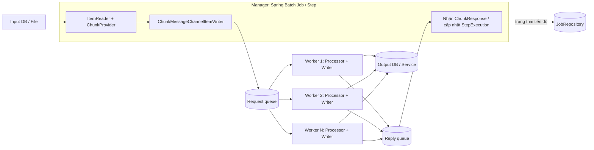

# Manager và remote workers trong Spring Batch Remote Chunking

## 1. Bối cảnh: vì sao cần tách manager và workers?

Trong Spring Batch, một `chunk-oriented Step` thông thường đọc dữ liệu bằng `ItemReader`, xử lý bằng `ItemProcessor` và ghi bằng `ItemWriter` trong cùng một ứng dụng. Khi phần xử lý hoặc ghi tốn nhiều CPU, thời gian gọi dịch vụ ngoài hay tài nguyên chuyên dụng, tăng số luồng trong cùng JVM có thể không đủ. **Remote Chunking** tách khâu đọc và điều phối khỏi khâu xử lý/ghi để nhiều tiến trình độc lập cùng xử lý các chunk.

Đây là một lựa chọn trong module `SPRING_BATCH_SCALING_OPERATIONS`: mở rộng Spring Batch cho dữ liệu lớn, đồng thời phải đo nút thắt, kiểm soát tài nguyên, bảo đảm an toàn khi chạy đồng thời và thiết kế retry/restart có thể vận hành được. Remote Chunking thường phù hợp khi **xử lý mỗi item nặng hơn đáng kể so với việc đọc và phân phối item**.

Ví dụ: một job đọc 480.000 bản ghi hóa đơn, kiểm tra quy tắc giá phức tạp, gọi dịch vụ tính thuế và ghi kết quả. Đọc danh sách hóa đơn tương đối nhanh, nhưng xử lý từng hóa đơn mất nhiều thời gian. Một manager đọc và gửi các nhóm 200 hóa đơn qua hàng đợi; bốn worker độc lập nhận các nhóm này, tính toán rồi ghi kết quả.

Sau bài học, bạn cần phân biệt rõ trách nhiệm của hai phía, hiểu luồng request/reply, cấu hình được cấu trúc cơ bản và đánh giá được những điểm dễ lỗi khi phân tán chunk.

## 2. Kiến trúc tổng thể



Hai hàng đợi trong sơ đồ là **kênh giao tiếp vật lý** qua message broker, chẳng hạn JMS. Spring Integration cung cấp các `MessageChannel` và channel adapter kết nối mã Java với broker. Những worker được triển khai thành các tiến trình độc lập có thể tăng/giảm số lượng theo tải.

| Thành phần | Sở hữu trách nhiệm | Không nên gánh |
| --- | --- | --- |
| **Manager** | Khởi chạy Job/Step, đọc input, tạo chunk, gửi `ChunkRequest`, nhận `ChunkResponse`, theo dõi `StepExecution` và trạng thái job trong `JobRepository`. | Tự làm hết phần tính toán nặng vốn định chuyển sang worker. |
| **Remote worker** | Nhận một chunk, gọi `ItemProcessor` (nếu có), `ItemWriter`, gửi phản hồi thành công/thất bại về manager. | Tự phát sinh việc đọc toàn bộ nguồn hoặc khởi chạy một Job/Step riêng cho mỗi chunk. |
| **Message broker** | Lưu/chuyển request và reply, phân phối request đến các consumer, hỗ trợ ack/redelivery và bộ đệm tải theo cấu hình. | Thay thế logic idempotency của ứng dụng hay bảo đảm giao dịch DB và message luôn nguyên tử. |
| **JobRepository** | Lưu metadata `JobExecution`, `StepExecution`, `ExecutionContext` của job được manager điều phối. | Mặc định quản lý từng worker như một `StepExecution` độc lập. |

**Điểm phân biệt quan trọng:** remote worker trong Remote Chunking thường là **message listener xử lý chunk**, không phải một Spring Batch Step độc lập. Trong Remote Partitioning, mỗi worker mới thường thực thi một Step với phạm vi dữ liệu/`ExecutionContext` riêng.

## 3. Dòng đời của một chunk

Giả sử `chunkSize = 200` và có ba worker đang nhận request từ cùng một queue.

1. **Manager khởi tạo step:** `JobLauncher` khởi chạy job; manager tạo `StepExecution` và khôi phục trạng thái `ItemReader` từ `ExecutionContext` nếu đây là một lần restart hợp lệ.
2. **Manager đọc item:** `ItemReader` lần lượt trả về tối đa 200 bản ghi; `ChunkProvider` gom thành chunk. Việc đọc vẫn tập trung ở manager.
3. **Manager phát request:** `ChunkMessageChannelItemWriter` đóng gói chunk thành `ChunkRequest` có thông tin xác định step/chunk, rồi gửi vào request channel/broker. Manager có thể tiếp tục đọc/gửi chunk kế tiếp trong khi chunk trước còn đang xử lý.
4. **Một worker nhận request:** với mô hình queue có competing consumers, mỗi bản giao request thường đến một consumer tại một thời điểm; broker có thể phát lại nếu xử lý/ack gặp lỗi.
5. **Worker xử lý:** `RemoteChunkingWorkerBuilder` dựng handler gọi `ItemProcessor` và `ItemWriter` trên các item nhận được. Ghi DB hoặc gọi dịch vụ ngoài xảy ra ở phía worker.
6. **Worker trả kết quả:** worker gửi `ChunkResponse` về reply channel, bao gồm kết quả và đóng góp thống kê bước xử lý. Cách broker ack/commit phụ thuộc cấu hình adapter, listener container và giao dịch.
7. **Manager tổng hợp:** phản hồi được ghép với request/step phù hợp; manager cập nhật số liệu và xử lý lỗi. Step chỉ hoàn thành đúng khi luồng đọc đã kết thúc **và** các kết quả cần thiết đã được xử lý theo cơ chế của framework.

Ví dụ mô phỏng phân phối (thứ tự hoàn thành có thể khác thứ tự gửi):

| Thời điểm | Manager | Worker A | Worker B | Worker C |
| --- | --- | --- | --- | --- |
| T1 | Gửi C1, C2, C3 | Nhận C1 | Nhận C2 | Nhận C3 |
| T2 | Tiếp tục gửi C4 | Đang xử lý C1 | Hoàn tất C2, gửi reply | Đang xử lý C3 |
| T3 | Nhận reply C2, gửi C5 | Hoàn tất C1, gửi reply | Nhận C4 | Hoàn tất C3, gửi reply |
| T4 | Tổng hợp reply | Nhận C5 | Tiếp tục xử lý | Sẵn sàng nhận chunk khác |

Không giả định reply có thứ tự hoặc mỗi request chỉ được giao đúng một lần. Bộ phận ghép phản hồi và logic ghi phải chịu được độ trễ, phát lại và tình huống phản hồi đến sau.

### Những đối tượng quan trọng

- `ChunkRequest<T>`: mang danh sách item và thông tin ngữ cảnh cần thiết để worker xử lý.
- `ChunkResponse`: phản ánh kết quả xử lý chunk để manager có thể tổng hợp tiến độ/thất bại.
- `ChunkMessageChannelItemWriter`: writer đặc biệt bên manager gửi request và tiếp nhận kết quả; **không phải** writer ghi bảng nghiệp vụ.
- `RemoteChunkingManagerBuilder`: cấu hình manager step ở Spring Batch 6.1+.
- `RemoteChunkingWorkerBuilder<I, O>`: cấu hình `IntegrationFlow` cho worker với processor, writer và hai message channel.
- `MessageChannel` cùng JMS/AMQP adapter: nối luồng Spring Integration với broker vật lý; các channel Java ở hai JVM **không phải** cùng một đối tượng dùng chung.

## 4. Cấu hình manager và worker

Ví dụ dưới đây minh họa API **Spring Batch 6.1**. Giả sử đã có `InvoiceInput`, `InvoiceResult`, `ItemReader`, `ItemProcessor`, `ItemWriter` và các bean channel/broker tương ứng. Các đoạn tập trung vào mối ghép giữa manager và workers, không phải toàn bộ ứng dụng có thể copy chạy ngay.

### 4.1. Phía manager: đọc, gửi và nhận kết quả

```java
@Configuration
public class InvoiceManagerConfig {

    @Bean
    Step invoiceManagerStep(
            JobRepository jobRepository,
            PlatformTransactionManager transactionManager,
            ItemReader<InvoiceInput> invoiceReader,
            @Qualifier("managerRequests") MessageChannel requests,
            @Qualifier("managerReplies") SubscribableChannel replies) {

        return new RemoteChunkingManagerBuilder("invoiceManagerStep", jobRepository)
                .outputChannel(requests)   // ChunkRequest -> broker
                .inputChannel(replies)     // ChunkResponse <- broker
                .<InvoiceInput, InvoiceResult>chunk(200)
                .reader(invoiceReader)
                .transactionManager(transactionManager)
                .build();
    }
}
```

Ở đây:

- `reader` chỉ tồn tại ở manager; nó quyết định phạm vi input và trạng thái đọc phục vụ restart.
- `chunk(200)` giới hạn số item trong một request. Đây là kích thước đơn vị phân phối, **không phải** số worker.
- `outputChannel` gửi request, `inputChannel` nhận reply. Cấu hình writer gửi message đã được builder thiết lập; không thay nó bằng writer nghiệp vụ trong manager step.
- `transactionManager` được chỉ định rõ khi nguồn đọc cần tài nguyên có giao dịch. Nó **không tạo** một giao dịch phân tán tự động qua manager, broker và DB của worker.
- Job chứa step này vẫn được khai báo/khởi chạy ở manager theo cơ chế Spring Batch thông thường.

### 4.2. Phía worker: nhận, xử lý và phản hồi

```java
@Configuration
public class InvoiceWorkerConfig {

    @Bean
    IntegrationFlow invoiceWorkerFlow(
            @Qualifier("workerRequests") MessageChannel incomingRequests,
            @Qualifier("workerReplies") MessageChannel outgoingReplies,
            ItemProcessor<InvoiceInput, InvoiceResult> invoiceProcessor,
            ItemWriter<InvoiceResult> invoiceWriter) {

        return new RemoteChunkingWorkerBuilder<InvoiceInput, InvoiceResult>()
                .inputChannel(incomingRequests)
                .itemProcessor(invoiceProcessor)
                .itemWriter(invoiceWriter)
                .outputChannel(outgoingReplies)
                .build();
    }
}
```

Worker chạy dưới dạng ứng dụng Spring độc lập, đăng ký listener qua Spring Integration. Nhiều bản sao worker có thể dùng cùng cấu hình và cùng request queue để chia tải. Với cấu hình Remote Chunking cơ bản, **worker không cần truy cập `JobRepository` của manager**. Nếu code nghiệp vụ phải truy cập DB đích, worker vẫn cần `DataSource` và quản lý giao dịch riêng phù hợp.

`ItemProcessor` nên độc lập trạng thái giữa các lần xử lý; `ItemWriter` nên ghi theo khóa nghiệp vụ có thể chống trùng. Nếu một JVM worker xử lý đồng thời nhiều request, mọi bean dùng chung trong worker phải an toàn với concurrency thực tế.

### 4.3. Đấu nối channel với broker

Tạo bean `MessageChannel` mới chỉ tạo kết nối **trong một tiến trình**. Muốn remote thật sự, cần channel adapter tới request/reply queue. Ví dụ minh họa các flow tương ứng (JMS):

```text
Manager JVM:
  managerRequests (DirectChannel) -> JMS outbound -> queue "batch.rc.requests"
  queue "batch.rc.replies" -> JMS inbound -> managerReplies (DirectChannel ở 6.1)

Worker JVM (mọi replica):
  queue "batch.rc.requests" -> JMS inbound -> workerRequests (DirectChannel)
  workerReplies (DirectChannel) -> JMS outbound -> queue "batch.rc.replies"
```

Một adapter nhận reply của manager trong Spring Integration phiên bản mới cần chuyển tiếp các header ghép phản hồi. Ví dụ:

```java
@Bean
IntegrationFlow repliesFromJms(
        ConnectionFactory connectionFactory,
        @Qualifier("managerReplies") MessageChannel managerReplies) {

    return IntegrationFlow
            .from(Jms.messageDrivenChannelAdapter(connectionFactory)
                    .destination("batch.rc.replies")
                    .headerMapper(new DefaultJmsHeaderMapper(
                            "correlationId", "sequenceNumber", "sequenceSize")))
            .channel(managerReplies)
            .get();
}
```

Điểm dễ bỏ sót là `correlationId`, `sequenceNumber` và `sequenceSize`. Nếu JMS header mapper phía **nhận reply** không giữ các header mà cơ chế gom phản hồi dựa vào, manager có thể chờ vô hạn hoặc báo lỗi ghép tương quan. Cần bảo toàn các header mà cấu hình Spring Batch/Spring Integration đang dùng qua cả quá trình serialize, gửi, nhận và giải mã. Chọn bộ ánh xạ header theo phiên bản thư viện và yêu cầu bảo mật, tránh mở toàn bộ header nếu không cần.

Ứng dụng thực tế còn cần cấu hình `ConnectionFactory`, hàng đợi bền vững, message converter tin cậy cho `ChunkRequest`/`ChunkResponse`, quyền truy cập broker, giới hạn kích thước message, listener concurrency và chính sách retry/ack. Dùng message broker và serializer nhất quán giữa manager/worker.

### 4.4. Khác biệt API theo phiên bản Spring Batch

| Phiên bản | Cách tạo manager step | Reply channel thường dùng |
| --- | --- | --- |
| Spring Batch 5.2 / 6.0 | `RemoteChunkingManagerStepBuilderFactory.get("stepName")`, sau đó `chunk(...).reader(...).outputChannel(...).inputChannel(...)`. | `PollableChannel`, thường là `QueueChannel`. |
| Spring Batch 6.1+ | `new RemoteChunkingManagerBuilder("stepName", jobRepository)`; đặt channel trước, rồi `chunk(...)` trả về builder cấu hình step thông thường. | `SubscribableChannel`, ví dụ `DirectChannel`. |

API factory/builder cũ được đánh dấu deprecated ở 6.1 và dự kiến bỏ ở 7.0. Không trộn cấu hình nhận reply của phiên bản 5.x với đoạn manager 6.1. Luôn kiểm tra chữ ký API đúng với dependency đang chạy; phần Worker Builder vẫn phục vụ mục đích xây dựng `IntegrationFlow`.

## 5. Ranh giới giao dịch, retry và restart

Remote Chunking có ít nhất ba phạm vi cần xem xét riêng: **tiến độ đọc của manager**, **chuyển phát message qua broker**, và **tác động nghiệp vụ ở worker**. Một transaction nội bộ Spring Batch không tự động bao trùm cả ba.

### 5.1. Vì sao có thể bị xử lý trùng?

Xét chuỗi sự kiện:

1. Worker nhận chunk C17 chứa hóa đơn H101 và ghi thành công vào DB đích.
2. Worker gặp sự cố trước khi reply được manager nhận hoặc trước khi broker ghi nhận ack thành công.
3. Broker chuyển phát lại C17 hoặc manager restart và tạo công việc tương đương.
4. Nếu writer chỉ `INSERT` không có khóa chống trùng, H101 bị ghi hai lần hoặc phát sinh lỗi unique constraint.

Do đó, **at-least-once delivery + idempotent processing** là giả định thiết kế an toàn hơn lời hứa "exactly once" chung chung. Một cách triển khai:

```sql
-- Ví dụ minh họa: một kết quả duy nhất cho mỗi hóa đơn/phiên bản xử lý.
CREATE TABLE invoice_results (
    invoice_id       BIGINT NOT NULL,
    pricing_version  VARCHAR(40) NOT NULL,
    amount           DECIMAL(18, 2) NOT NULL,
    processed_at     TIMESTAMP NOT NULL,
    PRIMARY KEY (invoice_id, pricing_version)
);
```

Writer có thể `UPSERT` theo `(invoice_id, pricing_version)` trong transaction DB; nếu tác động ra ngoài là gửi email, thanh toán hay gọi API không hỗ trợ idempotency, cần cơ chế khóa nghiệp vụ/idempotency key, bảng dedup hoặc transactional outbox thích hợp. Khóa chống trùng theo **định danh nghiệp vụ ổn định** thường hữu ích hơn khóa dựa riêng vào ID của một lần chạy, vì job restart có thể tạo execution mới.

### 5.2. Xử lý lỗi ở từng điểm

| Sự cố | Biểu hiện | Hướng xử lý |
| --- | --- | --- |
| Manager mất kết nối broker | Request không gửi được, step lỗi hoặc chờ tùy cấu hình. | Retry có backoff cho lỗi tạm thời, theo dõi số request đang chờ, giữ trạng thái reader nhất quán với cơ chế restart. |
| Worker chết trước khi ghi/ack | Request tồn đọng hoặc được broker giao lại. | Persistent queue, redelivery có giới hạn, giao dịch/ack hợp lý; tăng worker hoặc xử lý lỗi hạ tầng. |
| Worker đã ghi DB nhưng reply mất | Manager không thấy hoàn tất dù tác động nghiệp vụ đã xảy ra. | Idempotent writer; theo dõi reply timeout, reconcile với DB đích trước khi chạy lại. |
| Một item đầu vào sai dữ liệu | Một chunk có thể lỗi lặp lại, mắc kẹt ở request queue. | Phân loại lỗi nghiệp vụ và lỗi tạm thời, áp dụng retry/skip ở đúng nơi, lưu dữ liệu lỗi cùng nguyên nhân để điều tra. |
| Reply trễ hoặc không khớp | Manager chờ lâu, lỗi correlation hoặc không thể hoàn tất step. | Giữ header/ID tương quan, đặt giới hạn thời gian chờ có kiểm soát, không tùy tiện bỏ qua reply cũ. |
| DB đích quá tải | Worker xếp hàng, timeout, lock contention. | Giảm listener concurrency hoặc kích thước chunk, tăng pool phù hợp, tối ưu batch write và index. |

Chỉ cấu hình `retryLimit` trong manager rồi giả định mọi lỗi `ItemWriter` ở remote worker được thử lại chính xác theo cùng chính sách là không đủ. Cần xác định nơi exception phát sinh, handler/broker có trả lỗi hay redeliver ra sao, cách manager nhận lỗi, và kiểm thử quy tắc retry/skip của **phiên bản thực tế**.

### 5.3. Restart không đồng nghĩa tiếp tục chính xác từng lời gọi của worker

`JobRepository`/`ExecutionContext` giúp manager quản lý checkpoint và trạng thái step. Worker mặc định không sở hữu checkpoint đọc input hay `StepExecution` riêng. Khi restart, những chunk đã gửi nhưng chưa xác nhận có thể trở thành trường hợp cần phát lại/đối soát tùy thời điểm lỗi và cấu hình giao dịch.

Thiết kế restart đáng tin cậy cần đồng thời:

- Reader lưu và phục hồi vị trí đọc theo cơ chế `ItemStream`/`ExecutionContext` thích hợp.
- Broker có chính sách lưu bền, ack, redelivery và dead-letter queue được kiểm chứng.
- Writer idempotent hoặc có cơ chế đối soát tác động bên ngoài.
- Theo dõi định danh job/step/chunk và phân biệt retry cùng request với lần chạy lại dữ liệu nghiệp vụ.
- Chạy thử các tình huống kill manager, kill worker sau khi ghi DB, mất reply và ngắt broker.

## 6. Thread safety và giới hạn tài nguyên

Tăng worker không làm phần đọc của manager chạy song song tự động. Với Remote Chunking, manager thường vẫn là **một điểm đọc tập trung**. Nếu `ItemReader` chỉ đọc được 600 item/giây, hệ thống khó vượt mức đó dù cụm worker có thể xử lý 2.000 item/giây.

Ở phía worker, một JVM có thể chạy nhiều listener consumer đồng thời hoặc chạy một consumer với nhiều replica. Chọn bean `ItemProcessor`, `ItemWriter`, `DataSource` và HTTP client an toàn cho mức đồng thời đã cấu hình. Tránh giữ trạng thái mutable theo chunk trong singleton bean nếu nhiều message được xử lý cùng lúc.

Những giới hạn cần đo cùng nhau:

| Tầng | Dấu hiệu nghẽn | Phép đo đáng xem |
| --- | --- | --- |
| Manager reader | Worker rảnh, queue thường trống. | Item/s đọc được, thời gian đọc DB, truy vấn và kích thước fetch. |
| Broker | Request tồn nhiều hoặc reply đến chậm. | Queue depth, tuổi message cũ nhất, publish/consume rate, redelivery và DLQ. |
| Worker CPU / dịch vụ ngoài | Request queue tăng, worker bận. | Thời gian xử lý chunk p50/p95/p99, CPU, latency API, timeout. |
| DB đích | CPU worker chưa cao nhưng ghi rất chậm. | Connection pool, wait time, commit latency, lock, deadlock, disk I/O. |
| Manager reply | Worker xử lý xong nhưng step chưa kết thúc. | Số request outstanding, reply lag, lỗi correlation, timeout. |

### Ví dụ tính công suất ban đầu

Với 480.000 item, `chunkSize = 200`, ta có khoảng **2.400 request** (nếu mỗi chunk đầy và không có retry). Giả sử một worker xử lý một chunk trong trung bình 0,8 giây và có bốn worker chạy song song:

```text
Năng lực worker lý thuyết ≈ 4 × 200 / 0,8 = 1.000 item/giây
Năng lực thực tế ≤ min(reader, broker, workers, DB đích, dịch vụ phụ thuộc)
```

Nếu manager đọc được tối đa 600 item/giây, tăng từ bốn lên tám worker chưa chắc cải thiện throughput. Ngược lại, chunk quá nhỏ làm tăng overhead message/transaction; chunk quá lớn tăng payload, bộ nhớ, độ trễ retry và số item phải làm lại khi chunk lỗi.

Đo theo các cỡ chunk (ví dụ 50, 200, 500) và số worker (1, 2, 4, 8) trên dữ liệu gần thực tế. Quan sát cả throughput và độ trễ tail, số lần redelivery, kích thước message, tải DB/broker; chọn cấu hình theo nút thắt thật.

## 7. Vận hành manager và workers an toàn

Một quy trình triển khai thực tế:

1. **Khởi động hạ tầng giao tiếp:** tạo request/reply queue, thiết lập durable/persistent message khi cần, retry/backoff, DLQ, retention và quyền truy cập/TLS.
2. **Triển khai worker trước:** kiểm tra consumer đã kết nối broker, serializer và phiên bản message tương thích; bảo đảm DB đích/API sẵn sàng.
3. **Khởi chạy manager:** chỉ chạy một manager hợp lệ cho cùng JobInstance/JobExecution, tránh hai tiến trình vô tình đọc và gửi lại cùng tập input.
4. **Quan sát end-to-end:** log có cấu trúc với `jobExecutionId`, `stepExecutionId`, chunk/request ID, message ID, worker instance, retry attempt; đưa các ID vào tracing khi phù hợp.
5. **Scale có giới hạn:** đặt số worker/consumer tối đa theo quota dịch vụ ngoài, DB pool và băng thông broker, đồng thời theo dõi hiệu quả khi tăng replica.
6. **Dừng/khởi động lại có quy trình:** quản lý in-flight request, ack, thời gian chờ phản hồi và đối soát các tác động đã commit trước khi restart job.

Không ghi nguyên payload chứa dữ liệu nhạy cảm vào log/tracing; định danh và thống kê thường đủ để tra cứu. Nếu kết quả ghi phụ thuộc thứ tự item, nhiều worker có thể phá vỡ thứ tự đó: hãy tách xử lý theo khóa, thêm cơ chế ordering hoặc chọn mô hình khác.

### Kịch bản kiểm thử tích hợp nên có

| Kịch bản | Điều cần xác minh |
| --- | --- |
| 1 worker, dữ liệu nhỏ | Kết quả chính xác, số lượng read/write hợp lý, job kết thúc thành công. |
| 3–4 worker, chunk có tốc độ khác nhau | Tất cả chunk được tổng hợp dù reply khác thứ tự; không sót/trùng dữ liệu đầu ra. |
| Kill worker sau commit DB trước reply | Redelivery/restart không gây tác động nghiệp vụ trùng. |
| Ngắt broker lúc manager gửi | Job thể hiện trạng thái lỗi/chờ hợp lý; phục hồi không làm mất chunk. |
| Reply thiếu `correlationId` hoặc tới trễ | Hệ thống phát hiện lỗi, cảnh báo và không báo hoàn tất giả. |
| Dữ liệu lỗi liên tục (poison message) | Retry hữu hạn, có DLQ/nhật ký chẩn đoán, không lặp mãi. |
| Tăng worker lên gấp đôi | Throughput thực tăng khi worker là bottleneck; nếu không, xác định chính xác tài nguyên giới hạn. |

## 8. Khi nào chọn Remote Chunking?

| Mô hình | Đơn vị phân phối | Dữ liệu được đọc ở đâu? | Nên cân nhắc khi |
| --- | --- | --- | --- |
| Multi-threaded Step | Công việc trên nhiều thread trong cùng JVM. | Trong cùng tiến trình. | Cần tăng concurrency với hạ tầng đơn giản và component bảo đảm thread safety. |
| Parallel Steps | Các Step/flow độc lập. | Theo từng Step. | Có những giai đoạn nghiệp vụ độc lập có thể chạy song song. |
| **Remote Chunking** | **Chunk chứa item đã đọc.** | **Manager tập trung đọc.** | `processor/writer` nặng, input đọc nhanh, muốn scale worker độc lập. |
| Remote Partitioning | Một phân vùng và StepExecution ở worker. | Mỗi worker đọc phần input được giao. | Nút thắt là đọc/ghi I/O, input phân chia được theo range/key/file. |

**Quy tắc chọn lựa:** nếu manager đọc input quá chậm, Remote Chunking không xóa được nút thắt đó; hãy xem xét partitioning hoặc tối ưu reader. Nếu chi phí gửi dữ liệu qua broker lớn hơn thời gian xử lý, xử lý tại chỗ có thể hiệu quả hơn. Nếu tác động nghiệp vụ không idempotent và không thể đối soát, cần giải quyết vấn đề độ tin cậy trước khi phân tán tải.

## 9. Những điểm cần ghi nhớ

Manager sở hữu việc **đọc, chia chunk, gửi request, nhận reply và điều phối tiến độ**. Remote workers sở hữu việc **xử lý và ghi kết quả cho chunk được nhận**; chúng không mặc định trở thành các Spring Batch Step riêng. Broker giúp chia tải nhưng đồng thời tạo ranh giới về thông điệp, giao dịch, thứ tự và phản hồi. Một kiến trúc Remote Chunking tốt phải đi kèm phép đo bottleneck, writer idempotent, cấu hình correlation header, retry/restart đã kiểm thử và giới hạn concurrency phù hợp tài nguyên thực tế.

### Tài liệu tham khảo

- [Spring Batch 6.1 — Scaling and Parallel Processing](https://docs.spring.io/spring-batch/reference/scalability.html)
- [Spring Batch 6.1 — Externalizing Batch Process Execution](https://docs.spring.io/spring-batch/reference/spring-batch-integration/externalizing-execution.html)
- [API `RemoteChunkingManagerBuilder` (6.1)](https://docs.spring.io/spring-batch/reference/api/org/springframework/batch/integration/chunk/RemoteChunkingManagerBuilder.html)
- [API `RemoteChunkingWorkerBuilder` (6.1)](https://docs.spring.io/spring-batch/reference/api/org/springframework/batch/integration/chunk/RemoteChunkingWorkerBuilder.html)
- [API `RemoteChunkingManagerStepBuilder` (5.2)](https://docs.spring.io/spring-batch/docs/5.2.0/api/org/springframework/batch/integration/chunk/RemoteChunkingManagerStepBuilder.html)
