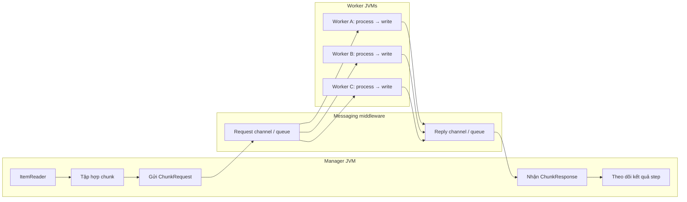
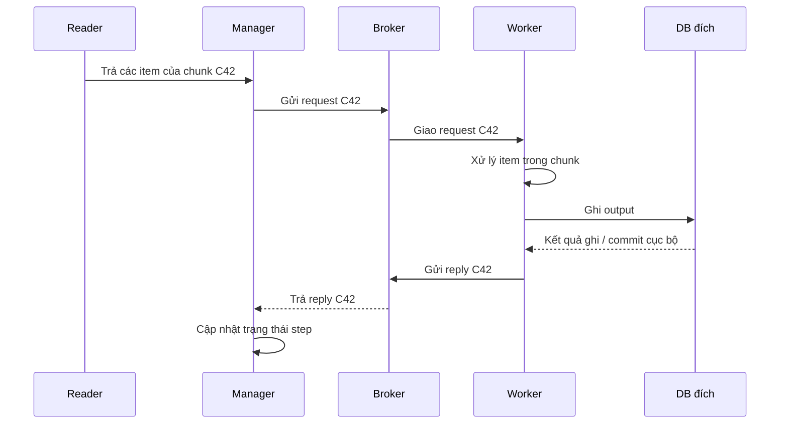

# Manager đọc item rồi gửi chunk trong Remote Chunking

## 1. Bài toán: Khi việc đọc và việc xử lý có đặc tính khác nhau

Một batch job cần đọc 5 triệu giao dịch từ cơ sở dữ liệu tập trung, kiểm tra quy tắc nghiệp vụ nặng rồi ghi kết quả vào hệ thống đích. Nếu tất cả bước đọc, xử lý và ghi đều ở một JVM, ứng dụng có thể bị giới hạn bởi CPU hoặc thời gian chờ của worker dù nguồn dữ liệu còn khả năng cung cấp item.

Trong chương **Remote Chunking** thuộc module **SPRING_BATCH_SCALING_OPERATIONS**, ta phân tách nhiệm vụ theo hướng: **manager đọc item, gom thành chunk và gửi chunk qua middleware; các worker nhận chunk để xử lý và ghi**. Kiến trúc này phù hợp với mục tiêu của module là mở rộng Spring Batch cho workload dữ liệu lớn, đo nút thắt, bảo đảm thread safety, retry/restart và vận hành job theo tài nguyên thực tế.

Đến cuối bài, bạn cần:

- Giải thích chính xác trách nhiệm của manager và worker trong remote chunking.
- Trình bày hành trình của một chunk từ `ItemReader` đến request message, xử lý ở worker và reply về manager.
- Phân biệt remote chunking với multi-threaded step, local chunking và remote partitioning.
- Phân tích transaction boundary, xác nhận message, tình huống gửi/nhận trùng và restart.
- Đề xuất chiến lược phân phối tải, backpressure, giới hạn số chunk đang xử lý, giám sát và vận hành.
- Phác thảo cấu hình Spring Batch Integration và kiểm thử những tình huống lỗi quan trọng.

> **Điểm then chốt:** Trong remote chunking, **manager sở hữu luồng đọc input và quyết định chunk nào được gửi**. Worker thường làm `ItemProcessor` và `ItemWriter`; worker **không tự đọc một phân vùng input độc lập** như remote partitioning.

## 2. Tổng quan kiến trúc manager → middleware → workers

Ba nhóm thành phần chính:

1. **Manager:** chạy job/step, chứa `ItemReader`, tập hợp item thành chunk theo commit interval, gửi yêu cầu xử lý chunk và theo dõi các phản hồi.
2. **Middleware:** đưa request đến worker và reply về manager. Ví dụ có thể dùng broker/kênh messaging với Spring Integration; đây là tầng liên lạc cần chính sách độ bền, xác nhận, timeout và xử lý lỗi.
3. **Worker:** nhận một chunk, gọi `ItemProcessor` cho từng item khi có, gọi `ItemWriter` cho dữ liệu đã xử lý, sau đó báo kết quả về manager theo giao thức của framework.



Điều dễ nhầm là từ **chunk**. Một chunk không nhất thiết tương ứng với một worker cố định, một partition dữ liệu, hay một transaction xuyên suốt các máy. Chunk là nhóm item manager gửi đi. Broker hoặc cơ chế phân phối có thể giao các chunk liên tiếp cho các worker khác nhau.

### Ví dụ minh họa

Reader trả về 1.000 item theo thứ tự ID. Đặt chunk size 100, ta có khoảng 10 chunk nếu không có item bị đọc lỗi hay điều kiện kết thúc đặc biệt.

- Manager đọc 100 item đầu, đóng thành chunk số 1 và gửi request.
- Worker B nhận chunk 1, xử lý và ghi dữ liệu.
- Trong lúc chờ phản hồi, manager có thể tiếp tục điều phối chunk kế tiếp tùy cấu hình giới hạn request đang xử lý.
- Worker A có thể xử lý xong chunk 2 trước worker B hoàn tất chunk 1.
- Manager nhận các kết quả, đối chiếu với request liên quan và cập nhật tiến độ theo cơ chế của framework.

**Thứ tự hoàn thành các chunk không được bảo đảm.** Nếu nghiệp vụ cần dữ liệu xuất hiện theo thứ tự ID, thiết kế phải giải quyết thứ tự ở lớp dữ liệu hoặc chọn mô hình xử lý khác.

## 3. Trách nhiệm cụ thể của manager

### 3.1. Manager là điểm đọc input

Trong mô hình remote chunking điển hình:

```text
Manager:
    read(item 1)
    read(item 2)
    ...
    read(item N)
    tạo chunk N item
    gửi chunk sang request channel
    theo dõi reply tương ứng

Worker:
    nhận chunk
    process(item) nếu có processor
    write(processedItems)
    trả trạng thái xử lý
```

Reader có thể đọc JDBC cursor/paging, file hoặc nguồn khác được Spring Batch hỗ trợ. Vì reader nằm ở manager, **dòng dữ liệu từ nguồn đi qua manager trước khi đến worker**, và chi phí fetch, serialization, network, memory có thể thành nút thắt ở manager.

Trong remote partitioning, manager giao dải dữ liệu/chỉ dẫn partition và worker tự mở reader cho vùng được giao. Hai mô hình khác nhau ngay từ nơi sở hữu reader.

### 3.2. Manager tạo chunk, không mặc định xử lý nghiệp vụ nặng

Giả sử ta dùng các thành phần:

- `ItemReader<OrderEvent>` ở manager: đọc bản ghi `OrderEvent`.
- `ItemProcessor<OrderEvent, SettlementRow>` ở worker: tính toán, làm giàu dữ liệu.
- `ItemWriter<SettlementRow>` ở worker: ghi báo cáo.

Nếu processor thực sự chiếm nhiều CPU, nhiều worker có thể tăng throughput. Nhưng nếu đọc JDBC đã tiêu tốn phần lớn thời gian hoặc item rất lớn, mở rộng worker sẽ ít tác dụng.

### 3.3. Manager quản lý vòng đời job/step

`JobRepository` của manager lưu metadata `JobInstance`, `JobExecution`, `StepExecution` và trạng thái phục vụ restart. Manager nhận phản hồi để biết chunk nào đã được xử lý theo hợp đồng message của Spring Batch Integration.

Không nên tự suy diễn “manager nhận reply” đồng nghĩa với một transaction ACID bao trùm cả broker và worker. Trạng thái manager, message trên broker và commit của worker thuộc các ranh giới khác nhau trừ khi ta cố tình triển khai một cơ chế transaction phân tán có hỗ trợ đầy đủ.

## 4. Điều gì được gửi qua middleware?

### 4.1. Request mang các item của chunk

Spring Batch Integration cung cấp các thành phần xây dựng remote chunking và message cho request/reply, thường được mô tả ở mức khái niệm bằng `ChunkRequest` và `ChunkResponse`. Request chứa nhóm item cần xử lý và thông tin để ghép đúng phản hồi với công việc đã gửi. Reply báo kết quả xử lý để manager tiếp tục điều phối.

Đây là **biểu diễn logic**, không phải cấu trúc JSON/wire format chính thức của thư viện:

```json
{
  "stepExecutionId": 1234,
  "chunkSequence": 17,
  "items": [
    {"orderId": 901, "amount": 150000},
    {"orderId": 902, "amount": 210000}
  ],
  "correlationKey": "step-1234-chunk-17"
}
```

Trong triển khai thực, **không tự thay đổi payload nội bộ của Spring Batch Integration** chỉ vì ví dụ trên. Cần dùng các message class, converter và serializer phù hợp với phiên bản Spring Batch/Spring Integration đang chạy.

### 4.2. Kênh gửi và kênh phản hồi phải ăn khớp

Manager có **outbound request channel** và **inbound reply channel**. Worker sử dụng inbound request và outbound reply tương ứng, thường thông qua các integration flow nối với broker.

| Luồng | Bắt đầu | Kết thúc | Cần bảo đảm |
| --- | --- | --- | --- |
| Chunk request | Manager | Một worker xử lý | Routing, payload tương thích, redelivery và giới hạn message size |
| Chunk reply | Worker | Manager | Correlation, timeout, reply không mất hoặc lạc step |
| Error / dead-letter | Broker hoặc worker | Hệ thống vận hành | Giữ được nguyên nhân và business key để phân tích |
| Metrics/log | Manager + worker | Monitoring | Theo dõi cùng job, step, request và worker |

**Request queue và reply queue có vai trò khác nhau**. Nếu reply bị gửi sai destination, worker có thể đã ghi DB thành công nhưng manager vẫn chờ tới timeout.

### 4.3. Payload size là chi phí thực

Nếu mỗi item cần truyền có kích thước serialize trung bình 2 KiB, chunk 500 item tương đương khoảng 1.000 KiB payload thuần, chưa tính header và overhead. Chunk lớn giảm số request nhưng làm message lớn, tăng latency và bộ nhớ trên cả producer, broker, consumer.

Trong kiến trúc gửi item qua message, cần kiểm tra:

- Item có serialize/deserialize ổn định giữa các phiên bản manager và worker không?
- Có object quá lớn, entity JPA đang gắn persistence context hoặc dữ liệu nhạy cảm không?
- Broker giới hạn kích thước message bao nhiêu, giới hạn inflight/prefetch thế nào?
- Cấu trúc payload có thay đổi khi triển khai rolling upgrade hai phía không?

Ưu tiên DTO rõ ràng và vừa đủ cho xử lý. Tránh gửi cả object graph nếu worker chỉ cần vài trường.

## 5. Chuỗi xử lý của một chunk từ đầu đến cuối

Giả sử cần đọc và ghi chunk C42:

1. Manager mở/chạy vòng chunk theo `Step` của mình, đọc các item và tập hợp C42.
2. Thành phần gửi message của manager chuyển C42 vào request channel/broker.
3. Broker chuyển request đến một worker sẵn sàng.
4. Worker nhận request, processor xử lý từng item, writer ghi kết quả.
5. Worker tạo reply theo giao thức, chuyển về reply channel.
6. Manager nhận reply, tương quan đúng chunk C42 và tiếp tục xử lý, cập nhật trạng thái step/checkpoint theo framework.
7. Khi mọi chunk cần thiết được xác nhận thành công và reader hết input, manager hoàn tất step theo các điều kiện kết thúc phù hợp.



Sơ đồ chỉ thể hiện đường đi thành công; **không có transaction mạng duy nhất** bao trùm tất cả mũi tên. Việc broker xác nhận giao message không đồng nghĩa writer đã commit; reply thành công không đồng nghĩa tất cả side effect bên ngoài DB có thể rollback.

### Ba loại tín hiệu cần phân biệt

| Tín hiệu | Nó xác nhận điều gì? | Không khẳng định |
| --- | --- | --- |
| Broker nhận request | Middleware đã nhận/ghi nhận message theo cấu hình | Worker đã xử lý xong |
| Worker hoàn thành ghi và phát reply | Worker báo đã xử lý chunk | Manager đã nhận và ghi trạng thái cuối |
| Manager kết thúc step `COMPLETED` | Spring Batch đã điều phối và ghi nhận hoàn tất theo quy trình | Không có lỗi nghiệp vụ bên ngoài hoặc dữ liệu đích luôn đúng nếu thiếu đối soát |

Những khoảng trống giữa các tín hiệu là nơi xuất hiện lost reply, redelivery, timeout và duplicate.

## 6. Cấu hình khái niệm với Spring Batch Integration

Spring Batch có module tích hợp messaging là **Spring Batch Integration** để xây dựng remote chunking. Ở phía manager, công cụ xây dựng thường là `RemoteChunkingManagerStepBuilder`; phía worker thường dùng `RemoteChunkingWorkerBuilder`. Các lớp liên quan hỗ trợ kết nối chunk step với các `MessageChannel` và integration flow.

Mẫu dưới đây minh họa **cấu trúc triển khai cho Spring Batch 5.x**, chưa phải ứng dụng chạy được độc lập: cần cung cấp `JobRepository`, transaction manager, bean reader/processor/writer, các channel, transport, serializer và cấu hình timeout theo phiên bản thư viện thực tế.

### 6.1. Manager step

```java
// Minh họa khung cấu hình, không bao gồm bean, imports và integration flow.
@Bean
public Step managerStep(
        JobRepository jobRepository,
        PlatformTransactionManager transactionManager,
        ItemReader<OrderEvent> orderReader,
        MessageChannel outboundRequests,
        PollableChannel inboundReplies) {

    return new RemoteChunkingManagerStepBuilder<OrderEvent, SettlementRow>(
                    "managerStep", jobRepository)
            .chunk(200, transactionManager)
            .reader(orderReader)
            .outputChannel(outboundRequests)
            .inputChannel(inboundReplies)
            .build();
}
```

Ở đây:

- `orderReader` chỉ được cấu hình cho manager. Manager là nơi biết cần đọc tiếp item nào.
- `chunk(200, transactionManager)` quyết định commit interval và transaction manager được sử dụng trong phần step ở manager; nó không tạo transaction xuyên JVM.
- `outboundRequests` dẫn tới integration flow gửi request vào middleware.
- `inboundReplies` nhận kết quả do worker gửi lại để manager đối chiếu.

**Cần đối chiếu chữ ký API với phiên bản Spring Batch Integration đang cài.** Trước khi chạy production, cấu hình đầy đủ adapter messaging, repository, timeout/giới hạn request đang xử lý và behavior khi mất reply.

### 6.2. Worker flow

```java
// Minh họa cấu trúc, cần bổ sung bean/cấu hình transaction và transport.
@Bean
public IntegrationFlow workerFlow(
        ItemProcessor<OrderEvent, SettlementRow> orderProcessor,
        ItemWriter<SettlementRow> orderWriter,
        MessageChannel inboundRequests,
        MessageChannel outboundReplies) {

    return new RemoteChunkingWorkerBuilder<OrderEvent, SettlementRow>()
            .itemProcessor(orderProcessor)
            .itemWriter(orderWriter)
            .inputChannel(inboundRequests)
            .outputChannel(outboundReplies)
            .build();
}
```

Worker không có `ItemReader<OrderEvent>` trong luồng trên; **dữ liệu được giao sẵn trong chunk request**. Thiết lập transaction của worker cho thao tác ghi cần phù hợp với cách worker xử lý message và kho dữ liệu thực tế.

Worker có thể được chạy thành nhiều instance, ví dụ ba container dùng cùng request destination và có khả năng nhận/chia tải theo cơ chế broker. Cần cấu hình consumer concurrency/prefetch và đảm bảo **một request được xử lý bởi một worker trong mỗi lần giao** (nhưng broker vẫn có thể giao lại khi mất xác nhận).

**Không tạo ba subscription kiểu broadcast cho cùng một request** nếu mục tiêu là chia tải. Broadcast khiến mỗi worker nhận cùng một chunk và có nguy cơ ghi trùng. Cần semantics cạnh tranh nhận việc hoặc routing một việc tới một worker.

### 6.3. Messaging topology không đồng nghĩa batch topology

Code builder mô tả kết nối bước batch với message channels, còn **transport integration flow** quyết định message đi qua RabbitMQ, JMS hay một hạ tầng tương đương. Đó là trách nhiệm bổ sung của ứng dụng.

Một ví dụ cấu hình logic:

```text
Manager:
  outboundRequests -> broker queue batch.chunk.requests
  inboundReplies   <- broker queue batch.chunk.replies

Workers:
  inboundRequests  <- broker queue batch.chunk.requests
  outboundReplies  -> broker queue batch.chunk.replies

Yêu cầu:
  - Các worker chia việc từ request queue
  - Có cơ chế correlation giữa request/reply
  - Có giới hạn message size, request in-flight, timeout
  - Có redelivery, dead-letter và đối soát khi lỗi
```

Tên queue trên là tên **minh họa**, không phải tên mặc định do Spring Batch tự tạo. Channel nội bộ và broker destination cần được nối đúng cả hai phía.

## 7. Ranh giới transaction: đừng nhầm “đã gửi” với “đã commit”

Remote chunking đưa giao tiếp mạng vào giữa manager và writer. Không có bảo đảm ACID xuyên suốt:

```text
Manager JVM                 Middleware                Worker JVM
[read / metadata] --request--> [queue] --delivery--> [process/write DB]
       ^                                                   |
       |-------------------- reply -------------------------|
```

Phần đọc và cập nhật metadata do manager điều phối, phần ghi được thực hiện ở worker. Từng phía có thể dùng transaction manager và nguồn dữ liệu khác nhau; broker có cơ chế xác nhận message của riêng nó.

### Tình huống 1: Worker lỗi trước khi ghi thành công

Worker nhận chunk nhưng processor ném exception hoặc transaction DB rollback. Tùy cơ chế xử lý, request có thể được giao lại hoặc lỗi được phản hồi lên manager. Chính sách retry/skip/đánh dấu `FAILED` phải rõ ràng; không được vô hạn redelivery cho một bản ghi dữ liệu sai không thể sửa.

### Tình huống 2: Worker commit DB rồi mất reply

1. Worker xử lý chunk C42, ghi dữ liệu vào DB và commit.
2. Kết nối bị ngắt trước khi reply về được manager.
3. Manager không có đủ bằng chứng để kết luận chunk C42 đã hoàn thành.
4. Cơ chế timeout/recovery có thể đưa tới xử lý lại cùng chunk.

Khi đó writer phải **idempotent**: một lần gửi lại không tạo thêm nghiệp vụ, ví dụ dùng unique key `(business_date, order_id)` và UPSERT có kiểm soát thay cho insert không ràng buộc.

### Tình huống 3: Manager crash sau khi gửi request

Manager có thể chưa kịp lưu trạng thái checkpoint tương ứng trong khi broker vẫn giữ request và worker có thể đã xử lý. Khi restart, việc phát lại item hoặc chunk có thể xảy ra tùy hợp đồng reader, repository và middleware.

**Vì vậy, trạng thái restart của manager và deduplication ở worker phải được kiểm thử cùng nhau.** Không nên tuyên bố “exactly once” chỉ vì broker hoặc `JobRepository` có lưu trạng thái.

### Tình huống 4: Worker gọi API bên ngoài

Chunk C42 gọi API cập nhật điểm thưởng rồi writer DB thất bại. API có thể đã thay đổi hệ thống ngoài, không rollback cùng DB. Dùng idempotency key, outbox/inbox hoặc thiết kế giao dịch bù phù hợp nếu nghiệp vụ yêu cầu.

| Ranh giới | Có thể bảo đảm trong phạm vi nào? | Còn phải thiết kế thêm |
| --- | --- | --- |
| Transaction DB ở worker | Commit/rollback các ghi SQL cùng transaction | Retry/redelivery sau commit |
| Broker ack | Xác nhận việc nhận hoặc xử lý delivery theo cấu hình | Không đồng nhất với commit DB |
| Manager checkpoint | Lưu tiến độ theo cơ chế Spring Batch | Tình huống mất reply hoặc crash giữa các ranh giới |
| API/file ngoài DB | Hành vi của hệ thống ngoài | Idempotency, bù trừ, đối soát |

**Nguyên tắc:** Dùng các transaction cục bộ đúng phạm vi, cộng với writer idempotent và recovery có kiểm chứng. Chỉ xem xét distributed transaction nếu kiến trúc, middleware và tất cả tài nguyên thực sự hỗ trợ, đồng thời yêu cầu nghiệp vụ biện minh được chi phí.

## 8. Correlation, timeout và xử lý trả lời muộn

Khi có nhiều worker, manager có thể phát C1, C2 và C3 gần nhau nhưng nhận reply theo thứ tự C3, C1, C2.

Cần theo dõi:

- **Danh tính job/step:** reply phải thuộc đúng lần chạy.
- **Danh tính chunk/request:** một reply tương ứng request nào?
- **Kết quả và lỗi:** chunk thành công, thất bại, timeout hay đã được xử lý lặp?
- **Thời gian:** request được gửi lúc nào, worker nhận lúc nào, hoàn tất lúc nào?
- **Trạng thái kết thúc:** sau khi step fail/restart, reply cũ còn đến có được xử lý đúng không?

Khi dùng Spring Batch Integration, nên dựa vào cơ chế message/correlation của thư viện, tránh tự phát minh chuỗi key và tự ghi trạng thái batch mà không hiểu luồng nội bộ.

### Timeout không nhất thiết nghĩa là thất bại ở worker

Nếu manager chờ reply quá thời gian quy định, có thể do:

1. Request chưa được worker nhận vì queue đầy.
2. Worker đang xử lý lâu hơn dự kiến.
3. Worker đã commit nhưng reply chưa được gửi/định tuyến.
4. Reply đã gửi nhưng manager tạm thời không nhận được.

**Không tự động xóa kết quả đã ghi** hoặc tạo JobInstance mới chỉ vì manager timeout. Cần kiểm tra trạng thái request, worker log, DB kết quả và chính sách phục hồi.

### Dead-letter queue và poison messages

Với item luôn làm worker lỗi, redelivery không giới hạn có thể khiến cùng một chunk chiếm tài nguyên mãi. Cần giới hạn retry, đưa vào DLQ/quarantine khi thích hợp, ghi nguyên nhân và khóa nghiệp vụ để xử lý thủ công hoặc tái chạy có kiểm soát.

Một chunk gồm nhiều item khiến cô lập một item lỗi phức tạp hơn xử lý từng message đơn. Phải xác định worker được phép skip item nào, rollback toàn chunk ra sao và manager biết kết quả nào là hợp lệ.

## 9. Thread safety, trạng thái và tính độc lập của worker

Worker có thể nhận nhiều request đồng thời nếu consumer được cấu hình concurrency cao. Khi đó:

- `ItemProcessor` nên stateless hoặc chỉ chia sẻ state thread-safe.
- `ItemWriter` phải an toàn khi được gọi đồng thời và xử lý ghi trùng từ redelivery.
- Connection pool và transaction manager ở worker phải đáp ứng số request đồng thời.
- Không dùng mutable counter/cache đơn giản để lưu checkpoint nghiệp vụ giữa các worker.
- Các instance worker có thể khởi động/dừng bất kỳ lúc nào, nên không được phụ thuộc vào bộ nhớ JVM của một worker để xác định item đã hoàn thành.

Nếu worker cần dữ liệu tham chiếu, đảm bảo cache đúng version và invalidation; nếu cần truy cập nguồn dữ liệu riêng, đó là **enrichment/lookup** ở worker, không thay đổi nguyên tắc manager là nơi đọc **dòng input chính** của remote chunking.

**Lưu ý thread safety ở manager:** Remote chunking thường giúp manager không phải thực thi processor/writer nặng, nhưng reader vẫn cần được cấu hình đúng theo cơ chế step. Nếu tự tạo nhiều thread đọc cùng cursor rồi gửi request, đây là thay đổi kiến trúc riêng và cần đánh giá lại thread safety/checkpoint. Không giả định remote chunking tự làm reader thread-safe.

## 10. Throughput: manager đọc nhanh tới đâu, worker xử lý được bao nhiêu?

Một ước lượng định hướng:

```text
End-to-end throughput
    <= min(
         manager read + serialize rate,
         broker transfer capacity,
         sum of sustainable worker processing rates,
         destination write capacity
       )
```

Ví dụ benchmark được:

| Thành phần | Khả năng duy trì |
| --- | ---: |
| Manager đọc + gửi | 12.000 item/giây |
| Middleware truyền nhận | 15.000 item/giây |
| Bốn worker, mỗi worker ~3.500 item/giây | 14.000 item/giây |
| DB đích ghi ổn định | 9.000 item/giây |

Throughput cuối tối đa khoảng **9.000 item/giây** trước khi tính các overhead còn lại. Thêm worker thứ năm không giải quyết nút thắt ở DB đích.

Khi chưa benchmark, không nên tính tổng worker theo lý thuyết rồi công bố SLA. Thực nghiệm phải dùng cùng dataset và quan sát cả **độ đúng dữ liệu**, p95/p99 latency, retry rate và memory.

### 10.1. Chunk size ảnh hưởng hai phía

Chunk lớn:

- Giảm số lần gửi request, routing và reply tương đối trên mỗi item.
- Có thể tối ưu batch write.
- Làm message lớn, tăng memory, kéo dài thời gian xử lý/rollback và chi phí redelivery khi lỗi.

Chunk nhỏ:

- Giúp phân phối việc đều hơn, rút ngắn thời gian phản hồi từng task.
- Tăng message traffic, metadata/correlation overhead và chi phí commit.

**Thí nghiệm:** Dùng chunk size 100, 250 và 500 trong cùng điều kiện, đo sustained throughput, message size, latency, broker queue depth, số transaction rollback và thời gian phục hồi sau lỗi.

### 10.2. Giới hạn số chunk đang xử lý đồng thời

Nếu manager phát chunk nhanh hơn worker hoàn thành, queue request tăng liên tục. Điều đó làm tiêu tốn disk/RAM broker, tăng thời gian chờ và khiến deadline khó dự báo.

Cần **backpressure** ở lớp điều phối: giới hạn số request in-flight, cấu hình broker prefetch/concurrency hợp lý, hàng đợi hữu hạn nếu có thể và có ngưỡng cảnh báo queue age. Chính cơ chế giới hạn request đang xử lý phải phù hợp version và framework sử dụng; không tự đặt một queue vô hạn giữa reader và broker.

### 10.3. Mô hình dữ liệu là yếu tố quyết định

Remote chunking hiệu quả khi:

- Manager có thể đọc item tương đối nhanh.
- Processor/writer tốn CPU hoặc I/O và có thể phân tán lên nhiều worker.
- Payload item đủ gọn để đưa qua middleware.
- Các chunk độc lập hoặc writer chịu được thứ tự xử lý bất kỳ.
- Tính idempotent và quan sát trạng thái được thiết kế rõ.

Nếu reader bị khóa trên một cursor chậm, hoặc item mỗi cái hàng chục MB, hãy thử tối ưu reader, thay đổi cách đọc hoặc cân nhắc partitioning để worker tự đọc dữ liệu nguồn.

## 11. Remote chunking khác remote partitioning thế nào?

| Khía cạnh | Remote chunking | Remote partitioning |
| --- | --- | --- |
| Nơi đọc input chính | **Manager** | **Worker partition** |
| Manager gửi gì? | **Dữ liệu item trong chunk** | Metadata/phân vùng công việc, ví dụ dải ID hoặc file |
| Worker làm gì? | Xử lý và ghi các item được gửi | Đọc, xử lý và ghi phân vùng được giao |
| Metadata batch | Manager điều phối step/chunk và reply | Manager có các partition `StepExecution`; worker step xử lý vùng riêng |
| Chi phí network | Truyền item payload qua middleware | Thường chủ yếu truyền chỉ dẫn partition/trạng thái |
| Bottleneck điển hình | Reader + serialize + broker của manager | Cân bằng partition, nguồn dữ liệu, DB đích |
| Restart | Cần giải quyết replay chunk, lost reply và checkpoint reader | Cần quản lý trạng thái/restart theo partition |
| Phù hợp khi | Reader nhẹ, processing/writing nặng, gửi item hợp lý | Dữ liệu chia thành các dải/file rõ ràng và worker đọc độc lập được |

Không nên gọi remote chunking là “partitioning chạy trên nhiều máy”. Hai mô hình đặt trách nhiệm đọc ở hai nơi khác nhau. Tương tự, **parallel steps** chạy nhiều step khác nhau và **multi-threaded step** chạy nhiều chunk cục bộ nhưng không cần gửi payload qua broker.

## 12. Tình huống thực tế: tính điểm rủi ro đơn hàng

**Bài toán:** Mỗi đêm có 3 triệu đơn hàng. Manager đọc DB giao dịch một cách tuần tự có checkpoint. Mỗi đơn hàng cần chạy tính toán rủi ro tương đối tốn CPU, worker ghi vào bảng `order_risk_score` theo khóa `(business_date, order_id)`. SLA hoàn thành trước 05:00.

### Phương án triển khai

1. Manager có reader trả DTO `OrderEvent` với `orderId`, `businessDate` và các trường thiết yếu cho tính toán. Không gửi JPA entity có nhiều quan hệ lazy hoặc toàn bộ dữ liệu không dùng đến.
2. Chunk size bắt đầu 200 item; manager phát yêu cầu qua request channel nối với durable queue.
3. Bốn worker cùng nhận job từ request queue. Mỗi worker dùng processor stateless và writer dựa trên unique key/UPSERT có kiểm soát.
4. Worker gửi reply theo cơ chế của Spring Batch Integration sau khi xử lý/ghi theo cấu hình transaction cục bộ.
5. Manager theo dõi reply, step status và checkpoint; hệ thống giám sát cả request queue lẫn reply queue.
6. Thử cố ý kill worker sau khi commit DB nhưng trước khi manager nhận reply. Xác minh redelivery/restart không gây ghi trùng.
7. Tăng từ bốn lên tám worker chỉ khi CPU worker đang bận và DB/broker/reader còn năng lực; đo throughput và SLA thực tế sau thay đổi.

### Ước tính sơ bộ

Nếu tốc độ cuối duy trì được 8.000 item/giây, riêng processing của 3 triệu item mất khoảng:

```text
3.000.000 / 8.000 = 375 giây ≈ 6,25 phút
```

Đây chỉ là phép chia định hướng, **không phải thời gian job cam kết**. Thời gian còn chịu ảnh hưởng của đọc nguồn, warm-up, queue, outlier, lỗi/retry, đối soát và publish. Cần đo theo tải peak và dự phòng đủ thời gian trong cửa sổ batch.

### Trạng thái nào cần đối soát?

- Tổng input theo ngày nghiệp vụ.
- Số item reader đã đọc, số item được filter/skip theo chính sách.
- Số business key duy nhất được ghi.
- Số request đang chờ, đang xử lý, timeout hoặc vào DLQ.
- Số chunk đã được manager ghi nhận và số lượng retry/redelivery.
- Kết quả sau restart khớp tập input kỳ vọng, không mất hoặc nhân đôi record.

**Không dùng chỉ số “đã có reply” thay thế kiểm tra chất lượng đầu ra.**

## 13. Kiểm thử lỗi và runbook vận hành

| Tình huống tiêm lỗi | Câu hỏi kiểm chứng |
| --- | --- |
| Worker crash trước khi ghi | Request có được xử lý lại? Manager có dừng hoặc timeout có kiểm soát? |
| Worker crash sau DB commit trước reply | Có ghi trùng không? Writer có idempotent thật không? |
| Broker ngừng hoạt động lúc manager gửi | Manager phản hồi thế nào? Chunk đã đọc có được phục hồi không? |
| Manager crash khi có request in-flight | Restart có đối soát đúng chunk đã hoàn thành và chưa hoàn thành không? |
| Reply đến muộn hoặc lặp | Correlation có đúng? Có làm sai trạng thái step không? |
| Poison item trong một chunk | Retry có giới hạn? Có DLQ/quarantine và nguyên nhân rõ ràng không? |
| Worker quá tải | Queue depth, age và timeout tăng ra sao? Có backpressure không? |
| DB đích deadlock hoặc hết connection | Có rollback/retry đúng phạm vi và tránh storm không? |
| Rolling deployment manager/worker | Converter, payload schema và version có tương thích không? |

**Một runbook tối thiểu:**

1. Kiểm tra `JobExecution`/`StepExecution` của manager và thời điểm sự cố.
2. Kiểm tra broker request/reply queue, DLQ, message age và consumer health.
3. Đối chiếu log theo chunk/request correlation và business key với dữ liệu thực tế tại worker DB.
4. Xác định chunk đã commit nhưng mất reply, chunk chưa xử lý hoặc poison chunk.
5. Khôi phục theo chính sách retry/restart của cùng JobInstance; tránh tạo identifying parameter mới để ép chạy lại toàn bộ input.
6. Sau recovery, đối soát input/output, trạng thái step và side effect ngoài DB; chỉ công bố output khi đạt điều kiện chất lượng.

Khi có nhiều worker, cần log đủ `jobName`, `jobInstanceId`, `stepExecutionId`, `chunk correlation`, `workerId`, duration và error type. Không ghi toàn bộ dữ liệu cá nhân nhạy cảm vào log message để “debug cho dễ”.

## 14. Những hiểu lầm thường gặp

**“Remote chunking cho mỗi worker một reader riêng.”** Không đúng với mô hình chuẩn: manager đọc item và gửi chunk. Nếu worker tự đọc một dải dữ liệu theo assignment, kiến trúc đó gần remote partitioning hơn.

**“Broker ack nghĩa là DB đã ghi xong.”** Broker ack xác nhận mức độ xử lý message theo cơ chế middleware, không nhất thiết là commit thành công của transaction DB.

**“Worker đã trả reply thì toàn job là exactly-once.”** Reply có thể bị mất sau commit; manager có thể restart/phát lại. Cần thiết kế tính idempotent và đối soát.

**“Thêm worker luôn tăng throughput.”** Nếu manager reader, network, broker hoặc DB đích đã bão hòa, worker tăng chỉ làm tăng tranh chấp/queue.

**“Chunk càng lớn càng tối ưu.”** Chunk lớn làm message lớn hơn, tăng thời gian retry/rollback, gây tắc broker và chênh lệch xử lý giữa worker.

**“Mọi side effect của worker rollback cùng manager.”** Transaction ở worker và manager không tự hợp thành một transaction phân tán.

**“Có `JobRepository` nên không cần DLQ/monitoring.”** Metadata step không thay thế theo dõi message, reply timeout, queue backlog và các sự cố trung gian.

## 15. Checklist thiết kế remote chunking

- [ ] Có lý do rõ ràng để manager đọc input tập trung và worker xử lý/ghi phân tán.
- [ ] Reader của manager có checkpoint/restart đúng và throughput đủ lớn.
- [ ] Request/reply channels, broker routing, correlation và serializer tương thích giữa các bên.
- [ ] Có giới hạn kích thước payload, request in-flight, queue length/age, timeout và retry.
- [ ] Worker processor/writer thread-safe theo concurrency và idempotent trước duplicate/redelivery.
- [ ] Transaction của DB đích và cơ chế broker ack/reply được hiểu, kiểm tra sau commit bị mất reply.
- [ ] Có DLQ/quarantine và quy trình xử lý poison message.
- [ ] Có metric manager, broker, worker, DB; theo dõi throughput **và** tính đúng dữ liệu.
- [ ] Đã chạy failure injection: crash manager/worker, mất broker/reply, restart, rolling update.
- [ ] Đã đánh giá remote partitioning nếu manager reader là nút thắt hoặc muốn worker tự đọc dữ liệu.

## 16. Câu hỏi tự kiểm tra

1. Trong remote chunking, tại sao manager vẫn có thể là bottleneck ngay cả khi triển khai 20 worker?
2. Sự khác nhau quan trọng nhất giữa request của remote chunking và assignment của remote partitioning là gì?
3. Nếu worker commit DB thành công nhưng manager không nhận reply, những trạng thái nào có thể xảy ra và đâu là chiến lược bảo vệ dữ liệu?
4. Vì sao tăng chunk size có thể giảm overhead nhưng lại làm tăng chi phí retry và nguy cơ message quá lớn?
5. Broker đã ack request nhưng worker báo lỗi ghi. Tại sao không thể kết luận chunk đã hoàn tất?
6. Phân biệt retry của transport, retry xử lý nghiệp vụ tại worker và restart của Spring Batch manager.
7. Với workload mà reader mất 80% thời gian còn processor rất nhanh, nên xem xét tối ưu gì trước khi tăng worker?

**Gợi ý câu 3:** Có thể dữ liệu đã commit ở worker nhưng manager chưa ghi nhận kết quả. Retry hoặc restart có thể tái thực hiện cùng chunk, vì vậy writer phải có khóa nghiệp vụ và xử lý idempotent, đồng thời cần đối soát trạng thái manager/broker/DB.

## 17. Ghi nhớ cốt lõi

- **Manager đọc item, tạo chunk và gửi chunk**; worker nhận chunk để xử lý và ghi. Đây là đặc điểm nhận diện remote chunking.
- Một request/reply flow không tạo transaction ACID xuyên manager, broker và worker. Phải thiết kế cho timeout, duplicate, lost reply và restart.
- Spring Batch Integration cung cấp building blocks cho manager step và worker flow; transport, serializer, observability và chính sách lỗi vẫn phải được cấu hình phù hợp.
- Throughput bị giới hạn bởi điểm chậm nhất giữa reader, middleware, worker và hệ thống ghi đích. Mở rộng worker cần đo và kiểm soát backpressure.
- Nếu dữ liệu có thể chia theo range/file để worker tự đọc, **remote partitioning** là phương án kiến trúc khác đáng cân nhắc.
- Độ đúng dữ liệu sau lỗi và recovery là điều kiện bắt buộc trước khi xem remote chunking là giải pháp scale thành công.
