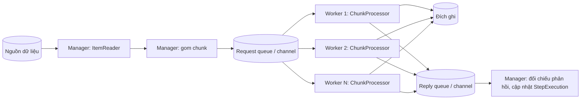
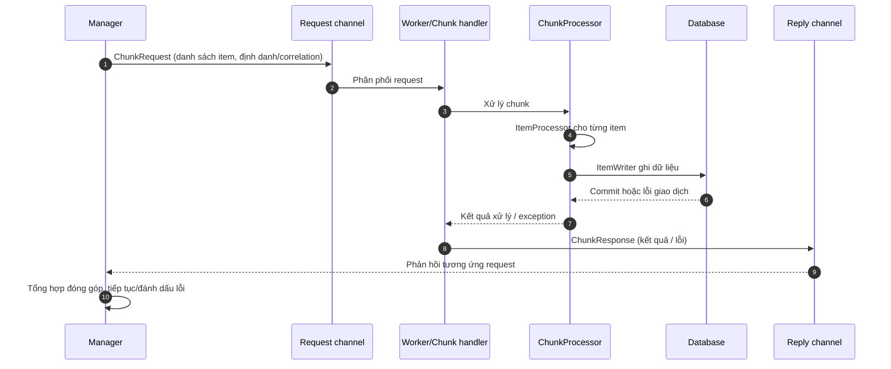

# Worker xử lý `ChunkProcessor` trong Remote Chunking

Trong **Spring Batch Remote Chunking**, *manager* chịu trách nhiệm đọc dữ liệu, gom các phần tử thành chunk và gửi chúng qua hệ thống nhắn tin. **Worker** nhận chunk, thực hiện logic của `ChunkProcessor` (thường gồm `ItemProcessor` và `ItemWriter`), sau đó gửi kết quả về manager. Cách tổ chức này cho phép tăng số worker để xử lý dữ liệu lớn mà vẫn giữ luồng đọc và trạng thái điều phối job ở manager.

Bài học thuộc chương **Remote Chunking** của module **SPRING_BATCH_SCALING_OPERATIONS**: tập trung vào đường đi của một chunk bên worker, cách cấu hình processor/writer, ranh giới giao dịch, khả năng chạy song song, retry/restart, vận hành và đo nút thắt. Nội dung giả định các thành phần Spring Batch và Spring Batch Integration tương thích với nhau; chữ ký API minh họa theo dòng Spring Batch 5.x, cần đối chiếu phiên bản đang dùng khi áp dụng.

## 1. Worker nằm ở đâu trong kiến trúc?



Ở mô hình tiêu chuẩn:

| Thành phần | Trách nhiệm chính | Điều cần lưu ý |
|---|---|---|
| Manager | Đọc bằng `ItemReader`, xác định ranh giới chunk, gửi `ChunkRequest`, nhận `ChunkResponse`, điều phối tiến trình step | Manager có thể trở thành nút thắt khi việc đọc hoặc phát/nhận thông điệp chậm. |
| Broker/transport | Chuyển request và reply giữa các tiến trình | Cần cấu hình durability, acknowledgement, redelivery, giới hạn hàng đợi và theo dõi độ trễ. |
| Worker | Nhận một request, chạy `ChunkProcessor`, gửi kết quả hoặc lỗi | Không tự đọc lại tập dữ liệu nguồn cho chunk này; có thể mở rộng bằng nhiều instance. |
| `JobRepository`/metadata | Ghi nhận trạng thái job/step phục vụ giám sát và restart | Trạng thái điều phối thuộc manager; không coi bộ nhớ của worker là nguồn trạng thái restart. |
| Kho dữ liệu đích | Lưu hiệu ứng ghi của `ItemWriter` | Cần giao dịch và cơ chế chống ghi trùng khi có redelivery. |

Remote chunking khác với **remote partitioning**: remote partitioning giao các *partition/step execution* để worker tự đọc một phân vùng dữ liệu; remote chunking giao **các item đã được manager đọc và gom thành chunk** để worker xử lý và ghi.

## 2. `ChunkProcessor` thực sự làm những gì?

`ChunkProcessor<I>` là phần thực thi xử lý một `Chunk<I>` trong hạ tầng chunk-oriented processing của Spring Batch. Với cách triển khai phổ biến là `SimpleChunkProcessor<I, O>`, công việc được tổ chức theo hai giai đoạn:

1. Duyệt từng item đầu vào, gọi `ItemProcessor<I, O>` để biến đổi hoặc kiểm tra dữ liệu. Nếu `process` trả về `null`, item đó được **lọc** khỏi đầu ra.
2. Gọi `ItemWriter<O>` với tập kết quả để ghi vào đích. Một lỗi chưa được xử lý ở giai đoạn process/write khiến request thất bại và phải đi qua chính sách xử lý lỗi đã cấu hình.

`StepContribution` được sử dụng để thu thập các số đếm liên quan đến việc xử lý chunk; handler đóng gói thông tin thành phản hồi để manager đối chiếu với request tương ứng. Việc phản hồi **thành công** về mặt xử lý không đồng nghĩa toàn bộ pipeline đã được checkpoint bền vững: broker, giao dịch ghi và metadata của manager là các phạm vi riêng.



Trong luồng xử lý thực tế, transport có thể redeliver một request. Vì vậy, worker phải được thiết kế để nhận lại cùng một công việc mà không làm sai dữ liệu nghiệp vụ.

### Một số khái niệm thường bị nhầm

- **`ChunkRequest`**: thông điệp chứa các item đã đọc cùng thông tin phục vụ liên kết với lần thực thi và phản hồi; định dạng serialization cụ thể phụ thuộc phiên bản và transport.
- **`ChunkProcessor`**: thành phần xử lý item và ghi đầu ra. Nó không quản lý việc đọc nguồn đầu vào.
- **Chunk handler**: lớp tích hợp nhận request, gọi `ChunkProcessor` và tạo `ChunkResponse`. Ứng dụng thường cấu hình handler thông qua builder thay vì tự giải mã request bằng tay.
- **`StepContribution`**: số liệu đóng góp từ chunk vào step, ví dụ số item được xử lý/lọc/ghi; không phải một giao dịch phân tán bao trùm worker và manager.
- **Chunk size**: số item manager gom mỗi request, là tham số ảnh hưởng chi phí mạng, bộ nhớ, độ trễ và quy mô công việc phải chạy lại khi lỗi.

## 3. Cấu hình worker bằng Spring Batch Integration

Về mặt ý tưởng, một worker cần: **kênh nhận request**, **kênh gửi reply**, `ItemProcessor` tùy chọn, `ItemWriter` và hạ tầng chuyển các thông điệp vào/ra broker. Spring Batch Integration cung cấp `RemoteChunkingWorkerBuilder` để kết nối các thành phần này với cơ chế gọi chunk handler.

Ví dụ dưới đây dùng Java 17+, Spring Batch 5.x và PostgreSQL. Bài toán: mỗi `Order` được chuyển thành một bản ghi tổng hợp `PaymentProjection`, rồi ghi vào bảng đích theo `order_id`. Đây là ví dụ minh họa cấu hình **worker**; các channel `workerRequests` và `workerReplies` phải được nối tới broker thực tế bằng Spring Integration adapter tương thích với manager.

```java
import java.math.BigDecimal;

import org.springframework.batch.integration.chunk.RemoteChunkingWorkerBuilder;
import org.springframework.batch.integration.config.annotation.EnableBatchIntegration;
import org.springframework.batch.item.ItemProcessor;
import org.springframework.batch.item.ItemWriter;
import org.springframework.context.annotation.Bean;
import org.springframework.context.annotation.Configuration;
import org.springframework.beans.factory.annotation.Qualifier;
import org.springframework.integration.dsl.IntegrationFlow;
import org.springframework.jdbc.core.JdbcTemplate;
import org.springframework.messaging.MessageChannel;
import org.springframework.transaction.PlatformTransactionManager;
import org.springframework.transaction.support.TransactionTemplate;

record Order(String id, BigDecimal amount) {}
record PaymentProjection(String orderId, BigDecimal total) {}

@Configuration
@EnableBatchIntegration
class RemoteChunkWorkerConfiguration {

    @Bean
    IntegrationFlow workerFlow(
            RemoteChunkingWorkerBuilder<Order, PaymentProjection> workerBuilder,
            @Qualifier("workerRequests") MessageChannel requests,
            @Qualifier("workerReplies") MessageChannel replies,
            ItemProcessor<Order, PaymentProjection> processor,
            ItemWriter<PaymentProjection> writer) {

        return workerBuilder
                .itemProcessor(processor)
                .itemWriter(writer)
                .inputChannel(requests)
                .outputChannel(replies)
                .build();
    }

    @Bean
    ItemProcessor<Order, PaymentProjection> orderProcessor() {
        return order -> {
            if (order.amount() == null || order.amount().signum() < 0) {
                throw new IllegalArgumentException("Invalid amount: " + order.id());
            }
            return new PaymentProjection(order.id(), order.amount());
        };
    }

    @Bean
    TransactionTemplate workerTransaction(PlatformTransactionManager transactionManager) {
        return new TransactionTemplate(transactionManager);
    }

    @Bean
    ItemWriter<PaymentProjection> projectionWriter(
            JdbcTemplate jdbc, TransactionTemplate workerTransaction) {
        return chunk -> workerTransaction.executeWithoutResult(status -> {
            for (PaymentProjection item : chunk) {
                jdbc.update("""
                    INSERT INTO payment_projection(order_id, total)
                    VALUES (?, ?)
                    ON CONFLICT (order_id)
                    DO UPDATE SET total = EXCLUDED.total
                    """, item.orderId(), item.total());
            }
        });
    }
}
```

Những điểm cốt lõi của ví dụ:

- `RemoteChunkingWorkerBuilder` nhận processor và writer, lắp luồng nhận request → xử lý chunk → phát reply. Trong nội bộ, chunk handler sẽ sử dụng cơ chế xử lý chunk tương ứng; không cần tự tạo vòng lặp đọc message hoặc gọi `process` từ controller.
- `ItemProcessor` **không lưu trạng thái chia sẻ** và không tạo tác dụng phụ bên ngoài. Nếu cần biến đổi thuần túy, đây là lựa chọn an toàn khi tăng số worker hoặc luồng xử lý.
- `TransactionTemplate` gom toàn bộ thao tác ghi của một chunk vào **một giao dịch cục bộ trên database**. Khi câu lệnh thứ ba thất bại, các câu lệnh trước trong cùng giao dịch được rollback nếu chúng cùng dùng transaction manager/data source.
- PostgreSQL `ON CONFLICT` yêu cầu khóa duy nhất trên `payment_projection(order_id)` và biến thao tác ghi thành *upsert*. Với cùng item và cùng giá trị, việc nhận lại request không tạo hai bản ghi.
- `workerRequests` và `workerReplies` là các channel logic. Nếu chúng chỉ là `DirectChannel` trong bộ nhớ mà không có broker adapter, hệ thống **chưa có giao tiếp liên tiến trình**.

Ví dụ lược bỏ cấu hình broker, schema migration, bảo mật và tùy chọn fault tolerance để giữ trọng tâm ở worker. Cần thiết lập message converter thống nhất giữa manager/worker, định danh correlation cho request/reply, phương thức acknowledgement, kiểm soát lưu lượng và chính sách lỗi phù hợp với adapter đang sử dụng.

### Nếu cần trực tiếp cấu hình `ChunkProcessor`

Về mặt lõi, processor thường tương đương:

```java
// Minh họa thành phần xử lý chunk, không phải một worker flow hoàn chỉnh.
ChunkProcessor<Order> chunkProcessor =
        new SimpleChunkProcessor<Order, PaymentProjection>(orderProcessor, projectionWriter);
```

`SimpleChunkProcessor` là lựa chọn phù hợp khi logic filter/process/write đơn giản. Khi cần retry/skip phức tạp ở mức item, cần dùng cơ chế chunk processing có fault tolerance đúng theo phiên bản Spring Batch, đồng thời kiểm thử tác động của lỗi lên toàn bộ chunk và phản hồi; không tự suy rằng các cấu hình `faultTolerant()` trên manager sẽ tự động điều khiển `ItemProcessor` chạy ở tiến trình worker. Việc gọi `ChunkProcessor` thủ công cũng không thay thế chunk handler, vì còn trách nhiệm xây dựng và đối chiếu `ChunkResponse`.

## 4. Vòng đời của một request tại worker

1. **Nhận request:** broker cấp một thông điệp cho consumer; hệ thống giải mã payload theo định dạng đã thống nhất. Thông điệp cần được gắn với request tương ứng để manager nhận diện phản hồi.
2. **Xác thực và bảo vệ đầu vào:** kiểm tra tính tương thích schema, dữ liệu bắt buộc và giới hạn kích thước. Không giả định request luôn hợp lệ chỉ vì được gửi từ manager.
3. **Xử lý:** handler gọi `ChunkProcessor`; processor có thể lọc item, kiểm tra quy tắc nghiệp vụ và tạo đầu ra. Logic không nên giữ biến đếm mutable ở singleton hay phụ thuộc thứ tự đến giữa các worker.
4. **Ghi:** writer áp dụng thay đổi trong giao dịch thích hợp. Các truy cập database hoặc API được giới hạn bằng connection pool, timeout và chính sách retry rõ ràng.
5. **Phản hồi:** handler phát kết quả hoặc lỗi; đường reply cần độ bền và correlation đủ tốt để manager không bỏ quên chunk đã xử lý.
6. **Hoàn tất việc nhận:** broker acknowledgement/redelivery phải phối hợp với việc ghi và gửi reply. Tên thao tác, thời điểm ack, giao dịch và cấu hình phụ thuộc loại broker/adapter; không mặc định việc commit DB đồng thời xác nhận message.

Đối với một chunk chứa 500 item, `ItemProcessor` có thể biến 500 item thành 490 item hợp lệ, lọc 10 item bằng cách trả về `null`, sau đó `ItemWriter` ghi 490 kết quả. Nếu có exception không được xử lý, hệ thống phải xác định rõ **toàn chunk thất bại**, **retry item cụ thể**, hay **bỏ qua theo chính sách**. Không nên nuốt exception để gửi phản hồi thành công khi dữ liệu chưa được ghi đầy đủ.

## 5. Giao dịch, redelivery và tính đúng đắn dữ liệu

### Không có giao dịch ACID tự động xuyên suốt manager, broker và worker

Một lần xử lý có ít nhất ba trạng thái bền vững khác nhau: checkpoint/metadata tại manager, trạng thái thông điệp tại broker và dữ liệu nghiệp vụ tại writer. Commit tại một nơi **không** mặc nhiên commit ở nơi còn lại. Vì vậy, không được lấy phản hồi thành công làm bằng chứng cho bảo đảm *exactly once* của toàn hệ thống.

| Tình huống lỗi | Hậu quả có thể xảy ra | Biện pháp |
|---|---|---|
| Worker chết trước khi ghi DB | Broker có thể phân phối lại request chưa được ack | Dùng durable queue, cơ chế redelivery hữu hạn và phục hồi consumer. |
| Ghi một phần rồi lỗi | Dữ liệu đích có thể dở dang nếu từng câu lệnh autocommit | Gom writer vào một transaction cục bộ; rollback cả chunk. |
| DB đã commit nhưng reply mất | Manager có thể chờ, timeout, retry hoặc phát lại công việc | Writer idempotent, correlation ổn định, quan sát reply queue. |
| Reply được gửi nhưng manager lỗi trước checkpoint | Khi restart có thể phát lại chunk đã ghi | Lưu hiệu ứng ghi chống trùng theo khóa nghiệp vụ, thử nghiệm restart thực tế. |
| Request lỗi vĩnh viễn, liên tục redeliver | Poison message giữ consumer bận và làm nghẽn queue | Giới hạn số lần thử, dead-letter queue, alert, quy trình xử lý thủ công. |

**Idempotency** là yêu cầu thiết kế quan trọng nhất ở worker khi tác vụ ghi có thể được thực hiện lại:

- Với phép ghi kiểu **upsert/projection**, tạo unique key theo định danh nghiệp vụ ổn định và cập nhật về cùng kết quả nếu request lặp lại.
- Với giao dịch kiểu **ghi bút toán/trừ tiền/gửi email**, một upsert đơn giản có thể chưa đủ. Cần bảng dedup hoặc idempotency key dùng chung với thay đổi nghiệp vụ, được ghi trong **cùng transaction** với hiệu ứng chính; với API bên ngoài, sử dụng idempotency key của API hoặc outbox.
- Ưu tiên khóa nghiệp vụ trên từng item (ví dụ `order_id` + loại sự kiện), vì chỉ dựa vào số thứ tự chunk có thể sai khi restart làm thay đổi biên chunk hoặc cách gom item.
- Không dùng `static Set`, bộ nhớ cache cục bộ hay thread-local làm sổ cái duy nhất: nhiều worker có bộ nhớ riêng và dữ liệu sẽ mất khi tiến trình khởi động lại.

Ví dụ thiết kế bảng ghi nhận tác vụ cho một side effect không có tính ghi đè:

```sql
CREATE TABLE processed_event (
    event_id VARCHAR(128) PRIMARY KEY,
    processed_at TIMESTAMP NOT NULL DEFAULT CURRENT_TIMESTAMP
);

-- Trong cùng transaction với việc ghi thay đổi nghiệp vụ:
INSERT INTO processed_event(event_id)
VALUES (:event_id)
ON CONFLICT (event_id) DO NOTHING;

-- Chỉ thực hiện side effect khi INSERT vừa thêm được một dòng.
```

Đây là **mẫu tư duy**, không phải đoạn SQL đủ để bảo vệ một side effect ở dịch vụ bên ngoài. Ứng dụng phải kiểm tra kết quả số dòng insert, thực hiện phần ghi dữ liệu cùng một transaction, và thiết kế riêng outbox/idempotency cho thao tác không thuộc transaction DB.

### Phân biệt retry, redelivery và restart

| Cơ chế | Đơn vị xử lý | Ai kích hoạt | Điểm cần kiểm soát |
|---|---|---|---|
| Retry lỗi tạm thời | Một lần gọi nghiệp vụ hoặc thao tác ghi | Logic fault tolerance/worker | Số lần thử, exception có thể retry, backoff, side effect trùng. |
| Broker redelivery | Cùng một message/request | Broker và consumer acknowledgement | Số lần giao, DLQ, duplicate message, duplicate reply. |
| Job restart | Step/job chạy lại dựa trên metadata | Manager + `JobRepository` | Trạng thái đầu đọc, trạng thái request dang dở, tính idempotent của writer. |

Nếu worker gọi một API chậm và lỗi quá thời gian, hãy đặt timeout; chỉ retry các lỗi tạm thời mà nghiệp vụ cho phép. Không retry vô hạn lỗi dữ liệu như mã thiếu hoặc schema sai. Một số broker có thể tự thử lại *message* trong khi logic worker cũng retry từng item; phối hợp hai tầng để tránh số lần thử tăng ngoài dự kiến.

Trong mô hình này, **worker không nên tự khởi chạy lại toàn bộ Job** khi lỗi một chunk. Manager quyết định trạng thái step/job, còn cơ chế message đảm nhiệm việc chuyển lại request theo chính sách đã thống nhất.

## 6. Thread safety khi tăng số worker

Remote chunking mở rộng bằng cách chạy nhiều instance worker hoặc tăng concurrency của consumer (nếu adapter hỗ trợ). Mỗi worker có thể đang xử lý các chunk khác nhau cùng lúc; trong cùng tiến trình, nhiều request cũng có thể dùng chung bean singleton.

Một số quy tắc thực hành:

- Giữ `ItemProcessor` **stateless**: mọi biến trung gian đặt trong phạm vi phương thức, tránh lưu `currentOrder`, `lastResult`, counter thường hoặc `ArrayList` mutable trên field singleton.
- `ItemWriter` phải chịu được việc nhận đồng thời các chunk. `JdbcTemplate` là đối tượng dùng chung được trong điều kiện cấu hình bình thường, nhưng connection được quản lý theo transaction; đừng chia sẻ một `Connection`, `PreparedStatement` hoặc buffer mutable giữa các request.
- Nếu một item phải được xử lý **đúng thứ tự** so với item khác cùng khóa nghiệp vụ, thêm cơ chế khóa, version/optimistic locking, phân vùng theo key hoặc serialize theo key ở tầng message/DB. Tăng worker có thể khiến các chunk hoàn thành lệch thứ tự gửi.
- Không mặc định `@StepScope`, `ExecutionContext`, `JobParameters` hay thread-local từ tiến trình manager được chuyển nguyên vẹn sang worker. Truyền thông tin nghiệp vụ tối thiểu qua contract được hỗ trợ và kiểm thử cách tạo step context ở phiên bản framework đang chạy.
- Đặt concurrency theo tài nguyên đích, không chỉ theo CPU worker. Nếu mỗi request giữ một DB connection, tổng số consumer đồng thời phải phù hợp với giới hạn pool và khả năng ghi của database.

Ví dụ **sai** khi chia sẻ trạng thái:

```java
class UnsafeProcessor implements ItemProcessor<Order, PaymentProjection> {
    private String currentOrderId; // bị ghi đè khi nhiều thread gọi process

    @Override
    public PaymentProjection process(Order order) {
        currentOrderId = order.id();
        return new PaymentProjection(currentOrderId, order.amount());
    }
}
```

Giải pháp đơn giản là dùng hoàn toàn biến cục bộ và trả kết quả trực tiếp như ví dụ `orderProcessor` ở trên. Nếu phải dùng cache, hãy xác định rõ tính đồng bộ, kích thước và cơ chế vô hiệu hóa; một cache thread-safe vẫn không đồng nghĩa với việc bảo đảm đúng thứ tự nghiệp vụ giữa nhiều máy.

## 7. Vận hành worker: đo, phát hiện và xử lý nút thắt

Khi tăng từ 2 lên 8 worker mà throughput gần như đứng yên, nguyên nhân có thể nằm ở **manager đọc chậm**, **broker bị nghẽn**, **database ghi chậm** hoặc **pool connection cạn**. Cần quan sát toàn bộ đường request → worker → reply thay vì chỉ nhìn CPU của worker.

| Chỉ số | Ý nghĩa | Tín hiệu cần điều tra |
|---|---|---|
| Độ sâu request queue, tuổi message lâu nhất | Độ trễ trước khi worker nhận việc | Queue tăng đều: khả năng xử lý thấp hơn tốc độ manager phát request. |
| Số request đang xử lý, thời gian xử lý chunk p50/p95 | Thời gian thực thi của worker | p95 tăng sau khi scale: DB/API hoặc contention có thể quá tải. |
| Số lượng retry/redelivery/DLQ | Lỗi tạm thời và lỗi kéo dài | Tăng cùng throughput giảm: nhiều request đang làm lại. |
| Reply queue depth và thời gian chờ reply | Sức khỏe đường phản hồi | Writer đã ghi nhưng manager chưa nhận kết quả: nguy cơ timeout/replay. |
| DB write latency, connection pool active/wait | Năng lực đích ghi | Worker chờ connection hoặc lock: cần tối ưu SQL/đích ghi trước khi tăng consumer. |
| Items/giây, chunks/giây, số item lọc/lỗi | Kết quả nghiệp vụ và tốc độ thực | Chunk throughput cao nhưng item throughput thấp có thể do chunk quá nhỏ. |

Về nguyên tắc, thông lượng đầu cuối bị giới hạn bởi mắt xích chậm nhất:

```text
throughput hệ thống <= min(
    tốc độ manager đọc/phát item,
    tổng năng lực worker xử lý item,
    tốc độ broker chuyển request/reply,
    tốc độ database hoặc API đích
)
```

Giả sử mỗi worker có thể xử lý chunk 100 item trong 2 giây, 6 worker có năng lực lý thuyết khoảng 300 item/giây nếu không có chi phí khác. Nếu database chỉ ghi an toàn 180 item/giây thì thêm worker thường chỉ tăng độ dài hàng chờ và contention. Đây là **ước lượng công suất**, phải đo bằng tải thật với số lượng item, kích thước payload và phân bố thời gian xử lý đại diện.

**Gợi ý khi điều chỉnh chunk size:** chunk quá nhỏ tạo nhiều message và reply; chunk quá lớn làm tăng dung lượng mỗi message, chiếm bộ nhớ, giao dịch ghi dài và chi phí chạy lại sau lỗi. Hãy thử trên dữ liệu đại diện (ví dụ 50, 200 và 500 item/chunk), đo p95 xử lý, số lần retry, độ sâu queue và tải DB. Tránh chọn theo throughput trung bình nếu tail latency hoặc lỗi tăng rõ rệt.

### Bảng xử lý sự cố nhanh

| Triệu chứng | Kiểm tra trước | Hành động thường phù hợp |
|---|---|---|
| Queue request tăng, worker ít bận | Adapter, subscription, consumer group, quyền truy cập broker | Sửa kết nối/consumer, xác minh request đến đúng channel. |
| Worker CPU cao, DB ổn | Processor nặng, allocation/GC, cấu trúc dữ liệu | Profile processor, tối ưu thuật toán; scale ngang sau khi đo. |
| Worker tăng nhưng throughput không tăng | Lock DB, pool, write throughput, manager read rate | Giảm concurrency, cải thiện batch SQL/index/pool hoặc tăng năng lực đích có kiểm soát. |
| DB có bản ghi trùng sau restart | Khóa nghiệp vụ, dedup và kiểu lệnh INSERT | Bổ sung unique key và idempotent writer; thử lại kịch bản mất reply. |
| Manager chờ mãi dù DB đã có dữ liệu | Reply channel, correlation, TTL, timeout, lỗi deserialize | Sửa contract/đường reply; đối chiếu request ID và log worker. |
| Một message lặp đi lặp lại | Exception gốc, số lần giao, DLQ, khả năng xử lý dữ liệu bẩn | Phân loại lỗi; đưa lỗi không phục hồi vào DLQ và xử lý có kiểm soát. |

Để truy vết xuyên các tiến trình, log các định danh hợp lệ như `jobExecutionId`, `stepExecutionId`, request/chunk correlation ID, worker instance và thời gian xử lý; dùng tracing nếu có. Tránh ghi toàn bộ nội dung item hoặc dữ liệu nhạy cảm vào log. Giữ phiên bản schema message đồng bộ khi triển khai rolling update và cảnh báo đối với reply chậm, DLQ tăng hoặc queue bị tồn đọng.

## 8. Quy trình kiểm thử trước khi chạy tải lớn

1. **Happy path:** cho manager gửi nhiều chunk, xác nhận mọi request đều có reply tương ứng; số bản ghi đích và các số đếm xử lý/lọc phù hợp dữ liệu nguồn.
2. **Processor lỗi dữ liệu:** cố tình đưa item không hợp lệ; kiểm tra loại exception, chính sách skip/retry, trạng thái step và cách ghi nhận lỗi. Không biến lỗi thành thành công im lặng.
3. **Writer rollback:** gây lỗi tại câu lệnh ghi thứ N; xác nhận transaction cục bộ không giữ lại nửa chunk và message được xử lý theo chính sách.
4. **Mất worker giữa chừng:** dừng instance khi đang xử lý, khởi động lại consumer; xác nhận redelivery và dữ liệu không trùng.
5. **Mất reply sau commit:** mô phỏng writer đã commit nhưng phản hồi không tới manager; xác minh ghi lặp không tạo side effect lần thứ hai.
6. **Manager restart:** dừng job/manager ở thời điểm có request đang xử lý, chạy lại bằng cơ chế restart của Spring Batch; kiểm tra tổng số item, trạng thái metadata và không mất/ghi trùng nghiệp vụ.
7. **Stress test:** tăng số worker và chunk size có kiểm soát, ghi lại throughput, latency p95, pool và queue; xác định mức concurrency ổn định trước khi đưa lên production.

Một thử nghiệm chỉ chứng minh được hiệu năng nếu có số liệu **trước/sau**, cùng tập dữ liệu và giới hạn tài nguyên tương đương. Một thử nghiệm chỉ chứng minh được restart an toàn nếu có lỗi thật tại đúng ranh giới commit, broker reply và manager checkpoint.

## 9. Checklist thiết kế worker có thể mở rộng

- [ ] Worker chỉ nhận item đã được manager đọc, dùng `ChunkProcessor`/handler của Spring Batch Integration để process và write.
- [ ] Request và reply dùng schema, serialization, correlation, queue/channel và timeout nhất quán giữa manager/worker.
- [ ] Processor không giữ trạng thái mutable chia sẻ; writer có transaction cục bộ và không phụ thuộc thứ tự hoàn thành chunk nếu không được bảo đảm.
- [ ] Hiệu ứng ghi có unique key/idempotency; thử kịch bản commit thành công nhưng reply mất.
- [ ] Retry lỗi tạm thời có giới hạn; dữ liệu lỗi vĩnh viễn được ghi nhận và có lối xử lý như DLQ hoặc quy trình vận hành.
- [ ] Có log/tracing và chỉ số queue, worker, reply, DB, retry và throughput.
- [ ] Đã kiểm thử restart, redelivery, rollback và concurrency với tải thực tế trước khi tăng số worker.

**Điểm cần ghi nhớ:** Worker xử lý `ChunkProcessor` là nơi tiêu thụ các chunk do manager phân phối, thực hiện transform/write và báo kết quả. Độ tin cậy không chỉ phụ thuộc code trong `ItemProcessor`/`ItemWriter`: phải phối hợp transaction cục bộ, idempotency, hợp đồng nhắn tin, cơ chế retry/restart và quan sát tài nguyên. Khi các điều kiện này được kiểm chứng, tăng số worker mới thực sự giúp mở rộng Spring Batch cho workload dữ liệu lớn.
