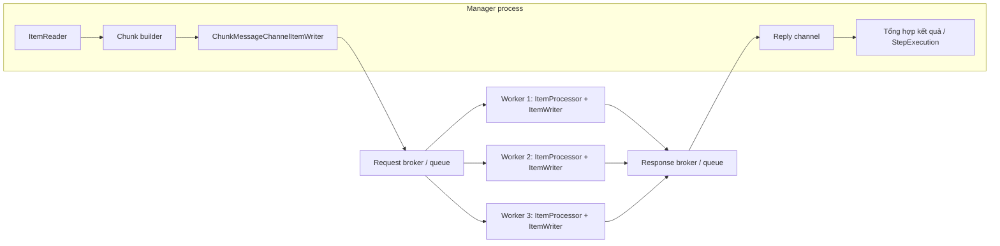
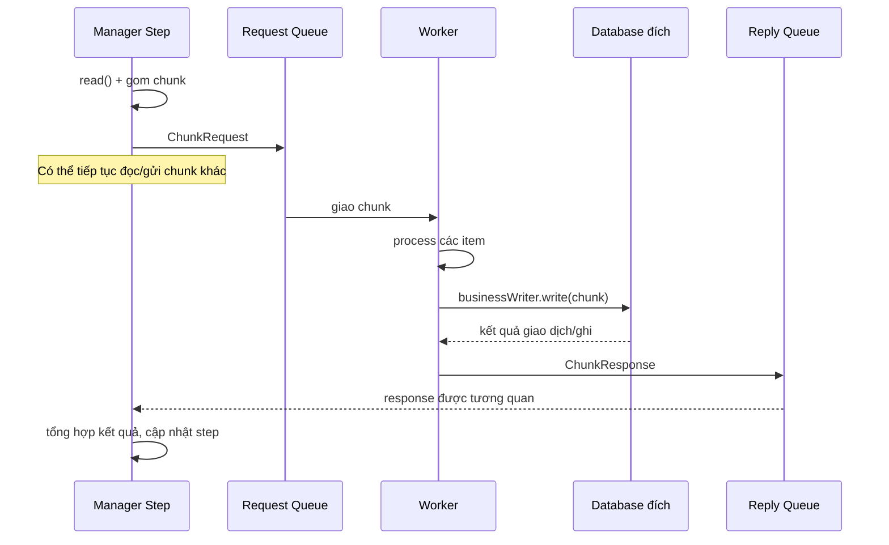

# Thay ItemWriter bằng message writer

## 1. Mục tiêu và bối cảnh

Trong chương **Remote Chunking** của module **SPRING_BATCH_SCALING_OPERATIONS**, chúng ta muốn xử lý workload lớn trên nhiều tiến trình/máy mà không bắt manager phải tự thực hiện phần xử lý và ghi tốn tài nguyên. Với một step chunk-oriented thông thường, `ItemWriter` ghi trực tiếp kết quả vào tệp, database hoặc dịch vụ đích. Trong **remote chunking**, `ItemWriter` ở **manager** được thay bằng thành phần **message writer**: nó gửi **cả chunk item** qua hệ thống messaging đến các worker; các worker dùng `ItemProcessor` và `ItemWriter` nghiệp vụ thật để xử lý và lưu kết quả.

Sau bài này, bạn có thể:

- Giải thích chính xác **thay writer ở đâu** và **writer nghiệp vụ còn nằm ở đâu**.
- Nắm luồng `ChunkRequest`, `ChunkResponse` và phản hồi từ worker.
- Cấu hình manager bằng `RemoteChunkingManagerStepBuilder` và worker bằng `RemoteChunkingWorkerBuilder` trong Spring Batch 5.2.
- Phân biệt việc gửi message thành công với **chunk đã được worker xử lý và commit thành công**.
- Thiết kế kênh gửi/nhận tin cậy, giới hạn hàng đợi, idempotency, retry/restart và giám sát bottleneck.
- Lựa chọn remote chunking so với multi-threaded step, parallel steps và partitioning theo chi phí đọc/xử lý/ghi thực tế.

> **Ghi nhớ trước tiên:** Trong remote chunking, manager **vẫn đọc và gom chunk**; **message writer thay writer tại manager**. Worker mới là nơi xử lý/ghi nghiệp vụ. Cách làm này chỉ tăng throughput khi công việc chuyển sang worker đủ nặng để bù chi phí serialization, broker, network và phản hồi; nếu reader ở manager đã là nút thắt, thêm worker chưa chắc giúp ích.

## 2. Step thông thường khác remote chunking như thế nào?

### 2.1. Step chạy tại một tiến trình

```text
ItemReader -> ItemProcessor -> ItemWriter -> Database/File
             (cùng một step)
```

Framework đọc các item, gom thành chunk, gọi processor và writer, sau đó quản lý transaction và metadata của step. Khi nâng concurrency trong cùng step bằng `TaskExecutor`, các component được chia sẻ phải bảo đảm thread safety; nếu reader hoặc writer có trạng thái không an toàn thì cần bảo vệ hoặc chọn mô hình khác.

### 2.2. Remote chunking



Luồng tổng quát:

1. Manager gọi `ItemReader.read()` để lấy dữ liệu nguồn và gom item thành chunk.
2. Thay vì gọi writer ghi thẳng vào bảng đích, manager gọi `ChunkMessageChannelItemWriter.write(chunk)`.
3. Message writer tạo yêu cầu xử lý chunk, gửi đến **request channel** được nối với middleware, chẳng hạn JMS hoặc AMQP.
4. Một worker nhận yêu cầu, chạy logic `ItemProcessor` (nếu có), gọi `ItemWriter` nghiệp vụ, rồi tạo **reply** chứa kết quả xử lý.
5. Manager nhận và tổng hợp reply, cập nhật tiến độ và kết thúc step khi các chunk liên quan đã được xử lý hoặc báo lỗi theo cấu hình.

**Manager không chờ từng chunk hoàn tất trước khi bắt đầu đọc/gửi chunk tiếp theo** theo cách triển khai hỗ trợ remote chunking. Tuy nhiên manager **phải theo dõi kết quả và chờ các phản hồi còn thiếu** trước khi có thể xem toàn step thành công. Gửi được một request đến broker **không đồng nghĩa** dữ liệu đã được ghi bền vững ở worker.

### 2.3. Hai writer khác vai trò

| Vị trí | Thành phần | Nhiệm vụ | Có ghi dữ liệu nghiệp vụ? |
| --- | --- | --- | --- |
| Manager | `ChunkMessageChannelItemWriter<T>` | Đóng gói và gửi chunk, thu thập/tổng hợp kết quả xử lý | **Không trực tiếp** |
| Worker | `ItemWriter<O>` thật, ví dụ `JdbcBatchItemWriter<O>` | Ghi dữ liệu đã xử lý vào database/tệp/dịch vụ đích | **Có** |

Không hiểu “thay `ItemWriter`” thành “không còn `ItemWriter`”. Thay đổi chỉ diễn ra ở **phía manager**: writer thật được chuyển vào worker. Nếu cần xử lý bằng `ItemProcessor`, cách tổ chức thông thường là để processor ở worker cùng writer nghiệp vụ.

## 3. Message writer thực hiện những việc gì?

Spring Batch Integration cung cấp lớp:

```java
org.springframework.batch.integration.chunk.ChunkMessageChannelItemWriter<T>
```

Thành phần này triển khai `ItemWriter<T>` và thực hiện nhiệm vụ đặc biệt thay cho một writer ghi dữ liệu trực tiếp. Trong luồng remote chunking, các đối tượng đáng biết là:

| Thành phần | Mục đích |
| --- | --- |
| `ChunkMessageChannelItemWriter<T>` | Gửi chunk request, theo dõi response và cung cấp kết quả để manager tổng hợp |
| `ChunkRequest<T>` | Chứa dữ liệu chunk và thông tin cần thiết để worker xác định yêu cầu |
| `ChunkResponse` | Phản ánh kết quả xử lý chunk từ worker, bao gồm thông tin contribution và trạng thái lỗi khi có |
| `MessagingTemplate` | Gửi message qua `MessageChannel`/Spring Integration |
| Request channel | Đường gửi các yêu cầu từ manager sang worker |
| Reply channel | Đường nhận phản hồi từ worker về manager |
| `ChunkProcessor` | Logic xử lý một chunk ở worker; dùng processor và writer nghiệp vụ |
| `RemoteChunkingManagerStepBuilder` | Builder tạo manager step và **tự cấu hình message writer** |
| `RemoteChunkingWorkerBuilder` | Builder giúp tạo integration flow cho worker nhận request, xử lý, gửi response |

Trong triển khai Spring Batch 5.2, builder manager **không cho thay writer của nó bằng `.writer(customWriter)`**: phương thức này ném `UnsupportedOperationException` vì builder phải dùng `ChunkMessageChannelItemWriter`. Do đó, “thay ItemWriter bằng message writer” thường được thực hiện **thông qua builder chuyên dụng**, chứ không phải tự viết mã bọc một `JdbcBatchItemWriter` ở manager.

Nếu cần cấu hình thủ công theo API tương ứng, message writer có thể được khởi tạo theo cách minh họa sau:

```java
// Minh họa API Spring Batch Integration 5.2;
// requests là MessageChannel, replies là PollableChannel.
MessagingTemplate template = new MessagingTemplate();
template.setDefaultChannel(requests);
template.setReceiveTimeout(2_000);

ChunkMessageChannelItemWriter<Order> messageWriter =
        new ChunkMessageChannelItemWriter<>();
messageWriter.setMessagingOperations(template);
messageWriter.setReplyChannel(replies);
```

Khi dùng `RemoteChunkingManagerStepBuilder`, thông thường **không cần tự tạo** hai bean `MessagingTemplate` và `ChunkMessageChannelItemWriter`. Builder tạo các phần này khi được cung cấp `outputChannel(...)` và `inputChannel(...)`. Ví dụ thủ công ở trên chỉ để nhìn rõ trách nhiệm của message writer, **không phải cấu hình phải thêm song song vào builder**.

**Phân biệt tên gần giống:** `MessageChannelItemWriter` là writer gửi item/message mang tính tổng quát trong Spring Batch Integration. Nó không thay thế nguyên trạng giao thức `ChunkRequest`/`ChunkResponse` của `ChunkMessageChannelItemWriter`. Đối với remote chunking có cơ chế phản hồi/tổng hợp, dùng đúng API remote chunking.

## 4. Ví dụ manager: thay writer theo API Spring Batch 5.2

Giả sử ứng dụng nhận các bản ghi hóa đơn nguồn `InvoiceRow` với `id` và `amount`. Đọc nguồn ở manager tương đối nhanh, nhưng việc tính toán phí và ghi dữ liệu ở worker tốn thời gian. Ví dụ sau tập trung vào cấu hình step; các bean kết nối database, broker và adapter sẽ được khai báo riêng.

```java
import org.springframework.batch.core.Step;
import org.springframework.batch.core.repository.JobRepository;
import org.springframework.batch.integration.chunk.RemoteChunkingManagerStepBuilder;
import org.springframework.batch.item.ItemReader;
import org.springframework.beans.factory.annotation.Qualifier;
import org.springframework.context.annotation.Bean;
import org.springframework.context.annotation.Configuration;
import org.springframework.messaging.MessageChannel;
import org.springframework.messaging.PollableChannel;
import org.springframework.transaction.PlatformTransactionManager;

@Configuration
class InvoiceRemoteChunkManagerConfig {

    record InvoiceRow(long id, java.math.BigDecimal amount) {}

    @Bean
    Step invoiceManagerStep(
            JobRepository jobRepository,
            PlatformTransactionManager transactionManager,
            @Qualifier("invoiceReader") ItemReader<InvoiceRow> reader,
            @Qualifier("managerRequests") MessageChannel requests,
            @Qualifier("managerReplies") PollableChannel replies) {

        return new RemoteChunkingManagerStepBuilder
                <InvoiceRow, InvoiceRow>("invoiceManagerStep", jobRepository)
            .chunk(200)
            .reader(reader)
            .outputChannel(requests)
            .inputChannel(replies)
            .transactionManager(transactionManager)
            .build();
    }
}
```

**Cách hiểu từng cấu hình:**

- `chunk(200)`: manager gom tối đa 200 item cho mỗi lần gửi, trừ chunk cuối hoặc khi chính sách hoàn tất có điều kiện khác.
- `reader(reader)`: đọc dữ liệu **tại manager**. Bean này vẫn phải hỗ trợ quản lý trạng thái/restart phù hợp.
- `outputChannel(requests)`: gửi request đến Spring Integration channel có outbound adapter nối với broker.
- `inputChannel(replies)`: nhận `ChunkResponse` từ worker; trong API 5.2, tham số yêu cầu `PollableChannel`, thường dùng một `QueueChannel` trong application context manager.
- `transactionManager(transactionManager)`: cung cấp transaction manager cho phần thực thi step tại manager. Không biến transaction trên manager và worker thành một distributed transaction.
- **Không có `.writer(...)`:** builder tự đặt `ChunkMessageChannelItemWriter` phù hợp.

Type parameter `<InvoiceRow, InvoiceRow>` ở manager thể hiện manager **không biến đổi dữ liệu** trước khi gửi; worker có thể áp dụng `ItemProcessor<InvoiceRow, ProcessedInvoice>` để tạo kiểu đầu ra khác. Hai phía phải thống nhất hợp đồng dữ liệu được truyền qua message.

### Các channel và broker là phần không thể thiếu

Ví dụ khai báo channel **trong manager**:

```java
import org.springframework.context.annotation.Bean;
import org.springframework.integration.channel.DirectChannel;
import org.springframework.integration.channel.QueueChannel;
import org.springframework.messaging.MessageChannel;
import org.springframework.messaging.PollableChannel;

@Bean("managerRequests")
MessageChannel managerRequests() {
    return new DirectChannel();
}

@Bean("managerReplies")
PollableChannel managerReplies() {
    return new QueueChannel();
}
```

Hai bean trên chỉ tồn tại trong **một application context**. `DirectChannel`/`QueueChannel` **không tự giao tiếp xuyên JVM**. Muốn chạy remote thực sự, ứng dụng phải nối `managerRequests` tới outbound adapter JMS/AMQP và nối inbound adapter nhận phản hồi từ broker vào `managerReplies`. Manager và worker cũng phải dùng đúng request/reply destinations.

```text
Manager managerRequests --[JMS/AMQP outbound]--> Broker queue: invoice.requests
Manager managerReplies  <--[JMS/AMQP inbound]--- Broker queue: invoice.replies
```

Đoạn cấu hình trên là **ví dụ lõi**, chưa phải ứng dụng chạy độc lập. Cần thêm bean `invoiceReader`, `Job`, cấu hình database, Spring Integration adapters, broker connection, credential và error handling.

## 5. Ví dụ worker: giữ writer nghiệp vụ ở nơi xử lý thật

Worker nhận một chunk từ broker, xử lý item và ghi kết quả. Ví dụ sau dùng `RemoteChunkingWorkerBuilder` thuộc Spring Batch Integration 5.2. Giả sử hệ thống đã có `ItemProcessor<InvoiceRow, ProcessedInvoice>`, `ItemWriter<ProcessedInvoice>` và các channel đã nối với inbound/outbound adapter.

```java
import org.springframework.batch.integration.chunk.RemoteChunkingWorkerBuilder;
import org.springframework.batch.item.ItemProcessor;
import org.springframework.batch.item.ItemWriter;
import org.springframework.beans.factory.annotation.Qualifier;
import org.springframework.context.annotation.Bean;
import org.springframework.context.annotation.Configuration;
import org.springframework.integration.dsl.IntegrationFlow;
import org.springframework.messaging.MessageChannel;

@Configuration
class InvoiceRemoteChunkWorkerConfig {

    record InvoiceRow(long id, java.math.BigDecimal amount) {}
    record ProcessedInvoice(long id, java.math.BigDecimal finalAmount) {}

    @Bean
    IntegrationFlow invoiceWorkerFlow(
            @Qualifier("workerRequests") MessageChannel requests,
            @Qualifier("workerReplies") MessageChannel replies,
            ItemProcessor<InvoiceRow, ProcessedInvoice> processor,
            ItemWriter<ProcessedInvoice> businessWriter) {

        return new RemoteChunkingWorkerBuilder
                <InvoiceRow, ProcessedInvoice>()
            .inputChannel(requests)
            .outputChannel(replies)
            .itemProcessor(processor)
            .itemWriter(businessWriter)
            .build();
    }
}
```

Ở worker:

1. `workerRequests` nhận `ChunkRequest` của manager từ broker.
2. `RemoteChunkingWorkerBuilder` tạo integration flow/handler để xử lý các request theo chunk.
3. `processor` biến hóa đơn đầu vào thành kết quả nghiệp vụ.
4. `businessWriter` mới là nơi ghi vào đích, ví dụ `JdbcBatchItemWriter`.
5. Handler gửi `ChunkResponse` ra `workerReplies`; outbound adapter chuyển response về broker để manager nhận.

Mỗi worker tiến trình có cấu hình tương thích và có thể nhận chunk khác nhau từ cùng request destination theo cơ chế competing consumers. **Độ đồng thời thực** còn phụ thuộc số consumer, cấu hình broker, số thread và khả năng của database đích.

Để giảm lỗi khi triển khai, hãy định nghĩa DTO/message contract dùng chung giữa các ứng dụng manager/worker. Với ví dụ trên, hai record `InvoiceRow` ở hai đoạn cấu hình chỉ mang tính minh họa; trong dự án thực tế chúng phải tham chiếu đến **cùng một kiểu dữ liệu/hợp đồng serialize**, không để hai application tạo hai class Java không tương thích rồi kỳ vọng Java serialization tự khớp.

### Writer nghiệp vụ có thể dùng JDBC như bình thường

```java
@Bean
JdbcBatchItemWriter<ProcessedInvoice> businessWriter(DataSource dataSource) {
    return new JdbcBatchItemWriterBuilder<ProcessedInvoice>()
        .dataSource(dataSource)
        .sql("""
            INSERT INTO invoice_result (invoice_id, final_amount)
            VALUES (:id, :finalAmount)
            """)
        .beanMapped()
        .build();
}
```

Snippet này minh họa **writer được đặt ở worker**. Trong Java thực tế cần import kiểu dữ liệu, `DataSource` và builder như bình thường. Chúng ta phải cấu hình transaction, ràng buộc unique key `invoice_result.invoice_id` và chính sách ghi lặp phù hợp; câu `INSERT` trực tiếp chỉ bảo đảm tránh trùng nếu database thực sự có constraint, còn replay có thể làm chunk lỗi khi key đã tồn tại.

## 6. Request, response và ranh giới transaction

Điểm khó của “thay writer bằng message writer” không nằm ở phương thức `write(...)` mà ở **việc giao việc qua một biên hệ thống**.



### Gửi request không phải commit ở đích

Ngay khi request được broker xác nhận nhận, phía manager có thể tiếp tục gửi chunk khác. Database đích của worker có thể chưa xử lý chunk đó. Nếu worker lỗi sau khi nhận message, manager có thể nhận phản hồi lỗi, nhận phản hồi muộn hoặc không nhận được phản hồi trước timeout.

**Các transaction không tự trở thành một transaction XA chung:**

- Transaction/checkpoint của reader và manager có phạm vi tại manager.
- Việc nhận message, xử lý dữ liệu và ghi ở worker có phạm vi transaction/ack riêng, tùy cấu hình Spring Integration, broker adapter và database.
- Một response chỉ đáng tin là “đã ghi thành công” nếu thiết kế bảo đảm response được phát sau trạng thái commit phù hợp. Việc có một handler tự động không thay cho kiểm chứng transaction/ack trong toàn đường đi.

Khi dùng ít nhất hai hệ thống lưu trữ (broker và database), phải kiểm tra từng trường hợp lỗi để xác định có khả năng **phát lại chunk**, **mất phản hồi** hoặc **ghi dữ liệu nhưng chưa ack request** hay không.

### Vì sao message cần correlation?

Các chunk có thể hoàn tất **không theo thứ tự gửi**. Manager phải biết `ChunkResponse` nào ứng với request nào, đồng thời tổng hợp số đếm hoặc lỗi của chunk tương ứng. Các message header như `correlationId` và các header liên quan đến chuỗi phản hồi có thể quan trọng cho Spring Integration aggregator.

Với **JMS và Spring Integration 7.0.6+**, tài liệu Spring Batch lưu ý bộ ánh xạ JMS header có thể không tự đưa `correlationId`, `sequenceNumber`, `sequenceSize` từ JMS properties trở lại message headers. Khi triển khai adapter nhận reply, cần cấu hình `DefaultJmsHeaderMapper` cho phép ánh xạ những header mà flow cần (hoặc danh sách rõ ràng theo tài liệu phiên bản). Nếu header bị mất, aggregator có thể treo hoặc báo lỗi correlation.

Ví dụ minh họa:

```java
new DefaultJmsHeaderMapper(
    "correlationId", "sequenceNumber", "sequenceSize");
```

Đây là **ví dụ cấu hình header mapper theo tài liệu Spring Batch/Spring Integration 6.1**, không nên tự gán mọi chi tiết của API này cho phiên bản cũ hơn. Trong mọi trường hợp, phải test một request sinh response đúng và correlation chạy qua cả broker.

## 7. Retry, restart và xử lý trùng dữ liệu

### 7.1. Những kịch bản cần thử

| Sự cố | Điều có thể xảy ra | Biện pháp |
| --- | --- | --- |
| Broker nhận request nhưng worker chưa nhận | Message tồn trong queue hoặc hết hạn | Durable queue, TTL/retry/DLQ rõ ràng |
| Worker nhận rồi crash trước khi ghi | Request có thể được redeliver | Ack/transaction phù hợp, xử lý lại an toàn |
| Worker ghi DB thành công nhưng crash trước khi gửi reply | Manager có thể chưa biết chunk đã hoàn tất | Idempotent write theo business key; đối chiếu DB đích |
| Reply được gửi nhưng manager không nhận | Manager chờ timeout hoặc retry dù worker đã hoàn tất | Durable reply, correlation, tracing, chính sách khôi phục |
| Broker/transport gửi trùng request | Một chunk được worker nhận nhiều lần | Deduplication/idempotency key có độ bền thích hợp |
| Manager restart sau lỗi | Có thể tái tạo/gửi lại một số chunk tùy checkpoint và trạng thái | Kiểm thử restart, checkpoint, unique constraint, reconciliation |

Một công thức triển khai hữu ích là lưu khóa nghiệp vụ bất biến (chẳng hạn `invoice_id`) và sử dụng **upsert idempotent** hoặc bảng ghi nhận `processed_chunk_id`/`request_id` khi yêu cầu. Chỉ dùng `chunk_id` nếu ID đó thật sự ổn định và duy nhất theo thiết kế; không mặc định một số thứ tự do manager phát ra sẽ luôn giống nhau qua mọi lần restart.

Đừng nhầm **delivery at-least-once** của broker với **exactly-once business effect**. Một broker gửi ít nhất một lần có thể tạo redelivery; cần transaction, khóa duy nhất và/hoặc giao thức idempotency ở phía worker/đích ghi.

### 7.2. Manager có JobRepository nhưng không tự nhìn thấy mọi giao dịch worker

`JobRepository` ghi nhận tiến độ job/step ở phía batch manager và tổng hợp thông tin do remote chunking trả về. Tuy nhiên việc một request đã đi vào broker không đủ xác nhận nó đã được commit ở database worker. Một `StepExecution` hoàn tất và đúng các count là tín hiệu cần thiết cho vận hành, nhưng khi xác nhận dữ liệu nghiệp vụ phải **đối chiếu với bảng/đích thật**.

Trong remote chunking, worker không mặc định tạo **một StepExecution riêng cho từng chunk** như remote partitioning. Đơn vị giao việc ở đây là `ChunkRequest`; manager vẫn quản lý step logic của mình. Muốn restart độc lập theo từng vùng dữ liệu có checkpoint riêng, hãy xem xét remote partitioning thay vì giả định mỗi message là một partition step.

### 7.3. Chiến lược restart thực tế

Với job xuất hóa đơn:

1. Đánh dấu record nguồn theo ID, giữ tập dữ liệu đầu vào ổn định cho một lần job logic hoặc áp dụng snapshot.
2. Để reader lưu checkpoint phù hợp, có thể khôi phục sau lỗi ở manager.
3. Tại worker, ghi idempotent theo `invoice_id` và định nghĩa xử lý khi cùng chunk/request được phát lại.
4. Sau lỗi, kiểm tra broker queues/DLQ, metadata batch, số record đã ghi và các ID còn thiếu.
5. Chỉ đánh dấu job phục hồi thành công khi **bản ghi đầu ra đáp ứng đủ điều kiện nghiệp vụ**.

Không mặc định tăng timeout hoặc retry vô hạn sẽ chữa được lỗi: nó có thể làm backlog tăng và kéo dài thời gian hoàn thành, thậm chí gia tăng ghi trùng.

## 8. Đo thông lượng khi đổi writer thành message writer

Trong remote chunking, **manager vẫn là nơi đọc**, nên throughput bị giới hạn bởi ít nhất ba nhóm:

- **Reader/manager:** tốc độ `read()`, số item gom mỗi chunk, thời gian serialize/publish message.
- **Messaging:** throughput của broker, queue backlog, RTT, serialization, kích thước message, số consumer và các cơ chế ack.
- **Worker/đích ghi:** thời gian process/write, CPU, I/O, DB connection pool, transaction và mức cạnh tranh ghi.

Với tốc độ trung bình đo được, một cách mô tả sơ bộ là:

\[
R_{\text{job}} \leq
\min(R_{\text{read}}, R_{\text{send}}, R_{\text{workers}}, R_{\text{destination}})
\]

Các đại lượng được đo cùng đơn vị **item/giây**. Giới hạn này là **mô hình trực giác**, chưa tính độ trễ đầu/cuối job, xử lý lại, chunk có kích thước khác nhau hay chi phí tổng hợp response.

Giả sử manager đọc tối đa **3.000 item/s**, broker chuyển ổn định **2.500 item/s**, bốn worker có thể xử lý tổng cộng **4.000 item/s** và database ghi **2.200 item/s**. Khi đó trần throughput thực tế từ các thành phần đã biết là khoảng **2.200 item/s**. Thêm hai worker sẽ không vượt trần này nếu database vẫn là giới hạn.

### Bộ chỉ số quan trọng

| Nhóm | Metric nên có | Ý nghĩa |
| --- | --- | --- |
| Manager | Item/s đọc, chunk/s gửi, thời gian publish | Reader hoặc message writer có chậm không? |
| Broker | Queue depth, ingress/egress, redelivery, DLQ, thời gian nằm chờ | Worker có tiêu thụ kịp? |
| Worker | Item/s xử lý, chunk duration, CPU/heap, lỗi processor/writer | Cần tăng worker hay tối ưu code? |
| Database | Connection wait, lock wait, transaction latency, batch write time | Đích có là nút thắt? |
| Reply | Response latency, số request chưa có reply, timeout, correlation error | Manager có chờ worker hoàn tất quá lâu? |
| Độ đúng | Count theo khóa nghiệp vụ, duplicate/missing IDs, retry/restart events | Mở rộng có giữ nguyên kết quả? |

Nếu worker CPU bận và queue request dài, thêm worker có thể hữu ích **nếu** database/broker còn dư công suất. Nếu queue thấp nhưng manager `read()` chậm, thêm worker thường không giải quyết nút thắt. Nếu reply queue lỗi hoặc correlation hỏng, worker có thể xử lý xong nhưng manager vẫn báo lỗi/timeout.

### Chunk size là một biến cần đo

Chunk nhỏ quá gây nhiều request, header, ack và round-trip. Chunk quá lớn tăng kích thước message, lượng dữ liệu giữ trong bộ nhớ, thời gian xử lý lại khi lỗi và áp lực broker. Hãy thử các mức như 100, 200, 500 item/chunk với dữ liệu đại diện rồi chọn theo throughput, P95 latency, bộ nhớ, tải broker và rủi ro replay. Không có một `chunkSize` tối ưu cho mọi tải.

## 9. Những lỗi cấu hình thường gặp

| Biểu hiện | Nguyên nhân thường gặp | Hướng kiểm tra |
| --- | --- | --- |
| Gọi `.writer(...)` trên `RemoteChunkingManagerStepBuilder` và nhận `UnsupportedOperationException` | Builder quản lý message writer riêng | Bỏ `.writer(...)`; chuyển business writer sang worker |
| Manager không gửi được request | Channel chưa nối outbound adapter/broker | Kiểm tra Spring Integration flow, broker connection và destination |
| Worker không nhận được chunk | Sai queue/binding, không có consumer | Kiểm tra request destination, group/consumer và quyền truy cập |
| Worker ghi xong nhưng manager chờ mãi | Reply không quay lại, thiếu correlation headers | Kiểm tra reply adapter, channel và header mapping |
| Dữ liệu đã ghi nhưng restart báo duplicate | Worker bị redelivery hoặc manager gửi lại | Unique constraint, idempotency và xử lý request trùng |
| Thêm worker nhưng item/s không tăng | Reader hoặc DB/broker đang bão hòa | Đo thông lượng từng đoạn thay vì chỉ số worker |
| Class `ChunkMessageChannelItemWriter` không tìm thấy | Thiếu `spring-batch-integration` hoặc dependency lệch | Kiểm tra dependency tree và version |
| DTO không giải mã được ở worker | Payload/schema/type/version không nhất quán | Kiểm tra serializer, contract và rollout các node |

Một lỗi kiến trúc khác là **thay writer bằng một producer tùy ý** rồi coi đó là remote chunking hoàn chỉnh. Việc gọi `messageChannel.send(...)` trong `ItemWriter` chỉ tạo luồng phát message; nếu không có request/response, tương quan, kết quả chunk và xử lý lỗi, bạn đã xây một **pipeline messaging riêng** chứ chưa có đầy đủ ngữ nghĩa của remote chunking trong Spring Batch.

## 10. Khi nào chọn remote chunking, khi nào chọn mô hình khác?

| Nhu cầu | Phương án phù hợp |
| --- | --- |
| Manager đọc nhanh, worker xử lý/ghi đắt, muốn mở rộng số consumer độc lập | **Remote chunking** |
| Muốn nhiều thread trong cùng JVM, read/process/write đều an toàn | Multi-threaded step |
| Dataset có thể chia theo ID, thời gian, tenant; muốn reader và checkpoint riêng cho từng vùng | Local/remote **partitioning** |
| Có các nghiệp vụ/step độc lập có thể chạy đồng thời | **Parallel steps** |
| Đích ghi tuần tự tuyệt đối hoặc reader rất chậm | Tối ưu điểm nghẽn tại nguồn/đích trước; thêm worker chưa đủ |
| Cần phân phối cùng loại công việc trên nhiều máy nhưng không muốn manager đọc và gửi mọi item | **Remote partitioning** có thể phù hợp hơn |

**So sánh ngắn:**

```text
Remote chunking:
  Manager: reader + gom chunk + message writer
  Worker : processor + business writer
  Đơn vị phân phối: chunk

Remote partitioning:
  Manager: chia phạm vi + gửi StepExecution/partition
  Worker : reader + processor + writer cho từng partition
  Đơn vị phân phối: partition/StepExecution
```

Với remote partitioning, mỗi worker thường đọc phạm vi được giao nên giảm áp lực reader tập trung. Nhưng phải thiết kế ranh giới dữ liệu ổn định và quản lý `ExecutionContext`/restart cho từng partition. Không nên tự động coi một phương án luôn tốt hơn phương án kia.

## 11. Phiên bản API và dependency

Lớp `ChunkMessageChannelItemWriter` và các builder remote chunking nằm trong artifact:

```text
org.springframework.batch:spring-batch-integration
```

Ngoài ra cần Spring Integration và adapter tương thích với messaging middleware (JMS/AMQP hoặc giải pháp khác). Hãy dùng dependency management/BOM phù hợp để các module Spring Batch có **cùng nhánh phiên bản**, tránh trộn `spring-batch-core` và `spring-batch-integration` khác major.

Ví dụ Java trên được định hướng cho **Spring Batch 5.2.x**:

```java
new RemoteChunkingManagerStepBuilder<InvoiceRow, InvoiceRow>(
    "invoiceManagerStep", jobRepository)
    .chunk(200)
    .reader(reader)
    .outputChannel(requests)
    .inputChannel(replies)
    .transactionManager(transactionManager)
    .build();
```

Đặc biệt với **Spring Batch 6.1**, Javadoc có thêm `RemoteChunkingManagerBuilder` và kiểu cấu hình:

```java
new RemoteChunkingManagerBuilder("invoiceManagerStep", jobRepository)
    .outputChannel(requests)
    .inputChannel(replies)
    .<InvoiceRow, InvoiceRow>chunk(200)
    .reader(reader)
    .transactionManager(transactionManager)
    .build();
```

Không copy/paste API builder của nhánh 6.1 vào ứng dụng 5.2 rồi giả định nó tồn tại. Trước khi làm ví dụ chạy thật, xác nhận **Javadoc đúng phiên bản**, API đã đổi và loại `MessageChannel` mà builder yêu cầu. Spring Batch 6 còn có các thay đổi đáng kể về package/API infrastructure, vì vậy đoạn mã 5.2 không được coi là tương thích nguồn tuyệt đối với tất cả đời 6.x.

### Tài liệu chính thức để đối chiếu

- [Spring Batch — Scaling and Parallel Processing: Remote Chunking](https://docs.spring.io/spring-batch/reference/scalability.html).
- [Spring Batch — Externalizing Batch Process Execution: Remote Chunking](https://docs.spring.io/spring-batch/reference/spring-batch-integration/externalizing-execution.html).
- [RemoteChunkingManagerStepBuilder — Spring Batch 5.2 API](https://docs.spring.io/spring-batch/docs/5.2.0/api/org/springframework/batch/integration/chunk/RemoteChunkingManagerStepBuilder.html).
- [RemoteChunkingWorkerBuilder — Spring Batch 6 API](https://docs.spring.io/spring-batch/reference/api/org/springframework/batch/integration/chunk/RemoteChunkingWorkerBuilder.html).
- [RemoteChunkingManagerBuilder — Spring Batch 6.1 API](https://docs.spring.io/spring-batch/reference/api/org/springframework/batch/integration/chunk/RemoteChunkingManagerBuilder.html).

## 12. Bài thực hành

**Tình huống:** Một job cần đọc 2 triệu hóa đơn. Manager đọc trong khoảng 5 phút nhưng processor xác thực và tính phí trên mỗi item cần nhiều CPU, đồng thời writer ghi vào một database đích. Mục tiêu là dùng ba worker ở những tiến trình khác nhau để giảm thời gian chạy.

Thực hiện từng bước:

1. Từ step ban đầu `reader -> processor -> writer`, đưa processor và writer nghiệp vụ sang worker. Tạo manager step với `RemoteChunkingManagerStepBuilder` và định nghĩa `chunk(200)`.
2. Tạo request/reply destinations qua broker; manager có outbound request/inbound reply, worker có inbound request/outbound reply. Chạy thử một chunk nhỏ và kiểm tra cả request/response correlation.
3. Gắn hai consumer worker, đo item/s, thời gian xử lý chunk, queue depth, độ trễ phản hồi và DB connection wait. Tăng lên ba worker và so sánh.
4. Cố ý dừng worker **sau khi ghi DB nhưng trước khi reply**; kiểm tra redelivery và bảo vệ ghi trùng bằng business key.
5. Cho broker hoặc manager lỗi khi còn nhiều chunk chưa phản hồi, rồi khởi động/restart theo quy trình; đối chiếu tập ID đầu vào và ID đầu ra duy nhất.
6. Thử tăng chunk size từ 200 lên 500, đo throughput và kích thước message. Đánh giá xem thêm worker/chunk lớn có thực sự giảm thời gian tổng.

**Câu hỏi tự kiểm tra:**

1. Tại sao manager vẫn có `ItemWriter` dù bản thân nó không ghi dữ liệu nghiệp vụ?
2. `ChunkMessageChannelItemWriter` khác writer JDBC ở nhiệm vụ nào?
3. Vì sao `RemoteChunkingManagerStepBuilder.writer(customWriter)` không phải cách cài đặt remote chunking chuẩn trên Spring Batch 5.2?
4. Nếu broker báo gửi request thành công, có thể khẳng định database đích đã commit chưa? Vì sao?
5. Cần kiểm thử gì khi worker ghi xong nhưng mất response?
6. Nếu manager đọc tối đa 1.000 item/s, việc tăng worker từ 4 lên 10 có thể làm throughput vượt giới hạn đó không?
7. Khi nào remote partitioning phù hợp hơn remote chunking?

**Ghi nhớ:** Thay `ItemWriter` bằng **message writer tại manager** là điểm then chốt của remote chunking. `ChunkMessageChannelItemWriter` gửi chunk request, nhận/tổng hợp reply; các worker vẫn cần `ItemProcessor` và `ItemWriter` nghiệp vụ thật. Để mở rộng an toàn, hãy thiết kế messaging có độ bền, correlation chính xác, xử lý redelivery/idempotency, kiểm thử retry/restart và đo cả manager, broker, worker lẫn hệ thống đích theo tài nguyên thực tế.
