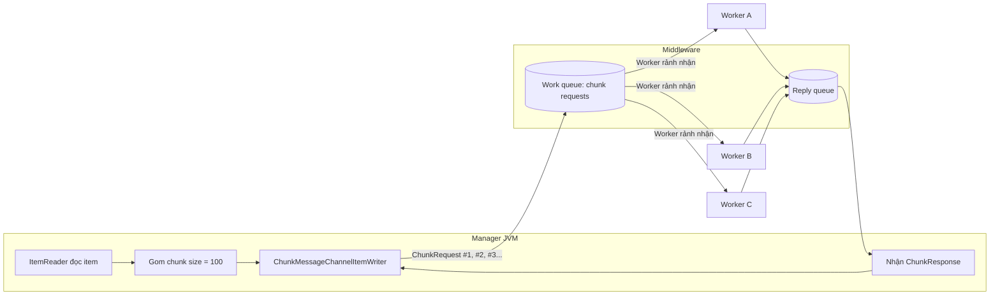

# Phân phối động chunk đến worker trong Spring Batch Remote Chunking

## 1. Vì sao cần phân phối chunk động?

Giả sử job xử lý 1.200.000 bản ghi. Đọc dữ liệu từ database tương đối nhanh, nhưng chuẩn hóa, gọi dịch vụ và ghi kết quả cho từng bản ghi mất nhiều thời gian. Nếu manager cố định 300.000 bản ghi cho mỗi trong bốn worker, một worker chậm có thể kéo dài toàn bộ job trong khi ba worker còn lại đã rảnh.

**Phân phối động chunk đến worker** giải quyết vấn đề này bằng cách chia luồng item thành những *chunk* tương đối nhỏ, đặt request vào một hàng đợi chung và để các worker nhận công việc theo khả năng tiêu thụ thực tế. Worker nhanh có thể xử lý nhiều chunk hơn worker chậm; không cần manager biết trước node nào sẽ xử lý chunk nào.

Trong Spring Batch **remote chunking**:

- **Manager** chạy một Spring Batch `Step`, thực hiện `ItemReader` và gom item thành chunk.
- `ChunkMessageChannelItemWriter` gửi `ChunkRequest` qua một kênh message, rồi thu thập `ChunkResponse` từ worker.
- **Middleware** (ví dụ JMS queue hoặc RabbitMQ) đưa request đến các consumer và vận chuyển reply.
- **Worker** nhận chunk, dùng `ItemProcessor`/`ItemWriter`, rồi trả phản hồi cho manager.

Phạm vi bài là chương **Remote Chunking** của module `SPRING_BATCH_SCALING_OPERATIONS`: học cách mở rộng workload dữ liệu lớn bằng phân phối công việc, đo nút thắt, giữ thread safety, xử lý retry/restart và chọn mức song song theo tài nguyên thật.

Sau bài học, bạn có thể giải thích chính xác cơ chế worker nhận việc, cấu hình manager/worker cơ bản trên Spring Batch 5.2, điều chỉnh số chunk đang chờ, phát hiện worker không cân tải và thiết kế an toàn với redelivery.

> **Phạm vi phiên bản:** các trích đoạn API dùng **Spring Batch 5.2.x**, Spring Batch Integration và Spring Integration 6.x. Spring Batch 6.1 đã giới thiệu builder khác; kiểm tra tài liệu đúng phiên bản trước khi sao chép mã.

## 2. Động ở đâu trong luồng xử lý?



Để phân phối động hoạt động đúng, middleware cần **một logical request queue với nhiều competing consumers** và bảo đảm một message được giao cho một consumer **ở mỗi lần delivery**. Nếu consumer lỗi, message có thể được giao lại theo chính sách broker. Không nên dùng kiểu publish-subscribe/topic khiến mỗi worker nhận một bản sao của cùng chunk.

Điểm khác biệt với **remote partitioning**: remote chunking gửi **item thực tế** qua middleware và manager vẫn giữ trách nhiệm đọc; remote partitioning gửi yêu cầu thực thi `StepExecution` với phạm vi dữ liệu, để worker thường tự đọc nguồn của mình. Chọn remote chunking khi công đoạn **process/write nặng hơn nhiều so với read**, và chi phí gửi item qua mạng chấp nhận được.

### 2.1. Ví dụ: worker có tốc độ khác nhau

Giả sử manager tạo 12 chunk `C01` đến `C12`, mỗi chunk 100 item. Có ba worker: A nhanh, B trung bình và C chậm. Một lịch thực thi *có thể xảy ra* là:

| Worker | Các chunk đã xử lý | Số chunk |
| --- | --- | ---: |
| A (nhanh) | `C01`, `C04`, `C06`, `C08`, `C10`, `C11`, `C12` | 7 |
| B (trung bình) | `C02`, `C05`, `C09` | 3 |
| C (chậm) | `C03`, `C07` | 2 |
| **Tổng** | **12 chunk** | **12** |

Đây là ví dụ để hình dung, **không phải lịch được Spring Batch bảo đảm**. Message broker có thể dùng prefetch, dispatch policy và consumer concurrency khác nhau; thời điểm gửi, tốc độ nhận, network và redelivery cũng ảnh hưởng phân bố. Kết quả đúng cần thỏa mãn: mọi chunk được xử lý thành công, không bỏ sót; nếu có redelivery thì side effect vẫn an toàn.

### 2.2. “Động” không có nghĩa là chia lại một chunk đang chạy

Khi worker A đã nhận `C01`, manager không tự động cắt `C01` thành hai nửa để giúp worker A. Đơn vị lịch biểu là **cả chunk**. Worker có thể xử lý lại trọn chunk khi lỗi; nếu một chunk đơn lẻ rất chậm, nó vẫn tạo *tail latency* dù nhiều worker khác rảnh.

Muốn cân bằng tốt hơn, thường điều chỉnh **chunk size** vừa đủ nhỏ để chia việc, nhưng không nhỏ đến mức overhead message và transaction lấn át xử lý thực tế.

## 3. Vòng đời của một chunk và quan hệ với metadata

1. Manager đọc item trong một `StepExecution` đang chạy. `ItemReader` nên có thứ tự ổn định và checkpoint phù hợp khi restart.
2. Manager gom tối đa `chunkSize` item, tạo `ChunkRequest` có thông tin sequence/step và gửi ra request channel.
3. Channel adapter chuyển request đến broker; middleware điều phối tới một worker consumer.
4. Worker nhận request và thực thi `ChunkProcessorChunkHandler`, gồm processor (nếu có) và writer. Writer cập nhật hệ thống đích, thông thường trong transaction do ứng dụng cấu hình.
5. Worker gửi `ChunkResponse`, chứa kết quả và `StepContribution` hoặc thông tin lỗi.
6. Manager thu thập reply và tổng hợp thống kê của worker vào trạng thái `StepExecution` của mình. Manager chỉ có thể đánh giá hoàn tất khi các request còn chờ đã được giải quyết theo chính sách hiện hành.

`ChunkRequest` và `ChunkResponse` là giao thức của Spring Batch Integration; không nên thay bằng payload DTO riêng rồi giả định builder vẫn xử lý được. Các header/correlation cần được giữ nguyên xuyên qua Spring Integration và adapter của middleware.

| Thứ thường bị nhầm | Ý nghĩa |
| --- | --- |
| `chunkSize = 100` | Mỗi request thường chứa tối đa 100 item, trừ chunk cuối |
| `workerCount = 4` | Có bốn consumer/instance nhận công việc ở thời điểm đó |
| `throttleLimit = 8` | Manager giới hạn số **request chunk còn pending**, không phải tạo tám worker |
| `broker prefetch = 1` | Broker-specific: giới hạn số message gửi trước cho từng consumer theo chính sách triển khai |
| `queue depth = 50` | Có 50 message chờ/buffered theo cách broker đo; chưa nói được số đang in-flight |
| `reply count` | Số phản hồi manager đã nhận; phải xét cả sự tương quan và kết quả của phản hồi |

**Lưu ý về transaction:** một request JMS được ACK **không đồng nghĩa** dữ liệu worker đã được commit thành công trong database. Cũng có trường hợp DB commit rồi worker crash trước ACK/reply, làm broker redeliver. Vì vậy, cần phân biệt *message delivery*, *business effect* và *batch metadata*.

## 4. Trách nhiệm của manager, broker và worker

### Manager: tạo chunk và giới hạn in-flight

Manager là một process với một `ItemReader` trung tâm. Trong Spring Batch 5.2, `RemoteChunkingManagerStepBuilderFactory` giúp dựng `Step` với `ChunkMessageChannelItemWriter`; các thiết lập quan trọng là:

- `reader(...)`: item nguồn, phải có checkpoint/thứ tự ổn định nếu restart.
- `chunk(100)`: kích thước chunk được gửi.
- `outputChannel(...)`: kênh đẩy request đến adapter đi vào broker.
- `inputChannel(...)`: một `PollableChannel` để lấy reply của worker.
- `throttleLimit(8)`: giới hạn request chunk chưa có kết quả, tạo backpressure tại manager.
- `maxWaitTimeouts(60)`: giới hạn **số lượt chờ không nhận được kết quả ở cuối step**. Giá trị là **số lần timeout**, không đơn thuần là 60 giây; thời gian mỗi lượt phụ thuộc receive timeout của messaging gateway.

Trong 5.2, `throttleLimit` và `maxWaitTimeouts` là API của `RemoteChunkingManagerStepBuilder`, được chuyển xuống writer chuyên dụng. Những giới hạn này giúp manager không phát request vô tận khi worker/broker bị chậm hoặc không phản hồi.

### Broker: phân phối theo khả năng nhận việc

Broker duy trì queue request, delivery/ACK, prefetch, consumer registration và redelivery tùy cấu hình. Manager chỉ đưa chunk vào **logical queue chung**; broker quyết định delivery đến consumer nào. Tùy broker, một worker có thể nhận thêm vài request trong local prefetch buffer trước khi hoàn tất request đầu, làm phân phối kém đều.

Nếu cần hạn chế tình trạng worker chậm giữ nhiều message, điều chỉnh **prefetch/credit** (ví dụ giới hạn prefetch ở mức nhỏ) và consumer concurrency theo broker cụ thể. Không có một tham số “prefetch” Spring Batch chung cho mọi middleware.

### Worker: tiêu thụ theo năng lực thực tế

Worker có một flow nhận `ChunkRequest`, gọi `ItemProcessor`/`ItemWriter`, rồi trả `ChunkResponse`. Khi hoàn thành và sẵn sàng nhận thêm, worker tiếp tục tiêu thụ request trong queue. Một instance có thể có nhiều listener consumer nếu processor/writer, DB pool và tài nguyên cho phép.

Worker cần **stateless giữa các chunk** hoặc có state riêng/đồng bộ rõ ràng. Đừng lưu `currentChunk`, `currentOrderId` hoặc bộ đệm dùng chung trong field mutable của singleton processor/writer. Thông thường worker remote chunking không phải một Batch `Job` riêng với metadata `StepExecution` độc lập cho từng chunk; manager quản lý step tổng thể.

## 5. Cấu hình ví dụ Spring Batch 5.2

Giả sử bảng `orders(id BIGINT PRIMARY KEY, processed BOOLEAN NOT NULL)`, manager đọc ID trong `[1, upperBound)` đã chốt; worker đặt `processed = TRUE`. Cùng một job không thêm/xóa/đổi ID trong phạm vi đọc. Mẫu này minh họa **động ở tầng middleware**, còn chính sách bảo vệ dữ liệu và restart cần hoàn thiện khi lên production.

### 5.1. Manager step với throttle limit

Các `@Bean` dưới đây thuộc class `@Configuration` có `@EnableBatchIntegration`. Ứng dụng phải cấu hình `JobRepository`, `PlatformTransactionManager`, `DataSource`, JMS connection và `Job` trỏ tới `managerStep`.

```java
import javax.sql.DataSource;
import org.springframework.batch.core.configuration.annotation.StepScope;
import org.springframework.batch.core.step.tasklet.TaskletStep;
import org.springframework.batch.integration.chunk.RemoteChunkingManagerStepBuilderFactory;
import org.springframework.batch.item.database.JdbcCursorItemReader;
import org.springframework.batch.item.database.builder.JdbcCursorItemReaderBuilder;
import org.springframework.beans.factory.annotation.Qualifier;
import org.springframework.beans.factory.annotation.Value;
import org.springframework.context.annotation.Bean;
import org.springframework.context.annotation.Configuration;
import org.springframework.integration.channel.DirectChannel;
import org.springframework.integration.channel.QueueChannel;
import org.springframework.batch.integration.config.annotation.EnableBatchIntegration;

@Configuration
@EnableBatchIntegration
public class DynamicChunkManagerConfig {

    @Bean
    public DirectChannel requestsToWorkers() {
        return new DirectChannel();
    }

    @Bean
    public QueueChannel repliesFromWorkers() {
        // Minh họa: kênh RAM, cần thiết kế durable reply khi lên production.
        return new QueueChannel(200);
    }

    @Bean
    @StepScope
    public JdbcCursorItemReader<Long> orderIdReader(
            DataSource dataSource,
            @Value("#{jobParameters['upperBound']}") Long upperBound) {
        return new JdbcCursorItemReaderBuilder<Long>()
                .name("orderIdReader")
                .dataSource(dataSource)
                .sql("SELECT id FROM orders " +
                     "WHERE id >= 1 AND id < ? ORDER BY id")
                .preparedStatementSetter(ps -> ps.setLong(1, upperBound))
                .rowMapper((rs, rowNum) -> rs.getLong(1))
                .saveState(true)
                .build();
    }

    @Bean
    public TaskletStep managerStep(
            RemoteChunkingManagerStepBuilderFactory factory,
            JdbcCursorItemReader<Long> orderIdReader,
            @Qualifier("requestsToWorkers") DirectChannel requests,
            @Qualifier("repliesFromWorkers") QueueChannel replies) {
        return factory.<Long, Long>get("managerStep")
                .chunk(100)
                .reader(orderIdReader)
                .outputChannel(requests)
                .inputChannel(replies)
                .throttleLimit(8)
                .maxWaitTimeouts(60)
                .build();
    }
}
```

Ở cách này, writer của manager đã được builder thay bằng `ChunkMessageChannelItemWriter`. **Không gắn một JDBC writer ở manager** nếu mục tiêu là remote chunking: việc ghi nghiệp vụ thuộc worker. Khi nâng `throttleLimit`, phải xem khả năng đáp ứng của broker, số consumer và thời gian xử lý; giá trị lớn không tự làm worker xử lý nhanh hơn.

### 5.2. Nối channel tới JMS queue bằng Spring Integration

Các flow sau minh họa hai chiều của **manager**. Giả sử có JMS `ConnectionFactory` và các queue `batch.chunks.requests`/`batch.chunks.replies` đã được provisioning.

```java
import jakarta.jms.ConnectionFactory;
import org.springframework.integration.dsl.IntegrationFlow;
import org.springframework.integration.jms.dsl.Jms;

@Bean
public IntegrationFlow managerRequestsToJms(
        ConnectionFactory connectionFactory,
        @Qualifier("requestsToWorkers") DirectChannel requests) {
    return IntegrationFlow.from(requests)
            .handle(Jms.outboundAdapter(connectionFactory)
                    .destination("batch.chunks.requests"))
            .get();
}

@Bean
public IntegrationFlow jmsRepliesToManager(
        ConnectionFactory connectionFactory,
        @Qualifier("repliesFromWorkers") QueueChannel replies) {
    return IntegrationFlow
            .from(Jms.messageDrivenChannelAdapter(connectionFactory)
                    .destination("batch.chunks.replies"))
            .channel(replies)
            .get();
}
```

Hai flow trên là các `@Bean` đặt trong class cấu hình manager ở mục 5.1 (cùng các import cần thiết). JMS queue **khác** `DirectChannel` và `QueueChannel`: queue broker là chặng cross-process, còn Spring Integration channel nối các thành phần nội bộ JVM.

Với demo, `QueueChannel` RAM giúp nhìn thấy cách reply đi vào manager. Nếu inbound adapter ACK reply rồi JVM manager crash trước khi poll, reply có thể mất dù broker dùng persistent messages. Trong sản xuất, cân nhắc kênh reply bền vững/khôi phục được, chính sách ACK phù hợp, correlation routing và đối soát.

### 5.3. Worker: tiêu thụ tự động qua request queue

Ở worker, mỗi instance cấu hình **cùng tên request queue**, cùng hợp đồng payload và một flow xử lý. Không cần manager gọi trực tiếp API của worker A hoặc worker B. Các worker có thể được thêm/bớt bằng thao tác vận hành khi có backlog.

```java
import jakarta.jms.ConnectionFactory;
import java.util.List;
import org.springframework.batch.integration.chunk.RemoteChunkingWorkerBuilder;
import org.springframework.batch.item.ItemWriter;
import org.springframework.beans.factory.annotation.Qualifier;
import org.springframework.context.annotation.Bean;
import org.springframework.context.annotation.Configuration;
import org.springframework.integration.channel.DirectChannel;
import org.springframework.integration.config.EnableIntegration;
import org.springframework.integration.dsl.IntegrationFlow;
import org.springframework.integration.jms.dsl.Jms;
import org.springframework.jdbc.core.JdbcTemplate;
import org.springframework.transaction.PlatformTransactionManager;
import org.springframework.transaction.support.TransactionTemplate;

@Configuration
@EnableIntegration
public class DynamicChunkWorkerConfig {

    @Bean
    public DirectChannel workerRequests() {
        return new DirectChannel();
    }

    @Bean
    public DirectChannel workerReplies() {
        return new DirectChannel();
    }

    @Bean
    public IntegrationFlow jmsRequestsToWorker(
            ConnectionFactory connectionFactory,
            @Qualifier("workerRequests") DirectChannel requests) {
        return IntegrationFlow
                .from(Jms.messageDrivenChannelAdapter(connectionFactory)
                        .destination("batch.chunks.requests"))
                .channel(requests)
                .get();
    }

    @Bean
    public ItemWriter<Long> processedFlagWriter(
            JdbcTemplate jdbcTemplate,
            PlatformTransactionManager transactionManager) {
        TransactionTemplate transaction = new TransactionTemplate(transactionManager);
        return chunk -> transaction.executeWithoutResult(status -> {
            List<Object[]> args = chunk.getItems().stream()
                    .map(id -> new Object[] {id})
                    .toList();
            jdbcTemplate.batchUpdate(
                    "UPDATE orders SET processed = TRUE " +
                    "WHERE id = ? AND processed = FALSE", args);
        });
    }

    @Bean
    public IntegrationFlow chunkWorkerFlow(
            @Qualifier("workerRequests") DirectChannel requests,
            @Qualifier("workerReplies") DirectChannel replies,
            ItemWriter<Long> processedFlagWriter) {
        return new RemoteChunkingWorkerBuilder<Long, Long>()
                .itemWriter(processedFlagWriter)
                .inputChannel(requests)
                .outputChannel(replies)
                .build();
    }

    @Bean
    public IntegrationFlow workerRepliesToJms(
            ConnectionFactory connectionFactory,
            @Qualifier("workerReplies") DirectChannel replies) {
        return IntegrationFlow.from(replies)
                .handle(Jms.outboundAdapter(connectionFactory)
                        .destination("batch.chunks.replies"))
                .get();
    }
}
```

Flow xử lý worker do `RemoteChunkingWorkerBuilder` tạo ra sẽ đọc `ChunkRequest` và gọi writer. Không khai báo processor nghĩa là item được truyền trực tiếp tới writer. Nếu nghiệp vụ cần biến đổi, thêm `.itemProcessor(...)` trước `.itemWriter(...)`, đồng thời đảm bảo logic thread-safe.

`TransactionTemplate` trong ví dụ gom các cập nhật database của chunk vào **một DB transaction**. Nó không tạo transaction nguyên tử giữa database và broker. Nếu worker commit DB rồi crash trước khi gửi reply/ACK, request có thể được phát lại. Predicate `AND processed = FALSE` là lớp bảo vệ cho thao tác *đặt cờ*, không đủ cho tác vụ thanh toán hay phát sự kiện.

Các bean code trên là mô hình triển khai; ứng dụng hoàn chỉnh còn cần `ConnectionFactory`, `DataSource`/`JdbcTemplate`, transaction manager, converter an toàn, cấu hình listener, broker persistence, lỗi và giám sát. Nếu worker chạy ở node khác, phải kết nối đến cùng broker và database đích theo kiến trúc đã chọn.

### 5.4. Tăng worker mà không sửa code manager

Giả sử một worker xử lý trung bình 3 chunk/giây và manager đang có request chờ:

| Worker hoạt động | Năng lực xử lý lý thuyết | Điều kiện để đạt được |
| --- | --- | --- |
| 1 worker | 3 chunk/giây | Có đủ request, broker và DB không giới hạn |
| 2 worker | 6 chunk/giây | Cả hai cùng tiêu thụ và không tranh chấp đáng kể |
| 4 worker | 12 chunk/giây | `throttleLimit` cho phép đủ request đang pending; DB/network đủ tải |
| 8 worker | 24 chunk/giây | Cần manager, broker và DB đáp ứng được; không có bảo đảm tăng tuyến tính |

Những con số là **giả định mô hình**, không phải benchmark. Khi thêm worker lúc job đang chạy, chunk đã được broker giao cho consumer cũ **không tự chuyển sang worker mới**. Worker mới thường nhận các chunk đang chờ hoặc được gửi tiếp. Khi một worker bị dừng đột ngột, broker có thể redeliver request chưa ACK theo chính sách của nó.

## 6. Vì sao các worker đôi khi nhận việc không đều?

Phân phối động chỉ cân tải tốt nếu middleware cho các worker cơ hội nhận việc tương ứng với năng lực thực tế. Các yếu tố sau làm kết quả lệch:

### 6.1. Prefetch và consumer credit

Nhiều broker có thể **giao trước** nhiều message cho consumer và giữ chúng trong buffer phía client. Worker C chậm vẫn có thể giữ nhiều request, trong khi A đã xử lý xong và đang chờ. Quan sát broker cần phân biệt:

- **Queued / ready**: message còn trong queue broker, sẵn cho consumer.
- **Dispatched / in-flight / unacknowledged**: message đã giao cho consumer nhưng chưa ACK.
- **Redelivered**: message đang hoặc đã được giao lại sau khi session rollback/disconnect.

Tên metric khác nhau tùy broker. Tùy đặc tính workload, hạ prefetch/credit xuống mức nhỏ (ví dụ 1 hoặc vài message) có thể tăng tính công bằng; đổi lại broker/network round-trip nhiều hơn và throughput có thể giảm. Không nên hard-code chính sách từ một broker sang tất cả loại middleware.

### 6.2. Độ dài và chi phí xử lý mỗi chunk

Cùng 100 item không có nghĩa chunk nào cũng mất thời gian như nhau: một item có thể yêu cầu 20 truy vấn, item khác chỉ cần một lệnh UPDATE. Nếu workload lệch, chunk nhỏ hơn thường giảm hiệu ứng **worker giữ việc quá lâu**, nhưng tăng số request.

Nếu một chunk lỗi liên tục, hàng đợi có thể chứa nhiều lần phát lại; đừng để một poison message retry vô hạn. Đặt retry có giới hạn và chuyển DLQ hoặc báo job fail theo chính sách.

### 6.3. Năng lực khác nhau giữa các worker

Worker ở máy ít CPU, connection pool nhỏ, mạng kém hoặc version xử lý khác có tốc độ thấp hơn. Phân phối động thích nghi một phần thông qua tốc độ ACK/nhận request, nhưng **không tự sửa** cấu hình resource hoặc lỗi code. Khi chênh lệch quá lớn, cân nhắc tách nhóm worker theo loại công việc, chuẩn hóa resource requests/limits và version triển khai.

### 6.4. Backpressure của manager

Trong Spring Batch 5.2, `throttleLimit` giới hạn lượng chunk request còn pending. Nếu đặt `throttleLimit = 2` trong khi có 16 worker, nhiều worker có thể rảnh vì manager chỉ để tối đa hai request chưa có kết quả. Nhưng đặt 10.000 chỉ vì có 16 worker cũng nguy hiểm: dữ liệu có thể chất đống trong queue/bộ nhớ/broker khi downstream chậm.

Hãy tăng `throttleLimit` theo từng bước, đồng thời kiểm tra số **consumer thực sự busy**, reply latency, queue depth, message size và DB. Đặt giới hạn trên số request in-flight là một phần của cơ chế **backpressure**; đây không phải cách chỉ định cụ thể worker sẽ xử lý một chunk.

### 6.5. Reply routing khi có nhiều manager

Nếu hai manager cùng đọc một **reply queue chung** bằng competing consumers, manager A có thể nhận response của job B. Header tương quan có mặt không có nghĩa broker tự biết consumer nào là đúng. Cần thiết kế reply destination tách theo manager/run, hoặc selector/router được kiểm thử cho trường hợp chạy đồng thời. Không để reply bị ACK nhầm hoặc loại bỏ chỉ vì consumer không nhận ra chunk.

## 7. Tính đúng dữ liệu khi có redelivery, timeout và restart

### 7.1. Một message có thể được thực thi nhiều lần

Phân phối động theo queue thường cần **at-least-once delivery** và replay khi xảy ra lỗi. Chuỗi sau là tình huống thực tế:

```text
1. Manager gửi ChunkRequest(C17)
2. Broker giao C17 cho worker A
3. Worker A cập nhật DB và commit thành công
4. Worker A crash trước khi ACK hoặc gửi ChunkResponse(C17)
5. Broker redeliver C17 cho worker B
6. Worker B xử lý lại cùng C17
```

Nếu writer của worker B là `balance = balance + 100`, kết quả có thể bị cộng hai lần. Broker không biết side effect ở DB đã commit. Vì vậy, remote chunking **không mặc định bảo đảm exactly-once end-to-end**.

Giải pháp tùy nghiệp vụ:

1. Với thao tác đặt trạng thái, dùng điều kiện idempotent, ví dụ `SET processed = TRUE WHERE processed = FALSE`.
2. Với tạo giao dịch, phí hoặc cộng tổng, dùng **operation ID** ổn định gắn với công việc logic, lưu vào bảng ledger/inbox có unique constraint trong cùng DB transaction với thay đổi nghiệp vụ.
3. Nếu worker phát message khác sau khi ghi DB, dùng transactional outbox và downstream consumer idempotent.
4. Duy trì audit/đối soát theo `jobRunId`, logical record ID và operation key để phân biệt lần *delivery* với kết quả *business commit*.

Không chỉ dựa vào `JMSMessageID` làm khóa idempotency. Khi request được dựng lại qua một lần restart của manager, ID vận chuyển có thể đổi dù đại diện cho cùng công việc.

### 7.2. Worker lỗi trước commit, sau commit và sau reply

| Điểm lỗi | Khả năng xảy ra | Thiết kế cần có |
| --- | --- | --- |
| Worker nhận nhưng chưa bắt đầu | Request được giao lại sau rollback/disconnect | Chính sách retry + message durability |
| Trong khi ghi, trước DB commit | DB rollback; message có thể được phát lại | Transaction rõ ràng, dữ liệu đầu vào ổn định |
| DB commit, chưa gửi reply/ACK | Dữ liệu đã ghi nhưng manager chưa biết | Idempotency, reply retry/reconciliation |
| Gửi reply thành công rồi worker crash | Reply có thể đang ở broker/manager | Correlation, dedup response nếu cần, durable reply path |
| Manager crash sau khi nhận reply vào RAM | Reply có thể đã rời broker nhưng chưa được manager xử lý | Kênh reply bền vững, restart/reconciliation |

**Transaction DB ≠ transaction JMS ≠ transaction Batch metadata**. Một `TransactionTemplate` quanh writer chỉ bảo vệ phần DB mà transaction manager đó quản lý. Cấu hình JMS transacted listener có thể điều chỉnh ACK/rollback ở tầng broker, nhưng không tự đồng bộ atomically với DB trừ khi thiết kế transaction phân tán phù hợp.

### 7.3. Retry và DLQ

Không retry vô hạn lỗi dữ liệu cố định như thiếu cột, payload không deserialize được hoặc validation luôn thất bại. Dùng giới hạn redelivery/backoff và dead-letter queue; gắn cảnh báo, correlation và thông tin nguyên nhân để có thể sửa và replay có kiểm soát.

Lỗi tạm thời như DB timeout, network chập chờn hoặc broker unavailable có thể retry, nhưng phải xác định **request có thể đã thực hiện side effect hay chưa** trước khi phát lại. Retry ở manager, retry ở worker, và redelivery của broker là **ba tầng khác nhau**; cộng dồn không kiểm soát có thể gây retry storm.

### 7.4. Restart và dữ liệu nguồn bất biến

Manager có `ItemReader` và `JobRepository` để giữ checkpoint. Khi restart **cùng `JobInstance`**, dữ liệu nguồn cần có thứ tự/ranh giới ổn định. Nếu manager đọc các dòng `WHERE status = 'NEW'` trong khi worker thay `status`, tập đang đọc có thể dịch chuyển và dẫn tới bỏ sót/trùng; dùng miền ID hoặc manifest/snapshot cố định phù hợp.

Không mặc định rằng mọi request và reply cũ đã rời queue sau khi job fail. Khi khởi động lại, cần có chính sách xử lý **stale message**, phân biệt job/run/correlation, tránh để reply của lần chạy cũ bị một manager khác lấy nhầm. Với các hệ thống dữ liệu quan trọng, phải diễn tập restart cùng metadata, broker queue và bảng đích thực tế.

## 8. Tối ưu năng lực thực tế

Đặt:

- `R_m`: tốc độ manager đọc và tạo request, đơn vị item/giây.
- `R_w`: tổng tốc độ worker xử lý/ghi, đơn vị item/giây.
- `R_b`: năng lực broker/network sau serialization, đơn vị item/giây.
- `R_d`: giới hạn của database hoặc downstream, đơn vị item/giây.

Một ước lượng sơ bộ cho tốc độ toàn pipeline khi chạy ổn định:

\[
R_{\text{job}} \lesssim \min(R_m, R_w, R_b, R_d)
\]

Ví dụ manager đạt 1.500 item/giây, broker đạt 2.000, mỗi worker đạt 250, có bốn worker và DB tối đa 900:

\[
R_{\text{job}} \lesssim \min(1500,4 \times 250,2000,900)=900
\]

Thêm hai worker đưa `R_w` lý thuyết lên 1.500 nhưng **DB vẫn là giới hạn 900 item/giây**. Trong thực tế còn chi phí điều phối, queue, lock, GC và các chunk cuối không đều; con số đo có thể thấp hơn giới hạn lý thuyết.

### Chọn chunk size

Giả sử 1.000.000 item:

| Chunk size | Số request dự kiến | Nhận xét |
| --- | ---: | --- |
| 10 | 100.000 | Phân phối mịn, overhead message/transaction lớn |
| 100 | 10.000 | Điểm khởi đầu hợp lý để benchmark nhiều loại workload |
| 1.000 | 1.000 | Ít message hơn, nhưng payload lớn và retry lại nhiều item |
| 10.000 | 100 | Nguy cơ vài chunk lớn chiếm hết thời gian cuối job |

Số request là `ceil(totalItems / chunkSize)`. Với item có kích thước lớn, nên đo **byte sau serialization** (message size), không chỉ số item. Nếu mỗi item ~30 KB, chunk 1.000 item đã khoảng 30 MB chưa kể metadata: rất dễ vượt quota broker hoặc gây áp lực memory.

### Điều chỉnh theo thứ tự

1. **Baseline:** đo job một worker, ghi throughput item/s, thời gian đọc, process, write, broker latency và DB wait.
2. **Chunk size:** thử 50, 100, 250 rồi 500 item trên cùng snapshot, theo dõi kích thước message, retry cost và p95 completion latency.
3. **Pending limit:** tăng `throttleLimit` từ mức thấp lên mức đủ giữ worker bận; theo dõi queue depth và pending replies.
4. **Consumers:** tăng worker count hoặc listener concurrency trong giới hạn CPU/DB pool; tránh tăng cùng lúc tất cả biến.
5. **Prefetch/credit:** điều chỉnh nếu message bị giữ ở worker chậm; so sánh fairness với throughput tổng.
6. **So sánh thời gian toàn job:** chọn cấu hình cho throughput ổn định và restart đáng tin, không chọn chỉ vì có nhiều request/giây.

### Các chỉ số cần theo dõi

| Metric | Dùng để nhận diện |
| --- | --- |
| `queue depth` request và reply | Backlog, downstream quá chậm hoặc lỗi reply path |
| `in-flight / unacked` | Bao nhiêu message đang ở consumer nhưng chưa được xác nhận |
| `consumer count` và busy ratio | Có worker nào thực sự nhận việc không |
| p50/p95/p99 latency theo chunk | Chuỗi xử lý chậm, long tail, chunk quá lớn |
| Redelivery count, DLQ size | Lỗi lặp, poison data, idempotency risk |
| Thời gian reader và tốc độ phát request | Manager có phải bottleneck không |
| DB connection wait, locks, throughput | Tăng worker có làm DB bão hòa không |
| Reply pending, timeouts và mismatched correlation | Manager có nhận phản hồi đúng không |
| Tổng `READ_COUNT`, `WRITE_COUNT` và số bản ghi đích duy nhất | Đối soát logic dữ liệu sau chạy |

Metrics của broker có tên và ý nghĩa cụ thể theo implementation; không suy luận queue “rỗng” tức không có công việc, vì có thể còn các message đã giao nhưng chưa ACK.

## 9. Thực hành kiểm chứng phân phối động

### 9.1. Bài thử phân phối giữa worker nhanh và chậm

Chuẩn bị một tập input gồm 1.000 ID, `chunkSize = 100`, `throttleLimit = 4` và ba worker instance cùng kết nối request queue. Trên môi trường thử nghiệm, thêm độ trễ giả lập cho từng instance (ví dụ A: 100 ms/chunk, B: 250 ms/chunk, C: 500 ms/chunk) rồi ghi log theo `workerId` và `chunkSequence`.

Kỳ vọng về hành vi, **không phải một lịch cố định**:

- Manager gửi tổng cộng 10 request chứa 100 ID mỗi request.
- Worker A thường xử lý nhiều chunk hơn C nếu broker phân phối theo khả năng tiêu thụ và prefetch không giữ nhiều message ở consumer chậm.
- Cả ba worker nhận request từ cùng queue, không cần cấu hình manager phân công trước từng chunk.
- Mọi ID đầu vào được cập nhật đúng một lần **ở mức hiệu ứng nghiệp vụ**; redelivery nếu xảy ra được phát hiện và xử lý idempotent.
- Manager chỉ `COMPLETED` khi đã thu thập đủ kết quả phù hợp; có thể thấy reply trả về không cùng thứ tự request.

Chạy lặp lại ba lần, kiểm tra queue metrics và thời gian; **không viết test assert “A phải nhận đúng 6 chunk”** vì điều phối động không bảo đảm tỉ lệ chính xác.

### 9.2. Thêm worker trong lúc job đang chạy

1. Khởi động manager và một worker, để tích lũy request trong broker.
2. Ghi queue depth, in-flight, item/s trong một khoảng đo ổn định.
3. Khởi động worker thứ hai, cùng queue và cùng phiên bản payload.
4. Kiểm tra worker mới nhận các message chưa được worker khác nhận, throughput tăng nếu còn dư nguồn lực, và DB không xuất hiện lock/connection errors bất thường.
5. Tiếp tục tăng worker đến điểm throughput không còn cải thiện; đối chiếu xem bottleneck nằm ở manager reader, broker hay DB.

Không xóa request đang in-flight hoặc “thu hồi” chunk từ worker cũ chỉ vì đã thêm worker. Nếu muốn chuyển tải, phải dựa trên cơ chế rollback/redelivery hợp lệ, tránh gây side effect lặp.

### 9.3. Dừng một worker đột ngột

Giả lập worker A crash khi có request chưa ACK, rồi theo dõi:

1. Broker phát lại các request chưa xác nhận theo policy đã cấu hình.
2. Worker B nhận và xử lý lại request, hoặc message được đưa vào DLQ nếu vượt giới hạn.
3. DB không chứa kết quả trùng nhờ operation key/unique constraint hoặc logic idempotent.
4. Manager nhận phản hồi tương quan với request còn chờ, hoặc job fail/timeout minh bạch; không báo thành công giả.

Chỉ dừng worker lúc đang thử nghiệm và có backup dữ liệu. Với hệ thống thật, cần diễn tập cả lỗi sau DB commit trước reply, vì trường hợp này dễ tạo duplicate nhất.

### 9.4. Kiểm tra quá tải và khôi phục

Tạm thời giảm connection pool của worker hoặc tăng độ trễ DB để worker xử lý chậm. Quan sát `throttleLimit` có giữ số pending request trong giới hạn đã chọn không, broker có backlog/expiry bất thường không và manager có thông báo timeout rõ ràng không. Khi DB phục hồi, queue được tiêu thụ hết và tổng kết quả đúng.

Một ca đặc biệt cần thử là **reply mất hoặc bị nhận nhầm**: tạo hai job chạy đồng thời, kiểm tra routing/correlation. Nếu cả hai manager chia sẻ cùng reply queue mà không có định tuyến đúng, kết quả có thể không ổn định dù request được xử lý chính xác ở worker.

### 9.5. Kiểm tra kết quả bằng metadata và bảng đích

Với schema metadata Spring Batch phổ biến:

```sql
SELECT STEP_NAME, STATUS, READ_COUNT, WRITE_COUNT,
       COMMIT_COUNT, ROLLBACK_COUNT
FROM BATCH_STEP_EXECUTION
WHERE JOB_EXECUTION_ID = :jobExecutionId
ORDER BY STEP_NAME;
```

Trong remote chunking, manager có thể tổng hợp `WRITE_COUNT` từ phản hồi của worker. Đây là số liệu Batch, **không phải bằng chứng rằng mọi side effect ở DB/dịch vụ ngoài xảy ra đúng một lần**. Cần đối soát thêm số ID đích duy nhất, audit idempotency và request/reply/DLQ.

Nếu có audit ghi `runId`, `chunkSequence`, `workerId`, `attempt` và `sourceId`, bạn có thể phân biệt phân phối động bình thường với redelivery:

```text
run=2026-01 seq=7 worker=A attempt=1 outcome=DB_COMMITTED
run=2026-01 seq=7 worker=B attempt=2 outcome=DUPLICATE_SUPPRESSED
```

Hai log cho cùng `seq=7` không mặc định là hai lần ghi thành công. Ý nghĩa phụ thuộc giai đoạn log, ranh giới commit và chính sách idempotency. Hạn chế ghi nội dung item nhạy cảm vào message log.

## 10. Các anti-pattern cần tránh

### 10.1. Chia trước “mỗi worker một phần cố định”

Nếu manager bắt buộc gửi C01–C04 cho A, C05–C08 cho B, C09–C12 cho C, worker chậm gây straggler. Đó là phân công tĩnh, mất lợi ích chủ chốt của remote chunking. Dùng **một logical work queue** và competing consumers để worker rảnh lấy chunk tiếp.

### 10.2. Dùng topic broadcast cho request

Topic phát request cho nhiều subscriber có thể khiến tất cả worker nhận cùng chunk. Với yêu cầu **mỗi request được một consumer xử lý trong một lần delivery**, chọn queue, hoặc một hàng đợi công việc có semantics tương đương. Xác định rõ consumer group semantics nếu chọn middleware không phải JMS.

### 10.3. Tăng chunk size vô hạn để giảm message

Chunk quá lớn tăng payload, bộ nhớ, retry cost và đuôi xử lý khi còn một chunk khó. Nên đo thời gian process/chunk, byte-size và timeout của broker; không chọn chỉ theo số request ít đi.

### 10.4. Tăng worker mà bỏ qua `throttleLimit`, prefetch và DB

Có 20 worker nhưng `throttleLimit = 2` sẽ không tạo 20 request pending cùng lúc. Ngược lại tăng limit quá cao có thể làm broker backlog lớn, DB quá tải và reply khó theo dõi. Cân bằng limit, listener concurrency, prefetch và connection pool trên số liệu thực tế.

### 10.5. ACK sớm rồi ghi DB sau

Nếu message được ACK trước khi DB commit và worker crash, broker có thể không redeliver request. Chọn listener transaction/ACK semantics phù hợp; nếu downstream handler bắt lỗi và không báo lên container, phải hiểu rằng broker có thể coi delivery đã xong.

### 10.6. Giả định “queue durable = exactly once”

Persistent delivery giúp giảm khả năng mất message, nhưng request vẫn có thể được giao lại sau lỗi. Dùng idempotency và reconciliation, nhất là với thanh toán, gửi event hoặc API ngoài transaction DB.

### 10.7. Reply chỉ nằm trong RAM hoặc không được route đúng

Manager crash sau JMS ACK có thể làm mất reply trong `QueueChannel` RAM. Hai manager chia sẻ reply queue mà không có selector/router có thể nhận nhầm response. Thiết kế reply path theo yêu cầu durability và concurrency thực tế, rồi kiểm thử crash để xác minh.

### 10.8. Gửi object lớn hoặc không tương thích giữa các phiên bản

JMS `ObjectMessage` có thể phụ thuộc class Java tương thích và cơ chế deserialization; không mở allowlist tùy tiện. Ưu tiên schema/codec có version rõ ràng nếu manager và worker được deploy độc lập. Theo dõi message size và giới hạn broker.

## 11. Bảng xử lý sự cố nhanh

| Triệu chứng | Nguyên nhân thường gặp | Kiểm tra và hướng sửa |
| --- | --- | --- |
| Queue backlog tăng liên tục | Worker quá ít/chậm, DB nghẽn, poison message | Đo consumer busy, DB wait, redelivery/DLQ, tăng tài nguyên đúng bottleneck |
| Worker rảnh dù queue vẫn có việc | Prefetch ở worker khác, listener không kết nối, resource cạn | Đo ready vs unacked/dispatched, consumer count, chỉnh prefetch/credit |
| Tăng worker nhưng throughput đứng yên | Manager reader, `throttleLimit`, broker/network hoặc DB là giới hạn | Đo từng chặng rồi điều chỉnh đúng nút thắt |
| Worker nhanh vẫn chỉ nhận ít chunk | Broker dispatch/prefetch và timing | Ghi trace chunk→worker, kiểm tra prefetch, ACK và concurrency |
| Job treo lúc kết thúc | Missing/late reply, timeout hoặc correlation sai | Đo pending request, reply queue, mapper/header, lỗi worker và `maxWaitTimeouts` |
| Sau crash có side effect trùng | Broker redelivery và writer không idempotent | Dùng operation ID, unique constraint, ledger/inbox/outbox |
| `Null correlation not allowed` | Header cần thiết bị mất qua adapter | Kiểm tra `correlationId`, `sequenceNumber`, `sequenceSize` và JMS header mapper theo version |
| Mọi worker xử lý cùng một chunk | Dùng pub-sub/topic thay cho work queue | Đổi request destination thành queue/competing-consumer tương đương |
| Worker không giải mã request | Payload class/codec/schema khác phiên bản | Đồng bộ schema, version, allowlist và kiểm thử rolling deployment |
| Request không đến worker mới | Worker chưa subscribe đúng queue, auth/network, broker prefetch | Kiểm tra destination, consumer registration, ACL, listener health |
| Request lặp mãi và queue không cạn | Retry/redelivery không giới hạn, lỗi dữ liệu không tự phục hồi | Bounded retry, backoff và DLQ có cảnh báo |

## 12. Checklist thiết kế phân phối động trước production

- [ ] Đã xác định remote chunking phù hợp vì manager reader không phải bottleneck chính.
- [ ] Request được phân phối qua queue với competing consumers; không broadcast cùng chunk cho mọi worker.
- [ ] Manager giữ một tập input có thứ tự và ranh giới ổn định khi restart.
- [ ] `chunkSize`, `throttleLimit`, worker count, prefetch/credit được đo và cấu hình có chủ đích.
- [ ] Worker writer/processor an toàn khi xử lý đồng thời; DB pool đáp ứng số consumer.
- [ ] Broker queue/persistence, ACK, redelivery, DLQ và TTL có chính sách rõ ràng.
- [ ] Side effect có idempotency hoặc có kế hoạch reconciliation khi request bị giao lại.
- [ ] Reply channel có durability/recovery tương ứng mức tin cậy cần thiết.
- [ ] Reply không bị manager khác nhận nhầm; header và chunk correlation còn nguyên.
- [ ] Có metrics queue depth, unacked, busy worker, p95 latency, retry, throughput và DB wait.
- [ ] Đã thử worker crash trước/sau commit, manager crash, broker restart và replay.
- [ ] Đã kiểm tra kết quả nghiệp vụ cuối cùng ngoài metadata `JobRepository`.

## 13. Tóm tắt và tài liệu tham khảo

**Phân phối động chunk** nghĩa là manager tạo request có kích thước phù hợp, middleware trao chúng cho các worker đang tiêu thụ, và worker rảnh tiếp tục nhận công việc khi còn queue. Cơ chế này cải thiện cân bằng tải với workload có chi phí xử lý không đều, nhưng **không tự chia lại chunk đã giao**, không tăng tốc reader của manager, và không tự bảo đảm exactly-once khi có crash hoặc redelivery. Khi vận hành, cần nhìn đồng thời **pending limit, queue dispatch, năng lực worker, DB và reply recovery**.

Tài liệu chính thức để đối chiếu từng API/khái niệm:

- [Spring Batch 5.2 — Scaling and Parallel Processing: Remote Chunking](https://docs.spring.io/spring-batch/reference/5.2/scalability.html).
- [Spring Batch Reference — Externalizing Batch Process Execution](https://docs.spring.io/spring-batch/reference/5.2/spring-batch-integration/externalizing-execution.html).
- [Spring Batch 5.2 API — RemoteChunkingManagerStepBuilder](https://docs.spring.io/spring-batch/docs/5.2.0/api/org/springframework/batch/integration/chunk/RemoteChunkingManagerStepBuilder.html).
- [Spring Batch 5.2 API — RemoteChunkingManagerStepBuilderFactory](https://docs.spring.io/spring-batch/docs/current/api/org/springframework/batch/integration/chunk/RemoteChunkingManagerStepBuilderFactory.html).
- [Spring Batch 5.2 API — RemoteChunkingWorkerBuilder](https://www.springframework.org/spring-batch/docs/5.2.3/api/org/springframework/batch/integration/chunk/RemoteChunkingWorkerBuilder.html).
- [Spring Batch 5.2 API — ChunkMessageChannelItemWriter](https://docs.spring.io/spring-batch/docs/5.2.x/api/org/springframework/batch/integration/chunk/ChunkMessageChannelItemWriter.html).
- [Spring Integration Reference — JMS Support](https://docs.spring.io/spring-integration/reference/jms.html).
