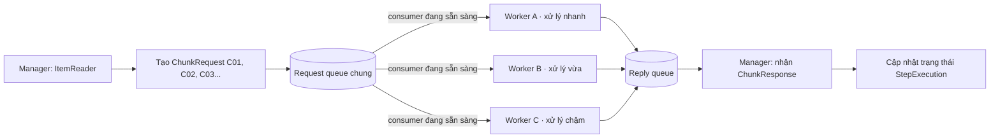

# Load balancing qua eager consumers trong Spring Batch Remote Chunking

## 1. Eager consumers là gì và vì sao chúng giúp cân bằng tải?

Trong **remote chunking**, manager đọc dữ liệu, nhóm item thành các chunk rồi đưa yêu cầu xử lý lên middleware. Nhiều worker chạy ở các tiến trình khác nhau cùng lắng nghe một hàng đợi công việc. Khi các listener **sẵn sàng nhận và xử lý công việc mới ngay khi có thể** (*eager consumers*), các chunk được chia động cho các worker, nên worker nhanh có cơ hội nhận thêm nhiều công việc hơn worker chậm.

Spring Batch mô tả lợi thế này trong phần *Scaling and Parallel Processing*: item được chia động, còn middleware phân phối công việc; nếu các listener đều là eager consumers, việc cân bằng tải có thể diễn ra tự động. Điều kiện quan trọng là middleware phải cung cấp cơ chế gửi nhận bền vững phù hợp, và mỗi **lần giao một message** chỉ đến một consumer.

**Eager consumer không có nghĩa là bật prefetch càng lớn càng tốt.** Trong ngữ cảnh bài này, *eager* mô tả worker chủ động sẵn sàng tiêu thụ công việc khi rảnh. *Prefetch* lại mô tả broker/client giao trước bao nhiêu message cho consumer. Nếu worker chậm giữ nhiều message trong bộ đệm do prefetch, worker nhanh khác có thể hết việc, khiến cân bằng tải kém đi.

Bài thuộc chương **Remote Chunking** của module `SPRING_BATCH_SCALING_OPERATIONS`. Mục tiêu là học cách mở rộng Spring Batch cho dữ liệu lớn qua các hình thức song song và phân tán, nhưng vẫn đo đúng bottleneck, bảo vệ thread safety, retry/restart và lựa chọn cấu hình theo tài nguyên thật.

Sau bài học, bạn có thể:

- Phân biệt **eager consumer**, **competing consumer**, **prefetch** và **concurrency**.
- Giải thích vì sao một hàng đợi chung giúp worker nhanh nhận thêm chunk.
- Cấu hình manager/worker Spring Batch 5.2 và Spring Integration JMS theo mô hình phân phối động.
- Điều chỉnh chunk size, in-flight limit, prefetch và số consumer từ số liệu thực tế.
- Thiết kế xử lý khi worker crash, request được giao lại, phản hồi bị mất và job phải restart.

> **Phiên bản:** các ví dụ Java dùng Spring Batch **5.2.x**, Spring Integration **6.x**, Java 17 và JMS với `jakarta.jms`. API của những phiên bản mới hơn có thể thay đổi; đối chiếu Javadoc đúng phiên bản trước khi áp dụng.

## 2. Vì sao queue chung giúp worker tự cân bằng tải?

Giả sử hệ thống có 4 worker xử lý một triệu bản ghi. Nếu chia tĩnh thành bốn tập, mỗi tập 250.000 bản ghi, worker chậm có thể giữ cả job chờ dù các worker nhanh đã hoàn tất.

Trong remote chunking, manager chia dữ liệu thành nhiều chunk nhỏ, ví dụ 100 item/chunk, và gửi vào **một logical work queue**. Mỗi worker là một consumer cạnh tranh nhận request. Khi xử lý xong và quay lại trạng thái sẵn sàng, worker tiếp tục nhận request từ queue. Manager không cần quyết định trước “chunk 1–1000 thuộc worker A, chunk 1001–2000 thuộc B”.



Mỗi `ChunkRequest` thường chứa danh sách item đã đọc, thông tin sequence/step cần thiết để worker xử lý và trả `ChunkResponse`. Một lần nhận message từ queue không nên được phát broadcast đến toàn bộ worker, vì điều đó khiến cùng chunk có thể bị ghi nhiều lần.

### Ví dụ một lịch xử lý có thể xảy ra

Giả sử có 14 chunk độc lập. A xử lý nhanh, B vừa, C chậm; một lịch tương đối hợp lý là:

| Worker | Chunk đã hoàn thành | Tổng |
| --- | --- | ---: |
| A | C01, C04, C06, C08, C10, C12, C13, C14 | 8 |
| B | C02, C05, C09, C11 | 4 |
| C | C03, C07 | 2 |
| **Tổng** | **14 chunk** | **14** |

Đây chỉ là **lịch minh họa**, không phải thuật toán chia cố định của Spring Batch hoặc bảo đảm của JMS. Thứ tự thực tế phụ thuộc lúc listener bắt đầu nhận, tốc độ từng worker, prefetch/credit, network, broker dispatch policy, message priority và redelivery. Không nên viết test bắt buộc worker A phải nhận đúng tám chunk.

### Các khái niệm gần nhau nhưng khác nhau

| Khái niệm | Ý nghĩa | Hệ quả |
| --- | --- | --- |
| **Eager consumer** | Worker/listener sẵn sàng lấy thêm việc khi có khả năng | Worker rảnh không đứng chờ phân công thủ công |
| **Competing consumers** | Nhiều consumer lắng nghe cùng một queue, cạnh tranh nhận request | Một lần delivery của request thuộc về một consumer |
| **Prefetch / consumer credit** | Số lượng hoặc số byte message broker có thể giao trước | Prefetch quá cao có thể khiến worker chậm giữ nhiều request |
| **Concurrency** | Số consumer/session/thread đang xử lý đồng thời | Giới hạn bởi CPU, DB pool, memory và downstream |
| **Chunk size** | Số item thường được gửi trong một request | Chi phối độ mịn phân chia công việc |
| **In-flight / pending limit** | Số request manager cho phép chưa có phản hồi | Tạo backpressure và giới hạn backlog |

“Tự động cân bằng” ở đây là **cân bằng công việc theo mức sẵn sàng tiêu thụ**, không phải cam kết cùng số chunk, cùng số bản ghi hay cùng thời gian CPU ở từng worker.

## 3. Vòng đời request/reply và ranh giới trách nhiệm

1. Manager thực thi một Spring Batch `Step` với `ItemReader` và một writer chuyên dụng `ChunkMessageChannelItemWriter`. Reader tạo một dòng item tuần tự ổn định.
2. Writer đóng một chunk thành `ChunkRequest`, gắn thông tin nhận diện cần thiết rồi gửi qua Spring Integration output channel.
3. Adapter của middleware xuất request lên broker queue. Broker giao request cho consumer theo chính sách dispatch.
4. Worker xử lý item bằng `ItemProcessor` (nếu có), `ItemWriter` và transaction phù hợp, sau đó gửi `ChunkResponse` trở về reply queue/channel.
5. Manager thu thập phản hồi và thống kê để quyết định trạng thái step, theo dõi những request chưa hoàn thành và thời gian đợi.

| Thành phần | Điều nó quyết định | Điều nó không quyết định |
| --- | --- | --- |
| Manager | Đọc input, chunk size, số request đang chờ | Không chọn trước worker cụ thể cho từng chunk |
| Spring Batch Integration | Giao thức `ChunkRequest`/`ChunkResponse`, tổng hợp kết quả | Không tự biến DB và JMS thành một transaction chung |
| Broker/adapter | Queue, delivery, ACK, prefetch, redelivery | Không biết side effect nghiệp vụ đã commit hay chưa |
| Worker | Process/write item và phản hồi, giới hạn xử lý theo năng lực node | Không tự dịch chuyển một chunk đang xử lý sang node khác |
| Database/downstream | Transaction, khóa và kết quả nghiệp vụ | Không tự chứng minh mỗi message JMS chỉ được deliver một lần |

Trong remote partitioning, manager chia **vùng dữ liệu** và worker thường tự đọc vùng của mình. Remote chunking lại gửi **các item đã đọc** qua middleware. Nếu reader là nút thắt lớn, tăng eager consumers cũng không làm nguồn item nhanh hơn.

## 4. Vì sao eager consumers đôi khi vẫn cân bằng kém?

### 4.1. Worker không thực sự rảnh để nhận thêm

Một worker có thể đang chờ connection pool, đợi I/O hoặc đang xử lý một chunk lớn. Nó không thể nhận chunk tiếp theo ngay lập tức nếu listener có một luồng và xử lý đồng bộ. Mở thêm consumer trong cùng JVM có thể tăng concurrency nhưng cũng tăng contention nếu DB đã bão hòa.

### 4.2. Prefetch quá cao: “giữ việc” tại consumer chậm

Với một số broker, request được gửi vào buffer của consumer trước khi worker bắt đầu xử lý. Ví dụ queue có 20 request; broker dispatch trước 8 message sang worker C (chậm) và 8 sang worker A (nhanh). A hoàn thành tám request trước nhưng không thể lấy những message đã được buffer tại C. Đây là hiện tượng **prefetch hoarding**, không có nghĩa C cố ý chiếm công việc.

```text
Broker queue:  [C17] [C18] [C19] [C20]
Worker A:     (đã xử lý xong C01..C08)     -> đang rảnh
Worker C:     [C09..C16 đã prefetched]    -> đang xử lý C09 rất chậm

Kết quả: A không thể lấy C10..C16 nếu các message đó đã được
giao/buffer tại C và broker chưa thu hồi hoặc redeliver.
```

Vì thế cần đo **ready messages** và **dispatched/unacknowledged messages** riêng. Queue depth bằng 0 **không** chứng minh không còn công việc; các message có thể đã rời queue server vào in-flight buffer của consumer.

### 4.3. Prefetch là cấu hình phụ thuộc broker

- Với **ActiveMQ Classic**, *prefetch limit* thường biểu thị **số message** broker có thể đẩy trước cho consumer.
- Với **ActiveMQ Artemis**, `consumerWindowSize` kiểm soát **số byte** buffer phía client; giá trị `0` ngăn client giữ trước message để cải thiện công bằng cho consumer chậm, còn `-1` cho phép buffer không giới hạn và có rủi ro bộ nhớ. Cấu hình cụ thể phụ thuộc client/protocol đang dùng.
- Với các middleware khác, cơ chế tương tự có thể gọi là consumer credit, link credit, QoS/prefetch count.

Giới hạn prefetch về mức nhỏ giúp queue giữ công việc sẵn cho các worker nhanh, nhưng cũng làm tăng số lần trao đổi giữa client và broker. Vì vậy **không có con số tối ưu chung**: benchmark cả mức cân bằng và throughput.

**Đừng hiểu “eager” = “prefetch vô hạn”.** Eager là sẵn sàng *nhận* công việc; prefetch lớn là *nhận sớm nhiều message*, có thể gây mất cân bằng.

### 4.4. Tải không đều và chunk quá lớn

Hai chunk đều 100 item nhưng có thể khác nhau đáng kể về độ nặng: một chunk chỉ ghi một bảng, chunk khác gọi dịch vụ ngoài nhiều lần. Broker không thể tự chia nửa một chunk đã giao. Chunk quá lớn làm worker chậm giữ một khối công việc kéo dài; chunk quá nhỏ lại tăng overhead serialize, round-trip, transaction và metadata.

### 4.5. Manager không tạo đủ request

Nếu manager phát request chậm hoặc giữ pending limit quá thấp, nhiều worker luôn rảnh dù queue hoạt động chính xác. Spring Batch 5.2 có `RemoteChunkingManagerStepBuilder.throttleLimit(long)` để giới hạn số request chunk còn đang đợi xử lý; một giá trị `2` có thể khiến 16 worker không có đủ việc cùng lúc. Đây là **backpressure**, không phải số consumer.

## 5. Ước lượng giới hạn cân bằng tải

Gọi:

- `c`: kích thước chunk (item/chunk);
- `r`: tốc độ đọc manager (item/s);
- `\mu_i`: tốc độ thực thi của worker `i` (chunk/s);
- `b`: năng lực vận chuyển middleware (item/s);
- `d`: năng lực ghi cuối cùng của DB/downstream (item/s).

Một ước lượng giới hạn trên khi hệ thống chạy ổn định:

\[
R_{\mathrm{job}}
\lesssim
\min\left(r,\;c\sum_{i=1}^{n}\mu_i,\;b,\;d\right)
\]

Ví dụ: chunk có 100 item, ba worker đạt lần lượt 4, 2 và 1 chunk/s; manager đọc 1.200 item/s, broker đủ 1.500 item/s, DB ghi tối đa 600 item/s. Tổng năng lực worker lý thuyết là `(4 + 2 + 1) × 100 = 700 item/s`, nhưng throughput toàn job vẫn bị DB giới hạn khoảng **600 item/s** (thực tế có thể thấp hơn do contention).

Một bài toán khác: manager đưa vào queue 10 request/s, worker cộng lại chỉ xử lý được 7 request/s. Nếu không có backpressure và tốc độ duy trì trong 60 giây, **backlog tăng khoảng 180 request**. Đó là dấu hiệu cần điều chỉnh năng lực xử lý, tốc độ phát hoặc giới hạn pending; thêm prefetch không làm mất chênh lệch `10 − 7 = 3 request/s`.

### Quan sát phân phối trên từng worker

Nếu worker A được giao tám chunk, B bốn, C hai trong cùng khoảng đo, hãy xem thêm **thời gian bận**, **độ trễ mỗi chunk** và **số message unacked**. Một worker xử lý ít chunk nhưng luôn bận 100% có thể đã được sử dụng hết công suất. Phân phối mỗi worker bằng nhau theo **số message** thường không phải mục tiêu tốt nhất.

Các chỉ số hữu ích:

| Chỉ số | Điều cần hiểu |
| --- | --- |
| `chunk/s` và `item/s` theo worker | Năng lực tiêu thụ thực tế; chú ý chunk cuối nhỏ hơn |
| `busy ratio`, CPU, GC, memory | Worker có thực sự sử dụng tài nguyên hiệu quả không |
| `p50/p95/p99 chunk latency` | Phân tán thời gian, straggler và tail latency |
| `ready / dispatched / unacked` | Công việc đang đợi broker và đã giao vào consumer |
| `redelivery count`, `DLQ size` | Retry storm, poison message và lỗi idempotency |
| `pending requests` phía manager | Backpressure, nguy cơ manager phải đợi reply |
| `DB connection wait` và lock wait | Nút thắt ghi khi tăng số worker |
| `reply latency`/timeout | Manager có nhận đủ và đúng phản hồi không |

## 6. Cấu hình Spring Batch 5.2 với eager consumers và JMS

Ví dụ dùng Spring Integration JMS với hai queue: `orders.chunk.requests` và `orders.chunk.replies`. Manager và worker là **hai ứng dụng khác nhau** cùng kết nối broker. Để tăng tải, có thể khởi động thêm instance của ứng dụng worker mà không sửa danh sách “worker A, B, C” trong manager.

Giả sử nguồn là bảng `orders(id BIGINT PRIMARY KEY, processed BOOLEAN)`. Manager lấy các ID trong miền `[1, maxIdExclusive)`; worker đánh dấu `processed = TRUE`. Mục tiêu ví dụ là giải thích kết nối và việc chia chunk động, không xây một ứng dụng production hoàn chỉnh.

### 6.1. Manager: tạo chunk và gửi request

Các import chính:

```java
import jakarta.jms.ConnectionFactory;
import javax.sql.DataSource;

import org.springframework.batch.core.Job;
import org.springframework.batch.core.configuration.annotation.StepScope;
import org.springframework.batch.core.job.builder.JobBuilder;
import org.springframework.batch.core.repository.JobRepository;
import org.springframework.batch.core.step.tasklet.TaskletStep;
import org.springframework.batch.integration.chunk.RemoteChunkingManagerStepBuilderFactory;
import org.springframework.batch.integration.config.annotation.EnableBatchIntegration;
import org.springframework.batch.item.database.JdbcCursorItemReader;
import org.springframework.batch.item.database.builder.JdbcCursorItemReaderBuilder;
import org.springframework.beans.factory.annotation.Qualifier;
import org.springframework.beans.factory.annotation.Value;
import org.springframework.context.annotation.Bean;
import org.springframework.context.annotation.Configuration;
import org.springframework.integration.channel.DirectChannel;
import org.springframework.integration.channel.QueueChannel;
import org.springframework.integration.dsl.IntegrationFlow;
import org.springframework.integration.jms.dsl.Jms;
```

```java
@Configuration
@EnableBatchIntegration
public class EagerManagerConfig {
    private static final String REQUESTS = "orders.chunk.requests";
    private static final String REPLIES = "orders.chunk.replies";

    @Bean
    public DirectChannel chunkRequests() {
        return new DirectChannel();
    }

    @Bean
    public QueueChannel chunkReplies() {
        return new QueueChannel(128); // Chỉ để demo: in-memory
    }

    @Bean
    @StepScope
    public JdbcCursorItemReader<Long> orderIdReader(
            DataSource dataSource,
            @Value("#{jobParameters['maxIdExclusive']}") Long maxIdExclusive) {
        return new JdbcCursorItemReaderBuilder<Long>()
                .name("orderIdReader")
                .dataSource(dataSource)
                .sql("SELECT id FROM orders " +
                     "WHERE id >= 1 AND id < ? ORDER BY id")
                .preparedStatementSetter(ps -> ps.setLong(1, maxIdExclusive))
                .rowMapper((rs, rowNum) -> rs.getLong(1))
                .saveState(true)
                .build();
    }

    @Bean
    public TaskletStep remoteStep(
            RemoteChunkingManagerStepBuilderFactory factory,
            JdbcCursorItemReader<Long> orderIdReader,
            @Qualifier("chunkRequests") DirectChannel requests,
            @Qualifier("chunkReplies") QueueChannel replies) {

        return factory.<Long, Long>get("remoteStep")
                .chunk(100)
                .reader(orderIdReader)
                .outputChannel(requests)
                .inputChannel(replies)
                .throttleLimit(8)
                .maxWaitTimeouts(40)
                .build();
    }

    @Bean
    public Job orderJob(
            JobRepository jobRepository,
            @Qualifier("remoteStep") TaskletStep remoteStep) {
        return new JobBuilder("orderJob", jobRepository)
                .start(remoteStep)
                .build();
    }

    @Bean
    public IntegrationFlow managerToBroker(
            ConnectionFactory connectionFactory,
            @Qualifier("chunkRequests") DirectChannel requests) {
        return IntegrationFlow.from(requests)
                .handle(Jms.outboundAdapter(connectionFactory)
                        .destination(REQUESTS))
                .get();
    }

    @Bean
    public IntegrationFlow brokerToManager(
            ConnectionFactory connectionFactory,
            @Qualifier("chunkReplies") QueueChannel replies) {
        return IntegrationFlow
                .from(Jms.messageDrivenChannelAdapter(connectionFactory)
                        .destination(REPLIES))
                .channel(replies)
                .get();
    }
}
```

Các điểm cần đọc đúng:

1. `factory.<Long, Long>get("remoteStep")` tạo builder của **manager step**; `.chunk(100)` nhóm item, `.outputChannel(...)` gửi request, `.inputChannel(...)` nhận kết quả. Builder tạo `ChunkMessageChannelItemWriter` ở manager.
2. `.throttleLimit(8)` giới hạn **số chunk request chưa có phản hồi**, giúp tránh đẩy quá nhiều công việc vào middleware. Con số 8 **không phải** tám worker hay tám JMS consumer.
3. `.maxWaitTimeouts(40)` là số lần chờ khi đợi kết quả ở cuối step, **không tự tương đương 40 giây**. Mỗi lần chờ phụ thuộc receive timeout của messaging template/gateway.
4. `orderIdReader` sử dụng `@StepScope` và job parameter chốt miền đầu vào. Reader của manager cần thứ tự, checkpoint và ranh giới ổn định khi restart. Không để worker cập nhật một điều kiện lọc khiến tập đang đọc dịch chuyển không kiểm soát.
5. `QueueChannel(128)` là **hàng đợi RAM phía manager**, không phải JMS queue trên broker. Nếu inbound JMS adapter ACK một reply rồi manager JVM crash trước khi poll reply, phản hồi có thể bị mất. Production cần thiết kế reply recovery/durability phù hợp.

Ở Spring Batch 5.2, `@EnableBatchIntegration` cung cấp `RemoteChunkingManagerStepBuilderFactory`. Ứng dụng vẫn phải cấu hình `JobRepository`, `PlatformTransactionManager`, `DataSource`, JMS `ConnectionFactory`, broker và codec message phù hợp.

### 6.2. Worker: một flow, nhiều instance cạnh tranh nhận

Mọi worker dùng **cùng một request destination**, không phải mỗi worker một queue riêng. Worker chạy cùng một cấu hình, nhưng có thể khác hostname, instance ID và số listener consumer. Ví dụ bên worker:

```java
import jakarta.jms.ConnectionFactory;
import java.util.List;

import org.springframework.batch.integration.chunk.RemoteChunkingWorkerBuilder;
import org.springframework.batch.item.ItemWriter;
import org.springframework.beans.factory.annotation.Qualifier;
import org.springframework.context.annotation.Bean;
import org.springframework.context.annotation.Configuration;
import org.springframework.integration.channel.DirectChannel;
import org.springframework.integration.config.EnableIntegration;
import org.springframework.integration.dsl.IntegrationFlow;
import org.springframework.integration.jms.dsl.Jms;
import org.springframework.jdbc.core.JdbcTemplate;
import org.springframework.transaction.PlatformTransactionManager;
import org.springframework.transaction.support.TransactionTemplate;

@Configuration
@EnableIntegration
public class EagerWorkerConfig {
    private static final String REQUESTS = "orders.chunk.requests";
    private static final String REPLIES = "orders.chunk.replies";

    @Bean
    public DirectChannel incomingChunks() {
        return new DirectChannel();
    }

    @Bean
    public DirectChannel outgoingResults() {
        return new DirectChannel();
    }

    @Bean
    public IntegrationFlow brokerToWorker(
            ConnectionFactory connectionFactory,
            @Qualifier("incomingChunks") DirectChannel chunks) {
        return IntegrationFlow
                .from(Jms.messageDrivenChannelAdapter(connectionFactory)
                        .destination(REQUESTS))
                .channel(chunks)
                .get();
    }

    @Bean
    public ItemWriter<Long> orderWriter(
            JdbcTemplate jdbcTemplate,
            PlatformTransactionManager transactionManager) {
        TransactionTemplate transaction = new TransactionTemplate(transactionManager);
        return chunk -> transaction.executeWithoutResult(status -> {
            List<Object[]> rows = chunk.getItems().stream()
                    .map(id -> new Object[] {id})
                    .toList();
            jdbcTemplate.batchUpdate(
                    "UPDATE orders SET processed = TRUE " +
                    "WHERE id = ? AND processed = FALSE", rows);
        });
    }

    @Bean
    public IntegrationFlow chunkHandlingFlow(
            @Qualifier("incomingChunks") DirectChannel chunks,
            @Qualifier("outgoingResults") DirectChannel results,
            ItemWriter<Long> orderWriter) {
        return new RemoteChunkingWorkerBuilder<Long, Long>()
                .itemWriter(orderWriter)
                .inputChannel(chunks)
                .outputChannel(results)
                .build();
    }

    @Bean
    public IntegrationFlow workerToBroker(
            ConnectionFactory connectionFactory,
            @Qualifier("outgoingResults") DirectChannel results) {
        return IntegrationFlow.from(results)
                .handle(Jms.outboundAdapter(connectionFactory)
                        .destination(REPLIES))
                .get();
    }
}
```

`RemoteChunkingWorkerBuilder` tạo flow nhận `ChunkRequest`, gọi `ChunkProcessor` với processor/writer và gửi `ChunkResponse`. Nếu không cấu hình processor, worker dùng pass-through. Logic writer ví dụ là một DB transaction cho các ID trong chunk; **DB transaction này không bao trùm JMS ACK/reply**.

Đối với tác vụ đặt cờ `processed = TRUE`, điều kiện `AND processed = FALSE` giúp giảm ảnh hưởng nếu cùng request bị giao lại. Với nghiệp vụ cộng tiền, tạo hóa đơn hoặc gửi thông báo, phải dùng khóa idempotency/ledger/outbox cụ thể hơn.

### 6.3. Làm listener thật sự “eager”

Khi deploy, đảm bảo:

- Instance worker khởi động thành công và **đăng ký consumer** trên request queue; listener không bị pause/stop hoặc liên tục reconnect.
- Listener sẵn sàng nhận thêm khi xử lý xong; không có sleep/poll interval không cần thiết khiến worker rảnh mà vẫn không nhận việc.
- Số concurrent consumers/threads đủ khai thác năng lực CPU và DB pool, nhưng không vượt năng lực downstream.
- Prefetch/consumer credit được chỉnh để worker chậm không giữ nhiều request hơn khả năng xử lý, sau khi đã đo throughput.
- Không có một lock, synchronized block hoặc singleton state làm mọi worker/consumer phải nối đuôi nhau.

`Jms.messageDrivenChannelAdapter(...)` sử dụng listener container của Spring Integration/JMS. Với Spring Integration 6.x, message-driven adapter mặc định có thể tạo `DefaultMessageListenerContainer` và dùng chế độ transacted theo cấu hình; production nên xác nhận/điều chỉnh số consumer, ACK, redelivery, error channel và exception propagation. Nếu tự cấp container, trách nhiệm cấu hình session/transaction thuộc về ứng dụng.

**Không đồng nhất “mở nhiều consumer” với “tăng băng thông”**: mười listener dùng chung connection pool bốn connection có thể làm tăng thời gian chờ hơn là tăng số item xử lý. Với broker có consumer prefetch, số consumer quá nhiều còn có thể khiến công việc phân tán vào buffer khó quan sát.

### 6.4. Reply phải về đúng manager

Nếu hai manager độc lập đồng thời nhận từ **một reply queue chung** theo competing-consumer, manager A có thể lấy response thuộc job B. Header `correlationId` không khiến broker tự gửi message đến đúng process trừ khi có **routing hoặc selector** tương ứng.

Với sản xuất, thiết kế reply destination phân tách theo manager/run hoặc một router/selector đủ chặt. Kiểm tra mapping các header `correlationId`, `sequenceNumber`, `sequenceSize` qua adapter. Ở Spring Integration 7.0.6+, inbound JMS header mapping cần allowlist rõ ràng cho các header này; nếu bị mất, bộ tổng hợp phản hồi có thể chờ mãi hoặc báo `Null correlation not allowed`. API map header phải dựa trên phiên bản đang dùng.

## 7. Ba núm điều chỉnh hiệu năng quan trọng

### 7.1. Chunk size: độ mịn của công việc

Giả sử 1.000.000 item và mỗi request chứa tối đa `c` item:

| `chunkSize` | Số request xấp xỉ | Đánh đổi |
| --- | ---: | --- |
| 10 | 100.000 | Chia việc mịn, nhưng overhead message/transaction lớn |
| 100 | 10.000 | Thường đáng thử làm baseline |
| 1.000 | 1.000 | Ít request, khó cân tải nếu độ nặng item khác nhau |
| 10.000 | 100 | Nhiều nguy cơ long-tail, message quá lớn, retry đắt |

Số request bằng `ceil(totalItems / chunkSize)` nếu toàn bộ input có thể gom đều. Phân phối động cân tải tốt hơn khi còn đủ **nhiều chunk so với số worker**, nhưng chunk quá nhỏ làm network và broker bão hòa.

### 7.2. In-flight limit: áp lực từ manager

Với `throttleLimit(8)` và 16 worker, manager không cung cấp vô hạn chunk pending. Có thể chỉ tối đa tám request đang chờ kết quả, nên hệ thống khó giữ 16 worker bận đồng thời. Cần tăng giới hạn từng bước theo đo đạc, đồng thời giới hạn queue backlog, memory và số request cần khôi phục sau crash.

Hãy chọn giới hạn vừa đủ để:

- Có công việc chờ khi worker hoàn tất chunk;
- Không giữ quá nhiều item serialized trong heap/broker;
- Không khiến thời gian chờ reply và số request chưa xác nhận tăng mất kiểm soát;
- Không đẩy thêm tải vào DB khi tất cả consumer đã dùng hết connection pool.

### 7.3. Consumer concurrency và prefetch

Tăng số worker instance/consumer giúp xử lý song song khi bottleneck nằm ở CPU/processing. Nhưng khi DB là bottleneck, tăng concurrency có thể tăng lock wait, deadlock, context switching và retry.

Giảm prefetch có thể cải thiện fairness khi nhiều worker có tốc độ khác nhau; tăng prefetch có thể cải thiện throughput khi processing rất nhanh và network round-trip chiếm phần lớn thời gian. Để chọn mức phù hợp, benchmark **cùng dữ liệu, cùng chunk size**, so sánh throughput toàn job, tỉ lệ worker rảnh và số unacked.

### Trình tự tuning tránh kết luận nhầm

1. Chạy baseline một worker, đo reader rate, worker CPU, DB wait và broker latency.
2. Giữ `chunkSize` cố định, tăng worker count từng mức 1 → 2 → 4 → 8; xem throughput có tăng hay DB đã chạm trần.
3. Khi worker nhanh vẫn rảnh còn worker chậm giữ nhiều request, đo dispatched/unacked và thử giảm prefetch/credit.
4. Giữ số worker đã chọn, thử một số chunk size; theo dõi p95 completion time, message size và lỗi retry.
5. Chỉnh `throttleLimit` để đủ pending request nhưng không tích backlog lớn; kiểm thử mất worker/manager ở cấu hình cuối.

Chỉ cần một nút thắt ở manager reader, broker disk/network hoặc DB là đủ giới hạn toàn job. Load balancing theo eager consumers cải thiện **cách chia công việc**, không xóa được các giới hạn tài nguyên này.

## 8. Đúng dữ liệu khi worker không còn sẵn sàng

### 8.1. Message có thể được giao lại

Broker thường cung cấp cơ chế **at-least-once delivery** khi cấu hình persistence, transaction và redelivery phù hợp. Một request đã giao cho worker A có thể quay lại queue và được worker B nhận nếu A crash hoặc session rollback. Vì vậy, cần phân biệt:

- **Một consumer cho mỗi lần delivery:** thông thường chỉ một consumer nhận một instance message ở một lượt giao.
- **Một chunk được xử lý đúng một lần về nghiệp vụ:** đây là mục tiêu *end-to-end* cần idempotency và xử lý transaction, không được JMS tự bảo đảm.

Ví dụ failure window:

```text
T0: Manager gửi ChunkRequest(C17)
T1: Broker giao C17 cho worker A
T2: A cập nhật DB và commit
T3: A crash trước khi gửi reply / xác nhận JMS
T4: Broker redeliver C17 cho worker B
T5: B chạy lại C17, nhưng DB phải tránh hiệu ứng lặp
```

Trong trường hợp này, load balancing tự động đưa việc sang một worker còn sống. Tuy nhiên, nó cũng có thể **chuyển một request đã tạo side effect**. Với thao tác không idempotent như `balance = balance + amount`, hai lần xử lý có thể làm sai tiền. Phải dùng operation key bền vững, unique constraint hoặc bảng ledger/inbox để bảo vệ transaction nghiệp vụ.

### 8.2. Những ranh giới transaction cần phân biệt

| Ranh giới | Điều được bảo đảm nếu cấu hình đúng | Khoảng trống còn lại |
| --- | --- | --- |
| DB transaction của worker | Các SQL trong cùng transaction commit/rollback cùng nhau | Không tự gộp với JMS ACK hoặc JMS reply |
| JMS listener transaction/ACK | Khi handler lỗi và exception được truyền đúng, broker có thể rollback/redeliver | Không chứng minh DB chưa commit |
| Manager `JobRepository` | Lưu trạng thái job/step và checkpoint reader | Không phản ánh tuyệt đối side effect ngoài DB |
| Reply correlation | Manager nhận biết request/response tương ứng | Không tự bảo vệ reply bị ACK trước khi lưu bền |

Với Spring Integration message-driven adapter, nếu lỗi bị error flow “nuốt” rồi kết thúc thành công, JMS container có thể coi xử lý đã xong và ACK/commit delivery. Cần kiểm tra cách exception propagation, transaction và error channel được nối trong ứng dụng thực tế.

### 8.3. Idempotency theo **công việc logic**

Giả sử item là `(orderId, action)` và worker thu phí. Một cách thiết kế an toàn là xác định operation key cố định, chẳng hạn `(batchRunId, orderId, action)`:

```sql
-- Ví dụ dữ liệu đối soát nghiệp vụ, không phụ thuộc ID JMS.
CREATE TABLE processed_operation (
    batch_run_id VARCHAR(100) NOT NULL,
    order_id BIGINT NOT NULL,
    action VARCHAR(30) NOT NULL,
    PRIMARY KEY (batch_run_id, order_id, action)
);
```

Trong cùng một DB transaction, worker thử ghi operation key và áp dụng nghiệp vụ khi key chưa tồn tại. Nếu key đã được commit, bản replay nhận diện công việc đã hoàn thành, không thực hiện tác dụng lần hai. Cần lựa chọn cú pháp insert-if-absent theo loại database, xử lý cạnh tranh ghi cùng key và đảm bảo lưu marker **cùng transaction với thay đổi nghiệp vụ**.

**Không dùng `JMSMessageID` làm operation key duy nhất**: manager có thể dựng lại request sau restart, khiến một việc logic có ID vận chuyển khác. Với hệ thống gọi API bên ngoài, dùng thêm idempotency key tại API và reconciliation; transaction DB không tự rollback hệ thống ngoài.

### 8.4. Reply đến muộn, mất hoặc bị nhận nhầm

Manager có thể đã gửi chunk và đang chờ reply. Nếu worker commit DB rồi reply bị mất, manager không biết chắc xử lý đã hoàn thành; việc gửi lại request có thể làm lặp side effect. Các vấn đề cần giải quyết:

- **Durable reply path:** một `QueueChannel` RAM có thể mất reply khi JVM crash sau khi adapter đã ACK JMS message. Cân nhắc channel có store bền hoặc thiết kế ACK/recovery đã được thử nghiệm.
- **Correlation:** bảo toàn header và identity của `ChunkRequest`/`ChunkResponse` qua adapter. Nếu có nhiều manager đồng thời, reply queue phải được route/selector đến đúng job/run.
- **Timeout:** thời gian chờ đủ dài cho chunk chậm nhưng hữu hạn để job phát hiện lỗi. Timeout **không chứng minh** worker chưa commit.
- **Stale reply/request:** sau restart cùng `JobInstance`, cần xử lý các message cũ còn trong broker, tránh trộn với job mới.

### 8.5. Restart khi nguồn dữ liệu biến động

Manager vẫn là nơi đọc đầu vào. Khi restart cùng `JobInstance`, phải giữ thứ tự reader và tập input theo một quy ước ổn định, ví dụ snapshot/watermark hoặc batch manifest. Nếu query nguồn là `WHERE status = 'NEW'`, trong khi các worker đổi status, kết quả reader có thể thay đổi giữa các lần đọc và restart.

Hãy sử dụng checkpoint qua `ItemStream`/`ExecutionContext` phù hợp, lưu identifying job parameters, và đối soát bản ghi đích. Khả năng tự phân phối lại chunk cho eager consumers không thay thế hợp đồng restart của manager.

## 9. Kiểm thử load balancing bằng bằng chứng

### 9.1. Kịch bản happy path có chênh lệch tốc độ

Chuẩn bị 1.200 item nguồn với `chunkSize = 100`, tức khoảng 12 request. Chạy ba worker cùng request queue. Trong môi trường thử nghiệm, giả lập độ trễ theo worker:

| Worker | Độ trễ giả lập / chunk | Vai trò bài thử |
| --- | --- | --- |
| A | 100 ms | Consumer nhanh |
| B | 250 ms | Consumer trung bình |
| C | 600 ms | Consumer chậm |

Kỳ vọng:

1. Mọi worker đã đăng ký consumer và request được gửi lên **một work queue**, không phải ba queue riêng.
2. Tổng số ID hợp lệ được xử lý đúng; không bỏ sót, không nhân đôi hiệu ứng nghiệp vụ.
3. A **có xu hướng** nhận nhiều chunk hơn C khi broker không giữ request quá nhiều ở consumer chậm.
4. Thứ tự hoàn thành reply có thể khác thứ tự manager gửi; manager vẫn phải tổng hợp đúng kết quả.
5. Nếu chạy nhiều lần, phân phối chính xác giữa A/B/C có thể khác; **không assert một lịch cố định**.

Đo `workerId`, `chunkSequence`, `requestAcceptedAt`, `processingStartedAt`, `committedAt` và `replyPublishedAt`. Khi ghi audit, phân biệt thời gian broker giao message với thời gian worker thật sự bắt đầu xử lý.

### 9.2. So sánh tác động của prefetch

Giữ nguyên 1.200 item, ba worker và chunk size. Thử hai cấu hình broker phù hợp công nghệ đang dùng: prefetch/consumer credit thấp và mức mặc định. Nếu dùng Artemis, `consumerWindowSize` là theo **byte**, nên cần kiểm tra dung lượng message thực, không suy một request = một đơn vị window.

So sánh:

- Số request do từng worker **hoàn tất**;
- Số message **dispatched nhưng chưa ACK** tại mỗi worker;
- Tỉ lệ worker A rảnh trong khi C đang giữ nhiều request;
- Tổng thời gian hoàn thành job và p95 chunk latency.

Cấu hình ít buffer thường giúp phân phối linh hoạt hơn khi worker có tốc độ lệch lớn, nhưng có thể giảm throughput nếu chunk quá nhỏ và round-trip broker cao. Chọn theo kết quả đo, không theo lý thuyết đơn lẻ.

### 9.3. Thêm và bớt worker lúc đang chạy

Khởi động manager cùng một worker, cho queue tích lũy backlog. Sau đó khởi động worker thứ hai **cùng request queue**. Kiểm tra worker mới nhận việc đang chờ và throughput thay đổi ra sao.

Dừng có kiểm soát worker A khi nó đang rảnh; worker B tiếp tục nhận các request mới. Trong một thử nghiệm riêng, làm A crash **khi request chưa ACK**, xác nhận broker redelivery hoặc DLQ đúng chính sách và không tạo side effect trùng. Không “xóa message thủ công” để tạo hiệu ứng cân bằng tải vì có thể làm mất công việc.

### 9.4. Gây nghẽn downstream

Giới hạn DB connection pool hoặc tăng latency truy vấn trong môi trường thử nghiệm. Quan sát nếu:

- Có nhiều consumer nhưng `item/s` không tăng, `connection wait` tăng mạnh.
- Manager `pending requests` chạm `throttleLimit` và phát chậm lại.
- Broker queue depth hoặc số message unacked tăng.
- Một số chunk vượt timeout/retry; DLQ phải được xử lý rõ ràng.

Từ đó có thể xác định nghẽn ở DB/downstream thay vì nghĩ rằng eager consumers không hoạt động.

### 9.5. Kiểm tra metadata và đối soát

Với schema metadata Spring Batch tiêu chuẩn:

```sql
SELECT STEP_NAME, STATUS, READ_COUNT, WRITE_COUNT,
       COMMIT_COUNT, ROLLBACK_COUNT
FROM BATCH_STEP_EXECUTION
WHERE JOB_EXECUTION_ID = :jobExecutionId
ORDER BY STEP_NAME;
```

Metadata cho biết tổng quan manager step, nhưng thông thường **không có một worker `StepExecution` độc lập cho mỗi chunk** như remote partitioning. `WRITE_COUNT` của manager có thể được tổng hợp từ contribution của worker. Do đó, cần kết hợp log/metrics theo worker và đối soát số bản ghi đích duy nhất, operation ledger, số lần redelivery và DLQ.

## 10. Lỗi vận hành thường gặp

| Triệu chứng | Nguyên nhân có thể | Hướng xử lý |
| --- | --- | --- |
| Worker nhanh rảnh, worker chậm giữ nhiều request | Prefetch/credit hoặc dispatch buffer quá cao | Đo dispatched/unacked, thử giảm prefetch và so throughput |
| Queue có message nhưng một worker không nhận | Listener đã stop, lỗi kết nối/auth, không subscribe đúng destination | Kiểm tra consumer registration, container health, ACL, log |
| Có nhiều worker nhưng job vẫn chậm | Manager reader, `throttleLimit`, broker hoặc DB là bottleneck | Đo từng chặng, tăng đúng thành phần bị giới hạn |
| Tăng số consumer khiến DB lỗi | Pool thiếu connection, lock wait/deadlock tăng | Giảm concurrency, kiểm tra transaction và tối ưu SQL |
| Chunk xử lý lặp sau worker crash | JMS redelivery sau DB commit, writer không idempotent | Operation key, unique constraint, ledger và reconciliation |
| Queue không cạn vì một message lặp | Poison payload, retry không giới hạn | Redelivery/backoff có trần và DLQ có cảnh báo |
| Manager chờ mãi dù worker báo thành công | Reply sai queue, bị ACK trước khi manager poll, correlation mất hoặc trễ | Kiểm tra reply routing/durability, header mapper, timeout |
| Mỗi worker nhận cùng một chunk | Dùng topic/pub-sub hoặc fan-out thay work queue | Dùng queue có competing consumers cho request |
| Chạy lại job gây thiếu/trùng dữ liệu | Input/thứ tự reader thay đổi, request cũ còn trong broker, side effect không idempotent | Snapshot nguồn, identifying parameters, restart/replay và audit |
| Message deserialize thất bại | Item class/schema/serializer lệch giữa manager và worker | Dùng codec/schema có version, allowlist kiểu dữ liệu và kiểm thử deploy |

## 11. Checklist production

- [ ] Worker listener luôn sẵn sàng nhận công việc khi có khả năng; không dùng cơ chế phân công cứng cho từng worker.
- [ ] Request đi qua **một logical queue có competing consumers**; mỗi delivery chỉ giao một consumer.
- [ ] Đã phân biệt eager consumption với prefetch; broker/client buffer được đo và cấu hình theo workload.
- [ ] Manager reader có tốc độ phù hợp, thứ tự ổn định và checkpoint cho restart.
- [ ] `chunkSize` đủ nhỏ để phân tải nhưng không gây overhead message/transaction quá lớn.
- [ ] `throttleLimit` và số consumer không tạo backlog hay tài nguyên chờ không kiểm soát.
- [ ] Worker processor/writer an toàn khi chạy đồng thời, DB pool phù hợp concurrency.
- [ ] JMS message/destination có persistence, redelivery/backoff, DLQ, TTL và hạn mức dung lượng phù hợp.
- [ ] ACK, DB commit và reply có failure-window được kiểm tra khi worker/manager crash.
- [ ] Side effect được bảo vệ bằng idempotency và đối soát; không coi “một consumer mỗi delivery” là exactly-once.
- [ ] Reply được định tuyến đúng manager/run; channel và header correlation có recovery phù hợp.
- [ ] Dashboard quan sát queue ready/unacked, consumer busy, throughput, p95 latency, redelivery, DB wait và `WRITE_COUNT`.
- [ ] Đã thử thêm/bớt worker lúc chạy, prefetch thấp/cao, broker restart và replay.

## 12. Kết luận

**Load balancing qua eager consumers** là lợi ích quan trọng của Spring Batch Remote Chunking: manager chia item thành các chunk vừa phải, middleware giữ một hàng đợi công việc chung, và worker có khả năng xử lý nhận thêm chunk mà không cần phân công tĩnh. Eager consumers giúp tải dịch chuyển dần về phía worker xử lý nhanh, nhưng mức cân bằng thực tế còn phụ thuộc prefetch, consumer concurrency, kích thước chunk và tốc độ của manager/DB.

Để mở rộng an toàn, hãy đo **throughput toàn job cùng độ trễ và các message unacked**, kiểm thử crash/redelivery và bảo vệ side effect bằng idempotency. Mục tiêu là xử lý đúng, phục hồi được và khai thác tài nguyên hiệu quả, chứ không phải bảo đảm mọi worker nhận đúng số chunk bằng nhau.

### Tài liệu tham khảo chính thức

- [Spring Batch 5.2 Reference — Scaling and Parallel Processing / Remote Chunking](https://docs.spring.io/spring-batch/reference/5.2/scalability.html).
- [Spring Batch 5.2 Reference — Externalizing Batch Process Execution](https://docs.spring.io/spring-batch/reference/5.2/spring-batch-integration/externalizing-execution.html).
- [Spring Batch 5.2 API — RemoteChunkingManagerStepBuilder](https://docs.spring.io/spring-batch/docs/5.2.0/api/org/springframework/batch/integration/chunk/RemoteChunkingManagerStepBuilder.html).
- [Spring Batch 5.2 API — RemoteChunkingManagerStepBuilderFactory](https://docs.spring.io/spring-batch/docs/5.2.x/api/org/springframework/batch/integration/chunk/RemoteChunkingManagerStepBuilderFactory.html).
- [Spring Batch 5.2 API — RemoteChunkingWorkerBuilder](https://docs.spring.io/spring-batch/docs/5.2.0-SNAPSHOT/org/springframework/batch/integration/chunk/RemoteChunkingWorkerBuilder.html).
- [Spring Integration Reference — JMS Support and Message Driven Channel Adapter](https://docs.spring.io/spring-integration/reference/jms.html).
- [Apache ActiveMQ Artemis — Consumer Flow Control](https://activemq.apache.org/components/artemis/documentation/latest/flow-control.html).
