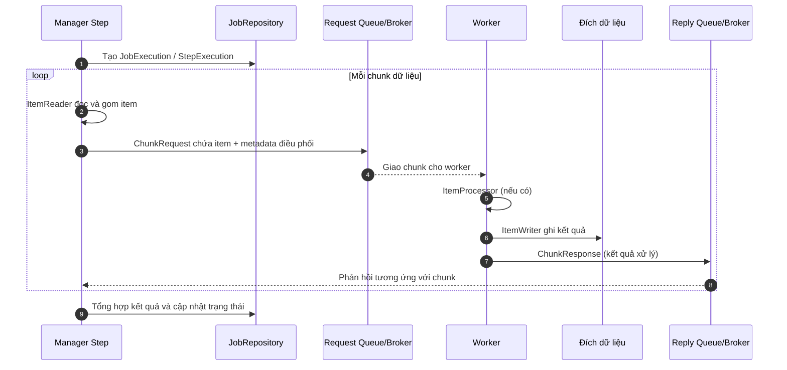

# Điều kiện workload phù hợp remote chunking trong Spring Batch

**Remote chunking** là mô hình mở rộng Spring Batch trong đó **manager đọc item và chia thành chunk**, gửi từng chunk qua middleware; **worker ở tiến trình khác xử lý và ghi dữ liệu**, rồi trả kết quả xử lý về manager. Mô hình giúp tăng năng lực xử lý/ghi khi phần đó tốn nhiều thời gian hơn việc đọc, nhưng chỉ hiệu quả nếu manager, mạng, broker và hệ thống đích còn đủ năng lực.

Bài thuộc chương **Remote Chunking** của module **SPRING_BATCH_SCALING_OPERATIONS**. Mục tiêu là xác định **điều kiện workload thực sự phù hợp remote chunking** trong bối cảnh dữ liệu lớn; biết đo nút thắt, cân nhắc thread safety, cơ chế retry/restart, vận hành job và chọn giữa multi-threaded step, parallel steps, local/remote partitioning và remote chunking theo tài nguyên thực tế. Không có ngưỡng “trên N triệu bản ghi thì phải dùng remote chunking”: quyết định cần dựa vào thời gian đọc, chi phí xử lý, kích thước message, khả năng của downstream và yêu cầu tính đúng đắn.

## 1. Hiểu đúng luồng xử lý và vị trí tốn tài nguyên

Trong remote chunking phổ biến của Spring Batch 5.x, manager sở hữu `ItemReader` và step metadata, đọc và gom các item vào chunk. Phần `ItemWriter` của manager được thay bằng cơ chế gửi message (ví dụ `ChunkMessageChannelItemWriter`); worker nhận chunk, có thể áp dụng `ItemProcessor` và ghi bằng `ItemWriter`, rồi gửi phản hồi `ChunkResponse`.



Sơ đồ trình bày thứ tự logic của một chunk; **nhiều chunk có thể đang được truyền và xử lý cùng lúc**, không nhất thiết manager chờ reply của chunk trước rồi mới đọc chunk tiếp theo. Cơ chế gửi, đợi và tổng hợp reply phụ thuộc builder, channels và cấu hình hạ tầng messaging.

| Thành phần | Công việc chính | Điểm có thể nghẽn |
| --- | --- | --- |
| **Manager** | Đọc, gom chunk, serialize/gửi yêu cầu, theo dõi kết quả | Truy vấn đọc chậm, một reader bị giới hạn, CPU serialize, heap |
| **Broker/adapters** | Chuyển request và reply, lưu đệm/điều phối consumer | Message payload lớn, network throughput, quota, backlog |
| **Workers** | Process/validate/enrich, gọi dịch vụ và ghi kết quả | CPU, API latency, logic nghiệp vụ, writer contention |
| **Nguồn dữ liệu** | Cung cấp item cho manager | Index, IOPS, query latency, connection limit |
| **Đích dữ liệu** | Nhận side effect từ worker | Transaction throughput, lock, rate limit, quota |
| **JobRepository** | Lưu metadata của manager step và job | I/O metadata, checkpoint, retry/restart |

Một khác biệt thiết yếu so với **remote partitioning**: remote chunking gửi **dữ liệu item thực tế** qua broker; remote partitioning thường gửi **yêu cầu thực thi partition** và định danh `StepExecution`, để worker tự đọc phạm vi dữ liệu của nó. Vì vậy, remote chunking phải trả chi phí vận chuyển item nhưng không đòi hỏi mỗi worker phải tự có reader ở nguồn.

## 2. Điều kiện quan trọng nhất: manager không được là nút thắt

Tài liệu Spring Batch nêu rõ remote chunking phát huy tốt khi **thời gian xử lý ở worker cao hơn thời gian đọc ở manager**. Có thể hiểu bằng một ví dụ:

- Reader ở manager đọc được **8.000 item/giây**.
- Mỗi worker xử lý và ghi trung bình **400 item/giây** ở mức tải đại diện.
- Có sáu worker hoạt động độc lập, downstream chưa bão hòa.

Thông lượng xử lý phía worker ở mô hình lý tưởng là `6 × 400 = 2.400 item/giây`. Reader 8.000 item/giây đủ cấp việc, nên thêm worker *có thể* cải thiện tốc độ, nếu broker và đích không nghẽn.

Ngược lại, nếu reader chỉ đọc được **500 item/giây**, thêm từ sáu lên hai mươi worker cũng không thể tăng thông lượng end-to-end vượt đáng kể 500 item/giây khi reader vẫn là nguồn cấp dữ liệu duy nhất.

**Cần đo riêng** tốc độ reader, processor/writer, broker và hệ thống đích trước khi chọn kiến trúc. Chỉ đo duration của một job tuần tự sẽ không phân biệt được phần nào đang chiếm thời gian.

### 2.1. Những phép đo đầu vào nên có

| Phép đo | Cách quan sát | Câu hỏi cần trả lời |
| --- | --- | --- |
| `R_read`: tốc độ đọc item ở manager | Đo riêng reader + truy vấn nguồn với dữ liệu đại diện | Reader có cấp đủ item/giây cho SLA không? |
| `t_process`: thời gian xử lý/item | CPU timer/APM, phân bố P50/P95 | Worker có việc đủ nặng để bù overhead message không? |
| `R_write`: throughput thực của đích | Đo worker writer, lock, DB/API metrics | Đích có tăng thông lượng khi thêm worker? |
| `S_item`: kích thước serialized item | Đo payload thực sau converter | Bao nhiêu byte đi qua broker mỗi chu kỳ? |
| `L_message`: latency request/reply | Tracing theo chunk/correlation | Gửi, xử lý, ACK mất bao lâu? |
| `R_broker`: bandwidth và message rate | Broker metrics/queue depth | Broker có trở thành nút thắt khi tăng worker? |
| `N_run`: số item trong mỗi lần chạy | Nguồn + `readCount` tại `StepExecution` | Cần đạt bao nhiêu item/giây trong batch window? |
| `R_retry`: retry/redelivery | Logs, broker DLQ, repository | Có mất công suất hoặc ghi trùng khi lỗi? |

Nếu dùng API ngoài, cần đo cả quota theo tài khoản/tenant và thời gian chờ. Một worker nhanh khi chạy độc lập chưa chứng minh tổng throughput tăng tuyến tính.

## 3. Workload nào thường phù hợp?

Remote chunking thích hợp khi **đọc dữ liệu tương đối nhẹ**, còn **xử lý hoặc ghi dữ liệu đắt tiền**, có thể chia thành các chunk độc lập và được vận chuyển bằng message đủ nhỏ.

| Tình huống | Vì sao có thể phù hợp? | Điều phải xác minh |
| --- | --- | --- |
| Chuẩn hóa và làm giàu từng giao dịch có tính toán CPU nặng | Manager đọc nhanh; nhiều worker chia phần tính toán | CPU worker thực sự là nút thắt; không có shared mutable state |
| Gọi API xác minh địa chỉ/khách hàng cho từng item | Latency của processor lớn, nhiều worker có thể tăng concurrency | API rate limit, timeout, idempotency và chi phí retry |
| Ghi vào nhiều shard/đích độc lập | Writer có thể chạy đồng thời trên các worker | Không tranh chấp cùng khóa; đích chịu được số connection |
| Render, chuyển đổi định dạng hoặc phân tích nội dung nhỏ | Chi phí transform cao so với kích thước item gửi | Heap worker, thời gian mỗi item, giới hạn payload |
| Batch đọc DB nguồn tập trung nhưng worker không cần truy cập nguồn | Reader được quản lý tại manager, worker chỉ nhận payload đã đọc | Manager đủ throughput và broker truyền được dữ liệu cần thiết |
| Nhiều item độc lập, không yêu cầu thứ tự đầu ra toàn cục | Chunk hoàn thành theo thời điểm khác nhau mà không phá nghiệp vụ | Ghi kết quả có khóa định danh và chịu được nhận lại |

Một ví dụ tốt: một triệu bản ghi nhỏ, reader có thể đọc rất nhanh, nhưng mỗi bản ghi cần một phép tính/biến đổi tiêu tốn nhiều CPU và các worker có thể chạy trên nhiều máy. Nếu kết quả ghi được bằng khóa duy nhất và có chính sách phục hồi, remote chunking đáng để benchmark.

**Lưu ý:** “Có nhiều item” không đủ. Nếu xử lý mỗi item chỉ là phép cộng đơn giản còn việc đọc dữ liệu từ một DB rất chậm, mạng và broker có thể làm mô hình mới chậm hơn.

## 4. Workload nào không phù hợp hoặc cần cân nhắc phương án khác?

| Workload/dấu hiệu | Vì sao remote chunking khó phát huy? | Phương án cần đánh giá |
| --- | --- | --- |
| Reader là bottleneck lớn nhất | Manager vẫn chịu trách nhiệm đọc mọi item | Tối ưu SQL/index, chia nguồn bằng local/remote partitioning |
| Mỗi item rất lớn, chứa BLOB/ảnh/JSON hàng MB | Chi phí serialize, network và broker storage quá cao | Gửi object key/partition metadata; worker đọc trực tiếp từ storage |
| Processor đơn giản, writer cũng rất nhanh | Overhead message + phân tán có thể vượt chi phí xử lý | Chunk step tuần tự, local chunking/partitioning theo phiên bản |
| Workload bắt buộc xử lý theo thứ tự toàn cục | Các chunk có thể đến/hoàn thành khác thứ tự | Xử lý tuần tự hoặc chia theo khóa và có logic sắp xếp/ordering |
| Nhiều item cùng cập nhật một bản ghi/khóa nóng | Worker song song gây lost update, lock và deadlock | Serialize theo business key, atomic update, đổi mô hình dữ liệu |
| Đích áp một rate limit chung thấp | Thêm worker không tăng giới hạn downstream | Rate limiter, batching, cải tiến API hoặc lịch chạy |
| Worker cần đọc lượng lớn dữ liệu gốc theo range | Chuyển dữ liệu qua manager/broker thêm một chặng tốn kém | Remote partitioning để worker tự đọc |
| Không có hạ tầng request/reply đáng tin cậy | Khó quản lý lost/replayed message, reply và restart | Bắt đầu với local partitioning, hoặc thiết kế messaging trước |
| Đầu ra không thể retry/idempotent | Redelivery và lỗi mạng có nguy cơ tạo tác dụng phụ trùng | Thiết kế khóa idempotency/outbox/compensation rồi mới scale |

Một quy tắc thực tế: nếu **read + serialize + send** trên manager đã chiếm phần lớn thời gian batch, chuyển processor sang worker từ xa thường không giải quyết được bottleneck chính.

## 5. Mô hình công suất: tìm rào cản trước khi scale worker

Với pipeline có các giai đoạn chồng lấp, throughput end-to-end không thể vượt giai đoạn chậm nhất. Mô hình sơ bộ:

\[
R_{\mathrm{end-to-end}}\ \lesssim\
\min\left(
R_{\mathrm{reader}},
R_{\mathrm{manager-send}},
R_{\mathrm{broker-items}},
R_{\mathrm{workers}},
R_{\mathrm{destination}}
\right)
\]

Trong đó tất cả đại lượng nên được quy đổi về **item/giây** ở workload tương đương. Ví dụ broker có throughput `B_broker` byte/giây và payload trung bình `S_item` byte/item thì:

\[
R_{\mathrm{broker-items}}\approx\frac{B_{\mathrm{broker}}}{S_{\mathrm{item}}}
\]

Cần tính overhead header, envelope, compression, serialization, replication và cả chiều reply. Giá trị trên chỉ là ước lượng đường truyền request; bottleneck có thể nằm ở **messages/giây** dù byte/giây còn dư.

Thời gian tối thiểu theo bottleneck:

\[
T_{\mathrm{lower-bound}}\approx
\frac{N_{\mathrm{run}}}{R_{\mathrm{end-to-end}}}
\]

Thời gian job thực tế còn có startup, thời gian làm đầy pipeline, chunk còn in-flight, tail latency của chunk cuối, checkpoint và tổng hợp reply.

### Ví dụ có thể scale tốt

Một job có `N_run = 2.400.000` item, SLA 20 phút:

\[
R_{\mathrm{required}}=\frac{2.400.000}{20\times60}
=2.000\ \text{item/giây}
\]

Các phép đo:

- Reader manager: `6.000 item/giây`.
- Mỗi worker xử lý/ghi: `350 item/giây` khi chạy độc lập.
- Giả định hiệu suất worker khi chạy nhiều instance còn `75%`.
- Broker và đích được đo cho phép ít nhất `2.500 item/giây`.

Số worker ước tính để đạt tối thiểu:

\[
W_{\mathrm{minimum}}=
\left\lceil\frac{2.000}{350\times0,75}\right\rceil
=\lceil7,62\rceil=8
\]

Với tám worker, tốc độ kỳ vọng là `8 × 350 × 0,75 = 2.100 item/giây`, chỉ có khoảng dư nhỏ. Để có headroom cho retry và đỉnh dữ liệu, cần benchmark thêm số worker và kiểm tra giới hạn hệ thống đích. **Không được xem con số tám là cam kết SLA** chỉ từ phép nhân.

### Ví dụ manager là nút thắt

Giữ nguyên workload và worker, nhưng reader chỉ đạt `900 item/giây`. Dù có 20 worker, tốc độ end-to-end vẫn bị reader giới hạn xấp xỉ 900 item/giây:

\[
T_{\mathrm{best}}\gtrsim
\frac{2.400.000}{900}
\approx2.667\text{ giây}\approx44,4\text{ phút}
\]

Trong trường hợp này, nên tối ưu đường đọc hoặc đánh giá **remote partitioning** để nhiều worker đọc các phạm vi độc lập, nếu nguồn chịu được đồng thời.

## 6. Tỷ lệ chi phí xử lý so với chi phí vận chuyển

Đối với mỗi chunk gồm `k` item, gọi:

- `t_read(k)`: thời gian manager đọc/gom chunk.
- `t_encode(k)`: thời gian serialize, đóng message và gửi.
- `t_transport(k)`: độ trễ request đến worker và reply quay lại (không gồm xử lý).
- `t_worker(k)`: thời gian processor/writer thực hiện chunk.
- `t_coord(k)`: chi phí điều phối, theo dõi kết quả và metadata.

Remote chunking thường đáng cân nhắc nếu `t_worker(k)` lớn so với overhead `t_encode(k)+t_transport(k)+t_coord(k)` và reader vẫn có khả năng cấp đủ item. Đây là tiêu chí định tính để **đo**, không phải điều kiện toán học bắt buộc với một ngưỡng tỷ lệ cố định.

| Profile thử nghiệm | Đọc/serialize chunk | Worker xử lý/ghi | Nhận định sơ bộ |
| --- | ---: | ---: | --- |
| A | 5 ms | 800 ms | Đáng thử remote chunking nếu đích/broker ổn |
| B | 120 ms | 150 ms | Cần benchmark kỹ; overhead có thể đáng kể |
| C | 500 ms | 40 ms | Manager có thể thành bottleneck; ít lợi |
| D | 30 ms | 700 ms nhưng mọi worker cùng tranh chấp một DB lock | Có thể không scale dù xử lý worker “đắt” |

Các con số chỉ minh họa profile, không phải benchmark hay ngưỡng chính thức của Spring Batch.

**Thận trọng với I/O đích:** Nếu worker mất 800 ms chỉ vì chờ lock tại cùng một bảng, thêm worker có thể làm thời gian mỗi chunk tăng lên, khiến giả định có thể chia đều tải không còn đúng.

## 7. Kích thước item quyết định chi phí của remote chunking

Remote chunking truyền các **item đã đọc** trong request message. Nếu payload lớn, băng thông và giới hạn broker có thể đảo ngược lợi ích xử lý phân tán.

Giả sử 2,4 triệu item, chưa tính overhead header:

| Serialized item trung bình | Tổng payload request | Băng thông trung bình cần trong 20 phút |
| --- | ---: | ---: |
| 500 B | 1,2 GB | 1 MB/s |
| 8 KB | 19,2 GB | 16 MB/s |
| 64 KB | 153,6 GB | 128 MB/s |

Bảng dùng đơn vị hệ thập phân (1 KB = 1.000 B, 1 MB = 1.000.000 B). Các con số là **mức trung bình tối thiểu** của đường request; khi có retry, serialization overhead, broker replication, concurrent batch jobs và reply, tải thực tăng. Payload có thể gồm cấu trúc object/metadata và có kích thước khác dữ liệu hàng DB.

Khi có BLOB/tệp lớn, cân nhắc chỉ gửi **tham chiếu tới object được version hóa** (ví dụ object key + checksum), để worker đọc trực tiếp nguồn lưu trữ. Cách đó thay đổi mô hình chi phí và tính đúng đắn: worker cần quyền đọc, object phải bất biến trong lần chạy và hệ thống phải kiểm soát lifetime của reference. Nếu worker phải đọc chính nguồn dữ liệu theo partition, **remote partitioning** có thể rõ nghĩa hơn.

### Không chỉ xét số byte

- Broker có giới hạn kích thước **một message** và quota tổng bộ nhớ/đĩa.
- Serializer có thể tạo object graph rất lớn; trường không cần thiết làm payload phình.
- Nén giúp giảm byte mạng nhưng tiêu thụ CPU và có thể tăng latency.
- Một item bất thường lớn có thể khiến một chunk vượt giới hạn dù kích thước trung bình nhỏ.
- Thông tin nhạy cảm được gửi qua broker cần kiểm soát truy cập, TLS và chính sách retention phù hợp.

Nên đo P95/P99 serialized item size và kích thước chunk thực, không chỉ `avgRowBytes` của database.

## 8. Chọn chunk size theo độ trễ, throughput và độ an toàn

Chunk size (số item gửi mỗi request) ảnh hưởng đến số message và mức độ gom công việc.

Với `N` item và chunk size `k`:

\[
M_{\mathrm{requests}}\approx\left\lceil\frac{N}{k}\right\rceil
\]

Ví dụ 2,4 triệu item:

| Chunk size | Số request xấp xỉ | Tác động thường gặp |
| ---: | ---: | --- |
| 10 | 240.000 | Nhiều message/ACK, overhead cao |
| 100 | 24.000 | Cân bằng ban đầu để benchmark |
| 1.000 | 2.400 | Ít message hơn, nhưng payload/retry lớn hơn |
| 10.000 | 240 | Ít message, nguy cơ chunk quá lớn, tail latency và retry tốn kém |

Không có `chunkSize=100` hay `=1.000` là “đúng” cho mọi workload. Cần điều chỉnh theo những rào cản sau:

1. **Giới hạn message:** `k × P95(payload item)` cộng metadata không được vượt ngưỡng an toàn của broker; dùng phân bố thực, không chỉ trung bình.
2. **Thời gian xử lý chunk:** chunk quá lớn kéo dài transaction và thời gian chờ reply; khi worker chết phải xử lý lại nhiều item hơn.
3. **Overhead request/reply:** chunk quá nhỏ tăng số message, routing, deserialize, per-chunk transaction và coordination.
4. **Độ cân bằng tải:** nhiều chunk vừa đủ giúp worker nhận thêm việc khi rảnh; rất ít chunk lớn có thể tạo “đuôi dài”.
5. **Memory:** manager có thể giữ nhiều chunk đang in-flight; worker phải giải mã và giữ đủ dữ liệu cho xử lý.
6. **Tính đúng đắn:** không có transaction phân tán bao trùm việc đọc manager, chuyển message và commit worker theo mặc định.

Đặt timeout phải dựa trên P95/P99 thời gian xử lý chunk, độ trễ broker và hàng đợi; không tự đánh đồng một message chưa có reply với worker chưa ghi dữ liệu.

## 9. Concurrency thực sự nằm ở worker và downstream

Remote chunking chuyển xử lý sang nhiều worker instance, nhưng throughput không bằng “số pod × tốc độ của một pod” nếu chúng dùng chung DB, API hoặc broker.

Ví dụ mỗi worker đạt 300 item/giây khi chạy một mình:

| Worker instances | Tuyến tính lý tưởng | Khi DB đích bão hòa ở 900 item/s |
| ---: | ---: | ---: |
| 1 | 300 | Có thể gần 300 |
| 2 | 600 | Có thể gần 600 |
| 4 | 1.200 | Tổng thực không vượt năng lực đích bền vững |
| 8 | 2.400 | Tăng worker có thể chỉ gây lock/timeout nhiều hơn |

Khi worker gọi một API có quota 1.000 request/giây, phải dùng concurrency/rate limiting tính **trên toàn bộ worker**, không chỉ riêng mỗi instance. Nếu mỗi item gây nhiều request, quy đổi đúng ra request/s.

Tối ưu theo bước:

- Đo throughput reader riêng và worker riêng.
- Xác định số worker cần thiết cho batch window.
- Đo lại khi chạy 2, 4, 8 worker trên cùng nguồn/đích và dữ liệu đại diện.
- Theo dõi DB connection pool, lock wait, CPU, GC, request latency, backlog và retry.
- Dừng tăng worker khi throughput tăng ít nhưng latency, backlog hoặc tỷ lệ lỗi tăng.

Đừng dùng số item có trong queue như một cách thay thế cho số item đã xử lý thành công.

## 10. Ví dụ cấu hình Spring Batch 5.x: manager đọc, worker xử lý

Ví dụ sau minh họa các builder của **Spring Batch 5.2.x**. Nó nhấn mạnh cách chia vai trò, chưa phải ứng dụng độc lập có đầy đủ broker adapters, DataSource và nghiệp vụ.

### Manager: reader và request/reply channels

```java
import org.springframework.batch.core.Step;
import org.springframework.batch.core.repository.JobRepository;
import org.springframework.batch.integration.chunk.RemoteChunkingManagerStepBuilder;
import org.springframework.batch.item.ItemReader;
import org.springframework.beans.factory.annotation.Qualifier;
import org.springframework.context.annotation.Bean;
import org.springframework.messaging.MessageChannel;
import org.springframework.messaging.PollableChannel;
import org.springframework.transaction.PlatformTransactionManager;

@Bean
public Step remoteChunkManagerStep(
        JobRepository jobRepository,
        PlatformTransactionManager transactionManager,
        ItemReader<OrderInput> orderReader,
        @Qualifier("requestsOut") MessageChannel requestsOut,
        @Qualifier("repliesIn") PollableChannel repliesIn) {

    return new RemoteChunkingManagerStepBuilder<OrderInput, OrderInput>(
            "remoteChunkManagerStep", jobRepository)
        .chunk(100)
        .reader(orderReader)
        .outputChannel(requestsOut) // manager -> broker -> worker
        .inputChannel(repliesIn)    // worker -> broker -> manager
        .transactionManager(transactionManager)
        .build();
}
```

Builder tạo writer gửi chunk dưới dạng message, nên **không gọi thêm `.writer(...)`** để thay writer này. `OrderInput` là DTO do ứng dụng định nghĩa, phải serializable theo message converter đang dùng. `ItemReader` trên manager cần có cấu hình restart/checkpoint phù hợp; việc dùng transaction manager ở manager không làm thay giao dịch ghi của worker.

### Worker: processor, writer và integration flow

```java
import org.springframework.batch.integration.chunk.RemoteChunkingWorkerBuilder;
import org.springframework.batch.item.ItemProcessor;
import org.springframework.batch.item.ItemWriter;
import org.springframework.beans.factory.annotation.Qualifier;
import org.springframework.context.annotation.Bean;
import org.springframework.integration.dsl.IntegrationFlow;
import org.springframework.messaging.MessageChannel;

@Bean
public IntegrationFlow remoteChunkWorkerFlow(
        @Qualifier("requestsIn") MessageChannel requestsIn,
        @Qualifier("repliesOut") MessageChannel repliesOut,
        ItemProcessor<OrderInput, OrderResult> processor,
        ItemWriter<OrderResult> writer) {

    return new RemoteChunkingWorkerBuilder<OrderInput, OrderResult>()
        .inputChannel(requestsIn)
        .outputChannel(repliesOut)
        .itemProcessor(processor)
        .itemWriter(writer)
        .build();
}
```

Các kiểu `OrderInput` và `OrderResult`, bean reader/processor/writer, cùng adapters của JMS/AMQP/RabbitMQ cần được hiện thực cụ thể. Worker builder thiết lập flow tiếp nhận chunk, xử lý và trả reply. Ở cấu hình remote chunking tiêu chuẩn, worker **không nhất thiết cần truy cập JobRepository của manager**; manager quản lý lifecycle/metadata chính. Không áp dụng giả định này sang **remote partitioning**, nơi worker thường cần repository chung để nạp `StepExecution`.

### Hai chiều kết nối middleware

```text
Manager JVM                                          Worker JVM(s)
------------                                         -------------
ItemReader -> requestsOut -> broker.requests -> requestsIn
repliesIn  <- broker.replies  <- repliesOut <- ItemProcessor/ItemWriter
          \__________ correlation/response __________/
```

`MessageChannel` là kênh logic trong ứng dụng. Hai JVM **không chia sẻ cùng bean channel**; cần Spring Integration inbound/outbound adapters và broker thực sự ở giữa. Cần kiểm soát message converter, headers tương quan, routing reply, consumer concurrency và bảo mật. Hình trên không phải cấu hình broker hoàn chỉnh.

**Tương thích phiên bản:** Một số API và kiểu reply channel đã thay đổi ở Spring Batch 6.x; tài liệu hiện hành có thể mô tả builder khác Spring Batch 5.2. Khi triển khai, kiểm tra JavaDoc của **đúng phiên bản dependency**. Phần code trên dành cho cách dùng builder 5.2.x, trong đó manager nhận reply qua `PollableChannel`.

## 11. Tính độc lập của item và thứ tự xử lý

Remote chunking phù hợp nhất khi mỗi chunk có thể xử lý mà **không cần đợi kết quả của chunk khác**.

Các đặc tính nên có:

- Business key rõ ràng cho mỗi item.
- Xử lý có thể song song trên nhiều worker mà không sửa shared mutable state.
- Không phụ thuộc thứ tự hoàn thành giữa chunk A/B.
- Nếu cần thứ tự theo từng khách hàng hoặc tài khoản, có cơ chế phân nhóm/serialize theo key ở hệ thống đích, hoặc chọn kiến trúc khác.
- Kết quả có thể đối soát độc lập trước khi xác nhận job hoàn tất.

Ví dụ, xử lý dữ liệu địa chỉ độc lập thường có thể phân phối chunk cho nhiều worker. Ngược lại, sự kiện “trừ tiền → hoàn tiền → điều chỉnh số dư” của cùng một tài khoản cần kiểm soát thứ tự/atomic update. Gửi tùy ý qua nhiều consumer rồi chờ reply không tự bảo đảm đúng nghiệp vụ.

Đừng giả định **thứ tự gửi request = thứ tự commit kết quả**. Broker có thể redeliver, worker có latency khác nhau, và một chunk có thể hoàn thành sau chunk gửi muộn hơn.

## 12. Những điều kiện để retry và restart an toàn

Trong remote chunking, message delivery, transaction worker và cập nhật metadata manager không phải một giao dịch nguyên tử xuyên nhiều tiến trình theo mặc định.

Phân biệt ba sự kiện:

1. Manager đã gửi `ChunkRequest`.
2. Worker đã xử lý và commit tác dụng phụ ở đích.
3. Manager đã nhận `ChunkResponse` và ghi nhận kết quả.

Một sự cố có thể xảy ra **giữa bất kỳ hai sự kiện nào**. Ví dụ worker ghi dữ liệu xong nhưng reply mất, manager không thể kết luận worker chưa chạy. Nếu broker giao lại request, writer có thể bị thực thi thêm lần nữa.

| Tình huống | Nguy cơ | Biện pháp |
| --- | --- | --- |
| Worker chết trước commit | Chunk chưa xong, có thể được giao lại | Kiểm tra retry/transaction và số lần thử tối đa |
| Worker commit rồi mất reply | Manager nghĩ chưa nhận kết quả trong khi dữ liệu đã ghi | Writer idempotent, correlation và đối soát đích |
| Request bị broker redeliver | Một chunk được worker xử lý hai lần | Unique business key, idempotency token phù hợp |
| Reply đến muộn/sai correlation | Manager chờ lâu, timeout hoặc tổng hợp sai | Bảo toàn headers và routing reply |
| Manager crash khi còn chunk in-flight | Metadata và trạng thái broker không khớp trực quan | Thiết kế restart, đối soát checkpoint và dữ liệu đích |
| Writer gọi API không transactional | Side effect thành công nhưng worker báo lỗi sau timeout | Idempotency key ở API hoặc cơ chế bù trừ |
| Chunk lớn có một item độc hại | Retry cả chunk tốn nhiều thời gian, có thể kẹt | Phân loại lỗi, dead-letter/skip theo chính sách và giới hạn retry |

**Không hứa exactly-once end-to-end chỉ vì broker có ACK hoặc Spring Batch có `JobRepository`.** Tính đúng đắn cần xuất phát từ nghiệp vụ và tài nguyên đích:

- Upsert theo khóa tự nhiên + phiên bản, unique constraint hoặc phép cập nhật có điều kiện.
- Idempotency token ổn định theo **thao tác nghiệp vụ**, không phụ thuộc duy nhất vào attempt/message ID có thể thay đổi sau restart.
- Transaction đúng phạm vi worker writer, kết hợp outbox nếu cần phát thông báo sau ghi DB.
- Retry có giới hạn, backoff và xử lý DLQ cho lỗi vĩnh viễn.
- Đối soát dữ liệu đích và watermark/checkpoint trước khi tiếp tục job bị lỗi.

Hãy kiểm tra kỹ semantics của queue, ACK, transactional boundaries và lưu metadata trên phiên bản/framework messaging dùng thực tế. Một DLQ chứa request lỗi không tự động đổi trạng thái `BatchStatus` của manager.

## 13. Thread safety và quản trị state trong worker

Mỗi worker JVM có các bean Spring của riêng nó. Tuy nhiên, **nhiều consumer threads bên trong cùng một worker JVM** có thể gọi processor/writer singleton đồng thời; hoặc nhiều worker đồng thời cập nhật cùng dữ liệu đích.

| Phần | Rủi ro | Cách thiết kế |
| --- | --- | --- |
| `ItemProcessor` stateful | Bộ đếm/cache mutable bị race giữa consumer threads | Stateless hoặc cơ chế đồng bộ/cô lập theo message |
| `ItemWriter` có buffer | Trộn dữ liệu giữa chunk đồng thời | Stateless/thread-safe hoặc mỗi consumer có state riêng |
| Entity/session/connection | Chia sẻ session không an toàn | Mỗi lần xử lý dùng transaction/resource lifecycle phù hợp |
| External service | Rate limit, timeout, side effects trùng | Giới hạn concurrency và dùng idempotency key |
| Kết quả theo thứ tự | Chunks hoàn thành không đồng bộ | Version, sequence theo business key, hoặc luồng tuần tự |
| In-memory cache | Worker khác nhau có cache không đồng nhất | Cache bất biến theo version hoặc truy xuất nguồn thống nhất |

Trong remote chunking, không nên mặc định dùng `@StepScope` như worker step local/partitioned step: worker thường chạy integration flow xử lý request, không phải mỗi chunk có một `StepExecution` với scope được gắn đầy đủ. Hãy thiết kế processor/writer theo runtime worker thực tế và kiểm tra concurrency của Spring Integration consumer containers.

## 14. Khả năng vận hành: manager, broker, worker và đích phải được quan sát cùng nhau

Để biết remote chunking có thực sự phù hợp và đang khỏe mạnh, cần nhìn bốn lớp:

| Lớp | Metric | Điều chỉ ra |
| --- | --- | --- |
| Manager | `readCount`, tốc độ đọc, thời gian serialize/send, in-flight chunks | Reader có đủ tốc độ hay đang tạo backlog? |
| Broker | Request queue depth, oldest message age, throughput, message size, retry/DLQ | Worker có nhận đủ việc và broker có nghẽn? |
| Worker | Số consumer active, CPU, heap/GC, P95 xử lý chunk, lỗi/rollback | Xử lý có scale theo số worker? |
| Downstream | DB locks, connection wait, API 429, write throughput, latency | Hệ thống đích có bão hòa trước worker? |
| Reply/metadata | Chunk responses nhận được, correlation, timeout, trạng thái manager `JobExecution` | Manager có tổng hợp được kết quả? |

Ví dụ khi request queue tăng liên tục:

- Nếu manager đọc nhanh và worker CPU gần 100%, cần đánh giá thêm worker nếu đích còn dư.
- Nếu worker CPU thấp nhưng DB connection pending cao, bottleneck nằm ở DB/pool, thêm worker có thể gây hại.
- Nếu worker đã xử lý xong nhưng reply queue tăng, cần kiểm tra consumer reply, correlation/header mapping và manager.
- Nếu không có backlog mà manager read throughput thấp, cần tối ưu reader hoặc đổi kiến trúc phân phối đọc.

Một cảnh báo chỉ dựa vào “JobExecution STARTED quá 30 phút” có thể bỏ qua sự khác biệt giữa nhiều dữ liệu hơn dự kiến, một worker chậm và lỗi middleware. Nên đặt ngưỡng theo SLA, P95 duration lịch sử và mức backlog.

### Mẫu correlation cho log

Một record log (minh họa, không phải schema mặc định của framework) có thể gồm:

```json
{
  "jobExecutionId": 901,
  "stepExecutionId": 912,
  "chunkSequence": 42,
  "messageCorrelationId": "chunk-run-901-42",
  "workerInstance": "chunk-worker-3",
  "payloadItems": 100,
  "processingMs": 780,
  "status": "COMPLETED"
}
```

Trường và cách sinh correlation phụ thuộc cấu hình thực tế. Log phải đủ để nối request–worker–reply và kiểm tra duplicate/redelivery. Tránh đưa toàn bộ payload chứa dữ liệu khách hàng vào log, hoặc gắn ID có cardinality cao thành nhãn trên mọi metric.

## 15. So sánh remote chunking với các mô hình scaling khác

| Mô hình | Phần được chạy song song | Dữ liệu di chuyển giữa tiến trình | Phù hợp khi |
| --- | --- | --- | --- |
| Chunk step tuần tự | Không hoặc rất ít concurrency | Không cần message | Khối lượng nhỏ; logic đơn giản, dễ restart |
| Multi-threaded/local chunking | Các chunk trong một JVM | Không cần broker | Còn tài nguyên một máy, component có thread safety phù hợp |
| Parallel steps | Các bước/flow độc lập | Thường không cần message | Có nhiều pipeline không phụ thuộc dữ liệu |
| Local partitioning | Nhiều `StepExecution` trên thread cùng JVM | Không gửi toàn item qua broker | Đọc được chia range/file, vẫn scale tốt trên một host |
| **Remote chunking** | Processor/writer trên nhiều worker JVM; manager đọc và gửi item | **ChunkRequest** chứa dữ liệu item và **ChunkResponse** | Reader nhanh, xử lý/ghi nặng, item nhỏ, message overhead hợp lý |
| Remote partitioning | Các partition step chạy ở nhiều worker JVM | Request phân công + metadata; worker tự đọc dữ liệu | Reader cũng cần scale, dữ liệu lớn/không muốn chuyển payload qua manager |

**Chú ý về phiên bản:** Thuật ngữ và API của local chunking phát triển theo các phiên bản Spring Batch (chẳng hạn 6.x có hỗ trợ local chunking riêng). Khi so sánh lựa chọn kiến trúc, cần đối chiếu khả năng cụ thể của Spring Batch 5.x/6.x mà dự án đang dùng.

Vì remote partitioning để worker tự đọc, nó thường hữu ích khi mỗi worker có quyền truy cập trực tiếp tới tập dữ liệu đã chia; remote chunking phù hợp hơn khi cần giữ reader tập trung trên manager hoặc chi phí đọc nhỏ so với xử lý.

## 16. Phân tích ba workload cụ thể

### Trường hợp A — Làm giàu dữ liệu khách hàng bằng dịch vụ ngoài

- 1.000.000 customer record nhỏ, mỗi record serialized 700 B.
- Reader PostgreSQL đo được 10.000 item/giây.
- Một worker gọi API/transform đạt 120 item/giây.
- API cho phép tăng thông lượng qua nhiều worker đến 1.500 request/giây, có idempotency key.

**Đánh giá:** Remote chunking là ứng viên tốt: reader nhanh, payload tương đối nhỏ, xử lý ở worker đắt. Để đạt 1.200 item/giây có thể cần khoảng 10 worker lý tưởng, nhưng phải benchmark rate limit, request latency, retry và backlog. Nếu API thực tế có quota toàn tài khoản 300 request/giây, thêm worker vượt mức đó không giúp.

### Trường hợp B — ETL ảnh lớn

- 200.000 ảnh, mỗi ảnh 4 MB.
- Manager hiện đọc ảnh qua object storage.
- Worker cần nén/resize và ghi ảnh đích.

Nếu gửi đầy đủ ảnh qua broker, request payload lý thuyết đã là:

\[
200.000 \times 4\text{ MB}=800\text{ GB}
\]

Con số chưa kể retry/replication và message overhead; nhiều broker cũng giới hạn kích thước message thấp hơn một ảnh. **Nên cân nhắc gửi object key + version/hash cho worker**, hoặc remote partitioning theo object ranges để worker đọc trực tiếp từ storage. Cần đo băng thông object storage và tính đúng đắn của reference.

### Trường hợp C — Cập nhật một bảng đang bị lock nặng

- Reader nhanh 20.000 item/giây.
- Mỗi worker ghi vào cùng nhóm hàng trong một bảng quan hệ.
- Khi thêm worker, lock wait và deadlock tăng, tổng commit/s đứng yên.

**Đánh giá:** Phần đọc nhanh chưa đủ để chọn remote chunking. Writer đang tranh chấp dữ liệu đích; thêm worker qua broker không thay đổi lock. Cần đổi business key/partition strategy, giảm độ nóng, tối ưu SQL/transaction hoặc áp concurrency control trước khi chọn mô hình phân tán.

## 17. Quy trình thử nghiệm để ra quyết định kiến trúc

### Bước 1 — Xác định SLA và các giới hạn bắt buộc

Ghi `N_run`, batch window, peak workload, dữ liệu đến muộn, khả năng chịu downtime và yêu cầu idempotency. Phân biệt ingestion count với workload cần xử lý sau retry/backfill.

### Bước 2 — Đo baseline tuần tự

Chạy một chunk step tương đương, đo riêng reader, processor, writer, commit, I/O, DB connections, CPU/GC và kích thước item. Ghi lại phân bố P95/P99, không chỉ trung bình.

### Bước 3 — Thử vận chuyển message độc lập

Đo serialized item size, kích thước chunk sau encode, request/reply RTT, broker byte/s và message/s. Kiểm tra schema evolution, header correlation và giới hạn message. Với payload lớn, phải đánh giá lại kiến trúc trước khi triển khai worker.

### Bước 4 — Tăng worker có kiểm soát

Thử 1, 2, 4, 8 worker hoặc mức phù hợp; giữ dataset/chunk size/cấu hình DB tương đương. Ghi throughput end-to-end, queue depth, idle/busy time, DB locks và số lỗi. Quan sát **speedup thực**, không suy từ số instance.

### Bước 5 — Inject failure và xác nhận tính đúng đắn

Thử các tình huống: worker crash trước commit, crash sau commit nhưng trước reply, broker redelivery, reply đến trễ, manager restart, outage của đích. Đối soát output theo business key và bảo đảm không mất/nhân đôi tác dụng phụ ngoài phạm vi chấp nhận.

### Bước 6 — So sánh phương án khác

Nếu bottleneck nằm ở reader, thử remote partitioning hoặc tối ưu nguồn; nếu tài nguyên một máy còn dư, thử local partitioning; nếu các nhóm công việc có thể tách độc lập, thử parallel steps. Chốt kiến trúc theo throughput, độ phức tạp và chi phí vận hành thực tế.

### Ma trận kết quả thí nghiệm

| Thử nghiệm | Worker | Chunk size | Throughput (item/s) | P95 chunk latency | Broker backlog | DB/API lỗi | Kết quả restart |
| --- | ---: | ---: | --- | --- | --- | --- | --- |
| Baseline | 1 | 100 | Đo thực tế | Đo thực tế | Đo thực tế | Đo thực tế | Đánh giá |
| Mở rộng 1 | 2 | 100 | Đo thực tế | Đo thực tế | Đo thực tế | Đo thực tế | Đánh giá |
| Mở rộng 2 | 4 | 100 | Đo thực tế | Đo thực tế | Đo thực tế | Đo thực tế | Đánh giá |
| Tối ưu chunk | 4 | 500 | Đo thực tế | Đo thực tế | Đo thực tế | Đo thực tế | Đánh giá |

Bảng là biểu mẫu thu thập dữ liệu, **không phải benchmark đã thực hiện**. Thay đổi chunk size nên được thử riêng sau khi đã có baseline worker count, vì hai biến cùng đổi sẽ khó xác định nguyên nhân.

## 18. Checklist chọn workload cho remote chunking

- [ ] Manager đọc đủ nhanh để đáp ứng SLA và không là bottleneck khi tăng worker.
- [ ] Thời gian xử lý/ghi lớn hơn đáng kể chi phí đọc/serialize/gửi message theo phép đo.
- [ ] Item/chunk có payload vừa giới hạn broker, bandwidth và bộ nhớ; đã đo P95/P99 payload.
- [ ] Các chunk có thể chạy song song, không dựa vào thứ tự hoàn tất trên nhiều consumer.
- [ ] Worker processor/writer an toàn trước concurrency và không chia sẻ mutable state thiếu kiểm soát.
- [ ] Dữ liệu đích chịu được concurrency tăng, có headroom CPU/IO/connection/rate limit.
- [ ] Có đường request và reply được giám sát; correlation headers được giữ xuyên adapters.
- [ ] Có chính sách timeout, retry/redelivery, DLQ và cảnh báo backlog.
- [ ] Writer xử lý trùng/idempotent và có quy trình đối soát sau lỗi.
- [ ] Cấu hình reader/checkpoint/JobRepository hỗ trợ restart theo đúng phiên bản framework.
- [ ] Có benchmark end-to-end với dữ liệu đại diện và thử tình huống worker/broker/manager crash.
- [ ] Đã so sánh với local partitioning/remote partitioning theo nút thắt thật và chi phí vận hành.

Một quyết định **chưa đủ điều kiện triển khai** nếu chỉ đo được số worker mà chưa biết reader throughput, message size, behavior khi redelivery và mức bão hòa của đích.

## 19. Bài thực hành: có nên dùng remote chunking?

Một job mỗi đêm xử lý 3.600.000 item trong 30 phút.

- Manager reader: **5.000 item/giây**.
- Mỗi worker: **250 item/giây** khi chạy riêng.
- Khi nhiều worker hoạt động, hiệu suất dự kiến còn **80%**.
- Serialized item size: **1.500 B**.
- Hệ thống đích chịu tối đa **2.500 item/giây**.
- Broker chịu ổn định **20 MB/s** request payload (chưa tính overhead), message size limit do cấu hình cần xác nhận.

**Câu hỏi:**

1. Throughput tối thiểu cần đạt là bao nhiêu item/giây?
2. Theo ước lượng worker efficiency, tối thiểu cần bao nhiêu worker?
3. Băng thông payload trung bình cần truyền tại throughput tối thiểu là bao nhiêu?
4. Đích có là bottleneck trong tình huống này không?
5. Nếu mỗi item tăng từ 1.500 B lên 15.000 B, broker có còn dư ở cùng throughput không?
6. Nếu reader tụt xuống 1.200 item/giây, có nên tiếp tục tăng worker?

**Gợi ý giải:**

- Nhu cầu: `3.600.000 / (30 × 60) = 2.000 item/giây`.
- Mỗi worker hiệu dụng `250 × 0,8 = 200 item/giây` → lý thuyết **10 worker** đủ chạm mức tối thiểu nhưng **không còn headroom**.
- Băng thông payload request ở 2.000 item/giây là `2.000 × 1.500 = 3 MB/s`, thấp hơn 20 MB/s trong mô hình bỏ qua overhead/retry.
- Đích 2.500 item/giây còn khoảng trống nhỏ; phải benchmark thực tế và tính startup/tail latency.
- Nếu 15.000 B/item, cần **30 MB/s** → vượt năng lực 20 MB/s, broker trở thành nút thắt trước khi xử lý đủ SLA, dù worker đủ.
- Nếu reader chỉ còn 1.200 item/giây, mô hình không đạt SLA; tăng worker không giúp. Tối ưu reader hoặc thử kiến trúc worker tự đọc (remote partitioning) nếu dữ liệu chia được.

Kết quả là **ước lượng toán học** cho dữ liệu giả định. Với triển khai thật, cần tính cả request/reply envelope, replication, retry, timeout và khả năng dữ liệu bị lệch tải.

## 20. Những sai lầm lựa chọn thường gặp

1. **Chọn remote chunking chỉ vì dữ liệu nhiều:** không kiểm tra manager reader có thể cấp việc đủ nhanh.
2. **Cho rằng tăng worker luôn tăng throughput:** quên broker, DB/API và bandwidth.
3. **Gửi object lớn thay vì reference ổn định:** serialization/network áp đảo thời gian xử lý.
4. **Chọn chunk size rất nhỏ:** tăng message rate, ACK và metadata overhead.
5. **Chọn chunk size quá lớn:** vượt message limit, transaction dài, retry đắt và tail latency cao.
6. **Không giữ correlation header ở reply path:** manager không tập hợp được kết quả dù worker đã chạy.
7. **Tin ACK là đã commit nghiệp vụ:** ACK vận chuyển không đồng nghĩa tác dụng phụ đích thành công.
8. **Thiếu idempotency:** worker commit thành công nhưng reply mất, redelivery gây ghi trùng.
9. **Không đo throughput đọc riêng:** manager trở thành nút thắt vô hình sau khi thêm worker.
10. **Nhầm remote chunking với remote partitioning:** worker remote chunking thường nhận item, remote partitioning nhận việc và tự đọc nguồn.
11. **Bỏ qua ordering:** kết quả chunk có thể đến sai thứ tự nghiệp vụ.
12. **Không kiểm thử restart khi còn in-flight chunk:** xử lý lại thiếu kiểm soát hoặc bỏ sót.
13. **Lấy số item trong queue làm số item thành công:** backlog chỉ là tải đang chờ, không phải output đã commit.
14. **Không cân nhắc vận hành broker/worker:** tăng độ phức tạp monitoring, scaling, lỗi mạng và schema evolution.

## 21. Tài liệu tham khảo

- [Spring Batch Reference – Scaling and Parallel Processing](https://docs.spring.io/spring-batch/reference/scalability.html): nêu điều kiện manager không thành nút thắt, worker processing tốn hơn reading.
- [Spring Batch Reference – Externalizing Batch Process Execution](https://docs.spring.io/spring-batch/reference/spring-batch-integration/externalizing-execution.html): luồng request/reply và tích hợp middleware cho remote chunking.
- [Spring Batch 5.2 – RemoteChunkingManagerStepBuilder API](https://docs.spring.io/spring-batch/docs/5.2.x/api/org/springframework/batch/integration/chunk/RemoteChunkingManagerStepBuilder.html): manager reader, output/input channels, chunk size và chờ reply.
- [Spring Batch 5.2 – RemoteChunkingWorkerBuilder API](https://docs.spring.io/spring-batch/docs/5.2.x/api/org/springframework/batch/integration/chunk/RemoteChunkingWorkerBuilder.html): worker processor/writer và integration flow.
- [Spring Batch 5.2 – ChunkRequest và ChunkResponse](https://docs.spring.io/spring-batch/docs/5.2.x/api/org/springframework/batch/integration/chunk/package-summary.html): kiểu message điều phối chunk.
- [Spring Integration Reference](https://docs.spring.io/spring-integration/reference/): channel, adapters, message routing, header mapping và messaging middleware.
- [Spring Batch Reference – JobRepository](https://docs.spring.io/spring-batch/reference/job/configuring-repository.html): trạng thái job/step và khôi phục metadata.

> **Điểm cần nhớ:** Remote chunking phù hợp khi **manager đọc nhanh, worker xử lý hoặc ghi chậm, chunk nhỏ đủ truyền hiệu quả, công việc độc lập và đích chịu được nhiều worker**. Quyết định phải được xác nhận bằng benchmark qua bốn lớp manager–broker–worker–downstream, cùng thử nghiệm retry/restart và đối soát output. Nếu reader hoặc việc vận chuyển dữ liệu là nút thắt, hãy xem xét tối ưu nguồn hoặc remote partitioning trước khi tăng worker.
