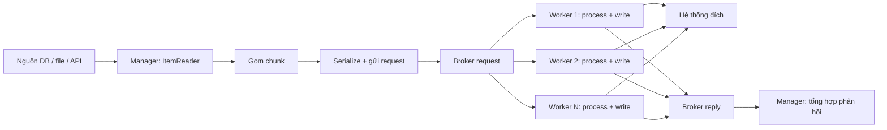
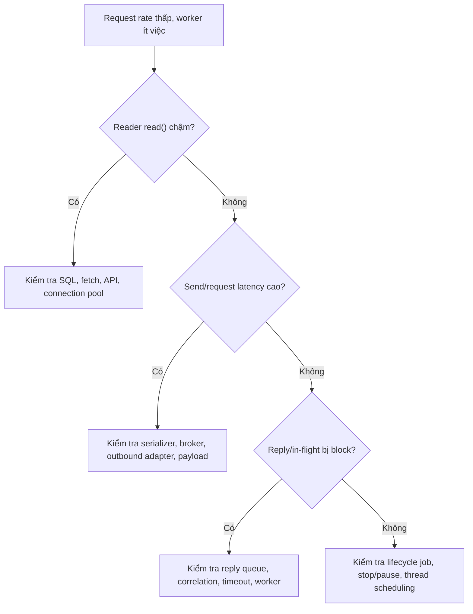
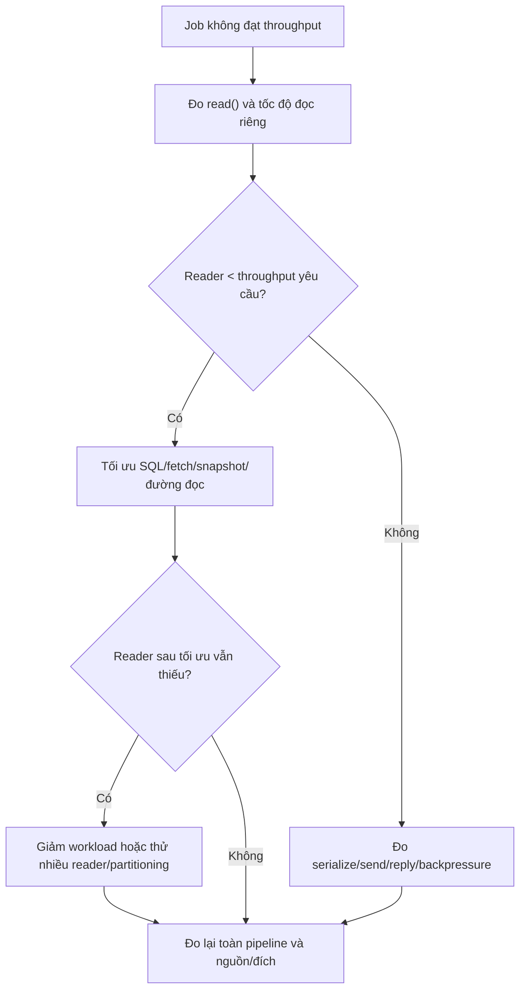

# Manager bottleneck khi đọc quá chậm trong Remote Chunking

Trong **remote chunking**, manager đọc item, gom chúng thành chunk và gửi cho các worker qua middleware. Worker xử lý/ghi và trả kết quả; **worker không tự chia phạm vi rồi đọc nguồn** như trong remote partitioning. Vì vậy, nếu manager đọc chậm, số worker tăng lên vẫn không thể tạo thêm dữ liệu đầu vào. Đây là một **giới hạn kiến trúc**, không chỉ là vấn đề thiếu thread.

Bài thuộc chương **Remote Chunking** của module **SPRING_BATCH_SCALING_OPERATIONS**. Ta sẽ học cách chứng minh manager đang là nút thắt, phân biệt đọc chậm với tắc ở kênh message/reply, tối ưu đường đọc có kiểm soát và quyết định khi nào nên chuyển sang partitioning. Mọi thay đổi phải bảo đảm thread safety, dữ liệu không trùng/thiếu khi retry hoặc restart, và hoàn tất trong batch window với tài nguyên thực tế.

## 1. Manager nằm ở đâu trong đường đi của dữ liệu?

Một hệ thống remote chunking thường có hai luồng message: request chứa các item và reply xác nhận kết quả xử lý.



Ở đây, **ItemReader của manager là nguồn cấp việc chung** cho các worker. Nếu không có item/chunk mới được gửi, worker có thể nhàn rỗi dù vẫn khỏe mạnh. Thêm một worker vào hệ thống chỉ tăng năng lực **tiêu thụ**; nó không tự tăng năng lực **sản xuất chunk** của manager.

Đặt tên những giai đoạn để quan sát:

| Giai đoạn | Công việc | Metric nên có |
| --- | --- | --- |
| Read | Truy vấn nguồn, gọi API, đọc file, chuyển dòng dữ liệu thành item | Item/s, thời gian `read()`, query latency, bytes/s |
| Assemble | Gom item thành chunk, cập nhật state đọc | Kích thước chunk thực, heap, GC |
| Send | Serialize và đưa request qua outbound adapter/broker | Send latency, message/s, bytes/s, lỗi gửi |
| Queue | Broker lưu/đưa request tới worker | Backlog, oldest message age, consumer count |
| Worker | Processor và writer | Item/s, P95 chunk duration, CPU, downstream latency |
| Reply | Worker trả status, manager nhận và tổng hợp | Reply backlog, correlation, timeout, in-flight count |

**Lưu ý quan trọng:** “Manager chậm” có thể là **reader thật sự chậm**, nhưng cũng có thể manager **bị chặn khi gửi message hoặc đang đợi reply**. Cả hai làm request rate thấp. Không nên sửa SQL khi nguyên nhân thực tế là reply channel bị tắc.

## 2. Bản chất của giới hạn throughput

Gọi:

- `R_read`: tốc độ đọc ổn định của manager, item/giây.
- `R_send`: năng lực đóng gói và gửi request quy đổi thành item/giây.
- `R_broker`: năng lực broker truyền request, item/giây.
- `R_workers`: tổng năng lực xử lý/ghi hiệu dụng của các worker.
- `R_dest`: thông lượng bền vững của hệ thống đích.

Trong pipeline có các giai đoạn chồng lấp, tốc độ end-to-end bị chặn bởi giai đoạn chậm nhất:

\[
R_{\text{end-to-end}}\;\lesssim\;
\min(R_{\text{read}},R_{\text{send}},R_{\text{broker}},
R_{\text{workers}},R_{\text{dest}})
\]

Đây là **mô hình công suất**, không phải đẳng thức đo được trong mọi thời điểm. Startup, batch commit, backpressure, retry, tail latency và luồng điều khiển đều có thể làm tốc độ thực thấp hơn.

Nếu có `W` worker giống nhau, mỗi worker đạt `r_worker` item/giây với hiệu suất đồng thời `e`:

\[
R_{\text{workers}}\approx W\times r_{\text{worker}}\times e
\]

Khi `R_read = 600` item/giây, còn tám worker có thể xử lý tổng 3.200 item/giây, toàn pipeline vẫn chỉ có thể hoàn thành **xấp xỉ tối đa 600 item/giây** nếu không có nguồn item khác.

### Bài toán SLA

Một job phải xử lý **2.400.000 item trong 20 phút**:

\[
R_{\text{required}}=\frac{2.400.000}{20\times60}
=2.000\text{ item/giây}
\]

Manager chỉ đọc được **650 item/giây**:

\[
T_{\text{best by reader}}\geq\frac{2.400.000}{650}
\approx3.692\text{ giây}\approx61,5\text{ phút}
\]

Ngay cả khi worker và broker có năng lực vô hạn, yêu cầu 20 phút vẫn không thể đạt với reader như vậy. Tăng worker từ 4 lên 20 lúc này không giải quyết nguyên nhân cốt lõi.

**Ngưỡng cần nhắm tới** còn phải có headroom. Nếu hệ thống muốn chỉ dùng tối đa 80% công suất reader bền vững khi tải bình thường, tốc độ đọc mục tiêu ít nhất là:

\[
R_{\text{reader target}}\geq\frac{2.000}{0,8}
=2.500\text{ item/giây}
\]

Mức 2.500 item/giây là mục tiêu thiết kế theo giả định 20% dư địa, không phải lời hứa rằng job sẽ xong trong 20 phút nếu các giai đoạn khác chưa được đo.

## 3. Cách nhận ra manager bị nghẽn ở đường đọc

Một số tín hiệu thường đồng thời xuất hiện:

- Worker khỏe mạnh nhưng **nhận ít chunk** hơn năng lực xử lý.
- Request queue thường gần rỗng, worker CPU thấp và không có lượng backlog đáng kể.
- `ItemReader.read()` hoặc truy vấn nguồn có latency cao; throughput đầu vào ổn định ở mức thấp.
- Thêm worker không làm số request/s hay item/s tăng tương ứng.
- Manager chờ DB connection, I/O, API nguồn hoặc bị giới hạn tốc độ truy vấn.
- Thời gian đọc ngày càng dài khi bảng phình to hoặc khi chạy tới các trang dữ liệu phía sau.

Tuy nhiên, **request queue rỗng không đủ kết luận reader chậm**. Nó cũng có thể xảy ra vì manager bị pause/stop, send thất bại, request bị consumer nhận rất nhanh hoặc manager đang chờ reply. Luôn đặt các tín hiệu cạnh nhau.

### Ma trận chẩn đoán

| Triệu chứng | Giả thuyết cần kiểm tra | Bằng chứng bổ sung |
| --- | --- | --- |
| Request queue thấp, workers idle, `read()` chậm | Reader/DB nguồn là bottleneck | Query plans, DB wait, CPU, P95 read latency |
| Request queue thấp, workers idle, `read()` nhanh | Send/serialization/flow control đang chặn manager | Send duration, outbound channel, reply wait, log |
| Request queue tăng liên tục, workers bận | Worker hoặc đích xử lý chậm hơn tốc độ đọc | Worker chunk duration, DB locks, API 429 |
| Request queue tăng nhưng workers idle | Worker không tiêu thụ được request | Consumer binding, broker auth, lỗi deserialize |
| Request queue thấp, **reply queue tăng** | Reply handling hoặc correlation bị nghẽn | Reply consumer, header mapping, manager logs |
| Manager read count không tăng sau nhiều phút | Có thể không commit được chunk hoặc đang chờ reply | Ghi thời gian thực của reader, send/in-flight, thread dump |
| Chỉ một số lần chạy chậm | Phân bố workload, data skew hoặc tải ngoài | Theo dõi giờ chạy, dữ liệu theo tenant/ngày, DB load |

Mục tiêu không phải chứng minh “manager có vấn đề” từ một metric duy nhất, mà phân tách thời gian **đọc**, **đóng gói/gửi** và **đợi phản hồi**.

## 4. Vì sao chỉ nhìn readCount của StepExecution là chưa đủ?

`StepExecution.readCount` rất hữu ích để đối soát item đã được Spring Batch ghi nhận trong lifecycle step. Nhưng nó không phải bộ đếm realtime của mọi lần gọi `ItemReader.read()`:

1. Reader có thể đã trả về item trong bộ nhớ nhưng transaction/chunk chưa hoàn tất.
2. Manager có thể bị block trong quá trình gửi hoặc đợi phản hồi, khiến metadata không được cập nhật đúng lúc bạn quan sát.
3. Retry/rollback/restart làm số lượt **đã thử đọc** khác số item đã được commit/ghi thành công.
4. Sau JVM crash, metadata cuối cùng có thể cũ dù trước đó đã đọc thêm dữ liệu.

Vì vậy cần hai loại số liệu:

- **Business/Batch counters:** `readCount`, `writeCount`, `commitCount`, `rollbackCount`, thời gian/exit status từ JobRepository.
- **Instrumentation ở giai đoạn đọc:** số item trả về trực tiếp từ reader, duration từng `read()`, lỗi reader, độ trễ truy vấn và bytes/s.

Trong dashboard, ghi rõ đây là `items_read_attempted` hay `items_read_committed` để tránh cộng nhầm khi rollback.

### Ví dụ Java instrument ItemStreamReader ở manager

Đoạn dưới đây là một wrapper tập trung vào thời gian gọi reader, dùng Micrometer và Spring Batch 5.x. Nó **ủy quyền toàn bộ lifecycle ItemStream** cho reader gốc để không vô tình làm mất checkpoint.

```java
import java.util.concurrent.TimeUnit;
import io.micrometer.core.instrument.Counter;
import io.micrometer.core.instrument.MeterRegistry;
import io.micrometer.core.instrument.Timer;
import org.springframework.batch.item.ExecutionContext;
import org.springframework.batch.item.ItemStreamReader;

public final class ObservedReader<T> implements ItemStreamReader<T> {

    private final ItemStreamReader<T> delegate;
    private final Timer readLatency;
    private final Counter returnedItems;
    private final Counter readErrors;

    public ObservedReader(
            ItemStreamReader<T> delegate,
            MeterRegistry registry) {
        this.delegate = delegate;
        this.readLatency = Timer.builder("batch.manager.read.latency")
                .description("Duration of ItemReader.read calls")
                .register(registry);
        this.returnedItems = Counter.builder("batch.manager.read.returned")
                .description("Items returned by manager reader")
                .register(registry);
        this.readErrors = Counter.builder("batch.manager.read.errors")
                .register(registry);
    }

    @Override
    public T read() throws Exception {
        long startNanos = System.nanoTime();
        try {
            T item = delegate.read();
            if (item != null) {
                returnedItems.increment();
            }
            return item;
        } catch (Exception ex) {
            readErrors.increment();
            throw ex;
        } finally {
            readLatency.record(
                    System.nanoTime() - startNanos,
                    TimeUnit.NANOSECONDS);
        }
    }

    @Override
    public void open(ExecutionContext context) {
        delegate.open(context);
    }

    @Override
    public void update(ExecutionContext context) {
        delegate.update(context);
    }

    @Override
    public void close() {
        delegate.close();
    }
}
```

Ví dụ dùng wrapper trong manager step:

```java
// Reader gốc là ItemStreamReader<OrderInput> đã cấu hình
// với query, sort key và checkpoint đúng nghiệp vụ.
ItemStreamReader<OrderInput> measuredReader =
        new ObservedReader<>(sourceReader, meterRegistry);

// Truyền measuredReader vào cấu hình reader của manager step.
// Không dùng cùng sourceReader stateful cho nhiều StepExecution.
```

Cần cấu hình bean và dependency Micrometer trong ứng dụng thật. Counter `returnedItems` đếm item trả về ở **lần gọi**, nên có thể đếm lại sau rollback/retry, khác `readCount` đã commit và số dòng duy nhất ở đích. Timer đo cả lần đọc trả về `null` cuối luồng và các lần ném exception; khi làm phân tích P95, có thể bổ sung timer riêng cho query và EOF nếu cần.

Không gắn `jobExecutionId` hay ID bản ghi lên mọi metric series vì gây cardinality cao; giữ ID chi tiết trong log/tracing. Wrapper không nên thay đổi semantics thread safety của reader, và phải được đăng ký đúng lifecycle theo cấu hình step.

## 5. Phân rã latency: đọc chậm do đâu?

Thời gian trung bình một lần `read()` không đồng nhất với thời gian truy vấn database. Một reader có thể có bước fetch cả trang, sau đó trả item từ buffer rất nhanh; số đo theo từng item sẽ có **nhiều mẫu nhanh và một số mẫu chậm**.

Phân tích ít nhất bốn lớp:

| Lớp | Dấu hiệu | Hướng kiểm chứng |
| --- | --- | --- |
| SQL/DB | Sequential scan, sort lớn, nhiều rows scanned so với rows returned | Query plan, index, buffer hits/misses, locks |
| Transport | Network RTT cao, fetch quá nhỏ, TLS/connection overhead | Database client metrics, fetch size, round trips |
| Reader implementation | Mỗi item tạo query/API call riêng, mapping nặng, paging offset sâu | Profiling call stacks, số query/item, page latency |
| Hạ tầng chạy manager | CPU throttling, GC, heap thiếu, thread chờ pool | JVM metrics, thread dump, pool pending |

**Phân biệt latency và throughput:** Một API nguồn có 80 ms/request nhưng trả 1.000 item mỗi request có thể cấp dữ liệu nhanh hơn một API 10 ms/request chỉ trả một item. Hãy đo item/s và bytes/s thực, không chỉ thời gian một lần gọi.

Nếu reader thực hiện lazy fetching, stopwatch quanh `read()` là thước đo ở cấp ứng dụng, còn SQL latency giúp chỉ ra tác nhân. Dữ liệu DB đã ở cache trong benchmark có thể làm tốc độ thử cao hơn thực tế; cần thử với tập dữ liệu và tải đại diện.

## 6. Các lỗi thiết kế query khiến manager ngày càng chậm

### 6.1. Không có index phù hợp với bộ lọc và thứ tự

Ví dụ manager đọc đơn hàng đã sẵn sàng xử lý theo ID tăng dần:

```sql
SELECT id, customer_id, amount, currency
FROM orders
WHERE status = 'READY'
  AND id > :lastId
  AND id <= :highWatermark
ORDER BY id
LIMIT :pageSize;
```

Đây là dạng **keyset/range pagination** minh họa. Cần đo xem index trên điều kiện `status`, `id` có phù hợp với phân bố và query plan thực tế không. Không thêm index bừa bãi: index có chi phí ghi, bảo trì và storage.

Có thể khảo sát query plan của một truy vấn mẫu trên môi trường thử nghiệm:

```sql
EXPLAIN (ANALYZE, BUFFERS)
SELECT id, customer_id, amount, currency
FROM orders
WHERE status = 'READY'
  AND id > 100000
  AND id <= 2000000
ORDER BY id
LIMIT 1000;
```

**Cảnh báo:** `EXPLAIN ANALYZE` **thực thi truy vấn thật**. Trên nguồn production lớn, cần quyền và thời điểm phù hợp; đối với query có ghi dữ liệu, còn có thể gây side effect. Đo số rows scanned, actual time, buffer I/O, sort và execution plan, không đánh giá chỉ dựa trên index có tồn tại.

### 6.2. OFFSET sâu trên bảng lớn

Ví dụ:

```sql
SELECT id, amount
FROM orders
ORDER BY id
LIMIT 1000 OFFSET 5000000;
```

Nhiều hệ quản trị phải đi qua lượng lớn hàng trước khi trả trang sâu, khiến tốc độ giảm khi offset tăng. Một phương án là keyset pagination với sort key duy nhất, ổn định và có index phù hợp.

Tuy nhiên, không nên mặc định mọi `JdbcPagingItemReader` của Spring Batch dùng OFFSET: reader này có cơ chế xây dựng truy vấn theo sort keys tùy database/provider. Cần xem **SQL thực tế do reader tạo** và đo query plan trước khi kết luận vấn đề.

### 6.3. Đọc thiếu tính ổn định khi nguồn thay đổi

Đang chạy batch, flow khác có thể đổi `status` từ `READY` sang trạng thái khác hoặc thêm đơn hàng mới. Nếu reader chỉ dùng filter mutable và đánh dấu watermark bằng `id`, việc paginate có thể bỏ sót/đếm sai tập dữ liệu nghiệp vụ. Cần thiết kế:

- `highWatermark` chụp ở đầu lần chạy để có cận trên ổn định.
- Business snapshot hoặc nguồn ingest immutable khi cần kết quả lặp lại được.
- CDC offset hoặc bảng queue công việc được đánh dấu trạng thái theo transaction khi có cập nhật thường xuyên.
- Chính sách xử lý **late arrival** và update/delete.
- Khóa sắp xếp **duy nhất**, không dựa vào timestamp có thể trùng mà thiếu tie-breaker.

**Không sửa concurrency để chữa lỗi snapshot/ordering.** Một reader nhanh nhưng trả sai hoặc trùng item cũng không đạt yêu cầu của batch.

## 7. Chọn reader và cấu hình đọc phù hợp

| Reader/nguồn | Lợi thế | Điểm cần cẩn trọng |
| --- | --- | --- |
| `JdbcPagingItemReader` | Paging và trạng thái restart theo sort key/reader; thuận tiện cho tập dữ liệu lớn | Sort key phải ổn định và duy nhất; query plan và page size cần đo |
| `JdbcCursorItemReader` | Có thể đọc tuần tự hiệu quả với cursor/fetch size | Connection và cursor sống lâu; behavior phụ thuộc driver/DB; timeout và restart |
| File streaming reader | Đọc từng record thay vì nạp cả file | I/O, parse, encoding, seek/line offset khi restart |
| REST API paginated reader | Không cần DB trực tiếp | Request quota, cursor expiration, retry, snapshot và mạng |
| ItemReader bọc cache | Giảm round trips trong một số tình huống | Heap, invalidation và tính nhất quán/restart |

Một số điều chỉnh có thể thử:

1. **Tối ưu SQL và index** theo điều kiện lọc, sort key và độ chọn lọc thật.
2. **Điều chỉnh page size/fetch size** để giảm network round trips nhưng không tràn heap hay khóa quá lâu.
3. **Loại cột không cần thiết** trước khi serialize item vào message.
4. **Tận dụng batch fetching** khi reader đang gọi DB/API cho từng item.
5. **Giảm query đắt do lookup lặp:** đưa enrichment sang processor ở worker nếu có lợi và chấp nhận access nguồn lookup từ worker.
6. **Tách khâu scan nặng thành preprocessing** (snapshot/staging) trước khi bắt đầu remote chunking nếu cần.
7. **Kiểm soát connection pool:** manager có đủ connection để đọc, nhưng không được đánh đổi bằng việc chiếm hết kết nối của các step khác.

Tuning đọc cần đo lại **đúng throughput end-to-end**, không chỉ số query/giây. Ví dụ fetch size lớn có thể tăng tốc reader nhưng gây giữ dữ liệu trong heap và tăng GC, khiến manager gửi message chậm hơn.

## 8. Chunk size không thay thế reader throughput

Remote chunking dùng chunk size `k` để quyết định số item trong một message request (trừ chunk cuối). Với `N` item:

\[
M_{\text{requests}}\approx
\left\lceil \frac{N}{k}\right\rceil
\]

Ví dụ 2.400.000 item:

| Chunk size | Số message request xấp xỉ | Ảnh hưởng chính |
| ---: | ---: | --- |
| 10 | 240.000 | Nhiều lần gửi/nhận và xử lý header |
| 100 | 24.000 | Điểm bắt đầu benchmark hợp lý cho một số workload |
| 1.000 | 2.400 | Ít message hơn, mỗi chunk lớn và khó retry hơn |
| 10.000 | 240 | Nguy cơ vượt message limit, latency đuôi dài, memory lớn |

Tăng `k` có thể giúp nếu manager bị tốn **overhead mỗi message** hoặc round trip. Nhưng nếu `ItemReader.read()` chỉ trả 650 item/giây vì SQL nguồn chậm, chunk size 100 hay 1.000 vẫn không biến nó thành 2.000 item/giây.

Cần đo riêng ba hiện tượng:

- **Đọc chậm:** tổng thời gian reader tăng gần tuyến tính với số item, gần như không đổi theo chunk size.
- **Gửi chậm:** send latency/message cao; tăng chunk size có thể giảm overhead trên mỗi item nếu payload vẫn hợp lệ.
- **Reply/backpressure:** số chunk in-flight hoặc đợi reply đạt giới hạn, manager không tiếp tục đọc; tăng chunk size có thể làm mỗi chunk lâu hơn và tăng thời gian chờ.

Không nên tăng chunk size chỉ vì “worker đang nhàn rỗi”. Cần xác định chính xác giai đoạn đầu tiên bị tắc.

## 9. Khi manager bị chặn do reply/backpressure, không phải do ItemReader

Ở một số cấu hình, manager đã đọc/gửi đủ chunk nhưng **cần đợi kết quả** hoặc bị giới hạn số chunk in-flight. Khi đó request rate có thể giảm dù `read()` nhanh.

Sơ đồ nhân quả:



### Bằng chứng ở các điểm cần đối chiếu

| Điều quan sát | Kết luận thận trọng |
| --- | --- |
| `read()` chậm, send nhanh, broker không backlog | Có bằng chứng reader nghẽn |
| `read()` nhanh nhưng outbound send mất nhiều giây | Có bằng chứng send/broker nghẽn |
| Worker xử lý xong, reply queue lớn | Đường reply có vấn đề; cần điều tra manager consumer |
| Worker chưa nhận chunk, queue request rất lớn | Nút thắt phía consumer/worker/đích |
| Không có request mới, manager chờ Future/Condition | Có thể điều phối chunk/reply đang block, không phải SQL |
| Metadata `STARTED` cũ, process không còn | Có thể execution stale sau crash; xác nhận runtime trước restart |

Một `ChunkResponse` bị thất lạc không chứng minh chunk chưa được worker ghi vào hệ thống đích. Không tự gửi lại dữ liệu chỉ dựa trên việc reply không xuất hiện; cần kiểm tra delivery semantics, correlation và tính idempotent.

## 10. Đo khả năng cấp dữ liệu thay vì nhìn số lượng worker

Để tìm tốc độ tối đa manager có thể cấp item, làm hai phép đo có kiểm soát trên **cùng một dataset**:

**Phép đo A — Reader đơn lẻ:** chạy đọc theo cùng query, fetch/page size và điều kiện snapshot, tiêu thụ item bằng sink nhẹ để xác định `R_read`. Không đo trên vài nghìn row được cache nếu job thật có hàng triệu row.

**Phép đo B — Đường manager đầy đủ:** đọc, serialize, gửi broker và nhận reply với worker/sink đại diện, đo `R_manager` cùng thời gian từng giai đoạn.

Nếu `R_read = 700` item/s và `R_manager = 650` item/s, reader là ứng viên bottleneck mạnh. Nếu `R_read = 8.000` nhưng `R_manager = 650`, vấn đề nằm sau reader (serialize, send, reply, memory hoặc orchestration).

### Mẫu số liệu (minh họa)

| Giai đoạn | Throughput ổn định | Chú giải |
| --- | ---: | --- |
| Reader + mapper | 650 item/s | Query nguồn chậm |
| Serialize + outbound adapter | 5.000 item/s | Còn dư |
| Broker request/reply | 10.000 item/s tương đương | Còn dư |
| 8 worker | 3.200 item/s | Còn dư |
| Database đích | 4.000 item/s | Còn dư |

Với mô hình này, tăng worker không có ích đáng kể. Sau tối ưu reader lên 3.000 item/s, pipeline sẽ tiến tới mức tối đa khoảng 3.000 item/s (nếu các giai đoạn khác giữ được công suất).

Ngược lại, nếu sau tối ưu reader worker chỉ đạt 2.400 item/s tổng, worker mới là bottleneck. Việc tuning là **quá trình đo–đổi–đo lại**, không chỉ tăng một cấu hình mãi mãi.

## 11. Vì sao tăng số thread trong manager thường không giúp?

Một `ItemReader` của manager thường có state tuần tự: cursor, current page, last key hoặc file offset. **Đọc cùng một reader stateful từ nhiều thread** có thể gây lặp item, bỏ sót hoặc checkpoint sai.

Các biện pháp dễ bị hiểu nhầm:

- **Thêm thread vào manager**: không tự biến một reader có state thành nhiều reader độc lập.
- **`SynchronizedItemStreamReader`**: có thể giúp tuần tự hóa quyền gọi vào reader không thread-safe, nhưng **không làm một reader chạy nhanh hơn**; còn có thể làm đường đọc bị serialize.
- **Tăng pool worker**: chỉ mở rộng năng lực xử lý/ghi, không mở rộng nguồn đọc do manager sở hữu.
- **Tăng `gridSize`**: là khái niệm của partitioning, không phải nút chỉnh trực tiếp để chia reader của remote chunking.
- **Đặt nhiều manager giống nhau cùng đọc toàn bảng**: có thể tạo xử lý trùng và cạnh tranh JobRepository/dữ liệu đích nếu không thiết kế phân vùng và JobInstance rõ ràng.

Nếu reader là hạn chế kiến trúc không thể giải quyết bằng SQL/cache, nên cân nhắc **remote partitioning** để worker tự đọc những phạm vi độc lập. Đây là thay đổi mô hình, không phải sửa một tham số của remote chunking.

## 12. Tách dữ liệu đọc qua nhiều miền độc lập

Có những cách mở rộng nguồn mà vẫn giữ tính đúng đắn, nhưng mỗi cách thay đổi độ phức tạp:

| Phương án | Tác dụng | Điều kiện và giới hạn |
| --- | --- | --- |
| Tối ưu một reader trên manager | Giảm thời gian query/read | Nguồn có index/scan plan tốt, latency có thể giảm |
| Tiền xử lý thành file/shards bất biến | Đọc tuần tự nhanh từ nguồn staging | Cần chi phí ETL trước và snapshot/version rõ ràng |
| Chạy nhiều JobInstance độc lập có phạm vi riêng | Nhiều manager đọc các phần không giao nhau | Identifying parameters, range, SLA và restart phải được thiết kế |
| Local partitioning | Nhiều reader/StepExecution trên thread cùng JVM | Máy và DB có năng lực đồng thời; reader theo StepScope |
| Remote partitioning | Worker trên nhiều máy tự đọc partition | Nguồn chịu được nhiều reader; hạ tầng worker/repository/messaging |
| CDC hoặc ingest event theo offset | Chỉ xử lý dữ liệu mới/đổi thay vì full scan | Semantics update/delete, late arrival, checkpoint |
| Thay đổi workload (lọc sớm, incremental) | Giảm `N_run` | Định nghĩa dữ liệu cần xử lý đủ chính xác |

**Lựa chọn hợp lý nhất đôi khi là giảm dữ liệu phải đọc**, không tăng số máy. Một job quét 100 triệu row mỗi đêm để tìm 500 nghìn row mới nên ưu tiên incremental read/index/CDC nếu nghiệp vụ cho phép.

### Đổi sang remote partitioning khi nào?

- Reader đã tối ưu nhưng vẫn không đạt mục tiêu.
- Dữ liệu có thể tách theo range/file/tenant và mỗi worker truy cập được nguồn.
- Nguồn có đủ IOPS/connections để nhiều reader thật sự chạy song song.
- Chi phí vận chuyển item qua broker trong remote chunking đang cao.
- Có chiến lược partition naming, checkpoint, restart, JobRepository và giới hạn đồng thời rõ ràng.

Ngược lại, nếu database nguồn vốn bão hòa I/O, đưa mười reader từ nhiều worker vào nguồn chưa chắc tăng throughput. Cần benchmark tổng thể thay vì chỉ thay kiến trúc.

## 13. Quản lý dữ liệu thay đổi khi tăng tốc manager

Tối ưu reader phải giữ **không bỏ sót/không trùng** khi job được restart. Đặc biệt:

1. **Keyset pagination:** sort key cần duy nhất và ổn định, có tie-breaker nếu dùng timestamp.
2. **Snapshot boundary:** cố định `highWatermark` hoặc version nghiệp vụ trước khi đọc; item đến sau được xử lý ở lần sau theo hợp đồng.
3. **Checkpoint:** lưu last processed key/offset phù hợp, không đặt watermark cao hơn dữ liệu đã xử lý an toàn.
4. **Late arrival/update/delete:** cần chính sách riêng; `created_at` không luôn tương đương thời gian ingest.
5. **Writer idempotency:** nguồn có thể đọc lại item sau retry/crash; worker phải chống tác dụng phụ lặp.
6. **Retention/cleanup:** tránh xóa dữ liệu nguồn hoặc staging trước khi tất cả chunk đã hoàn tất/được xác nhận.

Ví dụ: reader lấy ID từ 1 đến 1.000.000, nhưng giữa lúc chạy một luồng khác chèn bản ghi có ID nhỏ hơn lastId hiện tại. Keyset reader có thể không bao giờ gặp bản ghi mới ấy. Nếu thiết kế nguồn cho phép insert “điền lỗ” ID, cần snapshot hoặc cơ chế theo dõi sự kiện mới thay vì dựa hoàn toàn vào `id > lastId`.

### Không nhầm checkpoint đọc với commit ở worker

Trong remote chunking, manager đọc/gửi và worker ghi ở các tiến trình khác nhau; không có **một transaction database mặc định** bao trùm cả bước đọc, broker message và dữ liệu đích.

Một worker có thể đã commit kết quả nhưng reply bị mất. Manager không thể suy ra dữ liệu “chưa ghi” từ absence of reply. Việc restart cần thiết kế redelivery và idempotency ở đích.

Nếu tăng tốc reader bằng read-ahead/prefetch, lượng item/chunk in-flight còn nhiều hơn; phải tính khả năng mất/đọc lại khi manager crash và giới hạn bộ nhớ. Không nên nới hàng đợi vô hạn để che giấu bottleneck.

## 14. Retry/restart và tải đọc bổ sung

Một số tình huống làm tải trên reader tăng mà dashboard chỉ thấy số item nghiệp vụ không đổi:

| Tình huống | Hệ quả với manager/read path |
| --- | --- |
| Chunk gửi lỗi, được thử lại | Cần hiểu manager có đọc lại hay chỉ gửi lại payload in-flight |
| Worker xử lý xong nhưng reply mất | Có thể phải đối soát, redelivery khiến ghi trùng nếu thiếu idempotency |
| Job rollback/restart | Reader có thể khởi tạo lại ở checkpoint và đọc lại một số item |
| Một item lỗi dữ liệu gây retry | Tăng tải và thời gian xử lý dù số item duy nhất không tăng |
| API nguồn throttling/429 | `read()` bị backoff, thông lượng đọc giảm |
| Dữ liệu đến muộn hoặc reprocess | `N_run` thực tế lớn hơn lượng insert/ngày |

Đừng tính capacity chỉ từ “bình quân 2 triệu item mới/ngày” nếu job cần bù backlog sau outage. Ví dụ hệ thống nhận 2,4 triệu item/ngày, job dừng hai ngày sẽ tích lũy xấp xỉ 4,8 triệu item cần xử lý thêm, chưa kể dữ liệu mới trong thời gian khôi phục. Manager đọc 2.500 item/s có thể đủ cho lịch thường nhưng không đủ cho SLA recovery ngắn.

Khi đo throughput, ghi riêng số item **đã thử đọc**, số item **được checkpoint/commit**, số business key **đã ghi thành công ở đích** và số request/reply retry. Chúng không nhất thiết bằng nhau.

## 15. Theo dõi thực tế trên manager, broker và worker

Một dashboard tốt cho tình huống manager đọc chậm nên có:

| Metric | Mức xem | Gợi ý cảnh báo |
| --- | --- | --- |
| `manager_read_items_per_second` | Manager | Thấp hơn throughput yêu cầu/SLA trong nhiều khoảng đo |
| `manager_read_latency_p95` | Manager | Tăng khi DB tải, paging càng sâu hoặc connection wait |
| `manager_read_errors` | Manager | Lỗi SQL/API/fetch tăng |
| `manager_send_latency_p95` | Manager | Đọc nhanh nhưng publish chậm |
| `request_queue_depth` + age | Broker | Phân biệt queue đói việc với queue bị dồn |
| `worker_active_consumers` | Worker | Worker được cấp ít việc dù có tài nguyên |
| `worker_chunk_duration_p95` | Worker | Tìm worker slow/đích chậm |
| `reply_pending_age` / correlation errors | Reply path | Manager chờ phản hồi |
| `manager_heap_gc` | JVM | Prefetch/serialize gây áp lực memory |
| `source_db_query_p95`, connections pending | DB | Nút thắt thật ở nguồn |
| `job_duration`, committed items | JobRepository | Đánh giá kết quả end-to-end |

Sơ đồ quyết định ngắn:



Tất cả ngưỡng nên dựa trên baseline theo loại job, kích thước dataset và peak traffic. Không coi `BATCH_STEP_EXECUTION.LAST_UPDATED` là heartbeat độc lập; một step có chunk dài hoặc đang đợi reply có thể cập nhật metadata chậm.

## 16. Thí nghiệm kiểm chứng tối ưu đường đọc

Dùng cùng workload đại diện, cố định số worker, chunk size và giới hạn nguồn/đích. Sau đó thay một biến đọc mỗi lần:

| Thử nghiệm | Reader | Số worker | Biến cần so sánh |
| --- | --- | ---: | --- |
| A | Query hiện tại | 4 | Baseline read/s, SQL latency, duration |
| B | Query + index tối ưu | 4 | Reader cải thiện bao nhiêu? |
| C | Tăng page/fetch size có kiểm soát | 4 | Network calls, heap, GC, throughput |
| D | Cố định snapshot/high watermark | 4 | Tính đúng khi nguồn có update/insert |
| E | Reader tối ưu | 8 | Khi reader đủ nhanh, worker có còn thiếu không? |
| F | Reader tối ưu nhưng broker có latency | 8 | Manager có bị send/reply backpressure không? |

Trong báo cáo phải giữ số liệu **đo thực** ở mỗi dòng: throughput p50/p95, total duration, lỗi, retry, số row đọc, số row viết, query plan và tài nguyên dùng. Không điền speedup dự kiến như kết quả benchmark.

Sau tối ưu, đừng chỉ so “reader từ 650 lên 4.000 item/s”. Nếu writer của worker hoặc DB đích chỉ đạt 1.500 item/s, SLA 2.000 vẫn không đạt. Nút thắt chỉ chuyển từ manager sang chỗ khác.

### Phương pháp xác định điểm bão hòa

Cho worker tăng lần lượt 1, 2, 4, 8 instance (nếu hạ tầng cho phép), quan sát:

- Request item/s có tăng theo worker không?
- `read()` có trở nên chậm hơn khi nhiều worker cạnh tranh DB connection?
- Request queue và reply queue có tăng không?
- Worker CPU/DB wait có tăng không?
- Thông lượng end-to-end có tiến gần hoặc vượt mục tiêu một cách bền vững không?

Khi worker tăng nhưng request rate đứng yên và reader đo được ở giới hạn, đó là bằng chứng tốt về manager bottleneck. Nếu request rate đứng yên nhưng reader vẫn nhanh, cần điều tra send/reply/backpressure trước.

## 17. Case study: vì sao 12 worker vẫn không xong đúng hạn?

Một job có các thông số đã đo (giả định):

- Workload: **3.600.000 item**; deadline **30 phút**.
- Manager reader: **900 item/giây**.
- Mỗi worker: **300 item/giây** khi được cấp đủ chunk.
- Có 12 worker; broker và DB đích có năng lực ít nhất 4.000 item/giây.
- Item trung bình 800 B và độ trễ send/reply thấp.

Throughput yêu cầu:

\[
R_{\text{required}}=
\frac{3.600.000}{30\times60}
=2.000\text{ item/giây}
\]

Tổng công suất worker lý tưởng là `12 × 300 = 3.600 item/giây`; nhưng throughput toàn pipeline bị reader chặn ở `900 item/giây`:

\[
T_{\text{reader bound}}\ge
\frac{3.600.000}{900}=4.000\text{ giây}
\approx66,7\text{ phút}
\]

Hệ quả: worker request queue thường thấp, nhiều worker idle. Nếu giảm worker từ 12 xuống 6 mà reader vẫn chỉ đạt 900 item/giây, thời gian end-to-end có thể gần như không đổi; điều đó càng củng cố giả thuyết reader bottleneck.

### Phương án 1 — Tối ưu reader

Giả sử chỉnh index, predicate và fetch làm reader đạt **2.600 item/giây bền vững**. Nếu các giai đoạn khác còn đủ công suất, thời gian đọc tối thiểu khoảng:

\[
3.600.000/2.600\approx1.385\text{ giây}
\approx23,1\text{ phút}
\]

Có thể đáp ứng 30 phút **nếu** startup, retry, tail latency và các chặng còn lại cộng lại không vượt khoảng 6,9 phút. Cần xác nhận bằng đo end-to-end.

### Phương án 2 — Chuyển sang remote partitioning

Nếu tối ưu SQL vẫn chỉ đạt 900 item/s vì một cursor/reader tuần tự, nhưng nguồn DB có thể phục vụ nhiều range scan độc lập, remote partitioning có thể chia workload theo ID/tenant để worker tự đọc. Tuy nhiên 4 reader không tự bảo đảm đạt 3.600 item/s: DB tổng IOPS, index và connection pool vẫn là giới hạn.

### Phương án 3 — Giảm lượng dữ liệu phải đọc

Nếu job đang quét lại 3,6 triệu item để xử lý chỉ 900 nghìn item mới/đổi, chuyển sang incremental/CDC có thể giảm yêu cầu:

\[
900.000/(30\times60)=500\text{ item/giây}
\]

Reader 900 item/s khi ấy có thể đáp ứng yêu cầu mà không cần thêm worker, với điều kiện chiến lược watermark/CDC xử lý đủ update, delete và dữ liệu đến muộn.

**Không chọn phương án dựa trên phép tính đơn lẻ.** Chọn theo tính đúng đắn, khả năng restart và bài benchmark đại diện.

## 18. Các lỗi tối ưu thường gặp

1. **Chỉ tăng worker:** reader vẫn là điểm chặn, worker nhàn rỗi.
2. **Coi queue rỗng là đọc chậm:** bỏ qua send/reply backpressure và giới hạn in-flight.
3. **Dùng mỗi `readCount` làm thước đo realtime:** metadata phản ánh ranh giới lifecycle/commit và có thể trễ.
4. **Đổi sang nhiều thread đọc chung một reader stateful:** dẫn đến race, trùng hoặc mất item.
5. **Tăng chunk size vô hạn:** không giảm thời gian đọc SQL, lại tăng payload, timeout và retry cost.
6. **Tối ưu SQL mà không xem plan:** index không được dùng hoặc mỗi partition vẫn full scan.
7. **Dùng OFFSET sâu cho mọi trang:** chi phí đọc càng về sau càng cao.
8. **Không có snapshot/high watermark:** đọc nhanh nhưng bỏ sót dữ liệu mới đến hoặc thay đổi.
9. **Prefetch vào heap không giới hạn:** manager GC hoặc OOM, mất lợi ích đọc nhanh.
10. **Chỉ đo benchmark khi cache DB nóng:** hiệu năng production thấp hơn đáng kể.
11. **Không đo worker/đích sau tối ưu reader:** nút thắt chuyển sang DB/API, job vẫn trễ.
12. **Restart chỉ dựa vào message/reply count:** bỏ qua chunk đã commit nhưng mất reply.
13. **Chạy nhiều manager đọc trùng tập dữ liệu:** tạo duplicate processing ngoài kiểm soát.
14. **Tăng số reader khi DB nguồn đã bão hòa:** tổng throughput có thể giảm vì contention.

## 19. Bài thực hành: xác định đúng nguyên nhân

Một hệ thống xử lý 2.880.000 item trong **24 phút**, mỗi item serialized 1 KB. Manager gửi chunk 200 item, bốn worker có thể xử lý 700 item/giây mỗi worker khi có đủ việc.

Người vận hành đo được:

| Metric | Kết quả |
| --- | ---: |
| `read()` trên manager | Trung bình ổn định 750 item/giây |
| Serialize/send capacity | 5.000 item/giây |
| Broker request capacity | 6.000 item/giây |
| Tổng worker capacity | 2.800 item/giây |
| Đích bền vững | 3.500 item/giây |
| Request queue | Rất ít tồn đọng |

**Câu hỏi:**

1. Throughput yêu cầu theo SLA là bao nhiêu?
2. Theo mô hình công suất, giai đoạn nào là bottleneck?
3. Thời gian tối thiểu nếu reader chưa thay đổi?
4. Có nên tăng worker từ 4 lên 8 trước không?
5. Nếu reader được tối ưu lên 2.500 item/giây, nút thắt tiếp theo là gì?
6. Nếu sau tối ưu request rate vẫn 750 item/giây nhưng timer `read()` cho 2.500 item/giây, cần điều tra lớp nào?

**Gợi ý lời giải:**

- SLA cần `2.880.000/(24×60) = 2.000 item/giây`.
- Reader 750 item/giây nhỏ nhất, là ứng viên bottleneck rõ nhất với số liệu hiện có.
- Thời gian tối thiểu `2.880.000/750 = 3.840 giây = 64 phút` (chưa tính overhead).
- Tăng worker chưa có cơ sở vì worker đang dư capacity, request queue không dồn và reader chưa cấp đủ item.
- Sau khi reader đạt 2.500 item/giây, worker 2.800 và đích 3.500, broker 6.000: manager reader **vẫn là mức nhỏ nhất**, nhưng đã vượt mục tiêu 2.000 và cần đo end-to-end xem đủ headroom chưa.
- Nếu timer reader nhanh mà request rate thấp, ưu tiên điều tra serializer/send, broker adapters, reply/in-flight, thread scheduling và transaction coordination.

Bài tập nâng cao: giả sử reader chỉ còn 1.200 item/giây khi DB chạy cùng một ETL khác. Hãy xây lại capacity plan cho **giờ cao điểm**, không dùng kết quả chỉ chạy riêng job.

## 20. Checklist vận hành khi nghi ngờ manager đọc quá chậm

- [ ] Có số item phải xử lý và throughput tối thiểu để đáp ứng batch window/SLA.
- [ ] Đã đo `ItemReader.read()` riêng, số item trả về, thời gian truy vấn và dữ liệu theo trang.
- [ ] Phân biệt số item reader đã thử đọc với `StepExecution.readCount` và output đã commit.
- [ ] Có metric serialize/send, request/reply queue, in-flight chunks và correlation.
- [ ] Đã xác nhận worker idle do thiếu request chứ không phải lỗi consumer/adapter.
- [ ] Có SQL plan/index/fetch/page size dựa trên dữ liệu đại diện, không chỉ ước lượng.
- [ ] Reader có sort key duy nhất, snapshot/high watermark, checkpoint và chính sách late arrival.
- [ ] Không chia sẻ reader stateful giữa nhiều thread mà thiếu bảo đảm thread safety.
- [ ] Đã đo nguồn/đích, JDBC pool, CPU, heap, GC và API rate limit khi tăng concurrency.
- [ ] Đã thử worker crash, mất reply, manager restart và kiểm tra idempotency ở đích.
- [ ] Chỉ tăng chunk size khi overhead message là nút thắt và payload còn trong giới hạn broker.
- [ ] Đã so sánh tối ưu một reader, giảm workload và chuyển sang local/remote partitioning.
- [ ] Có số liệu end-to-end sau mỗi thay đổi và không cải thiện tốc độ bằng cách hy sinh tính đúng đắn.

## 21. Tài liệu tham khảo

- [Spring Batch Reference — Scaling and Parallel Processing](https://docs.spring.io/spring-batch/reference/scalability.html): mô hình remote chunking và điều kiện manager reader không trở thành bottleneck.
- [Spring Batch Reference — Externalizing Batch Process Execution](https://docs.spring.io/spring-batch/reference/spring-batch-integration/externalizing-execution.html): request/reply channels và thiết kế manager–worker.
- [Spring Batch Reference — Chunk-Oriented Processing](https://docs.spring.io/spring-batch/reference/step/chunk-oriented-processing.html): chunk lifecycle và transaction boundaries.
- [Spring Batch Reference — Database Readers](https://docs.spring.io/spring-batch/reference/readers-and-writers/database.html): cursor/paging readers và các tham số đọc.
- [Spring Batch Reference — JobRepository](https://docs.spring.io/spring-batch/reference/job/configuring-repository.html): metadata, trạng thái và restart.
- [Spring Batch Reference — Scaling Through Partitioning](https://docs.spring.io/spring-batch/reference/scalability.html#partitioning): khi cần nhiều reader/worker độc lập thay vì một manager đọc toàn bộ.
- [Micrometer — Timers](https://docs.micrometer.io/micrometer/reference/concepts/timers.html): đo latency bằng Timer.
- [PostgreSQL Documentation — EXPLAIN](https://www.postgresql.org/docs/current/sql-explain.html): hiểu query plan và lưu ý khi dùng `EXPLAIN ANALYZE`.

> **Điểm cần nhớ:** Remote chunking **không mở rộng khâu đọc** chỉ bằng cách thêm worker. Khi `R_read` của manager thấp hơn throughput cần đạt, toàn job sẽ chậm dù broker và worker còn rảnh. Cần đo reader riêng, loại trừ send/reply backpressure, tối ưu đường truy vấn và tính nhất quán dữ liệu; nếu giới hạn đọc vẫn tồn tại, hãy cân nhắc giảm workload hoặc thay mô hình bằng partitioning để worker tự đọc. Mục tiêu cuối là **throughput end-to-end đạt SLA mà vẫn retry/restart đúng dữ liệu**.
