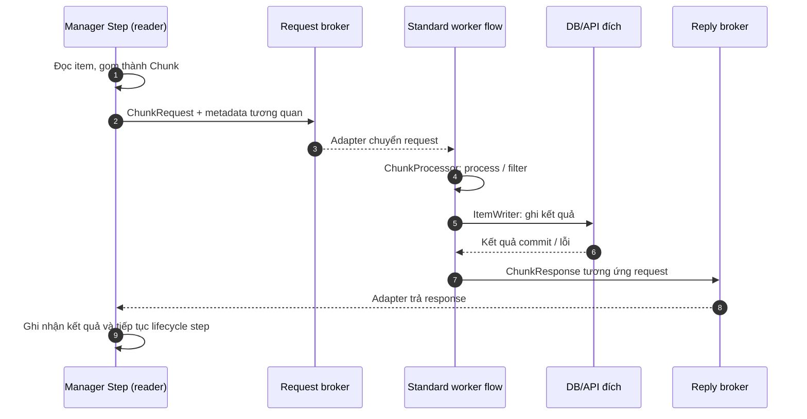
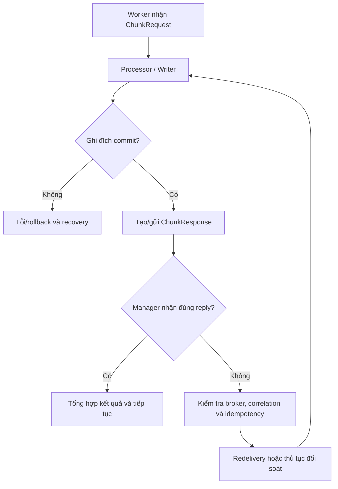

# Đảm bảo worker dùng thành phần chuẩn trong Remote Chunking

Trong **Spring Batch remote chunking**, manager đọc và chia dữ liệu thành các chunk, gửi yêu cầu qua middleware; worker ở tiến trình khác dùng **các thành phần xử lý chunk của Spring Batch** để gọi `ItemProcessor` và `ItemWriter`, rồi gửi kết quả về manager. Nếu worker chỉ là một consumer tùy biến tự giải mã message rồi ghi database mà không tuân thủ giao thức chunk request/reply, hệ thống có thể ghi được một phần dữ liệu nhưng manager không biết chunk đã thành công hay thất bại, khiến job kẹt, timeout hoặc restart không an toàn.

Bài thuộc chương **Remote Chunking** trong module **SPRING_BATCH_SCALING_OPERATIONS**, tập trung vào cách **đảm bảo worker sử dụng các thành phần chuẩn**, nhất quán giữa manager và worker. Phạm vi bao gồm cấu hình Java Spring Batch 5.x, giao thức trao đổi message, xử lý lỗi, tính an toàn khi nhiều consumer chạy đồng thời, giao dịch tại đích, retry/restart và kiểm chứng trong môi trường workload lớn.

## 1. “Thành phần chuẩn” ở worker nghĩa là gì?

Worker không chỉ phải “nhận được message” mà còn phải **hiểu đúng một `ChunkRequest` của Spring Batch**, xử lý item với semantics của chunk processor và **trả lời theo giao thức mà manager mong đợi**.

Một worker đúng trách nhiệm cần bảo đảm:

1. Tiếp nhận đúng payload chunk và metadata điều phối do manager phát ra.
2. Chuyển từng item qua `ItemProcessor` (nếu có), bao gồm quy tắc *lọc item* khi processor trả về `null`.
3. Chuyển các item hợp lệ tới `ItemWriter` của worker, với transaction/error semantics rõ ràng.
4. Trả về response tương ứng với request để manager tổng hợp tiến độ và quyết định trạng thái step.
5. Không tự tạo một “protocol khác” làm mất sequence, execution correlation, số lượng item, lỗi hay thông tin cần thiết cho quản lý chunk.

Ở Spring Batch Integration, con đường khuyến nghị thường là **`RemoteChunkingWorkerBuilder<I, O>`** để tạo một `IntegrationFlow` xử lý request/reply; builder kết hợp chunk processor/handler của Spring Batch với `ItemProcessor<I, O>` và `ItemWriter<O>`. Thành phần cấp thấp như `ChunkProcessorChunkHandler` và `ChunkProcessor` là một phần của cơ chế thực thi, **không phải lời mời viết lại từ đầu** nếu không thật sự cần tùy biến.

| Nhóm | Thành phần điển hình | Vai trò |
| --- | --- | --- |
| Manager | `RemoteChunkingManagerStepBuilder`, `ItemReader` | Tạo step đọc dữ liệu và gửi chunk |
| Message request | `ChunkRequest<I>` | Mang các item cùng thông tin cần để nhận diện yêu cầu chunk |
| Worker builder | `RemoteChunkingWorkerBuilder<I, O>` | Lắp ráp flow tiêu thụ request, xử lý và gửi reply |
| Chunk engine | `ChunkProcessor`, `ChunkProcessorChunkHandler` | Áp semantics xử lý chunk và chuyển kết quả thành reply |
| Business logic | `ItemProcessor<I, O>`, `ItemWriter<O>` | Biến đổi/lọc item và ghi kết quả |
| Message reply | `ChunkResponse` | Truyền phản hồi mà manager dùng để tổng hợp kết quả |
| Transport | Spring Integration channels/adapters + broker | Chuyển message giữa hai JVM, không định nghĩa nghiệp vụ |

Tên lớp, kiểu channel và overload cụ thể có thể khác theo phiên bản. Mọi ví dụ dưới đây theo hướng Spring Batch **5.2.x** với Java 17; khi dùng Spring Batch 6.x phải đối chiếu JavaDoc và dependency thực tế trước khi áp dụng.

## 2. Ranh giới trách nhiệm manager – broker – worker



Sơ đồ trình bày **vòng đời logic của một chunk**. Manager có thể phát nhiều chunk trong khi worker đang xử lý các chunk trước đó; thứ tự kết thúc không nhất thiết trùng thứ tự gửi.

Điểm mấu chốt về “chuẩn”:

- **Manager là nguồn dữ liệu đọc** trong mô hình remote chunking thông dụng. Worker nhận **item payload**, không phải dải ID để tự mở `ItemReader` và quét nguồn như remote partitioning.
- **Worker không tự quyết định kết thúc `JobExecution`**. Manager vẫn chịu trách nhiệm orchestration, metadata và tổng hợp trạng thái của remote chunking step.
- **Transport không phải hợp đồng nghiệp vụ**. Broker ACK có thể chỉ xác nhận việc nhận/giao message; việc xử lý/ghi có thể chưa hoàn tất.
- **ChunkResponse không phải “OK” tùy ý**. Chỉ gửi một chuỗi `"DONE"` hoặc HTTP 200 sẽ không thay thế được phản hồi đúng kiểu mà phía manager kỳ vọng.

## 3. Vì sao không nên tự viết worker bằng một listener tùy biến đơn giản?

Một triển khai dễ gặp:

```java
// PHẢN VÍ DỤ: chỉ để minh họa lỗi thiết kế.
@JmsListener(destination = "batch.chunks")
public void consume(String json) {
    OrderInput order = mapper.readValue(json, OrderInput.class);
    repository.save(toEntity(order));
    // Không có ChunkRequest/ChunkResponse chuẩn cho manager.
}
```

Mã trên có thể phù hợp với **một hệ thống event consumer thông thường**, nhưng không phải worker remote chunking tương thích Spring Batch: request của manager chứa **một chunk** cùng thông tin nhận diện, không phải mặc nhiên một đơn hàng JSON. Listener này cũng không cung cấp response tương ứng, không xử lý đúng filtering/counters và không cho manager phân biệt thành công, thất bại hay retry.

Hậu quả thường thấy:

| Hiện tượng | Nguyên nhân tiềm ẩn |
| --- | --- |
| Worker ghi được DB, manager chờ mãi | Không có `ChunkResponse` hoặc reply không quay về đúng channel |
| Reply tồn tại nhưng không được nhận | Payload/header correlation không đúng hoặc converter không tương thích |
| Step manager báo thất bại dù DB đã có dữ liệu | Worker lỗi sau commit hoặc trả response lỗi |
| Retry tạo dữ liệu trùng | Redelivery sau khi writer đã commit nhưng reply/ACK mất |
| Read/write count không phản ánh kết quả | Bỏ qua semantics xử lý chunk hoặc tự suy số liệu |
| Worker chạy được một chunk nhưng fail với chunk nhiều item | Consumer coi chunk là một item đơn lẻ |
| Lỗi chỉ xuất hiện khi tăng consumer | Bean xử lý có state mutable dùng chung, không thread-safe |

**Quy tắc:** Trong hệ thống đã chọn remote chunking của Spring Batch, hãy bắt đầu từ builder và các interface chuẩn. Chỉ tự viết handler/protocol cấp thấp khi có yêu cầu đặc biệt, tài liệu thiết kế rõ ràng và bộ kiểm thử tương thích đầy đủ.

## 4. Thành phần Spring Batch Integration cần có

Các thành phần thường đến từ các module Spring Batch và Spring Integration:

| Dependency/khối | Mục đích |
| --- | --- |
| `spring-batch-core` | `ItemProcessor`, `ItemWriter`, `Chunk` và metadata |
| `spring-batch-integration` | Remote chunking manager/worker builders và chunk message handling |
| `spring-integration-core` | `IntegrationFlow`, message channels, endpoint/adapters |
| Adapter cho JMS/AMQP hoặc broker đang dùng | Kết nối request/reply qua tiến trình, khai báo inbound/outbound |
| JDBC/HTTP client hoặc connector đích | Thực thi việc ghi của worker |
| Tracing/metrics/logging | Theo dõi tương quan request–worker–reply |

Bản chất kiến trúc là có **hai JVM độc lập**, mỗi JVM có các bean channel của chính nó; chỉ dùng cùng tên bean không làm chúng kết nối được với nhau. Phải cấu hình outbound adapter từ manager sang broker, inbound adapter trên worker, chiều reply ngược lại và định tuyến chính xác.

Không nên trộn các phiên bản Spring Batch/Spring Integration/Jackson lệch nhau theo kiểu chỉ thấy ứng dụng biên dịch. Contract serialization và cấu trúc message phải tương thích ở runtime, gồm DTO, headers, class mapping và các trường số/enum nếu có.

### Một cấu trúc triển khai minh họa

```text
manager-service/
  Job + RemoteChunkingManagerStepBuilder
  ItemReader<OrderInput>
  requestsOut --> outbound broker adapter
  repliesIn   <-- inbound broker adapter

broker/
  remote-chunking.requests
  remote-chunking.replies
  DLQ/quarantine (theo chính sách)

worker-service/
  requestsIn <-- inbound broker adapter
  RemoteChunkingWorkerBuilder<OrderInput, OrderResult>
  ItemProcessor<OrderInput, OrderResult>
  ItemWriter<OrderResult>
  repliesOut --> outbound broker adapter
```

Danh sách là sơ đồ trách nhiệm, không phải những file cần tạo. Tên queue/channel là ví dụ; hạ tầng thật có thể dùng JMS, AMQP hoặc transport được Spring Integration hỗ trợ.

## 5. Cấu hình worker theo cách khuyến nghị trong Spring Batch 5.2.x

Dưới đây là **đoạn cấu hình trọng tâm**. Bean `requestsIn` là channel đã được outbound/inbound adapter chuyển yêu cầu từ broker vào worker; `repliesOut` là channel để gửi response ra broker.

```java
import org.springframework.batch.integration.chunk.RemoteChunkingWorkerBuilder;
import org.springframework.batch.item.ItemProcessor;
import org.springframework.batch.item.ItemWriter;
import org.springframework.beans.factory.annotation.Qualifier;
import org.springframework.context.annotation.Bean;
import org.springframework.context.annotation.Configuration;
import org.springframework.integration.dsl.IntegrationFlow;
import org.springframework.messaging.MessageChannel;

@Configuration
public class OrderChunkWorkerConfiguration {

    @Bean
    public IntegrationFlow orderChunkWorkerFlow(
            @Qualifier("requestsIn") MessageChannel requestsIn,
            @Qualifier("repliesOut") MessageChannel repliesOut,
            ItemProcessor<OrderInput, OrderResult> orderProcessor,
            ItemWriter<OrderResult> orderWriter) {

        return new RemoteChunkingWorkerBuilder<OrderInput, OrderResult>()
                .inputChannel(requestsIn)
                .outputChannel(repliesOut)
                .itemProcessor(orderProcessor)
                .itemWriter(orderWriter)
                .build();
    }
}
```

**Ý nghĩa:**

1. `RemoteChunkingWorkerBuilder` thiết lập pipeline xử lý request theo giao thức chunk của Spring Batch.
2. `ItemProcessor` có thể biến đổi hoặc lọc item; `ItemWriter` chịu trách nhiệm ghi dữ liệu đích.
3. `inputChannel`/`outputChannel` là điểm nối với lớp transport; hai chiều message vẫn phải được cấu hình ở hạ tầng broker.
4. Worker không tự gọi `JobLauncher.run(...)` cho từng message và không tự tạo `JobExecution` theo mỗi chunk.
5. Worker không tự ý thay thế payload chuẩn bằng một DTO đơn lẻ rồi bỏ qua chunk metadata.

Đoạn mã là cấu hình lõi để học, **chưa phải ứng dụng chạy độc lập**: cần các bean channel, inbound/outbound adapters, kiểu `OrderInput`/`OrderResult`, processor/writer, message converter, database, bảo mật và transaction tại worker. Nếu phiên bản dự án dùng API khác, hãy tham khảo JavaDoc của đúng bản Spring Batch Integration.

### Một manager tương thích ở phía bên kia

Ví dụ lõi manager theo cách dùng builder Spring Batch 5.2.x:

```java
import org.springframework.batch.core.Step;
import org.springframework.batch.core.repository.JobRepository;
import org.springframework.batch.integration.chunk.RemoteChunkingManagerStepBuilder;
import org.springframework.batch.item.ItemReader;
import org.springframework.beans.factory.annotation.Qualifier;
import org.springframework.context.annotation.Bean;
import org.springframework.messaging.MessageChannel;
import org.springframework.messaging.PollableChannel;
import org.springframework.transaction.PlatformTransactionManager;

@Bean
public Step orderRemoteManagerStep(
        JobRepository jobRepository,
        PlatformTransactionManager transactionManager,
        ItemReader<OrderInput> orderReader,
        @Qualifier("requestsOut") MessageChannel requestsOut,
        @Qualifier("repliesIn") PollableChannel repliesIn) {

    return new RemoteChunkingManagerStepBuilder<OrderInput, OrderInput>(
            "orderRemoteManagerStep", jobRepository)
            .chunk(200)
            .reader(orderReader)
            .outputChannel(requestsOut)
            .inputChannel(repliesIn)
            .transactionManager(transactionManager)
            .build();
}
```

Manager có reader, chunk size, output request và input reply. **Không định nghĩa một writer nghiệp vụ khác ở manager** nếu builder đã thiết lập writer gửi remote chunk. Cơ chế kết nối giữa `requestsOut` và `requestsIn` là broker/adapters, không phải object reference dùng chung giữa JVM.

Trong dự án thật phải kiểm tra API builder theo phiên bản và định nghĩa transaction manager của manager. Transaction phía manager **không bao trùm** transaction ghi dữ liệu trong JVM worker.

## 6. Hiểu vai trò của ChunkRequest, ChunkProcessor và ChunkResponse

Thành phần chuẩn đảm bảo những bước mà một consumer tùy ý thường bỏ sót.

| Khái niệm | Đảm nhận | Vì sao cần |
| --- | --- | --- |
| `ChunkRequest<I>` | Yêu cầu gồm chunk item và thông tin điều phối | Worker biết đây là request batch, không phải một event riêng lẻ |
| `ChunkProcessor<I>` | Cơ chế xử lý chunk, áp dụng processor rồi writer | Thống nhất semantics filter/process/write cho chunk |
| `ChunkProcessorChunkHandler` | Nhận yêu cầu chunk, gọi processor và chuẩn bị phản hồi | Kết nối giao thức message với chunk engine |
| `ChunkResponse` | Phản hồi về kết quả processing/counters/lỗi theo contract | Manager theo dõi tiến độ, kết quả và quyết định lifecycle step |
| `ItemProcessor<I, O>` | Transform hoặc lọc một item | Business logic có thể tái sử dụng và kiểm thử |
| `ItemWriter<O>` | Ghi một `Chunk<? extends O>` | Quản lý cập nhật đích theo chunk và chính sách lỗi |

Không tự suy rằng có thể thay `ChunkResponse` bằng thông tin `{"success":true}`. Manager và worker phải nói **cùng contract**. Cũng không nên tự sửa các metadata như sequence/step execution ID để “khớp” request khác: làm vậy có thể gắn kết quả chunk A vào chunk B.

Mặc dù có các lớp cấp thấp, builder của Spring Batch giúp hạn chế lỗi lắp ráp. Khi cần customize (ví dụ thêm tracing, validation, metrics), nên bọc processor/writer hoặc bổ sung interceptor/advice phù hợp hơn là viết lại toàn bộ protocol.

### Filtering là semantics của processor

`ItemProcessor.process(item)` có thể trả về `null` để lọc một item. Đây **không phải lỗi** và item được lọc không được gửi tới writer.

Ví dụ 200 item đi vào một chunk, 20 item bị lọc, 180 item được ghi. Worker phải dùng chunk processor đúng semantics để xử lý số lượng đã lọc và kết quả viết. Một consumer tùy biến tự bỏ item nhưng trả số lượng sai có thể khiến metadata vận hành thiếu nhất quán.

## 7. Mẫu ItemProcessor chuẩn: stateless và rõ ý nghĩa nghiệp vụ

Ví dụ dùng Java 17 records làm DTO nội bộ; payload qua broker phải được cấu hình converter/type mapping tương thích chứ không mặc định mọi broker hiểu records.

```java
import java.math.BigDecimal;
import org.springframework.batch.item.ItemProcessor;
import org.springframework.context.annotation.Bean;
import org.springframework.context.annotation.Configuration;

record OrderInput(long orderId, BigDecimal amount, String currency) {}

record OrderResult(
        long orderId, String ruleVersion, BigDecimal calculatedAmount) {}

@Configuration
public class OrderBusinessConfiguration {
    @Bean
    public ItemProcessor<OrderInput, OrderResult> orderProcessor() {
        return input -> {
            if (input.amount() == null || input.amount().signum() <= 0) {
                return null; // Lọc item không đạt điều kiện xử lý minh họa.
            }

            // Công thức minh họa, thay bằng quy tắc nghiệp vụ thực tế.
            BigDecimal normalized = input.amount().setScale(
                    2, java.math.RoundingMode.HALF_UP);

            return new OrderResult(input.orderId(), "rules-v1", normalized);
        };
    }
}
```

Đặc tính tốt của processor trên:

- Không giữ con trỏ đọc, bộ đệm mutable hoặc biến trạng thái giữa các message.
- Dựa trên input và rule version; cùng input hợp lệ cho cùng kết quả.
- Trả về `null` với item cần filter, theo hợp đồng `ItemProcessor`.
- Dễ unit test và an toàn hơn khi nhiều worker/consumer xử lý đồng thời.

Một processor thực tế có thể gọi API, truy vấn lookup và cache. Lúc đó cần timeout, circuit breaker/rate limit phù hợp, idempotency nếu phát side effect, và xử lý thread safety của cache. **Không phát email hoặc trừ tiền ngay trong processor** mà chưa có kế hoạch phục hồi: worker có thể retry toàn chunk sau khi side effect đã xảy ra.

## 8. Mẫu ItemWriter chuẩn và transaction tại worker

Trong Spring Batch 5.x, `ItemWriter<T>` nhận `Chunk<? extends T>`. Không nên dùng mẫu cũ `write(List<? extends T>)` nếu dự án đã nâng lên API 5.x mà không có lớp adapter tương thích.

Ví dụ PostgreSQL, với khóa duy nhất `(order_id, rule_version)`:

```sql
CREATE TABLE processed_orders (
    order_id          BIGINT NOT NULL,
    rule_version      VARCHAR(40) NOT NULL,
    calculated_amount NUMERIC(18, 2) NOT NULL,
    PRIMARY KEY (order_id, rule_version)
);
```

Worker writer dùng `TransactionTemplate` để ghi **toàn bộ chunk trong một local database transaction**. Ví dụ này không cố gắng tạo transaction phân tán xuyên manager, broker và worker.

```java
import org.springframework.batch.item.ItemWriter;
import org.springframework.context.annotation.Bean;
import org.springframework.jdbc.core.JdbcTemplate;
import org.springframework.transaction.PlatformTransactionManager;
import org.springframework.transaction.support.TransactionTemplate;

@Bean
public ItemWriter<OrderResult> orderWriter(
        JdbcTemplate jdbc,
        PlatformTransactionManager workerTxManager) {

    TransactionTemplate tx = new TransactionTemplate(workerTxManager);

    return chunk -> tx.executeWithoutResult(status -> {
        for (OrderResult order : chunk) {
            jdbc.update(
                """
                INSERT INTO processed_orders
                    (order_id, rule_version, calculated_amount)
                VALUES (?, ?, ?)
                ON CONFLICT (order_id, rule_version)
                DO UPDATE SET
                    calculated_amount = EXCLUDED.calculated_amount
                """,
                order.orderId(),
                order.ruleVersion(),
                order.calculatedAmount());
        }
    });
}
```

Ví dụ giả định `workerTxManager` là transaction manager phù hợp với `DataSource` mà `JdbcTemplate` đang dùng. Đây là mã minh họa **database write transaction**; không bao gồm toàn bộ transaction/ACK của JMS hoặc AMQP adapter. Vận hành production nên cân nhắc batch update, timeout, giới hạn chunk size và lock contention.

**Vì sao vẫn cần idempotency?** Nếu writer đã commit nhưng `ChunkResponse` bị mất, request có thể được chuyển lại. UPSERT theo khóa ổn định giúp trạng thái cuối có thể giữ nguyên với cùng input và `ruleVersion`. Tuy nhiên, UPSERT không tự bảo đảm an toàn trong mọi nghiệp vụ:

- Nếu input có phiên bản khác nhưng trùng khóa, ghi đè có thể là lỗi; cần version/fencing/kiểm tra điều kiện.
- Nếu nghiệp vụ là cộng tiền, tăng bộ đếm hoặc phát thông báo, “chạy hai lần” có thể tạo kết quả sai; cần khóa giao dịch idempotent hoặc outbox.
- Unique constraint ở database chỉ bảo vệ phạm vi của bảng/khóa đã thiết kế, không bảo vệ tác dụng phụ ở hệ thống khác.

**Lưu ý:** processor trong worker có thể chạy trước khi writer mở local transaction. Nếu processor tự tạo side effect ngoài DB, transaction của writer không hoàn tác được side effect đó. Nên ưu tiên processor thuần biến đổi, writer là nơi thực thi các tác dụng phụ có kiểm soát.

## 9. Không nhầm ACK của broker với kết quả của ChunkResponse

Cần phân biệt ít nhất bốn sự kiện:

1. Broker nhận request từ manager.
2. Worker consumer nhận và bắt đầu xử lý request.
3. Worker đã commit các thao tác ghi dữ liệu thuộc phạm vi transaction của nó.
4. Manager đã nhận `ChunkResponse` hợp lệ và cập nhật trạng thái của step.

Một ACK ở sự kiện 1 hoặc 2 **không tự chứng minh** sự kiện 3 và 4 đã xảy ra. Cơ chế ACK, redelivery và transaction có thể khác nhau giữa JMS, AMQP và adapters.

| Tình huống | Điều có thể xảy ra | Nguy cơ |
| --- | --- | --- |
| Message được broker ACK nhưng chưa xử lý thành công | Adapter/consumer ghi nhận delivery theo policy riêng | Manager có thể đợi kết quả vô thời hạn hoặc tới timeout |
| Worker ghi DB xong, crash trước khi gửi reply | Dữ liệu đã có nhưng manager chưa ghi nhận hoàn tất | Redelivery gây ghi trùng nếu writer không idempotent |
| Worker gửi reply nhưng manager không nhận | Reply đi sai queue, converter lỗi hoặc correlation bị mất | Chunk bị coi là thiếu kết quả |
| Worker ném exception, adapter nuốt lỗi rồi ACK | Không có response lỗi chuẩn và cũng không có retry được quản lý | Silent failure, job bị treo |
| Request được giao lại hai lần | Hai consumer xử lý cùng business key | Giao dịch chồng chéo hoặc duplicate side effects |

**Cảnh báo:** Không thể đảm bảo “exactly once” xuyên nhiều process chỉ bằng việc bật transactions trong Spring Batch hoặc persistent broker. Phải phối hợp contract message, idempotent writer, retry policy, deduplication và đối soát kết quả.

## 10. Duy trì correlation request–response

Một manager có thể đồng thời có nhiều chunk đang in-flight. Mỗi reply phải được liên kết với đúng request và đúng execution.

Những yếu tố cần giữ nguyên trong hệ thống:

- Định danh JobExecution/StepExecution theo giao thức chuẩn.
- Sequence hoặc định danh chunk do framework sử dụng.
- Các message headers hỗ trợ correlation/reply routing theo adapter/broker.
- Payload type `ChunkResponse` và các trường cần thiết.
- Quy ước lỗi khi worker không hoàn thành việc xử lý.

Trong các transport, một số header có thể không tự đi xuyên broker hoặc bị converter thay đổi tên/kiểu. **Không suy đoán tên header của riêng framework rồi tự viết mapping bằng chuỗi bất biến** nếu chưa kiểm tra phiên bản và adapter thực tế. Dùng integration tests để xác nhận request từ manager đến worker và reply quay về được manager nhận đúng.

### Ví dụ log có correlation (schema do đội vận hành tự định nghĩa)

```json
{
  "jobExecutionId": 1201,
  "stepExecutionId": 1208,
  "chunkSequence": 53,
  "workerId": "worker-03",
  "messageId": "broker-msg-7a92",
  "itemsInRequest": 200,
  "itemsWritten": 197,
  "durationMs": 1850,
  "result": "SUCCESS"
}
```

Các trường là **log quan sát**, không phải định nghĩa của `ChunkRequest`/`ChunkResponse`. Không dùng log JSON này để thay thế protocol Spring Batch. Không ghi toàn bộ item chứa thông tin khách hàng hoặc secret lên log.

Nếu manager báo đã gửi 1.000 chunk nhưng chỉ nhận 999 reply, log cần giúp xác định request nào còn thiếu, worker nào nhận, DB đã commit hay chưa và broker còn message/retry không. Chỉ có tổng số message gửi/nhận là chưa đủ.

## 11. Tương thích giữa manager và worker

Worker “dùng class chuẩn” vẫn có thể không tương thích nếu hai phía khác contract.

| Phạm vi | Cần tương thích gì? | Dấu hiệu lỗi |
| --- | --- | --- |
| Phiên bản Spring Batch | Module core/integration, message contract và builders tương ứng | Class casting/deserialize/chunk handler exception |
| Item DTO | Kiểu dữ liệu, field name, version, timezone, enum | Mapping sai, mất field, lỗi serializer |
| Message converter | Jackson/Java serialization/type headers, trusted types | Không deserialize được `ChunkRequest` |
| Request/reply channels | Tên queue, adapter, routing, consumer bindings | Manager gửi nhưng worker không nhận hoặc reply sai nơi |
| Correlation metadata | Headers và thông tin định danh xuyên adapter | Worker thành công nhưng manager không chấp nhận reply |
| Bảo mật broker | Producer/consumer permissions, TLS, topic ACL | Unauthorized publish/consume, timeout |
| Transaction/retry | ACK policy, error channel, redelivery và DLQ | Duplicate writes hoặc silent loss |
| Business rule version | Cùng quy ước input và transform để có kết quả tái lập | Restart tạo dữ liệu khác dù cùng JobInstance |

Khi triển khai nhiều phiên bản worker trong rolling deployment, cân nhắc liệu **một request cũ có thể được worker phiên bản mới xử lý** hay không. Nếu DTO/rule version không tương thích, phải có chiến lược drain queue, versioned message contract hoặc routing theo version. Không nâng code mà bỏ mặc lượng request đang chờ trong broker.

Dùng class cùng tên trong hai JVM chưa đủ: message có thể được chuyển thành bytes/JSON rồi phục dựng bằng converter khác nhau. Cần test cả byte-level serialization và semantic mapping.

## 12. Worker có cần JobRepository hoặc @StepScope không?

Ở kiến trúc **remote chunking tiêu chuẩn**, manager là bên giữ logic step và repository chính; worker xử lý chunk qua một integration flow. Worker **không tự tạo một `StepExecution` mới cho mỗi request** và không cần khởi chạy một Spring Batch Job cho từng chunk.

Vì vậy:

- Không nên mặc định gắn `@StepScope` cho processor/writer worker theo cách giống chunk step local, bởi remote chunking worker có thể không có lifecycle StepExecution/scope giống một step thường.
- Nếu processor/writer có state, thiết kế theo **đơn vị xử lý request**, dùng bean stateless hoặc cơ chế cô lập rõ ràng; kiểm tra consumer concurrency thực tế.
- Không đọc/ghi trực tiếp `ExecutionContext` của manager từ worker trừ khi kiến trúc và framework hỗ trợ chính thức; payload phải chứa dữ liệu cần thiết.
- Worker có thể vẫn sử dụng repository **nghiệp vụ**, database, transaction manager và metrics. Điều đó không đồng nghĩa nó cần truy cập `JobRepository` của manager.

Đây là điểm khác với **remote partitioning**: worker remote partitioning thực thi một partition step và thường phải truy xuất JobRepository chung để tải/update `StepExecution`. Không chép cấu hình worker partitioning sang worker chunking chỉ vì cả hai đều có chữ “remote”.

## 13. Thread safety khi scale nhiều worker và consumer

Thêm worker instance tăng số tiến trình, còn tăng consumer concurrency trong một instance tăng số request có thể xử lý trên các thread của cùng JVM. Nếu processor/writer là singleton có mutable state, nhiều request có thể chạy đồng thời qua cùng object.

| Thành phần | Rủi ro | Hướng thiết kế |
| --- | --- | --- |
| Processor cache mutable | Race/lẫn version giữa chunk | Stateless, immutable cache versioned hoặc đồng bộ có chủ đích |
| Writer buffer | Item của hai request chen nhau | Không giữ buffer chung; dùng writer theo request hoặc thread-safe |
| JDBC session/connection | Chia sẻ connection không thread-safe | Mỗi task dùng transaction/resource lifecycle riêng |
| RestClient/HTTP auth | Token refresh race, rate limit | Dùng client thread-safe, pool và quota rõ ràng |
| Bộ đếm custom | Đếm thiếu khi increment từ nhiều thread | Metrics thread-safe, tránh biến `int` dùng chung |
| File writer | Hai chunk ghi cùng file | File theo partition/key, append protocol hoặc một writer duy nhất |
| Cùng business key | Lost update hoặc deadlock | Unique/idempotent update, lock/serialize theo key nếu cần |

**Không suy rằng** dùng `RemoteChunkingWorkerBuilder` sẽ làm toàn bộ business code thread-safe. Builder cung cấp framework chuẩn để điều phối chunk; reader/processor/writer và downstream vẫn do ứng dụng chịu trách nhiệm.

Khi 8 worker mỗi worker có 4 consumer, mức concurrency có thể lên tới khoảng **32 request xử lý đồng thời** (nếu broker và handler cho phép). Kết nối DB/API, CPU, memory và quota cần tính theo **tổng worker**, không phải mỗi process riêng lẻ.

## 14. Retry, skip và xử lý lỗi ở mức chunk

Cần phân biệt:

1. **Lỗi nghiệp vụ tạm thời:** connection reset, 429, deadlock có thể retry với giới hạn và backoff.
2. **Lỗi dữ liệu vĩnh viễn:** field không hợp lệ có thể bị lọc, skip hoặc chuyển quarantine tùy chính sách nghiệp vụ.
3. **Lỗi transport:** request hoặc response bị mất/redeliver, converter lỗi, broker ngắt kết nối.
4. **Lỗi ở JobRepository/manager:** metadata/checkpoint có thể chưa phản ánh kết quả worker đã commit.

Một worker chạy trong integration flow **không mặc nhiên có toàn bộ chính sách skip/retry của một step chunk-oriented cấu hình với `.faultTolerant()`**. Việc bật retry trong manager cũng không đồng nghĩa writer remote có retry chính xác như writer local. Phải kiểm tra năng lực thực của worker builder, interceptor và retry/advice ở lớp integration/transport đang dùng.

**Nguyên tắc xử lý lỗi:**

- Bảo toàn exception phù hợp; không bắt mọi lỗi rồi trả `ChunkResponse` thành công giả.
- Thiết kế retry có giới hạn, phân biệt transient và permanent failures.
- Không tạo vòng lặp vô hạn giữa broker retry và worker retry.
- DLQ/quarantine là nơi **điều tra và xử lý**; không phải dấu hiệu cho phép manager tự coi chunk đã hoàn tất.
- Nếu lỗi một item làm cả chunk fail, cần cân nhắc phân loại hoặc chia chunk hợp lý; không tự làm mất item để “đạt SLA”.
- Trước khi replay một chunk, đối chiếu dữ liệu đích và kiểm tra tính idempotent.

### Bảng lỗi và hành động

| Tình huống | Cần xác minh | Hành động an toàn |
| --- | --- | --- |
| Exception trong `ItemProcessor` | Item nào, transient/permanent, có side effect không? | Sửa dữ liệu hoặc retry/skip có chủ đích |
| Exception trong `ItemWriter` | Transaction đã commit một phần hay rollback? | Kiểm tra DB transaction, idempotency, giới hạn retry |
| Request deserialize lỗi | DTO/converter/trusted type mismatch? | Cách ly request, sửa tương thích trước khi redeliver |
| Reply không đến | Worker đã commit chưa? Correlation/queue có đúng không? | Kiểm tra broker và DB; tránh replay vô điều kiện |
| Worker crash giữa chunk | Request còn trong queue/in-flight? | Đối chiếu và khôi phục theo policy broker |
| Lỗi sau DB commit | Reply/ACK lỗi nhưng dữ liệu đã có | Idempotent write, dedup hoặc đối soát để xử lý lại |

## 15. Worker side effect không đồng nghĩa với trạng thái manager

Với một chunk cụ thể, có thể thấy:

```text
T0 Manager đọc 200 item và gửi ChunkRequest #53
T1 Worker nhận ChunkRequest #53
T2 Worker ghi 200 item, DB commit thành công
T3 Worker crash, chưa gửi được ChunkResponse
T4 Broker redeliver ChunkRequest #53
T5 Worker khác nhận lại #53
T6 Writer được gọi lại với cùng business keys
T7 Manager chỉ nhận một response sau retry
```

Nếu writer thực hiện `balance = balance + amount` không có khóa idempotency, dữ liệu có thể bị cộng hai lần. Một xử lý “đúng protocol” vẫn cần **logic ghi có thể retry an toàn**.

Giải pháp minh họa:

- Mỗi nghiệp vụ có `operation_id` bất biến.
- Lưu trong bảng kết quả với `UNIQUE(operation_id)`, xử lý transactionally.
- Với tác dụng phụ ra hệ thống khác, dùng idempotency key hoặc outbox và quy trình reconciliation.
- Không dùng riêng broker message ID làm idempotency key vì ID có thể thay khi replay theo cách khác.
- Khi worker nhận lại cùng chunk, việc xử lý lại phải cho **kết quả cuối hợp lệ**, không làm nhân đôi side effect.

Không mặc định “mọi writer phải exactly-once”; hãy xác định invariant nghiệp vụ, thiết kế để at-least-once delivery vẫn dẫn đến dữ liệu đúng và kiểm thử failure windows.

## 16. Kiểm tra bằng unit test cho ItemProcessor/ItemWriter

Dùng đúng interface chuẩn giúp test phần nghiệp vụ mà không cần chạy cả broker.

Ví dụ kiểm tra processor:

```java
import static org.assertj.core.api.Assertions.assertThat;
import java.math.BigDecimal;
import org.junit.jupiter.api.Test;
import org.springframework.batch.item.ItemProcessor;

class OrderProcessorTest {

    private final ItemProcessor<OrderInput, OrderResult> processor =
            new OrderBusinessConfiguration().orderProcessor();

    @Test
    void filtersInvalidAmounts() throws Exception {
        OrderResult result =
                processor.process(new OrderInput(42L, BigDecimal.ZERO, "VND"));
        assertThat(result).isNull();
    }

    @Test
    void mapsValidOrder() throws Exception {
        OrderResult result = processor.process(
                new OrderInput(43L, new BigDecimal("100.00"), "VND"));
        assertThat(result).isNotNull();
        assertThat(result.orderId()).isEqualTo(43L);
    }
}
```

Đây là **minh họa unit test** gọi trực tiếp factory `OrderBusinessConfiguration` đã trình bày ở mục 7, không cần khởi động broker. Khi triển khai, đặt DTO, class cấu hình và test vào package/source set phù hợp, bổ sung JUnit/AssertJ đúng phiên bản và bảo đảm test dùng chính processor mà worker được inject.

Test writer nên dùng DB test với schema/transaction phù hợp:

- Ghi một `Chunk<OrderResult>` thành công.
- Gửi lại **cùng chunk** và xác nhận invariant không bị nhân đôi.
- Tạo exception giữa chunk và xem transaction rollback đúng không.
- Ghi hai chunk đồng thời vào cùng/khác business key để kiểm tra lock và unique constraints.
- Kiểm tra lỗi validation làm worker trả failure thay vì ngầm bỏ dữ liệu.

Không chỉ assert số lần gọi `ItemWriter.write(...)`: điều đó không chứng minh dữ liệu đích đúng sau crash/retry.

## 17. Integration test phải chứng minh đúng cả hai chiều request/reply

Bài kiểm thử tương thích cần chạy một manager và ít nhất một worker **qua adapter tương đương môi trường thật**, thay vì gọi trực tiếp phương thức Java của worker rồi cho rằng messaging sẽ đúng.

### Kịch bản bắt buộc

| Test | Cách thực hiện | Tiêu chí đạt |
| --- | --- | --- |
| Happy path | Manager đọc 250 item, chunk size 100 | Worker xử lý ba chunk; manager nhận đủ response và job hoàn tất |
| Filtering | Processor trả `null` với item không hợp lệ | Output chỉ chứa item hợp lệ, số lượng khớp nghiệp vụ |
| Serialization | Item có Unicode, null, số lớn và kiểu versioned | Request/response round trip không mất dữ liệu/header |
| Multi-worker | Hai worker nhận nhiều chunk khác thời lượng | Manager không nhầm response khi thứ tự hoàn thành đảo |
| Writer exception | Worker ném lỗi khi ghi một chunk | Manager không ghi nhận thành công giả |
| Lost reply | Worker commit nhưng chặn/drop reply trong test | Replay không nhân đôi dữ liệu, có thể xác định chunk thiếu |
| Redelivery | Broker giao lại cùng request | Writer idempotent; exception/retry có giới hạn |
| Worker crash | Dừng worker giữa write và ACK | Hệ thống có đường recovery, không silent loss |
| Manager crash | Dừng manager khi còn chunk in-flight | JobRepository và dữ liệu đích có thể đối soát sau restart |
| Mixed deployment | Hai phiên bản tương thích khác nhau | Converter/message contract được kiểm chứng trước rollout |

**Quan trọng:** Kết quả test phải đánh giá cả **đúng dữ liệu nghiệp vụ** và **trạng thái BatchStatus/exit code** của manager. Nếu manager `COMPLETED` nhưng DB đích thiếu item, test thất bại. Nếu DB đầy đủ nhưng manager mãi `STARTED` vì reply thiếu, test cũng thất bại.

### Không gian lỗi giữa commit và reply



Sơ đồ này chỉ cho thấy các trạng thái cần kiểm thử; không có nghĩa cứ thiếu reply thì hệ thống nên tự replay ngay lập tức.

## 18. Theo dõi worker bằng log và metrics

Để xác nhận worker đang chạy theo thành phần chuẩn, cần theo dõi đủ bốn lớp:

| Lớp | Chỉ số | Mục đích |
| --- | --- | --- |
| Manager | Số chunk request, item read, replies received, in-flight/timeout | Có thiếu response hoặc manager bị block không? |
| Broker | Requests queue depth/age, delivered/redelivered, replies queue depth, DLQ | Hệ thống có vận chuyển đúng chiều, đúng hạn? |
| Worker | Active consumers, chunk duration P50/P95, processed/written/filtered, errors | Worker có thực sự xử lý đúng chunk? |
| Database/API đích | Commit latency, locks, connection pending, duplicate-key conflicts, throughput | Ghi có bền vững, chịu được concurrency? |
| JobRepository | JobExecution/StepExecution statuses và counters | Manager tổng hợp kết quả đúng lifecycle? |

Một lỗi rất phổ biến là queue request rỗng nên tưởng worker đang khỏe, nhưng **reply queue dồn**; manager không nhận được phản hồi. Cần giám sát cả hai chiều và khả năng tương quan response.

Nếu worker CPU thấp, request queue tăng, kiểm tra consumer container, message converter, broker permissions và adapter bindings trước khi tăng worker. Nếu worker CPU cao nhưng DB write rate thấp, tìm bottleneck ở transaction, pool hoặc lock. Nếu worker commit thành công nhưng manager chờ lâu, ưu tiên điều tra reply converter/correlation.

Không đưa `jobExecutionId` hoặc `chunkSequence` vào mọi metric label nếu gây cardinality cao. Dùng structured logs/traces với định danh chi tiết, metric tổng hợp theo worker type/job name, và tuyệt đối hạn chế log payload chứa dữ liệu cá nhân.

## 19. Runbook khi nghi ngờ worker không dùng đúng chuẩn

**Bước 1 — Xác nhận topology.** Kiểm tra manager có chạy remote chunking manager builder, worker có xây dựng `IntegrationFlow` qua remote chunking worker builder, hai chiều request/reply có adapters thực sự hay không.

**Bước 2 — Xem một request thực tế.** Trong môi trường được phép, kiểm tra payload type/schema, số item, chunk metadata, headers, serializer. Không công khai dữ liệu nghiệp vụ trong log.

**Bước 3 — Kiểm tra một response.** Xác nhận response thuộc protocol manager mong đợi, quay lại đúng queue/channel và được ghép với đúng request. Đừng chỉ quan sát broker ACK.

**Bước 4 — Kiểm tra processor/writer.** Xác nhận filtering semantics, input/output DTO, transaction write, lỗi được propagate đúng và không có state mutable chung.

**Bước 5 — Đối chiếu dữ liệu đích.** Với business key trong chunk, xác định đã commit hay chưa, có trùng không và kết quả có phù hợp phiên bản quy tắc không.

**Bước 6 — Xem retry/redelivery.** Kiểm tra vì sao message quay lại, có worker cũ vẫn chạy không, error channel/DLQ và trạng thái manager. Chỉ replay sau khi đã xác minh idempotency.

**Bước 7 — Triển khai sửa lỗi có kiểm chứng.** Chạy integration test qua broker thật/tương đương, kiểm tra rolling deploy và job restart rồi mới mở traffic đầy đủ.

**Không làm:** sửa `BATCH_JOB_EXECUTION.STATUS` trực tiếp để “mở khóa”, xóa DLQ không đối soát, hoặc bỏ reply handling vì “DB đã ghi xong”.

## 20. Tình huống thực hành: worker ghi thành công nhưng manager không kết thúc

Một job đọc 600.000 item và gửi 6.000 chunk, mỗi chunk 100 item. Có 6 worker JVM cùng tiêu thụ request. Sau 15 phút:

- Worker logs báo đã xử lý 6.000 request và không có lỗi JDBC.
- DB đích có 600.000 business keys duy nhất.
- Request queue rỗng nhưng reply queue còn 74 message.
- Manager step vẫn `STARTED`; theo log manager mới nhận được 5.926 phản hồi.
- Một nhóm worker dùng bản mới của adapter, vừa thay đổi header mapping trong đợt deploy.

**Câu hỏi:**

1. Tăng từ 6 lên 12 worker có làm manager kết thúc nhanh hơn không?
2. Dấu hiệu nào cho thấy phần **xử lý/ghi** có thể không phải nút thắt?
3. Những chi tiết giao thức nào phải xác minh giữa request và reply?
4. Có nên replay 74 request ngay để “bù” số response còn thiếu?
5. Sau khi sửa adapter, cần kiểm tra điều gì trước khi đánh dấu job hoàn tất?

**Gợi ý:**

- Tăng worker không giải quyết được **reply path** khi request đã được tiêu thụ.
- 600.000 business keys đã ghi và request queue rỗng gợi ý worker-side write đã hoàn tất, nhưng vẫn cần đối soát lỗi/tính đúng của nội dung.
- Kiểm tra `ChunkResponse`, correlation/headers, converter, reply routing, consumer của manager và log exception.
- Không replay vô điều kiện; worker có thể đã commit toàn bộ 74 chunk. Phải xác minh idempotency, trạng thái broker và khả năng nhận lại reply hợp lệ.
- Sau sửa cần chứng minh manager nhận đúng response, metadata/BatchStatus chuyển trạng thái theo flow, output không bị ghi trùng hoặc thiếu; thực hành failure/restart trong môi trường kiểm thử trước khi áp dụng thủ tục production.

**Bài mở rộng:** Trong số 74 reply, 10 message không deserialize được do DTO version mới. Hãy đề xuất chiến lược versioning/rolling deployment để tránh lặp lại vấn đề khi manager và worker chạy hai phiên bản trong một khoảng thời gian.

## 21. Checklist đánh giá “worker dùng thành phần chuẩn”

- [ ] Worker sử dụng `RemoteChunkingWorkerBuilder` hoặc cơ chế chunk processor/handler tương thích chính thức với phiên bản framework.
- [ ] Request inbound thực sự là giao thức `ChunkRequest`, không bị đổi thành event JSON tùy tiện mất metadata.
- [ ] Business logic dùng `ItemProcessor`/`ItemWriter` đúng interface và contract Spring Batch 5.x.
- [ ] Processor xử lý filtering (trả `null`) và exception theo hợp đồng, không nuốt lỗi.
- [ ] Writer có transaction phù hợp hệ thống đích, invariant nghiệp vụ và idempotency.
- [ ] Reply chuẩn được gửi về đúng queue/channel, có correlation đúng request/step/chunk.
- [ ] Đã kiểm tra serializer, trusted classes, DTO schema và tương thích version giữa manager/worker.
- [ ] Worker không tự tạo `JobExecution` cho mỗi chunk và không dùng sai semantics remote partitioning.
- [ ] Không dựa vào `@StepScope` hoặc mutable singleton để mang state không được khởi tạo đúng trong integration flow.
- [ ] Consumer concurrency, DB connection pool, API quota và thread safety đã được test ở mức tải thực.
- [ ] Có retry/backoff/DLQ được điều phối rõ ràng, không tạo vòng lặp retry vô hạn hoặc silent loss.
- [ ] Có test lost reply, duplicate request, worker crash, manager restart và mixed-version deployment.
- [ ] Có metric/log cả request, worker processing, reply, JobRepository và dữ liệu đích.
- [ ] Đã xác nhận manager kết thúc thành công **chỉ khi** tất cả chunk cần thiết được ghi nhận đúng và dữ liệu nghiệp vụ đã đối soát.

## 22. Tài liệu tham khảo

- [Spring Batch Reference – Scaling and Parallel Processing](https://docs.spring.io/spring-batch/reference/scalability.html): mục Remote Chunking, manager–worker và vai trò messaging.
- [Spring Batch Reference – Externalizing Batch Process Execution](https://docs.spring.io/spring-batch/reference/spring-batch-integration/externalizing-execution.html): thiết kế và cấu hình remote chunking qua Spring Integration.
- [Spring Batch 5.2 API – RemoteChunkingWorkerBuilder](https://docs.spring.io/spring-batch/docs/5.2.x/api/org/springframework/batch/integration/chunk/RemoteChunkingWorkerBuilder.html): builder của worker.
- [Spring Batch 5.2 API – RemoteChunkingManagerStepBuilder](https://docs.spring.io/spring-batch/docs/5.2.x/api/org/springframework/batch/integration/chunk/RemoteChunkingManagerStepBuilder.html): builder của manager.
- [Spring Batch 5.2 API – Integration Chunk Package](https://docs.spring.io/spring-batch/docs/5.2.x/api/org/springframework/batch/integration/chunk/package-summary.html): `ChunkRequest`, `ChunkResponse` và các lớp liên quan.
- [Spring Batch Reference – Item Processing](https://docs.spring.io/spring-batch/reference/processor.html): hợp đồng `ItemProcessor` và filtering.
- [Spring Batch Reference – ItemWriter](https://docs.spring.io/spring-batch/reference/readers-and-writers/item-writer.html): writer và chunk-based semantics.
- [Spring Integration Reference](https://docs.spring.io/spring-integration/reference/): message channels, inbound/outbound adapters, header mapping và lỗi messaging.
- [Spring Batch Reference – JobRepository](https://docs.spring.io/spring-batch/reference/job/configuring-repository.html): metadata và trạng thái phục hồi.

> **Ghi nhớ:** Một worker remote chunking “chuẩn” không chỉ xử lý được dữ liệu: nó phải nhận `ChunkRequest`, chạy `ItemProcessor`/`ItemWriter` thông qua cơ chế chunk của Spring Batch và phát `ChunkResponse` đúng contract để manager tổng hợp trạng thái. Builder chuẩn giảm rủi ro viết sai protocol; transaction, thread safety, idempotency, error handling và cấu hình broker vẫn là trách nhiệm thiết kế của ứng dụng. Chỉ khi kiểm chứng cả hai chiều request/reply và dữ liệu đích trong các tình huống failure/restart thì kiến trúc mới sẵn sàng mở rộng an toàn.
