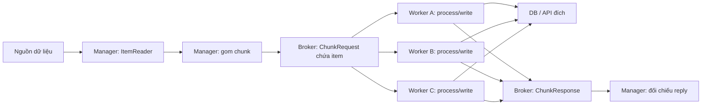
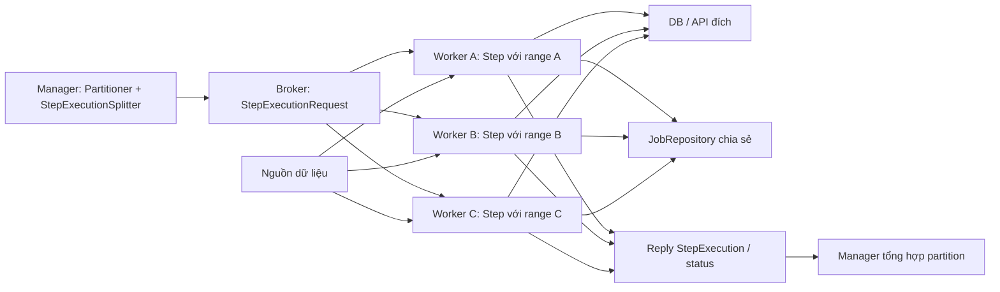
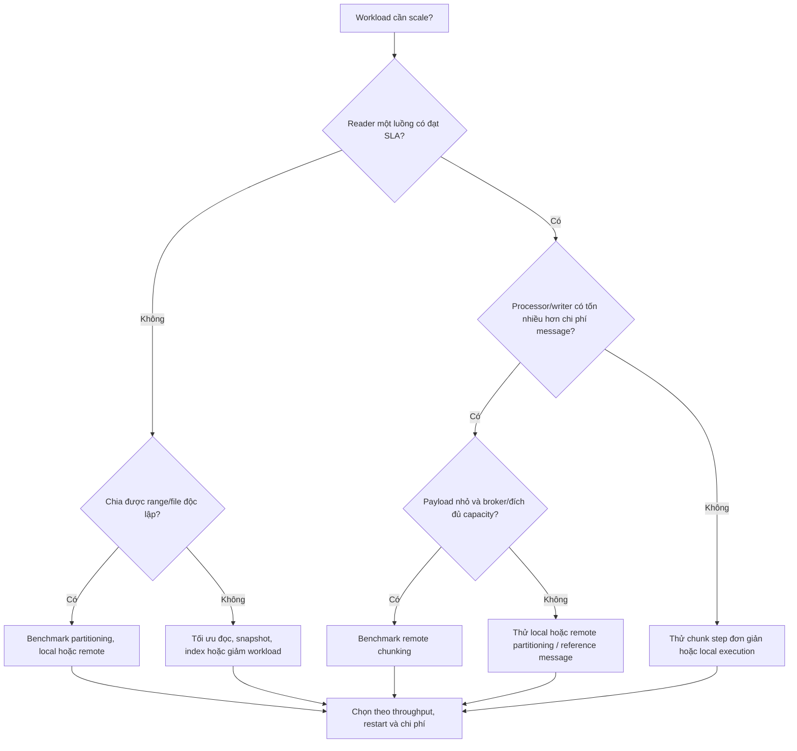

# Remote chunking so với partitioning trong Spring Batch

**Remote chunking** và **partitioning** đều giúp Spring Batch xử lý workload lớn bằng nhiều đơn vị công việc song song, nhưng chúng **chia việc ở hai ranh giới khác nhau**. Remote chunking giữ `ItemReader` ở manager rồi gửi **dữ liệu item đã đọc** tới worker để xử lý/ghi. Partitioning chia **phạm vi dữ liệu** thành nhiều `StepExecution`; mỗi worker thực thi một step trên phần dữ liệu của riêng mình và thường **tự đọc** phạm vi ấy.

Đây không chỉ là khác biệt về số lượng thread hoặc máy. Nó quyết định nơi đặt nút thắt đọc dữ liệu, kích thước message qua broker, cách lưu metadata, ranh giới transaction, cơ chế retry/restart và khả năng mở rộng khi nguồn/đích trở nên quá tải.

Bài thuộc chương **Remote Chunking** trong module **SPRING_BATCH_SCALING_OPERATIONS**, phục vụ mục tiêu mở rộng Spring Batch qua multi-threaded step, parallel steps, local/remote partitioning và mô hình phân tán. Sau bài học, bạn có thể chọn mô hình dựa trên **đo throughput, giới hạn nguồn/đích, tính đúng đắn khi chạy lại và chi phí vận hành**, thay vì mặc định “remote” đồng nghĩa nhanh hơn.

## 1. Phân biệt ngay trong một câu

- **Remote chunking:** *Manager đọc từng item → gom chunk → gửi chính các item sang worker → worker process/write → trả `ChunkResponse`.*
- **Partitioning:** *Manager tạo các partition và `StepExecution` → worker thực thi cả step trên phạm vi được phân công → worker tự reader/process/writer → trả trạng thái `StepExecution` hoặc cập nhật repository để manager tổng hợp.*
- **Local partitioning:** Worker partition chạy trên thread khác **trong cùng JVM**, thường do `TaskExecutorPartitionHandler` điều phối.
- **Remote partitioning:** Worker partition chạy trên **JVM/máy khác**, thường qua Spring Batch Integration và middleware hoặc cơ chế theo dõi repository phù hợp.

Khi nói “remote chunking so với partitioning”, nên so sánh theo **hai cấp**: remote chunking với *partitioning nói chung* và với **remote partitioning** (lựa chọn phân tán gần nhất).

| Tiêu chí | Remote chunking | Local partitioning | Remote partitioning |
| --- | --- | --- | --- |
| Đơn vị chia việc | Một chunk **item đã được đọc** | Một `StepExecution` theo phạm vi dữ liệu | Một `StepExecution` theo phạm vi dữ liệu |
| Nơi đọc | Manager | Worker step trong cùng JVM | Worker step ở JVM khác |
| Nơi process/write | Worker từ xa | Worker thread cục bộ | Worker JVM từ xa |
| Dữ liệu gửi qua broker | Request chứa **nhiều item** và metadata chunk | Không bắt buộc có broker | Thường là **yêu cầu thực thi partition**, không phải toàn bộ item |
| Repository | Manager quản lý step và checkpoint đọc | StepExecution riêng cho partition | StepExecution riêng cho partition, thường sử dụng repository chia sẻ |
| Tăng tốc phần đọc | Không tự động: reader manager vẫn là điểm chung | Có thể, nếu nhiều reader vùng độc lập | Có thể, nếu nguồn hỗ trợ nhiều reader độc lập |
| Tăng tốc process/write | Có | Có | Có |
| Giới hạn quy mô | Manager reader, broker, worker và đích | CPU, heap, thread và DB trên một JVM/máy | Năng lực nhiều worker, nguồn/đích và điều phối |
| Bài toán restart | Chunk in-flight, reply, checkpoint manager và idempotency đích | State/checkpoint từng StepExecution | State/checkpoint từng partition và giao thức request/reply |

**Cảnh báo về thuật ngữ:** Một số tài liệu dùng “partitioning” để chỉ cả local và remote. Vì thế, phát biểu “partitioning không dùng broker” là sai nếu đang nói tới **remote partitioning**; ngược lại, “partitioning luôn phải có message broker” cũng sai vì **local partitioning** có thể chỉ cần `TaskExecutor`.

## 2. Hai sơ đồ: dữ liệu đi qua đâu?

### Remote chunking — payload item đi qua manager và broker



Manager thường là **một luồng đọc có trạng thái** của step; nó chịu trách nhiệm cung cấp item cho tất cả worker. Chạy thêm nhiều worker chỉ tăng năng lực tiêu thụ nếu manager có đủ item để gửi.

### Remote partitioning — mỗi worker tự đọc phạm vi dữ liệu



Trong remote partitioning, broker thường mang **thông tin phân công**, chẳng hạn định danh StepExecution và tên step; dữ liệu lớn không phải đi qua reader của manager. Worker có thể phải truy cập nguồn, repository và hệ thống đích từ xa. Tùy implementation, manager tổng hợp qua message reply hoặc theo dõi JobRepository; không phải mọi deployment đều có cùng topology reply.

Một sai lầm kiến trúc phổ biến là chọn remote chunking vì có “nhiều server”, trong khi bottleneck chính chính là **reader tuần tự** mà remote chunking không phân phối sang worker.

## 3. Khác biệt căn bản: chunk so với partition

**Chunk** là đơn vị gom item để xử lý/ghi và quản lý commit trong một step. Chunk size thường được biểu diễn bằng số item. Với 2.400.000 item và chunk size 200, manager có thể phát khoảng:

\[
M_{\text{chunks}}\approx
\left\lceil\frac{2.400.000}{200}\right\rceil
=12.000 \text{ chunk}
\]

Mỗi chunk có thể chứa nhiều item DTO đã serialize. Các chunk từ một remote chunking step được phân phát cho worker thông qua broker và response được manager theo dõi.

**Partition** là một **lần thực thi step độc lập về metadata**, có tên và `ExecutionContext` riêng. Ví dụ partition theo dải ID:

| Partition | `minId` | `maxId` | Worker |
| --- | ---: | ---: | --- |
| `partition0` | 1 | 300.000 | Worker A |
| `partition1` | 300.001 | 600.000 | Worker B |
| `partition2` | 600.001 | 900.000 | Worker C |
| `partition3` | 900.001 | 1.200.000 | Worker D |

Mỗi partition có thể **tiếp tục chia thành nhiều chunk nội bộ**: partitioning và chunk-oriented step **không loại trừ nhau**. Một partition xử lý 300.000 item với commit interval 200 sẽ có nhiều lần chunk commit và checkpoint trong `StepExecution` của riêng mình.

| Câu hỏi | Remote chunking | Partitioning |
| --- | --- | --- |
| “Chunk size = 200” nghĩa là gì? | Manager tạo request chứa tối đa khoảng 200 item | Mỗi worker chunk step có thể commit 200 item/lần |
| “Grid size = 8” nghĩa là gì? | Không phải nút chia reader chính của remote chunking | Partitioner nhận gợi ý tạo khoảng 8 partition |
| Số đơn vị metadata chính | Manager step + quản lý các chunk đang xử lý | Nhiều `StepExecution` partition |
| Một worker xử lý xong gì? | Một message chunk | Một partition step gồm nhiều chunk |
| Có thể chia dữ liệu đọc ở worker? | Không theo mô hình remote chunking chuẩn | Có, nếu partitioner và reader theo context đúng |

Giá trị `gridSize` chỉ là **gợi ý** cho `Partitioner.partition(gridSize)`; số partition thật phụ thuộc cách partitioner viết. Không lấy `gridSize` làm định nghĩa cứng cho số JVM worker.

## 4. So sánh JobRepository, trạng thái và phạm vi checkpoint

Đây là khác biệt quyết định đối với retry/restart:

| Khía cạnh | Remote chunking | Partitioning |
| --- | --- | --- |
| Đối tượng chính | Manager `StepExecution` cho remote-chunking step | Manager step và một `StepExecution` cho mỗi partition |
| Đọc và checkpoint | Reader manager, lưu state theo step | Reader của mỗi partition, state theo `ExecutionContext` của partition |
| Theo dõi tiến độ chi tiết | Counters ở manager + request/reply/in-flight; log worker | Counters/status/ExecutionContext riêng cho từng partition |
| Khi một đơn vị việc lỗi | Chunk có thể cần retry/replay; phải xem response và commit ở đích | Partition có thể FAILED; restart theo trạng thái partition và checkpoint |
| Khi một worker JVM chết | Chuỗi request/response có thể bị gián đoạn | Partition StepExecution của worker có thể còn STARTED/FAILED và cần recovery |
| Cơ sở biết đã ghi xong | Reply hợp lệ **và** semantics writer/transaction | Metadata partition **và** đối soát dữ liệu nghiệp vụ |

Trong remote chunking, manager **không nhận một StepExecution riêng cho từng chunk**. Trạng thái xử lý từng chunk được theo dõi qua request/reply và metadata của manager step. Vì vậy không nên áp mô hình “mỗi chunk là một partition” khi debug.

Trong partitioning, mỗi `StepExecution` có các bộ đếm `readCount`, `writeCount`, `commitCount`, `rollbackCount` và checkpoint riêng, thuận tiện để điều tra **partition nào chậm hoặc lỗi**.

Tuy nhiên, **metadata không thay thế dữ liệu nghiệp vụ**. Một worker có thể commit vào hệ thống đích rồi mất kết nối với repository hoặc broker; có thể cần đối soát idempotency trước khi restart. Không được đổi trạng thái repository trực tiếp bằng SQL chỉ để job “chạy lại được”.

## 5. Remote chunking phù hợp khi nào?

Remote chunking thường là ứng viên tốt khi:

1. **Manager đọc nhanh và đều:** reader source có thể cấp dữ liệu nhanh hơn tổng năng lực xử lý/ghi mục tiêu.
2. **Processor hoặc writer nặng:** tính toán CPU, enrichment, validation, gọi API hoặc ghi nhiều thao tác phức tạp.
3. **Payload item vừa phải:** serialize và vận chuyển chunk không chiếm phần lớn thời gian, không vượt giới hạn message.
4. **Chunk độc lập:** kết quả không phụ thuộc thứ tự hoàn thành trên nhiều worker.
5. **Đích chịu concurrency:** DB, API và rate limit có headroom khi tăng worker.
6. **Hệ thống chịu được redelivery:** writer idempotent hoặc có khóa nghiệp vụ/compensation khi chunk được thực thi lại.
7. **Broker/worker sẵn sàng vận hành:** request/reply correlation, timeout, retry, DLQ, giám sát backlog và cấu hình schema/version.

Ví dụ: manager đọc 8.000 item/giây từ một bảng đã index tốt; mỗi worker xử lý 300 item/giây vì cần chạy thuật toán nặng; broker và đích hỗ trợ tổng hơn 2.000 item/giây. Việc thêm worker có thể rút ngắn batch window.

**Không phù hợp chỉ vì item count lớn.** Nếu mỗi item là JSON 10 MB và worker xử lý chỉ 2 ms, việc gửi item qua broker có thể tốn hơn nhiều so với xử lý trực tiếp.

## 6. Partitioning phù hợp khi nào?

Ưu tiên cân nhắc partitioning nếu:

1. **Reader cũng cần mở rộng:** một reader manager duy nhất không đáp ứng tốc độ đọc.
2. **Dữ liệu chia được thành các phạm vi độc lập:** theo ID, tenant, file, business date hoặc key-range.
3. **Worker có quyền và năng lực truy cập nguồn:** reader trên worker có thể lấy chính xác phần dữ liệu được phân công.
4. **Dữ liệu quá lớn để chuyển qua broker:** gửi chỉ metadata về phạm vi giúp giảm payload request.
5. **Cần metadata theo phần việc:** mỗi partition có checkpoint/status/counters và đường restart riêng.
6. **Dữ liệu có skew:** có thể chọn nhiều partition nhỏ hơn số worker để cân bằng đuôi dài, nhưng phải cân đối overhead.
7. **Tài nguyên cho phép:** nguồn chịu được nhiều reader đồng thời, DB connection pool/IO đủ headroom.

**Chọn local partitioning** nếu một JVM/host vẫn còn CPU, heap và tài nguyên, cần tránh độ phức tạp broker. **Chọn remote partitioning** khi một host đã chạm giới hạn, cần phân phối worker sang nhiều máy nhưng nguồn vẫn phục vụ nhiều reader ổn định.

Nếu database nguồn đang bão hòa IOPS, chuyển 1 reader trên manager thành 20 reader trên 20 worker có thể **làm chậm hơn** vì lock, cache misses, contention hoặc thiếu connection. Phải đo năng lực đọc tổng cộng của nguồn.

## 7. Công thức throughput: vì sao ranh giới đọc quan trọng nhất?

### 7.1. Remote chunking

Gọi:

- `R_m`: tốc độ manager đọc item, item/s.
- `R_send`: tốc độ manager serialize/send, quy đổi item/s.
- `R_msg`: năng lực broker request/reply.
- `R_w`: tổng worker process/write, item/s.
- `R_dest`: năng lực bền vững của đích.

Trong pipeline có các giai đoạn chồng lấp:

\[
R_{\mathrm{remoteChunk}}\ \lesssim\
\min(R_m,R_{\mathrm{send}},R_{\mathrm{msg}},R_w,R_{\mathrm{dest}})
\]

Tăng `R_w` không tăng throughput khi `R_m` là giá trị nhỏ nhất.

### 7.2. Partitioning

Mỗi worker/partition tự đọc. Nếu `P_active` partition hoạt động đồng thời, tốc độ đọc tổng có thể tăng:

\[
R_{\mathrm{read,total}}\ \lesssim\
\min\left(\sum_{i=1}^{P_{\mathrm{active}}}r_{\mathrm{read},i},\
R_{\mathrm{source,max}}\right)
\]

Tốc độ end-to-end vẫn bị giới hạn bởi worker process/write và hệ thống đích:

\[
R_{\mathrm{partition}}\ \lesssim\
\min(R_{\mathrm{read,total}},R_{\mathrm{process,total}},R_{\mathrm{dest}})
\]

Các công thức là **mô hình planning**, không phải định luật cam kết linear speedup. Thời gian thực tế còn có startup, chunk overhead, data skew, message latency, retry, checkpoint và GC.

### 7.3. Tính thời gian đáp ứng SLA

Với `N` item trong thời hạn `D` giây:

\[
R_{\mathrm{required}}=\frac{N}{D}
\]

Muốn có 20% dự phòng công suất (mức sử dụng thiết kế 80%), throughput mục tiêu:

\[
R_{\mathrm{target}}=\frac{R_{\mathrm{required}}}{0,8}
\]

**Ví dụ:** `N=2.400.000` item, `D=20×60=1.200` giây → cần **2.000 item/giây**, hoặc mục tiêu **2.500 item/giây** nếu dành 20% dư địa.

Đây là bước đầu để chọn mô hình; bước tiếp theo phải đo chính xác reader, worker, broker và nguồn/đích.

## 8. Case study: cùng workload, hai lựa chọn kiến trúc

Giả sử dự án xử lý **2.400.000 hóa đơn** trong 20 phút. Dữ liệu có thể chia theo ID, DB nguồn có index và cho phép các range scan song song.

### Phương án A: remote chunking

- Reader manager đo được **700 item/giây**.
- Có 8 worker, mỗi worker đạt **400 item/giây** với dữ liệu đại diện.
- Broker và DB đích đủ khả năng đạt hơn **3.000 item/giây**.
- Item payload nhỏ, chi phí serialize chấp nhận được.

Tổng năng lực worker lý tưởng:

\[
R_{\mathrm{workers}}=8\times400=3.200\text{ item/s}
\]

Nhưng pipeline bị reader chặn ở **700 item/s**:

\[
T_{\mathrm{best}}\geq\frac{2.400.000}{700}
\approx3.429\text{ giây}\approx57,1\text{ phút}
\]

Tăng lên 16 worker vẫn không làm một reader 700 item/s đạt SLA 20 phút.

### Phương án B: remote partitioning

Giả sử tạo 16 partition cân bằng, có 8 worker hoạt động đồng thời. Đã **đo thực nghiệm** trên nguồn/đích rằng:

- Mỗi worker có thể **đọc + process + write** ổn định khoảng **300 item/s** khi cùng chạy.
- DB nguồn chịu tối đa **2.800 item/s** aggregate.
- DB đích chịu tối đa **2.500 item/s**.
- Metadata/reply coordination không phải nút thắt ở mức tải này.

Khi đó:

\[
R_{\mathrm{partition}}\approx
\min(8\times300,2.800,2.500)
=\min(2.400,2.800,2.500)
=2.400\text{ item/s}
\]

Thời gian xử lý payload lý tưởng:

\[
T_{\mathrm{payload}}\approx
\frac{2.400.000}{2.400}=1.000\text{ giây}
\approx16,7\text{ phút}
\]

Phương án B **có khả năng** đạt SLA nếu chi phí khởi tạo, dữ liệu lệch, last partition, retry và tổng hợp không vượt khoảng 3,3 phút. Không thể kết luận chắc chắn trước khi benchmark job đầy đủ.

**Bài học:** Partitioning không “nhanh hơn remote chunking” một cách tuyệt đối. Nó giải quyết được giới hạn **reader tập trung** trong ví dụ này vì các worker thực sự đọc độc lập và nguồn có năng lực đọc song song.

### Khi cả hai đều không đạt

Nếu DB nguồn chỉ chịu tổng cộng 800 item/s dù có nhiều reader, remote partitioning cũng không thể vượt rào cản này đáng kể. Khi ấy cần tối ưu index/SQL, cải thiện IOPS, giảm dữ liệu cần đọc, incremental load, materialized snapshot hoặc thay đổi batch window trước khi đổi số worker.

## 9. Khối lượng message: gửi item hay gửi phạm vi?

Một khác biệt lớn về mạng/broker:

### Remote chunking

Với `N` item, kích thước serialized trung bình `S` byte, chunk size `C`:

\[
\text{Request payload bytes}\approx N\times S
\]

\[
\text{Request messages}\approx\left\lceil\frac{N}{C}\right\rceil
\]

Giả sử 2,4 triệu item, mỗi item **8 KB** serialized, chunk size **200**:

- Payload request tối thiểu khoảng **19,2 GB** (đơn vị thập phân).
- Khoảng **12.000 request messages**, cùng các response tương ứng.
- Băng thông trung bình yêu cầu qua đường request trong 20 phút là khoảng **16 MB/s**, chưa kể broker replication, headers, retry, reply và overhead mạng.

Chunk size lớn giảm số message nhưng không giảm tổng byte của item đã gửi. Với object hoặc BLOB rất lớn, payload có thể vượt hạn mức một message.

### Remote partitioning

Nếu 16 partition chỉ gửi khoảng ID, tên step và metadata, broker chủ yếu truyền **request phân công + response**; kích thước request nhỏ hơn đáng kể so với dữ liệu item.

**Đổi lại**, mỗi worker phải tự đọc source. Tổng byte dữ liệu nghiệp vụ vẫn phải đi từ nguồn tới worker qua mạng nếu source ở máy khác; nó **không biến mất**, chỉ đổi đường đi. Điều này ảnh hưởng topology network, quyền truy cập, connection và data locality.

Đối với file/video/ảnh lớn, remote partitioning hoặc phương án worker đọc object storage theo versioned object key thường có lợi hơn gửi toàn bytes qua message. Nhưng nếu worker không thể đọc nguồn do chính sách bảo mật và DTO nhỏ, remote chunking có thể đơn giản hơn về access boundary.

## 10. Manager làm những gì trong hai mô hình?

| Trách nhiệm manager | Remote chunking | Partitioning |
| --- | --- | --- |
| Chọn phạm vi dữ liệu | Reader đọc các item của step | Partitioner tạo range/file/tenant cho từng partition |
| Đọc item | **Có**, là trách nhiệm chính | **Không đọc toàn bộ item**; giao phạm vi cho worker |
| Gửi dữ liệu | Gửi chunk chứa item | Gửi request/điều phối StepExecution |
| Chờ kết quả | Theo dõi `ChunkResponse` | Tổng hợp trạng thái/counters `StepExecution` |
| Checkpoint | Reader state và step metadata manager | Checkpoint nằm trong mỗi partition step |
| Khi worker chậm | Request queue có thể tăng, chunk in-flight/timeout | Một số partition còn STARTED lâu, manager chờ straggler |
| Khi manager quá tải CPU | Serialize/publish/chunk coordination có thể nghẽn | Partitioner/splitter và metadata coordination có thể nghẽn, thường ít payload hơn |

Điều này giải thích tại sao remote chunking thường phù hợp nếu **đọc nhẹ, xử lý nặng**, còn partitioning hấp dẫn nếu **đọc cũng nặng** hoặc muốn phân chia nguồn ngay từ đầu.

Một nhầm lẫn phổ biến là chuyển processor sang remote worker rồi kỳ vọng tốc độ đọc của manager tăng. Nếu reader dùng một cursor SQL tuần tự đang bị chặn, worker không thể tăng tốc cursor đó.

## 11. Cấu hình Java: remote chunking manager và worker trong Spring Batch 5.x

Ví dụ sau minh họa cách dùng **Spring Batch Integration 5.2.x**, không phải ứng dụng hoàn chỉnh. Các bean `OrderInput`, `OrderOutput`, reader, processor/writer, message channels, broker adapters, `JobRepository` và transaction manager phải được định nghĩa bởi dự án.

### 11.1. Manager đọc và phát chunk

```java
import org.springframework.batch.core.Step;
import org.springframework.batch.core.repository.JobRepository;
import org.springframework.batch.integration.chunk.RemoteChunkingManagerStepBuilder;
import org.springframework.batch.item.ItemReader;
import org.springframework.beans.factory.annotation.Qualifier;
import org.springframework.context.annotation.Bean;
import org.springframework.messaging.MessageChannel;
import org.springframework.messaging.PollableChannel;
import org.springframework.transaction.PlatformTransactionManager;

@Bean
public Step chunkManagerStep(
        JobRepository jobRepository,
        PlatformTransactionManager transactionManager,
        ItemReader<OrderInput> orderReader,
        @Qualifier("requestsOut") MessageChannel requestsOut,
        @Qualifier("repliesIn") PollableChannel repliesIn) {

    return new RemoteChunkingManagerStepBuilder<OrderInput, OrderInput>(
            "chunkManagerStep", jobRepository)
        .chunk(200)
        .reader(orderReader)
        .outputChannel(requestsOut)
        .inputChannel(repliesIn)
        .transactionManager(transactionManager)
        .build();
}
```

Đặc điểm quan trọng: `orderReader` là **reader duy nhất được dùng bởi manager step này**, còn `requestsOut` gửi item payload theo chunk. Builder đảm nhiệm việc dùng writer để gửi chunk; không nên đồng thời gắn một writer nghiệp vụ khác để ghi kết quả tại manager.

### 11.2. Worker xử lý item nhận qua middleware

```java
import org.springframework.batch.integration.chunk.RemoteChunkingWorkerBuilder;
import org.springframework.batch.item.ItemProcessor;
import org.springframework.batch.item.ItemWriter;
import org.springframework.beans.factory.annotation.Qualifier;
import org.springframework.context.annotation.Bean;
import org.springframework.integration.dsl.IntegrationFlow;
import org.springframework.messaging.MessageChannel;

@Bean
public IntegrationFlow chunkWorkerFlow(
        @Qualifier("requestsIn") MessageChannel requestsIn,
        @Qualifier("repliesOut") MessageChannel repliesOut,
        ItemProcessor<OrderInput, OrderOutput> processor,
        ItemWriter<OrderOutput> writer) {

    return new RemoteChunkingWorkerBuilder<OrderInput, OrderOutput>()
        .inputChannel(requestsIn)
        .outputChannel(repliesOut)
        .itemProcessor(processor)
        .itemWriter(writer)
        .build();
}
```

Đây là worker theo kiểu **xử lý chunk message**, không phải một worker step có reader riêng. Cần có adapters của Spring Integration nối `requestsOut → broker → requestsIn` và `repliesOut → broker → repliesIn`; hai JVM không dùng chung một object `MessageChannel`.

**Lưu ý phiên bản:** API có thể khác theo phiên bản Spring Batch Integration, nhất là giữa 5.x và 6.x. Ví dụ tập trung vào kiểu builder Spring Batch 5.2.x; hãy đối chiếu JavaDoc đúng dependency và cấu hình transaction/ACK của middleware trước khi triển khai.

## 12. Cấu hình Java: partitioner và worker đọc riêng phạm vi

Trong partitioning, ý tưởng cốt lõi nằm ở **Partitioner → ExecutionContext → Reader của worker**.

Ví dụ tạo partition theo khoảng ID không giao nhau:

```java
import java.util.LinkedHashMap;
import java.util.Map;
import org.springframework.batch.core.partition.support.Partitioner;
import org.springframework.batch.item.ExecutionContext;

public final class OrderRangePartitioner implements Partitioner {

    private final long firstId;
    private final long lastId;

    public OrderRangePartitioner(long firstId, long lastId) {
        if (firstId < 1 || lastId < firstId) {
            throw new IllegalArgumentException("Invalid ID bounds");
        }
        this.firstId = firstId;
        this.lastId = lastId;
    }

    @Override
    public Map<String, ExecutionContext> partition(int gridSize) {
        if (gridSize < 1) {
            throw new IllegalArgumentException("gridSize must be positive");
        }

        // Ví dụ giả định ID hữu hạn, không gây overflow số học long.
        long total = lastId - firstId + 1;
        long width = (total + gridSize - 1L) / gridSize;
        Map<String, ExecutionContext> result = new LinkedHashMap<>();

        int index = 0;
        for (long from = firstId; from <= lastId; from += width) {
            long to = Math.min(lastId, from + width - 1);
            ExecutionContext context = new ExecutionContext();
            context.putLong("minId", from);
            context.putLong("maxId", to);
            result.put("partition" + index++, context);
        }
        return result;
    }
}
```

Nếu ID từ 1 tới 1.000.000 và gridSize=4, mỗi partition quản lý khoảng 250.000 ID. **Số row thực tế** trong mỗi khoảng có thể khác nhau đáng kể do ID khuyết, phân bố dữ liệu hoặc điều kiện business filter.

Worker reader dùng đúng phạm vi từ `ExecutionContext`:

```java
import org.springframework.batch.core.configuration.annotation.StepScope;
import org.springframework.batch.item.ItemReader;
import org.springframework.beans.factory.annotation.Value;
import org.springframework.context.annotation.Bean;

@Bean
@StepScope
public ItemReader<OrderInput> partitionReader(
        @Value("#{stepExecutionContext['minId']}") Long minId,
        @Value("#{stepExecutionContext['maxId']}") Long maxId) {

    // Factory do ứng dụng hiện thực, áp WHERE id BETWEEN minId AND maxId,
    // chọn sort key ổn định và checkpoint phù hợp để restart.
    return createReaderForRange(minId, maxId);
}
```

`createReaderForRange(...)` là factory **minh họa**, chưa phải implementation đầy đủ. Trong dự án có thể dùng `JdbcPagingItemReader`, cursor reader hoặc file reader theo context. Sử dụng `@StepScope` để cô lập state reader theo từng `StepExecution`; không dùng chung một cursor mutable cho nhiều partition.

### Local partitioning với TaskExecutor

Ví dụ builder điển hình trong Spring Batch 5.x:

```java
@Bean
public Step localManagerStep(
        JobRepository repository,
        @Qualifier("orderWorkerStep") Step workerStep,
        OrderRangePartitioner partitioner,
        @Qualifier("partitionExecutor") TaskExecutor taskExecutor) {

    return new StepBuilder("localManagerStep", repository)
        .partitioner("orderWorkerStep", partitioner)
        .step(workerStep)
        .gridSize(8)
        .taskExecutor(taskExecutor)
        .build();
}
```

Đoạn trên cần import `JobRepository`, `Step`, `StepBuilder`, `TaskExecutor` và các annotation tương ứng. Trong **remote partitioning**, cơ chế phân công không dùng local `TaskExecutorPartitionHandler` để chạy worker step trong cùng JVM; thay bằng remote partition manager/worker và kênh gửi request/reply phù hợp. **Partitioner và cách truyền range qua ExecutionContext vẫn là ý tưởng chung**, chỉ thay cách điều phối và nơi worker chạy.

### Minh họa wiring remote partitioning ở mức kiến trúc

```text
Manager JVM:
  Partitioner.partition(gridSize)
    -> StepExecutionSplitter / JobRepository
    -> RemotePartitioningManagerStepBuilder
    -> StepExecutionRequest qua broker

Worker JVM:
  RemotePartitioningWorkerStepBuilder / listener tương thích
    -> tải StepExecution + ExecutionContext
    -> ItemReader(minId, maxId)
    -> ItemProcessor
    -> ItemWriter
    -> cập nhật JobRepository + StepExecution reply/status

Manager:
  tổng hợp StepExecution theo partition và quyết định status step/job
```

Đây là sơ đồ cấu hình khái niệm để tránh giả định API remote builder trùng hệt local builder. Đường request/reply cụ thể, worker step và JobRepository phải được cấu hình theo **đúng phiên bản Spring Batch Integration**. Với remote partitioning, các instance cần nhìn thấy metadata thống nhất; thường dùng JobRepository chung có tính bền vững.

## 13. Thread safety và state: hai mô hình khác vị trí rủi ro

| Vấn đề | Remote chunking | Partitioning |
| --- | --- | --- |
| Reader state | Tập trung ở manager; có thể là một reader tuần tự | Reader tách theo StepExecution trên worker |
| Processor/writer state | Worker nhận nhiều request; có thể cùng bean singleton qua nhiều consumer | Bean worker step có thể được dùng bởi nhiều partition; cần step scope |
| Business-key contention | Nhiều chunk có thể ghi cùng khóa | Nhiều partition cũng có thể ghi cùng khóa nếu chia phạm vi sai |
| ExecutionContext | State/checkpoint reader ở manager; worker không mặc nhiên có StepExecution riêng | Context riêng theo partition, phù hợp late binding |
| Concurrency | Số worker/consumer và tài nguyên đích | Số thread/partition worker, nguồn và đích |
| Ordering | Chunks có thể hoàn thành khác thứ tự gửi | Partitions có thể hoàn thành khác thứ tự phân công |

**Remote chunking:** Đừng mặc định gắn `@StepScope` ở worker rồi kỳ vọng có `StepExecution` được tạo tự động theo mỗi chunk. Worker tiêu chuẩn là một integration flow xử lý request; scope và transaction cần phù hợp với môi trường worker thực tế. Processor nên stateless; writer cần idempotent và an toàn khi nhiều request đồng thời.

**Partitioning:** `@StepScope` có ích vì mỗi partition thực sự có `StepExecution` riêng. Nhưng khi worker step còn **multi-threaded chunk** bên trong partition, một StepExecution có thể được dùng đồng thời bởi nhiều thread, nên `@StepScope` **chưa đủ** để bảo đảm reader/writer thread-safe ở tầng đó.

Trong cả hai mô hình, DB connection, session và buffer mutable không nên được chia sẻ sai ranh giới giữa thread. Tăng số worker không thay thế thiết kế dữ liệu đúng.

## 14. Transaction boundary: không có một transaction toàn cục

### Remote chunking

Manager đọc và gửi request; worker xử lý/ghi, rồi trả reply. Thông thường **không có một transaction ACID mặc định bao trùm**:

1. Checkpoint đọc của manager.
2. Broker nhận/giao message.
3. Worker commit xuống DB/API đích.
4. Manager nhận response và cập nhật metadata.

Một lỗi có thể xảy ra sau **bước 3** nhưng trước **bước 4**. Khi request được gửi lại, worker có thể ghi lại dữ liệu đã commit. Vì vậy writer phải có **idempotency**, deduplication hoặc compensating logic.

### Partitioning

Mỗi worker step có transaction/chunk riêng, commit và checkpoint trong `StepExecution` của nó. Nếu partition A hoàn tất nhưng partition B thất bại, Spring Batch không tự động rollback những transaction mà A đã commit.

Với **remote partitioning**, JobRepository của worker và hệ thống đích có thể là database khác nhau; do đó vẫn có khoảng trống consistency khi commit dữ liệu và lưu metadata. Mô hình có checkpoint theo partition nhưng không có nghĩa mọi side effect đều exactly-once.

| Sự kiện lỗi | Remote chunking | Remote partitioning |
| --- | --- | --- |
| Worker chết trước khi ghi | Chunk có thể cần redelivery/retry | Partition cần recovery theo metadata và trạng thái worker |
| Worker ghi xong, reply mất | Có thể replay chunk đã commit | Manager có thể chưa có reply dù StepExecution đã update; cần đối chiếu |
| Manager chết giữa lúc có việc | Chunk in-flight và checkpoint cần kiểm tra | Các partition có thể đang chạy ở worker; cần tránh chạy chồng |
| DB đích timeout sau commit | Có nguy cơ ghi trùng | Cũng có nguy cơ; phải đối soát side effect |
| Dữ liệu nguồn thay đổi khi chạy | Reader manager phải có snapshot/watermark | Mỗi reader partition phải thống nhất snapshot/watermark |
| Retry gây áp lực thêm | Request replay, tải broker và đích tăng | Partition retry/restart, tải nguồn và đích tăng |

**Điểm quan trọng:** Partitioning có metadata chi tiết hơn, nhưng cả hai vẫn cần xác định **định danh business operation** và cơ chế viết lặp an toàn. Không dùng chỉ `BatchStatus.COMPLETED` như bằng chứng tuyệt đối rằng hệ thống đích không có trùng lặp.

## 15. Restart: khi nào cần giữ nguyên partitioning strategy?

Trong partitioning, một lần restart được nhận diện theo `JobInstance`, step name và các partition có metadata riêng. Nếu bạn đổi `gridSize`, tên partition hoặc thuật toán tính range giữa các lần restart, một tên `partition2` có thể không còn biểu thị đúng vùng dữ liệu ban đầu.

Để restart an toàn:

- Giữ tên partition ổn định trong cùng JobInstance.
- Giữ ranh giới phạm vi và snapshot/watermark nhất quán.
- Sử dụng checkpoint của reader theo StepExecution và tránh bỏ qua vùng dữ liệu đã commit một phần.
- Không tự tạo run mới với identifying JobParameters khác rồi coi đó là restart.
- Nếu cần đổi cách chia, lên kế hoạch reprocess/backfill hoặc một JobInstance mới có đối soát dữ liệu.

Trong remote chunking, không có tên partition cho từng chunk, nhưng manager cần khôi phục reader/checkpoint và giải quyết những chunk đã gửi mà chưa có reply/metadata nhất quán. **Không tin một reply mất nghĩa là writer chưa chạy.**

### Hai quy tắc dữ liệu chung

1. **Chia không chồng lấn** nếu mỗi business key chỉ được xử lý một lần: partition theo interval nửa mở `[from, to)` hoặc ID inclusive không giao nhau.
2. **Write idempotent:** ví dụ `UNIQUE(job_business_id, operation_version)` hoặc conditional update, cùng khóa qua retry; với webhook/email cần idempotency key hoặc outbox.

Thứ tự commit và ACK của broker phải được hiểu theo adapter và broker thực tế; Spring Batch không biến request/reply thành giao dịch phân tán tự động.

## 16. Chi phí vận hành: broker, repository và quyền truy cập

Một kiến trúc phân tán hoạt động tốt không chỉ cần code worker mà còn cần pipeline vận hành.

| Hạng mục | Remote chunking | Remote partitioning |
| --- | --- | --- |
| Broker load | **Nhiều request/reply theo chunk**, có item payload | Thường **ít request/reply theo partition**, payload nhỏ |
| Network | Item từ manager → worker | Item nguồn → trực tiếp worker; request chỉ metadata |
| Manager CPU/heap | Đọc/serialize/gom chunk, theo dõi in-flight | Chia partition, lưu metadata, tổng hợp |
| Worker access | Có thể không cần quyền đọc trực tiếp dữ liệu nguồn | Thường phải có quyền đọc nguồn |
| JobRepository | Metadata manager và reader state | Nhiều StepExecution/ExecutionContext, worker cần update |
| Security | Bảo vệ payload item trong broker/queue, TLS/ACL | Bảo vệ metadata + thông tin truy cập DB tại worker |
| Monitoring | Item/chunk rate, request/reply queue, correlation | Partition statuses, skew, worker health và repo load |
| Backpressure | Request in-flight, queue, reply wait, worker concurrency | Số partition active, queue/rejection, broker/workers |
| Đường recovery | Chunk replay, lost reply, idempotency | Retry/restart StepExecution, straggler, stale execution |

Nếu quản trị broker đắt hoặc dữ liệu chứa payload nhạy cảm không nên lưu trong message queue, local partitioning có thể giảm độ phức tạp khi một host còn đủ năng lực. Nếu worker không được phép truy cập database nguồn, remote chunking có thể phù hợp về phân quyền hơn remote partitioning.

**Không nên bỏ qua compliance:** khi gửi toàn item qua broker, hãy đánh giá PII, retention/DLQ, encryption, logging, message converter trusted types và quyền truy cập worker.

## 17. Thực hành đo bottleneck trước khi chọn mô hình

Bảng quan sát cần thu thập ở cả hai lựa chọn:

| Metric | Với remote chunking | Với partitioning |
| --- | --- | --- |
| Read throughput | `ItemReader` manager; item/s | Tổng readCount/s của các StepExecution và DB source |
| Request throughput | Chunk messages/s, bytes/s, payload P95 | Partition dispatch/s, latency tạo StepExecution |
| Worker duration | Chunk duration P95/P99 | Partition duration P95/P99, tail latency |
| Backlog | Request/reply queue depth và oldest age | Partition chờ/đang chạy, task queue hoặc worker availability |
| Error | Chunk failure/redelivery/lost reply | Failed partition, retry/restart, stale StepExecution |
| JobRepository | Manager counters/step status | Counters và status theo từng partition |
| DB/source | Query P95, pool pending, CPU, IOPS | Tổng hiệu ứng nhiều reader: index, locks, IO |
| DB/đích | Writer throughput, lock wait, API 429 | Writer throughput theo partition, lock wait, API 429 |
| End-to-end | Job duration, số business key hoàn thành | Job duration, số business key hoàn thành |

Một phép đo sai dễ gặp: chỉ đếm số chunk worker báo thành công, bỏ qua read count và DB output; hoặc chỉ đếm partition `COMPLETED` mà không đối soát số hàng thực tế. Cần đo **output nghiệp vụ**, số item còn thiếu/trùng và thời gian khôi phục sau lỗi.

### SQL tra trạng thái partition (schema metadata mặc định)

```sql
SELECT
    STEP_EXECUTION_ID,
    STEP_NAME,
    STATUS,
    READ_COUNT,
    WRITE_COUNT,
    COMMIT_COUNT,
    ROLLBACK_COUNT,
    START_TIME,
    END_TIME,
    LAST_UPDATED
FROM BATCH_STEP_EXECUTION
WHERE JOB_EXECUTION_ID = :jobExecutionId
ORDER BY STEP_EXECUTION_ID;
```

Truy vấn hữu ích để xem từng partition trong một job; tên step partition thường có suffix. Trong remote chunking có thể chỉ có manager step tương ứng, **không có một StepExecution cho mỗi request chunk**, vì thế SQL trên không phải cách đếm in-flight chunk; phải xem cả message metrics/correlation.

**Không xem `LAST_UPDATED` là heartbeat realtime** của mọi worker. Một chunk/transaction dài có thể chưa cập nhật metadata, còn worker chết đột ngột có thể để lại trạng thái cũ; cần kết hợp logs, thread dump, broker và DB.

## 18. Bộ câu hỏi quyết định kiến trúc

Có thể dùng quy trình dưới đây trong review thiết kế:



Một bảng quyết định nhanh:

| Câu hỏi | Thiên về remote chunking | Thiên về partitioning |
| --- | --- | --- |
| Reader một luồng đủ nhanh? | Có | Không hoặc có nhu cầu nhiều reader |
| Processor/writer nặng hơn reader? | Rõ ràng | Có thể cả reader và processor đều nặng |
| Worker có thể đọc nguồn trực tiếp? | Không bắt buộc | Cần nếu là remote partitioning |
| Payload item lớn? | Kém hấp dẫn | Thường tốt hơn nếu chỉ truyền metadata |
| Phạm vi dữ liệu chia theo range/file? | Không bắt buộc ở manager | Nên có |
| Cần checkpoint/metrics theo phạm vi? | Không phải điểm mạnh chính | Có |
| Nguồn DB chịu nhiều query đồng thời? | Ít cần nhiều reader | Là điều kiện quan trọng |
| Muốn ít hạ tầng phân tán nhất? | Không | Local partitioning có thể đơn giản hơn |
| Có khả năng vận hành request/reply broker? | Cần | Remote partitioning cũng thường cần, local thì không |

Hãy ghi **bằng chứng đo được** cạnh mỗi lựa chọn. Một câu như “partitioning có 10 worker nên chắc nhanh hơn” không đủ để duyệt kiến trúc.

## 19. Những lỗi chọn sai mô hình hay gặp

1. **Reader manager đã nghẽn nhưng tăng remote chunk workers:** request queue không đủ việc, worker nhàn rỗi.
2. **Chuyển sang remote partitioning khi nguồn DB đã bão hòa:** nhiều reader tranh nhau IO/index, throughput có thể giảm.
3. **Nhầm chunk size với grid size:** chunk size gom item; grid size gợi ý số partition.
4. **Gửi BLOB lớn qua ChunkRequest:** broker/network/heap trở thành bottleneck.
5. **Tự viết worker chunk consumer không trả ChunkResponse chuẩn:** manager không tổng hợp được kết quả.
6. **Dùng TaskExecutorPartitionHandler và kỳ vọng worker chạy remote:** handler này chạy partition ở cùng JVM.
7. **Coi mỗi request chunk là một StepExecution:** suy sai checkpoint và trạng thái restart.
8. **Quên rằng mỗi partition có reader riêng:** vô tình dùng singleton reader mutable, dẫn tới lặp/thiếu item.
9. **Chia range ID bằng nhau nhưng data skew lớn:** một partition kéo dài thời gian toàn job.
10. **Nhìn broker ACK như bằng chứng DB đã commit:** replay có thể tạo side effect trùng.
11. **Không giữ ổn định partition names/ranges khi restart:** checkpoint cũ không còn khớp phạm vi.
12. **Không kiểm thử mất reply và worker crash:** đánh giá sai tính nhất quán.
13. **Không so sánh local với remote:** thêm broker và worker JVM dù một host vẫn còn headroom.
14. **Chỉ đo throughput processor:** bỏ qua DB source, writer, JobRepository, tail latency và startup.
15. **Bật concurrency không giới hạn:** pool/connection/API quota quá tải, rollback tăng.

## 20. Bài thực hành: chọn giữa remote chunking và partitioning

Một job có **3.600.000 item**, deadline **30 phút**. Dữ liệu là các row có khóa ID, có thể chia range không giao nhau.

Thông số đã đo trên tải đại diện:

| Thành phần | Kết quả |
| --- | ---: |
| Reader duy nhất trên manager | 1.000 item/s |
| Worker process/write độc lập | 250 item/s/worker |
| Tổng nguồn DB khi nhiều reader | 2.700 item/s bền vững |
| Đích database | 2.500 item/s bền vững |
| Năng lực broker truyền remote chunk request | 4.000 item/s tương đương |
| 10 worker partition read+process+write khi cùng chạy | 220 item/s/worker |
| Item serialized | 6 KB/item |
| Chunk size remote chunking dự kiến | 200 item |

**Câu 1.** Throughput tối thiểu?

\[
R_{\mathrm{required}}=
\frac{3.600.000}{30\times60}=2.000\text{ item/s}
\]

**Câu 2.** Remote chunking với 10 worker có đạt không?

Worker lý tưởng `10×250=2.500 item/s` nhưng reader manager chỉ **1.000 item/s**, nên thời gian payload tối thiểu là:

\[
3.600.000/1.000=3.600\text{ giây}=60\text{ phút}
\]

Không đạt SLA. Tăng worker từ 10 lên 20 không chữa được giới hạn manager read.

**Câu 3.** Partitioning với 10 worker đồng thời có khả thi không?

Mô hình đo được:

\[
R_{\mathrm{partition}}=
\min(10\times220,2.700,2.500)
=2.200\text{ item/s}
\]

Thời gian payload lý tưởng:

\[
3.600.000/2.200\approx1.636\text{ giây}
\approx27,3\text{ phút}
\]

Có khả năng đạt 30 phút, nhưng chỉ còn khoảng **2,7 phút** cho startup/metadata, skew, retry và tail latency. Phải benchmark end-to-end và tính headroom; chưa thể coi là chắc chắn.

**Câu 4.** Tổng payload remote chunk request nếu xử lý 3,6 triệu item 6 KB?

\[
3.600.000\times6.000=21,6\text{ GB}
\]

Có khoảng `3.600.000/200=18.000` request chunks, chưa kể replies và overhead; partitioning gửi thông tin range thay vì toàn bộ dữ liệu item qua broker.

**Câu 5.** Nếu nguồn DB chỉ còn 1.400 item/s do hệ thống khác cùng chạy?

Remote partitioning cũng có thể không đạt SLA vì tổng reader throughput không đủ. Cần tối ưu nguồn, sắp lịch, caching/snapshot, incremental load hoặc tăng năng lực nguồn.

**Câu 6.** Khi worker ghi xong nhưng reply bị mất, cả hai mô hình có đảm bảo không ghi trùng?

Không. Cần xem giao thức/metadata và tính idempotent của writer, duy trì business key/version, đồng thời kiểm thử failure windows trước khi production.

## 21. Checklist triển khai đúng và an toàn

- [ ] Đã xác định rõ đang so sánh remote chunking với **local** hay **remote partitioning**.
- [ ] Biết chắc nơi chạy `ItemReader` và điểm tạo `ExecutionContext` trong mô hình chọn.
- [ ] Đã đo reader throughput, CPU/DB I/O, worker throughput, message payload, broker và đích.
- [ ] Đã tính throughput cần đạt theo SLA và có headroom cho retry/backlog.
- [ ] Không nhầm `gridSize` (partition count gợi ý) với `chunkSize` (số item/commit hoặc request).
- [ ] Chỉ gửi payload item qua broker khi kích thước/latency/cost chấp nhận được.
- [ ] Partitioning có range/file/tenant không chồng lấn và reader theo StepExecution context.
- [ ] Dữ liệu nguồn có snapshot/watermark, sort key ổn định và xử lý late arrival.
- [ ] Reader, processor, writer được cô lập hoặc thread-safe ở concurrency thực.
- [ ] Writer có invariant/idempotency cho retry, redelivery, crash sau commit và lost reply.
- [ ] JobRepository, broker, worker và nguồn/đích có metrics đủ để xác nhận trạng thái.
- [ ] Đã thử restart cùng JobInstance, giữ naming/range partition ổn định.
- [ ] Đã benchmark local/remote với cùng workload, điều kiện tải tương đương.
- [ ] Không điều chỉnh trạng thái metadata thủ công để né bước chẩn đoán recovery.
- [ ] Đã kiểm thử sự cố worker crash, manager crash, broker outage, source DB throttling.

## 22. Tài liệu tham khảo

- [Spring Batch Reference — Scaling and Parallel Processing](https://docs.spring.io/spring-batch/reference/scalability.html): các mô hình multi-threaded step, parallel steps, remote chunking, partitioning.
- [Spring Batch Reference — Externalizing Batch Process Execution](https://docs.spring.io/spring-batch/reference/spring-batch-integration/externalizing-execution.html): request/reply trong Spring Batch Integration.
- [Spring Batch Reference — Partitioning](https://docs.spring.io/spring-batch/reference/scalability.html#partitioning): manager/worker, Partitioner, StepExecution và partition handler.
- [Spring Batch API — Partitioner](https://docs.spring.io/spring-batch/docs/5.2.x/api/org/springframework/batch/core/partition/support/Partitioner.html): hợp đồng `partition(int gridSize)`.
- [Spring Batch 5.2 API — RemoteChunkingManagerStepBuilder](https://docs.spring.io/spring-batch/docs/5.2.x/api/org/springframework/batch/integration/chunk/RemoteChunkingManagerStepBuilder.html): manager đọc, đóng chunk và gửi.
- [Spring Batch 5.2 API — RemoteChunkingWorkerBuilder](https://docs.spring.io/spring-batch/docs/5.2.x/api/org/springframework/batch/integration/chunk/RemoteChunkingWorkerBuilder.html): worker process/write và phản hồi.
- [Spring Batch 5.2 API — RemotePartitioningManagerStepBuilder](https://docs.spring.io/spring-batch/docs/5.2.x/api/org/springframework/batch/integration/partition/RemotePartitioningManagerStepBuilder.html): manager gửi yêu cầu thực thi partition.
- [Spring Batch Reference — Late Binding of Job and Step Attributes](https://docs.spring.io/spring-batch/reference/step/late-binding.html): `@StepScope` và `ExecutionContext`.
- [Spring Batch Reference — JobRepository](https://docs.spring.io/spring-batch/reference/job/configuring-repository.html): metadata, trạng thái thực thi và restart.
- [Spring Integration Reference](https://docs.spring.io/spring-integration/reference/): adapters, broker, routing, request/reply và message handling.

> **Ghi nhớ:** **Remote chunking phân phối phần process/write của những item manager đã đọc; partitioning phân phối chính các lần thực thi step và có thể mở rộng cả phần đọc.** Muốn chọn đúng, hãy xác định nơi nghẽn thật sự: reader, broker/network, processor, writer hay DB nguồn/đích. Dùng remote chunking khi manager đọc nhanh và payload đủ nhỏ; dùng local/remote partitioning khi dữ liệu chia được thành các phạm vi độc lập và cần nhiều reader/StepExecution. Cả hai chỉ an toàn khi transaction, thread safety, checkpoint, retry/restart và idempotency đã được kiểm chứng bằng workload thực tế.
