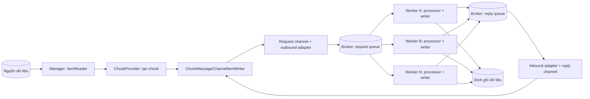

# Middleware vận chuyển chunk message trong Spring Batch Remote Chunking

## 1. Bài toán: đưa một chunk tới đúng worker và nhận lại kết quả

Một job cần xử lý hàng triệu bản ghi đơn hàng. Bước đọc dữ liệu từ cơ sở dữ liệu chỉ mất vài mili giây cho mỗi nhóm bản ghi, nhưng kiểm tra nghiệp vụ và ghi kết quả có thể chậm hơn nhiều. Chạy toàn bộ xử lý trong một tiến trình làm CPU hoặc tài nguyên gọi dịch vụ ngoài trở thành nút thắt. **Remote chunking** cho phép một tiến trình **manager** đọc dữ liệu, chia thành các `chunk` rồi chuyển các chunk đó cho nhiều tiến trình **worker** xử lý.

Chủ đề của bài này là **middleware vận chuyển chunk message**: hệ thống truyền thông điệp đứng giữa manager và workers, đưa request đến worker và chuyển response về manager. Đây là một phần của kỹ thuật mở rộng Spring Batch cho workload dữ liệu lớn. Việc tăng số worker chỉ có ý nghĩa nếu tuyến truyền message đủ tin cậy, có kiểm soát tải, có khả năng khôi phục và không làm mất tính đúng đắn của dữ liệu.

Sau bài học, bạn có thể:

- Mô tả luồng request/reply của remote chunking và vai trò của message broker.
- Thiết kế các channel, queue/destination, adapter và cơ chế correlation.
- Chọn cách xử lý acknowledgment, gửi trùng, retry, timeout và dead-letter queue.
- Nhận diện các giới hạn về thread safety, transaction, restart và throughput.
- Kiểm tra một cấu hình middleware trước khi dùng trong môi trường có dữ liệu lớn.

> **Phạm vi:** Remote chunking phân phối **các nhóm item** đã được manager đọc. Remote partitioning phân phối **các phần công việc/StepExecution** cho worker tự đọc dữ liệu. Hai mô hình có yêu cầu vận chuyển và khôi phục khác nhau; không nên dùng lẫn tên hoặc giả định về transaction.

## 2. Middleware nằm ở đâu trong kiến trúc?



Manager vẫn chịu trách nhiệm đọc và tạo chunk; các worker thực thi phần xử lý/ghi dữ liệu. Trong Spring Batch Integration, `ChunkMessageChannelItemWriter` đóng vai trò writer đặc biệt của manager: gửi các `ChunkRequest` và nhận các `ChunkResponse` để cập nhật kết quả xử lý. Manager có thể tiếp tục tạo những chunk tiếp theo trong giới hạn số request đang chờ, rồi chờ các phản hồi cần thiết trước khi kết luận step.

| Thành phần | Nhiệm vụ | Điểm cần kiểm tra |
|---|---|---|
| `ItemReader` ở manager | Đọc từng item và gom thành chunk | Reader là nút thắt tiềm năng; trạng thái đọc phải hỗ trợ restart |
| Request channel | Đầu ra logic của Spring Integration trong manager | Channel được nối đến adapter gửi qua broker |
| Request queue/destination | Giữ và phân phối `ChunkRequest` cho các worker | Durability, competing consumers, prefetch, backlog |
| Worker inbound adapter | Chuyển message của broker thành Spring message | Message conversion, headers, xác nhận nhận message |
| Worker processing flow | Chạy processor và writer trên chunk nhận được | Thread safety, transaction ghi dữ liệu, idempotency |
| Reply queue/destination | Chuyển `ChunkResponse` về manager | Routing, correlation, độ bền của phản hồi |
| Reply channel ở manager | Cung cấp response cho logic tổng hợp kết quả | Không đánh mất message hay headers cần ghép phản hồi |

`MessageChannel` là abstraction **trong ứng dụng**; bản thân `DirectChannel` hoặc `QueueChannel` chỉ truyền message giữa các thành phần Spring Integration trong cùng tiến trình. Để đi qua mạng, cần thêm **outbound/inbound channel adapter hoặc gateway** kết nối JMS, AMQP hay middleware phù hợp. Tạo hai bean `MessageChannel` ở hai JVM không khiến chúng tự giao tiếp.

## 3. Đường đi của một chunk từ đầu đến cuối

Giả sử manager đọc các mã đơn hàng, chunk size bằng 100 và có ba worker.

1. **Đọc và đóng gói.** Manager đọc tối đa 100 mã đơn hàng, tạo `ChunkRequest` có danh sách item cùng thông tin nhận diện và đóng góp của step.
2. **Gửi request.** `ChunkMessageChannelItemWriter` đưa request lên output channel; outbound adapter serialize payload, map headers và publish vào request queue.
3. **Phân phối tới worker.** Broker giao một message cho một consumer trong nhóm cạnh tranh. Worker A nhận chunk số 1, worker B có thể nhận chunk số 2; **không có bảo đảm các chunk được hoàn thành theo thứ tự**.
4. **Thực thi nghiệp vụ.** Worker chuyển đổi item, ghi dữ liệu đích và tạo `ChunkResponse` chứa thông tin thành công/thất bại cùng phần đóng góp của step.
5. **Gửi phản hồi.** Worker publish response sang reply destination; adapter phía manager nhận response, chuyển vào reply channel.
6. **Ghép và hoàn tất.** Manager đối chiếu thông tin tương quan, thu thập các response đang chờ, cập nhật thống kê và quyết định kết quả step. Thiếu phản hồi hoặc phản hồi lỗi có thể khiến step thất bại.

Hai tầng nhận diện cần phân biệt:

- **Nhận diện chunk/đợt chạy ở payload:** `ChunkRequest` mang số thứ tự chunk, định danh job và `StepContribution`; `ChunkResponse` mang thông tin tương ứng. Spring Batch dùng chúng để theo dõi kết quả xử lý.
- **Correlation ở tầng Spring Integration/broker:** Các message headers như `correlationId`, `sequenceNumber`, `sequenceSize` có thể được dùng bởi luồng tổng hợp phản hồi. Adapter phải bảo tồn các headers cần thiết; chúng không tự động được bảo toàn qua mọi loại transport hay converter.

Không nên tự tạo một `correlationId` bất kỳ rồi ghi đè metadata của framework. Nếu có nhiều job/manager chạy đồng thời, cần thiết kế reply routing và cách phân tách những lần chạy để một manager không vô tình tiêu thụ phản hồi của manager khác.

### Hình dạng message ở mức khái niệm

Thông điệp dưới đây **chỉ minh họa các thông tin cần hiểu**, không phải format JSON mặc định của Spring Batch:

```text
REQUEST
  Payload: ChunkRequest
    job identity = 812
    sequence = 27
    items = [order-2701, order-2702, ...]
    step contribution = <framework metadata>
  Transport headers: correlation/routing metadata

RESPONSE
  Payload: ChunkResponse
    job identity = 812
    sequence = 27
    status = success / failure
    step contribution = <updated metadata>
  Transport headers: correlation/routing metadata
```

Payload thực tế là đối tượng framework, có yêu cầu converter/serializer tương thích với cả phía gửi và nhận. Nếu muốn dùng JSON, cần thiết kế message converter phù hợp cho cả object lồng nhau và kiểm thử round-trip thực tế. **Đừng thay `ChunkRequest` bằng DTO tùy ý** khi dùng builder của Spring Batch Integration nếu chưa có lớp chuyển đổi rõ ràng.

## 4. Chọn middleware và mô hình destination

Spring Integration cho phép dùng các adapter tương ứng với middleware được chọn. JMS và AMQP thường phù hợp khi cần queue, competing consumers, acknowledgment, retry/redelivery và khả năng quan sát hàng đợi. Kafka hoặc các transport khác có thể dùng thông qua integration phù hợp, nhưng không thể mặc định coi mọi middleware đều có cùng ngữ nghĩa của work queue và request/reply.

| Tiêu chí | Câu hỏi thiết kế thực tế |
|---|---|
| Mô hình phân phối | Một request chỉ giao cho **một** worker hay bị phát tới tất cả subscriber? |
| Độ bền | Broker có giữ request/reply khi process hay broker restart không? Message persistence có được bật không? |
| Xác nhận | Khi nào broker nhận ACK: sau khi worker hoàn thành hay ngay khi message rời adapter? |
| Gửi trùng | Redelivery có xảy ra sau timeout/mất kết nối không? Dữ liệu đích xử lý trùng như thế nào? |
| Thứ tự | Có yêu cầu thứ tự không? Nếu có, phân phối song song có phù hợp không? |
| Giới hạn tải | Queue capacity, prefetch, số consumer, số chunk in-flight và kích thước message là bao nhiêu? |
| Vận hành | Có DLQ, cảnh báo backlog, tracing, TLS, xác thực và phân quyền destination không? |

### Bố cục queue gợi ý

```text
batch.chunk.requests                 # shared work queue
  |- worker-1 (competing consumer)
  |- worker-2 (competing consumer)
  '- worker-N (competing consumer)

batch.chunk.replies.<manager-run>    # hoặc routing/correlation tương đương
  '- manager của lần chạy tương ứng

batch.chunk.requests.dlq             # request lỗi không thể xử lý
batch.chunk.replies.dlq              # reply lỗi conversion/routing
```

Tên destination trên chỉ là ví dụ. Không bắt buộc tạo một reply queue cho **mọi** job run; có thể dùng reply queue chung nếu có cơ chế định tuyến/correlation an toàn. Điều bắt buộc là phản hồi của một lần chạy phải được chuyển đến đúng logic đang chờ nó. Với request queue, dùng competing consumers phù hợp hơn fan-out/pub-sub vì một chunk không cần được tất cả worker xử lý.

### Kích thước chunk và kích thước message

Chunk size ảnh hưởng trực tiếp đến lưu lượng middleware:

```text
số request xấp xỉ = làm tròn lên (số item / chunk size)
dung lượng request xấp xỉ = số request × kích thước trung bình mỗi request
```

Ví dụ một triệu item, chunk size 200, tạo khoảng **5.000 request**. Nếu mỗi request trung bình 50 KiB, chiều request đã truyền khoảng **244 MiB** payload, chưa tính headers, phản hồi, overhead mạng và redelivery. Nếu item mang tài liệu lớn hoặc object graph phức tạp, transport có thể trở thành nút thắt trước khi CPU worker đạt giới hạn.

Ưu tiên chuyển **dữ liệu tối thiểu đủ xử lý** (ví dụ ID và trường nghiệp vụ cần thiết), có giới hạn payload, thay vì đưa cả entity với quan hệ lazy hoặc blob vào message. Tuy nhiên, nếu worker phải truy vấn lại nguồn dữ liệu, cần tính thêm chi phí và tính nhất quán của lần truy vấn đó.

## 5. Cấu hình ở Spring Batch Integration

Ví dụ sau minh họa phần **kết nối Spring Batch với các message channel** theo API Spring Batch 6.0.x. Để chạy phân tán thật, phải nối những channel này với broker adapter, cấu hình converter, destination và cơ chế quản lý lỗi ở **hai ứng dụng riêng**. Các bean/kiểu nghiệp vụ như `ItemReader<Long>` hoặc `ProcessedOrder` là thành phần giả định của ứng dụng.

### Manager: đọc item và gửi chunk

```java
import org.springframework.batch.core.Step;
import org.springframework.batch.core.repository.JobRepository;
import org.springframework.batch.integration.chunk.RemoteChunkingManagerStepBuilder;
import org.springframework.batch.item.ItemReader;
import org.springframework.beans.factory.annotation.Qualifier;
import org.springframework.context.annotation.Bean;
import org.springframework.messaging.MessageChannel;
import org.springframework.messaging.PollableChannel;
import org.springframework.transaction.PlatformTransactionManager;

@Bean
Step remoteOrdersStep(
        JobRepository jobRepository,
        PlatformTransactionManager transactionManager,
        ItemReader<Long> orderIdReader,
        @Qualifier("managerRequestChannel") MessageChannel requests,
        @Qualifier("managerReplyChannel") PollableChannel replies) {

    return new RemoteChunkingManagerStepBuilder<Long, Long>(
                    "remoteOrdersStep", jobRepository)
            .reader(orderIdReader)
            .chunk(100)
            .outputChannel(requests)
            .inputChannel(replies)
            .throttleLimit(12)
            .transactionManager(transactionManager)
            .build();
}
```

- `outputChannel(requests)` là nơi manager **gửi yêu cầu** cho adapter đi tới broker.
- `inputChannel(replies)` là nơi manager **nhận phản hồi** đã được inbound adapter chuyển về. Với API 6.0.x ở ví dụ này, manager nhận `PollableChannel`.
- `throttleLimit(12)` giới hạn số request pending để không phát không kiểm soát khi worker/broker chậm. Đây là thông số minh họa, phải đo rồi điều chỉnh.
- Manager **không cấu hình writer nghiệp vụ** trên builder này: writer gửi chunk do remote chunking cung cấp tự tạo. Việc ghi dữ liệu nghiệp vụ nằm ở worker.

### Worker: xử lý và trả lời

```java
import org.springframework.batch.integration.chunk.RemoteChunkingWorkerBuilder;
import org.springframework.batch.item.ItemProcessor;
import org.springframework.batch.item.ItemWriter;
import org.springframework.beans.factory.annotation.Qualifier;
import org.springframework.context.annotation.Bean;
import org.springframework.integration.dsl.IntegrationFlow;
import org.springframework.messaging.MessageChannel;

@Bean
IntegrationFlow remoteOrdersWorker(
        @Qualifier("workerRequestChannel") MessageChannel requests,
        @Qualifier("workerReplyChannel") MessageChannel replies,
        ItemProcessor<Long, ProcessedOrder> processor,
        ItemWriter<ProcessedOrder> writer) {

    return new RemoteChunkingWorkerBuilder<Long, ProcessedOrder>()
            .inputChannel(requests)
            .outputChannel(replies)
            .itemProcessor(processor)
            .itemWriter(writer)
            .build();
}
```

`RemoteChunkingWorkerBuilder` tạo Spring Integration flow xử lý request và phát response. Mỗi instance worker có thể chạy trên host/container riêng; tất cả cùng consume request queue theo cơ chế phân phối của broker.

Ví dụ sơ đồ wiring mà adapter phải thực hiện:

```text
Manager requestChannel -> broker outbound adapter -> request queue
Worker request queue  -> broker inbound adapter  -> workerRequestChannel
Worker replyChannel  -> broker outbound adapter -> reply queue
Manager reply queue  -> broker inbound adapter  -> managerReplyChannel
```

Đối với các phiên bản mới hơn, **API builder có thể thay đổi**: Spring Batch 6.1 giới thiệu `RemoteChunkingManagerBuilder` để thay thế dần `RemoteChunkingManagerStepBuilder`. Khi nâng phiên bản, kiểm tra API chính xác của dependency đang chạy, bao gồm kiểu reply channel, cách khai báo chunk và transaction manager; không sao chép máy móc cấu hình giữa 5.x, 6.0.x và 6.1.x.

## 6. Chi tiết dễ sai: JMS headers và reply correlation

Khi dùng JMS làm transport, việc round-trip payload thành công **chưa đủ**. Các Spring Integration message headers phục vụ correlation phải được map qua JMS properties rồi phục hồi tại đầu nhận.

Với **Spring Integration 7.0.6+**, mặc định `DefaultJmsHeaderMapper` giới hạn inbound mapping của user properties. Tài liệu Spring Batch nhấn mạnh rằng nếu không cho phép các headers `correlationId`, `sequenceNumber` và `sequenceSize` ở JMS inbound adapter **nhận reply**, reply aggregator có thể không ghép được message, treo chờ hoặc báo:

```text
IllegalStateException: Null correlation not allowed
```

Minh họa phần cấu hình cần chú ý trong JMS inbound adapter (rút gọn, chưa phải toàn bộ `IntegrationFlow`):

```java
Jms.messageDrivenChannelAdapter(connectionFactory)
        .destination("batch.chunk.replies")
        .headerMapper(new DefaultJmsHeaderMapper(
                "correlationId", "sequenceNumber", "sequenceSize"));
```

Có thể cho phép tất cả bằng `new DefaultJmsHeaderMapper("*")`, nhưng production nên ưu tiên allowlist các headers thực sự cần. Cần kiểm tra cả chiều request nếu flow thực tế sử dụng những headers khác cho correlation/routing. Header broker tự sinh như JMS correlation ID và Spring Integration `correlationId` **không mặc nhiên là cùng một trường**; hãy kiểm tra đúng mapper và conversion trên đường đi thực tế.

Khi dùng AMQP hoặc transport khác, nguyên tắc tương tự vẫn đúng: verify headers đi qua outbound converter, broker và inbound converter mà không bị mất hoặc đổi kiểu. Trường hợp có nhiều manager/job chạy đồng thời càng cần kiểm thử reply routing riêng.

## 7. Delivery, transaction và tính đúng đắn

**Broker báo đã nhận message không đồng nghĩa với worker đã ghi dữ liệu thành công.** Manager, broker và worker là những ranh giới transaction khác nhau. Không có một transaction database duy nhất tự động bao trùm việc đọc ở manager, publish request, xử lý tại worker và gửi reply.

Hệ thống messaging thường có khả năng **at-least-once delivery** khi bật persistent messaging và redelivery. Như vậy có thể gặp **xử lý lặp**, kể cả khi mỗi message lúc bình thường chỉ giao cho một consumer. Không được suy từ broker sang lời hứa “exactly-once” đối với dữ liệu nghiệp vụ.

| Tình huống | Điều có thể xảy ra | Thiết kế phòng vệ |
|---|---|---|
| Manager publish nhưng mất kết nối trước khi nhận xác nhận | Không rõ broker đã nhận hay chưa; gửi lại có thể tạo bản sao | Publisher confirm/transaction phù hợp, định danh nghiệp vụ, ghi idempotent |
| Worker chết trước khi commit dữ liệu | Broker redeliver request sau timeout hoặc rollback | Xác nhận message sau khi xử lý thành công, retry có giới hạn |
| Worker đã commit dữ liệu nhưng chết trước khi gửi reply | Chunk có thể được xử lý lại; manager vẫn thiếu response | Writer idempotent, durable reply, chính sách phục hồi và đối soát |
| Reply mất hoặc sai route/header | Manager chờ đến timeout hay nhận sai reply | Giữ reply channel/destination bền vững, preserve correlation, cảnh báo unmatched reply |
| Message lỗi deserialize hoặc item không hợp lệ liên tục | Poison message gây vòng lặp redelivery | Phân biệt lỗi tạm thời/vĩnh viễn, backoff, DLQ và quy trình xử lý |
| Manager restart khi còn request đang chạy | Request/reply cũ có thể tới sau; trạng thái hai phía lệch nhau | Restart từ JobRepository, cô lập/routing theo lần chạy, kiểm tra idempotency |

### Acknowledgment cần đi cùng thời điểm hoàn tất công việc

Với listener đồng bộ, xác nhận sau khi handler chạy và transaction cần thiết thành công thường là điểm khởi đầu hợp lý. **Cẩn thận khi flow chuyển message sang `QueueChannel` hoặc `ExecutorChannel`:** việc giao message cho một thread khác có thể khiến listener coi khâu nhận đã xong trước khi logic ghi dữ liệu thật sự hoàn tất. Khi dùng xử lý bất đồng bộ, phải kiểm tra ngữ nghĩa acknowledgment của adapter/listener container và cơ chế phản hồi lỗi thay vì mặc định ACK luôn đến sau commit.

Với worker cập nhật DB, transaction DB bảo vệ thao tác ghi của worker; broker transaction bảo vệ việc nhận/gửi message theo khả năng broker. Đây là **hai phạm vi khác nhau** nếu không chủ động triển khai transaction phối hợp. Do đó, idempotency là yêu cầu thiết kế cốt lõi.

### Idempotent writer: ưu tiên business key

Ví dụ bảng đích lưu kết quả cho mỗi đơn hàng theo phiên bản xử lý:

```sql
CREATE TABLE processed_order (
    source_order_id BIGINT NOT NULL,
    processing_version VARCHAR(30) NOT NULL,
    normalized_total DECIMAL(18, 2) NOT NULL,
    PRIMARY KEY (source_order_id, processing_version)
);
```

Worker có thể dùng `UPSERT` hoặc cập nhật có điều kiện trong cùng DB transaction để lần xử lý trùng cho cùng `(source_order_id, processing_version)` không tạo kết quả trùng. Với API bên ngoài, truyền idempotency key ổn định và hiểu chính sách deduplication của phía nhận. **Sequence number của chunk không nên là business key duy nhất**: cấu trúc chunk có thể đổi khi restart, lọc dữ liệu hoặc thay chunk size.

Nếu tác vụ có side effect không thể lặp (gửi tiền, phát hành chứng từ, gửi email), cần thiết kế outbox, trạng thái nghiệp vụ và quy trình đối soát riêng; chỉ bật broker retry không giải quyết được việc thực hiện tác vụ hai lần.

## 8. Retry, timeout, DLQ và restart

Hãy tách ba lớp lỗi để thiết kế chính sách khác nhau:

1. **Transport:** mất kết nối broker, không publish được, không deserialize được hoặc không nhận reply. Retry tại adapter/broker cần backoff, số lần tối đa và quan sát lỗi.
2. **Xử lý chunk:** worker nhận message nhưng nghiệp vụ lỗi. Chỉ retry lỗi tạm thời (ví dụ dịch vụ ngoài quá tải) theo ngân sách có giới hạn; lỗi dữ liệu vĩnh viễn nên đưa vào tuyến xử lý riêng.
3. **Job/step:** manager không thu đủ kết quả hoặc nhận thất bại nên job/step có thể FAILED. Khôi phục thông qua `JobRepository` và cơ chế restart của Spring Batch; phải kiểm tra dữ liệu đã ghi khi chunk có thể được phát/nhận lại.

Không đồng nhất **message retry** với **Spring Batch retry/skip**. Retry của broker quyết định message có được giao lại hay không; retry/skip ở cấp item hoặc chunk quyết định cách logic Batch xử lý lỗi. Cách hai lớp phối hợp phụ thuộc cấu hình thật của worker và manager.

Tham số `maxWaitTimeouts` của manager giới hạn số lần chờ phản hồi không có kết quả ở cuối step. Giá trị này được kết hợp với receive timeout của messaging gateway; nó **không phải timeout cho mỗi lần gọi processor**. Nếu đặt quá nhỏ, worker chậm nhưng còn chạy có thể bị coi là lỗi; nếu quá lớn, mất worker sẽ khiến job chờ lâu. Phải đo phân bố thời gian hoàn thành chunk, đặc biệt là p95/p99, trước khi cấu hình.

**DLQ không phải nơi hoàn tất nghiệp vụ.** Message vào DLQ vẫn cần phân loại nguyên nhân, xác định an toàn khi replay và ghi lại hành động xử lý. Trước khi replay, phải xác định item đã được ghi một phần/chưa, có tạo side effect hay không, và manager còn chờ response của request đó hay đã kết thúc.

## 9. Điều chỉnh hiệu năng khi dữ liệu rất lớn

Một mô hình gần đúng cho throughput theo **item/giây**:

```text
throughput thực tế <= min(
    tốc độ reader,
    tổng tốc độ xử lý của các worker,
    tốc độ ghi đích,
    khả năng vận chuyển/serialize của middleware
)
```

Thêm worker không tăng throughput nếu manager đọc chậm, database đích đang khóa/cạn connection hoặc broker chậm vì serialization. Đo cả throughput lẫn độ trễ và độ dài hàng đợi khi thay đổi một tham số.

| Tham số | Tăng lên có thể giúp | Nhưng cũng có thể gây |
|---|---|---|
| Chunk size | Giảm số message, giảm overhead theo request | Message lớn, lỗi phải xử lý lại nhiều item hơn, latency p99 tăng |
| Số worker/consumer | Tăng xử lý song song khi workload nặng CPU/I/O | Tranh chấp DB, connection, rate limit dịch vụ ngoài |
| Prefetch | Giảm thời gian chờ broker của worker | Worker giữ nhiều message chưa xử lý, phân phối thiếu công bằng |
| Pending requests (`throttleLimit`) | Tận dụng pipeline khi worker xử lý chậm | Tăng backlog, bộ nhớ và lượng dữ liệu đang treo |
| Số kết nối/broker node | Giảm nghẽn transport khi broker là nút thắt | Tăng chi phí, áp lực điều phối và độ phức tạp vận hành |

Nên bắt đầu từ chunk size vừa phải, ví dụ 50–200 item **chỉ để thử nghiệm**, sau đó so sánh các cấu hình dựa trên kích thước payload thật và thời gian worker xử lý. Không coi khoảng ví dụ là mặc định tối ưu cho mọi ứng dụng.

### Chỉ số nên theo dõi

- **Manager:** items đọc/giây, chunk phát/giây, chunk pending, thời gian chờ reply, số step FAILED/restarted.
- **Broker:** queue depth, tuổi message lâu nhất, publish/consume rate, unacked, redelivery, message size, DLQ count.
- **Worker:** số chunk đang chạy, thời gian xử lý p50/p95/p99, lỗi nghiệp vụ, số DB connection, CPU/RAM/GC.
- **Dữ liệu đích:** thời gian commit, xung đột lock, duplicate bị chặn, dữ liệu chưa hoàn tất và số lần replay.

Một hàng request queue dài lên **có thể** báo thiếu worker; nhưng cũng có thể do worker chờ DB. Cần xem queue age, consumer utilization, thời gian DB và tốc độ reader cùng nhau trước khi scale.

## 10. Vận hành và xử lý sự cố theo triệu chứng

| Triệu chứng | Kiểm tra đầu tiên | Hướng xử lý |
|---|---|---|
| Manager chờ reply mãi | Reply queue có message không; correlation/sequence headers có còn không | Kiểm tra JMS header mapper, inbound adapter, reply routing và cấu hình chờ |
| Worker không nhận request | Request queue có backlog; consumer/subscription đã chạy chưa | Kiểm tra destination, binding, connection, credentials và listener |
| Một vài item được ghi hai lần | Redelivery, worker restart, mất reply sau commit | Kiểm tra business key, unique constraint, idempotency và thời điểm ACK |
| Tăng worker mà không nhanh hơn | Reader throughput, broker publish rate, DB đích | Xác định nút thắt thật trước khi tăng concurrency |
| Queue tăng nhanh, worker vẫn rảnh | Routing sai, conversion lỗi, adapter không poll/consume | Kiểm tra logs adapter, DLQ, message headers và converter |
| Nhiều message dồn ở DLQ | Poison data, schema/version mismatch, lỗi converter | Phân loại lỗi, sửa nguyên nhân, replay có đối soát |
| Restart rồi thấy response cũ | Reply destination chia sẻ nhiều run, request đang in-flight | Kiểm tra cô lập lần chạy, correlation, timeout và chính sách drain |

Khi triển khai production:

1. Phân quyền broker riêng cho manager publish request/consume reply và worker consume request/publish reply; bật TLS nếu qua mạng không tin cậy.
2. Có quy trình deploy đồng bộ **phiên bản message converter và kiểu payload** giữa manager/workers; kiểm thử rolling upgrade với cả phiên bản cũ và mới.
3. Đặt giới hạn message size, số consumer, concurrency, prefetch và pending requests theo ngân sách CPU/RAM/DB.
4. Quy định thao tác **stop/drain/restart**: xử lý message đang chạy, reply đang trên đường và các request còn ở queue; không tự ý xóa queue đang có job hoạt động.
5. Dùng trace/correlation identifiers ở logs và metrics nhưng không log payload chứa thông tin nhạy cảm; có cảnh báo backlog, age, DLQ, lỗi reply và tỉ lệ restart.

## 11. Bài thực hành đề xuất

Xây một job lấy ID của 100.000 đơn hàng, worker giả lập kiểm tra và ghi trạng thái vào bảng có unique key. Dùng broker JMS hoặc RabbitMQ, tạo hai ứng dụng manager/worker riêng, bắt đầu với chunk size 100 và 2 worker.

Thực hiện lần lượt các phép thử:

1. Đo thời gian tổng, chunk/giây, request queue depth và p95 thời gian worker xử lý khi chạy 1, 2, 4 rồi 8 worker. Xác định thời điểm tăng worker không còn có lợi.
2. Dừng đột ngột một worker **sau khi DB commit nhưng trước khi publish reply** (có thể giả lập bằng fault injection); xác minh redelivery/restart không tạo hàng trùng.
3. Tạm ngắt broker trong khi manager publish, ghi nhận tình trạng publish/ACK và hậu quả sau khi kết nối phục hồi.
4. Cố ý cấu hình sai JMS inbound reply headers trong môi trường thử nghiệm, quan sát lỗi correlation rồi sửa mapper.
5. Tạo một message lỗi deserialize, theo dõi số lần retry, DLQ và cách replay sau khi sửa converter.

Một triển khai đạt yêu cầu khi các chunk được xử lý đúng bởi các worker, manager chỉ hoàn tất khi đã tổng hợp kết quả hợp lệ, dữ liệu không bị trùng sau retry/restart, lỗi có thể truy vết và không có queue backlog tăng mãi mà không báo động.

## 12. Chọn remote chunking khi nào?

Remote chunking phù hợp khi **đọc dữ liệu tương đối nhanh**, còn **xử lý/ghi mỗi item tốn nhiều tài nguyên** và có thể phân phối độc lập. Nếu reader ở manager đã chiếm phần lớn thời gian, chuyển chunk qua broker chỉ thêm latency, serialization và chi phí vận hành. Khi khối dữ liệu chia rõ theo khóa/vùng và muốn từng worker **tự đọc**, hãy đánh giá remote partitioning. Với workload vừa và hệ thống đơn giản, multi-threaded step hoặc parallel steps có thể phù hợp hơn sau khi xác minh thread safety.

**Ghi nhớ:** Middleware trong remote chunking là một phần của đường xử lý dữ liệu. Thiết kế queue, mapping headers, ACK, khả năng gửi trùng, idempotency, giới hạn in-flight và quan sát hệ thống phải được xét cùng nhau để tăng throughput mà vẫn có thể retry, restart và vận hành an toàn.

## Tài liệu tham khảo

- [Spring Batch Reference — Scaling and Parallel Processing, Remote Chunking](https://docs.spring.io/spring-batch/reference/6.0/scalability.html).
- [Spring Batch Reference — Externalizing Batch Process Execution](https://docs.spring.io/spring-batch/reference/6.0/spring-batch-integration/externalizing-execution.html).
- [Spring Batch API — ChunkMessageChannelItemWriter](https://docs.spring.io/spring-batch/docs/6.0.x/api/org/springframework/batch/integration/chunk/ChunkMessageChannelItemWriter.html).
- [Spring Batch API — RemoteChunkingWorkerBuilder](https://docs.spring.io/spring-batch/docs/6.0.x/api/org/springframework/batch/integration/chunk/RemoteChunkingWorkerBuilder.html).
- [Spring Integration Reference — AMQP Inbound Endpoint Acknowledge Mode](https://docs.spring.io/spring-integration/reference/amqp/inbound-ack.html).
