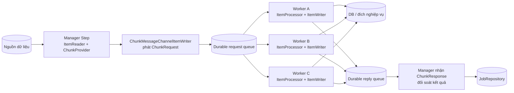

# Durable delivery cho chunk trong Spring Batch Remote Chunking

## 1. Bài toán: gửi chunk sang worker nhưng không được mất dữ liệu

Một job cần chuyển đổi 20 triệu giao dịch. Manager Spring Batch đọc nguồn và gom thành chunk 200 item, sau đó gửi các chunk sang nhiều worker qua RabbitMQ hoặc JMS. Một worker ghi dữ liệu đích thành công nhưng chết trước khi gửi phản hồi; một lần khác manager mất kết nối broker ngay sau khi gửi yêu cầu. **Chunk nào đã được xử lý? Chunk nào sẽ được gửi lại? Nếu gửi lại có ghi trùng không?**

Đây là vấn đề **durable delivery cho chunk** trong chương **Middleware remote chunking** của module `SPRING_BATCH_SCALING_OPERATIONS`. Mục tiêu không chỉ là tăng throughput mà là xử lý dữ liệu lớn, có thể phục hồi sau lỗi mạng, broker, worker và manager mà vẫn bảo đảm tính đúng đắn nghiệp vụ.

Sau bài này, bạn có thể:

- Giải thích vai trò của manager, worker, request/reply middleware và tại sao remote chunking cần truyền tin bền vững.
- Phân biệt **message durability**, **publisher confirm**, **consumer acknowledgment**, **business commit** và **processing completion**.
- Thiết kế **at-least-once delivery + idempotent handling** để chịu được gửi/nhận lặp, timeout, crash và restart.
- Cấu hình nền tảng RabbitMQ/JMS, retry, dead-letter queue, correlation, prefetch và backpressure phù hợp.
- Kiểm thử các khoảng lỗi cụ thể và quan sát trạng thái chunk, queue, worker, `JobRepository`, database.

> **Phạm vi kỹ thuật:** mô tả theo kiến trúc Spring Batch 5.x / Spring Batch Integration 5.x; tên API và thuộc tính có thể thay đổi theo phiên bản. Ví dụ RabbitMQ mang tính **minh họa cấu hình hạ tầng**, chưa phải ứng dụng remote chunking hoàn chỉnh để chạy ngay. Một số guarantee phụ thuộc broker, transaction manager, serializer, adapter và deployment thực tế.

## 2. Luồng manager → request queue → worker → reply queue → manager



Trong remote chunking:

1. **Manager** giữ `ItemReader`, đọc dữ liệu và tạo chunk. Manager gửi **`ChunkRequest`** chứa các item qua một `MessageChannel` được nối tới middleware.
2. **Request broker/queue** lưu và phân phối mỗi delivery cho một consumer tại một thời điểm. Nhiều worker cùng cạnh tranh nhận từ một queue giúp chia tải động.
3. **Worker** nhận chunk, chạy `ItemProcessor` và `ItemWriter`, rồi gửi **`ChunkResponse`** trở lại manager. Worker remote chunking thường **không tự chạy một Spring Batch Job/Step với JobRepository riêng** như worker của remote partitioning.
4. **Manager** nhận phản hồi, liên kết kết quả với chunk đã gửi và hoàn tất trạng thái Step. Các chi tiết `ChunkMessageChannelItemWriter` và việc chờ/tổng hợp reply do Spring Batch Integration đảm nhiệm theo cấu hình.

Remote chunking có **hai hướng truyền tin cần quan tâm**: request từ manager đến worker **và** reply từ worker về manager. Một request được giữ bền vững không đủ nếu reply thành công bị mất khiến manager không biết chunk đã hoàn tất. Spring Batch Reference nhấn mạnh rằng remote chunking cần middleware bền vững, giao nhận được bảo đảm và chỉ có **một consumer tại một thời điểm cho mỗi message delivery**. Điều này **không có nghĩa** mỗi chunk chỉ được xử lý một lần trong suốt vòng đời.

### Phân biệt với remote partitioning

| Khía cạnh | Remote chunking | Remote partitioning |
| --- | --- | --- |
| Nơi đọc dữ liệu | Manager đọc và đóng gói item | Mỗi worker Step đọc phần đầu vào được giao |
| Đơn vị gửi qua middleware | Chunk item và phản hồi xử lý | Lệnh thực thi một partition/StepExecution và trạng thái |
| Worker thực hiện | `ChunkProcessor` / `ItemProcessor` / `ItemWriter` | Worker Step với reader, processor, writer, checkpoint |
| Yêu cầu độ bền message | **Trọng yếu:** item đã rời manager phải đến được worker hoặc có cách tái tạo an toàn | Có thể phục hồi từ metadata worker StepExecution; giao thức phân phối khác |
| Điểm nghẽn hay gặp | Manager đọc/đóng gói, broker, serialization, worker, DB đích | Chia partition, reader/DB tại worker, tài nguyên dùng chung |

## 3. “Durable” và “đã xử lý” là bốn khái niệm khác nhau

| Mức bảo đảm | Tín hiệu | Điều **chưa được** bảo đảm |
| --- | --- | --- |
| **Persistent message + durable queue** | Broker được cấu hình lưu message và queue qua restart | Publisher chưa chắc biết broker đã lưu an toàn |
| **Publisher confirm** | Broker xác nhận đã nhận/xử lý publish theo chính sách queue | Worker đã tiêu thụ, đã commit dữ liệu hay manager đã nhận reply |
| **Consumer ACK** | Broker biết consumer cho phép xóa delivery khỏi queue | Dữ liệu DB và reply có nhất quán hay không, nếu ACK sai thời điểm |
| **Business commit** | Giao dịch ghi DB đích thành công | Reply đã đến manager hoặc consumer ACK đã được broker nhận |
| **Manager nhận/correlate reply** | Manager có thông tin xử lý chunk | Giao dịch/metadata cuối cùng của manager đã commit hoặc chống trùng nghiệp vụ qua restart |

**Durable delivery** là khả năng broker/transport duy trì và giao lại message trong các kịch bản lỗi đã xác định. Nó thường kéo theo **at-least-once delivery**: message có thể đến worker nhiều lần, nhất là khi mất ACK hoặc mất kết nối sau commit. **Exactly-once business effect** là vấn đề khác và cần giao dịch, idempotency, unique constraint hoặc cơ chế reconciliation ở hệ thống đích.

Để đạt at-least-once đáng tin cậy, cần đồng thời xét độ bền khi **publish**, thời điểm **ACK**, khả năng **redelivery**, lưu **reply**, và tính đúng đắn của **database/side effect**. Không có một flag `durable=true` nào thay thế được toàn bộ thiết kế này.

## 4. Nhận dạng chunk và correlation qua middleware

Trong Spring Batch 5.2, `ChunkRequest<T>` có các thông tin như `sequence`, `items`, `jobId` và `StepContribution`. Các thông tin do framework dùng để phối hợp request/reply phải sống sót qua serialization, broker và header mapping. Khi tích hợp Spring Integration, cần giữ nguyên **correlation headers** mà aggregator dùng; adapter JMS/AMQP và message converter có thể có quy tắc map header khác nhau theo phiên bản.

Một **message contract** nên làm rõ:

| Trường/thông tin | Ý nghĩa | Quy tắc |
| --- | --- | --- |
| `jobId`, `sequence` trong `ChunkRequest` | Định danh/ngữ cảnh chunk trong một lần phối hợp của framework | Không tùy ý thay thế hoặc sửa trong adapter |
| `correlationId` và header hỗ trợ aggregation | Ghép reply về đúng request/group đang chờ | Được truyền qua cả hai chiều; không bị converter bỏ mất |
| `messageId` | Truy vết một message ở transport | Hữu ích cho observability, **chưa chắc** là khóa nghiệp vụ |
| `businessEventId` / `orderId` + `version` | Định danh hiệu ứng xử lý item tại đích | Ổn định qua retry/redelivery, kể cả khi message được đóng gói lại |
| `schemaVersion` | Hợp đồng serialize payload | Có chính sách tương thích khi rolling deploy manager/worker |

Ví dụ request `jobId=830, sequence=7` có 200 item. Broker có thể redeliver cùng `ChunkRequest`; manager cũng có thể phát lại công việc sau lỗi. **Không nên dùng duy nhất `jobId:sequence` làm khóa chống trùng nghiệp vụ lâu dài** nếu chunk có thể được đóng gói khác khi tạo JobInstance mới, đổi chunk size hoặc thay nguồn. Với giao dịch thanh toán, khóa phù hợp là `transactionId` (cộng phiên bản nghiệp vụ khi cần); với snapshot đơn hàng là `orderId + sourceVersion`.

Hai lưu ý khi vận hành:

- **Serialization:** item trong chunk phải được serialize/deserialize đúng phiên bản, kích thước message nằm trong giới hạn broker và worker. Không chuyển đối tượng chứa connection/session hoặc trạng thái chưa serializable.
- **Reply routing:** reply được gửi về đúng manager/JobExecution đang chờ; không dùng reply queue tạm không bền nếu muốn bảo vệ trước broker restart. Tuy vậy, queue reply bền **không tự phục hồi** trạng thái aggregator trong bộ nhớ khi manager process chết; cần thiết kế quy trình restart/reconciliation riêng.

## 5. RabbitMQ: điều kiện tối thiểu cho request/reply bền vững

RabbitMQ là một lựa chọn middleware cho remote chunking thông qua Spring Integration AMQP. Để triển khai với RabbitMQ, cần kiểm tra **từng lớp**.

### 5.1. Queue durable và message persistent

Queue **durable** còn tồn tại sau khi broker khởi động lại; message đánh dấu **persistent** được broker đưa qua cơ chế lưu bền vững theo loại queue. Để giảm nguy cơ mất message khi node lỗi, cân nhắc **quorum queue** và số node/replica phù hợp. Với queue thường, queue durable và persistent message vẫn có cửa sổ broker xác nhận chưa an toàn nếu không dùng **publisher confirms**.

Ví dụ topology Spring AMQP dưới đây tạo queue request, reply và dead-letter, cùng exchange/routing key. Đây là **cấu hình hạ tầng**, chưa kết nối các `MessageChannel` của Spring Batch Integration.

```java
import org.springframework.amqp.core.BindingBuilder;
import org.springframework.amqp.core.Declarables;
import org.springframework.amqp.core.DirectExchange;
import org.springframework.amqp.core.Queue;
import org.springframework.amqp.core.QueueBuilder;
import org.springframework.context.annotation.Bean;
import org.springframework.context.annotation.Configuration;

@Configuration
public class ChunkBrokerTopology {
    @Bean
    public Declarables remoteChunkingQueues() {
        DirectExchange exchange =
                new DirectExchange("batch.chunk.exchange", true, false);
        DirectExchange deadExchange =
                new DirectExchange("batch.chunk.dlx", true, false);

        Queue requests = QueueBuilder.durable("batch.chunk.requests")
                .withArgument("x-queue-type", "quorum")
                .deadLetterExchange("batch.chunk.dlx")
                .deadLetterRoutingKey("chunk.failed")
                .build();

        Queue replies = QueueBuilder.durable("batch.chunk.replies")
                .withArgument("x-queue-type", "quorum")
                .build();

        Queue deadLetters = QueueBuilder.durable("batch.chunk.dead")
                .withArgument("x-queue-type", "quorum")
                .build();

        return new Declarables(
                exchange, deadExchange, requests, replies, deadLetters,
                BindingBuilder.bind(requests).to(exchange).with("chunk.request"),
                BindingBuilder.bind(replies).to(exchange).with("chunk.reply"),
                BindingBuilder.bind(deadLetters).to(deadExchange).with("chunk.failed"));
    }
}
```

Để gửi request, outbound adapter phải publish vào `batch.chunk.exchange` với routing key `chunk.request`; worker publish reply theo `chunk.reply`. Các adapter inbound phải đọc đúng queue tương ứng. Đối với hệ thống hiện hữu, khai báo lại một queue với thuộc tính khác có thể bị broker từ chối; hãy quản lý topology qua hạ tầng/deployment nhất quán. Quorum queue cần cấu hình cụm và chính sách vận hành phù hợp; tạo `x-queue-type=quorum` trong một node đơn lẻ **không tự biến hệ thống thành HA**.

Trong Spring Boot có thể cấu hình client RabbitMQ như sau:

```yaml
spring:
  rabbitmq:
    publisher-confirm-type: correlated
    publisher-returns: true
    template:
      mandatory: true
    listener:
      simple:
        acknowledge-mode: manual
        prefetch: 5
        concurrency: 2
```

**Giải thích:** `publisher-confirm-type: correlated` hỗ trợ theo dõi publisher confirm; `publisher-returns` và `mandatory` giúp phát hiện publish không định tuyến tới queue. `acknowledge-mode: manual` giao quyền ACK cho consumer; `prefetch` giới hạn delivery chưa ACK mà consumer giữ.

**Cảnh báo cấu hình:** các thuộc tính `spring.rabbitmq.listener.simple.*` chủ yếu áp dụng cho listener container do Spring Boot cấu hình theo mô hình đó. **Spring Integration adapter/flow tự tạo hoặc được inject container khác có thể không nhận các giá trị này**. Hãy kiểm tra instance listener thực tế, cấu hình `acknowledgeMode`/prefetch trực tiếp nếu cần và quan sát hành vi sau khi khởi động.

### 5.2. Publisher confirms và returned/unroutable messages

Quy trình publish cần đạt được:

1. Gửi persistent request với thông tin correlation/id hợp lệ và routing key đúng.
2. Chờ hoặc xử lý bất đồng bộ **confirm** của broker theo cùng request; xác nhận success theo chính sách của loại queue.
3. Bắt **return** khi message không đến được queue dù exchange vẫn nhận publish. Publisher confirm có thể vẫn là ACK đối với message không routable nếu không kiểm tra return.
4. Khi kết quả gửi không rõ vì timeout/mất kết nối, ưu tiên chiến lược **phát lại có kiểm soát** + idempotency; tuyệt đối không suy ra “chưa gửi” chỉ vì client chưa nhận confirm.

Chú ý phân biệt:

- **Broker publisher ACK**: broker đã xử lý publish theo guarantee của queue.
- **Consumer ACK**: consumer đồng ý xóa delivery khỏi queue sau khi đã xử lý.
- **ChunkResponse**: worker trả về kết quả nghiệp vụ cho manager.

Ba tín hiệu này phục vụ ba mục tiêu khác nhau. Publisher confirm **không** xác nhận worker đã ghi DB; consumer ACK **không** thay thế một `ChunkResponse` hợp lệ.

### 5.3. Lựa chọn JMS

Với JMS, cần bảo đảm **persistent delivery mode**, queue/destination bền vững, cơ chế acknowledgment/session transaction thích hợp, xử lý redelivery và DLQ của broker. Một số cấu hình JMS có thể tham gia transaction với tài nguyên khác khi dùng transaction manager phù hợp, nhưng **không tự có transaction phân tán DB + JMS** chỉ vì bật `sessionTransacted`.

Đối với Spring Integration JMS, phải kiểm tra map các header `correlationId`, `sequenceNumber`, `sequenceSize` hoặc các header framework/version thực sự dùng; nếu chúng bị converter lọc, reply aggregator có thể không ghép được phản hồi. Khi dùng JMS 2.x hoặc Jakarta JMS, kiểm tra phiên bản Spring Integration/Spring Batch trước khi sao chép code từ tài liệu khác phiên bản.

## 6. ACK phải đến sau việc xử lý đã có thể phục hồi

Giả sử worker nhận request R. Thứ tự sau đây **không an toàn**:

```text
receive R -> ACK R -> ghi DB -> publish reply
                    |
             worker chết tại đây => request đã bị xóa, dữ liệu chưa ghi
```

Kịch bản tốt hơn là chỉ ACK sau khi kết quả đã được **commit** và đường phản hồi được bảo vệ:

```text
receive R
   -> validate + xử lý (idempotent)
   -> COMMIT dữ liệu đích
   -> publish reply bền vững, kiểm tra publisher confirm
   -> ACK request R
```

Đây là **thứ tự logic cần bảo vệ**, không phải đoạn code có thể chép nguyên vào mọi Spring Integration flow. Ở consumer thực, cần xác minh thời điểm listener container thực hiện ACK, nhất là khi `DirectChannel`, `ExecutorChannel`, xử lý bất đồng bộ, transaction boundary và exception channel được kết hợp. `AUTO` của Spring AMQP thường ACK khi **luồng xử lý đồng bộ hoàn tất thành công**; nếu adapter trả về trước khi DB/reply hoàn thành ở thread khác, ACK có thể đến quá sớm.

Ngay cả với thứ tự tốt hơn, vẫn có khoảng lỗi:

- **DB commit xong, worker chết trước ACK:** request được giao lại; writer phải chống ghi trùng.
- **Reply đã publish, worker chết trước ACK:** request có thể được xử lý lại và tạo thêm reply; manager phải xử lý tương quan/trùng an toàn theo cơ chế của framework.
- **DB commit xong nhưng publish reply thất bại:** request có thể được giao lại; worker cần gửi lại reply mà không lặp hiệu ứng nghiệp vụ.

Nếu ghi DB và xuất reply phải bền vững xuyên crash, có thể dùng **transactional outbox**: cùng transaction ghi kết quả nghiệp vụ và một record outbox mang reply cần phát. Một relay độc lập gửi outbox đến broker, theo dõi publisher confirm và đánh dấu đã gửi. Relay có thể gửi trùng khi crash, do đó manager vẫn cần xử lý reply idempotent. Nếu chỉ publish reply trực tiếp, phải kiểm soát ACK và retry để không xóa request trước khi reply được bảo đảm.

## 7. Bảng failure windows: mất message, lặp message và cách phục hồi

| Điểm lỗi | Chuyện có thể xảy ra | Thiết kế cần có |
| --- | --- | --- |
| Manager đọc chunk, crash **trước publish** | Chunk chưa đến broker; reader checkpoint có thể không khớp nếu thiết kế sai | Đồng bộ checkpoint và phát message phù hợp, hoặc có outbox/replay nguồn, kiểm thử restart |
| Publish thành công, **confirm mất trên đường về** | Manager không rõ broker đã nhận hay chưa; gửi lại tạo duplicate | Stable message/business IDs, retry có giới hạn, writer idempotent |
| Broker restart trước khi message được lưu an toàn | Request có thể mất ở cấu hình không đủ bền | Durable queue, persistent delivery, publisher confirms, cấu hình HA/replication phù hợp |
| Worker chết **trước DB commit và trước ACK** | Request không ACK, broker giao lại | Transaction rollback, consumer redelivery, lỗi được retry |
| Worker commit thành công, chết **trước ACK** | Request được giao lại; dữ liệu đã có | Unique key/UPSERT hoặc ledger, xử lý duplicate thành công an toàn |
| Worker commit thành công nhưng **reply bị mất** | Manager đợi vô hạn/timeout trong khi dữ liệu đã ghi | Reply queue bền, confirm, replay/reconciliation; timeout không có nghĩa chưa xử lý |
| Reply nhận được nhưng manager crash **trước cập nhật metadata** | Trạng thái trong bộ nhớ và `JobRepository` có thể lệch | Restart cùng JobInstance, kiểm tra trạng thái DB đích, idempotency và quy trình đối soát |
| Poison chunk luôn lỗi dữ liệu | NACK requeue liên tục làm nghẽn queue | Phân loại lỗi, retry giới hạn, DLQ và quy trình sửa/replay |
| Message không có route hợp lệ | Broker nhận publish nhưng không worker nào thấy request | Mandatory publish + returns, giám sát bindings/queue |

**Quan trọng:** transaction `JobRepository` của manager, transaction DB đích tại worker và transaction/message ACK của broker thường là **ba phạm vi khác nhau**. Chúng không tự commit nguyên tử cùng nhau. Nếu không dùng giao thức/transaction manager hỗ trợ nhất quán xuyên tài nguyên, hãy thiết kế để xử lý được việc cùng công việc lặp lại và có bước đối soát.

## 8. Idempotent ItemProcessor/ItemWriter: chống lặp ở lớp nghiệp vụ

Ví dụ worker nhận item `OrderEvent(eventId, accountId, points)`. Với một event đã xử lý, redelivery không được cộng điểm lần hai. Thay vì:

```sql
-- Không an toàn với redelivery:
UPDATE account_points
SET total_points = total_points + :points
WHERE account_id = :accountId;
```

hãy dùng **event ID ổn định**, lưu ledger có unique constraint và chỉ cộng điểm khi ghi nhận event mới thành công.

```sql
CREATE TABLE order_score_ledger (
    event_id       VARCHAR(128) PRIMARY KEY,
    account_id     BIGINT NOT NULL,
    points         BIGINT NOT NULL
);

CREATE TABLE account_points (
    account_id     BIGINT PRIMARY KEY,
    total_points   BIGINT NOT NULL DEFAULT 0
);

-- PostgreSQL: một câu SQL trong transaction của worker.
WITH newly_applied AS (
    INSERT INTO order_score_ledger (event_id, account_id, points)
    VALUES (:eventId, :accountId, :points)
    ON CONFLICT (event_id) DO NOTHING
    RETURNING account_id, points
)
INSERT INTO account_points (account_id, total_points)
SELECT account_id, points
FROM newly_applied
ON CONFLICT (account_id) DO UPDATE
SET total_points = account_points.total_points + EXCLUDED.total_points;
```

Nếu event đến lần đầu, CTE ghi ledger và cộng điểm. Nếu cùng `eventId` đến lần hai, `newly_applied` rỗng, nên không cộng thêm. Unique constraint trên database bảo vệ ngay cả khi hai worker chạy cùng lúc.

**Điều kiện của ví dụ:** `eventId` phải duy nhất theo **sự kiện nghiệp vụ bất biến**, không sinh lại UUID mỗi lần gửi message và không dựa hoàn toàn vào số thứ tự chunk. Nếu cùng `eventId` nhưng payload (`accountId`, `points`) khác, `ON CONFLICT DO NOTHING` che giấu bất nhất: cần kiểm tra/audit mismatch và báo lỗi. Thiết kế nhiều SQL statement cần đặt chúng trong **cùng DB transaction**; câu CTE trên cho thấy cách thực hiện atomic ở một PostgreSQL statement nhưng không tự giải quyết side effect bên ngoài DB.

Processor cũng nên là **phép biến đổi xác định** từ item và phiên bản rule đã cố định. Nếu processor gọi API thanh toán, gửi email hoặc dùng `Instant.now()` để quyết định kết quả, chỉ idempotency của DB writer chưa đủ. API ngoài cần `Idempotency-Key`, outbox/inbox hoặc cơ chế chống lặp tương ứng.

## 9. Retry, requeue, DLQ và poison message

Không nên xử lý mọi lỗi bằng `NACK(requeue=true)` không giới hạn. Phân biệt:

| Loại lỗi | Ví dụ | Xử lý |
| --- | --- | --- |
| **Tạm thời** | DB connection timeout, broker chưa sẵn sàng, HTTP 503 | Retry giới hạn và backoff/jitter; giữ request có thể giao lại |
| **Lỗi nghiệp vụ không phục hồi bằng retry** | Item thiếu trường bắt buộc, enum không hợp lệ, dữ liệu ngoài miền | Reject/route DLQ hoặc quarantine, ghi đủ ngữ cảnh để sửa |
| **Không xác định kết quả** | Timeout sau khi DB/API đã có thể commit | Tra cứu trạng thái bằng business ID trước khi replay hoặc retry idempotent |
| **Hạ tầng bão hòa** | DB lock wait cao, API 429, quá nhiều unacked | Giảm concurrency/prefetch, backpressure; tránh tạo retry storm |

DLQ là nơi **cất giữ để điều tra**, không phải cơ chế tự động tuyên bố chunk đã xử lý xong. Khi một request vào DLQ, manager có thể vẫn chờ reply. Cần quy trình vận hành quyết định: sửa và replay an toàn, gửi phản hồi lỗi thích hợp cho manager, hay fail job để restart đúng cách. Không được âm thầm loại chunk khỏi luồng nghiệp vụ chỉ vì queue đã hết retry.

Với RabbitMQ, dead-letter có thể do reject/nack không requeue, TTL, queue limit hoặc delivery limit, tùy loại queue và policy. **Độ bền của đường DLQ cũng phải được kiểm chứng**: một số cấu hình dead lettering có cơ chế chuyển message không đủ mạnh khi broker lỗi; với quorum queue có thể xem xét at-least-once dead lettering theo phiên bản/policy được hỗ trợ. Đừng cho rằng cứ khai báo DLX thì mọi message đã chết được lưu không thể mất.

### Định nghĩa giới hạn retry thực tế

Chọn số lần retry dựa vào time budget, độ hồi phục của lỗi và ảnh hưởng tải. Ví dụ một lỗi DB tạm thời có thể thử 3 lần với backoff 1 s, 2 s, 4 s; nhưng nếu DB đã quá tải toàn cục, mỗi worker cùng retry sẽ tăng áp lực lên DB. Cần giới hạn tổng concurrency, số request chưa ACK và lưu dấu số lần giao lại để nhận diện poison message.

## 10. Backpressure, prefetch và khả năng chịu tải

Remote chunking giúp scale phần processor/writer nhưng **manager vẫn là nơi đọc và chia chunk**. Broker trở thành bộ đệm giữa tốc độ đọc và tốc độ xử lý. Nếu manager gửi nhanh hơn worker xử lý lâu dài, backlog sẽ tăng, tăng dung lượng disk/RAM, độ trễ và thời gian hồi phục khi lỗi.

| Tham số | Ảnh hưởng | Quyết định khi tuning |
| --- | --- | --- |
| `chunkSize` | Số item trong mỗi request; ảnh hưởng kích thước payload và số lượt publish | Tính từ chi phí serialization, độ trễ, transaction và kích thước message tối đa |
| Worker concurrency | Số request có thể được xử lý đồng thời | Theo CPU, RAM, DB connection, downstream quota |
| `prefetch` | Số delivery có thể được giữ chưa ACK trước khi broker chờ | Đủ nuôi worker, không quá lớn gây giữ nhiều chunk tại consumer |
| Broker queue depth | Số request đang đợi | Giám sát backlog, quyết định khi nào giảm tốc manager |
| Unacked count | Số message đã giao cho consumer nhưng chưa ACK | Phát hiện worker kẹt, xử lý chậm, ACK sai |
| Publisher confirm latency | Độ trễ broker xác nhận nhận message | Đo broker persistence/replication, kết nối và disk |
| Reply latency / outstanding requests | Thời gian từ gửi chunk đến nhận `ChunkResponse` | Quyết định timeout và giới hạn số chunk đang bay |

Ví dụ: 4 worker, mỗi worker xử lý khoảng 2 chunk/s, manager phát 15 chunk/s. Trong 10 phút, queue request có thể tăng khoảng `(15 - 8) × 600 = 4.200 chunk` nếu không có giới hạn hay biến động khác. Tăng prefetch không làm worker tự xử lý nhanh hơn; nó chỉ khiến nhiều delivery được giữ tại worker và có thể làm chia tải kém công bằng.

Đối với workload lớn, **đo end-to-end throughput theo chunk đã xử lý/commit và reply đã được manager xác nhận**, không chỉ số message publish. Đánh giá CPU của manager (serialization, reader), CPU của worker (processor), DB lock/connection, broker IO và mạng. Nếu manager đọc là nút thắt thì remote chunking có thể không cải thiện nhiều; cân nhắc partitioning để phân tán reader khi dữ liệu chia được thành vùng độc lập.

## 11. Restart job và điều gì xảy ra khi manager chết?

Khi worker chết nhưng manager còn sống, broker redelivery có thể cho worker khác xử lý request, miễn là ACK/transaction cấu hình đúng. Khi **manager chết**, tình hình phức tạp hơn: request/reply bền vững giúp message không biến mất ở broker, nhưng **trạng thái aggregator, các request đang chờ, và checkpoint của manager có thể có phần nằm trong bộ nhớ hoặc metadata** tùy implementation và phiên bản.

Vì vậy, đừng mặc định “queue durable + Spring Batch JobRepository” tự suy ra một đường resume hoàn hảo với mọi request cũ:

1. Xác định `JobInstance`, `JobExecution`, `StepExecution` và metadata của manager trước khi restart.
2. Kiểm tra request còn trong broker, reply chưa tiêu thụ và dữ liệu worker đã commit ở đích.
3. Xem xét cơ chế correlation/reply aggregation khi một manager/JobExecution mới lên; reply đến muộn phải được xử lý có chủ đích.
4. Restart **cùng JobInstance** khi đúng chính sách; tránh tạo JobParameters định danh mới rồi vô tình xử lý lại toàn nguồn.
5. Nếu chunk được phát lại, dựa vào business key và writer idempotent để tránh nhân đôi hiệu ứng; đối soát số item/transaction.
6. Nếu thất lạc trạng thái dispatch, phải có runbook reconciliation/replay với dữ liệu nguồn và đích. Outbox hoặc bảng tracking chunk có thể cần thiết tùy mức guarantee yêu cầu.

Lưu ý: `JobRepository` là nguồn metadata Spring Batch nhưng **không phải broker**, còn broker là nguồn message in-flight nhưng **không phải sổ cái nghiệp vụ**. Thiết kế đúng cần phối hợp cả ba: JobRepository, middleware và dữ liệu đích.

## 12. Quan sát và cảnh báo khi vận hành

Để đo nút thắt và chứng minh hệ thống thực sự bền vững, hãy theo dõi:

- **Manager:** số chunk phát, confirm thành công/thất bại/timeout, returned/unroutable, outstanding requests, số reply ghép được, số reply trùng/đến muộn, thời gian hoàn thành Step.
- **Broker:** request/reply/DLQ depth, ready/unacked, redelivery, consumer count, publisher confirm latency, disk free, flow control, số lần connection/channel reconnect.
- **Worker:** chunk processing latency p50/p95/p99, throughput commit, retry count, DB rollback, lỗi serialization/schema, số event bị dedupe, tỷ lệ poison message.
- **Database:** unique-conflict, lock wait, active connections, transaction latency, số business ID đã xử lý và dấu hiệu dữ liệu bất nhất.
- **JobRepository:** trạng thái `JobExecution` và `StepExecution`, read/write/rollback counts; đối chiếu với ledger hoặc bảng đích thay vì tin riêng các counter.

Thiết lập cảnh báo theo **tốc độ hoàn thành hữu ích**: queue backlog tăng liên tục, unacked đứng yên, reply chậm vượt ngưỡng, manager còn chạy nhưng không nhận reply, retry/DLQ tăng, hoặc dữ liệu đích không đối soát được. Đưa `jobExecutionId`, `stepName`, `chunkSequence` và message ID vào log/tracing; tránh tạo metric label theo từng transaction ID vì cardinality cao.

## 13. Kịch bản kiểm thử failure injection

| Kịch bản | Cách kiểm tra | Kết quả đúng kỳ vọng |
| --- | --- | --- |
| Broker restart khi request đang chờ | Dừng rồi khởi động lại broker theo runbook | Message được bảo toàn trong giới hạn cấu hình durability, worker nhận tiếp |
| Publish đúng queue nhưng manager không nhận confirm | Cắt kết nối sau khi broker nhận publish | Hệ thống có thể gửi lại an toàn, không nhân đôi kết quả nghiệp vụ |
| Worker chết trước DB commit | Kill worker sau khi nhận, trước commit | Transaction rollback; request được redeliver |
| Worker chết ngay sau DB commit trước ACK | Kill worker ở khoảng lỗi chủ động | Request có thể redeliver; ledger/unique key chặn ghi trùng |
| Reply không được broker ghi bền | Gây lỗi publish reply/confirm | Không ACK request quá sớm; có retry/outbox/reconciliation |
| Reply đến muộn hoặc đến hai lần | Đổi thời gian xử lý, phát lại request | Correlation đúng, manager không hoàn tất nhầm chunk |
| Manager chết khi có nhiều chunk in-flight | Kill rồi restart đúng JobInstance | Có runbook đối soát in-flight, không mất/ghi trùng business event |
| Poison chunk | Gửi item không thể deserialize/validate | Retry giới hạn, DLQ/quarantine, manager nhận trạng thái phù hợp hoặc job fail |
| Vượt sức chứa DB | Tăng worker/prefetch | Thấy throughput bão hòa, retry/lock tăng; giới hạn concurrency để phục hồi |

Kiểm thử cần ghi **số message được gửi/ACK/redeliver**, số kết quả ghi ở DB, số duplicate được chặn và trạng thái manager. Test chỉ khởi động lại broker thành công **chưa đủ** chứng minh đúng trong các khoảng lỗi giữa commit và ACK. Khi thực hiện fault injection trên môi trường thực, hãy dùng dataset thử và cơ chế dọn/đối soát được kiểm soát.

## 14. Checklist trước khi chạy production

- [ ] Request **và reply** có queue/destination bền vững phù hợp chính sách HA của broker.
- [ ] Message quan trọng dùng delivery mode/persistence thích hợp; có **publisher confirms** và kiểm tra unroutable/returns.
- [ ] Consumer chỉ ACK khi xử lý/commit và bảo vệ reply hoàn tất theo thiết kế; xác nhận hành vi thật của Spring Integration adapter.
- [ ] Có idempotency key **nghiệp vụ** và unique constraint/ledger ở đích để chịu được redelivery.
- [ ] Giữ nguyên correlation/header cần thiết qua serialization, broker, adapter và rolling deploy.
- [ ] Retry phân biệt lỗi tạm thời, lỗi dữ liệu và kết quả không xác định; có backoff, hạn mức và DLQ.
- [ ] Có runbook cho chunk vào DLQ, reply mất, manager restart và request/reply tồn đọng.
- [ ] Đo queue depth, unacked, duplicate count, reply latency, worker throughput và dữ liệu đã commit thực tế.
- [ ] Chọn chunk size, concurrency, prefetch và số broker node theo CPU, disk, network, DB connection và khả năng phục hồi.
- [ ] Đã thử crash trước/sau DB commit, trước/sau ACK, publisher confirm timeout và manager crash; xác nhận không sai dữ liệu đích.

## 15. Bài tập tự kiểm tra

**Bài tập 1 — Phân biệt ba ACK.** Manager gửi request R, RabbitMQ trả publisher confirm ACK. Worker chưa hề nhận request. Có thể đánh dấu chunk hoàn thành không? Nêu thêm điều kiện để manager xác nhận kết quả nghiệp vụ.

**Bài tập 2 — Chết sau commit.** Worker đã cộng 100 điểm cho giao dịch T, nhưng chết trước khi ACK. Broker giao lại T cho worker khác. Viết thiết kế khóa/ledger để tổng điểm vẫn chỉ tăng 100, và giải thích tại sao một biến `HashSet` trong RAM worker không đủ.

**Bài tập 3 — Phát hiện backlog.** Manager publish 24 chunk/s, 6 worker mỗi worker xử lý 3 chunk/s. Giả sử tốc độ giữ nguyên, sau 5 phút backlog tăng bao nhiêu chunk? Bạn sẽ kiểm tra chỉ số nào trước khi tăng số worker từ 6 lên 10?

**Bài tập 4 — Reply đến muộn.** Manager restart khi còn 40 chunk chưa có reply. Một worker đã commit dữ liệu và phát reply sang queue bền. Bạn sẽ đối soát `JobRepository`, message và bảng đích như thế nào để tránh vừa mất item vừa ghi trùng? Vì sao không nên lập tức xóa các reply “cũ” mà chưa xác minh?

## 16. Ghi nhớ

Durable delivery trong remote chunking là **bài toán toàn tuyến**: manager phát chunk, broker lưu và phân phối, worker commit, gửi reply và ACK, manager nhận/correlate kết quả rồi cập nhật tiến độ. Queue durable và persistent message chỉ là điểm khởi đầu; cần publisher confirms, ACK đúng thời điểm, reply bền vững, retry/DLQ và **idempotency tại hệ thống đích**. Hãy thiết kế cho tình huống **một message có thể đến nhiều lần và một kết quả có thể không được xác nhận đúng lúc**. Khi đó có thể mở rộng qua nhiều worker mà vẫn restart, đối soát và vận hành an toàn.

**Tài liệu tham khảo chính thức:**

- [Spring Batch 5.2 — Scaling and Parallel Processing: Remote Chunking](https://docs.spring.io/spring-batch/reference/5.2/scalability.html)
- [Spring Batch 5.2 — Spring Batch Integration: Remote Chunking](https://docs.spring.io/spring-batch/reference/5.2/spring-batch-integration/sub-elements.html)
- [Spring Batch 5.2 — `ChunkRequest` API](https://www.springframework.org/spring-batch/docs/5.2.3/api/org/springframework/batch/integration/chunk/ChunkRequest.html)
- [RabbitMQ — Consumer Acknowledgements and Publisher Confirms](https://www.rabbitmq.com/docs/confirms)
- [RabbitMQ — Quorum Queues](https://www.rabbitmq.com/docs/quorum-queues)
- [Spring Integration — AMQP Inbound Channel Adapter](https://docs.spring.io/spring-integration/reference/amqp/inbound-channel-adapter.html)
