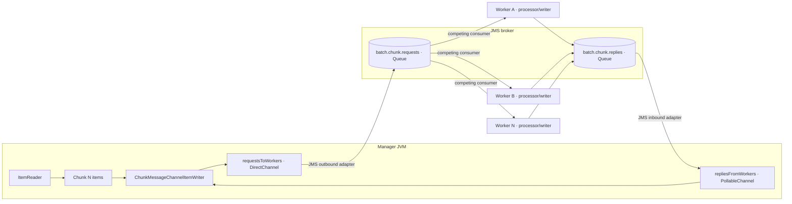

# JMS làm kênh remote chunking trong Spring Batch

## 1. Bài toán và mục tiêu

Trong một Spring Batch job thông thường, một `Step` đọc, xử lý và ghi dữ liệu ở cùng tiến trình. Với **remote chunking**, **manager** đọc và gom item thành chunk, sau đó gửi các chunk đến **worker** ở tiến trình hoặc máy khác để xử lý và ghi kết quả. **JMS (Java Message Service)** là một middleware có thể chuyển những chunk này giữa các JVM thông qua message broker.

Ví dụ: hệ thống cần xử lý 2 triệu đơn hàng. Đọc ID từ database tương đối nhanh, nhưng kiểm tra quy tắc nghiệp vụ và ghi kết quả tốn nhiều CPU/I/O. Manager có thể gửi từng chunk 100 ID đến JMS queue; nhiều worker cạnh tranh nhận các chunk và trả kết quả về manager.

Bài học thuộc chương **Middleware remote chunking** của module `SPRING_BATCH_SCALING_OPERATIONS`, với trọng tâm mở rộng Spring Batch cho workload dữ liệu lớn, đo bottleneck, giữ thread safety, retry/restart và lựa chọn kiến trúc theo tài nguyên thực tế.

Sau bài này, bạn có thể:

- Giải thích hai chiều request/reply giữa manager và worker qua JMS.
- Nối `RemoteChunkingManagerStepBuilder` và `RemoteChunkingWorkerBuilder` vào Spring Integration JMS.
- Phân biệt JMS broker queue với `MessageChannel` nội bộ, quản lý correlation và thời gian chờ phản hồi.
- Thiết kế giới hạn tài nguyên, retry/redelivery, idempotency, restart và quan sát.
- Biết khi nào remote chunking phù hợp hơn remote partitioning.

> **Phiên bản:** các ví dụ Java dành cho **Spring Batch 5.2.x**, Spring Framework 6.x, Spring Integration 6.x, Java 17+ và JMS API trong `jakarta.jms`. Spring Batch 6 và Spring Integration 7 có những thay đổi cần đối chiếu khi nâng cấp.

## 2. Kiến trúc request/reply



Một chunk đi qua các bước:

1. Manager đọc item và gom thành chunk, ví dụ 100 ID. Khi gọi writer đặc biệt `ChunkMessageChannelItemWriter`, dữ liệu được đóng gói thành `ChunkRequest`.
2. Spring Integration outbound adapter đưa request từ `MessageChannel` vào **JMS request queue**.
3. Broker giao mỗi lần delivery cho một consumer trong nhóm worker; worker giải mã request, chạy `ItemProcessor` (nếu có) và `ItemWriter`.
4. Worker tạo `ChunkResponse` với trạng thái/thống kê xử lý rồi gửi lên **JMS reply queue**.
5. Spring Integration inbound adapter đưa reply trở lại kênh manager. Manager đối chiếu, thu thập kết quả, quyết định `Step` hoàn thành hay thất bại.

Manager có thể gửi nhiều chunk trong khi các chunk trước vẫn đang chờ worker. **Gửi hết request không đồng nghĩa job thành công**: phản hồi từ worker và trạng thái thực thi vẫn phải được đánh giá.

### Các tầng dễ nhầm

| Khái niệm | Nằm ở đâu | Chức năng |
| --- | --- | --- |
| `DirectChannel` | Bên trong một ứng dụng Spring Integration | Chuyển message trực tiếp đến endpoint đăng ký, thường đồng bộ |
| `QueueChannel` | Bên trong một ứng dụng | `PollableChannel` để consumer trong ứng dụng lấy message; mặc định có thể nằm trong RAM |
| **JMS queue** | Trong broker | Truyền/lưu message giữa nhiều tiến trình; hỗ trợ persistence và redelivery theo cấu hình |
| `ChunkRequest` | Payload của request | Chứa chunk item, sequence và thông tin liên quan tới execution |
| `ChunkResponse` | Payload của reply | Chứa kết quả/ lỗi và `StepContribution` của chunk |

Một `QueueChannel` in-memory **không có độ bền tương đương JMS queue**. Nếu inbound adapter đã ACK reply trên broker nhưng manager crash trước khi lấy reply trong RAM, phản hồi có thể bị mất. Vì vậy, cấu hình dùng RAM ở phần ví dụ chỉ là bước đầu để hiểu luồng dữ liệu.

## 3. Remote chunking và remote partitioning

| Tiêu chí | Remote chunking | Remote partitioning |
| --- | --- | --- |
| Ai đọc dữ liệu nguồn? | **Manager** | Thông thường **worker** tự đọc partition được giao |
| Message chứa gì? | Các **item thực tế** trong chunk | Yêu cầu chạy worker step và thông tin partition/execution |
| Worker làm gì? | Process/write các chunk | Chạy một `Step` trên miền dữ liệu riêng |
| Cân bằng tải | Request queue phân phối chunk theo worker rảnh | Phụ thuộc cách chia partition và thời lượng từng partition |
| Nút thắt phổ biến | Manager reader, serialize, broker/network, DB ghi | Khả năng khai thác song song từ nguồn dữ liệu |
| Hợp lý khi | Đọc nhanh nhưng xử lý/ghi tốn tài nguyên | Dữ liệu chia được theo ID, file, range hoặc shard |

Nếu manager reader vốn chậm hoặc serial hóa payload quá lớn, tăng số worker chưa chắc cải thiện throughput. Nếu các worker có thể tự đọc từng vùng dữ liệu độc lập, remote partitioning thường giảm lượng dữ liệu phải gửi qua middleware.

## 4. JMS broker, hợp đồng message và dependency

### 4.1. Hai JMS queue

```text
batch.chunk.requests   # manager -> workers
batch.chunk.replies    # workers -> manager
```

Hai destination trên là **queue**. Đối với request, tránh dùng JMS topic với nhiều subscriber vì mỗi subscriber có thể nhận bản sao cùng chunk. Broker phải được cấu hình giới hạn dung lượng, queue durability, persistent delivery, ACL, TLS, retry/backoff và dead-letter queue (DLQ) phù hợp.

Với queue, một request được trao cho **một consumer trong một lần delivery**, nhưng có thể được **redeliver** nếu listener rollback, crash hoặc broker không nhận được ACK. JMS không bảo đảm logic nghiệp vụ chỉ chạy duy nhất một lần trong mọi tình huống.

### 4.2. Dependency tham khảo (Gradle)

```groovy
dependencies {
    implementation "org.springframework.batch:spring-batch-core"
    implementation "org.springframework.batch:spring-batch-integration"
    implementation "org.springframework.integration:spring-integration-core"
    implementation "org.springframework.integration:spring-integration-jms"
    implementation "org.springframework.boot:spring-boot-starter-jdbc"
    implementation "org.springframework.boot:spring-boot-starter-artemis"
}
```

Đây là một tổ hợp dùng **Spring Boot + ActiveMQ Artemis**; các version cần được quản lý bằng BOM tương thích. `spring-boot-starter-artemis` là ví dụ implementation JMS, có thể thay bằng client/broker tương đương.

Manager cần Spring Batch `JobRepository`, transaction manager, job launcher và nguồn item. Worker remote chunking **không nhất thiết cần `JobRepository` hay một Batch Job riêng**; nó là ứng dụng Spring Integration nhận/ xử lý/ trả message.

### 4.3. Tương quan phản hồi

Spring Batch Integration cung cấp `ChunkRequest`/`ChunkResponse` và các builder quản lý trao đổi chunk. Khi đi qua JMS adapter, phải giữ các header framework dùng để đối chiếu phản hồi:

- `correlationId` là header tổng quát của **Spring Integration**, được dùng khi gom/tương quan message; không tự đánh đồng với JMS `JMSCorrelationID`.
- `sequenceNumber` và `sequenceSize` có thể cần cho thành phần quản lý tập message.
- `ChunkRequest` và `ChunkResponse` có sequence/identity riêng trong payload do Spring Batch quản lý.

Trong Spring Integration **6.x**, `DefaultJmsHeaderMapper` thông thường map các JMS user properties phù hợp. Với **Spring Integration 7.0.6+**, tài liệu Spring Batch nhấn mạnh cấu hình allowlist inbound cho `correlationId`, `sequenceNumber`, `sequenceSize` (hoặc `"*"` khi chấp nhận tất cả). Nếu các header này bị lọc, manager có thể không tổng hợp được reply và gặp lỗi `Null correlation not allowed`. Hãy kiểm tra chính xác version của mapper khi cấu hình JMS inbound replies.

### 4.4. Chuyển đổi payload an toàn

Spring Batch 5.x định nghĩa `ChunkRequest` và `ChunkResponse` là `Serializable`. Demo có thể vận chuyển dưới dạng JMS `ObjectMessage` nếu tất cả item được serialize được. Trong production, cần cân nhắc **codec có schema/version rõ ràng** và allowlist khi deserialize; manager/worker phải dùng hợp đồng payload tương thích. Java deserialization không giới hạn class từ broker không đáng tin tạo rủi ro bảo mật, và thay đổi class giữa các lần deploy có thể làm message cũ không đọc được.

## 5. Ví dụ Spring Batch 5.2: manager đọc ID, worker cập nhật DB

Giả định bảng `orders(id BIGINT PRIMARY KEY, processed BOOLEAN)` có ID tăng dần. Manager đọc ID trong miền đã chốt; worker cập nhật `processed`. Để minh họa restart, `endExclusive` là identifying job parameter và dữ liệu nguồn trong miền này được giữ ổn định trong một `JobInstance`.

### 5.1. Kết nối broker

Trên cả manager và worker (trong ví dụ ActiveMQ Artemis):

```yaml
spring:
  artemis:
    mode: native
    broker-url: tcp://localhost:61616
    user: ${JMS_USER}
    password: ${JMS_PASSWORD}
```

Mỗi tiến trình phải truy cập được cùng broker. Nếu worker ở máy khác, thay `localhost` bằng địa chỉ broker thích hợp. Hai queue phải tồn tại, hoặc được tạo bởi cơ chế provisioning được kiểm soát. Mật khẩu được cấp từ môi trường/secret store.

### 5.2. Manager: tạo request channel, reply channel và `Step`

Các import chính:

```java
import jakarta.jms.ConnectionFactory;
import javax.sql.DataSource;

import org.springframework.batch.core.Job;
import org.springframework.batch.core.configuration.annotation.StepScope;
import org.springframework.batch.core.job.builder.JobBuilder;
import org.springframework.batch.core.repository.JobRepository;
import org.springframework.batch.core.step.tasklet.TaskletStep;
import org.springframework.batch.integration.chunk.RemoteChunkingManagerStepBuilderFactory;
import org.springframework.batch.integration.config.annotation.EnableBatchIntegration;
import org.springframework.batch.item.database.JdbcCursorItemReader;
import org.springframework.batch.item.database.builder.JdbcCursorItemReaderBuilder;
import org.springframework.beans.factory.annotation.Qualifier;
import org.springframework.beans.factory.annotation.Value;
import org.springframework.context.annotation.Bean;
import org.springframework.context.annotation.Configuration;
import org.springframework.integration.channel.DirectChannel;
import org.springframework.integration.channel.QueueChannel;
import org.springframework.integration.dsl.IntegrationFlow;
import org.springframework.integration.jms.dsl.Jms;
```

```java
@Configuration
@EnableBatchIntegration
public class RemoteChunkManagerConfig {
    static final String REQUESTS = "batch.chunk.requests";
    static final String REPLIES  = "batch.chunk.replies";

    @Bean
    public DirectChannel requestsToWorkers() {
        return new DirectChannel();
    }

    @Bean
    public QueueChannel repliesFromWorkers() {
        return new QueueChannel(1000); // Demo: lưu tại RAM
    }

    @Bean
    public IntegrationFlow managerToJms(
            ConnectionFactory connectionFactory,
            @Qualifier("requestsToWorkers") DirectChannel requests) {
        return IntegrationFlow.from(requests)
                .handle(Jms.outboundAdapter(connectionFactory)
                        .destination(REQUESTS))
                .get();
    }

    @Bean
    public IntegrationFlow jmsToManager(
            ConnectionFactory connectionFactory,
            @Qualifier("repliesFromWorkers") QueueChannel replies) {
        return IntegrationFlow
                .from(Jms.messageDrivenChannelAdapter(connectionFactory)
                        .destination(REPLIES))
                .channel(replies)
                .get();
    }

    @Bean
    @StepScope
    public JdbcCursorItemReader<Long> orderIdReader(
            DataSource dataSource,
            @Value("#{jobParameters['endExclusive']}") Long endExclusive) {
        return new JdbcCursorItemReaderBuilder<Long>()
                .name("orderIdReader")
                .dataSource(dataSource)
                .sql("SELECT id FROM orders " +
                     "WHERE id >= 1 AND id < ? ORDER BY id")
                .preparedStatementSetter(ps -> ps.setLong(1, endExclusive))
                .rowMapper((rs, rowNum) -> rs.getLong(1))
                .saveState(true)
                .build();
    }

    @Bean
    public TaskletStep managerStep(
            RemoteChunkingManagerStepBuilderFactory factory,
            JdbcCursorItemReader<Long> orderIdReader,
            @Qualifier("requestsToWorkers") DirectChannel requests,
            @Qualifier("repliesFromWorkers") QueueChannel replies) {
        return factory.<Long, Long>get("managerStep")
                .chunk(100)
                .reader(orderIdReader)
                .outputChannel(requests)
                .inputChannel(replies)
                .build();
    }

    @Bean
    public Job processOrders(
            JobRepository jobRepository,
            @Qualifier("managerStep") TaskletStep managerStep) {
        return new JobBuilder("processOrders", jobRepository)
                .start(managerStep)
                .build();
    }
}
```

`RemoteChunkingManagerStepBuilderFactory` dựng một `TaskletStep` dùng `ChunkMessageChannelItemWriter`. `outputChannel` trỏ đến đường đi request, `inputChannel` trỏ đến kênh có thể poll reply. `chunk(100)` nghĩa là 100 ID mỗi message (trừ chunk cuối), **không phải 100 worker**.

`@StepScope` cấp reader có trạng thái riêng theo execution và đọc `endExclusive` tại runtime. Tránh truy vấn nguồn theo `WHERE processed = FALSE` nếu worker đồng thời đổi `processed`, vì tập đang đọc có thể thay đổi; ví dụ đọc theo ID đã chốt. Manager cần cấu hình Batch metadata/transaction manager từ Spring Boot hoặc cấu hình Spring Batch của ứng dụng. `QueueChannel` in-memory chỉ có ý nghĩa minh họa; phần 7 nêu yêu cầu production.

### 5.3. Worker: nhận request, xử lý và trả reply

Worker chạy trong **ứng dụng riêng**, có thể triển khai nhiều instance cùng subscribe request queue. Các import chính:

```java
import jakarta.jms.ConnectionFactory;
import java.util.List;

import org.springframework.batch.integration.chunk.RemoteChunkingWorkerBuilder;
import org.springframework.batch.item.ItemWriter;
import org.springframework.beans.factory.annotation.Qualifier;
import org.springframework.context.annotation.Bean;
import org.springframework.context.annotation.Configuration;
import org.springframework.integration.channel.DirectChannel;
import org.springframework.integration.config.EnableIntegration;
import org.springframework.integration.dsl.IntegrationFlow;
import org.springframework.integration.jms.dsl.Jms;
import org.springframework.jdbc.core.JdbcTemplate;
import org.springframework.transaction.PlatformTransactionManager;
import org.springframework.transaction.support.TransactionTemplate;
```

```java
@Configuration
@EnableIntegration
public class RemoteChunkWorkerConfig {
    static final String REQUESTS = "batch.chunk.requests";
    static final String REPLIES  = "batch.chunk.replies";

    @Bean
    public DirectChannel incomingRequests() {
        return new DirectChannel();
    }

    @Bean
    public DirectChannel outgoingReplies() {
        return new DirectChannel();
    }

    @Bean
    public IntegrationFlow jmsToWorker(
            ConnectionFactory connectionFactory,
            @Qualifier("incomingRequests") DirectChannel requests) {
        return IntegrationFlow
                .from(Jms.messageDrivenChannelAdapter(connectionFactory)
                        .destination(REQUESTS))
                .channel(requests)
                .get();
    }

    @Bean
    public TransactionTemplate workerTransaction(
            PlatformTransactionManager transactionManager) {
        return new TransactionTemplate(transactionManager);
    }

    @Bean
    public ItemWriter<Long> orderWriter(
            JdbcTemplate jdbcTemplate,
            TransactionTemplate workerTransaction) {
        return chunk -> workerTransaction.executeWithoutResult(status -> {
            List<Object[]> args = chunk.getItems().stream()
                    .map(id -> new Object[] {id})
                    .toList();
            jdbcTemplate.batchUpdate(
                    "UPDATE orders SET processed = TRUE " +
                    "WHERE id = ? AND processed = FALSE",
                    args);
        });
    }

    @Bean
    public IntegrationFlow chunkWorkerFlow(
            @Qualifier("incomingRequests") DirectChannel requests,
            @Qualifier("outgoingReplies") DirectChannel replies,
            ItemWriter<Long> orderWriter) {
        return new RemoteChunkingWorkerBuilder<Long, Long>()
                .itemWriter(orderWriter)
                .inputChannel(requests)
                .outputChannel(replies)
                .build();
    }

    @Bean
    public IntegrationFlow workerToJms(
            ConnectionFactory connectionFactory,
            @Qualifier("outgoingReplies") DirectChannel replies) {
        return IntegrationFlow.from(replies)
                .handle(Jms.outboundAdapter(connectionFactory)
                        .destination(REPLIES))
                .get();
    }
}
```

`RemoteChunkingWorkerBuilder` tạo một `IntegrationFlow` với handler xử lý `ChunkRequest`, gọi processor/writer và trả `ChunkResponse`. Khi không truyền `itemProcessor(...)`, worker dùng processor pass-through. Nếu cần xử lý CPU nặng trước khi ghi, có thể thêm processor, nhưng phải đảm bảo state trong các bean sử dụng đồng thời là thread-safe.

`orderWriter` dùng một DB transaction cho toàn bộ danh sách ID trong chunk. `JdbcTemplate` hỗ trợ sử dụng đồng thời sau khi cấu hình đúng; tránh giữ `currentChunk`, counter hoặc buffer mutable trong writer singleton. Trong demo, `AND processed = FALSE` làm thao tác đặt cờ có tính idempotent tương đối: việc nhận lại cùng ID không cập nhật lần thứ hai. Nhưng với thu phí, cộng số tiền, gọi API hoặc gửi email, phải có idempotency key/ledger chuyên dụng.

Với cấu hình `DirectChannel`, các bước xử lý bên worker chạy đồng bộ trong thread listener theo luồng message của demo. Tăng số worker instance hoặc số listener consumer (nếu đã được kiểm tra thread safety) để tăng mức đồng thời. Dù vậy, worker vẫn chịu giới hạn connection pool, CPU, network và tốc độ DB.

> **Giới hạn ví dụ:** đây là cấu hình minh họa luồng JMS hai chiều, **chưa hoàn thiện HA/exactly-once cho production**. `QueueChannel` RAM trên manager, giao dịch DB và JMS, timeout và cơ chế xử lý lại request cần được thiết kế/kiểm thử bổ sung trước khi áp dụng cho dữ liệu quan trọng.

## 6. Điều kiện để middleware hoạt động đúng

### 6.1. Queue, persistence và listener

**Request queue** nên cho phép nhiều worker **competing consumers**: broker phát mỗi lần delivery cho một consumer, còn worker rảnh được nhận request tiếp theo. Không tự tạo một queue riêng cho mỗi worker nếu mục tiêu là cân bằng tải động.

**Reply queue** phải có chiến lược routing phù hợp manager. Nếu hai manager đang xử lý các job khác nhau nhưng cùng subscribe một reply queue, manager A có thể nhận reply dành cho B. Framework có thể phát hiện mismatch hoặc đợi mãi reply đúng, gây job lỗi. Hãy dùng reply destination tách theo manager/job run, hoặc selector/router có kiểm soát; đừng giả định một queue chung sẽ tự phân phối reply theo `jobExecutionId`.

| Cấu hình broker/consumer | Vai trò thực tế |
| --- | --- |
| Durable queue + persistent message | Hạn chế mất request/reply chưa xử lý khi broker restart (tùy broker và chính sách persistence) |
| JMS transacted listener | Nếu downstream xử lý lỗi và exception tới listener container, có thể rollback session để broker redeliver |
| Redelivery delay và max attempts | Tránh retry tức thì vô hạn khi DB hoặc dịch vụ downstream gặp sự cố |
| DLQ | Giữ poison message để điều tra sau khi vượt số lần thử |
| Quota và message-size limit | Ngăn backlog làm cạn bộ nhớ/dung lượng broker |
| TTL và expiry policy | Quyết định message có thể bị loại khi hết hạn hay không; TTL quá ngắn gây mất việc |
| ACL/TLS/credential rotation | Giới hạn quyền truy cập và bảo vệ dữ liệu khi truyền |

Spring Integration hỗ trợ `Jms.messageDrivenChannelAdapter`; với `DefaultMessageListenerContainer`, chế độ transacted được khuyến nghị để listener không ACK request ngay khi handler phía sau vẫn có thể lỗi. Khi cấu hình container riêng, hãy xác minh rõ acknowledgement, transaction manager và xử lý error channel. Một error flow nuốt exception rồi hoàn tất có thể khiến message được ACK dù nghiệp vụ chưa thành công.

### 6.2. Payload serialization và kích thước message

Remote chunking gửi **item thực tế**, nên payload size xấp xỉ `chunkSize × kích thước item` cộng overhead serializer, metadata và headers. Ví dụ 100 record × 20 KB đã khoảng 2 MB payload trước overhead. Nếu một chunk vượt giới hạn JMS/broker, việc tăng số worker không xử lý được lỗi.

Đo byte-size thật sau serialization. Payload chỉ nên chứa thông tin cần xử lý; tránh đưa cả object graph JPA với quan hệ lazy, kết nối database, stream hoặc các field không serializable vào request. Với object có PII, bảo vệ cả đường truyền, broker storage và log.

### 6.3. Header mapper và correlation

JMS có header chuẩn `JMSCorrelationID`; Spring Integration có header `correlationId`. Hai header **không mặc định là cùng một khóa**. Spring Batch Integration có cơ chế nhận diện `ChunkResponse` tương ứng `ChunkRequest`, và các adapter phải bảo toàn các header phục vụ tương quan.

Nếu nâng cấp lên Spring Integration 7.0.6+, kiểm tra `DefaultJmsHeaderMapper`: tài liệu mới yêu cầu ánh xạ inbound các user properties `correlationId`, `sequenceNumber`, `sequenceSize`. Ví dụ API ở dòng phiên bản mới:

```java
// Minh họa ý tưởng cho Spring Integration 7.0.6+.
// Không sao chép nguyên xi sang Spring Integration 6.x:
DefaultJmsHeaderMapper mapper = new DefaultJmsHeaderMapper(
        "correlationId", "sequenceNumber", "sequenceSize");
```

Lớp mapper trong Spring Integration 6.x có API khởi tạo khác; ở đây cần theo đúng tổ hợp thư viện đang chạy. Với một flow reply bị thiếu correlation, manager có thể không thể tổng hợp phản hồi và báo lỗi `Null correlation not allowed` hoặc chờ tới timeout. Kiểm tra header sau outbound JMS, sau inbound JMS và ngay trước reply channel khi chẩn đoán.

## 7. Transaction, redelivery và tính nhất quán

JMS đảm bảo các quy tắc giao nhận ở **tầng message** theo cấu hình; nó **không tự hợp nhất** transaction của DB worker, JMS ACK, reply và metadata `JobRepository` thành một transaction nguyên tử.

| Khi lỗi xảy ra | Trạng thái có thể có | Điều cần bảo vệ |
| --- | --- | --- |
| Manager đọc chunk nhưng broker chưa lưu request | Request có thể chưa tồn tại bền vững | Cấu hình gửi persistent, kiểm soát commit/rollback và restart reader |
| Worker nhận request rồi crash **trước DB commit** | DB có thể rollback; broker redeliver | Worker được phép chạy lại cùng chunk |
| Worker **commit DB rồi crash trước ACK/reply** | Dữ liệu đã thay đổi nhưng broker có thể giao lại cùng request | Idempotency trên dữ liệu/side effect |
| Reply lên broker nhưng manager crash **trước khi consume** | Reply còn hoặc mất tùy ACK và bộ đệm | Reply durability, recovery và reconciliation |
| Request/reply đã timeout | Không biết chắc worker đã hoàn thành hay chưa | Truy vấn trạng thái thật và áp dụng idempotency trước retry |

Trong ví dụ, `TransactionTemplate` đảm bảo các cập nhật DB của **một chunk** thuộc cùng DB transaction. Nó **không phải XA/JTA** gộp DB và JMS. Nếu hệ thống thực sự cần atomic commit nhiều resource, cần xem xét transaction coordinator và hỗ trợ XA của broker/DB cùng chi phí vận hành; phần lớn workflow chọn **at-least-once delivery + idempotency + reconciliation**.

### 7.1. Idempotency trên từng công việc

Với `UPDATE orders SET processed = TRUE WHERE processed = FALSE`, một lần replay không gây cập nhật trạng thái thêm. Nhưng cách này không đủ khi worker có `balance = balance + 100`, tạo đơn, thu phí hoặc gửi sự kiện.

Cơ chế phù hợp hơn:

1. Xác định **operation key** ổn định theo bản ghi/command, ví dụ `(batchId, sourceRecordId, operationType)`.
2. Trong cùng transaction với thay đổi nghiệp vụ, ghi operation key vào bảng có **unique constraint**. Nếu key đã tồn tại, bỏ qua side effect.
3. Với message phát ra ngoài DB, cân nhắc **transactional outbox** và consumer downstream idempotent.
4. Đối soát dữ liệu đích, số request, số reply, retry và DLQ khi kết thúc mỗi job.

Không dùng riêng `JMSMessageID` để làm khóa nghiệp vụ: message có thể được tạo mới khi replay/restart dù đại diện cùng một việc. Khóa phải gắn với **công việc logic** chứ không chỉ định danh lần vận chuyển.

### 7.2. Độ bền của reply ở manager

Ví dụ ở mục 5 dùng `QueueChannel(1000)` in-memory. Giả sử inbound JMS adapter đã lấy reply, hoàn tất xử lý JMS và đưa message vào channel RAM; manager crash trước khi poll. Mặc dù broker durable, reply đã được ACK khỏi broker và **vẫn có thể mất**.

Đối với production, cần đánh giá một trong các cách tiếp cận:

- Kênh `PollableChannel` dựa trên JMS hoặc một message store bền vững, sao cho reply chưa dùng không chỉ tồn tại trong heap.
- Adapter/consumer có transaction và ranh giới ACK rõ ràng, đủ để xử lý lỗi khi manager crash.
- Reply routing theo `JobExecution`/run để loại bỏ nhầm lẫn giữa các manager, cùng một chính sách dọn stale replies.
- Reconciliation khi kết quả worker đã commit nhưng reply không tới, thay vì phát lại tác vụ gây side effect không idempotent.

Chỉ bật `sessionTransacted` không tự biến DB+broker+RAM thành một transaction end-to-end. Phải thử **crash ở từng thời điểm** mới biết kiến trúc có phục hồi đúng hay không.

### 7.3. Restart của manager

Reader của manager cần có cơ chế checkpoint (`saveState(true)` trong ví dụ) và `JobRepository` bền vững. Khi restart **cùng `JobInstance`**, input và identifying parameters phải ổn định. Cập nhật/sắp xếp lại nguồn dữ liệu hoặc đổi cách tạo chunk có thể làm các chunk mới không tương ứng với lần chạy trước; idempotency trên record và chính sách reconciliation là tuyến phòng vệ thiết yếu.

Các worker remote chunking không phải mỗi worker có một `StepExecution` riêng như remote partitioning. Vì vậy, metadata từ `JobRepository` của manager và số liệu broker phải được đối chiếu; đừng suy luận từ trạng thái step rằng mọi external side effect đã được thực hiện đúng một lần.

## 8. Hiệu năng, backpressure và tài nguyên

Giả sử 2.000.000 item, kích thước chunk 100:

\[
\text{Số chunk} \approx \frac{2{,}000{,}000}{100} = 20{,}000
\]

Nếu 8 worker, mỗi worker xử lý trung bình 4 chunk/giây trong điều kiện đo lý tưởng:

\[
8 \times 4 \times 100 = 3{,}200\ \text{item/giây}
\]

Đây chỉ là ước lượng năng lực worker; throughput thật có thể bị giới hạn bởi reader manager, serialization, mạng, disk của broker hoặc DB.

| Thay đổi | Có thể cải thiện | Rủi ro/đánh đổi |
| --- | --- | --- |
| Tăng `chunkSize` | Ít message, giảm overhead và round-trip | Request lớn hơn, retry lại nhiều item, tăng latency/memory |
| Tăng worker instance | Thêm khả năng process/write | Vượt DB connection pool, tranh chấp lock, tăng CPU/network |
| Tăng tốc manager reader | Gửi request nhanh hơn | Backlog queue có thể bùng lên nếu worker không theo kịp |
| Giới hạn in-flight/backpressure | Bảo vệ broker, JVM và downstream | Có thể giảm peak throughput nhưng tăng độ ổn định |
| Dùng payload gọn và codec hiệu quả | Giảm size và network | Phải quản lý schema/version giữa các node |

Đo `queue depth`, `in-flight request`, worker consumer count, message size, throughput item/s, p95/p99 latency từng chặng, số redelivery, DLQ, CPU, memory, DB connection wait và broker disk. Không tăng pool chỉ vì queue còn nhiều message nếu database đã bão hòa.

**Phân biệt hai timeout:** timeout ở client/broker của **một message** và khoảng thời gian manager **đợi tất cả kết quả** là những thứ khác nhau. Đặt TTL quá ngắn có thể khiến message bị loại khi worker vẫn bận; timeout quá dài có thể khiến job báo lỗi rất muộn. Chọn theo latency thực nghiệm và yêu cầu recovery.

## 9. Kiểm thử chức năng và vận hành

### 9.1. Kiểm thử theo kịch bản

1. **Happy path:** tạo 250 ID nguồn, chạy manager với `chunk(100)` và một worker. Kỳ vọng 3 request (100, 100, 50 item), đủ reply và 250 dòng được cập nhật.
2. **Competing consumers:** tăng lên 3 worker, giữ cùng input snapshot. Kiểm tra chunk được phân phối giữa các instance và kết quả đích không thay đổi.
3. **Worker crash trước DB commit:** mô phỏng lỗi, xác minh rollback DB và redelivery sau khi worker khởi động lại.
4. **Worker crash sau DB commit trước reply:** xác minh request lặp **không tạo side effect lặp**, thử cả DB update và luồng phát sự kiện nếu có.
5. **Broker restart:** để queue còn request/reply, restart broker và quan sát persistence, consumer reconnect, timeout, DLQ.
6. **Manager crash:** dừng manager khi một số request đã xong và reply đang chờ. Kiểm tra durable reply/restart/reconciliation.
7. **Poison payload:** gửi request không thể chuyển đổi hoặc item lỗi không thể retry. Kiểm tra giới hạn retry, DLQ, cảnh báo; tránh retry vô hạn.
8. **Đo tải:** benchmark 1/2/4/8 worker trên cùng dữ liệu, theo dõi throughput, DB và broker để tìm điểm bão hòa.

### 9.2. Theo dõi metadata và broker

SQL theo schema metadata Spring Batch thông dụng:

```sql
SELECT STEP_NAME, STATUS, READ_COUNT, WRITE_COUNT,
       COMMIT_COUNT, ROLLBACK_COUNT
FROM BATCH_STEP_EXECUTION
WHERE JOB_EXECUTION_ID = :jobExecutionId
ORDER BY STEP_NAME;
```

Với remote chunking, `WRITE_COUNT` của manager có thể được tổng hợp từ đóng góp của worker; không nên hiểu đó là số lệnh SQL trực tiếp do manager thực thi. Đối chiếu cả **số dòng đích duy nhất**, request/reply đã xử lý, redelivery và DLQ. Metadata một mình không chứng minh external side effects không bị lặp.

Log vận hành nên có `jobExecutionId`/run ID, chunk sequence, attempt, worker instance, thời gian xử lý, tên queue và trạng thái. Không log toàn bộ chunk nếu chứa dữ liệu cá nhân.

### 9.3. Triệu chứng thường gặp

| Triệu chứng | Nguyên nhân có thể | Hướng xử lý |
| --- | --- | --- |
| Request queue tăng liên tục | Worker không chạy, xử lý chậm hoặc DB nghẽn | Kiểm tra consumer, DLQ, log, DB latency và worker health |
| Manager chờ dù worker ghi xong | Reply sai queue, header correlation bị lọc, reply mất trong RAM hoặc đến muộn | Kiểm tra inbound adapter, header mapper, reply persistence, routing và timeout |
| `Null correlation not allowed` | Header `correlationId` bị mất qua JMS adapter ở tổ hợp version tương ứng | Cấu hình mapper inbound theo đúng phiên bản, kiểm tra `sequenceNumber`/`sequenceSize` |
| Sau crash bị duplicate | JMS redelivery nhưng writer không idempotent | Unique key, operation ledger, outbox/inbox và reconciliation |
| Job timeout dù DB đã cập nhật | Worker commit nhưng ACK/reply thất lạc | Kiểm tra failure window, reply durability và trạng thái DB trước replay |
| Nhiều worker không nhanh hơn | Reader, broker, serialization hoặc DB là bottleneck | Đo từng chặng; giảm chunk size hoặc concurrency theo kết quả đo |
| Job A nhận reply job B | Dùng chung reply queue không định tuyến | Tách reply destination hoặc dùng selector/router đúng correlation |
| Không deserialize được payload | Converter, class version hoặc allowlist không tương thích | Dùng codec an toàn, schema/version thống nhất giữa manager và worker |
| Poison message cứ quay lại | Redelivery không có trần hoặc error flow nuốt/đánh dấu sai lỗi | Giới hạn retry, chuyển DLQ và xác minh ack/rollback |

## 10. Checklist thiết kế trước production

- [ ] Reader của manager không phải bottleneck chính; workload process/write đủ nặng để đáng gửi remote.
- [ ] Request dùng JMS **queue** với competing consumers; reply có định tuyến đúng manager/run.
- [ ] Mọi worker dùng phiên bản hợp đồng message/serializer tương thích và được giới hạn quyền deserialize.
- [ ] Header `correlationId`, `sequenceNumber`, `sequenceSize` được bảo toàn qua outbound/inbound adapters.
- [ ] Broker bật persistence cần thiết, có ACL/TLS, DLQ, quota, backoff và cảnh báo.
- [ ] DB writer và external side effects có idempotency; transaction boundaries được mô tả rõ.
- [ ] Reply path đủ bền và có giải pháp xử lý lost/late/stale replies.
- [ ] Manager reader lưu checkpoint và input/job parameters ổn định khi restart.
- [ ] Đã kiểm thử mất mạng, broker restart, worker crash trước/sau commit, manager crash.
- [ ] Chunk size và số worker được chọn bằng số liệu throughput, queue depth, DB latency và memory thực tế.

**Điểm cần ghi nhớ:** JMS giúp Spring Batch phân phối các chunk ra nhiều worker và cân bằng tải bằng queue. Spring Batch Integration chịu trách nhiệm giao thức `ChunkRequest`/`ChunkResponse`; Spring Integration nối ứng dụng với broker. Chất lượng vận hành phụ thuộc vào **persistent delivery, correlation, retry, idempotency, reply recovery và khả năng đo bottleneck**, không chỉ vào số lượng worker.

### Tài liệu tham khảo chính thức

- [Spring Batch 5.2 — Scaling and Parallel Processing: Remote Chunking](https://docs.spring.io/spring-batch/reference/5.2/scalability.html).
- [Spring Batch — Externalizing Batch Process Execution](https://docs.spring.io/spring-batch/reference/spring-batch-integration/externalizing-execution.html).
- [Spring Batch 5.2 API — RemoteChunkingManagerStepBuilderFactory](https://www.springframework.org/spring-batch/docs/5.2.3/api/org/springframework/batch/integration/chunk/RemoteChunkingManagerStepBuilderFactory.html).
- [Spring Batch 5.2 API — RemoteChunkingWorkerBuilder](https://docs.spring.io/spring-batch/docs/5.2.0-SNAPSHOT/org/springframework/batch/integration/chunk/RemoteChunkingWorkerBuilder.html).
- [Spring Batch 5.2 API — ChunkMessageChannelItemWriter](https://www.springframework.org/spring-batch/docs/5.2.3/api/org/springframework/batch/integration/chunk/ChunkMessageChannelItemWriter.html).
- [Spring Integration 6.4 — JMS Support](https://www.springframework.org/spring-integration/reference/6.4/jms.html).
