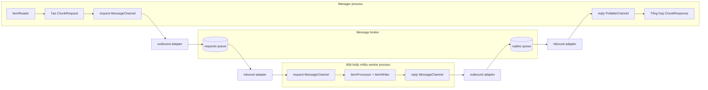
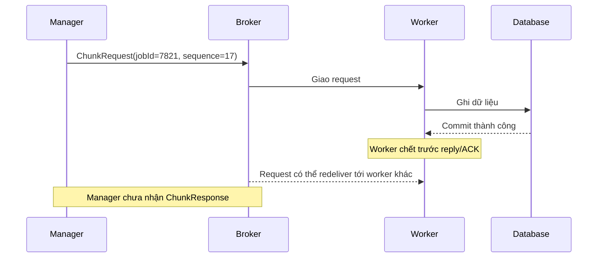

# Message channel và broker trong Spring Batch Remote Chunking

Trong **remote chunking**, Spring Batch chia công việc thành các **chunk** tại một tiến trình manager, sau đó chuyển các chunk qua hệ thống nhắn tin để nhiều worker xử lý ở tiến trình hoặc máy khác. Manager cần có đường **gửi request**, đường **nhận reply** và cách biết chunk nào đã xử lý xong. Ba thành phần thường bị nhầm lẫn là **Spring Integration message channel**, **message broker** và **Spring Batch metadata**; mỗi thành phần có trách nhiệm khác nhau.

Bài thuộc chương **Middleware remote chunking** của module `SPRING_BATCH_SCALING_OPERATIONS`. Trong mục tiêu mở rộng Spring Batch cho workload dữ liệu lớn, ta sẽ học cách nối message channel với broker, chọn topology, kiểm soát concurrency và độ bền thông điệp, đo nút thắt, giữ đúng dữ liệu khi retry/restart và vận hành job trên tài nguyên thực tế. Ví dụ tập trung vào **Spring Batch Integration 5.2.x** cùng Spring Integration; API có thể khác ở nhánh Spring Batch 6.x.

## 1. Bức tranh tổng thể: manager, worker, channel và broker

Manager đọc dữ liệu từ `ItemReader`, nhóm thành các chunk và gửi các chunk dưới dạng `ChunkRequest`. Worker nhận request, chạy `ItemProcessor` (nếu có) cùng `ItemWriter`, rồi trả về `ChunkResponse`. Manager thu reply để ghi nhận tiến độ và xác định kết quả step.



Nhìn sơ đồ theo bốn chặng:

1. **Manager → request channel → broker**: tạo message chứa chunk cần xử lý; adapter chuyển message thành giao thức mà broker hiểu.
2. **Broker → worker request channel**: broker phân phối message cho các consumer đủ điều kiện, worker chạy nghiệp vụ.
3. **Worker → reply channel → broker**: worker gửi kết quả thành công hoặc thất bại liên quan đến chunk.
4. **Broker → manager reply channel**: manager nhận reply, ghép kết quả về request gốc và đánh giá step còn pending chunk nào.

**Quan trọng:** trong remote chunking, manager vẫn sở hữu **step** và thường là nơi quản lý reader/checkpoint. Worker thường vận hành như **message listener xử lý chunk** thông qua `ChunkHandler`, không bắt buộc là một `StepExecution` riêng cho mỗi worker như **remote partitioning**. Vì vậy, đừng tìm một hàng `BATCH_STEP_EXECUTION` cho từng worker process rồi kết luận metadata bị mất.

## 2. Message channel khác message broker thế nào?

`MessageChannel` là trừu tượng **truyền message giữa các endpoint trong Spring Integration**. Nó có thể kết nối trực tiếp trong JVM hoặc chuyển message qua adapter tới middleware bên ngoài.

`Message broker` là **hệ thống nhắn tin độc lập** như RabbitMQ, ActiveMQ/JMS hoặc một nền tảng streaming phù hợp. Broker quản lý queue/topic, consumer, lưu đệm, định tuyến, xác nhận và phát lại message theo các bảo đảm riêng của từng công nghệ.

| Thành phần | Trách nhiệm | Ví dụ |
| --- | --- | --- |
| `MessageChannel` | API nội bộ để gửi/nhận `Message<?>` trong Spring Integration | `DirectChannel`, `QueueChannel` |
| Inbound/outbound adapter | Chuyển message qua ranh giới Spring Integration và middleware | AMQP inbound/outbound adapter, JMS adapter |
| Broker | Định tuyến, lưu và phân phối message giữa process | RabbitMQ queue/exchange, JMS queue |
| `ChunkRequest` / `ChunkResponse` | Dữ liệu giao thức remote chunking của Spring Batch Integration | Chunk đầu vào và kết quả xử lý |
| `JobRepository` | Lưu trạng thái job/step, checkpoint và thông tin restart | `BATCH_JOB_EXECUTION`, `BATCH_STEP_EXECUTION` |

**Không có chuyện cứ khai báo `DirectChannel` là message đã được lưu bền vững trên broker.** Chỉ khi có adapter/handler kết nối broker thì message mới đi qua ranh giới process. Tương tự, `QueueChannel` mặc định trong bộ nhớ chỉ lưu message tạm trong JVM; nó không thay thế broker durable.

### 2.1. Các loại channel thường gặp

| Channel | Đặc điểm | Đặt ở đâu trong remote chunking? |
| --- | --- | --- |
| `DirectChannel` | Gọi subscriber đồng bộ trong thread gửi | Phù hợp để nối manager request hoặc worker request/reply với adapter |
| `QueueChannel` | `PollableChannel` chứa message cho consumer chủ động gọi `receive` | Manager reply channel có thể dùng `QueueChannel` theo API builder Spring Batch 5.2 |
| `ExecutorChannel` | Giao xử lý cho executor khác, bất đồng bộ trong JVM | Chỉ thêm khi thực sự cần tách thread và đã kiểm soát lỗi/backpressure |
| `PublishSubscribeChannel` | Phát message đến nhiều subscriber | Hữu ích cho quan sát/audit, **không phù hợp để mọi worker cùng xử lý một chunk** |

Một message request trong remote chunking thường phải được **một worker xử lý về mặt nghiệp vụ**, theo mô hình competing consumers. Nếu phát cùng chunk tới mọi worker bằng pub/sub, công việc sẽ bị nhân bản trừ khi có cơ chế chống trùng rất cụ thể.

## 3. Message đi qua broker gồm những gì?

Spring Batch Integration 5.2 cung cấp:

- `ChunkRequest<T>`: mang `Chunk` các item, số thứ tự `sequence`, thông tin định danh `jobId` theo API và `StepContribution`.
- `ChunkResponse`: mang `sequence`, `jobId`, `StepContribution`, cờ `successful`, thông điệp lỗi và thông tin redelivery khi có.
- `ChunkMessageChannelItemWriter` ở manager: gửi request và thu kết quả từ worker.
- `ChunkProcessorChunkHandler` ở worker: gọi processor/writer để xử lý chunk.

Các đối tượng trên là **đối tượng Java Spring Batch**. Payload thực tế gửi qua RabbitMQ/JMS có hình thức byte nào phụ thuộc cấu hình message converter, serializer và header mapper. Minh họa logic bên dưới **không phải JSON wire format mặc định**:

```text
Request:
  jobId: 7821
  sequence: 17
  items: [Invoice(101), Invoice(102), Invoice(103)]
  contribution: <thông tin đóng góp của step>

Response:
  jobId: 7821
  sequence: 17
  successful: true
  contribution: <kết quả xử lý chunk>
```

Khi có nhiều request đang chạy đồng thời, reply **có thể đến sai thứ tự**: sequence 17 xong trước sequence 16. Không lấy thứ tự nhận message làm bằng chứng chunk nào thuộc job nào. Giao thức và bộ tổng hợp của Spring Batch sử dụng thông tin tương quan; đồng thời cần duy trì các **message header** cần thiết của Spring Integration qua adapter.

### 3.1. Correlation và định tuyến reply

Có hai lớp thông tin:

1. **Thông tin trong payload**: `jobId`, `sequence` và `StepContribution` của `ChunkRequest/ChunkResponse`.
2. **Headers của Spring Messaging/Spring Integration**: correlation, sequencing và các header giao thức mà từng adapter có thể map sang metadata của broker.

Nếu adapter làm rơi header cần thiết, reply có thể không được nhóm hoặc đối chiếu đúng. Với JMS, cần kiểm tra cấu hình `DefaultJmsHeaderMapper`: các header như `correlationId`, `sequenceNumber` và `sequenceSize` phải được giữ lại khi luồng sử dụng chúng. Với AMQP, cũng phải kiểm tra cách message converter/header mapper chuyển custom header qua broker.

Khi **nhiều manager job hoặc nhiều instance manager** cùng chạy, đừng để các instance tranh nhau lấy reply của nhau từ một queue mà không có phân tuyến/phân tách và correlation phù hợp. Nếu manager A nhận nhầm reply của manager B, một job có thể bị chờ mãi dù worker đã hoàn tất. Một thiết kế khả thi là reply destination riêng theo manager instance/run hoặc một bộ định tuyến có correlation bền vững; mỗi phương án phải tính được việc manager restart và dọn queue.

## 4. Hai luồng độc lập: request và reply

Remote chunking cần **cả hai chiều**. Chỉ thấy queue request giảm về 0 chưa chứng minh manager đã nhận reply để hoàn tất step.

| Chặng | Channel tại ứng dụng | Broker destination minh họa | Nếu gặp lỗi |
| --- | --- | --- | --- |
| Manager gửi chunk | `managerRequests` | `batch.chunk.requests` | Request chưa tới broker hoặc publish không được xác nhận |
| Worker nhận chunk | `workerRequests` | `batch.chunk.requests` | Worker down, message tồn trong queue hoặc unacked |
| Worker gửi kết quả | `workerReplies` | `batch.chunk.replies` | Worker xử lý xong nhưng reply có thể bị mất/trễ |
| Manager nhận kết quả | `managerReplies` | `batch.chunk.replies` | Manager chờ timeout, pending reply tăng |

Đường request và reply có thể dùng **hai queue độc lập**; đây là topology thường dễ quan sát hơn việc trộn chung. Trong RabbitMQ, exchange/routing key và queue binding quyết định message tới queue nào; một tên `MessageChannel` trong Java không tự tạo broker queue. Khi dùng default exchange của RabbitMQ, routing key trùng tên queue được khai báo là một cách định tuyến đơn giản cho môi trường demo.

### 4.1. Vì sao manager input là PollableChannel?

Ở Spring Batch Integration 5.2, API `RemoteChunkingManagerStepBuilder.inputChannel(...)` yêu cầu một `PollableChannel` để manager có thể lấy reply. `QueueChannel` là lựa chọn đơn giản cho ví dụ. `outputChannel(...)` nhận `MessageChannel` để manager đẩy request đi.

**Cảnh báo độ bền:** `QueueChannel` mặc định giữ message trong bộ nhớ. Nếu reply đã được adapter lấy và ACK khỏi broker nhưng chưa được manager xử lý rồi ứng dụng crash, reply trong queue nội bộ có thể biến mất. Với yêu cầu phục hồi nghiêm ngặt, phải thiết kế inbound adapter/store/ACK và cơ chế tái nhận reply phù hợp; dùng broker durable riêng **không tự khắc phục** khoảng hở này.

## 5. Cấu hình ví dụ với Spring Batch Integration 5.2 và RabbitMQ

Ví dụ chia thành **hai ứng dụng**: manager và worker. Cả hai cần dependency tương thích cho Spring Batch, Spring Batch Integration, Spring Integration AMQP và Spring AMQP; worker và manager phải thống nhất kiểu item, message conversion cùng phiên bản giao thức. Hạ tầng phải có sẵn hai queue `batch.chunk.requests` và `batch.chunk.replies`, quyền truy cập và binding tương ứng.

Đoạn mã tập trung vào **contract của channel và broker**; bean reader, processor, writer, nguồn DB và cấu hình kết nối RabbitMQ do ứng dụng cung cấp.

### 5.1. Manager: đọc item, gửi request và nhận reply

```java
import org.springframework.batch.core.Step;
import org.springframework.batch.core.repository.JobRepository;
import org.springframework.batch.integration.chunk.RemoteChunkingManagerStepBuilder;
import org.springframework.batch.item.ItemReader;
import org.springframework.beans.factory.annotation.Qualifier;
import org.springframework.context.annotation.Bean;
import org.springframework.context.annotation.Configuration;
import org.springframework.integration.channel.DirectChannel;
import org.springframework.integration.channel.QueueChannel;
import org.springframework.messaging.MessageChannel;
import org.springframework.messaging.PollableChannel;
import org.springframework.transaction.PlatformTransactionManager;

@Configuration
class ManagerChunkConfiguration {

    @Bean
    MessageChannel managerRequests() {
        return new DirectChannel();
    }

    @Bean
    PollableChannel managerReplies() {
        return new QueueChannel();
    }

    @Bean
    Step remoteChunkManagerStep(
            JobRepository jobRepository,
            PlatformTransactionManager transactionManager,
            @Qualifier("invoiceReader") ItemReader<Invoice> reader,
            @Qualifier("managerRequests") MessageChannel requests,
            @Qualifier("managerReplies") PollableChannel replies) {

        return new RemoteChunkingManagerStepBuilder<Invoice, Invoice>(
                "remoteChunkManagerStep", jobRepository)
                .chunk(100)
                .reader(reader)
                .outputChannel(requests)
                .inputChannel(replies)
                .transactionManager(transactionManager)
                .build();
    }
}
```

Trong ví dụ trên, `Invoice` là DTO có thể truyền qua transport (ví dụ `record Invoice(long id, BigDecimal amount) implements Serializable` nếu dùng serializer Java thích hợp). **Trong triển khai thực tế, nên dùng định dạng trao đổi an toàn và được version hóa** với danh sách kiểu cho phép, không cho phép deserialize tùy ý từ message không tin cậy.

`RemoteChunkingManagerStepBuilder` tự cài `ChunkMessageChannelItemWriter`. **Không gọi `.writer(...)` để thay writer của manager**: việc đẩy chunk qua middleware chính là nhiệm vụ writer đặc biệt này. Reader ở manager cần quản lý checkpoint và dữ liệu đầu vào nhất quán để có thể restart.

### 5.2. Manager: bridge channel ↔ RabbitMQ

```java
import org.springframework.amqp.core.AmqpTemplate;
import org.springframework.amqp.rabbit.connection.ConnectionFactory;
import org.springframework.beans.factory.annotation.Qualifier;
import org.springframework.context.annotation.Bean;
import org.springframework.context.annotation.Configuration;
import org.springframework.integration.amqp.dsl.Amqp;
import org.springframework.integration.dsl.IntegrationFlow;
import org.springframework.messaging.MessageChannel;
import org.springframework.messaging.PollableChannel;

@Configuration
class ManagerAmqpBridge {

    @Bean
    IntegrationFlow managerRequestOutbound(
            @Qualifier("managerRequests") MessageChannel requestChannel,
            AmqpTemplate amqpTemplate) {
        return IntegrationFlow.from(requestChannel)
                .handle(Amqp.outboundAdapter(amqpTemplate)
                        .routingKey("batch.chunk.requests"))
                .get();
    }

    @Bean
    IntegrationFlow managerReplyInbound(
            ConnectionFactory rabbitConnectionFactory,
            @Qualifier("managerReplies") PollableChannel replyChannel) {
        return IntegrationFlow
                .from(Amqp.inboundAdapter(
                        rabbitConnectionFactory, "batch.chunk.replies"))
                .channel(replyChannel)
                .get();
    }
}
```

Hai bean `IntegrationFlow` này minh họa vai trò của **adapter**. Chúng không tự bảo đảm cấu hình durable queue, publisher confirm, message converter, retry/DLQ, header mapping hay lưu trữ reply an toàn. Đó là phần phải bổ sung trong môi trường production.

### 5.3. Worker: nhận chunk và xử lý nghiệp vụ

```java
import org.springframework.batch.integration.chunk.RemoteChunkingWorkerBuilder;
import org.springframework.batch.item.ItemProcessor;
import org.springframework.batch.item.ItemWriter;
import org.springframework.beans.factory.annotation.Qualifier;
import org.springframework.context.annotation.Bean;
import org.springframework.context.annotation.Configuration;
import org.springframework.integration.channel.DirectChannel;
import org.springframework.integration.dsl.IntegrationFlow;
import org.springframework.messaging.MessageChannel;

@Configuration
class WorkerChunkConfiguration {

    @Bean
    MessageChannel workerRequests() {
        return new DirectChannel();
    }

    @Bean
    MessageChannel workerReplies() {
        return new DirectChannel();
    }

    @Bean
    IntegrationFlow remoteChunkWorkerFlow(
            @Qualifier("workerRequests") MessageChannel requests,
            @Qualifier("workerReplies") MessageChannel replies,
            ItemProcessor<Invoice, Invoice> processor,
            ItemWriter<Invoice> writer) {
        return new RemoteChunkingWorkerBuilder<Invoice, Invoice>()
                .inputChannel(requests)
                .outputChannel(replies)
                .itemProcessor(processor)
                .itemWriter(writer)
                .build();
    }
}
```

`RemoteChunkingWorkerBuilder.build()` tạo một `IntegrationFlow` để xử lý request và gửi reply. Worker thực thi logic processor/writer; **không đọc lại tập dữ liệu gốc bằng reader của manager**. Khi có nhiều consumer hoặc thread trong cùng worker process, kiểm tra thread safety của processor/writer và transactional boundary của việc ghi DB.

### 5.4. Worker: bridge ngược hướng với manager

```java
import org.springframework.amqp.core.AmqpTemplate;
import org.springframework.amqp.rabbit.connection.ConnectionFactory;
import org.springframework.beans.factory.annotation.Qualifier;
import org.springframework.context.annotation.Bean;
import org.springframework.context.annotation.Configuration;
import org.springframework.integration.amqp.dsl.Amqp;
import org.springframework.integration.dsl.IntegrationFlow;
import org.springframework.messaging.MessageChannel;

@Configuration
class WorkerAmqpBridge {

    @Bean
    IntegrationFlow workerRequestInbound(
            ConnectionFactory rabbitConnectionFactory,
            @Qualifier("workerRequests") MessageChannel requestChannel) {
        return IntegrationFlow
                .from(Amqp.inboundAdapter(
                        rabbitConnectionFactory, "batch.chunk.requests"))
                .channel(requestChannel)
                .get();
    }

    @Bean
    IntegrationFlow workerReplyOutbound(
            @Qualifier("workerReplies") MessageChannel replyChannel,
            AmqpTemplate amqpTemplate) {
        return IntegrationFlow.from(replyChannel)
                .handle(Amqp.outboundAdapter(amqpTemplate)
                        .routingKey("batch.chunk.replies"))
                .get();
    }
}
```

Ứng dụng manager cần tạo `Job` để chạy `remoteChunkManagerStep`; còn worker chạy IntegrationFlow và listener của middleware. Những class trên là **các mảnh cấu hình minh họa riêng theo process**; chưa phải ứng dụng có thể khởi chạy độc lập vì chưa có reader, writer, converter, kết nối broker, schema DB, transaction policy và cấu hình queue. Không chạy cả manager lẫn worker bridge trên cùng application context khi không có chủ đích.

## 6. Chọn broker và kiểu routing

Không có broker duy nhất phù hợp mọi workload; thứ cần đánh giá là mô hình request/reply, bảo đảm giao nhận, năng lực vận hành và độ trễ của từng công nghệ.

| Công nghệ | Kiểu tích hợp thường gặp | Ưu điểm trong bài toán | Cần lưu ý |
| --- | --- | --- | --- |
| RabbitMQ/AMQP | Exchange → queue; Spring Integration AMQP adapter | Competing consumer, ACK/NACK, DLQ, routing linh hoạt | Queue durability, publisher confirm, prefetch, dead-letter và retry |
| JMS broker (ví dụ ActiveMQ) | Request/reply queues qua JMS adapter | Hệ sinh thái enterprise/JMS, giao dịch và message listener | Header mapping, destination, session transaction, redelivery |
| Kafka | Topic/partition, consumer group; cần tích hợp/điều phối phù hợp | Throughput cao, lưu log và replay theo offset | Bài toán reply/correlation, ordering theo partition, offset commit và duplicate; không thay thế queue request/reply một cách tự động |
| Channel trong JVM | `DirectChannel`/`QueueChannel` đơn thuần | Test nhanh contract nội bộ | Không chạy xuyên process và không tự durable |

**Ví dụ RabbitMQ với default exchange:** gửi message tới routing key `batch.chunk.requests` sẽ đi vào queue có tên đó nếu queue đã được khai báo và broker định tuyến mặc định theo queue name. Nếu dùng exchange tùy chỉnh, cần khai báo exchange, queue binding và routing key rõ ràng. Với nhiều worker cùng subscribe **một request queue**, broker có thể chia tải giữa các consumer; dùng fanout exchange tới nhiều queue worker sẽ nhân số bản sao message.

**Tại sao không khuyên dùng một topic chung cho mọi message?** Remote chunking cần manager biết worker nào đã thực hiện request và nhận reply tương ứng. Pub/sub broadcast có thể khiến cùng chunk bị xử lý nhiều lần, trong khi topic log như Kafka yêu cầu tự thiết kế thêm correlation, offset/consumer group và chính sách lưu kết quả.

## 7. Delivery semantics: sent, received, processed, acknowledged

Có ít nhất bốn cột mốc khác nhau:

```text
Manager publish request
    -> broker xác nhận đã nhận request
    -> worker consumer nhận request
    -> worker ghi DB và gửi reply
    -> manager nhận reply và cập nhật trạng thái step
```

**Publisher confirm** chỉ xác nhận broker đã nhận hoặc xử lý publish theo cơ chế broker; nó **không chứng minh worker đã commit nghiệp vụ**. **Consumer ACK** báo broker rằng message có thể được coi là đã nhận/xử lý theo thời điểm ACK của consumer; nó cũng **không chứng minh manager đã nhận reply**.

### 7.1. Tại sao at-least-once thường dẫn đến xử lý lại?

Giả sử worker commit DB xong rồi chết trước khi gửi reply hoặc ACK message:



Nếu message được giao lại, **cùng chunk có thể chạy lần hai**. Ngược lại, nếu message ACK trước khi DB commit mà worker chết, request có thể bị mất khả năng tự giao lại. Không thể ghép hai giao dịch DB và broker thành một giao dịch nguyên tử chỉ bằng `DirectChannel` hoặc bật retry.

Để hạn chế mất/trùng dữ liệu:

1. Writer thực hiện **idempotent** theo business key hoặc khóa duy nhất đã được thống nhất.
2. Khi cần, duy trì bảng inbox/deduplication với khóa đủ phân biệt `job/run + chunk/item`, cập nhật trạng thái trong cùng transaction với business write.
3. Nếu có side effect ngoài DB như gửi email, gọi API thanh toán, phát event, dùng outbox/idempotency key thích hợp.
4. Thiết kế thứ tự **DB commit – publish reply – consumer ACK** dựa trên transaction boundary thật của listener container; kiểm tra chỗ có thể crash giữa các thao tác.
5. Đặt retry hữu hạn, backoff và DLQ để lỗi dữ liệu không bị requeue vô hạn.

**Không khẳng định exactly-once end-to-end** chỉ vì broker có giao dịch hoặc publisher confirm. Exactly-once ở tầng nghiệp vụ đòi hỏi quy tắc deduplication, transaction và cách phục hồi có kiểm chứng.

### 7.2. Không đồng nhất retry của broker và retry của Spring Batch

| Cơ chế | Đơn vị retry | Nơi cấu hình | Điều phải kiểm tra |
| --- | --- | --- | --- |
| Broker redelivery | Một message request/reply | Listener container, ACK/NACK, retry/DLQ | Message có thể chạy lại hoặc đến muộn |
| Retry xử lý item/chunk | Logic processor/writer và exception liên quan | Spring Batch và logic worker | Side effect cần idempotent, không retry vô hạn |
| Restart của job | Một `JobExecution` mới thuộc cùng `JobInstance` | `JobRepository`, reader checkpoint, job parameters | Chunk đã phát nhưng chưa có reply có thể cần đối chiếu |

Khi thiết kế, hãy viết rõ **ai** quyết định retry, **bao nhiêu lần**, **sau bao lâu**, và **ai** xử lý message vào DLQ. Nếu cả broker lẫn ứng dụng đều retry không giới hạn, một lỗi có thể tạo retry storm.

## 8. Header, converter và tương thích phiên bản

Remote chunking truyền đối tượng có nội dung nghiệp vụ và metadata. Một lỗi converter có thể xảy ra **trước khi worker bắt đầu xử lý**; lỗi header mapping có thể khiến request xử lý xong nhưng manager không nhận diện được reply.

Những điểm cần kiểm:

- Manager và worker cùng hiểu schema item, `ChunkRequest` và `ChunkResponse` theo **phiên bản thư viện tương thích**.
- Converter hỗ trợ kiểu dữ liệu trong message; nếu dùng JSON, định nghĩa rõ trường bắt buộc, kiểu `BigDecimal`/datetime, version và chính sách unknown field.
- Không mặc định bật Java native deserialization từ nguồn không tin cậy; chỉ cho phép class cần thiết và bảo vệ quyền publish vào queue.
- Correlation/sequence headers được **map xuyên qua outbound + inbound adapters**. Một số adapter mặc định chỉ map các AMQP/JMS header chuẩn, có thể bỏ qua header tự đặt.
- Kích thước message giới hạn; chunk quá lớn gây tăng RAM, network latency, hàng chờ và thời gian redelivery.
- Khi rolling deployment nhiều phiên bản, contract cần giữ backward/forward compatibility; kiểm thử phiên bản manager A với worker B trước khi cho chạy cùng queue.

Đừng tự thay thế `ChunkRequest` bằng JSON có `items` mà bỏ `jobId`, `sequence` hay `StepContribution` rồi kỳ vọng worker builder hoạt động bình thường. Nếu cần giao thức tùy chỉnh, phải thực hiện conversion và handling tương thích ở cả hai đầu.

## 9. Chỉnh concurrency và backpressure qua broker

Giả sử manager tạo `1.000.000` item với `chunkSize=500`, tương đương khoảng **2.000 request chunk**, chưa kể chunk rỗng/kết thúc nếu implementation có dùng. Nếu 8 consumer worker xử lý cùng lúc, số request có thể lớn hơn rất nhiều so với số worker đang chạy.

Các nút chỉnh chính:

| Nút chỉnh | Tác động | Rủi ro khi tăng quá mức |
| --- | --- | --- |
| `chunkSize` | Số item trong request và chi phí gửi message | Payload lớn, transaction dài, retry lại nhiều item |
| Số worker process | Tổng năng lực xử lý phân tán | DB/API quá tải, tăng overhead JVM/process |
| Consumer concurrency | Số request xử lý đồng thời tại mỗi worker | Tranh chấp writer/DB pool, mất ordering |
| Broker prefetch | Số message giữ in-flight/unacked mỗi consumer | Worker ôm nhiều message, phân tải lệch, mất RAM |
| Queue depth / in-flight limit | Khả năng hấp thụ chênh lệch tốc độ | Tăng độ trễ, phát tán nhiều request trước khi phát hiện lỗi |
| Connection pool | Số kết nối DB từ toàn bộ worker | Cạn connection hoặc làm DB quá tải |
| Reply consumption capacity | Tốc độ manager thu kết quả | Reply backlog và manager timeout dù worker vẫn xử lý tốt |

**Backpressure** nghĩa là giới hạn lượng request manager đưa vào hệ thống khi worker hoặc broker chậm hơn. Không nên chỉ tăng `prefetch` rồi coi như đã tăng throughput; nó có thể làm số message chưa ACK lớn hơn mà không cải thiện số item commit/giây.

Trong remote chunking, **manager vẫn đọc và tạo chunk**. Nếu reader là nút thắt, thêm worker không giúp; nếu worker xử lý CPU nặng, tăng worker có thể cải thiện; nếu DB là nút thắt chung, thêm consumer có thể làm lock wait tăng.

### 9.1. Bài toán sizing minh họa

Giả sử đo được:

```text
Manager tạo request:       100 chunk/giây
Mỗi worker xử lý:           15 chunk/giây
4 worker:                  ~60 chunk/giây
8 worker:                 ~120 chunk/giây (giả định DB chưa nghẽn)
```

Với 4 worker, request queue có xu hướng tích lũy khoảng 40 chunk/giây khi manager tiếp tục đọc cùng tốc độ. Với 8 worker, năng lực xử lý lý thuyết lớn hơn tốc độ phát request, nhưng throughput end-to-end vẫn không vượt nguồn item manager tạo ra. Đây chỉ là mô hình gần đúng; cần đo queue depth thực, message age, broker publish latency và số item đã commit.

## 10. Tình huống lỗi: thông điệp bị kẹt ở đâu?

| Triệu chứng | Vùng cần kiểm | Cách xác minh/khắc phục |
| --- | --- | --- |
| Request queue tăng liên tục | Worker, consumer concurrency hoặc DB/API bị chậm | Đo worker processing time, DB locks, connection wait, scale trong giới hạn |
| Request queue rỗng, step chưa kết thúc | Reply queue, manager reply channel, pending request | Đối chiếu reply theo `jobId/sequence`, kiểm tra ACK, consumer và timeout |
| Worker chạy xong nhưng manager chờ reply | Reply route, converter/header mapping hoặc manager crashed | Kiểm tra routing key/queue, message correlation, DLQ và logs |
| Một chunk xử lý hai lần | Broker redelivery sau crash hoặc retry | Dùng idempotency key, kiểm tra ACK/commit boundary |
| Một số message không thể deserialize | Schema DTO hoặc converter sai phiên bản | Đồng bộ contract, cách serialize và whitelist kiểu |
| Queue vẫn còn message của job cũ | Không có chính sách TTL/dọn queue hoặc job dừng giữa chừng | Xác định chủ sở hữu, cách cô lập theo run, xử lý message muộn an toàn |
| Có nhiều manager, reply thất lạc | Tranh nhau tiêu thụ cùng reply queue | Định tuyến reply theo manager/run và kiểm tra correlation |
| Worker crash gây vòng requeue | Retry không giới hạn, không có DLQ | Giới hạn lần thử, backoff, phân loại lỗi và xử lý DLQ |
| Producer nhận publish thành công nhưng không có output | Confirm ≠ worker commit | Theo dõi toàn chuỗi request → write → reply và nguồn dữ liệu đích |

Với `RabbitMQ`, nên theo dõi **ready messages**, **unacked messages**, consumer count, publish/ack/redelivery rates, dead-letter count, connection/channel lỗi. Với `JMS`, các khái niệm tương tự thường thể hiện qua queue depth, delivery attempts, consumer sessions và DLQ. Tên metric cụ thể tùy broker.

## 11. Theo dõi end-to-end trong Spring Batch

`JobRepository` ghi trạng thái `JobExecution` và `StepExecution` của manager. Với remote chunking, không phải worker process nào cũng có một `StepExecution` riêng, vì vậy số job/step row **không bằng** số request trên broker.

Truy vấn manager step:

```sql
SELECT STEP_EXECUTION_ID,
       STEP_NAME,
       STATUS,
       EXIT_CODE,
       READ_COUNT,
       WRITE_COUNT,
       COMMIT_COUNT,
       ROLLBACK_COUNT,
       START_TIME,
       END_TIME
FROM BATCH_STEP_EXECUTION
WHERE JOB_EXECUTION_ID = :jobExecutionId
ORDER BY STEP_EXECUTION_ID;
```

Kết hợp những chỉ số ở hai phía:

| Nơi đo | Metrics nên có | Tác dụng |
| --- | --- | --- |
| Manager | `jobExecutionId`, `stepExecutionId`, chunk đã gửi/đợi reply, thời gian đọc | Xác định bottleneck ở reader/manager |
| Broker | Queue depth, message age, unacked, redelivery, DLQ, publish confirm | Tìm nghẽn truyền và mất thông điệp |
| Worker | Chunk nhận/xử lý/thất bại, thời gian processor/writer, CPU/GC | Đánh giá năng lực từng worker |
| Database/API đích | Rows committed, slow queries, connection/lock wait, lỗi ngoài DB | Xác minh xử lý nghiệp vụ thực |
| Manager reply path | Reply received, correlation mismatch, timeout, pending requests | Phát hiện worker xử lý xong nhưng phản hồi bị chậm |

Không dùng duy nhất `WRITE_COUNT` để chứng minh xử lý chính xác khi có redelivery. Cần đối chiếu tập business ID đã commit với snapshot đầu vào, kiểm tra tính duy nhất và các side effect đã phát ra. Với metric dài hạn, tránh đặt mỗi `jobExecutionId` hoặc `sequence` làm tag vì tạo cardinality rất cao; lưu định danh chi tiết trong log/tracing có retention phù hợp.

## 12. Restart, message cũ và ranh giới giao dịch

Một kịch bản thực tế:

1. Manager đã gửi `ChunkRequest(sequence=17)` rồi mất kết nối.
2. Worker xử lý thành công và gửi `ChunkResponse(sequence=17)`.
3. Manager chết trước khi ghi nhận đầy đủ reply/checkpoint.
4. Scheduler restart cùng `JobInstance`; một hoặc nhiều chunk có thể bị phát lại, trong khi message cũ vẫn có thể tồn tại ở request/reply queue.

Điều cần thiết kế:

- **Giữ snapshot đầu vào và định danh job/run ổn định**; không thay dữ liệu nguồn hoặc naming rule giữa lần đầu và restart mà không tính đến replay.
- **Không để reply cũ áp sai vào job execution mới**. Xây dựng quy tắc correlation, stale message handling và cleanup rõ ràng.
- **Kiểm tra khả năng dedupe** ở writer đối với chunk/item đã commit; không dùng ID message ngẫu nhiên thay cho business key nếu muốn chống lặp qua restart.
- **Định nghĩa timeout có ý nghĩa**: chờ reply quá ngắn khiến job fail khi worker đang xử lý; quá dài khiến phát hiện worker chết muộn.
- **Ghi rõ transaction boundary** của việc đọc nguồn, publish request, xử lý worker, publish reply và ACK. Broker và database thường không có một global transaction tự động.
- **Kiểm thử failure injection**: kill worker sau commit DB nhưng trước ACK; restart manager khi reply chưa tiêu thụ; broker tạm dừng; reply đến trễ hoặc trùng.

Với ví dụ manager builder, cấu hình `maxWaitTimeouts(...)` chỉ liên quan số lần chờ kết quả ở cuối step; phải đặt cùng timeout của kênh nhận, độ dài chunk, tải broker và kế hoạch khi worker chết. Không nên dùng timeout rất cao để che việc reply route bị cấu hình sai.

## 13. Thử nghiệm tích hợp tối thiểu

Một bài lab nên dùng **broker thật hoặc môi trường tương đương**, không chỉ hai `DirectChannel` trong một JVM, vì lỗi routing, ACK và redelivery chỉ xuất hiện khi đi qua middleware.

1. Chuẩn bị 1.000 invoice có ID duy nhất, chia `chunkSize=100`, hai worker consumer.
2. Chạy bình thường; xác nhận worker nhận hết request, manager nhận đủ reply và dữ liệu đích đúng 1.000 ID.
3. Ngắt một worker **trước khi ghi DB**; xem request chưa ACK được chuyển lại theo chính sách broker.
4. Ngắt một worker **sau khi commit DB nhưng trước reply/ACK**; xác nhận idempotency và redelivery không tạo bản ghi nghiệp vụ trùng.
5. Chặn reply route tạm thời; quan sát reply backlog và thời gian manager chờ.
6. Tăng consumer lên 4, 8 rồi đo throughput, queue depth, DB connections/locks; tìm điểm bão hòa.
7. Restart manager cùng `JobInstance` sau lỗi; so đối chiếu số item đã xử lý, message còn sót và metadata.
8. Tạo message độc hại/sai schema trong môi trường test; kiểm tra converter reject, DLQ và vận hành không rơi vào loop requeue.

### Bất biến dữ liệu để đánh giá

```text
Số business ID hợp lệ đầu vào = 1.000
Số business ID được commit hợp lệ = 1.000
Số ID xuất hiện hơn một lần trong kết quả cuối = 0
Số request cần reply nhưng chưa đối chiếu sau khi job kết thúc = 0
```

Hai bất biến đầu là điều kiện nghiệp vụ; bất biến cuối phải được kiểm tra theo giao thức, trạng thái và chính sách dọn message của hệ thống. Một job `COMPLETED` nhưng còn duplicate side effect không đạt yêu cầu.

## 14. Bài tập tự kiểm tra

**Câu 1.** Manager dùng `DirectChannel` làm request output và không cấu hình outbound broker adapter. Worker chạy ở máy khác có nhận được message không?

**Đáp án:** Không. `DirectChannel` chỉ truyền message trong cùng application context/JVM. Cần adapter hoặc gateway phù hợp để chuyển message qua middleware.

**Câu 2.** Vì sao `QueueChannel` ở manager reply chưa đồng nghĩa với reply được lưu bền vững?

**Đáp án:** `QueueChannel` mặc định lưu trong bộ nhớ JVM. Nếu broker đã ACK reply nhưng manager chưa xử lý và JVM chết, reply có thể mất khỏi queue nội bộ; phải thiết kế durability và ACK boundary.

**Câu 3.** Worker commit DB thành công, gửi reply chưa kịp thì crash. Broker có thể giao lại request. Có thể tuyên bố exactly-once chỉ nhờ cấu hình durable queue không?

**Đáp án:** Không. Durable queue giúp lưu message theo bảo đảm của broker, không tự làm DB write idempotent. Cần khóa nghiệp vụ/dedupe hoặc cơ chế transaction phù hợp.

**Câu 4.** Có 4 worker process cùng nghe một request queue, nhưng routing theo fanout tạo 4 queue riêng và mỗi worker nghe queue của mình. Đây có còn là chia tải đúng kiểu competing consumers không?

**Đáp án:** Không. Fanout có thể nhân bản mỗi request tới cả 4 queue. Muốn mỗi chunk được xử lý một lần về mặt nghiệp vụ, phải dùng queue/consumer group và routing phù hợp.

**Câu 5.** Request queue đã trống nhưng manager chưa `COMPLETED`. Nên kiểm tra đâu trước?

**Đáp án:** Kiểm tra reply queue, reply adapter/channel, correlation, thời gian chờ và thông tin pending chunk; request queue trống không chứng minh manager đã thu đủ phản hồi.

## 15. Tài liệu tham khảo

- [Spring Batch 5.2 API — RemoteChunkingManagerStepBuilder](https://docs.spring.io/spring-batch/docs/5.2.x/api/org/springframework/batch/integration/chunk/RemoteChunkingManagerStepBuilder.html): `outputChannel(MessageChannel)`, `inputChannel(PollableChannel)`, `chunk(...)` và manager writer.
- [Spring Batch 5.2 API — RemoteChunkingWorkerBuilder](https://docs.spring.io/spring-batch/docs/5.2.x/api/org/springframework/batch/integration/chunk/RemoteChunkingWorkerBuilder.html): worker `IntegrationFlow`, processor/writer, request/reply channels.
- [Spring Batch 5.2 API — ChunkRequest](https://docs.spring.io/spring-batch/docs/5.2.x/api/org/springframework/batch/integration/chunk/ChunkRequest.html) và [ChunkResponse](https://docs.spring.io/spring-batch/docs/5.2.x/api/org/springframework/batch/integration/chunk/ChunkResponse.html): metadata của request/reply chunk.
- [Spring Batch — Scaling and Parallel Processing: Remote Chunking](https://docs.spring.io/spring-batch/reference/scalability.html#remote-chunking): manager/worker và khi nào remote chunking phù hợp.
- [Spring Integration — AMQP Outbound Channel Adapter](https://docs.spring.io/spring-integration/reference/amqp/outbound-channel-adapter.html) và [Inbound Channel Adapter](https://docs.spring.io/spring-integration/reference/amqp/inbound-channel-adapter.html): routing key, consumer, ACK, mapping header.
- [Spring Batch Integration — Externalizing Batch Process Execution](https://docs.spring.io/spring-batch/reference/spring-batch-integration/externalizing-execution.html): request/reply topology và tích hợp Spring Integration với broker.

**Ghi nhớ:** Spring Integration `MessageChannel` nối các thành phần trong ứng dụng; **adapter** nối channel với **broker**; broker phân phối request/reply qua process; Spring Batch ghép kết quả chunk và quản lý trạng thái job. Một kiến trúc remote chunking vận hành tốt cần **đúng routing, đủ correlation, ACK/transaction minh bạch, writer idempotent, backpressure và giám sát cả hai chiều message** trước khi tăng số worker.
