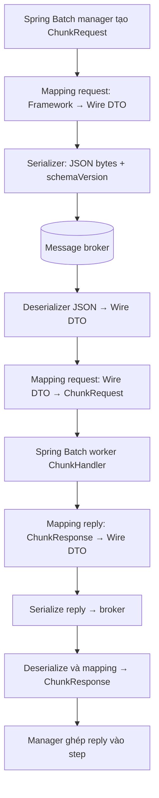
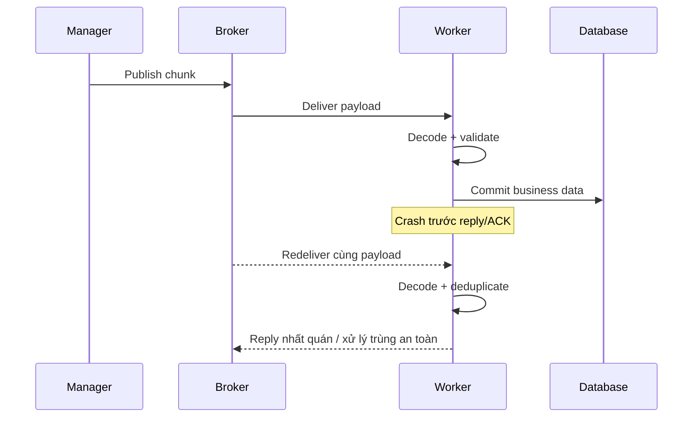

# Serializer payload của chunk trong Spring Batch Remote Chunking

Trong remote chunking, manager của Spring Batch đọc dữ liệu và tạo các chunk, sau đó chuyển từng chunk qua message broker cho worker ở JVM hoặc máy khác xử lý. **Payload phải được serialize (mã hóa thành bytes) ở phía gửi và deserialize (khôi phục dữ liệu) ở phía nhận**. Nếu hai phía không thống nhất cấu trúc, kiểu dữ liệu, phiên bản và message headers, worker có thể không đọc được chunk, manager không nhận diện được reply hoặc job mắc kẹt khi retry/restart.

Bài thuộc chương **Middleware remote chunking** của module `SPRING_BATCH_SCALING_OPERATIONS`. Mục tiêu học là hiểu chính xác những gì cần truyền trên đường request/reply, phân biệt Java serialization với JSON/Avro/Protobuf, cấu hình converter an toàn, kiểm soát kích thước chunk, hỗ trợ nâng phiên bản, đo bottleneck và xử lý message trùng/lỗi trong kiến trúc phân tán. Các API minh họa dựa trên **Spring Batch Integration 5.2.x** và Spring AMQP 3.x; khi dùng phiên bản khác, phải kiểm tra lại tương thích.

## 1. Serializer đứng ở đâu trong remote chunking?

Luồng xử lý tóm tắt:

```mermaid
flowchart LR
    R["Manager ItemReader"] --> C["Tạo ChunkRequest<Invoice>"]
    C --> S["Serialize / message converter"]
    S --> Q[("Broker request queue")]
    Q --> D["Deserialize / kiểm tra schema"]
    D --> W["Worker ItemProcessor + ItemWriter"]
    W --> X["Tạo ChunkResponse"]
    X --> S2["Serialize reply"]
    S2 --> Q2[("Broker reply queue")]
    Q2 --> D2["Deserialize reply"]
    D2 --> A["Manager đối chiếu chunk và cập nhật step"]
```



Cần phân biệt hai thứ:

1. **Spring Messaging `Message<?>`**: chứa `payload` và `headers` trong ứng dụng; `MessageChannel` chuyển message giữa các endpoint Spring Integration.
2. **Broker message**: có body dạng `byte[]` cùng metadata thuộc giao thức broker (content type, message ID, correlation ID, delivery mode, headers, ...). Adapter/gateway và `MessageConverter` biến payload ứng dụng thành body broker và ngược lại.

Không phải cứ đổi `MessageChannel` từ `DirectChannel` sang `QueueChannel` là có serialization xuyên máy. Hai channel đó có thể chỉ hoạt động trong cùng JVM. **Ranh giới serialize thường nằm tại adapter/gateway giao tiếp với broker**, hoặc tại transformer được cấu hình rõ trước/sau adapter.

## 2. ChunkRequest/ChunkResponse thực sự chứa gì?

Spring Batch Integration cung cấp các loại message có ngữ nghĩa sẵn:

| Kiểu | Trường quan trọng ở bản 5.2.x | Vai trò |
| --- | --- | --- |
| `ChunkRequest<T>` | `sequence`, `items: Chunk<? extends T>`, `jobId`, `stepContribution` | Gửi phần dữ liệu manager muốn worker xử lý |
| `ChunkResponse` | `sequence`, `jobId`, `stepContribution`, `status`/`successful`, `message`, `redelivered` | Báo kết quả xử lý một chunk về manager |
| `StepContribution` | Các counter và thông tin đóng góp của chunk cho step | Hợp nhất kết quả xử lý với metadata của manager |
| `MessageHeaders` | Correlation, content type, type ID, trace ID... khi dùng | Định tuyến, giải mã và quan sát message |

`ChunkRequest` và `ChunkResponse` trong Spring Batch 5.2 triển khai `java.io.Serializable`; `Chunk` và `StepContribution` cũng thuộc đồ thị đối tượng có khả năng Java-serialize. Nhưng **khả năng implements Serializable không phải một cam kết rằng định dạng byte của Java serialization ổn định qua mọi phiên bản thư viện hoặc an toàn khi nhận từ bên ngoài**.

Minh họa logic một request và reply (không phải body mặc định của RabbitMQ/JMS):

```json
{
  "type": "chunk.request",
  "schemaVersion": 1,
  "jobId": 7821,
  "sequence": 17,
  "items": [
    {"invoiceId": 101, "amount": "125000.50"},
    {"invoiceId": 102, "amount": "42000.00"}
  ],
  "stepContribution": "<du lieu framework duoc ma hoa theo contract>"
}
```

```json
{
  "type": "chunk.reply",
  "schemaVersion": 1,
  "jobId": 7821,
  "sequence": 17,
  "successful": true,
  "stepContribution": "<ket qua chunk cua framework>"
}
```

**Lưu ý:** `jobId` và `sequence` không phải thông tin trang trí. Manager cần ghép reply với request để thống kê và biết các chunk nào đã phản hồi. Không được chỉ gửi danh sách item mà bỏ thông tin của giao thức. Tên trường `jobId` ở đây là trường trong `ChunkRequest` bản 5.2, không nên tự suy ra nó luôn tương đương mọi `runId` nghiệp vụ do ứng dụng tạo.

## 3. Chọn chiến lược serializer nào?

| Cách mã hóa | Ưu điểm | Nhược điểm/rủi ro | Phù hợp |
| --- | --- | --- | --- |
| **Java native serialization** | Có thể serialize trực tiếp đồ thị `ChunkRequest`/`ChunkResponse` khi các thành phần đều hỗ trợ | Coupling theo Java class/version, bytes lớn, rủi ro deserialization, khó debug/interop | Môi trường Java đồng nhất và **được kiểm soát chặt**, demo hoặc hệ thống đã thẩm định |
| **JSON + DTO versioned** | Dễ quan sát, liên ngôn ngữ, có thể ổn định hợp đồng API | Phải định nghĩa DTO, convert `ChunkRequest/Response` hai chiều, quản lý kiểu/cấu trúc | Dịch vụ cần upgrade độc lập và audit rõ |
| **Avro + schema registry** | Schema evolution có quy tắc, thường compact hơn JSON | Thêm pipeline schema và adapter; vẫn cần map sang Spring Batch API | Nhiều consumer, dữ liệu lớn, governance tập trung |
| **Protobuf** | Kích thước nhỏ, trường có tag ổn định và tương thích có kiểm soát | Cần `.proto`, sinh lớp, xử lý null/precision, bridge sang `ChunkRequest/Response` | Mạng/broker hạn chế, hợp đồng định dạng chặt |
| **Custom binary** | Có thể tối ưu cho nghiệp vụ cụ thể | Dễ bỏ sót metadata, khó bảo trì và bảo mật | Chỉ khi benchmark chứng minh lợi ích và có test compatibility |

**Điểm quyết định:** một định dạng JSON/Avro/Protobuf thuận tiện cho **DTO riêng của ứng dụng** không đồng nghĩa với việc chỉ cần đặt `Jackson2JsonMessageConverter` là mọi object Spring Batch đều deserialize đúng. `ChunkRequest` chứa `Chunk` và `StepContribution`, vốn có kiểu/lifecycle của framework. Để dùng wire DTO riêng, cần **bộ bridge hai chiều** bảo toàn đúng thông tin mà manager và worker builder sử dụng; nếu không, đó là một giao thức mới, không còn mặc nhiên tương thích với `RemoteChunkingManagerStepBuilder` / `RemoteChunkingWorkerBuilder`.

## 4. Java serialization: hiểu giới hạn trước khi dùng

`SimpleMessageConverter` của Spring AMQP có thể xử lý `Serializable`; ví dụ object được đổi thành dạng `application/x-java-serialized-object`. Để làm việc, **mọi item trong chunk và các object được tham chiếu phải serialize được**. Nếu có field không serializable, việc gửi có thể ném `NotSerializableException` ngay trên đường outbound.

Một DTO Java phù hợp để minh họa:

```java
import java.io.Serial;
import java.io.Serializable;
import java.math.BigDecimal;

public record InvoiceItem(long invoiceId, BigDecimal amount)
        implements Serializable {

    @Serial
    private static final long serialVersionUID = 1L;
}
```

Không nên nhét `DataSource`, `Connection`, `EntityManager`, Spring bean, lambda mang closure, transaction context hoặc graph JPA lazy proxy vào `InvoiceItem`. Thứ cần gửi là **dữ liệu cần thiết để worker xử lý**, không phải tài nguyên runtime của manager.

`serialVersionUID` chỉ hỗ trợ kiểm tra tương thích ở tầng Java serialization; nó **không** tự đảm bảo thay đổi field/class/package giữa các lần triển khai là an toàn. Cũng không giải quyết vấn đề lỗ hổng gadget-based deserialization: **không deserialize Java native object từ queue mà bên không đáng tin có thể publish vào**. Cần phân quyền publish/consume, lọc class/giới hạn input và ưu tiên một giao thức dữ liệu an toàn hơn khi có thể.

### Thí nghiệm nội bộ để phát hiện field không serializable

Đoạn code sau chỉ minh họa serialize một DTO từ nguồn đáng tin trong JVM (không phải bộ giải mã message đầu vào từ broker):

```java
import java.io.ByteArrayOutputStream;
import java.io.IOException;
import java.io.ObjectOutputStream;
import java.io.Serializable;

public final class LocalSerializationProbe {

    public static byte[] encodeTrustedObject(Serializable value)
            throws IOException {
        try (ByteArrayOutputStream buffer = new ByteArrayOutputStream();
             ObjectOutputStream output = new ObjectOutputStream(buffer)) {
            output.writeObject(value);
            output.flush();
            return buffer.toByteArray();
        }
    }
}
```

Phép thử này giúp xác định lỗi serialization sớm trước khi triển khai worker, nhưng **không thay thế integration test có broker** và không được dùng làm cơ sở cho phép deserialize tùy ý.

## 5. Thiết kế JSON envelope có phiên bản

Một phương án dễ vận hành là định nghĩa **wire DTO** cố định, tách khỏi entity JPA và lớp internal của framework. Chẳng hạn manager muốn gửi hai hóa đơn:

```json
{
  "schemaVersion": 1,
  "messageType": "INVOICE_CHUNK_REQUEST",
  "jobRunId": "billing-2026-11-26-A",
  "sequence": 17,
  "items": [
    {"invoiceId": 101, "amount": "125000.50"},
    {"invoiceId": 102, "amount": "42000.00"}
  ]
}
```

Phía worker trả:

```json
{
  "schemaVersion": 1,
  "messageType": "INVOICE_CHUNK_REPLY",
  "jobRunId": "billing-2026-11-26-A",
  "sequence": 17,
  "successful": true,
  "writtenCount": 2,
  "errorCode": null
}
```

Đây là **giao thức minh họa do ứng dụng tự định nghĩa**, chưa phải payload tương thích trực tiếp với Spring Batch Integration. Hai DTO ở trên **chưa chứa đầy đủ `StepContribution` và định danh `jobId` theo framework**. Nếu dùng với builders chuẩn, bắt buộc xây bridge bảo toàn các giá trị tương ứng (hoặc sử dụng converter có thể mã hóa/giải mã toàn bộ object framework an toàn), chứ không thể chỉ đổi converter rồi bỏ trường.

### 5.1. DTO rõ kiểu, tránh deserialize theo tên class bên ngoài

```java
package com.example.batch.wire;

import java.math.BigDecimal;
import java.util.List;

public record InvoiceWireItem(long invoiceId, BigDecimal amount) {}

public record InvoiceChunkRequestV1(
        int schemaVersion,
        String messageType,
        String jobRunId,
        int sequence,
        List<InvoiceWireItem> items) {}

public record InvoiceChunkReplyV1(
        int schemaVersion,
        String messageType,
        String jobRunId,
        int sequence,
        boolean successful,
        long writtenCount,
        String errorCode) {}
```

Để các type `public` cùng tồn tại trong Java, đặt chúng trong **ba file Java** tương ứng với từng record; đoạn trên được gộp vào một block cho dễ theo dõi. `BigDecimal` được dùng nhằm giữ độ chính xác tiền tệ, tránh chuyển qua `double` rồi làm tròn sai.

### 5.2. Codec JSON với ObjectMapper và validation

```java
import com.example.batch.wire.InvoiceChunkRequestV1;
import com.fasterxml.jackson.core.JsonProcessingException;
import com.fasterxml.jackson.databind.ObjectMapper;

public final class InvoiceChunkJsonCodec {

    private static final int MAX_CHUNK_ITEMS = 500;
    private static final int MAX_PAYLOAD_BYTES = 1024 * 1024; // 1 MiB demo

    private final ObjectMapper mapper = new ObjectMapper();

    public byte[] encode(InvoiceChunkRequestV1 request)
            throws JsonProcessingException {
        validate(request);
        byte[] bytes = mapper.writeValueAsBytes(request);
        if (bytes.length > MAX_PAYLOAD_BYTES) {
            throw new IllegalArgumentException("Chunk payload quá lớn");
        }
        return bytes;
    }

    public InvoiceChunkRequestV1 decode(byte[] bytes)
            throws JsonProcessingException {
        if (bytes == null || bytes.length == 0
                || bytes.length > MAX_PAYLOAD_BYTES) {
            throw new IllegalArgumentException("Kích thước payload không hợp lệ");
        }
        InvoiceChunkRequestV1 value =
                mapper.readValue(bytes, InvoiceChunkRequestV1.class);
        validate(value);
        return value;
    }

    private static void validate(InvoiceChunkRequestV1 value) {
        if (value == null
                || value.schemaVersion() != 1
                || !"INVOICE_CHUNK_REQUEST".equals(value.messageType())
                || value.jobRunId() == null
                || value.jobRunId().isBlank()
                || value.sequence() < 0
                || value.items() == null
                || value.items().isEmpty()
                || value.items().size() > MAX_CHUNK_ITEMS
                || value.items().stream().anyMatch(item ->
                        item == null || item.invoiceId() <= 0
                                || item.amount() == null)) {
            throw new IllegalArgumentException("Chunk envelope không hợp lệ");
        }
    }
}
```

Ví dụ này chạy trên **DTO do ứng dụng định nghĩa**, không phải converter của `ChunkRequest` chuẩn. Đối với một hệ thống thực, cần mở rộng validation cho giá trị tiền, giới hạn chuỗi, trường bắt buộc, giá trị loại message và chống payload lồng sâu; cấu hình Jackson tương thích với kiểu record/version sử dụng. Nếu codec dùng chung nhiều thread, giữ `ObjectMapper` đã cấu hình bất biến trong khi vận hành.

Giới hạn 1 MiB và 500 item là **ngưỡng minh họa**, không phải giới hạn Spring Batch hay RabbitMQ mặc định. Ngưỡng thực tế phụ thuộc kích thước item, broker, độ trễ mạng và tài nguyên worker. Có thể cần kiểm tra kích thước body **trước** khi broker cấp phát nhiều bộ nhớ, và cấu hình các giới hạn bên broker/reverse proxy tương ứng.

## 6. Bridge giữa wire DTO và ChunkRequest/ChunkResponse

Nếu muốn dùng trực tiếp `RemoteChunkingManagerStepBuilder` cùng `RemoteChunkingWorkerBuilder`, cần hai phía nhìn thấy **đối tượng framework đúng kiểu** trước/sau network boundary. Thiết kế bridge:



**Các trường cần bảo toàn khi map:**

1. **Mã job/step đúng theo giao thức Spring Batch** và ánh xạ tới job đang chờ reply.
2. **Sequence của chunk**: không gán lại sequence ngẫu nhiên khi retry.
3. **Danh sách item và kiểu dữ liệu**: không mất record, không đổi độ chính xác/enum/timezone.
4. **`StepContribution`** cùng counter, `ExitStatus` và các field mà manager dùng để cập nhật state; không thay nó tùy tiện bằng một số `writtenCount`.
5. **Kết quả và chi tiết lỗi**: response thành công/thất bại, status, message và thông tin redelivery nếu logic yêu cầu.
6. **Headers điều khiển transport**: content type, định danh loại message, correlation/tracing, reply routing; có thể được khai báo riêng trong broker properties.

DTO `InvoiceChunkRequestV1` ở mục 5 chỉ mang thông tin nghiệp vụ nên cần thêm giao thức riêng cho metadata hoặc một cơ chế mã hóa đáng tin của `StepContribution`. Nếu không thể map đúng các class internal, **đừng xem thiết kế JSON ở mục 5 là cấu hình thay thế plug-and-play**. Khi đó nên giữ nguyên giao thức Spring Batch với converter tương thích trong một cụm Java cùng version, hoặc triển khai remote processing tùy chỉnh dựa trên DTO rõ ràng ngoài builders.

## 7. Message converter ở Spring AMQP và Spring Integration

Trong luồng RabbitMQ, thường có ít nhất hai tầng chuyển đổi:

- **Spring Messaging ↔ AMQP message**: inbound/outbound adapter của Spring Integration.
- **Java object ↔ `byte[]`**: `org.springframework.amqp.support.converter.MessageConverter` được adapter/template/container sử dụng.

Spring AMQP 3.2 có `SimpleMessageConverter` hỗ trợ string, bytes và Java serialization; `Jackson2JsonMessageConverter` hỗ trợ JSON với type mapping. Nếu dùng JSON, cần giữ nhất quán converter **ở manager outbound, worker inbound, worker outbound reply và manager inbound reply**. Một chiều decode đúng không chứng minh chiều còn lại đã cấu hình đúng.

Ví dụ cấu hình type alias giới hạn cho **envelope DTO riêng** ở Spring AMQP 3.x:

```java
import java.util.Map;

import com.example.batch.wire.InvoiceChunkReplyV1;
import com.example.batch.wire.InvoiceChunkRequestV1;
import org.springframework.amqp.support.converter.Jackson2JsonMessageConverter;
import org.springframework.amqp.support.converter.DefaultClassMapper;
import org.springframework.context.annotation.Bean;
import org.springframework.context.annotation.Configuration;

@Configuration
class InvoiceMessageConverterConfig {

    @Bean
    Jackson2JsonMessageConverter invoiceEnvelopeConverter() {
        DefaultClassMapper mapper = new DefaultClassMapper();
        mapper.setIdClassMapping(Map.of(
                "invoice-request-v1", InvoiceChunkRequestV1.class,
                "invoice-reply-v1", InvoiceChunkReplyV1.class));
        mapper.setTrustedPackages(
                "com.example.batch.wire", "java.util", "java.lang");

        Jackson2JsonMessageConverter converter =
                new Jackson2JsonMessageConverter();
        converter.setClassMapper(mapper);
        return converter;
    }
}
```

Trong production, **type mapping chỉ là một lớp bảo vệ**; còn phải giới hạn ai được publish vào queue, TLS, kích thước payload, schema validation và tắt các cơ chế bật polymorphic deserialization quá rộng. Không dùng `trustedPackages("*")` hoặc default typing không giới hạn trên input không tin cậy.

**Điểm quan trọng:** bean converter trên chỉ cấu hình cách chuyển **DTO của ứng dụng**. Muốn nó hoạt động với remote chunking builder, phải nối đúng transformer/bridge ở cả hai đầu như mục 6, và cấu hình converter cho cả `RabbitTemplate` outbound lẫn container/adapter inbound. Đăng ký một bean converter mà không inject vào các endpoint không đủ để bảo đảm nó được sử dụng.

## 8. Headers, content-type và lỗi chuyển kiểu

Giả sử worker nhận một message body JSON hợp lệ nhưng `contentType` lại là `application/x-java-serialized-object`. Adapter có thể thử giải mã sai phương pháp, trả `byte[]` thay vì `ChunkRequest` hoặc ném `MessageConversionException` trước khi vào `ItemProcessor`.

Các metadata cần quản trị:

| Thuộc tính | Ví dụ | Vai trò |
| --- | --- | --- |
| `contentType` | `application/json` hoặc `application/x-java-serialized-object` | Chọn cách giải mã |
| `type ID` / alias | `invoice-request-v1` | Chọn DTO được phép |
| `schemaVersion` | `1` | Tách version schema khỏi tên Java class |
| `correlationId` | `jobRunId + sequence` hoặc giá trị ổn định theo giao thức | Đối chiếu request và reply |
| `messageId` | UUID cho từng lần publish | Hữu ích cho tracing; không thay business idempotency key |
| `delivery mode` | Persistent (tùy broker) | Hỗ trợ độ bền của broker; không bảo đảm business commit |
| `traceId` | Mã vết giữa process | Quan sát độ trễ, lỗi decoder và redelivery |

**Không tự dựng lại các headers nội bộ của Spring Batch nếu không biết contract.** Với bridge tùy chỉnh, quyết định có dùng correlation header riêng hay dựa trên `jobId/sequence` trong payload, rồi kiểm tra cả khi hai request/reply đến sai thứ tự.

Khi dùng Spring Integration AMQP, header mapper có thể không chuyển tất cả header tùy chỉnh. Cần kiểm tra request outbound → broker → worker inbound và reply outbound → broker → manager inbound bằng integration test, không chỉ đọc cấu hình.

## 9. Xử lý lỗi deserialize như một loại lỗi vận hành riêng

Lỗi message conversion thường phát sinh **trước khi code nghiệp vụ xử lý chunk chạy**. Nếu broker mặc định requeue liên tục cùng payload sai, một message có thể tạo vòng lặp lỗi làm nghẽn cả hệ thống.

| Lỗi | Ví dụ | Hướng xử lý |
| --- | --- | --- |
| `NotSerializableException` | DTO chứa field `EntityManager` hoặc proxy | Chỉ truyền dữ liệu phẳng; test serialization trước khi chạy |
| Wrong content type | JSON bị gán như Java serialized object | Chuẩn hóa converter và properties ở hai phía |
| Unknown type ID | Alias worker chưa nhận diện | Giữ type mapping có version và chính sách compatibility |
| Unknown schema version | Producer v2, consumer chỉ hỗ trợ v1 | Fail có kiểm soát, DLQ/quarantine và triển khai tương thích |
| Payload vượt kích thước | Chunk quá lớn | Giảm chunk size, giới hạn body và theo dõi memory |
| Invalid field | Thiếu ID hoặc định dạng amount sai | Validate, reject và lưu diagnostic được khử dữ liệu nhạy cảm |
| Malicious polymorphic payload | Type metadata yêu cầu class lạ | Chặn type không được phép, khóa quyền publish |
| Reply không khớp request | Mất sequence/jobId hoặc sai kiểu response | Đối chiếu correlation và bridge hai chiều |

**Poison message** là message không thể xử lý sau nhiều lần thử vì nội dung sai. Nó khác lỗi mạng/DB tạm thời. Nên phân loại lỗi:

- **Không thể khôi phục bằng retry:** schemaVersion không hỗ trợ, payload sai cấu trúc, vi phạm allowlist hoặc bị quá hạn. Reject/quarantine/DLQ, không requeue vô hạn.
- **Có thể khôi phục:** broker tạm mất kết nối, DB timeout, rate limit. Retry hữu hạn, có backoff và monitoring.

Ở AMQP, xử lý lỗi trong `inboundAdapter`/listener container phụ thuộc `AcknowledgeMode`, `errorChannel` và error handler. Không giả định rằng mọi exception sẽ tự tới DLQ: phải cấu hình dead-letter exchange/queue, retry, giới hạn số lần thử và hành vi ACK/NACK phù hợp.

## 10. Serializer ảnh hưởng hiệu năng ra sao?

Serialization có thể chiếm đáng kể CPU và heap khi số chunk/giây lớn. Một chunk ít item có overhead request/reply lớn; chunk quá lớn làm tăng latency, time-to-retry và GC.

Ví dụ minh họa:

```text
Workload:           1.200.000 invoices
chunkSize=100       => khoảng 12.000 request chunks
chunkSize=500       => khoảng 2.400 request chunks
chunkSize=1.000     => khoảng 1.200 request chunks
```

Giảm số request không đồng nghĩa throughput tăng vô hạn: mỗi message lớn hơn, worker giữ transaction lâu hơn, redelivery sau lỗi tốn công hơn và broker có thể giới hạn kích thước frame/message.

**Các chỉ số nên đo theo từng hướng request/reply:**

1. Thời gian encode và decode p50/p95/p99 (ms/message).
2. Kích thước serialized body trung vị/p95/max (bytes).
3. CPU, allocation rate, GC pause và heap trong manager/worker.
4. Queue depth, message age, publish latency, số message unacked và DLQ.
5. Số item được commit thành công mỗi giây; tỷ lệ lỗi deserialize, retry/redelivery và timeout.
6. Thời gian từ manager gửi request tới lúc nhận đúng reply (end-to-end).

**Cách thử công bằng:** giữ nguyên dataset, business logic, number of workers và broker topology; chỉ thay serializer hoặc `chunkSize` trong từng vòng test, sau đó đối chiếu dữ liệu đúng. Đo cả cold start và warm run nếu startup/class loading ảnh hưởng nhiều đến kết quả.

### Có nên nén message?

Nén JSON/GZIP có thể giảm bytes trên mạng, nhưng tăng CPU, bộ nhớ và chi phí giải nén. Chỉ dùng khi đo thấy network/broker payload là nút thắt. Nếu bật nén, cần gửi metadata `contentEncoding` phù hợp, bảo đảm hai chiều đồng thuận và đặt **giới hạn kích thước sau giải nén** để tránh decompression bomb. Không nén payload nhỏ theo mặc định chỉ vì có thể.

## 11. Schema evolution và rolling deployment

Manager và worker thường không được nâng phiên bản cùng một khoảnh khắc. Trong lúc rolling deployment, queue có thể chứa message của bản cũ nhưng worker bản mới đang tiêu thụ (hoặc ngược lại).

Một nguyên tắc thiết kế:

| Thay đổi wire schema | Tính tương thích thường gặp | Kiểm soát |
| --- | --- | --- |
| Thêm trường tùy chọn với default | Có thể backward-compatible nếu decoder bỏ qua trường lạ và field mới không bắt buộc | Test producer v2 → consumer v1 |
| Đổi tên `invoiceId` thành `id` | Có thể làm consumer cũ không tìm được khóa | Dùng alias/chuyển đổi có version |
| Đổi amount từ string decimal sang float | Mất precision và không tương thích ngữ nghĩa | Giữ decimal string hoặc schema decimal chính xác |
| Bỏ trường `sequence` | Phá correlation | Không được bỏ nếu bridge cần nó |
| Chuyển enum sang giá trị mới | Consumer cũ có thể reject | Quy định chính sách unknown enum |
| Thay class Java/package khi dùng native serialization | Dễ phát sinh `ClassNotFoundException`/`InvalidClassException` | Giữ version đồng nhất hoặc chuyển sang wire DTO ổn định |

**Checklist triển khai rolling upgrade:**

1. Định nghĩa tương thích v1/v2 và test matrix manager cũ ↔ worker mới, manager mới ↔ worker cũ.
2. Có `schemaVersion` rõ trong body hoặc metadata; reject version không biết một cách có kiểm soát.
3. Không sửa ý nghĩa trường hiện hữu; nếu đổi breaking, phát hành message type hoặc queue/consumer riêng.
4. Xác định thời gian tối đa message có thể nằm trong queue và chính sách xóa/replay.
5. Khi phải chuyển schema, ưu tiên deploy consumer có khả năng đọc cả hai bản trước khi producer phát bản mới.
6. Chỉ gỡ compatibility của bản cũ khi xác nhận queue/retention của bản cũ đã hết.

## 12. Retry/restart: serializer phải giữ tính đồng nhất của chunk

Giả sử worker đã ghi thành công chunk 17 nhưng chết trước khi gửi reply. Broker giao lại request, có thể tới worker khác. Nếu converter/deserializer tạo ra một tập item khác với payload ban đầu (do schema mapping, rounding hoặc timezone), **idempotency key có thể không còn khớp** và dẫn tới dữ liệu trùng hoặc khác kết quả.



Do đó:

- Giữ **cùng schema và ngữ nghĩa** cho một message được gửi lại; không biến đổi số tiền/datetime hoặc tự sinh ID mới trong decoder.
- Định nghĩa idempotency key dựa trên **định danh nghiệp vụ bền vững**, có thể kết hợp `runId` và item/chunk key theo quy tắc rõ. `messageId` của broker có thể thay khi publish lại nên không phải khóa duy nhất đáng tin.
- Worker trả response mang đúng sequence/job ID và contribution tương ứng; không dùng response giả “OK” nếu thực tế chỉ reject message.
- Nếu reply cũ tới sau khi manager restart, phải kiểm tra ngữ cảnh job/execution hiện tại trước khi chấp nhận.
- Đối với custom wire format, không để bản triển khai mới decode lại cùng message theo cách khác bản trước mà không có migration policy.
- Ghi diagnostic khi deserialization thất bại nhưng **không log toàn bộ payload chứa PII, token hoặc dữ liệu tài chính**.

**Serialization không cung cấp exactly-once.** Broker có thể cung cấp at-least-once delivery; tính đúng end-to-end phụ thuộc transaction boundary, idempotent writer, consumer ACK và manager checkpoint.

## 13. Tích hợp bảo mật của serialization

Serialization của dữ liệu batch thường xử lý số lượng lớn thông tin nghiệp vụ, có thể gồm dữ liệu cá nhân. Cần bảo vệ cả trong lúc truyền và khi nằm trong queue:

- **Giảm dữ liệu gửi:** chỉ chứa các field worker cần, tránh gửi entity đầy đủ có quan hệ/lazy proxies và dữ liệu nhạy cảm không sử dụng.
- **Quyền broker:** phân quyền producer/consumer theo queue và môi trường; không cho dịch vụ không liên quan gửi chunk tùy ý.
- **Mã hóa khi truyền:** TLS giữa ứng dụng và broker; cân nhắc mã hóa at-rest theo chính sách hạ tầng.
- **Giới hạn deserializer:** explicit DTO class, allowlist type ID, không bật default typing tùy ý, hạn chế kích thước và độ sâu object.
- **Kiểm tra tính toàn vẹn:** dùng cơ chế xác thực của transport; nếu cần chống sửa message qua nhiều hệ thống, cân nhắc HMAC/signature với quản lý khóa và canonical encoding thích hợp.
- **Không lộ payload trên log/DLQ:** mask/giới hạn nội dung lỗi, retention cho message lỗi và phân quyền truy cập DLQ.
- **Quản lý dependency:** cập nhật Spring AMQP/Jackson phù hợp, giám sát cảnh báo deserialization và lỗi parse bất thường.

## 14. Quy trình kiểm thử serializer trước production

**Unit test codec:** kiểm tra round-trip và validate bằng cùng DTO. Ví dụ dùng JUnit 5, với hai record `InvoiceWireItem`/`InvoiceChunkRequestV1` và codec ở mục 5:

```java
import static org.junit.jupiter.api.Assertions.assertEquals;
import static org.junit.jupiter.api.Assertions.assertThrows;

import java.math.BigDecimal;
import java.util.List;

import org.junit.jupiter.api.Test;

class InvoiceChunkJsonCodecTest {

    private final InvoiceChunkJsonCodec codec = new InvoiceChunkJsonCodec();

    @Test
    void roundTripPreservesIdsAndDecimal() throws Exception {
        var original = new InvoiceChunkRequestV1(
                1, "INVOICE_CHUNK_REQUEST", "billing-run-001", 17,
                List.of(
                        new InvoiceWireItem(101, new BigDecimal("125000.50")),
                        new InvoiceWireItem(102, new BigDecimal("42000.00"))));

        var decoded = codec.decode(codec.encode(original));

        assertEquals(original, decoded);
        assertEquals(new BigDecimal("125000.50"),
                decoded.items().get(0).amount());
    }

    @Test
    void rejectsUnsupportedSchema() {
        var invalid = new InvoiceChunkRequestV1(
                99, "INVOICE_CHUNK_REQUEST", "billing-run-001", 17,
                List.of(new InvoiceWireItem(101, BigDecimal.TEN)));
        assertThrows(IllegalArgumentException.class,
                () -> codec.encode(invalid));
    }
}
```

Các `import` DTO và codec được lược bỏ theo package thực của dự án; để chạy test, đặt classes ở package phù hợp. Chỉ chạy unit test này **chưa đủ** để chứng minh toàn bộ remote chunking hoạt động; cần cả integration test.

**Integration test với broker thực hoặc môi trường tương đương:**

1. Dùng manager và worker thật với cùng adapter/converter; gửi một `ChunkRequest` có item và `StepContribution` đúng kiểu của framework (hoặc bridge đã triển khai đầy đủ).
2. Kiểm chứng worker nhận đúng số item, ID, amount, date/time và manager nhận `ChunkResponse` tương ứng.
3. Tạo payload sai `contentType`, unknown type ID, schemaVersion tương lai và body rỗng; kiểm tra reject/DLQ thay vì retry vô hạn.
4. Gửi message vừa sát ngưỡng kích thước và vượt ngưỡng; kiểm tra memory, GC và broker limit.
5. Test manager v1/worker v2 và chiều ngược lại trong giai đoạn rolling deployment.
6. Kill worker sau commit trước reply; bảo đảm duplicate không tạo side effect trùng.
7. Kill manager sau khi gửi chunk nhưng trước khi nhận reply; xác minh restart, correlation và dọn message cũ.
8. Đo `serializedBytes`, encode/decode latency, chunk throughput và toàn job duration với dữ liệu đại diện.

## 15. Checklist sự cố serialization

| Triệu chứng | Kiểm tra nhanh | Khắc phục khả thi |
| --- | --- | --- |
| `NotSerializableException` lúc gửi | Class DTO và field tham chiếu | Gửi DTO phẳng, test trước outbound |
| `ClassCastException` ở worker | Converter trả `byte[]`/`Map` thay `ChunkRequest` | Cấu hình converter phù hợp hoặc bridge có kiểm tra kiểu |
| `InvalidClassException` sau upgrade | `serialVersionUID` và phiên bản framework/DTO | Giữ binary compatibility hoặc chuyển sang wire DTO/version |
| Reply về nhưng manager không nhận | `jobId`, `sequence`, header/correlation và response type | Bảo toàn metadata qua mọi adapter |
| JSON thiếu thông tin đóng góp chunk | Mapper chỉ gửi item, bỏ `StepContribution` | Hoàn thiện bridge hai chiều hoặc dùng protocol chuẩn |
| Queue bị poison message kẹt | Error handler, requeue, retry count | Reject lỗi không phục hồi, DLQ, phân loại lỗi |
| CPU/heap tăng khi tăng chunkSize | Body bytes, allocation, compression | Benchmark và chọn chunk size theo budget |
| Decimal/date sai sau decode | `double`, timezone, format | `BigDecimal`/ISO 8601, contract rõ ràng |
| Manager và worker khác kết quả khi restart | Schema giữa lần gửi và lần đọc lại | Giữ compatibility, snapshot version và idempotency |
| Worker deserialize lớp bất thường | Type mapper/deserializer quá rộng | Allowlists, ACL broker, hạn chế class và cập nhật dependency |

## 16. Bài tập tự kiểm tra

**Câu 1.** `InvoiceItem` implements `Serializable`, nhưng có field `Connection` hoặc JPA proxy. Có chắc `ChunkRequest<InvoiceItem>` serialize được không?

**Đáp án:** Không. Mọi object được tham chiếu trong đồ thị cần đáp ứng cơ chế serializer. Hãy chỉ truyền DTO thuần có những trường cần thiết.

**Câu 2.** Dùng `Jackson2JsonMessageConverter` với `InvoiceWireItem` nhưng không có bridge mà đưa thẳng vào `RemoteChunkingWorkerBuilder`, liệu worker có tự hiểu thành `ChunkRequest`?

**Đáp án:** Không thể giả định như vậy. Worker builder cần contract `ChunkRequest`/`ChunkResponse`; custom DTO phải được chuyển đổi đầy đủ, bao gồm metadata/counter của framework.

**Câu 3.** Broker redeliver cùng chunk sau khi worker đã commit. Serializer JSON có giúp tránh xử lý trùng không?

**Đáp án:** Không. JSON chỉ giải mã dữ liệu. Phải thiết kế idempotency, transaction/ACK và correlation phù hợp.

**Câu 4.** Có nên dùng `trustedPackages("*")` để sửa nhanh lỗi thiếu class khi deserialize JSON từ queue có nhiều producer?

**Đáp án:** Không. Nó mở rộng tập lớp có thể được tạo từ input; cần allowlist type, quyền broker, schema validation và mapping rõ ràng.

**Câu 5.** Khi tăng chunk size từ 100 lên 1.000, số request giảm. Có chắc tổng thời gian job giảm 10 lần không?

**Đáp án:** Không. Payload lớn hơn, encode/decode, transaction dài và retry tốn chi phí hơn. Phải đo throughput end-to-end, kích thước body và độ trễ.

## 17. Tài liệu tham khảo

- [Spring Batch 5.2 — ChunkRequest API](https://docs.spring.io/spring-batch/docs/5.2.x/api/org/springframework/batch/integration/chunk/ChunkRequest.html): `Serializable`, `sequence`, `items`, `jobId` và `StepContribution`.
- [Spring Batch 5.2 — ChunkResponse API](https://docs.spring.io/spring-batch/docs/5.2.x/api/org/springframework/batch/integration/chunk/ChunkResponse.html): `isSuccessful`, `isRedelivered`, `message` và correlation fields.
- [Spring Batch 5.2 — Remote Chunking](https://docs.spring.io/spring-batch/reference/5.2/scalability.html#remote-chunking): mô hình manager/worker, điều kiện middleware durable.
- [Spring Batch 5.2 — RemoteChunkingManagerStepBuilder](https://docs.spring.io/spring-batch/docs/5.2.x/api/org/springframework/batch/integration/chunk/RemoteChunkingManagerStepBuilder.html): manager writer và request/reply channels.
- [Spring AMQP 3.2 — Message Converters](https://docs.spring.io/spring-amqp/reference/3.2/amqp/message-converters.html): Java serialization, JSON, type mapping và trusted packages.
- [Spring Integration — AMQP Inbound Conversion](https://docs.spring.io/spring-integration/reference/amqp/conversion-inbound.html): converter, errors và ACK/NACK ở inbound.

**Ghi nhớ:** serializer payload của chunk không chỉ là biến object thành bytes. Trong remote chunking cần bảo toàn **item + metadata Spring Batch + correlation + kết quả reply**, quản lý schema và lỗi chuyển đổi, đặt giới hạn message và giữ dữ liệu đúng khi redelivery/restart. **Định dạng wire ổn định, giải mã có giới hạn và writer idempotent** quan trọng hơn việc chọn serializer nhanh nhất trên một micro-benchmark.
