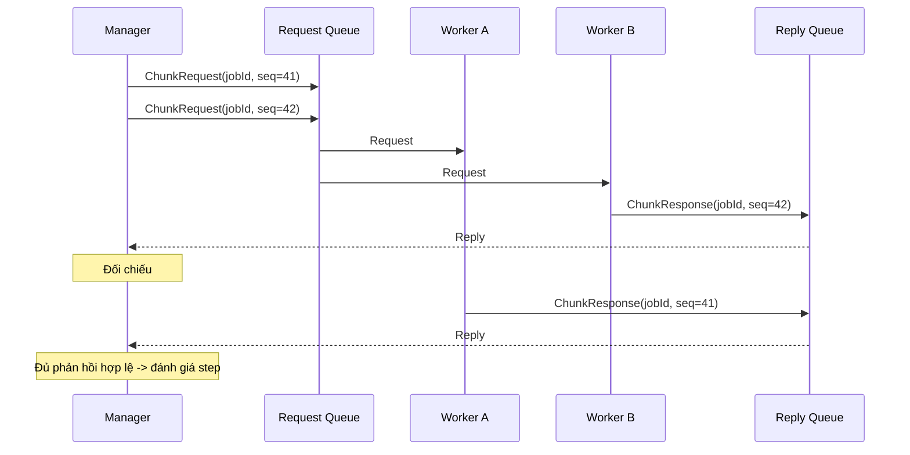
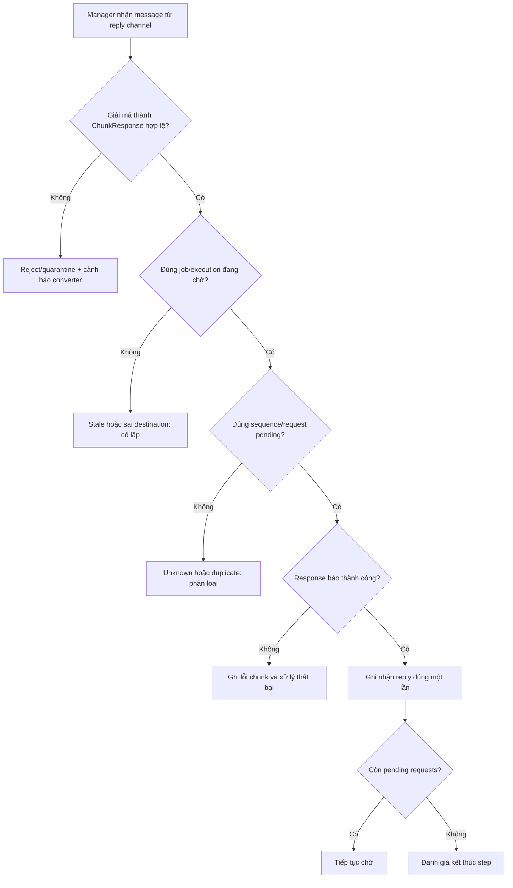
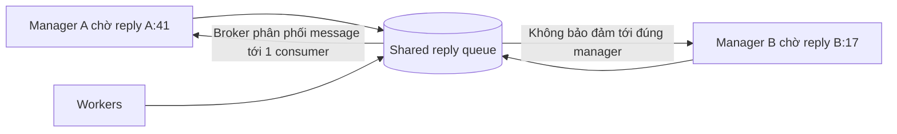
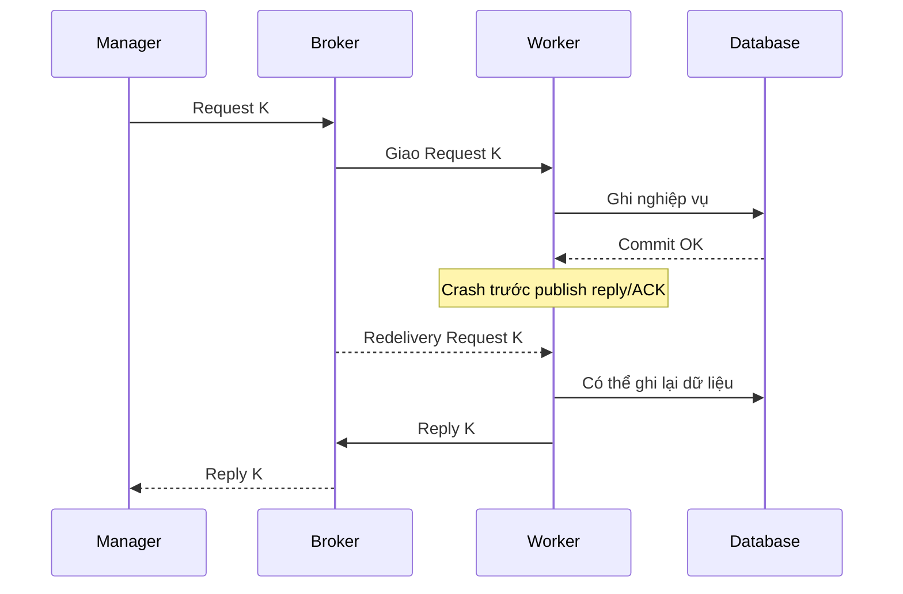

# Correlation giữa chunk request và reply trong Spring Batch Remote Chunking

Trong **remote chunking**, manager đọc dữ liệu, gửi từng `ChunkRequest` qua middleware cho các worker, rồi đợi những `ChunkResponse` tương ứng trước khi kết thúc step. Nếu có nhiều chunk và nhiều worker chạy đồng thời, reply có thể đến **không theo thứ tự gửi**, được giao lại nhiều lần hoặc đến khi manager đã restart. Vì vậy, câu hỏi vận hành quan trọng không phải chỉ là “đã nhận bao nhiêu reply?”, mà là: **reply này thuộc yêu cầu nào, thuộc lần thực thi nào và còn hợp lệ để ghi nhận hay không?**

Bài học thuộc chương **Middleware remote chunking** của module `SPRING_BATCH_SCALING_OPERATIONS`. Trong mục tiêu mở rộng Spring Batch cho workload dữ liệu lớn, ta sẽ làm rõ cơ chế correlation ở payload và broker, thiết kế request/reply an toàn cho nhiều worker, xử lý timeout, duplicate, stale reply, retry/restart, đồng thời đo thông lượng và nút thắt. Phần API minh họa dựa trên **Spring Batch Integration 5.x**; các ví dụ có thêm envelope/audit là **thiết kế ứng dụng**, không mặc định được Spring Batch tạo sẵn.

## 1. Tại sao request–reply cần correlation?

Giả sử manager đọc 300 đơn hàng, chia thành ba chunk, mỗi chunk 100 item. Ba worker nhận xử lý:

```text
Manager gửi:      request #41   request #42   request #43
                         |             |             |
Worker:               worker A      worker B      worker C
Thời gian xử lý:         8 s           2 s          5 s

Thứ tự reply về:  reply #42  ->  reply #43  ->  reply #41
```

Nếu manager đoán “reply đầu tiên chắc là kết quả của request đầu tiên”, kết quả có thể bị ghép sai. Lỗi còn nghiêm trọng hơn nếu:

- Worker xử lý xong, nhưng reply bị mất và request được broker **redeliver**.
- Reply trùng đến sau khi kết quả ban đầu đã được tính vào tiến độ.
- Hai `JobExecution` chạy đồng thời trên cùng hạ tầng nhắn tin.
- Manager restart; reply thuộc lần chạy cũ còn nằm trong queue.
- Request thành công về giao vận nhưng worker trả kết quả `FAILED` do nghiệp vụ.

**Correlation** là tập quy tắc gắn reply với request gốc và quyết định có chấp nhận reply đó vào trạng thái step hiện tại hay không. Đây là yêu cầu về **tính đúng**, không chỉ là tiện ích để tìm log.

## 2. Chuỗi request/reply trong Spring Batch

Mô hình điển hình:



Các vai trò:

| Thành phần | Trách nhiệm đối với correlation |
| --- | --- |
| Manager | Tạo request; biết những chunk đã gửi và kết quả nào đang chờ |
| `ChunkRequest<T>` | Mang item và metadata để worker hiểu chunk nào đang xử lý |
| Worker/`ChunkHandler` | Xử lý chunk và trả response gắn với request ban đầu |
| `ChunkResponse` | Chứa thông tin nhận diện request và kết quả thành công/thất bại |
| Broker | Chuyển request và reply; **không hiểu tự động ngữ nghĩa `StepContribution`** |
| Reply channel/adapter | Đưa reply về manager đúng nơi; không được đánh mất metadata cần thiết |
| `JobRepository` | Lưu trạng thái job/step để theo dõi và restart, **không tự là kho lưu request/reply của broker** |

Remote chunking khác **remote partitioning**: manager remote chunking đọc và phát các **chunk**, còn worker thường xử lý chunk thông qua message flow. Không được suy ra “mỗi worker message = một `StepExecution` riêng” như trong partitioning.

## 3. Trường nhận diện ở payload: jobId và sequence

Trong Spring Batch Integration 5.x, `ChunkRequest<T>` mang các thông tin như `sequence`, `jobId`, `items` và `StepContribution`; `ChunkResponse` phản ánh kết quả xử lý với `sequence`, `jobId`, thông tin đóng góp/trạng thái và chi tiết lỗi theo API của phiên bản đang dùng.

Hình dung logic:

```text
Request:
  jobId: 9182
  sequence: 41
  items: [item-1, ..., item-100]
  contribution: <StepContribution của framework>

Response:
  jobId: 9182
  sequence: 41
  successful: true
  contribution: <kết quả đóng góp của worker>
```

Đây là **biểu diễn ý nghĩa**, không phải JSON wire format mặc định. Khi dùng serializer hoặc adapter tự viết, phải giữ đúng kiểu và hợp đồng của `ChunkRequest`/`ChunkResponse`. Không thể bỏ `StepContribution` hay thay response bằng một JSON `{"ok":true}` rồi kỳ vọng builder chuẩn vẫn xử lý đúng.

**Vì sao chỉ dùng sequence là nguy hiểm?** Sequence `41` có thể được dùng lại ở job/lần chạy khác. Để nhận diện trong không gian có nhiều job, cần ít nhất một ngữ cảnh chạy job cùng với sequence (và khi ứng dụng tự thêm nhiều step/route thì có thể thêm step identity).

Một mô hình kiểm tra hữu ích cho **envelope do ứng dụng thiết kế**:

```text
transportCorrelation =
    (executionAttemptId, stepName, chunkSequence)

businessIdempotency =
    (businessRunId, businessItemId hoặc businessOperationId)
```

Hai khóa phục vụ **hai mục tiêu khác nhau**:

- `transportCorrelation`: reply còn thuộc request đang chờ trong **lần thực thi hiện tại** hay không?
- `businessIdempotency`: nếu nghiệp vụ bị thực hiện lại sau crash/restart, side effect đã được commit trước đó có bị tạo trùng không?

**Không đồng nhất mọi loại ID:** `JobInstance` có thể tồn tại qua nhiều lần restart, trong khi các `JobExecution` là các lần thực thi riêng. Trường `jobId` trong object Spring Batch phải được dùng theo đúng semantics của phiên bản API; không tự mặc định nó chính là `businessRunId` hoặc một broker message ID bền vững. Nếu thêm `executionAttemptId`/`stepName` vào custom envelope, adapter phải map và kiểm chứng chúng ở cả hai chiều.

## 4. Correlation của Spring Batch khác correlation ID của broker

Một message đi qua ít nhất hai lớp metadata:

| Lớp | Thuộc tính minh họa | Mục tiêu | Có tự đồng bộ với lớp còn lại? |
| --- | --- | --- | --- |
| Spring Batch payload | `ChunkRequest.jobId`, `sequence`; reply tương ứng | Liên hệ kết quả với chunk mà framework quản lý | Không mặc định |
| Spring Messaging headers | `correlationId`, `sequenceNumber`, `sequenceSize` hoặc header riêng | Điều phối endpoint/aggregator và tracing khi có cấu hình | Tùy transformer/header mapper |
| AMQP/RabbitMQ properties | `correlationId`, `replyTo`, `messageId` | Route reply và theo dõi ở broker | Tùy adapter/converter |
| JMS headers | `JMSCorrelationID`, `JMSReplyTo`, `JMSMessageID` | Request/reply theo giao thức JMS | Tùy JMS header mapper |
| Nghiệp vụ | `runId`, `invoiceId`, `operationId` | Idempotency và đối soát kết quả cuối | Không |

Ví dụ:

- `messageId` do broker/producer cấp cho một lần phát message **có thể khác** giữa hai lần publish cùng chunk.
- `replyTo` chỉ nơi gửi phản hồi, **không tự cho biết phản hồi thuộc chunk nào**.
- `correlationId` của broker có thể là một mã chuỗi do ứng dụng định nghĩa, nhưng nếu không cấu hình bridge và mapper thì không bảo đảm trùng với `jobId/sequence` trong payload.
- `sequenceNumber`/`sequenceSize` của Spring Integration aggregator là header phục vụ một giao thức kết hợp message; **không tự là `ChunkRequest.sequence`**.

**Nguyên tắc:** dùng metadata payload của framework để tôn trọng protocol remote chunking; dùng broker headers để **định tuyến, truy vết và hỗ trợ đối chiếu**; dùng business key riêng để xử lý lặp an toàn. Không lấy một header thay thế một tầng khác nếu chưa có thiết kế mapping và test rõ ràng.

## 5. Đường đi của một reply đúng

Một response chỉ được ghi nhận khi đáp ứng tất cả điều kiện do giao thức và ứng dụng yêu cầu.



Luồng trên là **logic thiết kế/kiểm chứng**, không mô tả một API cấu hình sẵn tên “ReplyRouter” trong Spring Batch. Một số khâu do `ChunkMessageChannelItemWriter` và các thành phần framework đảm nhận; nếu có nhiều manager, header tùy chỉnh hoặc restart phức tạp, cần kiểm tra hành vi thực tế của phiên bản tích hợp và bổ sung lớp định tuyến/giám sát phù hợp.

**Phân biệt hai điều:**

1. **Reply đã đến:** message xuất hiện ở reply queue hoặc đã được adapter chuyển vào `PollableChannel`.
2. **Reply đã được chấp nhận:** manager xác định đúng request, kết quả hợp lệ và phản ánh trong tiến độ của step.

Queue depth giảm không chứng minh điều (2). Tương tự, nhận đủ N message không chứng minh đã nhận đủ N **request khác nhau**, vì có thể có duplicate.

## 6. Cấu hình channel ở manager và worker

Ví dụ dưới tập trung vào điểm kết nối request/reply của Spring Batch Integration 5.x. Giả sử ứng dụng đã có `JobRepository`, `PlatformTransactionManager`, `ItemReader`, `ItemProcessor`, `ItemWriter` và các adapter broker tương ứng.

### 6.1. Manager sử dụng MessageChannel và PollableChannel

```java
import org.springframework.batch.core.Step;
import org.springframework.batch.core.repository.JobRepository;
import org.springframework.batch.integration.chunk.RemoteChunkingManagerStepBuilder;
import org.springframework.batch.item.ItemReader;
import org.springframework.beans.factory.annotation.Qualifier;
import org.springframework.context.annotation.Bean;
import org.springframework.context.annotation.Configuration;
import org.springframework.integration.channel.DirectChannel;
import org.springframework.integration.channel.QueueChannel;
import org.springframework.messaging.MessageChannel;
import org.springframework.messaging.PollableChannel;
import org.springframework.transaction.PlatformTransactionManager;

@Configuration
class ManagerRemoteChunkConfig {

    @Bean
    MessageChannel managerRequestChannel() {
        return new DirectChannel();
    }

    @Bean
    PollableChannel managerReplyChannel() {
        return new QueueChannel();
    }

    @Bean
    Step invoiceRemoteManagerStep(
            JobRepository jobRepository,
            PlatformTransactionManager tx,
            @Qualifier("invoiceReader") ItemReader<Invoice> reader,
            @Qualifier("managerRequestChannel") MessageChannel requests,
            @Qualifier("managerReplyChannel") PollableChannel replies) {
        return new RemoteChunkingManagerStepBuilder<Invoice, Invoice>(
                    "invoiceRemoteManagerStep", jobRepository)
                .chunk(200)
                .reader(reader)
                .outputChannel(requests)
                .inputChannel(replies)
                .transactionManager(tx)
                .build();
    }
}
```

Tại đây:

- `outputChannel` là đường phát request, thường nối tới **broker outbound adapter**.
- `inputChannel` là đường nhận reply; bản 5.x dùng `PollableChannel`, thường là `QueueChannel` nối từ **broker inbound adapter**.
- `RemoteChunkingManagerStepBuilder` tạo các thành phần manager (bao gồm `ChunkMessageChannelItemWriter`) theo giao thức Spring Batch Integration. Không tự thay bằng `ItemWriter` chỉ gửi danh sách item rồi bỏ reply/contribution.

**Cảnh báo:** `QueueChannel` mặc định là queue **trong bộ nhớ manager JVM**, không phải kho durable. Broker có lưu reply bền vững không và khi nào inbound adapter ACK là một bài toán khác, cần kiểm tra nhất quán để tránh reply biến mất sau crash.

### 6.2. Worker cần phản hồi qua đúng reply channel

```java
import org.springframework.batch.integration.chunk.RemoteChunkingWorkerBuilder;
import org.springframework.batch.item.ItemProcessor;
import org.springframework.batch.item.ItemWriter;
import org.springframework.beans.factory.annotation.Qualifier;
import org.springframework.context.annotation.Bean;
import org.springframework.context.annotation.Configuration;
import org.springframework.integration.channel.DirectChannel;
import org.springframework.integration.dsl.IntegrationFlow;
import org.springframework.messaging.MessageChannel;

@Configuration
class WorkerRemoteChunkConfig {

    @Bean
    MessageChannel workerRequestChannel() {
        return new DirectChannel();
    }

    @Bean
    MessageChannel workerReplyChannel() {
        return new DirectChannel();
    }

    @Bean
    IntegrationFlow invoiceRemoteChunkWorker(
            @Qualifier("workerRequestChannel") MessageChannel requests,
            @Qualifier("workerReplyChannel") MessageChannel replies,
            ItemProcessor<Invoice, Invoice> processor,
            ItemWriter<Invoice> writer) {
        return new RemoteChunkingWorkerBuilder<Invoice, Invoice>()
                .inputChannel(requests)
                .outputChannel(replies)
                .itemProcessor(processor)
                .itemWriter(writer)
                .build();
    }
}
```

Broker adapter phải nối **manager requests → request destination → worker requests** và **worker replies → reply destination → manager replies**. Các bean trong ví dụ chưa cung cấp AMQP/JMS broker configuration, converter, listener container, retry, DLQ hoặc JobLauncher; đây là phần cốt lõi để thấy API và hướng đi của dữ liệu.

`Invoice` là DTO nghiệp vụ do ứng dụng định nghĩa. Nếu worker nhận item là kiểu khác sau deserialize, lỗi conversion có thể xảy ra **trước khi processor chạy**, dẫn đến manager không nhận reply như mong đợi.

## 7. Ví dụ custom correlation envelope rõ ràng

Nếu có nhiều manager hoặc ứng dụng cần audit độc lập với Spring Batch, có thể tạo một **envelope bổ sung** cho transport. Ví dụ Java sau dùng record bất biến để biểu diễn khóa correlation:

```java
import java.util.Objects;

public record ChunkCorrelationKey(
        String executionAttemptId,
        String stepName,
        long chunkSequence) {

    public ChunkCorrelationKey {
        if (executionAttemptId == null || executionAttemptId.isBlank()
                || stepName == null || stepName.isBlank()
                || chunkSequence < 0) {
            throw new IllegalArgumentException("Correlation key không hợp lệ");
        }
    }

    public String toTransportId() {
        return executionAttemptId + ":" + stepName + ":" + chunkSequence;
    }
}

record ChunkReplyEnvelope(
        ChunkCorrelationKey correlation,
        boolean successful,
        String errorCode) {

    ChunkReplyEnvelope {
        Objects.requireNonNull(correlation);
    }
}
```

Đoạn trên là ví dụ cho **protocol ứng dụng**: nó không thay thế các trường `jobId`, `sequence`, `StepContribution` của `ChunkRequest/ChunkResponse` chuẩn. Nếu muốn thêm envelope như vậy vào luồng Spring Batch:

1. Bên manager tạo correlation từ **ID của execution/step hiện tại** và sequence, rồi đính kèm vào message header hoặc wrapper.
2. Bên worker **giữ nguyên** correlation khi trả reply; không tạo ID ngẫu nhiên mới.
3. Bên manager kiểm tra correlation của wrapper với **payload của framework** trước khi chấp nhận.
4. Các adapter AMQP/JMS phải bảo toàn header/custom wrapper ở cả hai chiều; test bằng broker thật.

Trong production, nên dùng encoding không gây nhập nhằng (ví dụ UUID, các trường JSON riêng hoặc length-prefix) thay vì luôn nối chuỗi bằng dấu `:` nếu ID có thể chứa ký tự phân cách. Hàm `toTransportId()` ở đây chỉ minh họa.

### 7.1. Đặt header qua Spring Messaging

```java
import org.springframework.messaging.Message;
import org.springframework.messaging.support.MessageBuilder;

// Ví dụ với envelope ứng dụng đã được kiểm tra hợp lệ.
ChunkReplyEnvelope reply = getReplyFromBusinessHandler();
String correlationId = reply.correlation().toTransportId();

Message<ChunkReplyEnvelope> message = MessageBuilder
        .withPayload(reply)
        .setHeader("batchCorrelationId", correlationId)
        .build();
```

`getReplyFromBusinessHandler()` là **pseudocode thể hiện nơi nhận kết quả**, không phải API Spring Batch. Khi chạy thật cần thực hiện trong một class có method xử lý, không copy các dòng này như file Java độc lập.

Đừng nhầm header `batchCorrelationId` tự đặt với `AmqpHeaders.CORRELATION_ID` hoặc `JMSCorrelationID`. Để broker route/trace bằng correlation ID, cần **mapping tường minh** từ header ứng dụng sang thuộc tính broker (và ngược lại); nếu không, nó chỉ là custom header nội bộ. Đồng thời, worker phải giữ protocol `ChunkResponse` chuẩn nếu đang dùng builders Spring Batch Integration.

## 8. Nhiều manager: reply queue có thể bị “nhận nhầm”

Một lỗi kiến trúc tinh vi xảy ra khi hai manager độc lập cùng nghe một reply queue theo mô hình **competing consumers**:



Nếu reply của A được broker giao cho inbound consumer của B, việc đơn giản là “B thấy ID không khớp và bỏ qua” có thể **làm A mất reply** nếu message đã bị ACK. Không nên thiết kế một queue chung cho các manager chỉ dựa trên hy vọng chúng nhận đúng thông điệp.

Các phương án:

| Topology reply | Ưu điểm | Điểm cần bảo vệ |
| --- | --- | --- |
| Reply queue riêng theo manager instance/attempt | Tránh tranh nhau nhận reply; dễ định tuyến | Restart khi tên queue đổi, cleanup, reply trễ vào queue cũ |
| Reply router/gateway tập trung, có lưu pending correlation | Có thể dùng queue vào chung rồi phân tuyến | Router phải bền vững, tránh mất message giữa ACK và giao tiếp phía trong |
| Reply destination bền vững theo nhóm/job với consumer có quyền sở hữu rõ | Hạn chế tạo queue mới liên tục | Cơ chế cấp quyền sở hữu/lease, failover, stale reply |
| Broker reply-to theo request | Giảm wiring thủ công với một số transport | Adapter/worker phải sao chép reply address đúng cách, xử lý timeout/restart |

Không chọn “tạo reply queue tên random theo lần khởi động” mà không có quy tắc restart: worker có thể đang trả về queue vừa bị xóa. Thiết kế reply destination phải phù hợp vòng đời `JobExecution`, thời gian TTL và chính sách giữ message chưa xử lý.

**Nguyên tắc cho quy mô lớn:** đừng chỉ hỏi “correlation ID có đúng không”, hãy hỏi thêm **message đó có được giao tới đúng process có trạng thái pending hay không**.

## 9. Reply đến trễ, đến sai thứ tự hoặc bị nhân đôi

### 9.1. Out-of-order

Các worker có tốc độ xử lý khác nhau nên reply `#43` có thể đến trước `#41`. Bộ đối chiếu phải dựa trên **khóa correlation**, không dựa vào vị trí trong queue hoặc thời điểm message đến.

### 9.2. Duplicate reply

Worker có thể gửi lại response khi không chắc reply trước đã được broker nhận; broker cũng có thể redeliver reply nếu manager consumer crash sau khi nhận nhưng trước ACK.

Không được tăng số chunk hoàn tất hai lần cho cùng một request. Khi thiết kế lớp audit ứng dụng, dùng idempotent state transition, chẳng hạn `PENDING → ACKNOWLEDGED`; response trùng chỉ được ghi nhận là duplicate.

### 9.3. Late/stale reply

Manager chờ timeout, đánh dấu lần chạy thất bại, rồi job restart. Reply của lần chạy cũ có thể xuất hiện sau đó. Nếu chỉ dựa vào sequence `41`, response có thể bị nhầm với chunk `41` mới.

Quy tắc an toàn là **nhận diện attempt/execution gốc** và giữ một chính sách xử lý stale reply: log và cô lập, không cộng vào pending của attempt mới. Việc một reply cũ có nghĩa worker đã commit thành công cũng phải được xem xét khi quyết định retry business operation — **không** được tự động xóa kết quả đã ghi ngoài DB.

### 9.4. Unknown reply

Response có `jobId`/sequence lạ chưa có yêu cầu đang chờ có thể do route nhầm, hệ thống đang replay dữ liệu cũ, code converter sai hoặc message không đáng tin. Không biến unknown reply thành thành công mặc định; kiểm tra schema, trạng thái attempt và lý do phân tuyến.

## 10. Thiết kế audit và đối chiếu theo trạng thái

Nếu cần quan sát đáng tin hoặc điều phối đa manager, có thể bổ sung **bảng audit của ứng dụng**. Bảng này **không phải bảng mặc định của Spring Batch** và không thay `JobRepository`.

Ví dụ schema tối giản:

```sql
CREATE TABLE chunk_request_audit (
    execution_attempt_id VARCHAR(100) NOT NULL,
    step_name            VARCHAR(150) NOT NULL,
    chunk_sequence       BIGINT NOT NULL,
    status               VARCHAR(24) NOT NULL,
    sent_at              TIMESTAMP NOT NULL,
    replied_at           TIMESTAMP NULL,
    PRIMARY KEY (execution_attempt_id, step_name, chunk_sequence)
);
```

Lúc gửi request, ghi nhận một dòng `PENDING`; khi nhận reply thành công hợp lệ, thực hiện **conditional update**:

```sql
UPDATE chunk_request_audit
   SET status = 'ACKNOWLEDGED',
       replied_at = CURRENT_TIMESTAMP
 WHERE execution_attempt_id = :attemptId
   AND step_name = :stepName
   AND chunk_sequence = :chunkSequence
   AND status = 'PENDING';
```

- **1 row cập nhật:** trạng thái chuyển từ pending sang acknowledged lần đầu.
- **0 row cập nhật:** có thể là reply trùng, reply cũ, request chưa đăng ký hoặc bản ghi đang ở trạng thái lỗi; **phải đọc lại trạng thái để phân loại**, không tự mặc định luôn là duplicate.
- **Reply failure:** cần nhánh xử lý khác, ví dụ `PENDING → FAILED`, lưu mã lỗi và thông tin chẩn đoán an toàn.

Đây là phương án audit **để minh họa tính idempotent của việc ghi nhận reply**, không phải yêu cầu cài bảng này để `RemoteChunkingManagerStepBuilder` chạy được. Nếu bổ sung audit, cần xác định transaction boundary giữa audit, `JobRepository` và broker ACK. Việc ghi audit thành công nhưng framework chưa ghi nhận chunk có thể vẫn cần quy trình recovery/reconciliation.

Không nên chỉ so `COUNT(requests) == COUNT(replies)`; nếu một reply bị duplicate và một request khác mất reply, hai tổng đếm vẫn bằng nhau nhưng job **chưa được trả lời đủ**. Hãy đo **distinct pending keys**.

## 11. Timeout, retry và reply “không tới”

Timeout chỉ nói rằng **manager chưa thấy kết quả đúng hạn**, không chứng minh worker chưa xử lý request. Một số tình huống:

```text
T1: manager gửi request #41
T2: broker chuyển tới worker
T3: worker commit thành công
T4: mạng/broker làm trễ reply
T5: manager hết thời gian chờ và báo lỗi
T6: reply #41 đến muộn
```

Nếu tại T5 hệ thống gửi lại yêu cầu một cách mù quáng, worker có thể xử lý item lần hai. **Retry request phải đi cùng idempotency ở nơi ghi nghiệp vụ**, và nên xem xét có message in-flight hay không.

Các loại timeout cần phân biệt:

| Timeout | Dấu hiệu | Việc cần kiểm tra |
| --- | --- | --- |
| Publish timeout | Manager chưa chắc broker đã nhận request | Publisher confirm, routing, network |
| Queue wait quá lâu | Message chờ worker rảnh | Queue depth/age, consumer count, prefetch |
| Worker processing timeout | Worker xử lý DB/API quá lâu | DB locks, transaction time, external SLA |
| Reply route timeout | Worker xong nhưng reply không về manager | Reply destination, header mapping, converter, consumer |
| Manager receive timeout | `PollableChannel` không cung cấp reply đúng lúc | ACK boundary, channel capacity, pending correlation |
| Job/step timeout | Chờ quá lâu khiến job/step kết thúc lỗi | Metadata, restart và stale reply |

Trong `ChunkMessageChannelItemWriter`/cấu hình manager có các tham số điều khiển khoảng chờ phản hồi tùy phiên bản. Đặt giá trị theo **p95/p99 thời gian xử lý chunk + độ trễ queue/mạng + headroom**, không đơn giản sao chép timeout của HTTP client. Đừng tăng timeout vô hạn để che reply route sai hoặc worker chết.

### Retry ở nhiều tầng

Đánh dấu rõ từng tầng có thể retry:

1. **Broker redelivery** request khi worker chưa ACK.
2. **Worker retry** processor/writer do lỗi tạm thời.
3. **Manager/job restart** do step thất bại hoặc mất reply.

Nếu cả ba tầng retry không giới hạn, một lỗi cố định có thể gây **retry storm**. Giới hạn lần thử, backoff, DLQ và quy tắc coi request nào đã hoàn thành phải được xác định trước.

## 12. ACK, commit và correlation không tạo exactly-once

Một sơ đồ lỗi rất điển hình:



Ở ví dụ này, **correlation giúp manager biết reply thuộc K**, nhưng **không tự ngăn worker ghi lần hai**. Cần:

- Business key/unique constraint hoặc dedupe inbox cập nhật **cùng transaction** với business write.
- Idempotency key bền vững qua retry và restart, khác với transport message ID có thể thay đổi.
- Nếu side effect gửi email, thanh toán, event không nằm trong DB transaction, dùng idempotency ở dịch vụ đích hoặc outbox/thiết kế tương đương.
- Phân tích thứ tự **DB commit → reply publish → broker ACK** theo listener/transaction manager thực tế; giữa các điểm luôn có thể có crash nếu không có cơ chế nhất quán.

**Không thể đạt exactly-once end-to-end chỉ bằng một header `correlationId`**. Cần kiểm thử kill worker ở các mốc transaction để xác minh kết quả nghiệp vụ cuối cùng không trùng.

## 13. Correlation khi restart cùng JobInstance

Ví dụ:

| Thời điểm | JobInstance | JobExecution/lần thử | Chunk | Trạng thái |
| --- | --- | --- | --- | --- |
| Lần đầu | `billing-date-2026-11-26` | Attempt A | `#41` | Đã gửi, chưa nhận reply |
| Sau crash | Cùng JobInstance | Attempt B | `#41` hoặc vùng dữ liệu tương đương | Có thể phát lại tùy checkpoint |
| Trễ mạng | Cùng JobInstance | Attempt A | Reply `#41` | Đến sau khi Attempt B bắt đầu |

Ở một lần restart, **JobExecution mới có định danh thực thi mới**, trong khi `JobInstance` và identifying `JobParameters` vẫn biểu diễn cùng job logic. Đồng thời, dữ liệu trong step context/reader có thể được phục hồi từ checkpoint.

Thiết kế an toàn cần:

1. Phân biệt reply của **Attempt A** và **Attempt B**, không match chỉ theo `chunkSequence`.
2. Giữ cách chọn **input snapshot/cutoff** nhất quán; nếu đọc lại nguồn đã biến đổi, có thể phát chunk khác nội dung nhưng dùng cùng sequence.
3. Đối chiếu các side effect đã commit của Attempt A để Attempt B không tạo duplicate.
4. Xác định vòng đời của reply queue, retry policy và cleanup khi manager cũ mất.
5. Không tự chỉnh trạng thái bảng `BATCH_JOB_EXECUTION`/`BATCH_STEP_EXECUTION` để “ép hoàn thành”; hãy dùng cơ chế restart và recovery theo contract Spring Batch.

**Lưu ý với giao thức chuẩn:** cách `ChunkRequest.jobId` được gắn với execution và cách framework theo dõi sequence phải được kiểm chứng theo phiên bản Spring Batch Integration đang dùng. Mẫu `executionAttemptId` trong bài là **phương án nâng cao ở tầng ứng dụng**, không khẳng định builder chuẩn tự thêm field này vào payload.

## 14. Header mapping và serialization: mất một trường có thể mất reply

Thành công khi gửi message không đảm bảo metadata correlation đã đi qua đủ bốn điểm:

```text
Manager outbound
  -> broker request
  -> worker inbound
  -> worker outbound
  -> broker reply
  -> manager inbound
```

Với AMQP/JMS, kiểm tra:

- Payload deserialize thành đúng `ChunkRequest`/`ChunkResponse` (hoặc bridge chuyển đúng kiểu) với `jobId`, `sequence` và contribution được bảo toàn.
- Header `correlationId` / custom `batchCorrelationId` còn sau adapter; kiểm tra whitelist/default mapper chứ không chỉ set header trong Java.
- `replyTo` hoặc reply routing key không bị rơi khi worker tạo reply; nếu topology dùng reply queue cố định thì kiểm tra queue/binding thực tế.
- Message converter hai chiều tương thích cùng schema/version.
- Không tạo ID mới cho request khi redelivery nếu ID ấy là khóa dedupe của ứng dụng.

Một integration test nên log **hash hoặc mã ID**, kích thước payload, header đã mask và thời điểm qua từng chặng; không log toàn bộ payload chứa dữ liệu nhạy cảm. Với schema thay đổi, test cả manager cũ ↔ worker mới và manager mới ↔ worker cũ trước rolling deployment.

## 15. Quan sát và đo nút thắt bằng correlation

Correlation là chìa khóa liên kết log giữa manager, broker và worker. Mỗi sự kiện có thể ghi:

```text
event=request_published
jobExecutionId=9182
chunkSequence=41
correlationId=attempt-A:invoiceRemoteManagerStep:41

event=worker_committed
correlationId=attempt-A:invoiceRemoteManagerStep:41
durationMs=840

event=reply_received
correlationId=attempt-A:invoiceRemoteManagerStep:41
outcome=accepted
```

Đây là mẫu log **tự thiết kế**, không phải trường mặc định Spring Batch luôn phát ra. Nên đo:

| Metric | Câu hỏi được trả lời |
| --- | --- |
| `requestsSent`, `uniqueRepliesAccepted`, `pendingRequests` | Manager còn chờ bao nhiêu request thực sự? |
| `duplicateReplies`, `staleReplies`, `unknownReplies` | Có lỗi routing, retry hoặc restart không nhất quán? |
| `requestToReplyLatency` p50/p95/p99 | End-to-end có chậm do queue, worker hay reply path? |
| Request/reply queue depth và message age | Nghẽn ở chiều nào? |
| Worker processing duration, DB lock/connection wait | Worker có phải nút thắt không? |
| Redelivery, DLQ, conversion errors | Broker/serializer có làm mất hoặc nhân việc? |
| Dữ liệu commit thực, duplicate business key | Đúng nghiệp vụ sau retry/restart không? |

**Tránh metric cardinality cao:** không gắn mỗi `jobExecutionId` hay `chunkSequence` thành label Prometheus/Micrometer cho hàng triệu chunk. Dùng log/tracing để truy vết ID chi tiết, còn metric tổng hợp theo tên job, step, loại lỗi và worker pool.

Để tìm giới hạn song song, chạy nhiều mức consumer concurrency (ví dụ 1, 2, 4, 8) với dataset giống nhau; so throughput, pending reply, DB locks và CPU. Nếu worker xử lý xong nhanh nhưng `reply_received` trễ, hãy sửa **reply routing/consumer/converter** trước khi tăng worker.

## 16. Các tình huống lỗi và cách xử lý

| Triệu chứng | Giả thuyết | Bước chẩn đoán đầu tiên |
| --- | --- | --- |
| Request queue rỗng, manager vẫn chờ | Reply chưa đến hoặc không đối chiếu được | Kiểm tra reply queue, correlation và pending keys |
| Reply queue có message, `PollableChannel` không có | Adapter inbound/ACK/converter lỗi | Trace inbound adapter và error channel |
| Hai manager đều log unknown reply | Cùng tiêu thụ shared reply queue | Xác định owner/destination của từng reply |
| `requestsSent == repliesReceived` nhưng chưa hoàn thành | Duplicate reply bù cho request mất reply | Đếm **distinct accepted correlation keys** |
| Reply A đến sau restart B | Stale reply | Phân biệt attempt và quarantine |
| Worker commit rồi broker redeliver | Crash trước reply/ACK | Kiểm tra idempotency của business writer |
| Reply thất bại vẫn bị tính “đã xong” | Chỉ đếm reply, bỏ qua trạng thái `successful` | Phân biệt ACK về giao vận với kết quả xử lý chunk |
| Converter báo sai type | Header/content-type hoặc DTO không tương thích | Kiểm tra cả payload và header mapper |
| Queue reply tăng nhanh | Manager nhận chậm, channel capacity hoặc route lỗi | Đo poll latency và consumer throughput |
| Một chunk chờ vô hạn | Reply bị mất, timeout vô hạn | Giới hạn wait/retry và cơ chế phục hồi rõ |

### Quy trình xử lý một incident

1. Xác định `JobExecution` và step lỗi, lưu trạng thái metadata trước khi can thiệp.
2. Lấy một correlation key bị pending; truy vết request publish → broker delivery → worker result → reply publish → manager receive.
3. Xác định **chặng mất** và liệu worker đã commit nghiệp vụ hay chưa.
4. Kiểm tra message trùng/late/stale cùng key, nhưng không xóa queue toàn bộ chỉ để giảm backlog.
5. Áp dụng retry/restart theo runbook, có idempotency và kiểm chứng dữ liệu cuối.
6. Bổ sung metric/cảnh báo để cùng dạng lỗi được phát hiện sớm lần sau.

## 17. Bài lab và kiểm thử failure injection

Chuẩn bị môi trường test có broker thật, một manager, hai worker, `chunkSize=50` và 500 bản ghi nghiệp vụ duy nhất. Đầu vào không đổi giữa các phép thử. Kiểm chứng ít nhất:

1. **Happy path:** tất cả request có reply hợp lệ; manager hoàn tất và bảng kết quả có đúng 500 business key.
2. **Đảo thứ tự:** làm worker A xử lý chunk `#1` chậm hơn worker B xử lý `#2`; đảm bảo không ghép sai `StepContribution`.
3. **Duplicate reply:** cố tình publish lại một reply cùng correlation ở tầng test; không được cộng kết quả chunk hai lần.
4. **Mất reply:** chặn đường worker reply outbound trong thời gian giới hạn; quan sát pending và timeout, không kết luận “DB chưa commit” chỉ từ timeout.
5. **Hai manager:** chạy đồng thời hai `JobExecution`, xác minh destination/correlation không cho manager này nhận mất reply của manager kia.
6. **Restart:** kill manager rồi restart cùng `JobInstance`; gửi late reply từ attempt cũ và đảm bảo không áp nhầm vào attempt mới.
7. **Crash sau commit:** kill worker ở cửa sổ sau DB commit trước reply/ACK; kiểm tra idempotency, duplicate delivery và trạng thái job cuối.
8. **Lỗi chuyển đổi:** thay đổi header/schema trong môi trường test để xem response bị reject/quarantine, không requeue vô hạn.

Kết quả cần ghi bằng bảng:

| Test case | Request unique | Reply accepted unique | Duplicates/stale | Business rows đúng | Job outcome |
| --- | ---: | ---: | ---: | ---: | --- |
| Happy path | Theo dữ liệu thật | Bằng số request | 0 | 500 | `COMPLETED` |
| Out-of-order | Không đổi | Bằng số request | 0 | 500 | `COMPLETED` |
| Duplicate reply | Không đổi | Không tăng | ≥1 duplicate | 500 | Theo chính sách |
| Late reply sau restart | Tùy checkpoint | Không cộng nhầm attempt | ≥1 stale | 500 | Theo chính sách restart |
| Worker crash sau commit | Có thể có redelivery | Theo request hợp lệ | Có thể có duplicate | 500 | `COMPLETED` sau phục hồi đúng |

Bảng là **tiêu chí mong đợi**, không phải số liệu đã chạy. Nếu driver test tự publish reply giả mà đi ngoài giao thức chuẩn, cần tách nó khỏi môi trường production và không để làm hỏng trạng thái thực của `ChunkMessageChannelItemWriter`.

## 18. Bài tập tự kiểm tra

**Câu 1.** Manager gửi sequence `7`, `8`, `9`. Worker trả `9` trước. Manager nên làm gì?

**Đáp án:** Đối chiếu reply `9` theo ngữ cảnh job/execution và request pending `9`. Không gán kết quả đó cho `7` chỉ vì nó là reply đầu tiên.

**Câu 2.** Có hai job chạy đồng thời, đều phát sequence `15`. Chỉ dùng số `15` làm correlation có đủ không?

**Đáp án:** Không. Phải gắn thêm định danh phạm vi job/execution (và step khi cần), rồi kiểm tra reply đúng attempt.

**Câu 3.** Manager A và B cùng consume một reply queue. B nhận reply của A, thấy không khớp và ACK. Correlation ID đã giải quyết được sự cố chưa?

**Đáp án:** Chưa. Correlation giúp phát hiện nhận sai, nhưng ACK nhầm khiến A mất reply. Cần routing hoặc ownership/requeue/quarantine có thiết kế để message tới đúng manager.

**Câu 4.** Worker đã commit DB rồi crash trước khi reply được gửi. Một request được broker giao lại. Chỉ thêm `correlationId` có bảo đảm không trùng dữ liệu?

**Đáp án:** Không. Cần idempotency ở tầng nghiệp vụ hoặc cơ chế transaction phù hợp; correlation chỉ giúp ghép request/reply.

**Câu 5.** Tổng 100 request và 100 reply. Một request có 2 reply, một request không có reply. Có thể đánh dấu job hoàn tất chỉ bằng hai tổng đếm?

**Đáp án:** Không. Chỉ có 99 request khác nhau được trả lời. Phải đếm số key hợp lệ được chấp nhận lần đầu và xác định request còn pending.

**Câu 6.** Reply thuộc Attempt A đến khi Attempt B đã restart cùng `JobInstance`. Có nên tự tăng completion counter của B?

**Đáp án:** Không. Phải xác định ngữ cảnh execution và trạng thái nghiệp vụ đã commit; reply cũ được phân loại stale hoặc xử lý bằng quy trình recovery được thiết kế rõ, không match chỉ theo sequence.

## 19. Tài liệu đối chiếu

- [Spring Batch — Scaling and Parallel Processing / Remote Chunking](https://docs.spring.io/spring-batch/reference/scalability.html): luồng manager/worker và các mô hình mở rộng.
- [Spring Batch 5.2 API — ChunkRequest](https://docs.spring.io/spring-batch/docs/5.2.x/api/org/springframework/batch/integration/chunk/ChunkRequest.html): request, `jobId`, `sequence` và contribution.
- [Spring Batch 5.2 API — ChunkResponse](https://docs.spring.io/spring-batch/docs/5.2.x/api/org/springframework/batch/integration/chunk/ChunkResponse.html): response và thông tin kết quả chunk.
- [Spring Batch 5.2 API — ChunkMessageChannelItemWriter](https://docs.spring.io/spring-batch/docs/5.2.x/api/org/springframework/batch/integration/chunk/ChunkMessageChannelItemWriter.html): phía manager gửi và nhận chunk qua messaging.
- [Spring Batch 5.2 API — RemoteChunkingManagerStepBuilder](https://docs.spring.io/spring-batch/docs/5.2.x/api/org/springframework/batch/integration/chunk/RemoteChunkingManagerStepBuilder.html): cấu hình `outputChannel` và `inputChannel`.
- [Spring Batch 5.2 API — RemoteChunkingWorkerBuilder](https://docs.spring.io/spring-batch/docs/5.2.x/api/org/springframework/batch/integration/chunk/RemoteChunkingWorkerBuilder.html): worker request/reply flow.
- [Spring Integration — Messaging Channels](https://docs.spring.io/spring-integration/reference/channel.html): `MessageChannel`, `QueueChannel` và truyền message trong ứng dụng.
- [Spring Integration — AMQP Support](https://docs.spring.io/spring-integration/reference/amqp.html): adapter, header và định tuyến qua RabbitMQ.

**Ghi nhớ:** correlation giữa `ChunkRequest` và `ChunkResponse` phải giải quyết **đúng request, đúng execution, đúng step và đúng trạng thái pending**, chứ không chỉ thêm một chuỗi `correlationId` lên message. Khi nhiều worker và nhiều manager hoạt động, cần cả **định tuyến reply chính xác, deduplication, timeout/restart, idempotency của writer và quan sát end-to-end**. Một reply đến được broker chưa chắc đã là một chunk được manager ghi nhận thành công.
