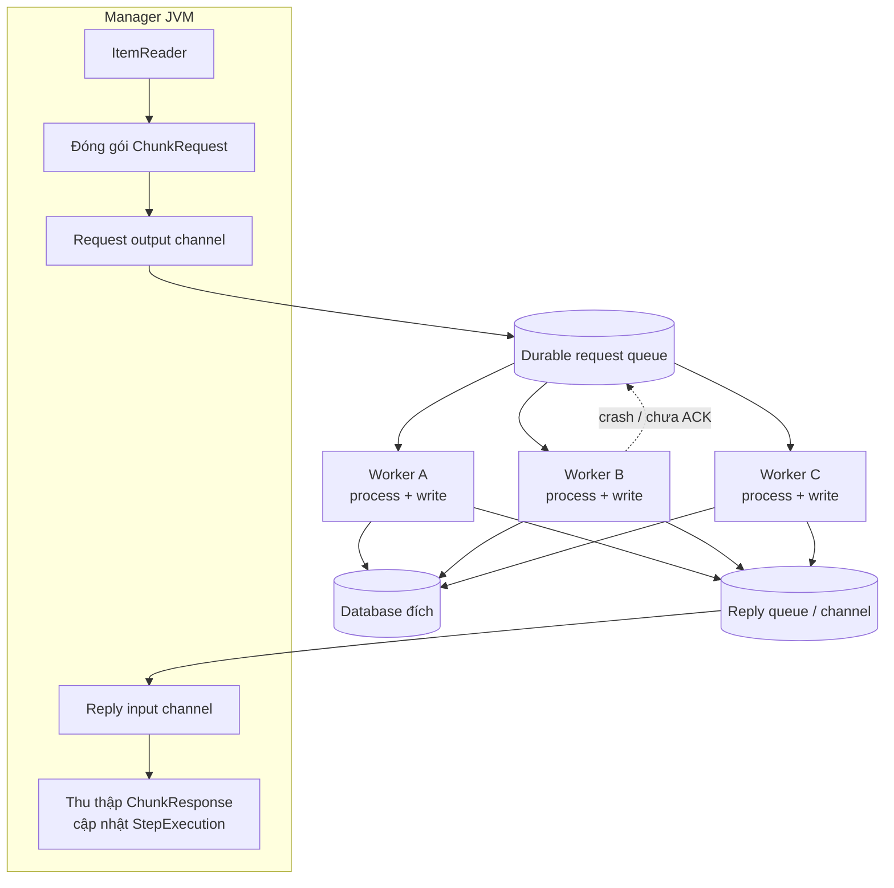
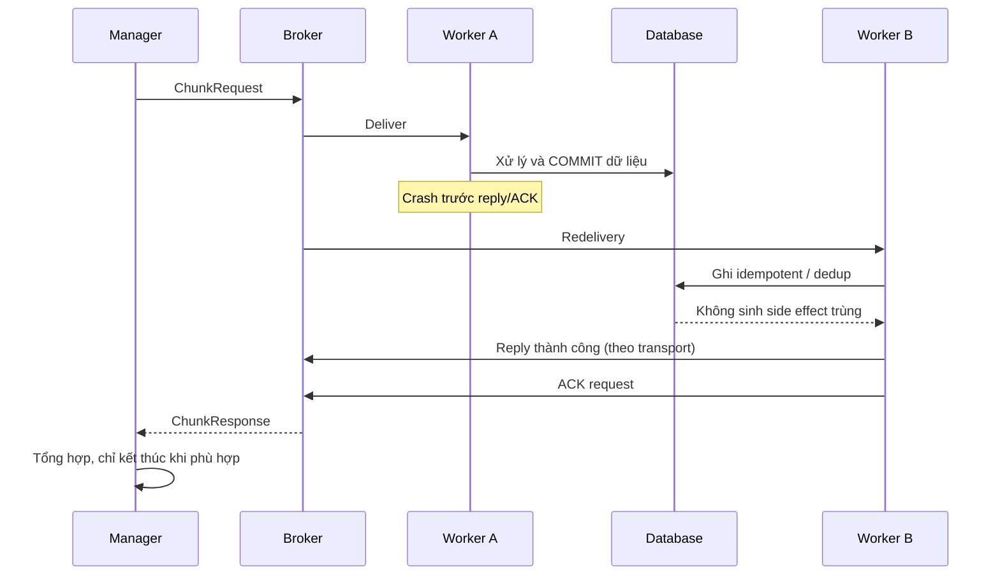

# Redelivery chunk khi worker lỗi trong Spring Batch Remote Chunking

> **Chương:** Middleware remote chunking  
> **Mục tiêu:** Hiểu cách message middleware giao lại chunk khi worker gặp lỗi/crash, phân biệt ACK của broker với kết quả xử lý của Spring Batch, xây dựng writer idempotent, chọn retry/DLQ hợp lý và kiểm thử restart khi mở rộng workload lên nhiều JVM. Các ví dụ Spring Batch dùng **5.2.x**, Java 17 và Spring Integration.

## 1. Tình huống: Worker chết sau khi nhận chunk

Một job nhập 10 triệu giao dịch có **manager** đọc dữ liệu và chia thành các chunk 100 item. Manager gửi chunk đến một message broker. Nhiều worker ở những JVM khác nhau cùng nhận chunk, chuẩn hóa giao dịch rồi ghi vào PostgreSQL.

Trong lúc worker B đang xử lý một chunk, process của B bị kill. Câu hỏi quan trọng không phải chỉ là “broker có phát lại message không?”, mà là:

- Broker có biết worker **chưa hoàn thành** hay không?
- Chunk đã ghi thành công vào database **trước khi worker chết** chưa?
- Reply đã tới manager chưa?
- Nếu chunk được giao cho worker C, các bản ghi có **bị ghi trùng** không?
- Job có được báo `COMPLETED` nếu reply bị mất không?
- Khi restart JobInstance, manager có đọc/gửi lại các item đã được commit không?

**Redelivery** là việc message middleware giao lại **cùng yêu cầu chunk** cho một consumer sau một tình huống như consumer mất kết nối, xử lý thất bại, transaction broker rollback hoặc yêu cầu chưa được ACK theo cấu hình. Redelivery là nền tảng để phục hồi, **không phải lời bảo đảm mỗi item chỉ được ghi đúng một lần**.

### Ví dụ minh họa

```text
t0  manager          publish chunk #42 (100 giao dịch) vào request queue
t1  broker           giao chunk #42 cho worker B
t2  worker B         ghi dữ liệu xuống DB
t3  worker B         chết trước khi hoàn tất ACK / reply
t4  broker           giao lại chunk #42 cho worker C
t5  worker C         xử lý lại những item của chunk #42
t6  manager          nhận reply thành công / thất bại để quyết định step
```

Tại `t3` có thể đã commit một phần hoặc toàn bộ hiệu ứng của chunk, tùy ranh giới transaction trong worker. Do đó worker C **phải xử lý an toàn khi nhận lại cùng request**, kể cả khi B thật ra đã ghi thành công.

## 2. Vị trí của middleware trong kiến trúc remote chunking

Spring Batch remote chunking không giống remote partitioning:

- **Remote chunking:** Manager có `ItemReader`, đóng gói các item thành chunk rồi gửi đi. Worker nhận chunk và dùng `ItemProcessor`/`ItemWriter` để xử lý. Manager thu thập kết quả từ reply của workers.
- **Remote partitioning:** Manager gửi mô tả partition; mỗi worker chạy **một Step độc lập**, thường có reader, processor, writer và `StepExecution` riêng.

Trong remote chunking, công việc đọc vẫn tập trung ở manager. Mô hình phù hợp khi chi phí **process/write** đủ lớn để bù cho chi phí gửi message; không phù hợp nếu manager đọc source quá chậm, message quá lớn hoặc database đích đã bão hòa.



Các thành phần Spring Batch Integration **5.2.x** liên quan:

| Thành phần | Ở đâu? | Trách nhiệm |
| --- | --- | --- |
| `RemoteChunkingManagerStepBuilder` | Manager | Tạo manager step với writer gửi request thay cho writer nghiệp vụ |
| `ChunkMessageChannelItemWriter` | Manager | Gửi `ChunkRequest` và thu thập `ChunkResponse` để tích hợp vào step |
| `RemoteChunkingWorkerBuilder` | Worker | Xây `IntegrationFlow` nhận chunk, dùng processor/writer, phát reply |
| `ChunkProcessorChunkHandler` | Worker | Xử lý một request qua `ChunkProcessor` |
| `ChunkRequest<T>` | Trên wire | Yêu cầu chứa items/metadata cần thiết của chunk |
| `ChunkResponse` | Trên wire | Kết quả xử lý kèm thông tin đóng góp cho step |
| JMS / AMQP + Spring Integration adapters | Middleware | Vận chuyển, queue, ACK/nack, redelivery, DLQ, routing |

Theo kiến trúc remote chunking, middleware phải hỗ trợ vận chuyển **bền vững** và chỉ phân phối một bản sao của message cho **một consumer tại một thời điểm** trong trạng thái bình thường. Tuy nhiên, sau lỗi vẫn có thể **giao lặp theo thời gian**. Không diễn giải “single consumer” thành “không bao giờ có duplicate”.

## 3. ACK của broker khác ChunkResponse của Spring Batch

Đây là điểm dễ nhầm nhất khi triển khai.

| Tín hiệu | Ai phát ra? | Ý nghĩa |
| --- | --- | --- |
| **Broker delivery** | JMS/AMQP broker | Request đã được giao cho một consumer |
| **ACK/commit nhận message** | Listener container / consumer theo cấu hình | Broker có thể loại request khỏi queue vì được coi là đã xử lý xong ở tầng messaging |
| **DB commit** | Transaction manager của worker | Dữ liệu do writer ghi đã commit trong tài nguyên tương ứng |
| **`ChunkResponse`** | Worker/Spring Batch Integration | Worker thông báo kết quả chunk để manager tổng hợp |
| **Manager step `COMPLETED`** | Spring Batch manager | Step tổng hợp đã đáp ứng điều kiện hoàn tất của cơ chế xử lý và phản hồi |

**Không được coi ACK và DB commit là một hành động nguyên tử** nếu không có cơ chế transaction phối hợp rõ ràng. Chúng thường thuộc **hai hệ thống khác nhau**.

Một số cấu hình nguy hiểm:

- **ACK quá sớm:** Broker thấy request thành công trước khi DB commit. Worker crash sau ACK nhưng trước commit → broker có thể **không redeliver**; chunk nguy cơ mất.
- **ACK sau commit:** DB đã ghi nhưng ACK chưa hoàn thành. Worker crash → broker redeliver; chunk có thể **bị xử lý lại**.
- **Reply trước DB commit:** Manager có thể thấy thành công khi DB vẫn có thể rollback → kết quả sai.
- **DB commit rồi reply thất lạc:** Worker đã hoàn thành nhưng manager chưa biết; manager phải có đường timeout/recovery và worker phải idempotent nếu request đến lần nữa.

Thứ tự xử lý khuyến nghị về mặt logic:

```text
receive request → validate → process → DB commit → prepare/publish reply → broker ACK
```

Đây là **mục tiêu thiết kế**, không phải thứ tự được mọi JMS/AMQP adapter bảo đảm mặc định. Ngay cả khi theo thứ tự này vẫn tồn tại cửa sổ crash giữa DB commit và reply/ACK; do đó phải có dedup/idempotency và thử nghiệm mất kết nối.

### Timeline sau DB commit nhưng trước ACK



Thứ tự gửi reply và ACK thực tế phải xét transaction của listener container, outbound adapter và broker, không chỉ nhìn sơ đồ.

## 4. Bảo đảm delivery nào là thực tế?

Trong hệ phân tán, một worker không thể tự phân biệt mọi trường hợp “worker trước đã commit hay chưa” chỉ bằng việc nhận request. Hai kịch bản sau có thể trông giống nhau từ phía broker:

- Worker A chết **trước khi commit DB**.
- Worker A commit DB **thành công nhưng chết trước khi ACK**.

Ở cả hai, broker có thể gửi lại request. Vì vậy một lựa chọn phổ biến là:

**At-least-once delivery + xử lý idempotent + giám sát/đối soát.**

- **At-most-once:** Không cố giao lại sau một số kiểu lỗi; rủi ro mất công việc.
- **At-least-once:** Request có thể được giao lại; cần chịu được duplicate.
- **Exactly-once effect:** Là mục tiêu **nghiệp vụ end-to-end**, đạt được nhờ transaction, idempotency, khóa duy nhất và quy trình phục hồi; không phải thuộc tính tự động của `@Transactional` hay “durable queue”.

Một broker có thể cung cấp transaction/ack semantics mạnh cho **chính broker**, nhưng không có nghĩa một DB khác được tự động tham gia cùng atomic commit. Distributed/XA transaction là lựa chọn hạ tầng riêng, có chi phí và giới hạn vận hành đáng kể; **không mặc định tồn tại** trong remote chunking.

## 5. Những tình huống worker lỗi và tác động của redelivery

| Sự cố | Request có thể được redeliver? | Rủi ro cần giải quyết |
| --- | --- | --- |
| Worker chết trước khi nhận request | Có, nếu request đã được publish bền vững | Request còn ở queue; worker khác tiếp tục |
| Worker nhận rồi chết trước DB commit, chưa ACK | Có, khi broker requeue theo cấu hình | Xử lý lại an toàn; transaction chưa commit rollback |
| Worker commit DB rồi chết trước ACK | Có | Duplicate write/side effect nếu writer không idempotent |
| Consumer ACK trước DB commit rồi chết | **Có thể không** | Mất chunk: ACK sớm là lỗi thiết kế delivery |
| DB ghi thành công, reply không tới manager | Có thể không tự redeliver nếu request đã ACK | Manager chờ/timeout; cần reconcile hoặc chủ động retry an toàn |
| Manager chết trong lúc request còn in-flight | Phụ thuộc trạng thái queue, reply và checkpoint | Chunk có thể được xử lý khi manager vắng mặt |
| Worker ném lỗi dữ liệu không thể sửa | Có thể redeliver lặp nếu cấu hình sai | Poison message, cần giới hạn redelivery/DLQ |
| Broker restart | Chỉ khôi phục message được cấu hình lưu bền vững | Queue/message persistence và confirm của publisher |
| Hai worker xử lý duplicate do sự cố mạng/lease | Có thể xảy ra trong mô hình custom | Concurrent dedup, unique key, tránh cùng side effect |

**Không coi mọi broker đều mặc định requeue message chưa xử lý.** JMS và AMQP có cơ chế ACK/transaction/requeue riêng; kết quả phụ thuộc listener container, acknowledgment mode, channel transaction, policy broker và cấu hình queue durability.

## 6. Thiết kế khóa idempotency cho chunk và từng item

Có **hai tầng định danh** khác nhau.

### Tầng request/chunk

`ChunkRequest` của Spring Batch chứa thông tin tương quan như step execution và sequence. Với hệ thống lưu dedup tùy chỉnh, có thể định danh một **lần gửi request** bằng tuple:

```text
requestIdentity = service + jobExecutionId + stepExecutionId + chunkSequence
```

Giữ nguyên identity khi **broker redeliver cùng request**. Nếu tạo message mới khi resend và thay sequence tùy ý, dedup theo request có thể không nhận ra yêu cầu cũ.

Nhưng **khóa request không đủ cho restart**: khi restart cùng JobInstance, một `JobExecution`/`StepExecution` mới có thể khiến request identity thay đổi dù item nghiệp vụ giống nhau.

### Tầng business item

Cần thêm khóa ổn định độc lập với lần chạy:

```text
itemIdentity = sourceSystem + sourceRecordId + businessVersion
```

Ví dụ `sourceSystem=accounting`, `sourceRecordId=INV-00127`, `businessVersion=3`. Tùy nghiệp vụ, khóa có thể đơn giản hơn (chỉ `sourceRecordId`) hoặc cần thêm version để không ghi đè sự kiện cập nhật hợp lệ.

| Khóa | Bảo vệ tốt nhất ở đâu? | Giới hạn |
| --- | --- | --- |
| Request/chunk ID | Cùng request được giao lại do broker/worker lỗi | Không chắc nhận ra item được đọc lại ở JobExecution mới |
| Item business key | Ghi một bản ghi nghiệp vụ nhiều lần | Cần thiết kế version và nghĩa của conflict |
| Event ID | Xử lý side effect/event tối đa một lần theo contract | Phải được duy trì từ source đến target |
| Database unique constraint | Ngăn row trùng ở tầng lưu trữ | Không tự ngăn email/HTTP call trùng |

**Đừng đặt ID sinh ngẫu nhiên mỗi lần xử lý vào item để chống trùng.** Hai lần redelivery sẽ có ID khác nhau và mất tác dụng.

## 7. Writer idempotent: Ví dụ PostgreSQL và Spring Batch worker

Giả sử mỗi invoice đến từ nguồn có `source_record_id` **bất biến**. Một bảng có unique key:

```sql
CREATE TABLE invoice_import (
    source_record_id VARCHAR(120) PRIMARY KEY,
    amount NUMERIC(18, 2) NOT NULL,
    source_hash VARCHAR(64) NOT NULL
);
```

Với dữ liệu bất biến, chiến lược tối thiểu là `INSERT ... ON CONFLICT DO NOTHING`. Cùng một record gửi lại sẽ không tạo thêm hàng.

```java
package com.example.batch.remote;

import java.math.BigDecimal;
import org.springframework.batch.item.ItemWriter;
import org.springframework.context.annotation.Bean;
import org.springframework.jdbc.core.JdbcTemplate;
import org.springframework.transaction.PlatformTransactionManager;
import org.springframework.transaction.support.TransactionTemplate;

public class IdempotentInvoiceWriterConfig {

    public record Invoice(
            String sourceRecordId,
            BigDecimal amount,
            String sourceHash) {}

    @Bean
    public ItemWriter<Invoice> invoiceWorkerWriter(
            JdbcTemplate jdbc,
            PlatformTransactionManager workerTransactionManager) {

        TransactionTemplate tx = new TransactionTemplate(
                workerTransactionManager);

        return chunk -> tx.executeWithoutResult(status -> {
            for (Invoice item : chunk) {
                jdbc.update("""
                    INSERT INTO invoice_import
                        (source_record_id, amount, source_hash)
                    VALUES (?, ?, ?)
                    ON CONFLICT (source_record_id) DO NOTHING
                    """,
                    item.sourceRecordId(),
                    item.amount(),
                    item.sourceHash());
            }
        });
    }
}
```

**Những điều phải hiểu trước khi dùng mẫu:**

1. `TransactionTemplate` mở/ghép transaction ở **worker thread đang chạy writer**. Nó đảm bảo các JDBC writes bên trong cùng transaction nếu `JdbcTemplate` dùng `DataSource` do transaction manager này quản lý.
2. Khi broker redeliver sau DB commit, insert trùng key sẽ không tạo row mới. Tuy nhiên `DO NOTHING` **có thể che giấu sự khác nhau giữa hai payload có cùng ID**; phải bổ sung kiểm tra `source_hash` hoặc cơ chế reject/alert khi có conflict không tương đương.
3. Với `ON CONFLICT DO NOTHING`, JDBC update count có thể bằng 0; nếu chuyển sang `JdbcBatchItemWriter`, cần hiểu cấu hình `assertUpdates` và chính sách business khi count=0.
4. Mẫu này chỉ idempotent **đối với DB row**. Nếu trước hoặc sau writer còn gửi email, cập nhật cache không transactional hoặc gọi API thanh toán, những hành động ấy cần cơ chế idempotency/outbox riêng.
5. `TransactionTemplate` **không tự tạo transaction broker bao trùm request ACK và reply**. Cấu hình listener JMS/AMQP, outbound adapter và broker là một lớp khác.
6. Khi dùng worker với processor sinh output mới, hãy bảo đảm processor **stateless hoặc idempotent**; nếu processor tạo UUID/giá trị random/time-dependent ở mỗi lần xử lý, kết quả redelivery có thể không tương đương.

### Không được nhầm insert conflict với xử lý thành công nghiệp vụ

Ví dụ một invoice có `sourceRecordId=INV-42`, lần đầu amount=100, lần redelivery amount=999. `ON CONFLICT DO NOTHING` sẽ giữ giá trị cũ và trả thành công về mặt SQL, nhưng nguồn dữ liệu đã **mâu thuẫn**. Production nên xác minh checksum/version khi detect conflict và báo lỗi/đưa quarantine, không âm thầm coi request nào cũng tương đương.

## 8. Hai kiểu dedup: Item key và chunk ledger

Nếu cần xác định chunk nào đã commit, có thể sử dụng một **chunk ledger** trong DB cùng transaction với ghi nghiệp vụ.

```sql
CREATE TABLE processed_chunk (
    request_key VARCHAR(180) PRIMARY KEY,
    payload_checksum VARCHAR(64) NOT NULL,
    committed_at TIMESTAMP NOT NULL DEFAULT CURRENT_TIMESTAMP
);
```

Quy trình khái niệm (đây là **pseudocode**, không phải API có sẵn trong `RemoteChunkingWorkerBuilder`):

```text
BEGIN WORKER DB TRANSACTION
  INSERT processed_chunk(request_key, payload_checksum)
    ON CONFLICT DO NOTHING

  IF request_key đã tồn tại:
      kiểm tra payload_checksum giống request gốc
      IF giống và bản ghi chunk đã commit: không ghi business lần nữa
      ELSE: FAIL với lỗi xung đột/đang xử lý
  ELSE:
      validate + write tất cả item bằng writer idempotent
COMMIT WORKER DB TRANSACTION

Publish ChunkResponse theo hợp đồng remote chunking
ACK request theo semantics của broker/listener
```

Vì marker và writes cùng nằm trong transaction, nếu worker crash trước commit, **marker cũng rollback** và lần redelivery có thể xử lý lại. Nếu marker đã commit, lần giao trùng có thể nhận diện và bỏ qua việc ghi.

**Điểm quan trọng về race:** Hai consumer có thể nhận hai bản sao cùng request gần như đồng thời. Không dùng một `HashSet` trong RAM để quyết định “chunk này đã chạy”. Unique constraint và transaction/isolation/locking của DB phải tạo ra hành vi xác định khi insert cùng key. Với PostgreSQL, các thao tác unique conflict có thể chờ transaction khác kết thúc; cần xử lý timeout và lỗi phù hợp.

Ledger theo chunk không thay thế item business key khi manager restart và **tạo chunk mới chứa lại item cũ** với request key mới. Để bảo đảm tính đúng đắn qua restart, cần cơ chế item-level idempotency hoặc snapshot/manifest phối hợp với metadata của manager.

### Khi nào phải dùng outbox?

Nếu vừa ghi DB vừa muốn đảm bảo **sự kiện kết quả** được phát đi cuối cùng, một thiết kế có thể ghi row `outbox` trong cùng DB transaction rồi có một publisher riêng phát message và đánh dấu đã gửi. Publisher cũng có thể phát trùng sau crash; consumer/reply handler phải chịu duplicate.

Khi tích hợp với Spring Batch remote chunking, không tự ý thay giao thức `ChunkResponse` bằng outbox mà không bảo toàn correlation, contribution/counters và trạng thái chờ của `ChunkMessageChannelItemWriter`. Outbox là lựa chọn kiến trúc cần tích hợp/test đầy đủ, **không phải cấu hình mặc định** của hai builder.

## 9. Ví dụ manager và worker bằng Spring Batch Integration 5.2

Phần dưới đây minh họa **wiring Batch Integration**, không gồm cấu hình JMS/AMQP adapter end-to-end. Channel beans phải được kết nối đến broker thật với request và reply destination bền vững.

### Manager step

```java
import org.springframework.batch.core.Step;
import org.springframework.batch.core.repository.JobRepository;
import org.springframework.batch.integration.chunk.RemoteChunkingManagerStepBuilder;
import org.springframework.batch.item.ItemReader;
import org.springframework.beans.factory.annotation.Bean;
import org.springframework.beans.factory.annotation.Qualifier;
import org.springframework.messaging.MessageChannel;
import org.springframework.messaging.PollableChannel;
import org.springframework.transaction.PlatformTransactionManager;

@Bean
Step invoiceManagerStep(
        JobRepository repository,
        PlatformTransactionManager managerTransactionManager,
        @Qualifier("invoiceReader") ItemReader<Invoice> reader,
        @Qualifier("outgoingChunkRequests") MessageChannel outgoing,
        @Qualifier("incomingChunkReplies") PollableChannel incoming) {

    return new RemoteChunkingManagerStepBuilder<Invoice, Invoice>(
            "invoiceManagerStep", repository)
            .chunk(100)
            .reader(reader)
            .transactionManager(managerTransactionManager)
            .outputChannel(outgoing)
            .inputChannel(incoming)
            .maxWaitTimeouts(20)
            .build();
}
```

- `Invoice` là kiểu item ứng dụng định nghĩa (ví dụ record ở phần 7).
- Manager có `ItemReader`, **không cấu hình business `ItemWriter`**. Builder đặt writer gửi chunk và thu reply.
- `incoming` phải là `PollableChannel` theo API Spring Batch 5.2 (ví dụ `QueueChannel` nối inbound broker adapter), không chỉ một `MessageChannel` bất kỳ.
- `maxWaitTimeouts(20)` kiểm soát số lần manager chờ mà không nhận kết quả ở cuối step, theo messaging template/receive timeout đã cấu hình. **Không đồng nghĩa 20 lần broker redelivery** hay 20 lần retry business.
- `transactionManager` điều phối ranh giới transaction **manager-side**, nhất là khi reader sử dụng tài nguyên transactional. Nó không bao trùm transaction DB ở remote worker.

### Worker integration flow

```java
import org.springframework.batch.integration.chunk.RemoteChunkingWorkerBuilder;
import org.springframework.batch.item.ItemProcessor;
import org.springframework.batch.item.ItemWriter;
import org.springframework.beans.factory.annotation.Bean;
import org.springframework.beans.factory.annotation.Qualifier;
import org.springframework.integration.dsl.IntegrationFlow;
import org.springframework.messaging.MessageChannel;

@Bean
IntegrationFlow invoiceWorkerFlow(
        ItemProcessor<Invoice, Invoice> processor,
        @Qualifier("invoiceWorkerWriter") ItemWriter<Invoice> writer,
        @Qualifier("incomingChunkRequests") MessageChannel incoming,
        @Qualifier("outgoingChunkReplies") MessageChannel outgoing) {

    return new RemoteChunkingWorkerBuilder<Invoice, Invoice>()
            .itemProcessor(processor)
            .itemWriter(writer)
            .inputChannel(incoming)
            .outputChannel(outgoing)
            .build();
}
```

Builder tạo flow với `ChunkProcessorChunkHandler` ở worker. Cấu hình này không quyết định request broker được ACK lúc nào: đó là trách nhiệm của **listener container + Spring Integration adapter** được nối tới `incomingChunkRequests` và `outgoingChunkReplies`.

**Ranh giới ứng dụng:** Hai đoạn mã chưa bao gồm dependency `spring-batch-integration`, broker client, serializer, reply adapter, xác thực TLS, retry/DLQ và Job tổng thể. Người học phải dùng đúng phiên bản Spring Integration/JMS/AMQP tương thích Batch 5.2 và kiểm thử trong môi trường chạy thật.

### Vì sao không tự gọi `.taskExecutor(...)` ở worker builder?

`RemoteChunkingWorkerBuilder` tạo một `IntegrationFlow`; **số consumer thread đồng thời** được quyết định bởi inbound message listener container, executor, concurrency setting và số worker instance. Đó là cấu hình transport/integration, khác `StepBuilder.taskExecutor(...)` của multi-threaded chunk step cục bộ.

## 10. Redelivery và dead-letter queue: Những điều cần cấu hình

Một hệ thống dùng JMS hoặc RabbitMQ/AMQP cần thiết kế chính sách ở **tầng message consumer**. Các tên setting cụ thể phụ thuộc broker/adapter/version; bảng dưới đây thể hiện nguyên tắc thay vì khẳng định một config chung áp dụng cho mọi middleware.

| Chủ đề | Cần quyết định | Rủi ro nếu bỏ qua |
| --- | --- | --- |
| Durable request queue | Queue và message được giữ qua broker restart | Mất request sau sự cố broker |
| Publisher confirm | Manager biết broker đã nhận message | “Gửi thành công” ở client chưa chắc được lưu bền vững |
| Manual/transacted acknowledgment | ACK sau khi việc xử lý và reply được bảo đảm theo protocol | ACK sớm làm mất request; ACK muộn gây duplicate |
| Prefetch / consumer concurrency | Giới hạn chunk in-flight trên mỗi worker | Quá nhiều message bị giữ bởi một worker chết |
| Redelivery delay/backoff | Chờ khi lỗi tạm thời (DB down, broker glitch) | Loop retry dồn dập làm hệ thống tệ hơn |
| Max delivery attempts | Giới hạn lần thử theo loại lỗi | Poison message lặp vô hạn |
| DLQ / parking queue | Lưu request không thể xử lý sau ngưỡng lỗi | Mất dấu vết, cần recovery thủ công |
| Reply durability / correlation | Manager nhận hoặc khôi phục được kết quả | DB commit nhưng manager chờ vô hạn |
| Message TTL / retention | Không xóa job đang chạy dài một cách vô tình | Message hết hạn trước khi worker nhận |
| Serializer/schema version | Worker hiểu đúng kiểu item và request | Deserialize fail, không thể replay khi nâng cấp |
| Security | Xác thực producer/consumer, mã hóa, giới hạn size | Message giả, lộ dữ liệu, quá tải |

**Không trộn các tầng retry:**

1. **Item retry** (Spring Batch fault tolerance) cho lỗi nghiệp vụ/DB của item, cấu hình theo nơi thực thi.
2. **Listener/broker redelivery** cho request chunk khi transport/consumer chưa hoàn thành.
3. **Job restart** chạy lại `JobInstance` theo metadata của manager.

Tầng 2 có thể phát lại **cả chunk**, kể cả khi tầng 1 đã thử lại từng item. Việc đặt mỗi tầng 5 lần có thể dẫn tới số lời gọi writer rất lớn. Hãy đo và giới hạn **tổng tải retry**.

### Poison chunk: Dữ liệu không sửa được bằng redelivery

Một chunk chứa dữ liệu malformed hoặc business rule violation sẽ thất bại ở mọi worker nếu không thay đổi dữ liệu/chính sách. Gửi đi gửi lại vô hạn:

- giữ worker bận,
- làm backlog queue phình to,
- tăng DB connection/lock/retry,
- có thể ngăn manager kết thúc.

Cần phân loại lỗi:

- **Transient:** retry có backoff, số lần giới hạn.
- **Permanent:** fail rõ ràng; đưa message sang DLQ/quarantine có payload reference và lỗi đã làm sạch.
- **Unknown:** mặc định fail và điều tra; không tự skip `Exception.class`.

**DLQ không đồng nghĩa job thành công.** Nếu worker ném request vào DLQ, manager phải có tín hiệu thất bại hoặc lộ trình quyết định step; không được lặng lẽ coi chunk đã hoàn thành.

## 11. Timeout, reply trùng và trạng thái manager

Manager không thể giả định “không nhận reply” có nghĩa “worker chưa commit”. Điều này tạo ra bài toán **outcome uncertain**.

Ba trạng thái thực tế cần phân biệt:

| Manager quan sát | Worker thực tế có thể | Hành động có kiểm soát |
| --- | --- | --- |
| Đã nhận `ChunkResponse` thành công | Đã ghi/commit theo worker protocol | Tổng hợp contribution, kiểm tra không trùng response |
| Nhận reply lỗi | Worker xử lý thất bại | Áp dụng chính sách fail/retry được thiết kế; không ẩn lỗi |
| Hết thời gian chờ, không thấy reply | Chưa nhận, đang xử lý, đã commit hoặc reply bị mất | Điều tra correlation, queue, logs, DB ledger; chỉ resend khi idempotent |

Response tới muộn hoặc response trùng cũng là tình huống phải thử. Không tự lấy `requestId` mới cho cùng request rồi gửi reply mới như một chunk khác; correlation giữa `ChunkRequest` và `ChunkResponse` phải theo hợp đồng Spring Batch Integration.

**Không chỉnh tay `StepExecution` thành `COMPLETED` chỉ vì phát hiện row đã tồn tại trong bảng đích.** Manager còn phải thu thập kết quả đúng, các counter và trạng thái của những chunk khác. Cần recovery protocol hoặc Job restart có kiểm chứng.

### Manager restart khi còn message in-flight

Có thể đồng thời tồn tại:

- message request của lượt chạy cũ trên broker;
- worker đã/đang ghi output của chunk cũ;
- reply chưa được manager cũ tiêu thụ;
- JobExecution mới sau restart có metadata khác.

Muốn restart an toàn, phải định danh **run/epoch**, tách channel/correlation hoặc fence message cũ, kiểm tra tất cả request tồn đọng, và giữ item business key ổn định. Tránh tiêu thụ reply của lượt chạy cũ như reply hợp lệ của lượt chạy mới chỉ vì số thứ tự chunk giống nhau.

Nếu chọn dọn request/reply queue sau một lần job fail, phải hiểu rằng việc xóa message **không hoàn tác** DB writes đã commit.

## 12. Nâng số worker: Tăng thông lượng nhưng cũng tăng khả năng redelivery

Remote chunking giúp manager phân phối workload qua nhiều tiến trình. Nhưng tăng số worker có thể khuếch đại:

- áp lực connection pool/DB lock,
- số chunk in-flight khi process chết,
- memory chứa chunk và buffer serialization,
- số bản reply đồng thời,
- khả năng request timeout nếu processing duration có đuôi dài.

Các thông số cần tách bạch:

| Thông số | Điều khiển | Không tương đương |
| --- | --- | --- |
| Manager `chunkSize` | Số item trong một message request | Số worker |
| Số worker JVM | Khả năng process/write độc lập | Số partition |
| Listener concurrency | Số request xử lý đồng thời trên một JVM | Số lần retry |
| Broker prefetch | Số message có thể được cấp trước cho consumer | Số request đã commit |
| DB connection pool | Connection cho worker transactions | Message queue capacity |
| Reply timeout | Thời gian manager chờ kết quả | Broker ACK timeout |

Ví dụ 10 workers × 4 consumers × prefetch 10 có thể khiến broker cấp trước tới **400 request** theo cấu hình/điều kiện thực tế, dù số chunk đang được xử lý bằng CPU nhỏ hơn. Nếu một worker chết, số request chưa ACK được cấp trước có thể nhiều, gây đợt redelivery lớn. Không dùng prefetch lớn chỉ để “tăng tốc” khi writer/DB đã là bottleneck.

```text
Successful throughput = số business item ghi hợp lệ / thời gian toàn job

Redelivery rate = request message redelivered / tổng lượt delivery

Duplicate-effect rate = số side effect nghiệp vụ bị lặp / số item đã xử lý
```

Redelivery cao nhưng duplicate-effect rate bằng 0 có thể cho thấy idempotency đang bảo vệ đúng; tuy nhiên vẫn tốn CPU, DB và băng thông. Ngược lại, throughput nhìn cao vì manager bỏ qua reply lỗi hoặc dữ liệu bị skip không phải là scale thành công.

## 13. Observability: Truy vết request qua manager, broker và worker

Một log hữu ích phải cho phép ghép:

- `jobExecutionId`, `stepExecutionId` của manager;
- `chunkSequence` hoặc correlation/request identity;
- `messageId` của broker;
- `workerId`, consumer thread, process/host;
- `deliveryAttempt`/redelivered flag (khi broker cung cấp);
- thời gian nhận/gửi, thời gian DB transaction, trạng thái commit/reply/ack;
- exception family, số lần retry, DLQ reason.

```text
INFO  manager stepExecutionId=901 chunkSeq=42 event=publish brokerMessageId=m123
INFO  worker-A chunkSeq=42 delivery=1 event=received
INFO  worker-A chunkSeq=42 delivery=1 event=db_commit
WARN  broker   chunkSeq=42 delivery=1 event=consumer_disconnected
INFO  worker-B chunkSeq=42 delivery=2 event=received redelivered=true
INFO  worker-B chunkSeq=42 delivery=2 event=already_applied
INFO  worker-B chunkSeq=42 delivery=2 event=reply_published
INFO  manager stepExecutionId=901 chunkSeq=42 event=reply_received status=COMPLETED
```

Các log là ví dụ, không phải key/field mặc định do Spring Batch tự sinh. Với JMS có thể có `JMSRedelivered` hoặc delivery count theo broker; với AMQP có cờ `redelivered` và metadata từ header/policy cụ thể. Không phụ thuộc tuyệt đối vào delivery count để chứng minh dữ liệu đã commit.

Nên tạo dashboard gồm:

| Chỉ số | Vì sao |
| --- | --- |
| Pending/unacked request count, DLQ depth | Phát hiện backlog, request kẹt và poison messages |
| Redelivery count/rate theo loại lỗi | Phân biệt worker crash với lỗi dữ liệu |
| Request latency p50/p95/p99 | Điều chỉnh timeout và năng lực worker |
| Worker active consumers, DB pool pending | Xác định bottleneck CPU/DB/concurrency |
| Manager outstanding chunks, reply wait time | Phát hiện reply mất hoặc worker thiếu |
| Successful items/s và job duration | Hiệu năng thực |
| Duplicate-key conflict / ledger hits | Biết mức độ replay được idempotency xử lý |
| Restart/fail count, quarantine backlog | Theo dõi reliability và phục hồi |

Đừng đưa `stepExecutionId`, `chunkSeq`, `requestId` hay source record ID vào **Prometheus metric label** vì cardinality rất cao; giữ các ID này trong structured logs/traces. Cần bảo vệ dữ liệu nhạy cảm của payload và giảm logging per-item cho workload lớn.

## 14. Thực hành lỗi có kiểm soát

### Bài A — Worker crash trước commit

Tạo manager và hai workers dùng broker bền vững, dữ liệu demo 1000 items, chunk size 100. Trong test, kill worker sau khi nhận chunk nhưng **trước DB commit**, khi message chưa ACK. Kiểm tra broker redeliver tới worker khác, không thiếu item và manager nhận kết quả đầy đủ.

### Bài B — Worker crash sau commit, trước ACK

Bật writer idempotent theo `source_record_id`. Dùng fault injection tại thời điểm DB commit vừa xong nhưng chưa gửi reply/ACK. Worker khác nhận lại chunk; xác nhận DB chỉ có **một row cho một business key**, dù số lời gọi writer lớn hơn một.

### Bài C — Mất reply

Cho worker commit thành công và ACK request, nhưng chặn đường reply về manager. Quan sát manager timeout hoặc fail theo cấu hình. Kiểm tra ledger/DB thay vì resend mù; diễn tập recovery/restart có kiểm soát và đảm bảo dữ liệu không bị nhân đôi.

### Bài D — Poison message và DLQ

Tạo một chunk chứa dữ liệu không hợp lệ vĩnh viễn. Cấu hình max delivery attempts nhỏ và backoff. Kiểm tra sau ngưỡng, request được chuyển tới DLQ với correlation và lý do; manager **không** được báo COMPLETED lặng lẽ. Thử quy trình sửa dữ liệu và replay.

### Bài E — Tái khởi động broker

Cho broker restart khi request còn đang chờ. So sánh cấu hình queue/message durable với non-durable, xác nhận số request còn tồn và khả năng hoàn tất job; không đánh đồng publisher send với broker persistent confirm.

### Bài F — Concurrent duplicate

Bắn hai request có cùng business key vào hai consumer gần đồng thời. Xác nhận unique constraint và transaction xử lý đúng race; kiểm tra DB không có side effect kép và worker không trả thành công khi payload cùng key khác checksum.

### Bài G — Load test

Thử các tổ hợp chunk size 50/100/500, listener concurrency 1/2/4, worker JVM 1/2/4, prefetch 1/10. Ghi throughput thực, DB wait, redelivery rate, reply latency và kích thước queue. Chọn cấu hình dựa trên cả hiệu năng lẫn tỷ lệ lỗi và độ dễ phục hồi.

### Checklist triển khai production

- [ ] Broker request queue và message được lưu bền vững, có publisher confirm.
- [ ] ACK/nack/redelivery thực tế đã được xác minh với **adapter và container cụ thể**.
- [ ] DB commit và reply/ACK được sắp xếp theo protocol; không giả định chúng nguyên tử.
- [ ] Writer idempotent theo **business item key**; có cơ chế phát hiện payload conflict.
- [ ] Có giới hạn redelivery/backoff, DLQ và cảnh báo khi chunk không thể xử lý.
- [ ] Manager có timeout và quy trình xử lý reply mất/trùng/đến muộn.
- [ ] Đã diễn tập kill worker trước/sau DB commit và broker restart.
- [ ] Restart cùng JobInstance không tạo duplicate/missing item; xử lý message cũ có fencing/correlation.
- [ ] Giám sát queue depth, unacked, redelivery, outstanding chunks, DB waits và throughput.
- [ ] Không log PII/secret hoặc đưa ID động làm metric tag.

## 15. Câu hỏi tự kiểm tra

1. Vì sao broker redelivery một `ChunkRequest` không chứng minh worker trước chưa ghi database?
2. ACK request và `ChunkResponse` khác nhau ra sao?
3. Vì sao idempotency theo `stepExecutionId + chunkSequence` chưa đủ khi restart?
4. Khi nào dùng `ON CONFLICT DO NOTHING` có thể che giấu sai lệch dữ liệu?
5. Nếu reply mất sau DB commit, manager nên làm gì trước khi thử gửi lại?
6. Poison chunk có nên được redeliver vô hạn không? DLQ ảnh hưởng trạng thái job thế nào?
7. Vì sao `RemoteChunkingWorkerBuilder` không tự quyết định listener concurrency và thời điểm broker ACK?
8. Khi nào remote partitioning phù hợp hơn remote chunking?

## 16. Tài liệu chính thức

- [Spring Batch 5.2 — Scaling and Parallel Processing: Remote Chunking](https://docs.spring.io/spring-batch/reference/5.2/scalability.html)
- [Spring Batch 5.2 — Spring Batch Integration: Remote Chunking](https://docs.spring.io/spring-batch/reference/5.2/spring-batch-integration/sub-elements.html)
- [Spring Batch 5.2 — RemoteChunkingManagerStepBuilder API](https://docs.spring.io/spring-batch/docs/5.2.x/api/org/springframework/batch/integration/chunk/RemoteChunkingManagerStepBuilder.html)
- [Spring Batch 5.2 — RemoteChunkingWorkerBuilder API](https://docs.spring.io/spring-batch/docs/5.2.x/api/org/springframework/batch/integration/chunk/RemoteChunkingWorkerBuilder.html)
- [Spring Batch 5.2 — ChunkRequest / ChunkResponse and integration package](https://docs.spring.io/spring-batch/docs/5.2.x/api/org/springframework/batch/integration/chunk/package-summary.html)
- [Spring Integration Reference — JMS Support](https://docs.spring.io/spring-integration/reference/jms.html)
- [Spring Integration Reference — AMQP Support](https://docs.spring.io/spring-integration/reference/amqp.html)
- [Spring Framework — TransactionTemplate](https://docs.spring.io/spring-framework/reference/data-access/transaction/programmatic.html)

> **Lưu ý phiên bản và phạm vi:** Ví dụ code sử dụng builder của **Spring Batch 5.2.x**. Spring Batch 6 thay đổi một số package/builder API; không lấy snippet 5.2 áp nguyên vào 6.x. Pseudocode ledger và trình tự ACK/reply là **hợp đồng thiết kế** để kiểm thử, không phải một chức năng tự động đã được cấu hình chỉ nhờ gọi builder. Tính bền vững và redelivery thực tế phụ thuộc broker, inbound/outbound adapters và transaction configuration.

**Ghi nhớ:** Khi remote worker chết, middleware **có thể giao lại cùng chunk**, bất kể worker trước đã commit dữ liệu hay chưa. Muốn mở rộng Spring Batch an toàn, hãy tách rõ broker ACK, worker DB commit, `ChunkResponse` và trạng thái manager; dùng delivery bền vững, idempotency theo khóa nghiệp vụ, retry/DLQ có giới hạn, observability và kiểm thử các cửa sổ crash/restart.
