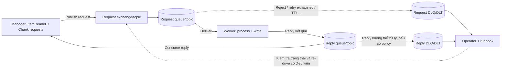
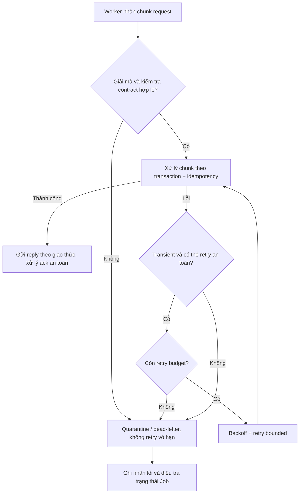

# Dead-letter chunk message

## 1. Dead-letter là gì trong remote chunking?

Trong **Spring Batch remote chunking**, manager thường đảm nhiệm việc đọc item và gom thành chunk, sau đó gửi yêu cầu xử lý qua message middleware. Worker nhận chunk, chạy logic xử lý/ghi, rồi gửi phản hồi theo giao thức remote chunking để manager biết kết quả. Middleware có thể là RabbitMQ, Kafka hoặc công nghệ khác được tích hợp qua Spring Integration.

Khi message không thể được xử lý an toàn, hệ thống có thể chuyển nó sang một **dead-letter queue (DLQ)** hoặc **dead-letter topic (DLT)** để cách ly, điều tra và quyết định xử lý tiếp. Tuy nhiên:

> **Dead-letter message là cơ chế xử lý sự cố ở tầng truyền thông điệp, không phải cơ chế restart tự động của Spring Batch.** Một chunk bị đưa vào DLQ có thể khiến manager chờ phản hồi đến timeout; bản thân DLQ không xác nhận với manager rằng chunk đã được commit, rollback hay thất bại.

Trong module **SPRING_BATCH_SCALING_OPERATIONS**, khi mở rộng workload dữ liệu lớn qua multi-threaded step, parallel steps, partitioning và mô hình phân tán, thiết kế DLQ phải bảo vệ **tính đúng dữ liệu** cùng lúc với throughput, thread safety, retry/restart và vận hành hệ thống.

### Mục tiêu học tập

Sau bài này, bạn có thể:

1. Phân biệt request/reply chunk message, lỗi worker, lỗi broker và các nguyên nhân dead-letter.
2. Thiết kế request DLQ và reply DLQ với correlation, retention và quyền truy cập phù hợp.
3. Chọn thứ tự retry → backoff → DLQ mà không tạo vòng lặp vô hạn.
4. Cấu hình một ví dụ RabbitMQ DLX/DLQ, và hiểu cách Kafka sử dụng DLT thay vì DLQ native.
5. Xây dựng runbook điều tra và re-drive message mà không ghi trùng hoặc làm sai trạng thái `JobRepository`.
6. Theo dõi backlog, tuổi message, lỗi xử lý và tiến độ job khi tăng số worker.

## 2. DLQ nằm ở đâu trong kiến trúc?



**Chú ý:** Đây là sơ đồ kiến trúc minh họa. Cách message được ack/nack, retry hoặc đưa vào DLQ phụ thuộc **broker, listener container, Spring Integration adapters và exception flow thực tế**. Spring Batch không tự tạo request DLQ và reply DLQ cho mọi middleware.

### 2.1. Request và reply khác vai trò

| Loại message | Ai phát? | Ai tiêu thụ? | Rủi ro nếu mất hoặc dead-letter |
| --- | --- | --- | --- |
| **Chunk request** | Manager | Worker | Chunk có thể không được xử lý; manager thiếu reply, chờ hoặc timeout |
| **Chunk reply** | Worker hoặc hạ tầng worker tích hợp | Manager | Worker có thể đã ghi xong nhưng manager không nhận được kết quả; trạng thái điều phối không chắc chắn |
| **Control/error event tùy kiến trúc** | Adapter/worker/monitoring | Manager hoặc hệ giám sát | Nếu không có hợp đồng rõ, có thể không ảnh hưởng đúng tới `JobExecution` |

Trong remote chunking, việc **chunk đã được broker nhận** khác hoàn toàn việc **writer ở worker đã commit thành công**; việc **worker đã gửi reply** cũng khác việc **manager đã tiêu thụ và ghi nhận reply**.

Do đó, thiết kế DLQ cần trả lời cả bốn câu hỏi: request có được giao không, worker có side effect không, reply có đến manager không và Spring Batch đã lưu trạng thái gì.

## 3. Những nguyên nhân khiến message thành dead letter

Một message có thể lỗi ở những tầng khác nhau:

| Loại lỗi | Ví dụ | Hành động ban đầu |
| --- | --- | --- |
| Không giải mã được payload | Serializer schema thay đổi, version không tương thích, message sai định dạng | Cách ly message; sửa contract, không retry liên tục |
| Lỗi nghiệp vụ vĩnh viễn | Dữ liệu không hợp lệ và policy không cho phép skip | Làm step/job thể hiện lỗi đúng; không replay vô hạn |
| Lỗi hạ tầng tạm thời | HTTP 503, database failover, network timeout | Retry giới hạn với backoff nếu an toàn |
| Thiếu quyền/truy cập | Broker ACL, DB credential sai | Sửa cấu hình/quyền trước khi xử lý lại |
| Resource quá tải | Pool DB cạn, consumer quá nhiều, API 429 | Backpressure, giảm concurrency, retry có giới hạn |
| Reply không còn người nhận | Manager đã dừng, route sai hoặc reply consumer lỗi | Xác định trạng thái job và đường reply; không tự tạo giả reply |
| Poison message | Cứ nhận lại là worker crash hoặc không deserialize được | Cách ly, điều tra version/schema trước khi re-drive |

Một **poison message** thường xuyên bị giao lại mà không thể xử lý là rủi ro với throughput: nó có thể chiếm consumer, gây bão log, tăng số reconnect và làm trễ hàng nghìn chunk hợp lệ.

### 3.1. Dead-letter không tự đồng nghĩa với “lỗi dữ liệu”

Ví dụ worker nhận một chunk hợp lệ, ghi DB xong, nhưng kết nối broker mất trước khi gửi reply. Message bị redeliver hoặc chuyển DLQ sau một số lần nhận. Nếu operator nhìn DLQ rồi kết luận “chunk chưa xử lý” và replay ngay, hệ thống có thể **ghi trùng**.

Vì thế phải phân biệt:

- **Chưa xử lý:** không có bằng chứng worker bắt đầu hoặc side effect.
- **Đã rollback:** transaction tương ứng được xác nhận rollback, không có side effect ngoài transaction.
- **Đã commit nhưng mất ack/reply:** nguy cơ xử lý trùng khi replay.
- **Không xác định:** cần điều tra database, log, correlation và metadata trước khi quyết định.

**Mặc định an toàn:** coi trạng thái là *không xác định* nếu chưa đủ bằng chứng.

## 4. Ack, nack, redelivery và retry: tránh vòng lặp

Ở RabbitMQ/AMQP, một worker consumer nhận message rồi cuối cùng có thể:

- **Ack**: broker xem delivery này đã được xử lý theo logic ack của consumer và không cần giao lại.
- **Nack/reject với requeue=true**: yêu cầu broker đưa message về hàng chờ để giao lại; có thể redelivery nhanh và liên tục.
- **Nack/reject với requeue=false**: broker không giao lại vào queue nguồn; nếu queue có dead-letter exchange phù hợp, message có thể chuyển sang DLQ, nếu không có nơi nhận có thể bị mất.
- **Connection/channel bị ngắt khi còn unacked**: broker có thể giao lại delivery; không nên suy ra worker chưa thực hiện side effect.

**Lưu ý:** Spring Integration có thể xử lý exception theo error channel, listener container hoặc interceptor. Nếu một adapter **bắt và nuốt exception** rồi ack, broker có thể không dead-letter dù nghiệp vụ đã lỗi. Muốn kiểm thử DLQ thật phải xem **đường lỗi cuối cùng** của consumer đang xử lý remote chunking, không chỉ ném một exception trong processor rồi kỳ vọng DLQ xuất hiện.

### 4.1. Trình tự xử lý lỗi khuyến nghị



Đây là **chính sách vận hành đề xuất**, không phải Spring Batch mặc định. Một số lỗi xử lý item phải được trả về theo cơ chế error reply và đánh dấu step/job lỗi ở manager, thay vì đơn giản dead-letter request. Đường đi chính xác cần thiết kế với adapter và giao thức reply cụ thể.

**Hai tầng retry dễ nhân lẫn nhau:** nếu `ItemProcessor` retry 3 lần, listener retry thêm 4 lần rồi broker redelivery 5 lần, một side effect có thể bị gọi rất nhiều lần. Tính **tổng số lần tác động phụ**, không chỉ `retryLimit` ở một tầng.

### 4.2. Backoff quan trọng hơn requeue ngay lập tức

Với lỗi DB/network tạm thời, requeue ngay có thể tạo vòng:

```text
Receive -> fail -> requeue -> receive -> fail -> requeue -> ...
```

Giải pháp có thể là retry tại consumer với backoff, delay/retry queue được thiết kế có giới hạn, hoặc tạm dừng consumer đến khi downstream hồi phục. Nếu dùng TTL queue để delay rồi route quay lại request queue, phải có **bộ đếm và ngưỡng retry đáng tin**; khi vượt ngưỡng thì chuyển sang DLQ cuối, không cho tạo vòng lặp vô tận.

## 5. RabbitMQ: DLX, DLQ và routing

RabbitMQ sử dụng **dead-letter exchange (DLX)**: message được dead-letter từ queue nguồn và được publish lại vào một exchange đã cấu hình; exchange có routing thích hợp mới đưa nó tới DLQ đích.

Các nguyên nhân RabbitMQ thường hỗ trợ dead-letter:

1. Consumer reject/nack với `requeue=false`.
2. Message hết TTL.
3. Queue vượt giới hạn độ dài và message bị loại.
4. Quorum queue đạt ngưỡng delivery-limit được cấu hình.

**Không đồng nhất với unroutable publish:** nếu manager publish vào exchange mà **không route tới queue nào**, request không tự động đi vào DLQ của một queue chưa từng nhận message. Cần publisher confirms, mandatory returns hoặc alternate exchange tùy broker, cộng với giám sát riêng.

### 5.1. Topology minh họa

```text
manager --[publish request key=chunk.request]-->
    exchange: batch.chunk.requests.x
        |
        v
    queue: batch.chunk.requests.q
        |
        +--- worker consume / process / reply
        |
        +--- reject, requeue=false (hoặc nguyên nhân DLX khác)
                |
                v
    dead-letter exchange: batch.chunk.dlx
        |
        +--- key=chunk.request.dead
                |
                v
    queue: batch.chunk.requests.dlq
```

Reply channel, reply queue và DLQ cho replies (nếu thực sự cần) phải được thiết kế **riêng**; không gửi lẫn mọi request/reply vào cùng một DLQ rồi suy ra chúng có cùng cách khôi phục.

### 5.2. Cấu hình Spring AMQP minh họa

Ví dụ Java tạo topology với những tên cố định, theo Spring AMQP. Nó **không tự cấu hình Spring Batch remote chunking**; request publisher, worker inbound adapter và reply adapter vẫn phải được nối theo Spring Integration.

```java
@Configuration
class ChunkDlqTopology {

    @Bean
    Declarables chunkDeadLetterResources() {
        DirectExchange requestExchange =
                new DirectExchange("batch.chunk.requests.x", true, false);

        DirectExchange deadLetterExchange =
                new DirectExchange("batch.chunk.dlx", true, false);

        Queue requestQueue = QueueBuilder
                .durable("batch.chunk.requests.q")
                .withArgument("x-dead-letter-exchange", "batch.chunk.dlx")
                .withArgument("x-dead-letter-routing-key", "chunk.request.dead")
                .build();

        Queue deadLetterQueue = QueueBuilder
                .durable("batch.chunk.requests.dlq")
                .build();

        Binding requestBinding = BindingBuilder
                .bind(requestQueue)
                .to(requestExchange)
                .with("chunk.request");

        Binding deadLetterBinding = BindingBuilder
                .bind(deadLetterQueue)
                .to(deadLetterExchange)
                .with("chunk.request.dead");

        return new Declarables(
                requestExchange,
                deadLetterExchange,
                requestQueue,
                deadLetterQueue,
                requestBinding,
                deadLetterBinding);
    }
}
```

**Giới hạn ví dụ:**

- Các resource phải được provision đúng vhost và quyền. Cấp `configure`/`write`/`read` theo vai trò thực; manager/worker runtime không nên có toàn quyền quản trị.
- RabbitMQ thường **khuyến nghị cấu hình DLX bằng policy của broker** để dễ thay đổi mà không redeclare queue. Các `x-dead-letter-*` arguments ở đây chỉ minh họa cơ chế; thay đổi trên queue đã tồn tại có thể gây `PRECONDITION_FAILED` nếu properties không khớp.
- DLX phải tồn tại và binding đúng; không phải hễ queue khai báo `x-dead-letter-exchange` thì message chắc chắn được lưu thành công ở DLQ trong mọi lỗi hạ tầng.
- Cơ chế dead-lettering có các mức bảo đảm khác nhau theo loại queue và cấu hình. Nếu cần **at-least-once dead-lettering**, xem hướng dẫn về quorum queues và broker version; kiểm thử khi DLX/DLQ không khả dụng.
- Khi tính capacity, DLQ **không phải storage vô hạn**; cần retention, disk monitoring, access policy và quy trình xử lý backlog.

### 5.3. Listener error policy phải khớp topology

Một ví dụ **listener container riêng** trong Spring AMQP:

```java
@Bean
SimpleRabbitListenerContainerFactory chunkRequestListenerFactory(
        ConnectionFactory connectionFactory) {

    SimpleRabbitListenerContainerFactory factory =
            new SimpleRabbitListenerContainerFactory();

    factory.setConnectionFactory(connectionFactory);
    factory.setConcurrentConsumers(2);
    factory.setMaxConcurrentConsumers(4);

    // Khi listener báo lỗi chưa được xử lý, không requeue vô hạn.
    factory.setDefaultRequeueRejected(false);

    return factory;
}
```

Ví dụ này **chưa phải cấu hình remote chunking worker hoàn chỉnh**: nếu inbound endpoint thực dùng Spring Integration message-driven adapter và listener container riêng, cần cấu hình **chính container đó**. `defaultRequeueRejected(false)` có thể khiến lỗi không được xử lý đi thẳng DLQ; muốn retry transient trước khi dead-letter cần kết hợp retry interceptor/error handling hợp lý.

Không dùng `basicAck` thủ công trước khi writer commit hoặc trước khi ranh giới trách nhiệm theo giao thức được xác nhận. Nhưng cũng không thể mặc định “gửi reply thành công” và “ack request” là một transaction nguyên tử nếu broker/DB không được phối hợp. Phải thử tình huống crash ở mọi điểm giữa các thao tác.

### 5.4. Header của message đã dead-letter

RabbitMQ có thể ghi các thông tin nguồn gốc dead-letter qua `x-death` và các header liên quan, gồm nguồn queue, reason và số lần dead-letter. Dùng chúng để chẩn đoán:

- Message đến từ request queue nào?
- Dead-letter vì `rejected`, `expired` hay nguyên nhân khác?
- Có dấu hiệu đi vòng qua retry queues nhiều lần không?
- Header correlation/job context ban đầu có còn nguyên và đáng tin không?

Đừng dựa duy nhất vào `redelivered` flag hoặc một header tự do để quyết định chắc chắn chunk đã commit. Khi re-publish/re-drive, broker và client có thể thay đổi message properties/header; các dấu vết này **không thay** giao dịch nghiệp vụ và metadata của Spring Batch.

## 6. Kafka: dead-letter topic là cơ chế ứng dụng

Kafka **không có DLQ/DLX queue native theo cách RabbitMQ**. Một Kafka consumer hoặc framework như Spring Kafka có thể publish record lỗi tới **dead-letter topic (DLT)**, ví dụ `batch.chunk.requests.DLT`. Record cũ không bị xóa ngay; retention, offset commit và cách consumer tiếp tục tùy chính sách của ứng dụng.

| Khía cạnh | RabbitMQ | Kafka |
| --- | --- | --- |
| Nơi giữ message lỗi | DLQ được định tuyến qua DLX | DLT topic do producer/error handler publish |
| Đánh dấu message đã tiêu thụ | Ack/nack delivery | Commit offset/transaction consumer |
| Delay/retry | Retry interceptor, TTL/delay queue hoặc cơ chế khác | Retry/backoff và retry topics/seek strategy theo listener |
| Dấu vết nguồn | `x-death`, original routing metadata | Topic/partition/offset, exception headers do DLT recoverer thêm |
| Re-drive | Publish lại request có điều kiện | Consumer từ DLT publish lại topic nguồn khi hợp lệ |
| Nguy cơ ghi trùng | Redelivery trước/sau ack | Replay offset, rebalance, lỗi trước khi offset commit |

### 6.1. Ví dụ cấu hình DLT cho Spring Kafka

Ví dụ dưới đây là **mẫu consumer Kafka thông thường**, không phải tự động gắn vào Spring Batch remote chunking. Để dùng trong pipeline thật, phải đưa error handler vào **đúng listener container** của Spring Integration/Spring Kafka và bảo toàn serialization, headers, correlation:

```java
@Bean
DefaultErrorHandler kafkaErrorHandler(
        KafkaTemplate<Object, Object> template) {

    DeadLetterPublishingRecoverer recoverer =
            new DeadLetterPublishingRecoverer(
                template,
                (record, ex) -> new TopicPartition(
                    record.topic() + ".DLT",
                    record.partition()));

    // Thử lại với backoff 1 giây, tối đa hai lần retry
    // sau lần xử lý ban đầu theo semantics DefaultErrorHandler.
    return new DefaultErrorHandler(
            recoverer,
            new FixedBackOff(1_000L, 2L));
}
```

**Các điều kiện bắt buộc trước khi sử dụng:**

- DLT tương ứng phải tồn tại và có đủ partitions để nhận partition nguồn nếu dùng `record.partition()` như ví dụ.
- Serializer của DLT producer phải xử lý được payload lỗi. Với lỗi deserialize, việc recover raw bytes/`DeserializationException` cần cấu hình serializer, deserializer và error handling riêng.
- Cần Kafka ACL `WRITE` topic DLT cho ứng dụng publish; consumer/operator đọc DLT có `READ` topic/group.
- Không suy ra publish DLT và commit offset sẽ **luôn nguyên tử**. Tính nhất quán phụ thuộc container transaction, producer và cách ack/offset được cấu hình.
- Không được tự động replay mọi DLT record vào topic nguồn khi JobExecution cũ đã FAILED hoặc manager đã dừng.

Nếu consumer Kafka sử dụng Spring Integration adapter thay vì `@KafkaListener`, một `DefaultErrorHandler` tự khai báo chưa chắc có hiệu lực: phải kết nối vào listener container thực tế.

## 7. DLQ và trạng thái JobRepository: một hợp đồng bắt buộc

### 7.1. Dead-letter request không phải StepExecution.FAILED

Giả sử manager gửi một chunk request, broker nhận nó, nhưng worker liên tục không deserialize được và request được chuyển sang DLQ.

- Broker biết **message không còn ở request queue thường**.
- Worker có thể chưa từng chạy `ItemProcessor`/`ItemWriter`.
- Manager có thể chỉ biết **chưa nhận được reply**, chờ tới timeout hoặc cơ chế lỗi của manager.
- `JobRepository` phản ánh trạng thái được Spring Batch thực sự cập nhật, không tự nhận sự kiện DLQ như một quyết định job failure.

Nếu không có cơ chế propagate lỗi/timeout và cảnh báo, hệ thống có thể **bị treo điều phối** dù DLQ đang tăng. Vì vậy cần kết nối các tín hiệu middleware với runbook vận hành và cơ chế dừng/restart job được hỗ trợ.

### 7.2. Dead-letter reply còn nguy hiểm hơn

Một worker có thể đã commit writer, publish reply nhưng manager không consume được do định tuyến sai, credential hết hạn hoặc lỗi deserialize. Nếu reply được dead-letter:

- Có thể **không cần xử lý lại chunk**; side effect đã hoàn thành.
- Manager vẫn thiếu xác nhận, dẫn đến trạng thái **không đồng bộ**.
- Replaying chunk request có thể nhân đôi kết quả.

Một reply DLQ cần thông tin về job/chunk correlation và các bằng chứng phía worker. **Không tự synthesize reply `SUCCESS` hoặc sửa `BATCH_*` tables để bỏ qua chờ**; phải làm theo giao thức batch tích hợp, restart/reconciliation được hỗ trợ.

### 7.3. Correlation không được làm mất hoặc tự bịa

Các trường hữu ích để điều tra (tên cụ thể tùy giao thức và adapter):

| Thông tin | Dùng để làm gì? | Lưu ý |
| --- | --- | --- |
| `jobName` và `JobExecutionId` nếu được giao thức cung cấp | Xác định job/lần chạy kỹ thuật | Không tự đưa secret vào header |
| `StepExecutionId` / step name | Liên hệ metadata tại manager/worker | Không phải middleware nào cũng gửi đầy đủ |
| Chunk request/message sequence hoặc correlation ID | Nối request với reply và log | Giữ nguyên cấu trúc của framework; không tự sinh ID thay thế |
| Business batch ID, source record keys | Đối soát dữ liệu đã commit | Ổn định qua restart nếu nghiệp vụ yêu cầu |
| Origin queue/topic, routing key, attempt count | Điều tra nguyên nhân DLQ | Phải xét broker header có thể thay đổi khi republish |
| Payload schema/version | Chẩn đoán deserialize | Hạn chế log raw payload có dữ liệu nhạy cảm |

Đối với remote chunking, `ChunkRequest` và `ChunkResponse` mang thông tin do Spring Batch Integration sử dụng để theo dõi xử lý. **Không tùy tiện chỉnh message body, sequence number, job/step execution IDs hoặc reply channel headers** khi re-drive. Nếu phải biến đổi schema, cần một quy trình migration và test tích hợp riêng.

### 7.4. Idempotency là trách nhiệm của ứng dụng

Giả sử worker ghi 100 dòng vào DB rồi kết nối tới broker đứt ngay trước khi ack/reply. Broker có thể giao request lại. **Exactly-once end-to-end không được tạo ra chỉ bằng queue durable, DLX hay `JobRepository`.**

Các biện pháp:

1. Dùng unique constraint hoặc upsert theo **khóa nghiệp vụ** như `invoiceId` và version phù hợp.
2. Với API ngoài DB, gửi **idempotency key** đã thống nhất với hệ thống đích; kiểm tra kết quả trước retry khi timeout.
3. Tách thao tác không thể rollback khỏi processor nếu có thể; quản lý chúng qua writer/transaction/outbox phù hợp.
4. Đối soát số record **duy nhất** ở sink, không chỉ `readCount`/`writeCount` hoặc số delivery trên broker.
5. Khi replay, xem xét các chunk đã được xử lý một phần và các side effect nằm ngoài transaction.

## 8. Chính sách retry và DLQ theo loại lỗi

Chọn chính sách có thể dự đoán, tránh để nhiều tầng cùng retry không có giới hạn:

| Điều kiện | Retry? | DLQ/quarantine? | Hành động liên quan Job |
| --- | --- | --- | --- |
| Lỗi schema không giải mã được | Không lặp liên tục | Có, sau khi giữ đủ metadata | Đánh dấu/giám sát lỗi và quyết định restart theo protocol |
| HTTP 503/DB failover | Có, bounded/backoff | Sau khi hết ngân sách nếu vẫn lỗi | Không gửi success reply sai |
| API 429 | Retry theo rate limit/backoff | Có thể sau khi hết ngân sách | Giảm concurrency/điều phối lại workload |
| Dữ liệu nghiệp vụ sai nhưng được phép skip | Spring Batch skip policy xử lý | Không nhất thiết đưa request vào DLQ | Thống kê skip, bảo đảm ngưỡng chất lượng |
| Dữ liệu nghiệp vụ buộc phải fail | Không retry vô nghĩa | Có thể quarantine để điều tra | Bảo đảm step/job thể hiện thất bại |
| Broker ACL hoặc DB password sai | Không retry vô hạn | Quarantine có kiểm soát nếu cần | Sửa quyền/secret rồi restart phù hợp |
| Reply hết hạn/hỏng | Chẩn đoán trước khi replay | Reply DLQ nếu topology có | Kiểm tra worker commit, manager state, tránh replay request |

**Cần tách hai lớp chính sách:**

- **Spring Batch fault tolerance:** `retry(...)`, `skip(...)` trong chunk step, với ngữ nghĩa transaction và metadata.
- **Middleware retry/dead-letter:** xử lý lỗi delivery, deserialize, consumer listener hoặc message transport.

Một processor exception có thể đã được Spring Batch xử lý và chuyển thành reply lỗi theo hợp đồng. Không nên mặc định mọi lỗi nghiệp vụ phải làm broker nack request; ngược lại, lỗi deserialize **trước khi vào Spring Batch** không được xử lý bởi `skipLimit` của processor.

### 8.1. Tính retry budget toàn hệ thống

Giả sử:

```text
Batch xử lý một item: 3 lần retry
Listener: 2 lần retry thêm
Broker: 4 lần redelivery

Số lần gọi downstream có thể bị nhân lên đáng kể nếu mỗi tầng
thực sự phát lại công việc; không coi đây là "chỉ 4 lần thử".
```

Không áp công thức nhân đơn giản cho mọi implementation vì thứ tự lỗi/rollback có thể khác, nhưng cần **lập bảng theo từng tầng** và kiểm thử trong hệ thống thật để biết tối đa side effect. Khi đạt ngưỡng, quyết định rõ trạng thái `FAILED`, DLQ và cảnh báo.

## 9. Quy trình xử lý dead-letter an toàn (re-drive runbook)

**Không làm:** chọn tất cả message DLQ rồi publish lại vào request queue bằng một script tổng quát. Việc này có thể gửi chunk của một JobExecution đã kết thúc đến worker đang chạy version mới, hoặc xử lý lại side effect đã commit.

### Bước 1 — Khoanh vùng sự cố

- Xác định broker/vhost/topic, queue nguồn, DLQ và thời điểm message được đưa vào.
- Kiểm tra số lượng, tuổi, lý do (`x-death` hoặc DLT exception headers), schema version.
- Xác định request hay reply, worker version, nguồn dữ liệu và correlation.
- Giới hạn quyền đọc DLQ; không trích xuất raw payload nhạy cảm ra ticket/log.

### Bước 2 — Đối chiếu JobRepository và sink

- Tìm JobInstance/JobExecution/StepExecution liên quan theo correlation đã có.
- Xem job `STARTED`, `FAILED`, `STOPPED` hay `COMPLETED`; kiểm tra exception và thời điểm commit.
- Kiểm tra bản ghi đích theo business key, outbox/HTTP response nếu có.
- Phân loại message: **chưa xử lý**, **đã commit**, **đã rollback** hay **không xác định**.
- Nếu không xác định, **dừng re-drive** để điều tra thêm.

### Bước 3 — Khắc phục nguyên nhân gốc

- Sửa schema/serializer và bảo đảm backward compatibility.
- Sửa broker routing, quyền `read/write` hoặc chứng chỉ/credential.
- Khôi phục database/API; giảm concurrency và retry storm khi cần.
- Test ở staging bằng message đã **khử dữ liệu nhạy cảm** với version đúng.

### Bước 4 — Chọn cách khôi phục phù hợp

| Trạng thái | Lựa chọn ưu tiên |
| --- | --- |
| Job đã `FAILED`, reader và checkpoint có thể restart | **Restart JobInstance** bằng Spring Batch thay vì replay DLQ mù |
| Job còn active và hợp đồng cho phép xử lý lại đúng request | Re-drive có chọn lọc sau khi xác nhận side effect và correlation |
| Worker đã commit nhưng reply bị lỗi | Đối soát/protocol recovery; không tự replay request |
| Message schema hỏng do version cũ | Migration có kiểm thử trước khi re-drive |
| Message thuộc JobExecution `COMPLETED` | Không mặc định re-drive; cần business correction workflow riêng |
| Không thể xác định commit | Cách ly đến khi có đủ bằng chứng, không tạo reply success giả |

### Bước 5 — Re-drive có kiểm soát nếu thực sự được phép

1. Duyệt **danh sách message cụ thể**, không phát lại toàn DLQ.
2. Xác định nguồn và đích re-drive phù hợp, đúng schema và routing.
3. Giữ metadata correlation/sequence theo yêu cầu giao thức; không tạo message trùng hoặc sửa body tuỳ tiện.
4. Tốc độ thấp, có giới hạn concurrency; bật audit, publisher confirms và theo dõi lỗi/reply.
5. Chỉ đánh dấu/quản lý trạng thái message DLQ sau khi biết kết quả publish và có kế hoạch cho khoảng “publish thành công nhưng xóa DLQ thất bại”.
6. Đối soát unique business IDs, StepExecution, read/write/skip counts và kết quả nghiệp vụ.
7. Dừng ngay nếu phát hiện mismatch, redelivery storm hoặc tăng số bản ghi trùng.

**Lưu ý đặc biệt:** Việc re-publish và ack/xóa bản gốc ở DLQ hiếm khi tạo thành một transaction end-to-end với database. Cần idempotency ngay cả trong công cụ re-drive.

## 10. Monitoring và cảnh báo DLQ

Với batch dữ liệu lớn, DLQ không nên được kiểm tra thủ công sau mỗi job; phải có metric và ngưỡng cảnh báo theo chu kỳ vận hành.

| Metric | Ý nghĩa | Dấu hiệu cảnh báo |
| --- | --- | --- |
| `request_dlq_depth` | Số chunk requests bị cách ly | Tăng liên tục hoặc khác 0 ngoài cửa sổ bảo trì đã biết |
| `request_dlq_oldest_age_seconds` | Tuổi message lâu nhất | Vượt SLA điều tra trước giờ job deadline |
| `reply_dlq_depth` | Số reply không đến được manager | Nguy cơ manager chờ kết quả trong khi worker đã ghi xong |
| Worker delivery/redelivery rate | Số lần nhận lại request | Tăng đột biến có thể là poison message/retry storm |
| Retry attempts và exhaustion | Hiệu quả chính sách retry | Nhiều retry nhưng không tiến triển |
| Job/Step duration & status | Tiến độ Spring Batch | `STARTED` quá lâu, `FAILED`, `STOPPED` bất thường |
| `readCount/writeCount` và unique sink rows | Kết quả nghiệp vụ | Chênh lệch bất thường dù queue đã rỗng |
| Broker connections, channels, memory/disk | Năng lực middleware | Broker gần giới hạn, có nguy cơ không ghi được DLQ |

Tên metric là **gợi ý cho hệ thống monitoring**, không phải mặc định Spring Batch hoặc RabbitMQ sẽ xuất đúng các tên đó.

### Alert nên kết hợp DLQ và JobRepository

Ví dụ cảnh báo có ý nghĩa hơn chỉ “DLQ > 0”:

- `request_dlq_depth > 0` trong job critical **và** một `JobExecution` đã chờ reply lâu hơn ngưỡng.
- Reply DLQ tăng **và** số worker commit tăng nhưng manager progress không tăng.
- Retry exhaustion tăng đồng thời DB timeout/HTTP 429 tăng.
- DLQ không được xử lý quá thời hạn runbook, hoặc dead-letter exchange/routing không hoạt động.

Đặt cảnh báo theo severity và thời gian: một message lỗi schema của một thử nghiệm không cần cùng mức cảnh báo với hàng nghìn chunk request của payroll batch production.

## 11. Capacity, durability và bảo mật của DLQ

### 11.1. DLQ không thể thay thế lưu trữ lâu dài

Message chunk có thể lớn và chứa nhiều item. Nếu request DLQ tích lũy, dung lượng disk/memory của broker sẽ tăng; một broker đầy disk có thể gây lỗi cho **toàn hệ thống** chứ không chỉ job thất bại.

Nên xác định:

- TTL/retention đủ cho thời gian điều tra, nhưng không vô hạn.
- Chính sách max-length/bytes và hành vi khi vượt ngưỡng, tránh vòng dead-letter từ DLQ sang nguồn.
- Loại queue (classic/quorum), durability, publisher confirms và các bảo đảm dead-letter phù hợp phiên bản broker.
- Cách backup/audit, địa điểm lưu an toàn khi cần forensic dài hạn.
- Cảnh báo trước khi chạm giới hạn disk, memory và consumer lag.

**Durable queue** và persistent message giúp tăng độ bền, nhưng **không bảo đảm exactly-once** hoặc rằng mọi dead-letter sẽ đến DLQ trong mọi sự cố cấu hình/broker. Test broker restart, DLX unavailable và route sai.

### 11.2. Bảo vệ dữ liệu nhạy cảm

Không đưa vào log/ticket/metrics:

- Raw chunk chứa PII hoặc dữ liệu tài chính không được ẩn.
- Password, bearer token hoặc DB credentials trong message header/payload.
- Full stack trace có dữ liệu đầu vào từ `toString()`.
- URL chứa secret hoặc user-defined error metadata không được làm sạch.

Tách service account runtime và tài khoản điều tra DLQ, áp ACL tối thiểu để nhân sự vận hành chỉ có quyền cần thiết. TLS bảo vệ đường truyền; broker vẫn có thể lưu payload ở trạng thái đọc được nên phải xem cả encryption at rest, quyền truy cập, lưu giữ và xóa dữ liệu.

## 12. Kiểm thử DLQ trước khi tăng số worker

| Kịch bản | Kỳ vọng |
| --- | --- |
| Worker nhận request đúng và xử lý thành công | Reply về manager, không có request DLQ |
| Payload sai schema, listener không deserialize được | Message bị cách ly theo error strategy thực; không lặp vô hạn |
| Processor có lỗi transient và retry phục hồi | Không DLQ, số lần retry có giới hạn |
| Processor có lỗi permanent | Job phản ánh lỗi đúng; nếu DLQ thì còn đủ metadata để điều tra |
| Listener `defaultRequeueRejected(false)` nhưng thiếu DLX/binding | Phát hiện nguy cơ mất message; không coi failure là được lưu thành công |
| RabbitMQ request bị reject `requeue=false` | Được route tới request DLQ theo topology đã kiểm thử |
| Manager publish vào exchange sai routing | Publisher return/confirm hoặc alert bắt lỗi; không kỳ vọng queue DLQ cứu được |
| Worker commit DB rồi crash trước reply | Re-delivery/restart không tạo bản ghi nghiệp vụ trùng |
| Reply bị dead-letter | Không tự replay request; phát hiện manager đang chờ và đối soát worker state |
| Broker và DLX/DLQ mất kết nối | Cảnh báo, không silently mất backlog theo kỳ vọng đã định |
| Worker tăng 4 → 32, DB hết connection | Backoff và giới hạn concurrency; không tạo retry storm |
| Re-drive một message của job `COMPLETED` | Bị quy trình kiểm soát chặn nếu không có business correction approval |
| DLT Kafka không đủ partitions/serializer không phù hợp | Ghi nhận lỗi recoverer và xử lý; không giả định đã quarantine thành công |

### Test tích hợp gợi ý

1. Chuẩn bị một manager/worker sandbox, RabbitMQ hoặc Kafka test broker, `JobRepository` test riêng và database sink có unique constraint.
2. Chạy happy path, ghi request ID/correlation, `JobExecutionId` và số bản ghi đích.
3. Inject một lỗi **trước deserialize**, một lỗi **trong processor**, một lỗi **sau writer commit** và một lỗi **trên reply path**.
4. Quan sát ack/nack/offset, DLQ/DLT, trạng thái Batch, retry count, redelivery và dữ liệu đích.
5. Khôi phục broker/worker, thử restart hợp lệ; xác minh dữ liệu chỉ có một phiên bản nghiệp vụ đúng.
6. Thử thao tác re-drive có chọn lọc từ sandbox DLQ và kiểm tra đầu ra, thời gian xử lý và audit.

Đừng chỉ assert “DLQ có một message”; test phải khẳng định **Spring Batch job không bị treo vô hạn** và dữ liệu không sai sau restart.

## 13. Tình huống thực tế: 5 triệu hóa đơn, một chunk vào DLQ

Một job đêm nhập **5 triệu hóa đơn** theo remote chunking. Manager gửi chunk qua RabbitMQ tới 12 worker. Sau khi triển khai worker mới, một số instance không deserialize được payload từ phiên bản manager cũ.

Dấu hiệu:

- Request queue có redelivery tăng, worker log lỗi serializer.
- Một số chunk bị đẩy vào `batch.chunk.requests.dlq` sau khi listener reject.
- Manager chờ reply của những chunk không được xử lý; job không thể kết thúc đúng hạn.
- Các chunk khác vẫn được worker tương thích ghi thành công.

Quy trình xử lý:

1. **Giảm/khóa rollout lỗi**, không tăng số worker để “xử lý cho nhanh”.
2. Kiểm tra payload schema và phiên bản serializer giữa manager/worker; kiểm tra lỗi `x-death`, DLQ depth, tuổi message.
3. Đối chiếu `JobExecution`/`StepExecution` và DB theo các business keys để xác nhận chunk nào chưa xử lý, chunk nào đã commit.
4. Rollback hoặc triển khai bản worker tương thích đã kiểm thử; xử lý request DLQ theo giao thức phù hợp.
5. Nếu job đã `FAILED`, **ưu tiên cơ chế restart Spring Batch** với metadata và idempotent sink thay vì publish lại tất cả chunk.
6. Nếu worker đã commit nhưng mất reply, không replay request trước khi reconciliation; giải quyết bất đồng trạng thái theo runbook.
7. Đối chiếu **5 triệu ID nguồn** với dữ liệu đích (có xét skip/filter hợp lệ), tổng giá trị hóa đơn và số record duy nhất.
8. Bổ sung contract test về serialization giữa các phiên bản trước rollout tiếp theo.

**Bài học:** DLQ làm lộ một sự cố dễ điều tra, nhưng không tự sửa việc manager thiếu reply. Tốc độ cao chỉ có giá trị khi request, reply, transaction và restart có cùng một hợp đồng xử lý lỗi.

## 14. Những hiểu nhầm thường gặp

| Nhận định | Vì sao sai |
| --- | --- |
| “Chunk vào DLQ nghĩa là nó chưa được ghi.” | Worker có thể đã commit trước khi mất ack/reply. |
| “DLQ tự đánh dấu StepExecution.FAILED.” | Broker và JobRepository là hai hệ thống khác; cần tích hợp/error propagation. |
| “Chỉ cần requeue=true khi lỗi, RabbitMQ sẽ tự ổn.” | Có thể redelivery storm và poison message vô hạn. |
| “Đã khai báo DLX thì không bao giờ mất dead-letter.” | Phụ thuộc routing, durability, quyền và các bảo đảm broker/queue. |
| “Publish không route được sẽ tự vào request DLQ.” | Nếu message chưa vào request queue, DLX của queue không áp dụng. |
| “Reply DLQ có thể chữa bằng replay request.” | Replay có thể ghi trùng vì worker đã commit. |
| “Spring Batch skip và broker DLQ là một cơ chế.” | Skip theo item/chunk fault tolerance; DLQ theo message transport/consumer. |
| “Kafka có DLX giống RabbitMQ.” | Kafka thường cần DLT/error handler ở tầng ứng dụng. |
| “Thêm TTL retry queue là xong.” | Cần giới hạn attempt, backoff, chính sách thoát và tránh vòng lặp. |
| “Re-drive message DLQ là thao tác idempotent.” | Có thể replay side effect; cần business key/transaction/idempotency. |
| “Durable DLQ bảo đảm exactly-once.” | Durability không đồng nghĩa với end-to-end exactly-once. |
| “DLQ không chứa dữ liệu nhạy cảm.” | Request chunk có thể mang payload nghiệp vụ/PII, phải kiểm soát ACL và retention. |

## 15. Câu hỏi tự kiểm tra

**Câu 1.** Worker đã ghi 100 record vào DB nhưng bị mất kết nối trước khi manager nhận reply. Request sau đó xuất hiện ở DLQ. Có được replay ngay không?

*Trả lời gợi ý:* Không. Trước tiên đối chiếu trạng thái commit, business keys và manager/JobRepository; dùng idempotency/protocol recovery phù hợp.

**Câu 2.** Vì sao `basicNack(requeue=true)` liên tục là rủi ro với poison message?

*Trả lời gợi ý:* Broker có thể giao lại ngay, tạo vòng nhận–lỗi–requeue, chiếm consumer và làm giảm throughput của các chunk hợp lệ.

**Câu 3.** Manager publish request vào exchange nhưng không có queue binding. Có chắc request xuất hiện trong request DLQ không?

*Trả lời gợi ý:* Không. Dead-letter queue hoạt động cho message đã vào queue nguồn rồi bị dead-letter; cần publisher confirms/returns hoặc alternate exchange cho unroutable publish.

**Câu 4.** Trong Kafka, DLT có cần cùng số partition với topic nguồn không?

*Trả lời gợi ý:* Nếu recoverer cố gửi vào cùng partition index của topic nguồn thì DLT **phải có partition đó**. Có thể dùng chiến lược phân vùng khác theo thiết kế, không bắt buộc mọi DLT luôn cùng partition count.

**Câu 5.** Một consumer nhận lỗi deserialize trước khi processor của Spring Batch chạy. `skipLimit` của step có giúp message được xử lý đúng không?

*Trả lời gợi ý:* Không tự động. Lỗi ở tầng serializer/listener xảy ra trước cơ chế fault tolerance của step; cần error handler/DLQ theo đúng adapter đang dùng.

**Câu 6.** Vì sao không nên xóa `BATCH_*` metadata hoặc tạo fake success reply sau khi thấy DLQ?

*Trả lời gợi ý:* Có thể phá trạng thái restart/correlation, che giấu chunk chưa commit và tạo dữ liệu không nhất quán. Cần khôi phục qua cơ chế Spring Batch được hỗ trợ và đối soát nghiệp vụ.

## 16. Checklist triển khai production

- [ ] Đã vẽ request/reply channels, worker, manager, DLQ/DLT, nguồn/sink dữ liệu và JobRepository.
- [ ] Phân biệt lỗi business, lỗi transport, lỗi deserialize và lỗi sau commit.
- [ ] DLQ có topology/routing/ACL/durability được kiểm thử, không chỉ khai báo trên giấy.
- [ ] Có retry giới hạn, backoff, tránh requeue loop và retry nhân tầng.
- [ ] Listener/error channel/adapter thực tế đã được kiểm thử để lỗi đi vào nơi mong muốn.
- [ ] Có correlation đủ để liên hệ message, job/step và business records mà không lộ secret/PII.
- [ ] Không tự replay request chỉ vì thấy reply DLQ hoặc message đã dead-letter.
- [ ] Writer/idempotency và transaction boundary chịu được redelivery/restart.
- [ ] Có runbook re-drive có chọn lọc và kiểm tra trạng thái JobInstance/JobExecution.
- [ ] Có alert depth/age DLQ, error rate, missing replies, job stalled và broker disk.
- [ ] DLT Kafka xử lý được lỗi serializer, partition mapping, ACL và offset/transaction phù hợp.
- [ ] Đã test crash trước/sau commit, broker outage, poison message và worker version mismatch.
- [ ] Có retention, quyền truy cập và quy trình xóa dữ liệu nhạy cảm trong DLQ.
- [ ] Benchmark concurrency của worker dưới lỗi thật, không chỉ happy path throughput.

## Tài liệu tham khảo

- [Spring Batch — Scaling and Parallel Processing](https://docs.spring.io/spring-batch/reference/scalability.html): ngữ cảnh remote chunking/remote partitioning và scaling.
- [Spring Batch Integration — Externalizing Batch Process Execution](https://docs.spring.io/spring-batch/reference/spring-batch-integration/externalizing-execution.html): cơ chế manager/worker, request và reply.
- [RabbitMQ — Dead Letter Exchanges](https://www.rabbitmq.com/docs/dlx): lý do dead-letter, queue arguments/policies, routing và hạn chế vận hành.
- [RabbitMQ — Consumer Acknowledgements and Publisher Confirms](https://www.rabbitmq.com/docs/confirms): ack, nack, redelivery và publisher confirms.
- [RabbitMQ — Quorum Queues](https://www.rabbitmq.com/docs/quorum-queues): delivery limits và các khả năng dead-lettering theo cấu hình.
- [Spring AMQP — Handling Exceptions](https://docs.spring.io/spring-amqp/reference/amqp/exception-handling.html): `defaultRequeueRejected`, error handling và requeue.
- [Spring Kafka — Handling Exceptions](https://docs.spring.io/spring-kafka/reference/kafka/annotation-error-handling.html): `DefaultErrorHandler`, `DeadLetterPublishingRecoverer` và retry/recovery.
- [Spring Batch — Configuring a Step for Restart](https://docs.spring.io/spring-batch/reference/step/chunk-oriented-processing/restart.html): trạng thái step và restart.

**Điểm cần nhớ:** một dead-letter chunk message là **bằng chứng tầng messaging gặp vấn đề**, không phải bằng chứng chắc chắn chunk chưa được thực thi. Thiết kế tốt phải kết nối **retry bounded, DLQ/DLT, correlation, JobRepository, idempotent writer và runbook re-drive**. Khi các phần này được kiểm thử qua lỗi, remote chunking mới có thể tăng throughput mà vẫn bảo toàn dữ liệu.
