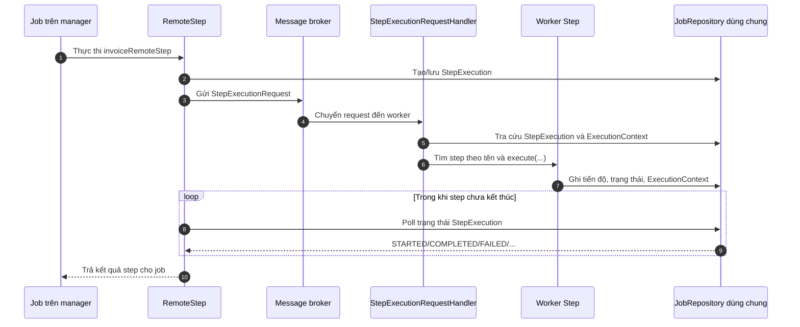

# RemoteStep trong Spring Batch 6

## 1. Bài toán và mục tiêu học tập

Khi một job xử lý dữ liệu lớn, có những công đoạn cần chạy trên máy hoặc cụm máy khác: máy chuyên tạo báo cáo dùng nhiều CPU, máy có quyền truy cập kho dữ liệu riêng, hoặc node có bộ nhớ và tài nguyên phù hợp hơn. Spring Batch 6 bổ sung **`RemoteStep`** để một job đang chạy tại tiến trình điều phối có thể giao **toàn bộ việc thực thi của một step** cho một worker ở xa thông qua Spring Integration.

Sau bài này, bạn có thể:

- Giải thích chính xác luồng thực thi của `RemoteStep` và vai trò của `JobRepository`, message broker, `StepExecutionRequestHandler`.
- Cấu hình một step điều phối và một step thực thi ở worker bằng API của Spring Batch 6.
- Phân biệt `RemoteStep` với multi-threaded step, parallel steps, remote chunking và remote partitioning.
- Nhận diện giới hạn về hiệu năng, giao dịch, khả năng khởi động lại và các nguy cơ vận hành khi chạy phân tán.
- Lựa chọn kiến trúc dựa trên nút thắt thực tế thay vì mặc định thêm worker sẽ làm job nhanh hơn.

> **Phạm vi phiên bản:** `org.springframework.batch.integration.remote.RemoteStep` xuất hiện từ **Spring Batch 6.0.0**. Đây là một loại `Step` chạy phân tán, không phải lớp `RemotePartitioningWorkerStepBuilder` hay API remote chunking của Spring Batch 5.

## 2. `RemoteStep` hoạt động như thế nào?

Xét job `billingJob` có bước `invoiceRemoteStep`. Job chạy trên **manager** nhưng logic tạo hóa đơn thực sự được khai báo ở bean `invoiceWorkerStep` trên **worker**. Manager không chạy logic nghiệp vụ của `invoiceWorkerStep` trong JVM của mình.



Các thành phần quan trọng:

| Thành phần | Trách nhiệm |
|---|---|
| `RemoteStep` | Đại diện step trong job của manager; tạo yêu cầu thực thi từ xa và theo dõi kết quả. |
| `remoteStepName` | Tên **step thật** mà worker phải tìm thấy, ví dụ `invoiceWorkerStep`. |
| `MessagingTemplate` và `MessageChannel` | Đẩy yêu cầu từ manager tới luồng Spring Integration; transport có thể là JMS hoặc một cơ chế messaging phù hợp. |
| `StepExecutionRequest` | Thông điệp định danh lần thực thi cần xử lý; không phải tập dữ liệu hàng triệu bản ghi. |
| `StepExecutionRequestHandler` | Nhận request, lấy `StepExecution` từ repository chung, tìm step qua `StepLocator` rồi gọi thực thi. |
| `JobRepository` | Kho metadata chung cho manager và worker: `JobExecution`, `StepExecution`, `ExecutionContext`, trạng thái và thông tin phục vụ restart. |

**Điểm cốt lõi:** manager tạo bản ghi `StepExecution` rồi chuyển yêu cầu cho worker. Worker cập nhật trạng thái và context trong **cùng kho metadata**; manager đọc kho này theo chu kỳ để biết khi nào step kết thúc. Việc hoàn thành không phụ thuộc vào một thông điệp trả lời kết quả tương đương remote chunking.

`invoiceRemoteStep` và `invoiceWorkerStep` là **hai tên khác nhau, hai vai trò khác nhau**. Một lần gọi `RemoteStep` đại diện cho **một lần thực thi step ở xa**. Nó không tự phân chia 10 triệu dòng dữ liệu thành 10 phần, cũng không tự nhân bản một step chạy trên 10 worker.

## 3. Khi nào nên sử dụng?

Ví dụ: hệ thống xuất hóa đơn cuối ngày gồm các bước `validateInput → buildInvoices → publishReport`. Bước `buildInvoices` đòi hỏi thư viện tạo PDF và có thể cần máy nhiều CPU hoặc quyền truy cập storage riêng. Đặt `buildInvoices` trên worker, còn job tổng thể và điều phối phụ thuộc giữa các step vẫn nằm ở manager.

`RemoteStep` hợp lý khi bạn cần **đặt trọn một bước nghiệp vụ** sang môi trường khác, ví dụ:

- Tách tải CPU/RAM hoặc quyền truy cập dữ liệu của một step khỏi máy chạy job.
- Giữ luồng điều phối job tập trung dù mỗi loại công việc nằm trên một cụm chuyên dụng.
- Tái sử dụng một `Step` thông thường trên worker qua giao thức messaging.

Nếu công việc cần **tăng thông lượng bằng nhiều worker xử lý các lát dữ liệu độc lập cùng lúc**, hãy cân nhắc **remote partitioning**; nếu manager đọc dữ liệu và phân phối các chunk để worker xử lý/ghi, cân nhắc **remote chunking**. `RemoteStep` chỉ thay đổi **nơi thực thi**; hiệu năng có thể tăng hoặc giảm tùy năng lực máy đích và chi phí mạng.

## 4. Điều kiện kiến trúc trước khi viết code

1. **Đồng bộ phiên bản và thư viện.** Dùng Spring Batch 6 và module `spring-batch-integration`; cấu hình Spring Integration cùng adapter cho hệ thống vận chuyển, ví dụ Spring Integration JMS và một JMS broker. Manager và worker cần hợp đồng payload/chuyển đổi thông điệp tương thích.
2. **Dùng chung `JobRepository` bền vững.** Hai ứng dụng phải truy cập **cùng dữ liệu metadata** và dùng schema Batch tương thích. Một in-memory/resourceless repository riêng cho mỗi JVM không đáp ứng thiết kế này.
3. **Khai báo worker step đúng tên.** Bean tên `invoiceWorkerStep` cần tồn tại trong context của worker và được `StepLocator` tra cứu. Manager phải cấu hình `remoteStepName` khớp tên đó.
4. **Thiết lập channel và broker.** Manager phát request lên destination mà worker đang nhận. Đảm bảo queue, quyền truy cập, message conversion, persistence/acknowledgement và cơ chế xử lý giao lại được cấu hình theo hệ thống thực tế.
5. **Cho worker truy cập dữ liệu nghiệp vụ.** Chia sẻ Batch metadata không đồng nghĩa worker tự có quyền đọc DB nghiệp vụ, file hoặc dịch vụ mà step cần dùng.
6. **Phân định ownership khi triển khai.** Nếu chạy nhiều bản worker, mỗi request chỉ nên được một consumer tiếp nhận; tránh gửi một yêu cầu đồng thời tới nhiều instance. Đặt giới hạn số request đang xử lý dựa trên tài nguyên máy và số connection của database.

### Phác thảo triển khai

```text
Manager process:
    JobLauncher -> billingJob -> RemoteStep
                          |        |
                    JobRepository  v
                     (DB chung)  request channel -> durable queue

Worker process(es):
    durable queue -> inbound Spring Integration flow
                                  |
                    StepExecutionRequestHandler
                                  |
                       StepLocator("invoiceWorkerStep")
                                  |
                           invoiceWorkerStep
                                  |
                            DB/Storage nghiệp vụ

Manager và worker đều đọc/ghi Batch JobRepository dùng chung.
```

Với một request, việc sử dụng queue có nhiều consumer giúp phân phối **vị trí thực thi**, nhưng **không tự tạo nhiều bản sao công việc**.

## 5. Cấu hình manager trong Spring Batch 6

Đây là phần cấu hình Java tối thiểu cho manager. Ví dụ chủ động tách tên step điều phối (`invoiceRemoteStep`) và step đích (`invoiceWorkerStep`). Import được lược bớt để tập trung vào API; các bean broker/transport được nối ở phần sau.

```java
@Configuration
public class BillingManagerConfiguration {

    @Bean
    public Step invoiceRemoteStep(
            JobRepository jobRepository,
            MessagingTemplate messagingTemplate,
            @Qualifier("remoteStepRequests") MessageChannel requestChannel) {

        RemoteStep remoteStep = new RemoteStep(
                "invoiceRemoteStep",
                "invoiceWorkerStep",
                jobRepository,
                messagingTemplate
        );

        remoteStep.setMessageChannel(requestChannel);
        remoteStep.setPollInterval(5_000L);
        remoteStep.setTimeout(3_600_000L);
        return remoteStep;
    }

    @Bean
    public Job billingJob(
            JobRepository jobRepository,
            @Qualifier("invoiceRemoteStep") Step remoteStep) {

        return new JobBuilder("billingJob", jobRepository)
                .start(remoteStep)
                .build();
    }

    @Bean
    public DirectChannel remoteStepRequests() {
        return new DirectChannel();
    }
}
```

Trong ví dụ, hai giá trị `5_000L` và `3_600_000L` thể hiện chu kỳ poll và thời hạn chờ dự kiến (lần lượt 5 giây và 1 giờ). Các số này là **ví dụ cấu hình**, không phải đề xuất mặc định cho mọi hệ thống. Hãy chọn khoảng poll và timeout theo thời gian chạy thực tế, yêu cầu phát hiện lỗi và tải đọc metadata.

Về API, constructor bắt buộc có bốn tham số:

```java
new RemoteStep(
    String name,
    String remoteStepName,
    JobRepository jobRepository,
    MessagingTemplate messagingTemplate
);
```

Ngoài constructor, lớp có `setMessageChannel(...)`, `setPollInterval(...)` và `setTimeout(...)`. Các tên phương thức này thuộc `RemoteStep` của Spring Batch 6; không nhầm với các builder của remote partitioning.

### Nối request channel ra JMS

Ví dụ bên dưới chỉ minh họa **đầu ra của manager** qua Spring Integration JMS:

```java
@Bean
public IntegrationFlow outboundRemoteRequests(
        @Qualifier("remoteStepRequests") MessageChannel requests,
        jakarta.jms.ConnectionFactory connectionFactory) {

    return IntegrationFlow.from(requests)
            .handle(Jms.outboundAdapter(connectionFactory)
                    .destination("batch.remote.steps"))
            .get();
}
```

Queue `batch.remote.steps` cần tồn tại hoặc được broker tạo theo chính sách triển khai. Khi dùng JMS, hãy lựa chọn message converter hiểu được `StepExecutionRequest`, đồng thời cấu hình persistence, redelivery và dead-letter queue theo broker. Không giả định mọi broker đều tự tương thích với payload Java của Spring Batch.

## 6. Cấu hình worker nhận và thực thi step

Worker có hai nhiệm vụ độc lập: **đăng ký step nghiệp vụ** và **đăng ký endpoint xử lý request**. Ví dụ sau sử dụng tasklet để minh họa; trong dự án thật, step có thể là chunk-oriented step với reader/processor/writer phù hợp.

```java
@Configuration
public class BillingWorkerConfiguration {

    @Bean("invoiceWorkerStep")
    public Step invoiceWorkerStep(
            JobRepository jobRepository,
            PlatformTransactionManager transactionManager,
            InvoiceService invoiceService) {

        return new StepBuilder("invoiceWorkerStep", jobRepository)
                .tasklet((contribution, context) -> {
                    invoiceService.generateInvoicesForBusinessDate();
                    return RepeatStatus.FINISHED;
                }, transactionManager)
                .build();
    }

    @Bean
    public StepLocator stepLocator(BeanFactory beanFactory) {
        BeanFactoryStepLocator locator = new BeanFactoryStepLocator();
        locator.setBeanFactory(beanFactory);
        return locator;
    }

    @Bean
    public StepExecutionRequestHandler stepExecutionRequestHandler(
            JobRepository jobRepository,
            StepLocator stepLocator) {

        StepExecutionRequestHandler handler = new StepExecutionRequestHandler();
        handler.setJobRepository(jobRepository);
        handler.setStepLocator(stepLocator);
        return handler;
    }

    @Bean
    public IntegrationFlow inboundRemoteRequests(
            jakarta.jms.ConnectionFactory connectionFactory,
            StepExecutionRequestHandler handler) {

        return IntegrationFlow
                .from(Jms.messageDrivenChannelAdapter(connectionFactory)
                        .destination("batch.remote.steps"))
                .handle(handler, "handle")
                .get();
    }
}
```

Các kiểu API cần import tương ứng:

```java
import org.springframework.batch.core.job.Job;
import org.springframework.batch.core.job.builder.JobBuilder;
import org.springframework.batch.core.repository.JobRepository;
import org.springframework.batch.core.step.Step;
import org.springframework.batch.core.step.StepLocator;
import org.springframework.batch.core.step.builder.StepBuilder;
import org.springframework.batch.integration.partition.BeanFactoryStepLocator;
import org.springframework.batch.integration.partition.StepExecutionRequestHandler;
import org.springframework.batch.integration.remote.RemoteStep;
import org.springframework.batch.infrastructure.repeat.RepeatStatus;
import org.springframework.integration.core.MessagingTemplate;
import org.springframework.integration.dsl.IntegrationFlow;
import org.springframework.integration.jms.dsl.Jms;
import org.springframework.integration.channel.DirectChannel;
import org.springframework.messaging.MessageChannel;
```

`InvoiceService` là **dịch vụ nghiệp vụ do ứng dụng tự viết**, không phải lớp được Spring Batch cung cấp. Cần thay phương thức mẫu `generateInvoicesForBusinessDate()` bằng logic thật, ưu tiên xử lý theo `JobParameters` và checkpoint rõ ràng để có thể chạy lại an toàn.

Lưu ý về bản mẫu:

- Đoạn Java thể hiện các bean chủ chốt, **không phải dự án có thể chạy độc lập**. Ứng dụng còn cần dependency, cấu hình JDBC `JobRepository`, JMS connection factory, đăng ký `InvoiceService` và khởi tạo batch metadata.
- Nếu dùng Spring Boot, kiểm soát bước khởi động tự động của job ở worker. Worker cần **phục vụ request**, không tự launch `billingJob` như manager.
- Nếu step có state lưu trong `ExecutionContext`, lớp dữ liệu được lưu phải phù hợp serializer và có thể đọc qua các phiên bản worker đang triển khai.
- Với JMS, kiểm tra kỹ chuyển đổi payload khi đi qua broker, nhất là chính sách Java serialization và class compatibility. Phải kiểm chứng round-trip end-to-end; chỉ khai báo `IntegrationFlow` chưa đủ để xác nhận broker truyền đúng loại request.

## 7. Trạng thái, transaction và khả năng restart

### 7.1. Repository là nguồn sự thật

Một `StepExecution` được tạo trên manager rồi worker cập nhật. Manager quan sát tiến độ bằng cách poll kho metadata. Vì vậy cần:

- Repository bền vững, cùng DB/schema, cấu hình transaction hợp lệ, quyền đọc/ghi phù hợp.
- Độ trễ kết nối DB thấp và giới hạn số kết nối; một số lượng lớn step đang poll có thể tăng áp lực lên repository.
- Theo dõi cả `BatchStatus` và `ExitStatus`; lỗi ở worker cần được ghi đúng vào step execution để job phản ánh thất bại.

`JobRepository` lưu metadata và context, **không cung cấp giao dịch phân tán tự động** giữa message broker, business database và metadata database. Ví dụ: worker đã ghi hóa đơn vào DB nhưng chưa kịp ghi kết quả step vào repository trước khi sập; khi retry/restart, phần hóa đơn có thể được xử lý lại.

### 7.2. Bảo đảm không xử lý trùng

Thiết kế business step có **idempotency**: dùng khóa duy nhất `(business_date, invoice_id)`, UPSERT có điều kiện, kiểm tra trạng thái trước khi xuất file, hoặc ghi sang vùng tạm rồi publish atomically. Nếu tạo file bên ngoài, lưu khóa công việc/phiên bản để không phát hành lặp khi nhận lại message.

Không coi queue giao thông điệp đúng một lần là bằng chứng rằng side effect nghiệp vụ đúng một lần. Khi consumer mất kết nối, message có thể redeliver; khi manager timeout, worker có thể vẫn đang thực thi. Vì thế **timeout không có nghĩa đã rollback mọi thay đổi ở worker**.

### 7.3. Xử lý sự cố có chủ đích

| Tình huống | Tín hiệu quan sát | Cách phản ứng |
|---|---|---|
| Không có worker hoặc sai destination | Queue tồn đọng; manager tiếp tục chờ/poll | Kiểm tra consumer, destination, serialization, mạng; không liên tục launch thêm bản job giống hệt. |
| `remoteStepName` không khớp bean worker | Handler không tìm được step đích | Đồng bộ tên `Step`, tên bean và cấu hình manager; xem lỗi tại worker. |
| Worker thất bại có kiểm soát | Step được cập nhật `FAILED`/exit code tương ứng | Kiểm tra lỗi nghiệp vụ, sửa nguyên nhân rồi restart theo chính sách Batch. |
| Worker chết giữa chunk/transaction | Metadata có thể còn `STARTED`, dữ liệu có thể đã commit một phần | Xác định trạng thái thực tế và khôi phục execution; yêu cầu checkpoint/idempotency. |
| Message bị gửi lại | Một request có thể được nhận lại | Chặn thực thi đồng thời cùng execution, xử lý side effect an toàn khi lặp. |
| Manager chạm timeout | Step điều phối kết thúc vì không nhận được kết quả đúng hạn | Đối chiếu tiến độ worker/repository trước khi retry; đặt timeout phù hợp workload. |
| Repository bị nghẽn | Poll chậm, tăng connection/lock và độ trễ | Giảm tần suất poll nếu có thể; tối ưu DB, pool, index/schema được hỗ trợ. |

Khi job ngừng hoặc restart, hành vi cụ thể phụ thuộc trạng thái lưu trong `JobRepository`, cách worker xử lý stop, cách framework phát hiện request cũ và chính sách retry của broker. Không thiết kế quy trình khôi phục dựa trên giả định cứ restart manager thì worker cũ sẽ tự dừng hoặc tự động rollback.

## 8. So sánh với các chiến lược scaling khác

| Kỹ thuật | Đơn vị phân chia | Nơi thực thi | Phù hợp khi |
|---|---|---|---|
| Multi-threaded step | Item/processor hoặc phần việc trong step | Nhiều thread cùng JVM | Muốn tăng đồng thời xử lý tại một node, kiểm soát thread safety. |
| Parallel steps | Các step/flow độc lập | Nhiều thread cùng JVM | Có các nhánh job độc lập chạy đồng thời. |
| Remote chunking | Những chunk dữ liệu | Manager đọc, worker xử lý/ghi | Processor/writer nặng, manager đọc không phải nút thắt. |
| Remote partitioning | Các phân vùng dữ liệu độc lập | Nhiều worker/step ở xa | Dữ liệu chia theo ID range, file hoặc tenant; cần chạy song song nhiều phần. |
| **RemoteStep (6.x)** | **Nguyên một step** | **Step đích chạy ở JVM khác** | Muốn tách vị trí/chuyên môn hóa tài nguyên của một step mà vẫn giữ job orchestration tập trung. |

Chẳng hạn, 8 triệu giao dịch cần tính tổng riêng cho 32 chi nhánh: nếu các chi nhánh độc lập, **partitioning** theo chi nhánh sẽ diễn đạt rõ phạm vi xử lý và tăng thông lượng tốt hơn. Nếu một bước duy nhất yêu cầu bộ thư viện nội bộ chỉ cài ở máy chuyên dụng, **RemoteStep** là lựa chọn gọn hơn.

Có thể kết hợp: một job có nhiều `RemoteStep` và cấu hình flow song song nếu các bước độc lập; hoặc worker nhận `RemoteStep` lại thực thi một step có chiến lược xử lý song song riêng. Tuy nhiên mỗi tầng đồng thời làm tăng chi phí điều phối, độ khó quan sát và nhu cầu connection, nên phải đo hiệu năng thật.

## 9. Đo hiệu năng trước khi mở rộng

Cần xác định nút thắt bằng dữ liệu thay vì chỉ nhìn số lượng bản ghi. Một quy trình thực tế:

1. Chạy benchmark đầu vào đại diện trên một node: thời gian đọc, xử lý, ghi, commit, thời gian chờ DB/I/O, CPU, heap/GC.
2. Đo riêng thời gian chờ queue và khởi chạy worker, thời gian chạy thực tế ở worker, độ trễ cập nhật repository và thời gian manager nhận biết kết thúc.
3. Thử cấu hình số worker và số request đang chạy; đo throughput, p95/p99 thời gian hoàn tất và tài nguyên DB/broker.
4. Tạo lỗi có kiểm soát (ngắt worker, mất kết nối broker, commit DB rồi kill process) để xác nhận tính đúng đắn sau restart.

Ví dụ số liệu giả định:

| Phương án | Đặc điểm | Kết luận |
|---|---|---|
| Local step: 20 phút | Máy manager đủ CPU và I/O | Remote execution chưa chắc đáng giá. |
| RemoteStep: 12 phút | Worker mạnh hơn; cộng 15 giây truyền thông và polling | Có lợi do tài nguyên máy đích, không phải do tự phân mảnh dữ liệu. |
| RemoteStep: 25 phút | Worker dùng DB xa, pool kết nối nhỏ, queue bận | Chuyển máy làm job chậm hơn; cần xử lý nút thắt. |
| Remote partitioning: 6 phút | 4 phân vùng độc lập, DB đủ năng lực | Phù hợp nếu mục tiêu là chạy song song nhiều lát dữ liệu. |

Các số chỉ để minh họa cách ra quyết định, không phải benchmark của Spring Batch.

### Các chỉ số nên quan sát

- **Job/step:** `JobExecutionId`, `StepExecutionId`, tên step, start/end time, `BatchStatus`, `ExitStatus`, read/write/skip/retry/commit/rollback count (theo loại step).
- **Message broker:** queue depth, consumer count, thời gian nằm trong queue, số message redelivered, dead-letter count.
- **Worker:** thời gian nhận request đến hoàn tất, CPU, heap, GC, thread pool, DB connection pool, lỗi nghiệp vụ.
- **Repository:** query latency, lock contention, số lần poll, connection saturation, sự không nhất quán trạng thái giữa manager và worker.
- **Tính đúng đắn nghiệp vụ:** số bản ghi đầu vào, số bản ghi thành công, số bản ghi lỗi, số lần phát hành trùng, đối soát tổng tiền/số lượng.

Ví dụ truy vấn kiểm tra step execution trên JDBC JobRepository (đổi tên schema nếu hệ thống dùng table prefix riêng):

```sql
SELECT STEP_EXECUTION_ID,
       STEP_NAME,
       STATUS,
       READ_COUNT,
       WRITE_COUNT,
       COMMIT_COUNT,
       ROLLBACK_COUNT,
       START_TIME,
       END_TIME
FROM BATCH_STEP_EXECUTION
WHERE JOB_EXECUTION_ID = :jobExecutionId
ORDER BY STEP_EXECUTION_ID;
```

Cũng cần kiểm tra log worker theo `JobExecutionId` và `StepExecutionId`; correlation ID trong log giúp truy vết một request đi qua broker.

## 10. Kiểm thử một kịch bản end-to-end

Trước khi đưa vào môi trường sản xuất, thực hành bài lab nhỏ:

1. Tạo hai tiến trình riêng: manager và worker. Cả hai kết nối một cơ sở dữ liệu Batch metadata; broker cung cấp queue `batch.remote.steps`.
2. Trong worker, tạo `invoiceWorkerStep` xử lý 100 bản ghi test theo khóa nghiệp vụ và cập nhật kết quả có thể đối soát.
3. Khởi động worker và kiểm tra đã subscribe queue, sau đó start `billingJob` từ manager.
4. Xác nhận manager tạo execution, worker nhận request, step hoàn tất và manager thấy trạng thái `COMPLETED`.
5. Đổi `remoteStepName` thành tên không tồn tại; quan sát lỗi định tuyến step, sau đó sửa lại.
6. Ngắt worker trước khi nhận request; xác minh queue, timeout và cách xử lý vận hành.
7. Giết worker sau khi ghi một phần dữ liệu; phục hồi theo quy trình, khởi động lại job khi thích hợp và so khớp dữ liệu để phát hiện duplicate/lost record.
8. Chạy lại với các số lượng record, thời hạn chờ và mức tải khác nhau; so sánh với step chạy tại chỗ.

**Tiêu chí đạt:** biết chính xác mỗi `StepExecution` được tạo/cập nhật ở đâu, dữ liệu nghiệp vụ không trùng sau retry/restart, lỗi worker được thể hiện trong job và có số liệu chứng minh remote execution đáng dùng.

## 11. Những lỗi tư duy thường gặp

- **“Thêm 5 worker thì một `RemoteStep` nhanh gấp 5.”** Sai: một request tương ứng một step execution; để chia workload, cần mô hình partition/chunk hoặc nhiều bước độc lập.
- **“Có broker nên không cần repository dùng chung.”** Sai: worker phải truy vấn/cập nhật `StepExecution` và `ExecutionContext` mà manager tạo.
- **“Đã có retry của message thì có thể bỏ idempotency.”** Sai: broker redelivery và lỗi ở ranh giới commit vẫn có thể gây side effect lặp.
- **“Manager timeout tức worker đã dừng.”** Không có bảo đảm tổng quát như vậy; phải quan sát worker và metadata trước khi xử lý lại.
- **“`StepExecutionRequestHandler` là logic nghiệp vụ.”** Không đúng: handler giải mã yêu cầu và điều phối sang `Step` được `StepLocator` tìm thấy; business logic nằm ở worker step.
- **“RemoteStep và remote partitioning là một.”** Không đúng: `RemoteStep` chuyển một bước trọn vẹn; remote partitioning tạo nhiều execution tương ứng nhiều phân vùng.

## 12. Câu hỏi tự kiểm tra

1. Vì sao cả manager và worker phải truy cập cùng `JobRepository`?
2. Khi `RemoteStep("invoiceRemoteStep", "invoiceWorkerStep", ...)` được chạy, hai tên step này ứng với đối tượng nào?
3. Nếu phải xử lý 40 triệu record trên 8 máy song song, tại sao `RemoteStep` đơn lẻ chưa đủ?
4. Sau khi worker đã ghi DB nghiệp vụ nhưng chết trước khi cập nhật repository, rủi ro lớn nhất khi restart là gì? Bạn sẽ thiết kế khóa idempotency nào?
5. Khi queue còn request nhưng manager báo timeout, bạn cần kiểm tra những tín hiệu nào trước khi chạy lại?
6. Với workload chủ yếu nghẽn DB, chuyển sang worker nhiều CPU hơn có thể giúp hay làm hại throughput? Cần số liệu gì để kết luận?

## Tài liệu tham khảo

- [Spring Batch 6.0 — Scaling and Parallel Processing, mục Remote Step execution](https://docs.spring.io/spring-batch/reference/6.0/scalability.html).
- [Spring Batch 6 API — `RemoteStep`](https://docs.spring.io/spring-batch/reference/api/org/springframework/batch/integration/remote/RemoteStep.html).
- [Spring Batch 6 API — `StepExecutionRequestHandler`](https://docs.spring.io/spring-batch/reference/api/org/springframework/batch/integration/partition/StepExecutionRequestHandler.html).
- [Spring Batch 6 — TaskletStep](https://docs.spring.io/spring-batch/reference/6.0/step/tasklet.html).
- [Spring Integration — JMS Support](https://docs.spring.io/spring-integration/reference/jms.html).

> Ghi nhớ: `RemoteStep` là công cụ **ủy quyền một step sang môi trường từ xa**. Đánh giá thành công của kiến trúc bằng thời gian xử lý, độ tin cậy khi lỗi và khả năng đối soát dữ liệu, không chỉ bằng số node được triển khai.
