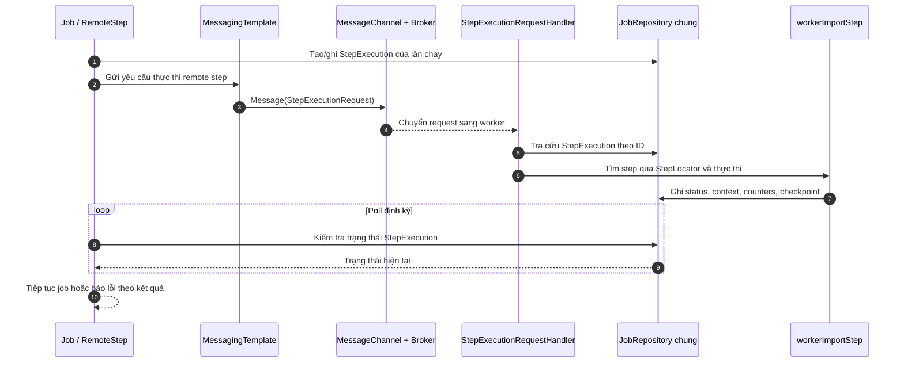

# MessagingTemplate gửi StepExecution request trong Remote Step

Khi một job Spring Batch chạy trên node điều phối nhưng một step cần sử dụng CPU, bộ nhớ hoặc kết nối dữ liệu của máy khác, **Remote Step** cho phép điều phối step đó qua thông điệp. Trong Spring Batch **6.0 trở lên**, lớp `RemoteStep` nhận một `MessagingTemplate` để gửi **yêu cầu thực thi step** (`StepExecutionRequest`) đến worker. Worker nhận yêu cầu, thực thi `Step` thực tế và cập nhật trạng thái trong `JobRepository` dùng chung; phía điều phối theo dõi kết quả qua repository.

Đây là một cách mở rộng Spring Batch trong module `SPRING_BATCH_SCALING_OPERATIONS`. Muốn vận hành đúng cần hiểu đường đi của request, phân biệt việc **gửi thông điệp thành công** với **step xử lý thành công**, rồi phối hợp timeout, retry/restart, thread safety, metrics và giới hạn tài nguyên.

> **Phạm vi phiên bản:** API `org.springframework.batch.integration.remote.RemoteStep` được giới thiệu từ **Spring Batch 6.0**. Với Spring Batch 5.x, muốn chuyển phần việc ra worker thường dùng *remote partitioning* (`MessageChannelPartitionHandler`, `RemotePartitioningManagerStepBuilder`) hoặc remote chunking. Hai cơ chế này có nét giống về messaging nhưng **không phải** cùng một API với `RemoteStep` 6.x.

## 1. Những thành phần tham gia

| Thành phần | Trách nhiệm | Chạy ở đâu? |
| --- | --- | --- |
| `Job` và `RemoteStep` | Định nghĩa luồng job, yêu cầu chạy worker step và theo dõi kết quả | Node điều phối (manager) |
| `MessagingTemplate` | Gửi message tới `MessageChannel`; cung cấp cấu hình channel và send timeout | Manager |
| `MessageChannel`, `IntegrationFlow` | Đưa message từ ứng dụng tới hệ thống messaging và từ hệ thống messaging vào ứng dụng | Cả hai phía |
| Broker/transport, ví dụ JMS | Chuyển request giữa các tiến trình/máy | Hạ tầng messaging |
| `StepExecutionRequest` | DTO mang tên worker step và ID của `StepExecution` | Được gửi qua message |
| `StepExecutionRequestHandler` | Xử lý request; tìm step theo tên và phối hợp thực thi theo ID được yêu cầu | Worker |
| `StepLocator` | Tra cứu bean `Step` thực tế mà worker cần chạy | Worker |
| `JobRepository` | Lưu `JobExecution`, `StepExecution`, `ExecutionContext`, status và checkpoint | **Dùng chung** giữa manager và worker |
| `Tasklet` hoặc chunk-oriented worker step | Thực hiện nghiệp vụ thực tế | Worker |

Sơ đồ luồng một remote step:



**Điểm cốt lõi:** thông điệp ra khỏi manager không mang toàn bộ dữ liệu cần xử lý. Manager gửi **lệnh tham chiếu đến một `StepExecution`**, còn worker dùng metadata đã được lưu và các nguồn dữ liệu được cấu hình để xử lý. Điều này giảm kích thước request và hỗ trợ khôi phục, nhưng cũng tạo điều kiện bắt buộc: worker phải truy cập đúng **repository chung** và tìm được step theo tên.

## 2. `StepExecutionRequest` chứa gì?

DTO `org.springframework.batch.integration.partition.StepExecutionRequest` cung cấp hai thông tin chính:

```java
// Mô phỏng payload để hiểu ý nghĩa; RemoteStep tạo/gửi request trong nội bộ.
StepExecutionRequest request =
        new StepExecutionRequest("workerImportStep", 42017L);
```

| Trường | Ví dụ | Mục đích |
| --- | --- | --- |
| `stepName` | `workerImportStep` | Tên step để `StepLocator` tìm đúng bean ở worker |
| `stepExecutionId` | `42017` | Khóa của `StepExecution` đã được tạo và lưu trong `JobRepository` |

Đừng nhầm `stepName` trong request với tên step phía manager. Ví dụ `RemoteStep("remoteImportStep", "workerImportStep", ...)`: `remoteImportStep` là step được job gọi ở manager, còn `workerImportStep` là tên step cần chạy ở worker. Cả hai tên phải được cấu hình đúng vai trò; đổi tên worker bean nhưng không đổi cấu hình manager sẽ khiến yêu cầu không tìm được step.

Cần phân biệt **request được nhận** và **business logic đã chạy xong**: `MessagingTemplate.send(...)` báo về kết quả gửi vào channel theo hợp đồng messaging; nó không xác nhận worker đã commit tất cả chunk hay hoàn thành step. Với `RemoteStep`, kết quả thực thi được xác nhận thông qua cập nhật `StepExecution` trong `JobRepository`.

## 3. Cấu hình phía manager để gửi request

Ví dụ sau dành cho Spring Batch 6.x với Spring Integration JMS. Có hai ứng dụng/tiến trình riêng: manager định nghĩa `RemoteStep`, còn worker định nghĩa `workerImportStep`. Giả sử ứng dụng đã có `JobRepository`, `ConnectionFactory` của JMS và kết nối đến cùng broker.

### 3.1. Tạo channel và `MessagingTemplate`

```java
import jakarta.jms.ConnectionFactory;

import org.springframework.batch.core.Step;
import org.springframework.batch.core.job.repository.JobRepository;
import org.springframework.batch.integration.remote.RemoteStep;
import org.springframework.beans.factory.annotation.Qualifier;
import org.springframework.context.annotation.Bean;
import org.springframework.context.annotation.Configuration;
import org.springframework.integration.channel.DirectChannel;
import org.springframework.integration.core.MessagingTemplate;
import org.springframework.integration.dsl.IntegrationFlow;
import org.springframework.integration.jms.dsl.Jms;
import org.springframework.messaging.MessageChannel;

@Configuration
public class RemoteStepManagerConfiguration {

    @Bean
    public MessageChannel remoteStepRequests() {
        return new DirectChannel();
    }

    @Bean
    public MessagingTemplate remoteStepMessagingTemplate(
            @Qualifier("remoteStepRequests") MessageChannel requests) {
        MessagingTemplate template = new MessagingTemplate();
        template.setDefaultChannel(requests);
        template.setSendTimeout(5_000L);
        return template;
    }

    @Bean
    public IntegrationFlow remoteStepOutboundFlow(
            @Qualifier("remoteStepRequests") MessageChannel requests,
            ConnectionFactory connectionFactory) {
        return IntegrationFlow.from(requests)
                .handle(Jms.outboundAdapter(connectionFactory)
                        .destination("batch.remote-step.requests"))
                .get();
    }

    @Bean
    public Step remoteImportStep(
            JobRepository jobRepository,
            @Qualifier("remoteStepMessagingTemplate")
                    MessagingTemplate messagingTemplate) {
        RemoteStep step = new RemoteStep(
                "remoteImportStep",
                "workerImportStep",
                jobRepository,
                messagingTemplate
        );
        step.setPollInterval(2_000L);
        step.setTimeout(30 * 60 * 1_000L);
        return step;
    }
}
```

Đây là **mẫu cấu hình cho manager**, chưa phải một ứng dụng hoàn chỉnh: cần cấu hình JMS provider, database dùng làm `JobRepository`, dependency tương thích và `Job` có `remoteImportStep` trong flow. Ví dụ job gọi step này:

```java
@Bean
public Job importJob(JobRepository jobRepository, Step remoteImportStep) {
    return new JobBuilder("importJob", jobRepository)
            .start(remoteImportStep)
            .build();
}
```

Tại sao cần từng phần?

1. `DirectChannel` là điểm gửi nội bộ của Spring Integration. Nó **không phải** hàng đợi liên máy; `remoteStepOutboundFlow` mới chuyển message ra JMS.
2. `MessagingTemplate.setDefaultChannel(requests)` cho phép `RemoteStep` gửi request vào đúng channel. Có thể cấu hình channel qua `RemoteStep.setMessageChannel(...)` theo API; không cấu hình hai đường gửi khác nhau ngoài ý muốn.
3. `sendTimeout` giới hạn thời gian thao tác gửi/chờ channel theo tính chất transport. Nó **không** phải timeout cho toàn bộ thời gian worker chạy.
4. `remoteStepOutboundFlow` kết nối channel với queue `batch.remote-step.requests`. Cùng tên destination phải được dùng trong worker.
5. `setPollInterval(...)` điều chỉnh nhịp kiểm tra `JobRepository`; `setTimeout(...)` là giới hạn chờ của cơ chế remote step. Cả hai tính bằng **mili giây**. Các giá trị 2 giây và 30 phút chỉ minh họa: phải chọn theo workload và SLA.
6. `remoteStepName` là `workerImportStep`, đúng với tên step sẽ được worker đăng ký.

**Không tự viết một vòng `for` gửi lại request** sau mỗi lần `send` thành công. `RemoteStep` đã chịu trách nhiệm giao tiếp ở mức step; gửi lặp mù quáng có thể khiến cùng một `StepExecution` được thực thi nhiều lần hoặc chồng lấn. Nếu cần retry do mất kết nối/broker, phải phối hợp chính sách retry tại transport với kiểm soát giao lại yêu cầu và khả năng idempotent của nghiệp vụ.

### 3.2. Dependency và môi trường

Một ứng dụng sử dụng `RemoteStep` cần module Spring Batch Integration và cơ chế truyền thông Spring Integration tương ứng. Ví dụ Gradle, phiên bản nên được quản lý nhất quán bằng Spring Boot dependency management hoặc BOM của hệ thống:

```groovy
dependencies {
    implementation 'org.springframework.batch:spring-batch-integration'
    implementation 'org.springframework.integration:spring-integration-jms'
    // Bổ sung JMS provider và JDBC driver phù hợp với hạ tầng triển khai.
}
```

Đừng đặt producer/consumer dùng các phiên bản message serialization không tương thích; khi nâng version, kiểm tra format payload và cấu hình convert/deserialization của JMS provider. Bảo vệ đường kết nối broker bằng xác thực, TLS và quyền đọc/ghi queue riêng.

## 4. Worker nhận request và chạy `Step` như thế nào?

Ở ứng dụng worker, `StepExecutionRequestHandler` nhận request từ Spring Integration, tra cứu `StepExecution` qua `JobRepository`, rồi định vị `Step` theo `stepName` bằng `StepLocator`. `Step` thực thi business logic và cập nhật metadata.

```java
import jakarta.jms.ConnectionFactory;

import org.springframework.batch.core.Step;
import org.springframework.batch.core.job.repository.JobRepository;
import org.springframework.batch.core.step.builder.StepBuilder;
import org.springframework.batch.core.step.StepLocator;
import org.springframework.batch.integration.partition.BeanFactoryStepLocator;
import org.springframework.batch.integration.partition.StepExecutionRequestHandler;
import org.springframework.batch.repeat.RepeatStatus;
import org.springframework.beans.factory.BeanFactory;
import org.springframework.context.annotation.Bean;
import org.springframework.context.annotation.Configuration;
import org.springframework.integration.dsl.IntegrationFlow;
import org.springframework.integration.jms.dsl.Jms;
import org.springframework.transaction.PlatformTransactionManager;

@Configuration
public class RemoteStepWorkerConfiguration {

    @Bean
    public Step workerImportStep(
            JobRepository jobRepository,
            PlatformTransactionManager transactionManager) {
        return new StepBuilder("workerImportStep", jobRepository)
                .tasklet((contribution, chunkContext) -> {
                    // Thay bằng xử lý nhập dữ liệu thực tế.
                    System.out.println("Worker đang xử lý import");
                    return RepeatStatus.FINISHED;
                })
                .transactionManager(transactionManager)
                .build();
    }

    @Bean
    public StepLocator stepLocator(BeanFactory beanFactory) {
        BeanFactoryStepLocator locator = new BeanFactoryStepLocator();
        locator.setBeanFactory(beanFactory);
        return locator;
    }

    @Bean
    public IntegrationFlow remoteStepInboundFlow(
            ConnectionFactory connectionFactory,
            JobRepository jobRepository,
            StepLocator stepLocator) {

        StepExecutionRequestHandler handler = new StepExecutionRequestHandler();
        handler.setJobRepository(jobRepository);
        handler.setStepLocator(stepLocator);

        return IntegrationFlow
                .from(Jms.messageDrivenChannelAdapter(connectionFactory)
                        .destination("batch.remote-step.requests"))
                .handle(handler, "handle")
                .get();
    }
}
```

**Giải thích các ranh giới:**

- `remoteStepInboundFlow` lắng nghe cùng JMS destination mà manager gửi vào. `StepExecutionRequestHandler.handle(...)` được Spring Integration gọi với payload là `StepExecutionRequest`.
- `BeanFactoryStepLocator` tìm `workerImportStep` trong container của worker. Nếu step chưa được đăng ký hoặc tên lệch, request không thể thực thi thành công.
- `JobRepository` ở worker phải trỏ tới **cùng kho metadata logic** với manager. Cùng tên bảng nhưng hai database tách biệt **không** tạo thành repository dùng chung.
- `Tasklet` trong ví dụ kết thúc ngay để làm rõ đường giao tiếp; ở production thay bằng thao tác nghiệp vụ hoặc chunk step thực tế với reader/processor/writer, transaction và checkpoint.
- Worker không cần trả toàn bộ kết quả nghiệp vụ vào response message cho `RemoteStep`. Việc hoàn thành step được manager quan sát bằng trạng thái đã ghi trong `JobRepository`.

Với JMS, cần cấu hình adapter/converter phù hợp cho kiểu `StepExecutionRequest`, bao gồm danh sách class được phép deserialize nếu provider áp dụng hạn chế. Nếu dùng headers cho correlation hoặc tự xây reply flow, phải bảo đảm header mapper không làm rơi các header cần thiết; **ví dụ Remote Step này dùng repository polling**, không cần tự viết reply aggregator như luồng remote partitioning nhận phản hồi.

## 5. Tình huống thực thi: từ yêu cầu đến kết quả

Giả sử job xử lý báo cáo ban đêm có step `remoteImportStep`. Tình huống diễn ra như sau:

1. Scheduler khởi chạy `importJob` tại manager. `RemoteStep` được gọi trong thứ tự step của job.
2. Spring Batch tạo và lưu `StepExecution` tương ứng, ví dụ có ID `42017`.
3. `RemoteStep` sử dụng `MessagingTemplate` gửi một yêu cầu tương đương `{stepName: "workerImportStep", stepExecutionId: 42017}` đến channel.
4. Outbound flow đưa request lên JMS queue; một worker tiêu thụ message.
5. Handler ở worker tìm `workerImportStep`, nạp `StepExecution` đã lưu, chạy nghiệp vụ và cập nhật status/counters/context vào `JobRepository`.
6. Manager định kỳ kiểm tra `StepExecution`. Khi việc thực thi kết thúc, job có thể chuyển step tiếp theo nếu trạng thái/exit status cho phép.
7. Nếu worker thất bại, timeout hoặc metadata không trở về trạng thái kết thúc như kỳ vọng, hệ thống phải xử lý failure/restart thay vì tự coi request đã xử lý xong.

Các state có thể quan sát:

| Thời điểm | Message/broker | Trạng thái cần theo dõi |
| --- | --- | --- |
| Chưa gửi được | Lỗi kết nối hoặc send timeout | Bắt exception và ghi lỗi manager; không giả định worker đã nhận |
| Đã nhận vào broker | Message có thể vẫn chờ consumer | Chưa chứng minh worker đã bắt đầu |
| Worker đang chạy | Message đã được tiêu thụ | `StepExecution` đang ở trạng thái thực thi |
| Worker hoàn thành | Có thể không có message phản hồi riêng | Repository báo hoàn thành và ghi checkpoint |
| Worker lỗi hoặc mất kết nối | Có thể redelivery/timeout | Repository, broker và log cần được đối chiếu |

**Mốc quan trọng:** `MessagingTemplate.send(...)` hoàn thành chỉ xác nhận thao tác **gửi** theo hợp đồng channel/adapter. Để xác định step **hoàn thành**, cần quan sát execution status qua `JobRepository`.

## 6. Retry, restart và khả năng bị giao request lại

Remote execution có ít nhất ba nguồn lỗi khác nhau:

| Nguồn lỗi | Ví dụ | Biện pháp xử lý |
| --- | --- | --- |
| **Gửi message** | Broker ngắt kết nối, gửi không thành công, send timeout | Retry có giới hạn theo transport, log và cảnh báo; không tạo vòng gửi vô hạn |
| **Vận chuyển/nhận message** | Queue tắc, consumer crash, message redelivery | Đo độ trễ queue, cấu hình acknowledgment, redelivery và dead-letter queue |
| **Thực thi step** | Database deadlock, writer timeout, dữ liệu sai | Retry/skip trong chunk worker theo loại lỗi; rollback và restart theo metadata |

Không được suy luận rằng việc dùng `JobRepository` tự động tạo **exactly-once side effects** trong mọi hệ thống. Một worker có thể đã gọi API bên ngoài rồi mất kết nối trước khi tiến trình xác nhận thành công. Khi message được giao lại hoặc job được restart, tác dụng phụ như trừ tiền, gửi email, tạo đơn hàng có thể xảy ra thêm lần nữa nếu không có cơ chế bảo vệ.

Các nguyên tắc bắt buộc khi triển khai:

- **Idempotency:** dùng unique key, upsert phù hợp, idempotency key hoặc cơ chế đối soát kết quả ở hệ thống đích. Key phải ổn định theo thao tác nghiệp vụ giữa các lần chạy lại.
- **Checkpoint/restart:** reader/writer phải lưu và khôi phục đúng tiến độ; dùng chung `JobRepository` và thiết kế dữ liệu đầu vào có phạm vi xác định. Đừng dựa vào biến RAM của worker để tiếp tục một lần chạy.
- **Không cho cùng execution chạy song song:** khi broker có redelivery hoặc nhiều consumer, cân nhắc cơ chế chống trùng request/concurrent execution ở tầng hạ tầng và ứng dụng; thử nghiệm crash ở điểm giữa gửi, nhận và commit.
- **Phân loại lỗi:** lỗi hạ tầng tạm thời có thể retry; lỗi schema/config cố định nên fail nhanh. Không để việc retry quá nhiều tầng (JMS, API, Spring Batch) nhân số lần thử lên ngoài kiểm soát.
- **Timeout hợp lý:** thời gian manager đợi phải lớn hơn thời gian xử lý hợp lý của worker khi tải thực tế, có dự trù queue delay, retry/backoff và thời gian commit. Timeout chỉ báo kết quả không đến đúng hạn; **không chứng minh** worker đã dừng.

Nếu một `JobExecution` thất bại rồi restart cùng `JobInstance`, trạng thái các `StepExecution` đã lưu giúp Spring Batch xác định cách chạy lại theo cấu hình restart. Hãy kiểm tra thực tế tình huống worker đã commit thành công nhưng manager bị gián đoạn trước khi nhìn thấy trạng thái cuối.

## 7. Điều phối tài nguyên thực tế

Chuyển `workerImportStep` qua mạng giúp tận dụng tài nguyên của máy khác, nhưng **một `RemoteStep` không tự chia hàng triệu bản ghi thành nhiều partition**. Muốn cùng một bước nghiệp vụ chạy trên nhiều phạm vi dữ liệu, cân nhắc remote partitioning; muốn gửi nhiều chunk từ manager sang worker, cân nhắc remote chunking.

| Mô hình | Thứ được gửi | Đơn vị song song điển hình |
| --- | --- | --- |
| **Remote Step (6.x)** | Yêu cầu chạy một step cụ thể, tham chiếu đến `StepExecution` | Một step logic được đặt tại máy khác |
| **Remote partitioning** | Một request cho từng partition và `ExecutionContext` tương ứng trong repository | Nhiều worker step xử lý các vùng dữ liệu độc lập |
| **Remote chunking** | Các chunk item do manager chuẩn bị | Nhiều worker cùng xử lý item/chunk |
| **Parallel steps** | Không nhất thiết cần messaging | Nhiều step độc lập trong job chạy đồng thời |

Không lấy **số consumer của queue** làm thước đo duy nhất cho hiệu năng. Một remote step có thể chỉ tạo một yêu cầu thực thi cho lần gọi đó; tăng consumer lên tám không chia nhỏ nội dung của step. Cần xem bản chất công việc, khả năng song song hóa, giới hạn connection pool, database lock, I/O, network, CPU và memory.

Với một bước dựng báo cáo cần 16 GB RAM mà manager chỉ cấp 4 GB, Remote Step hữu ích để chuyển sang node chuyên dụng. Với 100 triệu đơn hàng chia được theo khoảng khóa và cần chạy đồng thời, remote partitioning có thể hợp lý hơn. Chọn kiến trúc sau khi **đo nút thắt** chứ không chỉ dựa vào tổng số bản ghi.

## 8. Quan sát và vận hành

Mỗi remote step nên có đủ thông tin để truy vết từ manager qua broker đến worker:

| Metric/log | Trả lời câu hỏi |
| --- | --- |
| `jobExecutionId`, `stepExecutionId`, tên step | Yêu cầu nào tương ứng execution nào? |
| Thời điểm gửi, thời điểm worker nhận | Message mất bao lâu trong queue? |
| Send timeout, số lỗi publish, độ dài queue | Broker hoặc đường truyền có nghẽn không? |
| Thời điểm bắt đầu/kết thúc worker step | Xử lý thực sự mất bao lâu? |
| `BatchStatus`, `ExitStatus`, lỗi cuối | Step hoàn thành, thất bại hay bị dừng? |
| Read/write/commit/rollback count | Lỗi nằm trong xử lý nghiệp vụ hay giao dịch? |
| Retry/redelivery/DLQ count | Request có bị giao lại, chờ quá lâu hoặc bỏ vào dead-letter queue? |
| Poll interval, số lần timeout | Manager đang đợi quá lâu hay thăm dò quá dày? |

**Phân biệt các khoảng thời gian:** `request latency` (từ phát message tới worker nhận), `worker step duration` (thời gian xử lý) và `manager remote step duration` (bao gồm gửi, chờ queue, worker và polling) không phải lúc nào cũng bằng nhau. Trong môi trường phân tán, dùng timestamp đã chuẩn hóa múi giờ và đồng bộ đồng hồ giữa các node; không sử dụng `stepExecutionId` làm label/tags của metric tổng hợp vì tạo cardinality cao. Có thể dùng ID đó trong structured log và tracing.

Khi thiết lập cảnh báo, kết hợp độ sâu queue, timeout và thời gian xử lý thực. Nếu worker thực thi 25 phút nhưng manager có timeout 10 phút, bạn có thể tạo cảnh báo và restart sai dù worker vẫn đang chạy; cần chọn timeout theo số liệu production và hành vi cancellation thực tế.

## 9. Kiểm thử luồng gửi `StepExecutionRequest`

Một kiểm thử tích hợp có ích cần khởi động **manager + worker + broker + một `JobRepository` chung** và chứng minh các trạng thái bằng dữ liệu. Các kịch bản nên có:

1. **Thành công:** manager gửi một request, worker tìm đúng `workerImportStep`, thực thi và cập nhật `COMPLETED`; manager quan sát trạng thái cuối rồi chạy step tiếp theo.
2. **Sai tên step:** gửi request tham chiếu tên không tồn tại; xác nhận có lỗi rõ ràng ở worker và có phương án phát hiện job không hoàn thành.
3. **Worker tắt trước khi nhận:** message chờ hoặc thất lạc tùy cấu hình broker; theo dõi timeout và khả năng khởi phục, không coi send thành công là job thành công.
4. **Worker chết giữa giao dịch:** kiểm tra rollback/checkpoint, trạng thái `StepExecution`, hành vi redelivery và restart cùng `JobInstance`.
5. **Message bị giao lặp:** kiểm tra không tạo ra tác dụng phụ nghiệp vụ trùng; các cơ chế kiểm soát cùng `StepExecution` không chạy đè nhau.
6. **Timeout manager:** xác nhận timeout làm job phản ánh lỗi theo cấu hình và kiểm tra worker có tiếp tục chạy hay không; không suy đoán nó tự bị hủy.
7. **Tăng tải:** đo job/step duration, queue wait, database connection pool, throughput và số consumer thực sự đang xử lý.

Một log minh họa (các ID và mốc thời gian chỉ là ví dụ):

```text
manager: jobExecutionId=920 step=remoteImportStep
manager: publish request stepName=workerImportStep stepExecutionId=421
worker : consume request stepName=workerImportStep stepExecutionId=421
worker : stepExecutionId=421 status=COMPLETED read=50000 write=50000
manager: stepExecutionId=421 observed status=COMPLETED via JobRepository
```

Khi cấu hình hệ thống, đừng lẫn tên broker queue (`batch.remote-step.requests`) với tên bean channel (`remoteStepRequests`) hoặc tên worker step (`workerImportStep`). Đây là **ba lớp đặt tên khác nhau** và đều phải khớp đúng tại điểm nối của chúng.

## 10. Checklist triển khai

- Dự án dùng **Spring Batch 6.x** cho `RemoteStep`; nếu dùng 5.x, chọn API remote partitioning/chunking tương ứng.
- `MessagingTemplate` có default request channel; outbound flow nối channel đó với JMS destination đúng.
- `StepExecutionRequest` truyền đúng tên worker step và ID execution; việc tạo/gửi request do `RemoteStep` thực hiện.
- Worker có `StepExecutionRequestHandler`, `StepLocator` và bean `Step` mang đúng tên.
- Manager và mọi worker truy cập **cùng `JobRepository`**; các node có quyền truy cập dữ liệu nghiệp vụ cần thiết.
- Timeout gửi, polling timeout, JMS redelivery và worker transaction được cấu hình theo SLA, thử cả trường hợp worker tắt và broker mất kết nối.
- Writer có chiến lược idempotency, checkpoint được kiểm tra qua restart và redelivery.
- Có log/metric nối được manager, broker, worker và `StepExecution`; đo thêm queue wait và worker duration trước khi tăng số node.

> **Ghi nhớ:** `MessagingTemplate` là phương tiện gửi **lệnh thực thi** đến worker; `StepExecutionRequest` là địa chỉ tham chiếu tới step cần chạy; **`JobRepository` mới là nơi manager theo dõi kết quả thực thi** của `RemoteStep`. Gửi thành công không đồng nghĩa xử lý thành công. Để mở rộng Spring Batch an toàn, phải ghép giao tiếp từ xa với restart, transaction, idempotency và quan sát tài nguyên.

## Tài liệu tham khảo

- [Spring Batch 6.x — Scaling and Parallel Processing, Remote Step execution](https://docs.spring.io/spring-batch/reference/scalability.html).
- [API `RemoteStep`](https://docs.spring.io/spring-batch/reference/api/org/springframework/batch/integration/remote/RemoteStep.html).
- [API `StepExecutionRequest`](https://docs.spring.io/spring-batch/reference/api/org/springframework/batch/integration/partition/StepExecutionRequest.html).
- [API `StepExecutionRequestHandler`](https://docs.spring.io/spring-batch/reference/api/org/springframework/batch/integration/partition/StepExecutionRequestHandler.html).

