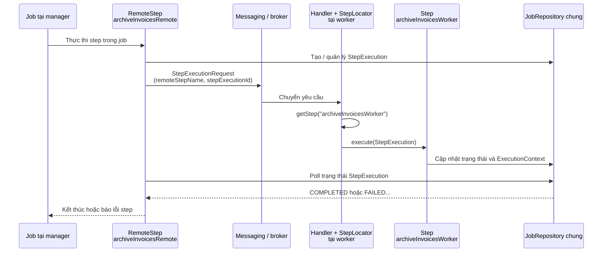

# Remote step name và worker step name

## 1. Vì sao cần phân biệt hai tên?

Trong hệ thống Spring Batch xử lý dữ liệu lớn, có lúc một job chạy trên **manager** nhưng một bước xử lý tốn CPU/I/O cần được thực thi ở **worker** thuộc JVM hoặc máy khác. Từ **Spring Batch 6.0**, `org.springframework.batch.integration.remote.RemoteStep` hỗ trợ mô hình **remote step execution**: job giữ một step đại diện ở manager, gửi yêu cầu thực thi sang worker thông qua Spring Integration và theo dõi trạng thái trong `JobRepository`.

Một `RemoteStep` khai báo **hai tên khác vai trò**:

```java
new RemoteStep("archiveInvoicesRemote", "archiveInvoicesWorker",
               jobRepository, messagingTemplate);
//              ^ tên step trong job   ^ tên step cần tìm tại worker
```

- **Tên thứ nhất (`name`)**: tên của đối tượng `RemoteStep` tại manager; job sử dụng tên này để định danh bước của mình.
- **Tên thứ hai (`remoteStepName`)**: tên dùng để yêu cầu worker tìm **step thực thi nghiệp vụ**. Với `BeanFactoryStepLocator` thông dụng, tên này cần khớp tên Spring bean `Step` trên worker.

Hai tên **không bắt buộc giống nhau**. Chúng thường *nên khác nhau* để phân biệt vị trí điều phối với vị trí thực thi khi đọc log và thiết kế job. Tuy nhiên, mọi thành phần cùng tham gia phải dùng đúng từng tên.

> **Giới hạn phiên bản:** Lớp `RemoteStep` đề cập ở đây xuất hiện từ Spring Batch **6.0**. Nếu dự án dùng Spring Batch 5.x, không sao chép ví dụ này nguyên trạng; ở phiên bản đó cần lựa chọn các cơ chế khác như remote partitioning hoặc remote chunking.

### Kết quả cần đạt

Sau bài này, bạn có thể đọc đúng chữ ký constructor `RemoteStep`, ánh xạ tên step giữa manager và worker, giải thích tên được theo dõi trong batch metadata, phát hiện lỗi sai tên và quyết định khi nào Remote Step phù hợp với workload thực tế.

## 2. Ba loại tên thường xuất hiện trong một hệ thống

Giả sử cần chuyển toàn bộ bước lưu trữ hóa đơn ra một worker chuyên xử lý file lớn:

| Thuộc tính | Ví dụ | Được khai báo ở đâu? | Vai trò |
| --- | --- | --- | --- |
| **Tên `RemoteStep` (`name`)** | `archiveInvoicesRemote` | Tham số 1 của `new RemoteStep(...)` ở manager | Định danh bước trong luồng job và `StepExecution` do job tại manager quản lý |
| **Tên worker (`remoteStepName`)** | `archiveInvoicesWorker` | Tham số 2 của `new RemoteStep(...)` ở manager | Khóa dùng để tra cứu step nghiệp vụ trên worker |
| **Tên bean và tên step ở worker** | `archiveInvoicesWorker` | `@Bean("archiveInvoicesWorker")` và `new StepBuilder("archiveInvoicesWorker", ...)` ở worker | Cho phép `StepLocator` tìm thấy step và người vận hành nhận diện đúng logic thực thi |

Tên phương thức `@Bean`, chẳng hạn `workerArchiveStep()`, không phải lúc nào cũng là tên bean. Khi khai báo `@Bean("archiveInvoicesWorker")`, tên bean chính là `archiveInvoicesWorker`, cho dù phương thức có tên khác. `BeanFactoryStepLocator.getStep(stepName)` tìm **bean `Step` theo tên bean**, vì vậy chỉ đổi tên trong `StepBuilder` mà quên tên bean có thể vẫn gây lỗi tra cứu.

Trong thực hành, dùng cùng một hằng tên nghiệp vụ hoặc một quy ước triển khai được quản lý thống nhất ở hai ứng dụng. Không nên phụ thuộc vào việc tên bean mặc định tình cờ trùng tên phương thức.

## 3. Tên đi qua luồng điều phối như thế nào?



1. **Manager** chạy `RemoteStep` trong job; hệ thống có `StepExecution` thuộc lần chạy job đó.
2. `RemoteStep` gửi yêu cầu có tên worker mục tiêu và thông tin định danh `StepExecution` qua `MessagingTemplate` đến kênh đã nối với middleware.
3. **Worker** nhận yêu cầu; `StepExecutionRequestHandler` dùng `StepLocator` để lấy `Step` tương ứng với tên được gửi, sau đó thực thi bằng `StepExecution` đã có.
4. Worker cập nhật kết quả và execution context vào **cùng kho metadata**; manager **poll `JobRepository`** để biết bước hoàn thành hoặc thất bại. `RemoteStep` không đòi hỏi worker gửi một luồng phản hồi riêng như cấu hình reply aggregation của remote partitioning.

Hệ quả quan trọng: **tên dùng để định danh bước trong job là `archiveInvoicesRemote`**, còn **tên được tra cứu để chọn mã chạy trên worker là `archiveInvoicesWorker`**. Việc nhìn thấy tên `archiveInvoicesRemote` ở `BATCH_STEP_EXECUTION.STEP_NAME` là hợp lý; không nên mặc định truy tìm `archiveInvoicesWorker` ở cột đó cho chính lần thực thi `RemoteStep` này.

## 4. Ví dụ cấu hình với Spring Batch 6.x

Ví dụ dưới đây tập trung vào hợp đồng tên, cách gửi yêu cầu và cách đăng ký worker. Giả sử đã cấu hình database dùng chung cho `JobRepository`, broker và các adapter Spring Integration để nối `outboundRequests` trên manager với `inboundRequests` ở worker. Đây là **mẫu cấu hình trọng tâm**, chưa phải ứng dụng có thể chạy độc lập khi chưa bổ sung kết nối middleware.

### 4.1. Manager: tên trong job và tên worker mục tiêu

```java
// ManagerConfig.java — lược bỏ import
@Configuration
class ManagerConfig {

    static final String JOB_STEP_NAME = "archiveInvoicesRemote";
    static final String WORKER_STEP_NAME = "archiveInvoicesWorker";

    @Bean
    MessagingTemplate remoteRequestsTemplate(
            @Qualifier("outboundRequests") MessageChannel outboundRequests) {
        MessagingTemplate template = new MessagingTemplate();
        template.setDefaultChannel(outboundRequests);
        return template;
    }

    @Bean
    Step remoteArchiveStep(JobRepository jobRepository,
            @Qualifier("remoteRequestsTemplate") MessagingTemplate template) {
        RemoteStep remoteStep = new RemoteStep(
                JOB_STEP_NAME,        // step thuộc job ở manager
                WORKER_STEP_NAME,     // tên để tìm Step tại worker
                jobRepository,
                template);

        remoteStep.setPollInterval(1_000L);   // kiểm tra repository mỗi 1 giây
        remoteStep.setTimeout(30 * 60_000L); // tối đa 30 phút chờ worker
        return remoteStep;
    }

    @Bean
    Job archiveJob(JobRepository jobRepository,
            @Qualifier("remoteArchiveStep") Step remoteArchiveStep) {
        return new JobBuilder("archiveJob", jobRepository)
                .start(remoteArchiveStep)
                .build();
    }
}
```

**Điểm cần đọc:** `remoteArchiveStep` là tên bean ở manager, còn `JOB_STEP_NAME` là tên Spring Batch của step thuộc job. `WORKER_STEP_NAME` **không tạo worker**, mà chỉ nói cho remote execution infrastructure biết tên cần tra cứu tại phía nhận yêu cầu. `MessagingTemplate` phải có kênh đầu ra nối đến middleware có thể đưa yêu cầu sang tiến trình worker; `DirectChannel` đơn thuần trong cùng JVM không thay thế một đường truyền liên tiến trình.

### 4.2. Worker: đăng ký bean với đúng tên được yêu cầu

```java
// WorkerConfig.java — lược bỏ import
@Configuration
class WorkerConfig {

    @Bean("archiveInvoicesWorker")
    Step workerArchiveStep(JobRepository jobRepository,
            PlatformTransactionManager transactionManager) {
        return new StepBuilder("archiveInvoicesWorker", jobRepository)
                .tasklet((contribution, chunkContext) -> {
                    // Xử lý một đơn vị nghiệp vụ, ví dụ ghi kho lưu trữ hóa đơn.
                    // Production: phải có cách retry/restart và tránh ghi trùng.
                    return RepeatStatus.FINISHED;
                }, transactionManager)
                .build();
    }

    @Bean
    StepLocator stepLocator(BeanFactory beanFactory) {
        BeanFactoryStepLocator locator = new BeanFactoryStepLocator();
        locator.setBeanFactory(beanFactory);
        return locator;
    }

    @Bean
    IntegrationFlow inboundStepRequests(
            @Qualifier("inboundRequests") MessageChannel inboundRequests,
            StepLocator stepLocator,
            JobRepository jobRepository) {
        StepExecutionRequestHandler handler = new StepExecutionRequestHandler();
        handler.setStepLocator(stepLocator);
        handler.setJobRepository(jobRepository);

        return IntegrationFlow.from(inboundRequests)
                .handle(handler, "handle")
                .get();
    }
}
```

Trong đoạn code này, hàm Java tên `workerArchiveStep`, nhưng `BeanFactoryStepLocator` nhận được bean có tên **`archiveInvoicesWorker`**. Đồng thời `StepBuilder` tạo step cùng tên, giúp code, trace và cấu hình nhất quán. `inboundRequests` ở worker phải được feed từ adapter tiêu thụ message của broker; worker cần có kết nối `JobRepository` dùng chung với manager.

Các thành phần chính cần hiểu:

| Thành phần | Nhiệm vụ | Lưu ý vận hành |
| --- | --- | --- |
| `RemoteStep` | Đại diện bước ở manager và gửi yêu cầu thực thi | Đặt tên ổn định; cấu hình timeout/poll interval theo workload |
| `MessagingTemplate` và kênh | Đưa yêu cầu tới middleware | Kiểm tra destination, format message, quyền truy cập, độ bền và cách xử lý message bị lặp |
| `StepExecutionRequestHandler` | Xử lý yêu cầu thực thi ở worker | Phải được nối vào inbound flow và cấu hình `JobRepository`/`StepLocator` |
| `BeanFactoryStepLocator` | Tìm bean kiểu `Step` bằng tên yêu cầu | Bean name phải khớp `remoteStepName`, phân biệt chữ hoa/chữ thường |
| `JobRepository` | Lưu/truy vấn `JobExecution`, `StepExecution`, trạng thái và context | Manager và worker cùng dùng kho metadata tương thích, truy cập được từ các node |

## 5. Ví dụ đổi tên đúng và sai

**Đúng — tên ở hai phía khớp hợp đồng:**

```java
// Manager
new RemoteStep("dailyExportRemote", "dailyExportWorker", repository, template);

// Worker
@Bean("dailyExportWorker")
Step exportWorker(JobRepository repository, PlatformTransactionManager tx) {
    return new StepBuilder("dailyExportWorker", repository)
            .tasklet((c, ctx) -> RepeatStatus.FINISHED, tx)
            .build();
}
```

**Sai — tên mà manager yêu cầu không tồn tại ở worker:**

```java
// Manager gửi yêu cầu cho "dailyExportWorker"
new RemoteStep("dailyExportRemote", "dailyExportWorker", repository, template);

// Worker lại đăng ký bean tên "exportWorkerV2"
@Bean("exportWorkerV2")
Step exportWorker(JobRepository repository, PlatformTransactionManager tx) {
    return new StepBuilder("exportWorkerV2", repository)
            .tasklet((c, ctx) -> RepeatStatus.FINISHED, tx)
            .build();
}
```

Với `BeanFactoryStepLocator` tiêu chuẩn, yêu cầu `dailyExportWorker` không tra cứu được bean `exportWorkerV2`; việc có đúng `Step` về mặt nghiệp vụ vẫn chưa đủ. Cách sửa là thống nhất tên mà manager gửi với bean worker đã đăng ký, và ưu tiên giữ cả `Step.getName()` nhất quán. Nếu cần đổi tên phiên bản đang vận hành, phải đánh giá trước tác động tới restart và các lần chạy chưa hoàn tất.

## 6. Phân biệt Remote Step và remote partitioning

Hai cơ chế đều có manager/worker và có thể dùng message broker, nhưng **ngữ nghĩa tên khác nhau**:

| Tiêu chí | `RemoteStep` (Spring Batch 6+) | Remote partitioning |
| --- | --- | --- |
| Đơn vị được gửi | Yêu cầu thực thi **một step logic** tại worker | **Nhiều partition** có `StepExecution` và `ExecutionContext` riêng |
| API tiêu biểu | `new RemoteStep(localName, remoteStepName, ...)` | `new RemotePartitioningManagerStepBuilder(managerName, repo).partitioner(workerName, partitioner)` |
| Tên xuất hiện trong metadata | Tên step thuộc job, ví dụ `dailyExportRemote` | Tên manager và các execution dạng `dailyExportWorker:partition0`, `:partition1`... |
| Cách mở rộng | Chuyển bước tốn tài nguyên sang node thích hợp; cần cơ chế khác nếu muốn chia một bước thành nhiều mảnh | Chia dữ liệu thành nhiều phần để nhiều worker chạy đồng thời |
| Điều phối kết quả | `RemoteStep` poll trạng thái trong `JobRepository` | Manager tổng hợp kết quả partition qua repository polling hoặc message replies tùy cấu hình |

**Ví dụ chọn kiến trúc:** Nếu bước tạo báo cáo PDF tiêu tốn RAM và cần máy riêng, một `RemoteStep` có thể đưa toàn bộ bước sang node cấu hình cao. Nếu cần xử lý 20 triệu bản ghi độc lập theo khoảng ID, remote partitioning thường phù hợp hơn để phân việc cho nhiều worker; chỉ thay tên `RemoteStep` không tự chia dữ liệu và không tự tạo 20 partition.

## 7. Ảnh hưởng tới restart, retry và theo dõi job

**Định danh step cần ổn định theo thời gian.** Spring Batch sử dụng tên step để theo dõi lịch sử, trạng thái hoàn tất và quyết định cách restart các lần chạy. Đổi tên step của job từ `archiveInvoicesRemote` sang `archiveV2` có thể khiến hệ thống xem đây là một step khác khi chạy lại cùng job instance; thay đổi như vậy cần chủ đích và kế hoạch xử lý metadata. Đổi `remoteStepName` ở manager khi worker chưa được triển khai đồng bộ dễ làm các yêu cầu không tìm được step.

**Một message chưa phải kết quả thành công.** Sau khi yêu cầu được gửi, manager tiếp tục theo dõi `StepExecution` trong `JobRepository`. Nếu worker ngừng hoạt động, broker không chuyển message hoặc bước quá thời hạn chờ, manager có thể thất bại hoặc hết timeout mà không có kết quả thành công. Timeout không chứng minh tác động phụ của worker đã bị rollback: cần kiểm tra repository, log worker và hệ thống đích trước khi retry.

**Retry/restart không thay thế tính idempotent.** Trong thực tế có thể gặp yêu cầu trùng, worker crash sau khi ghi dữ liệu nhưng trước khi cập nhật trạng thái, hoặc một job restart sau lỗi hạ tầng. Hãy dùng khóa nghiệp vụ duy nhất, upsert, trạng thái xử lý, transaction/chunk boundary thích hợp và xử lý lại an toàn. `JobRepository` cung cấp metadata cho khả năng khôi phục, nhưng bản thân nó không bảo đảm "exactly once" cho mọi thao tác ngoài database.

**Quan sát theo hai tên:** Khi log, nên ghi đồng thời `jobName`, tên local step (`archiveInvoicesRemote`), tên worker mục tiêu (`archiveInvoicesWorker`), `jobExecutionId` và `stepExecutionId`. Nếu có nhiều phiên bản worker, bổ sung thông tin phiên bản ứng dụng và correlation id của message. Cách này giúp phân biệt lỗi dispatch, lỗi lookup step và lỗi nghiệp vụ bên trong worker.

Ví dụ truy vấn metadata (tên bảng/cột theo schema JDBC chuẩn của Spring Batch):

```sql
SELECT STEP_EXECUTION_ID, STEP_NAME, STATUS, START_TIME, END_TIME
FROM BATCH_STEP_EXECUTION
WHERE JOB_EXECUTION_ID = ?;
```

Với cấu hình `RemoteStep` ở mục 4, tên kỳ vọng của dòng tương ứng trong kết quả là `archiveInvoicesRemote`. Nên kết hợp kết quả này với log nhận message `archiveInvoicesWorker` ở worker để theo dõi xuyên hệ thống.

## 8. Chẩn đoán sự cố liên quan tới tên

| Biểu hiện | Cần kiểm tra | Cách xử lý |
| --- | --- | --- |
| Worker báo không tìm thấy step | `remoteStepName`, tên `@Bean`, `StepLocator` có trỏ đúng `ApplicationContext` không | Đăng ký đúng tên bean `Step`; nếu dùng locator riêng, xác minh quy tắc ánh xạ |
| Manager chờ quá lâu dù đã tạo `StepExecution` | Message có tới broker và worker không; worker có đọc đúng destination; worker có kết nối đúng repository không | Kiểm tra adapter, consumer, dead-letter queue, network và trạng thái metadata; đặt timeout hợp lý |
| Chỉ thấy `archiveInvoicesRemote` trong metadata | Đây là tên local `RemoteStep`; tên worker được dùng để lookup | Kiểm tra log handler/worker; đừng kỳ vọng metadata có thêm một dòng `archiveInvoicesWorker` cho cùng `RemoteStep` |
| Thay đổi tên xong restart hành xử bất ngờ | Tên bước trong job có bị đổi; job instance cũ có step hoàn tất chưa | Giữ tên ổn định, đánh giá thay đổi lịch sử/restart trước triển khai |
| Worker đã ghi dữ liệu nhưng manager chưa xác nhận xong | Lỗi cập nhật repository, job bị ngắt, timeout hoặc mất kết nối | Kiểm tra tác động phụ, khóa idempotency, transaction, log và trạng thái `StepExecution` trước retry |
| Code không nhận diện `RemoteStep` | Spring Batch có đang dùng bản 5.x không; đã thêm `spring-batch-integration` chưa | Chọn đúng phiên bản và dependency; nếu đang ở 5.x dùng mô hình tương thích với phiên bản đó |

### Checklist trước khi chạy production

1. Tên `RemoteStep` ở manager **duy nhất trong flow của job** và được giữ ổn định qua restart.
2. `remoteStepName` trùng chính xác với **tên bean `Step`** được `StepLocator` ở worker sử dụng; kiểm tra được bằng `stepLocator.getStep("archiveInvoicesWorker")`.
3. `Step.getName()` tại worker có ý nghĩa rõ ràng, tốt nhất thống nhất với tên bean để tránh nhầm cấu hình.
4. Manager và worker truy cập cùng `JobRepository`/schema tương thích; các kênh message nối đúng destination.
5. Có quan sát theo `jobExecutionId`, `stepExecutionId`, tên local step và worker; đã thử cả trường hợp worker chậm, worker chết và message trùng.
6. Đã đo CPU, RAM, I/O, thời gian chờ và throughput thực tế. Một remote step giúp chuyển nơi thực thi; mục tiêu tăng throughput cần được kiểm chứng bằng benchmark.

## 9. Tự kiểm tra hiểu bài

**Câu 1.** Cho `new RemoteStep("settlementRemote", "settlementWorker", repository, template)`. Job gọi tên nào? Worker cần có bean nào?

*Đáp án:* Job chạy step tên `settlementRemote`. Nếu dùng `BeanFactoryStepLocator`, worker cần cung cấp bean `Step` tên `settlementWorker`.

**Câu 2.** Worker khai báo `@Bean("settlementWorker")` nhưng `new StepBuilder("internalStep", ...)`. Có tra cứu được không? Có nên giữ cấu hình này không?

*Đáp án:* Locator dựa trên tên bean có thể tìm được `settlementWorker`, nhưng tên nội bộ `internalStep` gây khó đọc log và có thể tạo sai lệch kỳ vọng về metadata. Nên thống nhất cả hai tên, trừ khi có lý do thiết kế cụ thể và đã kiểm thử.

**Câu 3.** Muốn chạy song song 12 phần của cùng một bảng dữ liệu, đổi `remoteStepName` thành 12 giá trị có đủ không?

*Đáp án:* Không. `RemoteStep` không tự chia dữ liệu. Cần chiến lược phân chia rõ ràng, thường là partitioning với `Partitioner`, mỗi partition có execution context riêng.

## Tài liệu tham khảo

- [Spring Batch Reference — Scaling and Parallel Processing, mục Remote Step execution](https://docs.spring.io/spring-batch/reference/scalability.html): luồng manager/worker và ví dụ `RemoteStep` của Spring Batch 6.
- [Spring Batch API — RemoteStep](https://docs.spring.io/spring-batch/reference/api/org/springframework/batch/integration/remote/RemoteStep.html): chữ ký constructor, ý nghĩa `name` và `remoteStepName`, polling repository.
- [Spring Batch API — BeanFactoryStepLocator](https://docs.spring.io/spring-batch/reference/api/org/springframework/batch/integration/partition/BeanFactoryStepLocator.html): cơ chế tìm bean `Step` theo tên.
- [Spring Batch Integration — Externalizing execution](https://docs.spring.io/spring-batch/reference/spring-batch-integration/externalizing-execution.html): phân biệt kiến trúc remote partitioning với việc đưa nguyên step sang remote worker.
