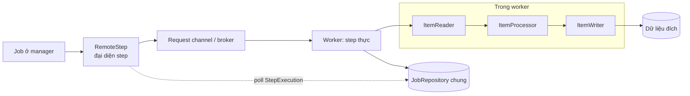
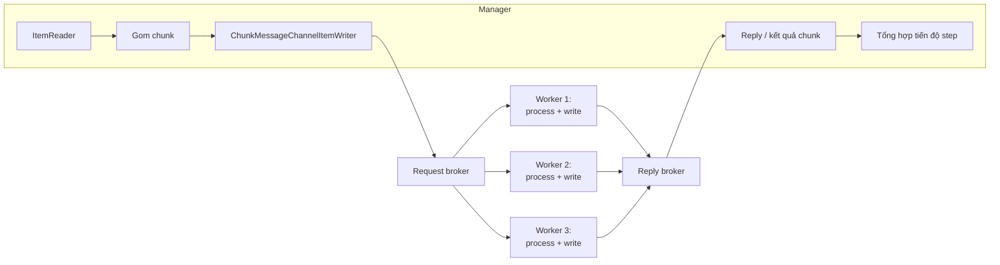
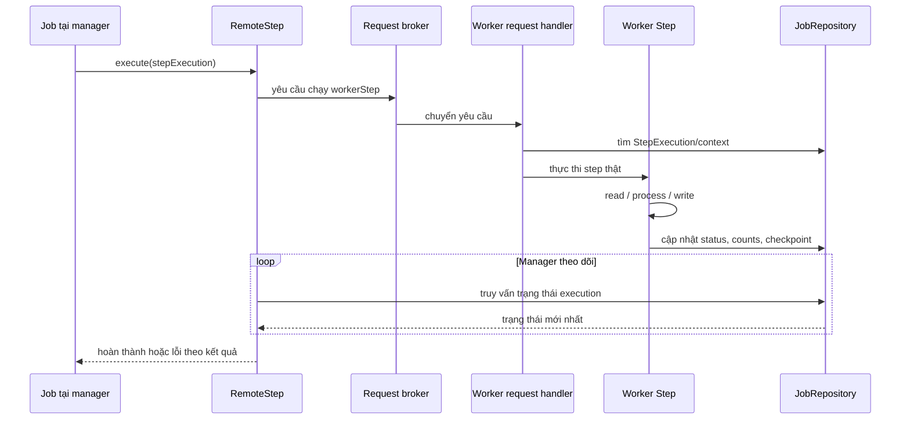

# Remote step so với remote chunking

## 1. Bối cảnh: cùng chạy từ xa nhưng giao việc ở hai cấp khác nhau

Trong chương **Remote Step** của module **SPRING_BATCH_SCALING_OPERATIONS**, yêu cầu đặt ra là mở rộng Spring Batch cho khối lượng dữ liệu lớn bằng multi-threaded step, parallel steps, partitioning và những mô hình phân tán phù hợp với tài nguyên thực tế. Hai thuật ngữ thường bị nhầm lẫn là **remote step execution** và **remote chunking**. Chúng đều có thể dùng messaging để chuyển công việc từ một tiến trình manager sang worker, nhưng **đơn vị công việc được chuyển đi khác nhau**:

- **Remote step execution:** manager ủy quyền **toàn bộ một lần thực thi step** cho worker từ xa. Reader, processor và writer của step thật được thực thi tại worker.
- **Remote chunking:** manager **giữ reader và tạo chunk**, thay writer ghi dữ liệu bằng **message writer** để gửi từng chunk đến worker; worker xử lý và ghi dữ liệu nghiệp vụ.

Sự khác biệt này quyết định vị trí đọc dữ liệu, nơi tạo checkpoint, tài nguyên bị nghẽn, cách retry/restart và cơ chế quan sát. **`RemoteStep` là một API cụ thể được giới thiệu từ Spring Batch 6.0**, trong khi remote chunking đã có ở những nhánh Spring Batch trước đó. Vì vậy, khi đọc ví dụ trên mạng cần kiểm tra cả **mô hình kiến trúc** lẫn **phiên bản API**.

Sau bài này, bạn có thể:

1. Phân biệt remote step execution, remote chunking và remote partitioning.
2. Chỉ ra nơi chạy `ItemReader`, `ItemProcessor`, `ItemWriter` và cách quản lý `StepExecution` trong từng mô hình.
3. Hiểu quan hệ giữa `RemoteStep`, `StepExecutionRequestHandler`, `JobRepository` và các messaging channel.
4. Đọc cấu hình remote chunking sử dụng `ChunkMessageChannelItemWriter`, request/reply và worker chunk processor.
5. Phân tích ranh giới transaction, lỗi mạng, redelivery, checkpoint, retry/restart và tính idempotent.
6. Lựa chọn kiến trúc dựa vào bottleneck thật, năng lực worker, database, broker và yêu cầu vận hành.

> **Ghi nhớ ngay:** Remote step chuyển **cả step execution**; remote chunking chuyển **nhiều chunk item** của một step. Remote step **không tự tạo nhiều partition**, còn remote chunking **không tự biến mỗi chunk thành một `StepExecution` riêng**.

## 2. Cùng một bài toán, hai sơ đồ thực thi

Giả sử một job xử lý 5 triệu hóa đơn. Mỗi hóa đơn cần đọc từ database, tính phí và ghi kết quả. Có một ứng dụng manager điều phối job và nhiều ứng dụng worker có CPU, thư viện hoặc kết nối hệ thống đích.

### 2.1. Remote step: worker chạy nguyên step



Manager tạo/điều phối `StepExecution` của một step trong job, gửi yêu cầu để worker thực thi step tương ứng. Worker tìm step theo tên, thực hiện logic đọc/xử lý/ghi và cập nhật metadata trong `JobRepository` dùng chung. Manager theo dõi tiến độ của remote execution để biết lúc nào job có thể đi tiếp.

**Một `RemoteStep` không tương đương “chia step ra N worker”.** Nó chuyển một đơn vị thực thi sang worker. Nếu mục tiêu là chia 5 triệu bản ghi cho 16 worker đồng thời, cần thêm chiến lược chia công việc như partitioning hoặc nhiều step độc lập trong flow.

### 2.2. Remote chunking: manager đọc, worker xử lý/ghi



Manager liên tục đọc item, gom thành chunk và gửi các `ChunkRequest` qua message writer. Các worker nhận chunk, xử lý và ghi kết quả, rồi phát `ChunkResponse`. Manager theo dõi phản hồi để tổng hợp tình trạng step. **Reader vẫn ở manager**, nên tốc độ đọc và publish request có thể trở thành nút thắt dù có rất nhiều worker.

Hai sơ đồ đều là mô hình logic. Để chạy qua nhiều JVM cần triển khai middleware/adapter thực sự, nhất quán về hợp đồng message và cơ chế quản lý lỗi.

## 3. Bảng so sánh kiến trúc

| Tiêu chí | Remote step execution | Remote chunking |
| --- | --- | --- |
| **Đơn vị giao việc** | Một lần thực thi **toàn bộ step** | Từng **chunk item** |
| **Thành phần tại manager** | `RemoteStep` làm đại diện, gửi request và theo dõi trạng thái | Reader, chunk-oriented step và `ChunkMessageChannelItemWriter` |
| **Reader nằm ở đâu?** | Trong worker thực thi step thật | **Trong manager** |
| **Processor nằm ở đâu?** | Trong worker | Thường trong worker |
| **Writer nghiệp vụ nằm ở đâu?** | Trong worker | Trong worker; manager dùng message writer |
| **Thông điệp chủ yếu** | Yêu cầu thực thi step, định danh execution/worker step | `ChunkRequest` mang item và `ChunkResponse` |
| **Theo dõi hoàn tất** | Worker cập nhật `StepExecution` trong `JobRepository`; manager theo dõi trạng thái | Manager thu/tổng hợp phản hồi chunk và metadata step |
| **Checkpoint nguồn đọc** | Gắn với step thực ở worker | Gắn với reader/step ở manager |
| **Mở rộng số worker** | Một remote step riêng lẻ không tự tạo parallelism | Nhiều worker có thể tiêu thụ nhiều chunk của cùng manager step |
| **Nút thắt dễ gặp** | Worker đơn lẻ, nguồn đọc/ghi tại worker, repository/polling | Reader manager, serialization, broker, worker hoặc đích ghi |
| **Retry/restart** | Phục hồi step execution và trạng thái của reader/writer tại worker | Phục hồi reader manager, xử lý request/reply mất/trùng và tác dụng phụ tại worker |
| **API phiên bản** | `RemoteStep` từ Spring Batch **6.0** | Remote chunking đã có ở các đời **trước 6.0**, ví dụ 5.2 |

Trong cả hai mô hình, cách cấu hình Spring Integration, broker, database, transaction manager và framework version ảnh hưởng hành vi thực tế. Bảng mô tả **trách nhiệm chính**, không phải cam kết “đúng một lần” hay throughput cố định.

## 4. RemoteStep hoạt động cụ thể như thế nào?

### 4.1. Yêu cầu thực thi theo StepExecution

Ở Spring Batch 6.x, `RemoteStep` đại diện một step trong job tại manager. Nó gửi yêu cầu thực thi đến worker bằng cơ chế messaging đã cấu hình. Worker nhận yêu cầu, dùng `StepLocator` để tìm step thật, sau đó chạy nó theo định danh execution. `StepExecutionRequestHandler` là thành phần tích hợp quen thuộc cho việc xử lý yêu cầu thực thi step.



Trong sơ đồ, **kết quả được xác nhận thông qua metadata `StepExecution`**, vì vậy yêu cầu chính là manager và worker phải truy cập được cùng kho metadata logic và dùng tổ hợp phiên bản tương thích. Việc message được broker chấp nhận không chứng minh worker đã thực thi xong.

### 4.2. Các thành phần tối thiểu

| Thành phần | Manager | Worker |
| --- | --- | --- |
| `Job` và flow cần chạy | Có | Thường chỉ cần step thực và hạ tầng xử lý request |
| `RemoteStep` đại diện | Có | Không bắt buộc |
| Bean `Step` nghiệp vụ với tên worker rõ ràng | Có thể không có | **Có** |
| Adapter và channel truyền request | Outbound | Inbound |
| `StepExecutionRequestHandler` và `StepLocator` | Không phải thành phần chính | Có |
| Kho `JobRepository`/schema phù hợp | Truy cập metadata | Truy cập metadata |
| Đọc, xử lý, ghi dữ liệu nghiệp vụ | Không nằm trong proxy | **Trong worker step thật** |

Nếu worker chạy ở máy khác, `DirectChannel` của Spring Integration tại manager **không tự truyền qua mạng** đến `DirectChannel` của worker. Cần JMS, AMQP hoặc một cơ chế transport hỗ trợ truyền request với adapter phù hợp.

### 4.3. Ví dụ mã cấu hình lõi RemoteStep 6.x

Ví dụ minh họa sau chỉ tập trung vào **cấu hình phía manager**. Giả sử `outboundStepRequests` đã được nối với broker và `JobRepository` đã chuẩn bị:

```java
import org.springframework.batch.core.Step;
import org.springframework.batch.core.repository.JobRepository;
import org.springframework.batch.integration.remote.RemoteStep;
import org.springframework.context.annotation.Bean;
import org.springframework.integration.core.MessagingTemplate;
import org.springframework.messaging.MessageChannel;

@Bean
MessagingTemplate remoteStepMessagingTemplate(
        MessageChannel outboundStepRequests) {
    MessagingTemplate template = new MessagingTemplate();
    template.setDefaultChannel(outboundStepRequests);
    return template;
}

@Bean
Step normalizeRemoteStep(
        JobRepository jobRepository,
        MessagingTemplate remoteStepMessagingTemplate) {
    return new RemoteStep(
        "normalizeRemoteStep", // tên step trong job manager
        "normalizeWorkerStep", // tên step thật tại worker
        jobRepository,
        remoteStepMessagingTemplate
    );
}
```

Tại worker cần có bean step mang đúng tên `normalizeWorkerStep` và một inbound IntegrationFlow chuyển request cho `StepExecutionRequestHandler`. Ví dụ lõi để đăng ký handler:

```java
import org.springframework.batch.core.repository.JobRepository;
import org.springframework.batch.integration.partition.BeanFactoryStepLocator;
import org.springframework.batch.integration.partition.StepExecutionRequestHandler;
import org.springframework.batch.integration.partition.StepLocator;
import org.springframework.beans.factory.BeanFactory;
import org.springframework.context.annotation.Bean;

@Bean
StepLocator workerStepLocator(BeanFactory beanFactory) {
    BeanFactoryStepLocator locator = new BeanFactoryStepLocator();
    locator.setBeanFactory(beanFactory);
    return locator;
}

@Bean
StepExecutionRequestHandler remoteStepRequestHandler(
        JobRepository jobRepository,
        StepLocator workerStepLocator) {
    StepExecutionRequestHandler handler =
        new StepExecutionRequestHandler();
    handler.setJobRepository(jobRepository);
    handler.setStepLocator(workerStepLocator);
    return handler;
}
```

**Phạm vi của ví dụ:** Chưa có bean `normalizeWorkerStep`, adapter broker, worker inbound flow, cách kiểm soát duplicate request hoặc chính sách timeout. Cần đối chiếu constructor/method của **đúng Spring Batch 6.x đang dùng**; không sao chép API này vào Spring Batch 5.x. Khi worker đọc/ghi dữ liệu, quản lý `ItemStream`, transaction và checkpoint như một step bình thường.

## 5. Remote chunking: vì sao manager vẫn có ItemWriter?

Trong một step chunk-oriented bình thường:

```text
reader -> processor -> writer ghi database
```

Khi dùng remote chunking:

```text
Manager: reader -> gom chunk -> message writer -> request queue
Worker : request queue -> processor -> business writer -> database
                                |
                                +-> response queue -> manager
```

`ChunkMessageChannelItemWriter<T>` vẫn triển khai hợp đồng writer ở manager, nhưng nhiệm vụ của nó là **đóng gói và gửi yêu cầu xử lý chunk**, đồng thời phối hợp tiếp nhận kết quả. **Writer nghiệp vụ không biến mất**: nó nằm ở worker.

Các đối tượng cần phân biệt:

- `ChunkRequest<T>`: mang chunk item và thông tin cần để worker xử lý yêu cầu.
- `ChunkResponse`: phản ánh kết quả xử lý chunk để manager đối chiếu/tổng hợp.
- `RemoteChunkingManagerStepBuilder`: hỗ trợ tạo manager step và tự cấu hình message writer theo API nhánh phù hợp.
- `RemoteChunkingWorkerBuilder`: hỗ trợ tạo worker flow nhận request, chạy processor/writer và gửi phản hồi.

### 5.1. Ví dụ manager theo API Spring Batch 5.2

Giả sử `invoiceReader` là reader đã cấu hình ở manager. `managerRequests` và `managerReplies` là hai channel được nối với broker bằng adapter; mã sau **chưa bao gồm cấu hình broker**:

```java
import org.springframework.batch.core.Step;
import org.springframework.batch.core.repository.JobRepository;
import org.springframework.batch.integration.chunk.RemoteChunkingManagerStepBuilder;
import org.springframework.batch.item.ItemReader;
import org.springframework.messaging.MessageChannel;
import org.springframework.messaging.PollableChannel;
import org.springframework.transaction.PlatformTransactionManager;

@Bean
Step invoiceManagerStep(
        JobRepository jobRepository,
        PlatformTransactionManager tx,
        ItemReader<Invoice> invoiceReader,
        MessageChannel managerRequests,
        PollableChannel managerReplies) {
    return new RemoteChunkingManagerStepBuilder<Invoice, Invoice>(
            "invoiceManagerStep", jobRepository)
        .chunk(200)
        .reader(invoiceReader)
        .outputChannel(managerRequests)
        .inputChannel(managerReplies)
        .transactionManager(tx)
        .build();
}
```

Điểm quyết định là **không có `.writer(businessWriter)` tại manager**: builder remote chunking sử dụng message writer. Trong Spring Batch 5.2, cố thay writer của builder bằng một writer thường có thể dẫn đến `UnsupportedOperationException` vì builder kiểm soát writer theo giao thức remote chunking.

`<Invoice, Invoice>` mô tả kiểu item mà manager đọc và gửi; worker có thể chuyển `Invoice` thành một kiểu đầu ra khác. DTO/payload phải được serialize tương thích giữa tiến trình.

### 5.2. Ví dụ worker theo API Spring Batch 5.2

```java
import org.springframework.batch.integration.chunk.RemoteChunkingWorkerBuilder;
import org.springframework.batch.item.ItemProcessor;
import org.springframework.batch.item.ItemWriter;
import org.springframework.integration.dsl.IntegrationFlow;
import org.springframework.messaging.MessageChannel;

@Bean
IntegrationFlow invoiceWorkerFlow(
        MessageChannel workerRequests,
        MessageChannel workerReplies,
        ItemProcessor<Invoice, ProcessedInvoice> processor,
        ItemWriter<ProcessedInvoice> businessWriter) {
    return new RemoteChunkingWorkerBuilder<Invoice, ProcessedInvoice>()
        .inputChannel(workerRequests)
        .outputChannel(workerReplies)
        .itemProcessor(processor)
        .itemWriter(businessWriter)
        .build();
}
```

`businessWriter` mới là writer ghi database hoặc dịch vụ đích. `workerRequests` phải nhận message từ request destination; `workerReplies` phải được nối với outbound adapter để gửi `ChunkResponse` trở lại manager. Trong hệ thống thực, bổ sung transaction/ack, broker consumer configuration, serialization, xử lý lỗi và cơ chế chống trùng.

**Chú ý phiên bản:** Các builder của Spring Batch Integration có thay đổi giữa các đời API. Ví dụ `RemoteChunkingManagerBuilder` được sử dụng trong các tài liệu nhánh mới hơn; không được giả định nó có mặt ở 5.2. Với code sản xuất, luôn kiểm tra Javadoc đúng phiên bản.

## 6. Sự khác nhau về trạng thái và JobRepository

### 6.1. RemoteStep: metadata cho cả một lần thực thi step

`RemoteStep` đại diện một step execution có tên và định danh trong job; worker thực thi step nghiệp vụ và cập nhật `StepExecution`/`ExecutionContext` trong `JobRepository`. Manager theo dõi trạng thái để quyết định job có chuyển tiếp được không.

Ví dụ step tại worker đọc từ `orders` và ghi `order_result` theo chunk 100. Mỗi lần commit của worker có thể cập nhật vị trí đọc qua `ItemStream`/`ExecutionContext`. Nếu job lỗi, restart phải xét metadata của **step này**, tài nguyên nguồn và dữ liệu đích.

Một remote step **không tạo riêng `StepExecution` cho từng item hoặc từng chunk**. Nó là một step từ góc nhìn flow.

### 6.2. Remote chunking: manager giữ tiến độ đọc và tổng hợp kết quả chunk

Trong remote chunking, manager là chủ của step chunk-oriented và reader tại manager. Các worker nhận `ChunkRequest`, xử lý rồi trả về `ChunkResponse`. Mỗi message chunk **không mặc định tạo một worker `StepExecution` riêng** như mô hình partitioning.

Ví dụ manager đã gửi chunk 27 và 28:

| Trạng thái | RemoteStep | Remote chunking |
| --- | --- | --- |
| Đã đọc tới item thứ 2.800 | Checkpoint thuộc reader đang chạy ở worker step | Checkpoint reader tại manager |
| Worker ghi thành công một chunk | Step thực tại worker quản lý commit và counts | Worker xử lý request chunk, gửi response về manager |
| Manager muốn biết đã xong chưa | Theo dõi status `StepExecution` qua repository | Theo dõi/tổng hợp response các chunk còn pending |
| Một response bị thất lạc | Không phụ thuộc reply cho mỗi chunk theo mô hình `RemoteStep` | Có thể dẫn tới timeout/tình trạng kết quả chunk chưa rõ |
| Restart | Cần khôi phục step execution tại worker theo metadata | Cần phối hợp checkpoint reader manager với giao việc, response và ghi idempotent ở worker |

**Không suy ra tất cả transaction đã được commit chỉ từ việc publish message.** Đối với cả hai mô hình, metadata cần được đối chiếu với kết quả nghiệp vụ thật nếu có rủi ro ghi trùng, mất dữ liệu hoặc tác dụng phụ ngoài transaction.

## 7. Retry, lỗi mạng và ranh giới transaction

Phân tán batch không tự tạo một transaction ACID bao phủ manager, broker, worker và database nghiệp vụ. Mỗi đoạn đường có ranh giới thực thi khác nhau.

### 7.1. Remote step: manager mất kết nối trong khi worker còn chạy

Kịch bản:

1. Manager gửi yêu cầu thực thi `normalizeWorkerStep`.
2. Worker nhận request và bắt đầu xử lý; một số chunk đã được commit.
3. Manager timeout hoặc mất kết nối với `JobRepository`/broker.
4. Worker **có thể vẫn đang chạy**, hoặc đã hoàn tất mà manager chưa quan sát được.
5. Nếu operator gửi lại request hoặc restart quá sớm, cần tránh hai tác nhân đồng thời xử lý cùng phạm vi và ghi đích xung đột.

Lưu ý **timeout không đồng nghĩa hủy execution thành công**. Khi khôi phục, kiểm tra trạng thái `StepExecution`, log worker, transaction đích và broker trước khi replay. Nếu worker đã ghi ra dịch vụ ngoài transaction, cần idempotency key hoặc cơ chế đối soát/bù.

### 7.2. Remote chunking: worker ghi xong nhưng response biến mất

Kịch bản:

1. Manager gửi `ChunkRequest #42` đến broker.
2. Worker nhận, xử lý và commit dữ liệu đích.
3. Worker crash hoặc mất mạng trước khi manager nhận `ChunkResponse #42`.
4. Broker/ứng dụng có thể redeliver request, hoặc manager timeout vì chưa đủ phản hồi.
5. Worker có thể thấy chunk 42 **lần thứ hai**, dù dữ liệu lần đầu đã được ghi.

Nếu writer chỉ thực hiện `INSERT` và không có chiến lược chống trùng, lần phát lại có thể sinh bản ghi trùng hoặc lỗi unique constraint. Cần bảo vệ theo **business key**, transaction và, khi cần, bảng ghi nhận request đã xử lý với ID ổn định.

### 7.3. Bảng các sự cố cần thử

| Sự cố | Remote step | Remote chunking |
| --- | --- | --- |
| Manager gửi request nhưng broker không nhận | Worker step chưa được kích hoạt; cần kiểm tra status trước khi phát lại | Chunk chưa đến worker; ảnh hưởng hàng đợi và checkpoint manager |
| Worker crash giữa transaction | Cần phục hồi step/reader/writer tại worker | Cần redelivery/retry chunk theo cấu hình transport và business writer |
| Broker redeliver request | Phải tránh thực thi trùng cùng `StepExecution` | Phải xử lý chunk lặp an toàn |
| Manager mất trạng thái tạm thời | Dựa vào `JobRepository` và log worker để xác định thực tế | Dựa vào request/response, metadata manager, broker và đích ghi |
| Worker đã ghi DB nhưng thông tin hoàn tất thất lạc | Manager có thể vẫn đợi/timeout | Manager có thể thiếu `ChunkResponse` |
| Muốn restart đúng phần dữ liệu chưa xong | Reader/step checkpoint ở worker | Checkpoint manager và idempotency của chunk ở worker |

**Hệ quả chung:** Middleware đảm bảo delivery theo một chính sách nào đó không tự chứng minh **exactly-once business effect**. Chính sách ghi trùng, xác nhận giao dịch, retry, dead-letter queue và reconciliation vẫn phải được thiết kế riêng.

## 8. Thread safety và phạm vi scale

### 8.1. RemoteStep không tự song song hóa một step

Nếu `normalizeWorkerStep` là chunk step chạy một luồng ở worker, chuyển nó sang máy khác **không làm read/process/write bên trong step trở thành nhiều luồng**. Để tăng tốc thực sự có thể:

- Tối ưu tài nguyên của máy worker, giảm cạnh tranh với manager.
- Dùng multi-threaded step **trong worker** nếu reader/writer hỗ trợ concurrency và restart được kiểm chứng.
- Tổ chức nhiều step độc lập với parallel flows, mỗi flow có thể dùng remote step riêng.
- Dùng **remote partitioning** để chia dữ liệu thành nhiều `StepExecution` với reader/writer riêng theo partition.

Không có lựa chọn nào là miễn phí: nhiều worker có thể làm quá tải connection pool, storage hoặc API ngoài hệ thống.

### 8.2. Remote chunking có thể khai thác nhiều consumer cho cùng stream chunk

Remote chunking thường thích hợp khi:

- Manager đọc dữ liệu nguồn tương đối nhanh.
- `process()` và `write()` tốn nhiều CPU/I/O, có thể thực hiện độc lập theo chunk.
- Có nhiều worker đọc request queue theo cơ chế competing consumers.
- Hệ thống chịu được chunk hoàn tất **không theo thứ tự gửi** hoặc có bước xử lý thứ tự riêng.

Nhưng nếu manager đọc tối đa 2.000 item/s thì việc có 20 worker xử lý được tổng 10.000 item/s **không thể tự làm manager tạo ra hơn 2.000 item/s**. Ngoài ra, broker và database đích phải còn công suất.

### 8.3. Cả hai đều khác remote partitioning

Trong remote partitioning, manager chia dataset thành các partition theo dải ID, ngày, tenant... rồi giao **mỗi partition như một worker `StepExecution`**. Mỗi worker partition tự đọc, xử lý và ghi phạm vi của mình, có `ExecutionContext`/checkpoint riêng.

| Câu hỏi lựa chọn | RemoteStep | Remote chunking | Remote partitioning |
| --- | --- | --- | --- |
| Muốn đưa **một step nguyên vẹn** sang máy chuyên dụng? | **Có** | Không phải mục tiêu chính | Có thể, nhưng chia partition là trọng tâm |
| Muốn **một reader trung tâm** phân phối item? | Không phải đặc trưng | **Có** | Thường không |
| Muốn **mỗi worker đọc vùng dữ liệu riêng**? | Không tự cung cấp | Không | **Có** |
| Muốn checkpoint riêng cho từng vùng dữ liệu? | Không tự chia vùng | Không có `StepExecution` riêng cho mỗi chunk | **Có** |
| Muốn tăng số consumer xử lý nhiều chunk? | Không tự động | **Có**, nếu broker và worker hỗ trợ | Tăng concurrency qua số partition/worker |

## 9. Đo nút thắt trước khi chọn

Với workload dữ liệu lớn, nên đo ít nhất:

| Nhóm chỉ số | RemoteStep | Remote chunking |
| --- | --- | --- |
| Đọc dữ liệu | Reader latency và item/s tại **worker** | Reader latency và item/s tại **manager** |
| Xử lý/ghi | CPU, process/write duration, DB wait của worker step | Process/write duration của worker chunk consumers |
| Messaging | Thời gian publish yêu cầu step, số request bị redelivery | Chunk/s gửi, size message, request/reply latency, backlog |
| Repository | `StepExecution`, checkpoint, thời gian poll và kết thúc | Step manager, response aggregation, checkpoint reader |
| Đồng thời | Số remote steps/worker steps đang chạy thực | Số worker consumer, số chunk outstanding, queue age |
| Đúng dữ liệu | Business keys, idempotency, retry/restart trên worker step | Business keys, chunk deduplication, response/replay |

Một mô hình gần đúng cho remote chunking là:

\[
R_{\text{chunking}} \lesssim
\min(R_{\text{read-manager}}, R_{\text{publish}}, R_{\text{workers}}, R_{\text{destination}})
\]

Các tốc độ được tính cùng đơn vị item/s. Đó chỉ là mô hình giới hạn lý tưởng, chưa kể serialization, queueing, retry và startup/shutdown.

Ví dụ giả định:

| Nút xử lý | Thông lượng tối đa có thể duy trì |
| --- | ---: |
| Manager đọc nguồn | 3.000 item/s |
| Broker truyền request | 2.500 item/s |
| Sáu worker xử lý tổng | 6.000 item/s |
| Database đích ghi | 2.200 item/s |

Remote chunking có **trần theo các thành phần đã biết khoảng 2.200 item/s**. Thêm worker trong ví dụ này không tăng trần nếu database vẫn là giới hạn. Với một remote step chạy trên một worker, tốc độ phụ thuộc **toàn chu trình read/process/write của chính worker ấy**; chỉ có một remote execution không tự sử dụng cả sáu worker.

### Khác biệt về độ trễ hoàn tất

`RemoteStep` thường giao một request cho cả step, rồi manager đợi execution ở worker kết thúc. `Remote chunking` liên tục giao nhiều chunk, nên có chi phí tạo/gửi/nhận response trên mỗi chunk. Nếu chunk quá nhỏ, overhead messaging có thể lớn; chunk quá to làm message lớn và tăng chi phí replay sau lỗi.

Hãy kiểm thử nhiều `chunkSize`, số consumer và cấu hình broker trên dữ liệu đại diện. Đừng chỉ so CPU; quan sát thời gian toàn job, P95 latency, connection wait, queue depth, số retry và độ đúng của dữ liệu.

## 10. Một kịch bản chọn mô hình cụ thể

### Tình huống A: chuyển bước sang hệ thống có tài nguyên đặc biệt

Job có ba bước:

```text
downloadManifest -> normalizeWithSpecialLibrary -> publish
```

`normalizeWithSpecialLibrary` cần một thư viện và cấu hình chỉ cài tại worker, phải đọc/ghi dữ liệu ở mạng nội bộ của worker. Không cần chia nó thành nhiều phần. Với Spring Batch 6.x, `RemoteStep` là ứng viên hợp lý để **ủy quyền toàn bộ step**.

Lý do là vị trí thực thi và khả năng quản trị step quan trọng hơn số lượng chunk được gửi. Job tại manager vẫn theo dõi step qua metadata.

### Tình huống B: một reader nhanh, tính toán từng chunk rất nặng

Manager quét 5 triệu bản ghi từ một nguồn tập trung và gom chunk. Sáu worker độc lập có CPU mạnh; mỗi chunk tính toán 1–2 giây rồi ghi một batch. **Remote chunking** có thể phù hợp vì reader tập trung không phải nút thắt và workload có thể phân phối theo chunk.

Phải dự trù độ bền message, correlation, number of outstanding chunks, retry/replay và ghi idempotent.

### Tình huống C: bảng dữ liệu cực lớn chia tốt theo dải ID

Có 100 triệu bản ghi trong database sharded, mỗi worker có thể đọc một dải khóa độc lập và cần restart riêng từng dải. **Remote partitioning** thường hợp hơn: mỗi worker nhận `ExecutionContext` với dải ID, tự đọc và ghi, checkpoint theo partition. Remote chunking với reader manager dễ tạo nút thắt tại một điểm tập trung.

Ba tình huống cho thấy chọn kiến trúc theo **vị trí tài nguyên và cách phân rã dữ liệu**, không chỉ theo tên “remote”.

## 11. Những điều phải kiểm tra trước khi triển khai

### 11.1. Phiên bản và dependency

`RemoteStep` được giới thiệu từ **Spring Batch 6.0** và thuộc module `spring-batch-integration`, với tên class:

```java
org.springframework.batch.integration.remote.RemoteStep
```

Remote chunking đã có ở **Spring Batch 5.x**, nhưng API builder/constructor có thể thay đổi khi nâng cấp. Đảm bảo `spring-batch-core`, `spring-batch-integration`, Spring Integration và phiên bản Spring Boot/BOM tương thích với nhau. **Không trộn một artifact 6.x vào nền tảng 5.x** chỉ để import được `RemoteStep`.

Ví dụ kiểm tra dependency:

```bash
# Maven
mvn dependency:tree -Dincludes=org.springframework.batch

# Gradle
./gradlew dependencyInsight --dependency spring-batch-core --configuration runtimeClasspath
./gradlew dependencyInsight --dependency spring-batch-integration --configuration runtimeClasspath
```

Trong Windows có thể dùng `gradlew.bat`. Việc kiểm tra version **runtime** quan trọng ngang compile: class/method có mặt lúc biên dịch không bảo đảm artifact thực thi có cùng bộ dependency.

### 11.2. Checklist thiết kế

1. **Nguồn dữ liệu:** manager hay worker cần truy cập reader? Có snapshot/watermark để restart ổn định không?
2. **Đơn vị công việc:** cả step, chunk hay partition? Mỗi loại có metadata và retry khác nhau.
3. **Broker:** request destination, queue durability, payload serializer, worker concurrency, ack/requeue/DLQ và tracing.
4. **Repository:** mọi node có truy cập metadata phù hợp và schema đúng phiên bản không?
5. **Transaction:** commit ở worker gắn với ack/reply ra sao; điều gì xảy ra giữa commit và mất kết nối?
6. **Idempotency:** dữ liệu đích có unique business key, upsert hoặc cơ chế deduplication nào?
7. **Restart:** thao tác nào được chạy lại, checkpoint đặt ở đâu, trạng thái nào chưa rõ khi timeout?
8. **Tài nguyên:** CPU, database pool, giới hạn I/O, tốc độ broker và số worker thực sự hoạt động.

### 11.3. Sai lầm cần tránh

| Nhận định sai | Điều chỉnh |
| --- | --- |
| “RemoteStep chính là remote chunking với tên khác.” | Một bên chuyển **cả step execution**, bên kia chuyển **chunk item**. |
| “Thêm `RemoteStep` sẽ tự dùng mười worker.” | Một remote step không tự phân vùng hoặc tự tạo song song. |
| “Remote chunking không còn ItemWriter.” | Manager có **message writer**; worker vẫn dùng **writer nghiệp vụ**. |
| “Manager của remote chunking cũng chạy processor như step thường.” | Theo mô hình chuẩn, manager giữ reader và gửi chunk; processor/writer nghiệp vụ ở worker. |
| “Gửi message thành công là DB đã commit.” | Chỉ xác nhận đã publish/nhận message theo transport, chưa xác nhận tác dụng phụ nghiệp vụ. |
| “Một chunk tương đương một worker StepExecution.” | Remote chunking giao `ChunkRequest`; partitioning mới giao worker `StepExecution` theo partition. |
| “Timeout nghĩa là worker đã dừng.” | Worker có thể vẫn chạy hoặc đã commit; phải kiểm tra trạng thái thực tế. |
| “Có JobRepository nên khỏi cần idempotency.” | Metadata không thay thế transaction, unique key và kiểm tra dữ liệu đích. |
| “Code RemoteStep 6.x chạy được trên Spring Batch 5.2.” | Phải kiểm tra API/version; `RemoteStep` xuất hiện từ 6.0. |

## 12. Bài thực hành và câu hỏi tự kiểm tra

**Bài toán:** Một job nhập 8 triệu giao dịch từ database nguồn. Việc đọc có thể diễn ra ở manager hoặc tại worker. Phần xử lý gồm áp dụng quy tắc chống gian lận tốn CPU, sau đó ghi kết quả vào bảng có ràng buộc unique theo transaction ID. Hệ thống có sáu worker và một broker.

Thực hiện:

1. Thiết kế hai phương án trên giấy: (a) `RemoteStep` đưa cả reader, processor, writer sang worker; (b) remote chunking giữ reader ở manager, chuyển processor/writer sang sáu consumer.
2. Xác định ở mỗi phương án: **ai giữ checkpoint**, đâu là source of truth cho kết quả, message nào bị phát lại khi lỗi.
3. Đo baseline item/s của reader, process, write, broker và connection pool. Đánh giá mô hình nào dễ đạt mục tiêu throughput hơn.
4. Với remote chunking, cố ý cho worker ghi thành công nhưng không gửi reply; thiết kế unique key/upsert và kiểm chứng chunk phát lại không tạo kết quả trùng.
5. Với remote step, cố ý làm mất kết nối manager khi worker đang chạy; mô tả cách kiểm tra `StepExecution`/worker trước khi restart để không kích hoạt cùng công việc hai lần.
6. Thay đổi dữ liệu nguồn thành bốn shard độc lập. Đánh giá vì sao remote partitioning có thể phù hợp hơn hai phương án ban đầu.
7. Thiết kế dashboard riêng cho manager, broker, worker và dữ liệu đích; xác định cảnh báo khi thiếu phản hồi hoặc một worker chậm bất thường.

**Câu hỏi tự kiểm tra:**

1. Trong `RemoteStep`, `ItemReader` và `ItemWriter` nghiệp vụ chạy ở tiến trình nào?
2. Trong remote chunking, tại sao manager vẫn cần `ItemReader` và một `ItemWriter` đặc biệt?
3. Vì sao `RemoteStep` không tương đương remote partitioning?
4. Khi worker đã commit DB nhưng manager không nhận phản hồi, nguy cơ khác nhau giữa hai mô hình là gì?
5. `RemoteStep` được giới thiệu từ phiên bản Spring Batch nào? Điều gì xảy ra nếu cố dùng class đó với 5.x?
6. Nếu reader manager chỉ đạt 1.000 item/s, tăng số worker chunking lên 20 có tự vượt được giới hạn đọc này không?
7. Nếu muốn checkpoint riêng cho từng vùng ID và nhiều worker tự đọc nguồn, mô hình nào phù hợp?
8. Tại sao phải kiểm tra cả `BatchStatus`, `ExitStatus`, metadata và business key ở đích trước khi công bố kết quả?

## 13. Tài liệu tham khảo theo phiên bản

- [Spring Batch 6.0 — Scaling and Parallel Processing](https://docs.spring.io/spring-batch/reference/6.0/scalability.html).
- [Spring Batch 6.0 — Externalizing Batch Process Execution](https://docs.spring.io/spring-batch/reference/6.0/spring-batch-integration/externalizing-execution.html).
- [Spring Batch — RemoteStep Java API](https://docs.spring.io/spring-batch/reference/api/org/springframework/batch/integration/remote/RemoteStep.html).
- [Spring Batch 5.2 — Scaling and Parallel Processing](https://docs.spring.io/spring-batch/reference/5.2/scalability.html).
- [Spring Batch — Remote Chunking](https://docs.spring.io/spring-batch/reference/spring-batch-integration/externalizing-execution.html).

**Ghi nhớ:** Remote step dùng `RemoteStep` từ Spring Batch 6.0 để **ủy quyền cả step execution** cho worker; remote chunking để **manager đọc và gửi từng chunk** qua `ChunkMessageChannelItemWriter`, còn worker xử lý/ghi và phản hồi. Cả hai cần transport, transaction, checkpoint, retry/restart và idempotency được thiết kế rõ. Nếu dữ liệu phải chia thành nhiều vùng để worker tự đọc và quản lý riêng, hãy cân nhắc remote partitioning. Chọn kiến trúc theo điểm nghẽn và tài nguyên đo được, thay vì chỉ theo số máy có sẵn.
