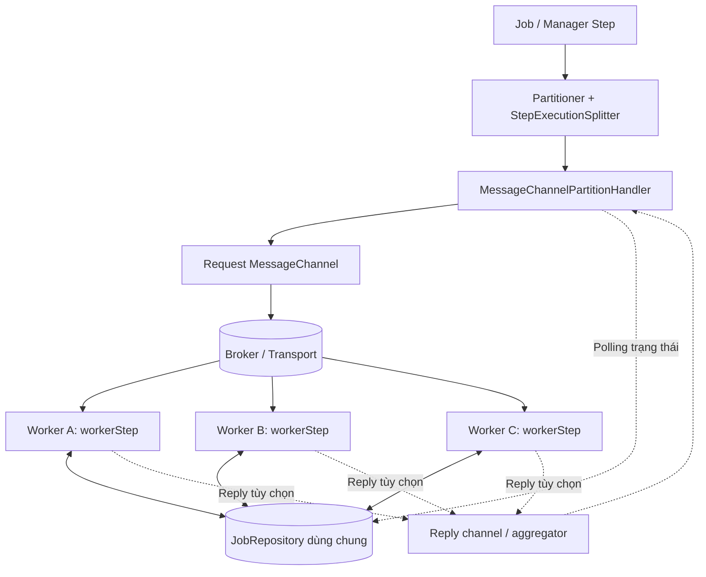
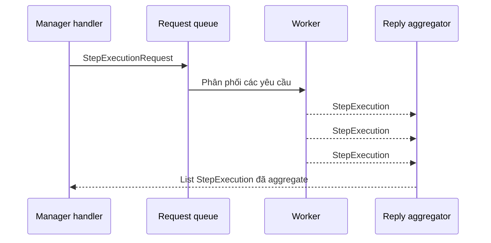

# MessageChannelPartitionHandler trong Spring Batch Integration

## Mục tiêu bài học

Sau bài này, bạn có thể giải thích vai trò của `MessageChannelPartitionHandler` trong **remote partitioning**, cấu hình luồng giao việc từ manager tới worker qua Spring Integration, chọn cách thu kết quả phù hợp, và đánh giá các rủi ro về throughput, thread safety, timeout, retry và restart khi chạy Spring Batch với dữ liệu lớn.

Trong module **SPRING_BATCH_SCALING_OPERATIONS**, mục tiêu là mở rộng Spring Batch theo nút thắt thực tế: multi-threaded step, parallel steps, partitioning hoặc xử lý phân tán. `MessageChannelPartitionHandler` là một thành phần quan trọng của nhánh **remote partitioning** khi một JVM không đủ tài nguyên hoặc cần tách worker để xử lý đồng thời nhiều phân vùng.

> **Phạm vi phiên bản:** Ví dụ Java tập trung vào Spring Batch **5.2.x** và Spring Integration tương thích. API giữa Spring Batch 5.x và 6.x có thay đổi; kiểm tra Javadoc đúng phiên bản trước khi sao chép cấu hình. Các ví dụ tập trung vào cơ chế partitioning, nên kết nối broker, migration schema Spring Batch và hạ tầng ứng dụng được mô tả dưới dạng điều kiện triển khai.

## 1. Bài toán mà MessageChannelPartitionHandler giải quyết

Giả sử một job cần đối soát 8 triệu giao dịch. Một step tuần tự chạy 4 giờ; khi tăng số luồng trong cùng JVM, cơ sở dữ liệu và bộ nhớ trở thành giới hạn. Ta có thể chia tập giao dịch thành các vùng ID hoặc các shard độc lập, rồi giao mỗi vùng cho một worker khác nhau.

`MessageChannelPartitionHandler` là triển khai `PartitionHandler` trong **spring-batch-integration**. Thành phần này được đặt ở phía **manager** và thực hiện hai việc:

1. Gửi thông điệp `StepExecutionRequest` qua một `MessageChannel` để yêu cầu worker thực thi một `StepExecution` đã được tạo cho từng phân vùng.
2. Chờ trạng thái xử lý của các phân vùng, bằng cách **nhận reply qua channel** hoặc **poll JobRepository**.

Nhờ `MessageChannel`, manager không cần biết worker nằm trong JVM nào hay giao tiếp qua JMS, AMQP hay lớp transport nào khác. Tuy nhiên, `MessageChannelPartitionHandler` **không tự tạo broker, không tự chia dữ liệu và không tự bảo đảm exactly-once**: `Partitioner` tạo phân vùng; Spring Integration adapter kết nối channel với transport; `JobRepository` lưu trạng thái; logic ghi dữ liệu phải chịu được retry.

### Kiến trúc cơ bản



Hai mũi tên nét đứt là **hai lựa chọn thu kết quả**, không phải yêu cầu phải dùng đồng thời.

| Thành phần | Vai trò | Chạy ở đâu |
| --- | --- | --- |
| `Partitioner` | Tạo các `ExecutionContext` không chồng lấn, ví dụ `fromId` và `toId` | Manager |
| `StepExecutionSplitter` | Tạo hoặc khôi phục các `StepExecution` theo phân vùng, có xét restart | Manager |
| `MessageChannelPartitionHandler` | Gửi yêu cầu và chờ kết quả của các phân vùng | Manager |
| `MessagingTemplate`, request channel | Đưa `StepExecutionRequest` ra luồng Spring Integration | Manager |
| Broker/transport, inbound adapter | Chuyển yêu cầu tới worker; có thể phân phối cho nhiều consumer | Hạ tầng + worker |
| `StepExecutionRequestHandler` | Tra cứu `StepExecution` trong repository, tìm `Step` tương ứng và thực thi | Worker |
| `JobRepository` / `JobExplorer` | Lưu, truy vấn trạng thái job/step và ngữ cảnh phân vùng | Manager + worker, dùng chung metadata |
| `ItemReader`, `ItemProcessor`, `ItemWriter` | Xử lý đầy đủ một phân vùng, có transaction và checkpoint riêng | Worker |

**Phân biệt mô hình:** Remote partitioning gửi **đơn vị công việc là toàn bộ worker step**; mỗi worker tự đọc, xử lý, ghi. Remote chunking thường đọc/chia chunk ở manager và chuyển chunk sang worker để xử lý. Multi-threaded step dùng nhiều thread trên một step trong cùng process; parallel steps chạy các step logic khác nhau. Các cơ chế này giải quyết những nút thắt khác nhau.

## 2. Vòng đời của một partition

1. Job khởi động `managerStep`. `Partitioner` trả về các cặp `partitionName → ExecutionContext`, chẳng hạn `partition-0 → {fromId: 1, toId: 100000}`.
2. Spring Batch tạo các `StepExecution` con, gắn chúng với `JobExecution` và lưu metadata trong `JobRepository`.
3. `MessageChannelPartitionHandler` tạo `StepExecutionRequest`, chứa tên worker step và ID của `StepExecution` tương ứng, rồi gửi tới request channel.
4. Adapter chuyển yêu cầu vào broker; worker nhận thông điệp từ broker và chuyển vào inbound channel.
5. `StepExecutionRequestHandler` sử dụng `JobExplorer` / `StepLocator` để truy xuất step execution và gọi worker step đã đăng ký cùng tên. Worker dùng `ExecutionContext` của phân vùng để giới hạn phạm vi đọc.
6. Worker commit các chunk và cập nhật metadata step vào `JobRepository`. Các worker độc lập có thể hoàn tất không cùng thời điểm.
7. Manager lấy kết quả bằng polling repository hoặc nhận reply đã được aggregate.
8. Manager kết luận trạng thái tổng hợp. Một partition thất bại có thể khiến manager step và job thất bại; khi restart đúng `JobInstance`, Spring Batch tận dụng metadata đã lưu để xác định công việc cần chạy lại.

Thông điệp `StepExecutionRequest` không phải là nơi gửi hàng triệu bản ghi. Dữ liệu lớn nằm ở nguồn đọc của worker; thông điệp chỉ giúp worker xác định **cần chạy step nào với StepExecution nào**.

## 3. Hai chiến lược lấy kết quả

| Tiêu chí | Polling JobRepository | Reply channel + aggregation |
| --- | --- | --- |
| Cách nhận kết quả | Manager định kỳ đọc trạng thái `StepExecution` từ repository | Worker gửi `StepExecution` kết quả, Spring Integration ghép reply |
| Cấu hình then chốt | `JobExplorer`, `pollInterval`, `timeout`; không cần reply channel | Reply channel, correlation/sequence header, aggregator, receive timeout |
| Độ phức tạp transport | Ít luồng message hơn | Cần luồng reply và cơ chế aggregate tương ứng |
| Tải lên metadata DB | Tăng theo tần suất polling và số job đồng thời | Chủ yếu vẫn là cập nhật metadata của worker |
| Rủi ro đáng chú ý | Poll quá dày tạo tải DB; timeout trước khi worker xong | Mất reply, header correlation bị loại bỏ, aggregator giữ trạng thái quá lâu |
| Phù hợp | Ưu tiên cấu hình đơn giản; các worker đã chia sẻ JobRepository | Hạ tầng message vận hành tốt, cần cơ chế reply/event rõ ràng |

Trong Spring Batch 5.2.x, `MessageChannelPartitionHandler#setReplyChannel` nhận `PollableChannel` cho đường reply; các API này có thể khác ở phiên bản mới hơn. Khi dùng **polling**, `setTimeout` là thời gian manager chờ worker hoàn thành (mặc định -1, tức không giới hạn), còn `setPollInterval` mặc định là 10 giây. Khi dùng **reply**, cần điều chỉnh receive timeout của `MessagingTemplate` và thời hạn aggregator theo thời lượng thực tế của partition. Không nhầm các timeout này với timeout của kết nối mạng hay transaction.

## 4. Ví dụ: remote partitioning với repository polling

Bối cảnh: mỗi worker xử lý một đoạn ID của bảng `payment` và ghi vào `processed_payment`. Ví dụ chọn repository polling để tập trung vào `MessageChannelPartitionHandler`, không phải trình bày toàn bộ cấu hình JMS/AMQP.

### 4.1. Điều kiện hạ tầng

- Manager và worker chạy cùng phiên bản Spring Batch tương thích, truy cập **cùng JobRepository** cùng schema/namespace metadata. Worker phải nhìn thấy `StepExecution` do manager tạo.
- Có `spring-batch-integration`, `spring-integration-core` và adapter tương ứng với broker (ví dụ JMS hoặc AMQP).
- Request channel phía manager được nối với outbound adapter tới queue công việc; inbound channel phía worker nhận từ queue đó. Hai bean `DirectChannel` ở hai JVM **không tự giao tiếp qua mạng**.
- Worker đăng ký bean `Step` tên **`workerStep`**. Reader/writer và database mà worker cần sử dụng phải có sẵn trong worker process.
- DB nghiệp vụ có index trên cột `payment.id` và ràng buộc unique cho `processed_payment.payment_id`.

### 4.2. Partitioner tạo các đoạn ID không chồng lấn

```java
@Bean
Partitioner paymentPartitioner() {
    return gridSize -> {
        long firstId = 1L;
        long lastId = 1_000_000L; // Minh họa; thực tế lấy theo snapshot/dataset cố định.
        long count = lastId - firstId + 1;
        int partitions = Math.max(1, gridSize);
        long width = (count + partitions - 1) / partitions;

        Map<String, ExecutionContext> result = new LinkedHashMap<>();
        for (int i = 0; i < partitions; i++) {
            long from = firstId + i * width;
            if (from > lastId) {
                break;
            }
            long to = Math.min(lastId, from + width - 1);

            ExecutionContext context = new ExecutionContext();
            context.putLong("fromId", from);
            context.putLong("toId", to);
            result.put("partition-" + i, context);
        }
        return result;
    };
}
```

`gridSize` là **gợi ý** về số phân vùng cho splitter/partitioner, không đồng nghĩa số worker hay số thread thực chạy. Nếu số partition khác số consumer của broker, những partition còn lại phải xếp hàng. Trong sản xuất, cần chốt tập dữ liệu xử lý theo `JobParameters` hoặc snapshot tương ứng để một lần restart không chuyển biên dữ liệu gây trùng/lọt bản ghi.

### 4.3. Manager step

Ví dụ sử dụng builder của Spring Batch Integration 5.2.x. `@EnableBatchIntegration` cung cấp `RemotePartitioningManagerStepBuilderFactory`, factory này tạo `MessageChannelPartitionHandler` và cấu hình các thành phần cần thiết.

```java
@Configuration
@EnableBatchIntegration
class ManagerConfig {

    @Bean
    Step managerStep(
            RemotePartitioningManagerStepBuilderFactory builders,
            Partitioner paymentPartitioner,
            @Qualifier("toWorkers") MessageChannel toWorkers) {

        return builders.get("managerStep")
                .partitioner("workerStep", paymentPartitioner)
                .gridSize(8)
                .outputChannel(toWorkers)
                // Không khai báo inputChannel: manager poll JobRepository.
                .pollInterval(2_000L)         // 2 giây
                .timeout(1_800_000L)          // 30 phút
                .build();
    }

    @Bean
    Job paymentJob(JobRepository repository, Step managerStep) {
        return new JobBuilder("paymentJob", repository)
                .start(managerStep)
                .build();
    }

    @Bean("toWorkers")
    MessageChannel toWorkers() {
        return new DirectChannel();
    }
}
```

`toWorkers` ở đây mới là **channel nội bộ**. Cần có `IntegrationFlow`/outbound adapter nối channel đó tới queue `batch.partition.requests`; worker có inbound adapter từ cùng queue. Factory được dùng để tránh tự cấu hình handler và aggregator không cần thiết. Với repository polling, không khai báo `inputChannel` cho reply.

### 4.4. Worker step đọc đúng đoạn được giao

Bên worker, builder tạo worker step và luồng nhận `StepExecutionRequest`. `@StepScope` bảo đảm reader lấy các giá trị `fromId`, `toId` từ **StepExecutionContext của partition tương ứng** khi step chạy, thay vì dùng giá trị của partition khác.

```java
@Configuration
@EnableBatchIntegration
class WorkerConfig {

    @Bean
    Step workerStep(
            RemotePartitioningWorkerStepBuilderFactory builders,
            @Qualifier("fromManager") MessageChannel fromManager,
            PlatformTransactionManager transactionManager,
            JdbcPagingItemReader<Long> paymentIdReader,
            ItemWriter<Long> paymentWriter) {

        return builders.get("workerStep")
                .inputChannel(fromManager)
                // Không cần outputChannel khi manager poll JobRepository.
                .<Long, Long>chunk(500, transactionManager)
                .reader(paymentIdReader)
                .writer(paymentWriter)
                .build();
    }

    @Bean("fromManager")
    MessageChannel fromManager() {
        return new DirectChannel();
    }

    @Bean
    @StepScope
    JdbcPagingItemReader<Long> paymentIdReader(
            DataSource dataSource,
            @Value("#{stepExecutionContext['fromId']}") Long fromId,
            @Value("#{stepExecutionContext['toId']}") Long toId) {

        return new JdbcPagingItemReaderBuilder<Long>()
                .name("paymentIdReader")
                .dataSource(dataSource)
                .selectClause("SELECT id")
                .fromClause("FROM payment")
                .whereClause("WHERE id BETWEEN :fromId AND :toId")
                .sortKeys(Map.of("id", Order.ASCENDING))
                .parameterValues(Map.of("fromId", fromId, "toId", toId))
                .pageSize(500)
                .rowMapper((rs, rowNum) -> rs.getLong("id"))
                .build();
    }
}
```

Ví dụ giả định `paymentWriter` là một `ItemWriter<Long>` riêng, ghi theo transaction và **idempotent** (ví dụ PostgreSQL `INSERT ... ON CONFLICT (payment_id) DO NOTHING` với unique key). Với hệ thống thật, row mapper, SQL paging, mức cô lập giao dịch, index và writer cần được đo bằng dữ liệu đại diện; đừng dùng reader đếm bằng biến trong RAM nếu cần restart chính xác giữa một partition.

> **Giới hạn ví dụ:** Chưa có outbound/inbound adapter tới broker, cấu hình DataSource/JobRepository, writer nghiệp vụ, và các import Java. Đó là các phần phụ thuộc môi trường triển khai. Ví dụ cho thấy vị trí của handler và cách thông tin phân vùng đến worker; không phải một ứng dụng có thể chạy ngay khi dán riêng đoạn mã này.

### 4.5. Khi nào cần khởi tạo MessageChannelPartitionHandler trực tiếp?

Builder thường là lựa chọn dễ bảo trì. Khi cần tùy biến sâu `MessagingTemplate` hoặc điều khiển vòng đời bean, có thể tạo handler trực tiếp:

```java
@Bean
MessageChannelPartitionHandler partitionHandler(
        @Qualifier("toWorkers") MessageChannel toWorkers,
        JobExplorer jobExplorer) {

    MessagingTemplate template = new MessagingTemplate();
    template.setDefaultChannel(toWorkers);
    template.setSendTimeout(10_000L);

    MessageChannelPartitionHandler handler = new MessageChannelPartitionHandler();
    handler.setStepName("workerStep");
    handler.setGridSize(8);
    handler.setMessagingOperations(template);
    handler.setJobExplorer(jobExplorer); // Spring Batch 5.2.x, polling mode.
    handler.setPollInterval(2_000L);
    handler.setTimeout(1_800_000L);
    return handler;
}
```

Trong cách cấu hình thủ công, gắn bean này vào `new StepBuilder("managerStep", jobRepository).partitioner("workerStep", partitioner).partitionHandler(partitionHandler).build()`. **Không** gọi `partitionHandler(...)` trên `RemotePartitioningManagerStepBuilder`: builder chuyên dụng tự tạo `MessageChannelPartitionHandler` và phương thức gán handler khác sẽ ném `UnsupportedOperationException` trong Spring Batch 5.2.x.

## 5. Nếu dùng reply channel thì khác gì?

Ở chế độ reply, worker gửi `StepExecution` đã chạy xong về manager. Một aggregator Spring Integration gom các phản hồi theo correlation/sequence metadata và chuyển **danh sách kết quả** tới reply channel mà handler đang đợi.



Điểm cần cấu hình đầy đủ:

1. Manager có request channel, reply channel đúng kiểu API của phiên bản đang dùng; handler nhận reply đã aggregate.
2. Worker có inbound request adapter và outbound reply adapter.
3. Aggregator biết cách **correlate** các reply cùng lần xử lý và khi nào release nhóm, kể cả trường hợp reply lỗi hoặc thiếu.
4. `MessagingTemplate` và aggregator có timeout đủ dài theo p95/p99 thời gian xử lý partition; có chiến lược dọn nhóm khi hết hạn.
5. Transport phải bảo toàn metadata mà cơ chế tương quan yêu cầu (đặc biệt `correlationId`, `sequenceNumber`, `sequenceSize` qua JMS/header mapper khi phiên bản Spring Integration yêu cầu). Kiểm tra định tuyến reply cả khi có nhiều `JobExecution` chạy đồng thời.

Trong Spring Batch 5.2.x, ví dụ thủ công có thể gọi `handler.setReplyChannel(PollableChannel)` và cấu hình một Spring Integration aggregator dùng phương thức `aggregate(List<?>)` của handler. Không gắn trực tiếp các reply lẻ vào channel mà handler kỳ vọng kết quả đã gom. Tránh tái sử dụng một instance handler/reply channel thiếu cơ chế phân biệt giữa nhiều lần chạy; theo Javadoc 5.x, cấu hình handler theo scope step/job là cách giảm nguy cơ trộn reply.

Nếu không có yêu cầu riêng về reply event, repository polling thường là điểm khởi đầu dễ kiểm soát hơn: vừa giảm số thành phần phải bảo trì, vừa sử dụng metadata vốn cần thiết cho restart.

## 6. Thread safety, hiệu năng và giới hạn tài nguyên

**Một partition tương ứng một StepExecution riêng**, nhưng điều đó không có nghĩa mọi bean đều tự động thread-safe. Các bean singleton chia sẻ trạng thái ghi được (buffer, cache mutable, cursor, `SimpleDateFormat` cũ...) giữa nhiều worker hoặc luồng có thể tạo race condition. Dùng `@StepScope` cho reader có trạng thái theo partition, bảo đảm `ExecutionContext` không bị chia sẻ tùy tiện, và xử lý transaction/connection pool đúng mức.

Để chọn độ song song, đo **thời gian end-to-end**, không chỉ thời gian chạy CPU:

| Tín hiệu | Cách đọc kết quả | Hành động thường gặp |
| --- | --- | --- |
| CPU worker thấp, hàng đợi dài | Worker thiếu consumer hoặc đang chờ I/O | Tăng worker/consumer có kiểm soát; kiểm tra DB |
| CPU worker cao, DB còn dư | Tính toán ở worker là nút thắt | Tăng số worker hoặc tối ưu processor |
| DB connection pool đầy, query p95 tăng | DB đã bão hòa; thêm worker chỉ tăng cạnh tranh | Giảm concurrency, tối ưu SQL/index và kích thước pool |
| Partition có thời gian lệch rất lớn | Chia dữ liệu không cân bằng hoặc dữ liệu bị skew | Dùng partitioner theo histogram/shard, giảm độ lệch kích thước |
| Broker lag tăng dù CPU/DB thấp | Transport, producer/consumer hoặc ack chậm | Đo message send, queue, prefetch và consumer |
| Manager poll quá dày, metadata DB tải cao | Polling tiêu tốn I/O trên JobRepository | Tăng `pollInterval` hợp lý, giới hạn số job đồng thời |

**Ví dụ công suất:** Có 8 partition nhưng chỉ 3 consumer worker thì chỉ khoảng 3 partition chạy cùng lúc; `gridSize=8` không tạo ra 8 JVM. Nếu mỗi worker giữ tối đa 5 kết nối DB, 10 worker có thể cần tới 50 kết nối cộng với phần của manager/ứng dụng khác. Không tăng đồng thời `gridSize`, số consumer, chunk size và pool size mà không đo thay đổi.

Nguyên tắc tuning:

- Khởi đầu với các partition tương đối cân bằng, đủ lớn để chi phí gửi message nhỏ so với thời gian xử lý.
- Chọn `chunkSize` theo transaction latency, bộ nhớ và khả năng rollback; chunk quá lớn làm lần retry tốn kém.
- Đặt timeout lớn hơn thời gian xử lý dài nhất dự kiến **có biên dự phòng**, rồi giám sát cảnh báo khi gần ngưỡng.
- Dùng index phù hợp với biên phân vùng và sort key; xác nhận execution plan, tránh full scan lặp lại.
- Theo dõi read/write/skip/retry count, commit time, queue lag, active workers, partition duration, số kết nối DB, tỷ lệ restart và kết quả cuối của từng `StepExecution`.

## 7. Retry, restart và xử lý sự cố

Spring Batch lưu metadata để **restart có kiểm soát**, nhưng khả năng restart không đồng nghĩa transport và side effect được bảo đảm exactly-once.

| Sự cố | Hiện tượng | Cách xử lý |
| --- | --- | --- |
| Message chưa tới worker | Partition không có tiến triển; manager có thể hết timeout | Kiểm tra queue, adapter và deadline; phân biệt lỗi dispatch với xử lý lâu trước khi restart |
| Worker chết giữa chunk | Transaction chưa commit rollback; metadata có thể cho thấy step chưa hoàn tất | Bảo đảm JobRepository dùng chung; restart theo chính sách của job |
| Worker commit xong nhưng reply bị mất | Dữ liệu nghiệp vụ đã ghi nhưng manager không nhận reply | Poll metadata để đối chiếu; writer phải idempotent nếu message bị phát lại |
| Broker giao request lặp | Có thể có hai lần nhận cùng `StepExecutionRequest` | Chống side effect trùng bằng unique key/idempotency; kiểm soát consumer/concurrency |
| Sai tên `workerStep` | Worker không tìm được step cần thực thi | Đồng bộ tên trong `partitioner(...)`, handler và bean `Step` ở worker |
| Manager hết timeout khi worker vẫn chạy | Manager thất bại, worker có thể tiếp tục ghi | Xác minh metadata và trạng thái transaction trước khi khởi động lại; tránh chạy chồng job |
| Một partition lớn hơn hẳn các partition khác | Các worker khác rảnh nhưng job chưa xong | Điều chỉnh thuật toán chia việc, xem độ phân bố dữ liệu và độ lớn shard |

Để xử lý lỗi bền vững, thực hiện đồng thời các lớp sau:

- **Business idempotency:** ghi theo khóa nghiệp vụ duy nhất, upsert hoặc kiểm tra trạng thái trước tác động. Với API bên ngoài, dùng idempotency key hoặc cơ chế outbox/inbox phù hợp.
- **Checkpoint:** ưu tiên `ItemStream` reader/writer hỗ trợ lưu state theo `ExecutionContext` và các commit; nhớ rằng metadata phải được commit đúng transaction.
- **Retry có giới hạn:** retry lỗi tạm thời (deadlock, network transient) kèm backoff; không retry vô hạn lỗi dữ liệu không hợp lệ.
- **Restart đúng danh tính:** dùng cùng identifying `JobParameters` nếu muốn restart `JobInstance` lỗi; dùng params mới sẽ tạo instance mới, dễ xử lý trùng nếu writer không idempotent.
- **Điều phối vận hành:** quy định cách dừng worker, drain queue, tránh hai manager đồng thời xử lý cùng logical dataset, bảo toàn metadata qua deploy.

## 8. Cách kiểm chứng trước production

Thực hiện một bài kiểm tra có thể đối soát, ví dụ 1 triệu ID được chia thành 8 partition. Đối chiếu tập kết quả theo khóa nghiệp vụ với dữ liệu đầu vào, không chỉ dựa vào `BatchStatus=COMPLETED`.

1. **Đúng phạm vi:** mỗi bản ghi nằm đúng một dải `fromId..toId`, không bỏ sót biên, không chồng lấn; kiểm tra cả tập rỗng và ID không liên tục.
2. **Restart:** tắt một worker giữa một chunk và chạy lại job thất bại; các partition hoàn tất không bị ghi sai, các partition cần chạy lại không tạo kết quả trùng.
3. **Duplicate/reorder:** mô phỏng hai message trùng, reply đảo thứ tự hoặc reply bị mất; xác minh hành vi xử lý, timeout và thao tác khôi phục.
4. **Load:** tăng số worker theo từng mức trong khi đo DB pool, CPU, queue lag và độ trễ; dừng tăng khi throughput không còn cải thiện.
5. **Isolation:** chạy hai job với tham số khác nhau, kiểm tra correlation/reply và dữ liệu không bị lẫn giữa hai lần chạy.
6. **Deploy/restart broker:** xác nhận chính sách ack/redelivery, trạng thái đang xử lý và khả năng tiếp tục sau restart dịch vụ.

Các dấu hiệu cần cảnh báo trong production gồm: `StepExecution` treo lâu hơn p99, queue lag tăng liên tục, timeouts, số retry/skip bất thường, và sai lệch tổng số bản ghi xử lý/ghi giữa các partition.

## 9. Chọn MessageChannelPartitionHandler khi nào?

| Nhu cầu | Lựa chọn phù hợp |
| --- | --- |
| Step có reader/writer thread-safe, tài nguyên một JVM còn đủ | Bắt đầu bằng multi-threaded step nếu phù hợp |
| Các công đoạn khác nhau có thể chạy độc lập | Parallel steps |
| Muốn chia một step thành các partition ngay trong một JVM | `TaskExecutorPartitionHandler` |
| Muốn worker riêng JVM/máy, mỗi worker tự đọc và ghi dữ liệu partition | **`MessageChannelPartitionHandler` / remote partitioning** |
| Muốn manager giữ việc đọc và chuyển từng chunk sang worker | Remote chunking |

`MessageChannelPartitionHandler` đặc biệt hữu ích khi I/O hoặc dữ liệu có thể phân vùng rõ, mỗi worker cần toàn quyền chạy một step, và hạ tầng đã có broker cùng JobRepository dùng chung. Nếu bottleneck thực sự ở một DB đơn lẻ, thêm nhiều worker có thể **làm job chậm hơn** vì tranh chấp kết nối, lock và I/O. Quyết định mở rộng nên dựa trên đo đạc trước và sau thay đổi.

## Tài liệu tham khảo

- [Spring Batch 5.2.x API — MessageChannelPartitionHandler](https://docs.spring.io/spring-batch/docs/5.2.x/api/org/springframework/batch/integration/partition/MessageChannelPartitionHandler.html): các setter và cơ chế nhận kết quả.
- [Spring Batch 5.2.x API — RemotePartitioningManagerStepBuilder](https://docs.spring.io/spring-batch/docs/5.2.x/api/org/springframework/batch/integration/partition/RemotePartitioningManagerStepBuilder.html): cấu hình manager bằng builder.
- [Spring Batch 5.2.x API — RemotePartitioningWorkerStepBuilder](https://docs.spring.io/spring-batch/docs/5.2.x/api/org/springframework/batch/integration/partition/RemotePartitioningWorkerStepBuilder.html): cấu hình worker.
- [Spring Batch Reference — Externalizing Batch Process Execution](https://docs.spring.io/spring-batch/reference/spring-batch-integration/externalizing-execution.html): remote partitioning, transport, reply aggregation và kiến trúc triển khai.

**Điều cần nhớ:** Handler chỉ điều phối các `StepExecution` qua channel. Chất lượng của hệ thống phân tán phụ thuộc vào cách phân vùng dữ liệu, giới hạn tài nguyên, trạng thái JobRepository, khả năng ghi idempotent và quy trình kiểm chứng restart.
