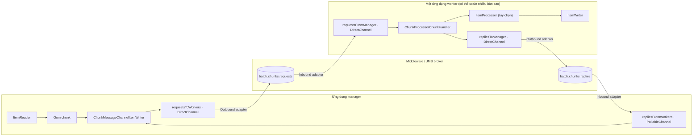

# Remote chunking qua Spring Integration

## 1. Mục tiêu và bài toán

Trong Spring Batch, một **chunk-oriented step** thường có ba thành phần `ItemReader`, `ItemProcessor` và `ItemWriter` nằm trong cùng một ứng dụng. Khi xử lý dữ liệu lớn, nếu đọc nhanh nhưng xử lý/ghi chậm, chúng ta có thể giữ reader ở **manager** và chuyển những chunk đã đọc sang nhiều **worker** chạy ở tiến trình khác.

**Remote chunking qua Spring Integration** là cách thực hiện mô hình đó bằng các `MessageChannel` và `IntegrationFlow`. Spring Batch Integration cung cấp giao thức `ChunkRequest`/`ChunkResponse` cùng builder của manager/worker. Spring Integration chuyển request và reply qua middleware (ví dụ JMS broker), đồng thời cho phép cấu hình adapter, channel, routing và monitoring.

Ví dụ: một job có 1.000.000 sự kiện cần phân loại và cập nhật database. Reader lấy ID nhanh, nhưng mỗi ID cần tra cứu và ghi khá tốn thời gian. Nếu gửi 100 ID/request tới một hàng đợi chung, ba worker có thể tiêu thụ chunk đồng thời mà manager không phải chỉ định “chunk nào thuộc worker nào”.

Bài thuộc chương **Spring Batch Integration** của module `SPRING_BATCH_SCALING_OPERATIONS`. Mục tiêu module là mở rộng Spring Batch bằng multi-threaded step, parallel steps, partitioning và các mô hình phân tán; đo bottleneck, bảo đảm thread safety, retry/restart và chọn kiến trúc theo tài nguyên thực tế. Remote chunking phù hợp khi muốn mở rộng **process/write** mà nguồn đọc tập trung vẫn đáp ứng tốc độ cần thiết.

Sau bài này, bạn có thể:

- Giải thích đường đi của `ChunkRequest` và `ChunkResponse` giữa manager, middleware và worker.
- Kết nối `RemoteChunkingManagerStepBuilderFactory` và `RemoteChunkingWorkerBuilder` với `IntegrationFlow` của Spring Integration.
- Phân biệt channel trong JVM với queue/broker, cũng như adapter một chiều với gateway hai chiều.
- Nhận diện các giới hạn của serialization, correlation, timeout, transaction và restart.
- Thiết kế kiểm thử lỗi, idempotency, quan sát backlog và lựa chọn mức concurrency theo tài nguyên thực tế.

> **Phiên bản:** ví dụ Java phía dưới dùng **Spring Batch 5.2.x**, **Spring Integration 6.x**, **Spring Framework 6.x**, Java 17+ và `jakarta.jms`. Spring Batch 6.1 sử dụng cấu trúc builder mới cho remote chunking; cần đối chiếu API theo phiên bản ứng dụng trước khi chuyển mã.

## 2. Hai hệ thống hợp tác: Spring Batch Integration và Spring Integration

| Thành phần | Trách nhiệm chính |
| --- | --- |
| **Spring Batch Core** | `Job`/`Step`, reader, processor, writer, transaction, checkpoint, `JobRepository` và restart |
| **Spring Batch Integration** | `ChunkMessageChannelItemWriter`, `ChunkRequest`, `ChunkResponse`, manager/worker builders và việc tổng hợp đóng góp của chunk |
| **Spring Integration** | `MessageChannel`, `IntegrationFlow`, service activator, adapter/gateway, routing và nối với middleware |
| **Middleware** như JMS | Hàng đợi cross-process, delivery/ACK, consumer concurrency, lưu message và redelivery theo cấu hình |
| **Ứng dụng worker** | Process/write chunk, quản lý transaction nghiệp vụ và phát reply |

### Sơ đồ tương tác



Sơ đồ trình bày **một worker instance**. Khi chạy thêm instance, mỗi instance có inbound adapter riêng cùng subscribe `batch.chunks.requests`. Broker phân phối các delivery cho competing consumers, vì vậy worker rảnh nhận việc mới. Dù một message chỉ được giao cho một consumer *ở một lượt delivery*, broker vẫn có thể gửi lại khi session rollback hoặc consumer crash.

### Trình tự một chunk

1. Manager đọc item, gom tối đa `chunkSize` item.
2. `ChunkMessageChannelItemWriter` gửi `ChunkRequest` qua Spring Integration `outputChannel`.
3. Outbound adapter đưa request vào broker; inbound adapter của worker nhận request từ queue và chuyển vào `inputChannel`.
4. Worker xử lý/ghi chunk rồi tạo `ChunkResponse`; outbound adapter gửi reply vào broker.
5. Inbound adapter phía manager chuyển reply đến một `PollableChannel`; manager nhận, đối chiếu, cập nhật kết quả và chỉ kết thúc khi việc chờ phản hồi được giải quyết.

Manager chịu trách nhiệm đọc. Worker chịu trách nhiệm xử lý/ghi; không bắt buộc có một `JobRepository` hoặc một `Job` riêng ở từng worker khi chỉ làm remote chunking. Cấu hình này khác **remote partitioning**, trong đó manager chia các vùng dữ liệu và worker thường tự chạy một batch step để đọc vùng được giao.

## 3. Hiểu đúng các loại channel và endpoint

### 3.1. Channel nội bộ không phải hàng đợi của broker

| API/điểm nối | Vị trí | Tính chất |
| --- | --- | --- |
| `DirectChannel` | Trong một Spring ApplicationContext | Gửi message trực tiếp cho subscriber; xử lý thông thường diễn ra đồng bộ trên thread gửi |
| `QueueChannel` | Trong một JVM (nếu dùng store mặc định) | `PollableChannel`, giữ message trong bộ đệm RAM để bên nhận poll |
| JMS queue | Ngoài JVM, trên broker | Chuyển message giữa tiến trình, hỗ trợ persistence và redelivery tùy broker |
| `IntegrationFlow` | Trong Spring Integration | Khai báo chuỗi endpoint/channel xử lý message |
| Inbound channel adapter | Ranh giới ngoài → ứng dụng | Đọc/nhận message từ nguồn ngoài và đẩy vào channel |
| Outbound channel adapter | Ranh giới ứng dụng → ngoài | Nhận message từ channel rồi gửi tới hệ thống ngoài |
| Inbound/outbound gateway | Ranh giới giao tiếp hai chiều | Bao gói mô hình request-reply ở một endpoint |

Ví dụ `QueueChannel(256)` của manager chỉ là bộ đệm của ứng dụng; nó **không trở thành durable queue chỉ vì dữ liệu vừa đi qua JMS**. Nếu reply đã bị ACK khỏi broker nhưng chưa được manager poll, JVM crash có thể khiến reply bị mất.

### 3.2. Tại sao dùng channel adapters hai chiều thay vì một JMS gateway?

Remote chunking đã có giao thức request/reply riêng: manager gửi nhiều chunk và có thể nhận response theo thứ tự khác với thứ tự gửi. Với mẫu này, ta thường tạo **hai integration flow một chiều** cho mỗi phía: request đi ra, reply đi vào. Spring Batch Integration xử lý mối tương quan chunk; Spring Integration chỉ làm nhiệm vụ vận chuyển.

`Jms.outboundAdapter(...)` khác `Jms.outboundGateway(...)`. Gateway JMS riêng thường gửi một request rồi chờ một reply theo semantics của gateway; nếu dùng tùy tiện trong flow remote chunking, có thể vô tình thêm tầng blocking/timeout và correlation không ăn khớp với `ChunkMessageChannelItemWriter`. Hãy chọn endpoint theo đúng hợp đồng giao thức đã được Spring Batch Integration cung cấp.

### 3.3. Spring Integration là tầng trung gian có thể thay transport

Ở phía Batch, builder nhận `MessageChannel` và `PollableChannel`, không buộc code manager biết JMS queue name. Tầng integration adapter có thể đổi sang công nghệ khác (ví dụ AMQP) nếu thay đúng inbound/outbound endpoints và bảo đảm payload, độ bền, consumer semantics, correlation và transaction được kiểm thử.

Điều này **không đồng nghĩa đổi adapter là đủ** trong mọi trường hợp. Mỗi broker có ACK, ordering, prefetch, TTL, header mapping và codec khác nhau; muốn thay transport, phải kiểm chứng lại giao thức end-to-end, không chỉ thay dependency.

## 4. Dependency, dữ liệu và điều kiện chạy thử

Với Spring Boot và broker JMS ActiveMQ Artemis, có thể dùng:

```groovy
dependencies {
    implementation "org.springframework.boot:spring-boot-starter-batch"
    implementation "org.springframework.batch:spring-batch-integration"
    implementation "org.springframework.integration:spring-integration-core"
    implementation "org.springframework.integration:spring-integration-jms"
    implementation "org.springframework.boot:spring-boot-starter-artemis"
    implementation "org.springframework.boot:spring-boot-starter-jdbc"
}
```

Đây là một **tổ hợp tham khảo**; các phiên bản nên để Spring Boot BOM quản lý và bảo đảm Spring Batch/Spring Integration tương thích. Worker không nhất thiết cần `spring-boot-starter-batch` khi chỉ chạy integration flow và logic nghiệp vụ, nhưng phải có `spring-batch-integration` và các lớp item/ChunkRequest tương thích với manager.

Giả sử bảng nguồn/đích là:

```sql
CREATE TABLE import_event (
    event_id BIGINT PRIMARY KEY,
    processed BOOLEAN NOT NULL DEFAULT FALSE
);
```

Manager chỉ đọc danh sách `event_id` trong một khoảng ID đã chốt. Worker nhận `Long` và thực hiện cập nhật có điều kiện. Đối với hệ thống thực, cần xác định phiên bản/snapshot input và quy tắc không sửa ID trong cùng lần chạy để reader có thể restart an toàn.

Ví dụ cấu hình kết nối JMS (đặt ở **cả manager và worker**, thay hostname theo môi trường):

```yaml
spring:
  artemis:
    mode: native
    broker-url: tcp://localhost:61616
    user: ${JMS_USER}
    password: ${JMS_PASSWORD}
```

Hai queue `batch.chunks.requests` và `batch.chunks.replies` phải được provisioning hoặc tự tạo theo chính sách broker; không mặc định rằng queue luôn tồn tại. Các thông tin đăng nhập lấy từ biến môi trường/secret store. Production cần TLS và ACL theo từng queue.

## 5. Ví dụ manager Spring Batch 5.2 + Spring Integration

Các bean dưới đây nằm trong **ứng dụng manager**. `@EnableBatchIntegration` kích hoạt cấu hình Spring Batch Integration và cung cấp `RemoteChunkingManagerStepBuilderFactory`. Spring Boot hoặc cấu hình riêng vẫn phải cung cấp `JobRepository`, transaction manager, `DataSource` và `JobLauncher`.

### 5.1. Cấu hình manager step và các channel

```java
import jakarta.jms.ConnectionFactory;
import javax.sql.DataSource;

import org.springframework.batch.core.Job;
import org.springframework.batch.core.configuration.annotation.StepScope;
import org.springframework.batch.core.job.builder.JobBuilder;
import org.springframework.batch.core.repository.JobRepository;
import org.springframework.batch.core.step.tasklet.TaskletStep;
import org.springframework.batch.integration.chunk.RemoteChunkingManagerStepBuilderFactory;
import org.springframework.batch.integration.config.annotation.EnableBatchIntegration;
import org.springframework.batch.item.database.JdbcCursorItemReader;
import org.springframework.batch.item.database.builder.JdbcCursorItemReaderBuilder;
import org.springframework.beans.factory.annotation.Qualifier;
import org.springframework.beans.factory.annotation.Value;
import org.springframework.context.annotation.Bean;
import org.springframework.context.annotation.Configuration;
import org.springframework.integration.channel.DirectChannel;
import org.springframework.integration.channel.QueueChannel;
import org.springframework.integration.dsl.IntegrationFlow;
import org.springframework.integration.jms.dsl.Jms;

@Configuration
@EnableBatchIntegration
public class ManagerIntegrationConfig {

    private static final String REQUEST_QUEUE = "batch.chunks.requests";
    private static final String REPLY_QUEUE = "batch.chunks.replies";

    @Bean
    public DirectChannel requestsToWorkers() {
        return new DirectChannel();
    }

    @Bean
    public QueueChannel repliesFromWorkers() {
        // Demo: PollableChannel trong RAM, chưa đáp ứng durable reply.
        return new QueueChannel(256);
    }

    @Bean
    @StepScope
    public JdbcCursorItemReader<Long> eventIdReader(
            DataSource dataSource,
            @Value("#{jobParameters['upperBoundExclusive']}") Long upperBoundExclusive) {

        if (upperBoundExclusive == null || upperBoundExclusive <= 1L) {
            throw new IllegalArgumentException("Invalid upperBoundExclusive");
        }

        return new JdbcCursorItemReaderBuilder<Long>()
                .name("eventIdReader")
                .dataSource(dataSource)
                .sql("SELECT event_id FROM import_event "
                    + "WHERE event_id >= 1 AND event_id < ? "
                    + "ORDER BY event_id")
                .preparedStatementSetter(
                        ps -> ps.setLong(1, upperBoundExclusive))
                .rowMapper((rs, rowNum) -> rs.getLong("event_id"))
                .saveState(true)
                .build();
    }

    @Bean
    public TaskletStep remoteChunkManagerStep(
            RemoteChunkingManagerStepBuilderFactory factory,
            JdbcCursorItemReader<Long> eventIdReader,
            @Qualifier("requestsToWorkers") DirectChannel requests,
            @Qualifier("repliesFromWorkers") QueueChannel replies) {

        return factory.<Long, Long>get("remoteChunkManagerStep")
                .chunk(100)
                .reader(eventIdReader)
                .outputChannel(requests)
                .inputChannel(replies)
                .throttleLimit(8)
                .maxWaitTimeouts(40)
                .build();
    }

    @Bean
    public Job importEventJob(
            JobRepository jobRepository,
            @Qualifier("remoteChunkManagerStep") TaskletStep managerStep) {

        return new JobBuilder("importEventJob", jobRepository)
                .start(managerStep)
                .build();
    }

    @Bean
    public IntegrationFlow managerRequestsToJms(
            ConnectionFactory connectionFactory,
            @Qualifier("requestsToWorkers") DirectChannel requests) {

        return IntegrationFlow.from(requests)
                .handle(Jms.outboundAdapter(connectionFactory)
                        .destination(REQUEST_QUEUE))
                .get();
    }

    @Bean
    public IntegrationFlow jmsRepliesToManager(
            ConnectionFactory connectionFactory,
            @Qualifier("repliesFromWorkers") QueueChannel replies) {

        return IntegrationFlow
                .from(Jms.messageDrivenChannelAdapter(connectionFactory)
                        .destination(REPLY_QUEUE))
                .channel(replies)
                .get();
    }
}
```

### 5.2. Phân tích các API đã nối

| Lời gọi | Ý nghĩa |
| --- | --- |
| `factory.<Long, Long>get("remoteChunkManagerStep")` | Tạo manager builder đã gắn `JobRepository` và transaction manager |
| `.chunk(100)` | Tối đa 100 item được gửi trong mỗi chunk, trừ chunk cuối |
| `.reader(eventIdReader)` | Chọn reader duy nhất của manager; dữ liệu được checkpoint theo `StepExecution` |
| `.outputChannel(requests)` | Chọn kênh gửi `ChunkRequest` tới middleware |
| `.inputChannel(replies)` | Chọn `PollableChannel` mà manager lấy `ChunkResponse` từ worker |
| `.throttleLimit(8)` | Giới hạn số request chunk còn pending; giúp tạo backpressure |
| `.maxWaitTimeouts(40)` | Giới hạn **số lần đợi không có reply tại cuối step**, không tự đồng nghĩa 40 giây |
| `Jms.outboundAdapter` | Gửi message từ channel Spring Integration đến request queue |
| `Jms.messageDrivenChannelAdapter` | Lắng nghe reply queue rồi đưa message vào Spring Integration channel |

Điểm quan trọng: manager builder **tự cung cấp `ChunkMessageChannelItemWriter`**. Không gọi `.writer(customWriter)` trên builder đó; phương thức này của `RemoteChunkingManagerStepBuilder` không hỗ trợ thay writer theo kiểu chunk step thông thường. `ItemProcessor` và `ItemWriter` nghiệp vụ thường được đặt ở worker.

`@StepScope` cho reader có trạng thái riêng theo execution và lấy `upperBoundExclusive` ở runtime. Với ví dụ, ID được đọc theo thứ tự tăng; việc worker cập nhật cột `processed` **không làm thay đổi điều kiện lọc**. Tuy nhiên, ứng dụng thật vẫn phải chốt/snapshot nguồn nếu ID có thể chèn hoặc xóa trong khoảng đang chạy.

`QueueChannel(256)` là lựa chọn ngắn gọn để minh họa kênh nhận reply, vì manager builder cần `PollableChannel`. Nó **không phải giải pháp khôi phục reply đầy đủ khi JVM crash**; phần 9 giải thích cách đánh giá rủi ro đó.

### 5.3. Luồng logic trong manager, nhìn theo từng message

```text
Batch reader
  -> ChunkMessageChannelItemWriter
      -> requestsToWorkers (DirectChannel)
          -> JMS outbound adapter
              -> batch.chunks.requests (broker)

batch.chunks.replies (broker)
  -> JMS message-driven inbound adapter
      -> repliesFromWorkers (QueueChannel)
          -> ChunkMessageChannelItemWriter nhận kết quả
              -> StepContribution / trạng thái StepExecution
```

Spring Integration chịu trách nhiệm kết nối message endpoints; Spring Batch Integration chịu trách nhiệm đối chiếu reply với chunk tương ứng. Đừng tự tạo một flow trả lời khác bỏ qua `ChunkResponse` và các thông tin tương quan mà Batch Integration cần.

## 6. Ví dụ worker: Spring Integration xử lý ChunkRequest

Ứng dụng worker **không cần khởi chạy một Batch Job cho mỗi chunk**. Nó khởi động listener trên request queue, xử lý message và publish reply. Có thể triển khai nhiều instance cùng một cấu hình để cạnh tranh nhận công việc.

### 6.1. Cấu hình một worker

```java
import jakarta.jms.ConnectionFactory;
import java.util.List;

import org.springframework.batch.integration.chunk.RemoteChunkingWorkerBuilder;
import org.springframework.batch.item.ItemWriter;
import org.springframework.beans.factory.annotation.Qualifier;
import org.springframework.context.annotation.Bean;
import org.springframework.context.annotation.Configuration;
import org.springframework.integration.channel.DirectChannel;
import org.springframework.integration.config.EnableIntegration;
import org.springframework.integration.dsl.IntegrationFlow;
import org.springframework.integration.jms.dsl.Jms;
import org.springframework.jdbc.core.JdbcTemplate;
import org.springframework.transaction.PlatformTransactionManager;
import org.springframework.transaction.support.TransactionTemplate;

@Configuration
@EnableIntegration
public class WorkerIntegrationConfig {

    private static final String REQUEST_QUEUE = "batch.chunks.requests";
    private static final String REPLY_QUEUE = "batch.chunks.replies";

    @Bean
    public DirectChannel requestsFromManager() {
        return new DirectChannel();
    }

    @Bean
    public DirectChannel repliesToManager() {
        return new DirectChannel();
    }

    @Bean
    public IntegrationFlow jmsRequestsToWorker(
            ConnectionFactory connectionFactory,
            @Qualifier("requestsFromManager") DirectChannel requests) {

        return IntegrationFlow
                .from(Jms.messageDrivenChannelAdapter(connectionFactory)
                        .destination(REQUEST_QUEUE))
                .channel(requests)
                .get();
    }

    @Bean
    public ItemWriter<Long> markProcessedWriter(
            JdbcTemplate jdbcTemplate,
            PlatformTransactionManager transactionManager) {

        TransactionTemplate transaction = new TransactionTemplate(transactionManager);
        return chunk -> transaction.executeWithoutResult(status -> {
            List<Object[]> args = chunk.getItems().stream()
                    .map(id -> new Object[] { id })
                    .toList();
            jdbcTemplate.batchUpdate(
                    "UPDATE import_event SET processed = TRUE "
                    + "WHERE event_id = ? AND processed = FALSE", args);
        });
    }

    @Bean
    public IntegrationFlow remoteChunkWorkerFlow(
            @Qualifier("requestsFromManager") DirectChannel requests,
            @Qualifier("repliesToManager") DirectChannel replies,
            ItemWriter<Long> markProcessedWriter) {

        return new RemoteChunkingWorkerBuilder<Long, Long>()
                .itemWriter(markProcessedWriter)
                .inputChannel(requests)
                .outputChannel(replies)
                .build();
    }

    @Bean
    public IntegrationFlow workerRepliesToJms(
            ConnectionFactory connectionFactory,
            @Qualifier("repliesToManager") DirectChannel replies) {

        return IntegrationFlow.from(replies)
                .handle(Jms.outboundAdapter(connectionFactory)
                        .destination(REPLY_QUEUE))
                .get();
    }
}
```

`RemoteChunkingWorkerBuilder` dựng `IntegrationFlow` có `ChunkProcessorChunkHandler` làm service activator: lấy request, gọi processor/writer rồi gửi `ChunkResponse`. Nếu không truyền `itemProcessor(...)`, builder dùng cơ chế pass-through. Khi cần biến đổi dữ liệu, thêm `.itemProcessor(...)` phù hợp trước `.itemWriter(...)`.

Ví dụ writer dùng `TransactionTemplate` để cập nhật một chunk trong **một DB transaction**. `JdbcTemplate` có thể dùng chung giữa nhiều thread sau khi cấu hình, nhưng processor/writer có state thay đổi theo chunk không được dùng singleton mutable tùy tiện. Ghi trạng thái bằng `WHERE processed = FALSE` giảm hiệu ứng khi cùng ID bị xử lý lại; với nghiệp vụ cộng tiền hoặc gọi API bên ngoài, cần cơ chế idempotency đầy đủ hơn.

### 6.2. Khi chạy thêm worker

Một queue request được nhiều worker instance lắng nghe theo cơ chế **competing consumers**. Mỗi lần broker giao request, một worker nhận nó; worker xử lý nhanh thường có cơ hội lấy thêm chunk. Thực tế vẫn phụ thuộc chính sách dispatch, prefetch và concurrency của broker, nên không bảo đảm chia đều chính xác số chunk.

Các instance worker phải dùng **cùng phiên bản hợp đồng message**; số worker/consumer cần được giới hạn theo CPU, thread, memory, DB connection pool và độ trễ hệ thống đích. Nếu source reader hoặc broker đã là nút thắt, tăng worker có thể không cải thiện throughput.

### 6.3. Giữ module worker độc lập với Batch metadata

Một worker remote chunking chỉ cần nhận request, thực hiện logic và gửi response. Không phải mỗi request tương ứng một `StepExecution` worker được quản lý như trong remote partitioning. Manager giữ `JobRepository` và tổng hợp số liệu `READ_COUNT`/`WRITE_COUNT` theo phản hồi. Nếu cần theo dõi chi tiết từng worker, sử dụng thêm log có cấu trúc, metrics và audit thay vì trông đợi `BATCH_STEP_EXECUTION` có một dòng cho từng chunk.

## 7. Hợp đồng message: payload, serializer và correlation

### 7.1. Không được đánh mất `ChunkRequest`/`ChunkResponse`

Trước khi đi qua adapter, manager đưa `ChunkRequest<Long>` vào Spring Integration message. Khi worker xử lý xong, `ChunkResponse` quay về. Đây là **giao thức nội bộ của Spring Batch Integration**; manager dùng nội dung phản hồi để biết chunk nào được xử lý và tổng hợp `StepContribution`.

Nếu cần ghi log, gắn thêm trace ID hoặc chuyển đổi format để đi qua broker, phải bảo toàn các dữ liệu cần thiết. Không tùy ý đổi payload `ChunkRequest` thành chuỗi JSON không có converter đối xứng rồi đưa trực tiếp vào worker builder.

Các điều kiện hợp đồng cần thống nhất:

| Thành phần | Ràng buộc |
| --- | --- |
| Kiểu item | Item/DTO có cấu trúc và schema tương thích ở manager và worker |
| Chunk request/response | Hai phía dùng phiên bản `spring-batch-integration` tương thích |
| Serializer/converter | Mã hóa ở bên gửi phải giải được ở bên nhận, và ngược lại |
| Header | Giữ các header tương quan/sequence mà flow sử dụng |
| Dung lượng | Chunk không vượt giới hạn message size, broker memory/disk và timeout |
| Độ tin cậy | Message quan trọng cần persistent delivery, ACK/redelivery và chính sách recovery |

Với Spring Batch 5.x, các lớp chunk message hỗ trợ serialization. Demo sử dụng JMS `ObjectMessage` có thể hoạt động khi item serializable và converter phù hợp. Nhưng Java object deserialization phụ thuộc classpath/version và có rủi ro bảo mật nếu broker nhận message từ nguồn không đáng tin. Production nên dùng **codec có version/schema rõ ràng**, kiểm soát các loại được deserialize và thử rolling deployment trước khi nâng cấp worker.

### 7.2. Header Spring Integration khác header JMS

`correlationId` của Spring Integration và `JMSCorrelationID` thuộc JMS **không nhất thiết cùng một giá trị hay tự được map đối xứng**. Ngoài ra, một số flow dùng `sequenceNumber`/`sequenceSize` để tổng hợp message. Hãy kiểm tra mapper hai phía:

```text
Manager output channel:
  payload = ChunkRequest
  headers = correlationId, sequenceNumber, sequenceSize, ...
      ↓
JMS outbound converter/header mapper
      ↓
Broker message
      ↓
JMS inbound converter/header mapper
      ↓
Worker input channel:
  payload vẫn là ChunkRequest
  headers cần cho routing/correlation vẫn còn
```

Đường reply phải bảo toàn các thông tin tương tự theo chiều ngược lại. Trong Spring Integration 6.x, `DefaultJmsHeaderMapper` thường map user properties phù hợp; từ **Spring Integration 7.0.6+**, việc map inbound user properties có thay đổi, nên tài liệu Spring Batch yêu cầu allowlist rõ `correlationId`, `sequenceNumber` và `sequenceSize` (hoặc cho phép các header phù hợp chính sách). Nếu mất các header này, bộ xử lý phản hồi có thể báo `Null correlation not allowed` hay chờ reply cho tới timeout.

Điều quan trọng hơn tên header cụ thể là **kiểm tra thực tế message sau khi qua adapter** trên đúng tổ hợp phiên bản. Khi thay message converter, transformer, router hoặc bridge, hãy xác minh cả payload type và headers; một flow lọc/sửa header vô tình có thể làm mất khả năng đối chiếu reply.

### 7.3. Một reply queue chung cho nhiều manager là rủi ro

Nếu hai manager đang chạy hai job khác nhau và cùng subscribe một reply queue với competing consumers, manager A có thể **lấy/ACK** một `ChunkResponse` thuộc manager B. Tên correlation trong payload không khiến broker tự lựa đúng consumer trừ khi bạn có **selector/router** tương ứng.

Cách vận hành an toàn hơn là định tuyến response theo manager/run, chẳng hạn dùng reply destination riêng hoặc một tầng router/selector đã được kiểm thử. Khi dùng một queue chung, phải xử lý cả trường hợp response đến trễ sau khi job cũ đã restart hoặc kết thúc.

## 8. Độ tin cậy giữa Spring Integration và JMS

### 8.1. Khi worker nhận lại cùng message

Middleware có thể redeliver một request khi listener ném exception, session rollback, consumer crash hoặc mất ACK. Ví dụ:

```text
Manager gửi ChunkRequest #42
Broker giao #42 cho Worker A
Worker A ghi DB và COMMIT
Worker A crash trước JMS ACK / publish reply
Broker redeliver #42 cho Worker B
Worker B xử lý lại cùng #42
```

Tính chất **“một consumer nhận một lần delivery”** không đồng nghĩa **“nghiệp vụ được thực hiện đúng một lần trong mọi sự cố”**. `TransactionTemplate` trong ví dụ bảo đảm transaction DB của worker, nhưng không có nghĩa DB commit và JMS ACK/reply được commit nguyên tử.

| Lỗi ở thời điểm | Điều có thể xảy ra | Lớp bảo vệ |
| --- | --- | --- |
| Manager gửi request nhưng chưa được broker nhận bền vững | Chưa chắc request được xử lý | Persistent delivery, ranh giới transaction/commit và restart reader |
| Worker crash trước DB commit | DB rollback; broker có thể giao lại request | Retry có giới hạn, reader/input ổn định |
| Worker commit DB rồi crash trước reply/ACK | Message được giao lại dù DB đã thay đổi | Idempotency key + constraint + audit |
| Reply đã vào manager `QueueChannel` RAM nhưng manager crash | Reply có thể mất sau khi broker ACK | Durable reply path và reconciliation |
| Manager timeout khi worker vẫn chạy | Có thể ghi DB xong sau khi manager báo lỗi | Timeout hợp lý và tra trạng thái trước khi phát lại |

### 8.2. Idempotency theo công việc logic

Khi worker chỉ đặt cờ `processed = TRUE`, thêm `WHERE processed = FALSE` thường ngăn thay đổi lặp sau khi đã thành công. Với các thao tác **không idempotent** như trừ tiền, tạo hóa đơn, phát notification hoặc cộng tổng, cần định danh nghiệp vụ ổn định:

```sql
CREATE TABLE processed_operation (
    batch_run_id VARCHAR(100) NOT NULL,
    event_id BIGINT NOT NULL,
    operation_type VARCHAR(30) NOT NULL,
    PRIMARY KEY (batch_run_id, event_id, operation_type)
);
```

Trong cùng **DB transaction** với thay đổi nghiệp vụ, worker chèn khóa `(batchRunId, eventId, operationType)`; chỉ xử lý khi khóa chưa được ghi thành công. Cú pháp insert-if-absent phụ thuộc DB, và hai consumer cạnh tranh cùng operation key cần được ràng buộc bởi unique constraint thật.

`JMSMessageID` không nên là khóa duy nhất cho idempotency: manager có thể tái tạo request khi restart, tạo ID message vận chuyển mới cho cùng công việc. Nếu worker còn phát message hoặc gọi API ngoài DB transaction, thêm transactional outbox và idempotency của hệ thống đích.

### 8.3. ACK, transaction và error channel

Một inbound message-driven adapter thường dựa vào `MessageListenerContainer`. Cấu hình session transacted/ACK phải phù hợp cách flow xử lý exception. Ví dụ worker ném lỗi DB chưa commit:

- Nếu exception truyền ngược lên container, session JMS có thể rollback và message được redeliver theo chính sách broker.
- Nếu một error flow **nuốt exception** rồi báo xử lý hoàn tất, container có thể ACK/commit delivery dù nghiệp vụ đã lỗi.
- Nếu DB commit thành công nhưng outgoing JMS reply lỗi, bản thân DB không tự rollback trừ khi có transaction phối hợp phù hợp; phải xử lý failure window bằng idempotency và reconciliation.

Đừng giả định chỉ thêm `@Transactional` vào một hàm Java sẽ làm JMS, DB và metadata Spring Batch cùng tham gia **một atomic transaction**. Nếu yêu cầu gộp nhiều resource, cần kiến trúc transaction phân tán/JTA-XA tương thích và chấp nhận chi phí vận hành; nhiều hệ thống chọn at-least-once + idempotency có kiểm chứng.

### 8.4. Tránh ACK reply trước khi được lưu bền

Trong ví dụ, inbound reply adapter chuyển message vào `QueueChannel` RAM. Khi broker coi reply đã tiêu thụ nhưng manager chưa poll, JVM crash có thể làm mất reply. Để đáp ứng mục tiêu khôi phục ở production, cần đánh giá một phương án:

1. Kênh reply backed bởi message store bền vững hoặc nguồn poll trực tiếp từ middleware, nếu phiên bản hỗ trợ và đã kiểm tra lifecycle.
2. Cấu hình transaction/ACK của consumer sao cho phản hồi không bị loại khỏi broker trước mốc xử lý được coi là bền.
3. Có chiến lược replay/reconciliation nếu worker đã commit nhưng manager không nhận được reply.
4. Tách reply destination theo manager/run hoặc bảo đảm selector/router gửi đúng phản hồi tới consumer có thẩm quyền.

Không có một cấu hình channel adapter đơn lẻ nào biến toàn bộ pipeline thành exactly-once qua mọi loại crash và mất mạng. Mức độ recovery phải được kiểm tra trên broker/JVM/DB thực tế.

### 8.5. Retry, timeout và dead-letter queue

Có ít nhất ba cấp độ cần phân biệt:

- Retry ở **Spring Batch manager** khi đọc/gửi chunk hoặc xử lý kết quả theo chính sách step.
- Retry/recover ở **worker** khi processor/writer thất bại.
- **Broker redelivery** khi một JMS delivery bị rollback, disconnect hoặc không ACK.

Nếu cả ba cấp đều retry không giới hạn, một lỗi DB tạm thời có thể tạo retry storm. Đặt giới hạn, backoff và DLQ rõ ràng; lỗi dữ liệu cố định như payload sai schema nên được cách ly để điều tra. Giữ log có `jobExecutionId`/chunk ID/attempt và nguyên nhân lỗi, tránh log dữ liệu nhạy cảm.

`maxWaitTimeouts` của manager là **số lần chờ tại cuối step**, không phải số giây. Thời gian thực còn phụ thuộc receive timeout của `MessagingTemplate` và độ trễ của adapter/broker. Timeout thông báo manager chưa biết kết quả, **không chứng minh** worker chưa commit dữ liệu.

## 9. Restart, checkpoint và dữ liệu ổn định

Manager vẫn là nơi đọc input nên khả năng restart của reader rất quan trọng. Với `JdbcCursorItemReader`, `saveState(true)` ghi state theo `StepExecutionContext` và transaction/chunk commit của Batch; khi restart đúng `JobInstance`, manager dựa vào metadata để tiếp tục theo cơ chế của framework.

Tuy nhiên, checkpoint không tự giữ nguyên **tập bản ghi** nếu ứng dụng vẫn cho phép thay đổi source. Ví dụ, `SELECT ... WHERE processed = FALSE ORDER BY event_id` sẽ đổi tập kết quả khi worker cập nhật `processed`, dễ dẫn tới bỏ sót/trùng khi reader hoặc job phải restart.

Các quy tắc thiết kế:

- Chốt **identifying JobParameters**, mốc cutoff hoặc manifest để miền đầu vào ổn định.
- Giữ cùng ordering/cách ánh xạ dữ liệu khi restart; không thay đổi nguồn, schema/serialization và ý nghĩa item trong lúc job chạy.
- Đừng thay đổi tùy tiện chunk size, thuật toán tạo request hoặc version converter giữa một lần chạy lỗi và restart khi vẫn còn request/reply của lần chạy cũ trong broker.
- Gắn operation key theo công việc logic, vì chunk request được tái tạo có thể dùng ID message khác.
- Khi có stale request/reply, quyết định rõ replay, dedup, cách ly hay cleanup theo trạng thái `JobInstance` đã xác minh; tránh xóa message thủ công khi chưa đối soát DB.
- Đảm bảo job không được đánh dấu hoàn thành chỉ vì queue request đã rỗng; phải nhận/tổng hợp được kết quả của các chunk theo giao thức Batch Integration.

## 10. Tối ưu hiệu năng dựa trên tài nguyên thực tế

### 10.1. Những nút thắt có thể tồn tại

| Chặng | Bottleneck thường gặp | Chỉ số cần đo |
| --- | --- | --- |
| Manager reader | SQL chậm, thiếu index, I/O hoặc một luồng đọc không đủ | `READ_COUNT`/s, DB read latency, CPU |
| Chunk serialization | Item quá lớn, class graph phức tạp, GC cao | Byte/message, serialize time, GC pause |
| Broker/network | Queue backlog, disk quota, throughput hoặc ACK chậm | Ready/unacked, publish rate, consume rate, broker disk |
| Worker processor | CPU, gọi HTTP/DB ngoài, lock nội bộ | Chunk latency, busy ratio, p95 service latency |
| Worker writer | Connection pool, index update, lock contention | DB connection wait, TPS, deadlock/rollback |
| Reply path | Correlation sai, kênh reply thiếu bền, timeout | Replies pending, mismatched response, timeout count |

Tăng số worker chỉ có tác dụng khi tổng tốc độ process/write còn là giới hạn và các chặng khác đủ năng lực. Nếu reader manager chỉ phát 800 item/giây thì thêm worker để xử lý lý thuyết 5.000 item/giây cũng không thể tạo thêm input.

### 10.2. Công thức trực giác về throughput

Gọi `R_m` là tốc độ manager (item/s), `R_w` là tổng năng lực worker, `R_q` là throughput vận chuyển quy đổi item/s và `R_d` là năng lực của database/downstream:

\[
R_{\text{job}} \lesssim \min(R_m, R_w, R_q, R_d)
\]

Giả sử manager đọc `1.500 item/s`, có bốn worker mỗi worker xử lý `300 item/s`, broker xử lý được `2.000 item/s` và DB cho phép `900 item/s`:

\[
R_{\text{job}} \lesssim \min(1500,1200,2000,900)=900
\]

Nếu tăng worker từ bốn lên tám mà DB không tăng năng lực, throughput tối đa về lý thuyết vẫn gần `900 item/s`. Trong thực tế kết quả có thể thấp hơn vì chi phí mạng, serialization, lock và lệch tải giữa các chunk.

### 10.3. Chunk size, pending limit, số worker

Với `1.000.000` item:

| Chunk size | Số request dự kiến | Đánh đổi |
| --- | ---: | --- |
| 10 | 100.000 | Nhiều cơ hội chia tải; overhead message lớn |
| 100 | 10.000 | Điểm khởi đầu hợp lý để benchmark |
| 1.000 | 1.000 | Ít request; payload lớn, chi phí replay cao |
| 10.000 | 100 | Nguy cơ đuôi xử lý dài và broker từ chối message quá lớn |

Số request xấp xỉ `ceil(totalItems / chunkSize)`. Nhưng chunk size không chỉ là số item: nếu một item cỡ 40 KB, chunk 1.000 item đã khoảng 40 MB trước serialization overhead; cần đo byte thực tế và giới hạn message của broker.

Khi điều chỉnh:

1. Đo baseline với một worker và một chunk size, ghi thời gian đọc, gửi, xử lý, ghi và tổng thời gian job.
2. Tăng worker 1 → 2 → 4 → 8, so throughput và độ chờ DB trên cùng input snapshot.
3. Giữ số worker, thử thay chunk size vừa phải để cân bằng overhead request với latency/replay.
4. Chỉnh `throttleLimit` để đủ request pending giữ worker bận nhưng không làm queue và bộ nhớ tăng không kiểm soát.
5. Đo prefetch/consumer credit của broker; worker chậm giữ nhiều message chưa ACK có thể làm worker nhanh bị đói việc.
6. Chọn cấu hình theo **tổng thời gian hoàn tất job, độ chính xác và khả năng phục hồi**, không chỉ theo số chunk/giây.

`QueueChannel` RAM của manager cũng có capacity. Nếu adapter đẩy reply vào kênh đã đầy, nó có thể block hoặc lỗi tùy cách flow cấu hình; vì vậy phải theo dõi tốc độ manager tiêu thụ reply và không coi bộ đệm RAM vô hạn.

## 11. Kiểm thử remote chunking qua Spring Integration

### 11.1. Happy path với nhiều worker

Chuẩn bị 250 hàng `import_event` có ID 1–250 và `processed = FALSE`. Khởi chạy broker, manager và hai worker cùng dùng hai queue đã định. Dùng identifying parameter `upperBoundExclusive = 251` và chunk size `100`.

Các kỳ vọng chính:

- Manager đọc đúng **250 item**; tạo ba chunk có 100, 100 và 50 item.
- Hai worker có thể xử lý các chunk theo thứ tự và phân bố khác nhau; **không assert mỗi worker nhận cùng số chunk**.
- Manager nhận đủ phản hồi đúng loại, tương quan đúng `StepExecution`; job chuyển sang `COMPLETED`.
- `import_event` có đúng 250 dòng `processed = TRUE`, không có sự kiện ngoài miền input bị cập nhật.
- Không còn request/reply treo không rõ nguồn gốc thuộc job sau khi đã đối soát kết quả.

Không nên khẳng định số `WRITE_COUNT` chính xác chỉ bằng số câu `UPDATE`: writer trả `StepContribution` và thống kê tùy logic `ItemWriter`; hãy kiểm tra cả metadata lẫn kết quả DB. Việc dùng `UPDATE ... WHERE processed = FALSE` có thể khiến một replay cập nhật 0 dòng dù chunk vẫn được nhận và xử lý.

### 11.2. Kiểm tra contract ở ranh giới adapter

Một bài kiểm tra hữu ích là quan sát hoặc chặn message có kiểm soát ở bốn điểm:

```text
A. requestsToWorkers (manager trước adapter)
B. requestsFromManager (worker sau adapter)
C. repliesToManager (worker trước adapter)
D. repliesFromWorkers (manager sau adapter)
```

Ở A và B, kiểm tra payload được giải mã thành `ChunkRequest<Long>` tương ứng; ở C và D kiểm tra `ChunkResponse`. Với từng cặp, đối chiếu thông tin sequence, execution identity và các header correlation mà implementation đang dùng. Nếu dùng logging, chỉ ghi mã chunk/trace và kích thước payload, tránh in dữ liệu cá nhân.

### 11.3. Diễn tập từng failure window

| Tình huống | Cách thử trong môi trường test | Kết quả cần chứng minh |
| --- | --- | --- |
| Worker lỗi **trước** DB commit | Cố ý ném exception trong writer | DB rollback, request được retry/redeliver có giới hạn |
| Worker lỗi **sau** DB commit | Dừng worker trước JMS reply/ACK | Request replay không tạo side effect trùng |
| Broker mất kết nối | Ngắt broker khi có in-flight request | Message recovery, reconnect, timeout và DLQ đúng chính sách |
| Manager crash khi có reply chờ | Dừng JVM sau inbound reply, trước khi manager poll | Reply path/reconciliation không làm job “thành công giả” hoặc mất công việc |
| Poison payload | Gửi message sai schema tại queue test | Bounded redelivery, DLQ, log và cảnh báo rõ ràng |
| Hai manager chạy đồng thời | Cho hai run dùng reply infrastructure thực tế | Không manager nào nhận nhầm/ACK mất phản hồi của run khác |
| Workload lệch | Worker A xử lý chậm gấp 5 lần worker B | Broker vẫn phân phối được phần lớn chunk tới worker sẵn sàng, không có long-tail bất thường |
| Restart cùng `JobInstance` | Cho job fail rồi chạy lại với input cố định | Tiến độ không bị mất/bị lặp hiệu ứng, stale message được xử lý đúng |

Đừng chỉ kiểm tra “có reply”: cần **xác minh dữ liệu nghiệp vụ cuối cùng**, vì worker có thể commit rồi reply thất lạc.

### 11.4. Đọc metadata và metrics

Truy vấn tham khảo schema metadata Spring Batch thông dụng:

```sql
SELECT STEP_NAME, STATUS, READ_COUNT, WRITE_COUNT,
       COMMIT_COUNT, ROLLBACK_COUNT
FROM BATCH_STEP_EXECUTION
WHERE JOB_EXECUTION_ID = :jobExecutionId
ORDER BY STEP_NAME;
```

Kết hợp với dashboard middleware:

- `requests published/s`, `requests delivered/s`, số message sẵn sàng, unacked và redelivered.
- `replies published/s`, reply pending, wrong-correlation replies và số lần timeout.
- Thời gian gửi → worker bắt đầu, worker xử lý, worker commit → manager nhận reply.
- CPU/GC/memory của manager và worker; database connection wait, lock wait và TPS.
- Số operation key được commit, số duplicate bị từ chối, DLQ và số item đích duy nhất.

Một message đang **unacked** vẫn là công việc chưa hoàn tất, dù dashboard “ready queue depth” bằng 0. Tương tự, reply queue rỗng không chứng minh manager đã nhận và lưu bền mọi kết quả.

## 12. Bảng chẩn đoán lỗi cấu hình

| Triệu chứng | Nguyên nhân khả dĩ | Hướng xử lý |
| --- | --- | --- |
| Manager gửi request nhưng worker không chạy | Sai JMS queue, listener inactive, ACL/network/broker lỗi | Kiểm tra destination ở hai adapter, consumer registration, kết nối |
| Worker nhận request nhưng không gọi writer | Sai `inputChannel`, flow chưa đăng ký, converter lỗi | Kiểm tra `IntegrationFlow`, payload type, handler và error channel |
| Manager không nhận reply dù worker ghi xong | Sai reply destination, inbound adapter không hoạt động, reply bị ACK vào RAM | Theo dõi reply path từ worker output đến manager `PollableChannel` |
| `Null correlation not allowed` hoặc không ghép reply | Header tương quan bị mapper/transformer loại | Kiểm tra payload, `correlationId`, `sequenceNumber`, `sequenceSize` theo version |
| Có nhiều worker nhưng job vẫn chậm | Reader manager, broker, serialization hoặc DB là bottleneck | Đo từng chặng, cân chunk size, pending limit và số worker |
| Sau worker crash DB có dữ liệu trùng | JMS redelivery với side effect không idempotent | Unique constraint, operation ledger, transactional outbox |
| Hai manager cùng chạy bị chờ mãi | Competing consumer trên reply queue nhận nhầm run | Dùng reply queue theo run/manager hoặc selector/router chặt chẽ |
| Reply về rất nhiều nhưng manager bị đầy kênh | `QueueChannel` capacity nhỏ, manager consume chậm | Đo reply rate, thiết kế channel bền vững và backpressure |
| Khởi động lại job làm đọc thiếu/trùng | Tập input/ordering khác, checkpoint không tương thích | Chốt snapshot/watermark và identifying parameters |
| Message không deserialize được | Manager/worker dùng khác class, converter, schema/version | Kiểm thử contract, nâng cấp tương thích, allowlist kiểu |
| Poison message bị phát lại vô hạn | Thiếu giới hạn redelivery hoặc error flow nuốt lỗi | Bounded retry, backoff, DLQ và cảnh báo |

## 13. Khi nào nên và không nên dùng remote chunking?

| Bối cảnh | Cách tiếp cận thường hợp lý | Lý do |
| --- | --- | --- |
| Reader nhanh, process/write nặng, item vừa phải | **Remote chunking** | Worker chia tải động theo chunk; manager chỉ tập trung đọc |
| Nguồn dữ liệu chia được theo file/range và từng worker có thể tự đọc | **Remote partitioning** | Message nhỏ hơn, tránh manager trở thành reader bottleneck |
| Một máy còn dư CPU, IO, memory và worker đơn giản | **Multi-threaded step / local partitioning** | Ít thành phần vận hành hơn |
| Các step độc lập có thể chạy song song trong một job | **Parallel steps** | Tách nhánh nghiệp vụ rõ, quản lý bằng Spring Batch flow |
| Item quá lớn hoặc network hạn chế | Đưa dữ liệu tới gần worker hoặc partition tại nguồn | Tránh serialize/chuyển cả payload qua broker |
| Cần độ đúng cao cho side effects ngoài DB | Bổ sung idempotency/ledger/outbox/reconciliation | Broker queue không cung cấp exactly-once xuyên hệ thống |

Spring Integration hữu ích khi cần **tách giao thức xử lý chunk khỏi middleware**. Đổi broker có thể thay adapter và cấu hình routing, nhưng không được bỏ qua kiểm thử serialization, correlation, ordering, ACK và độ bền vì mỗi công nghệ có semantics vận hành khác nhau.

## 14. Checklist thiết kế trước production

- [ ] Đã xác định nút thắt thật ở process/write; reader manager có đủ tốc độ.
- [ ] `ChunkRequest`/`ChunkResponse` dùng đúng version và serializer được quản lý chặt chẽ.
- [ ] Manager có `MessageChannel` request và `PollableChannel` reply được nối đúng.
- [ ] Worker `IntegrationFlow` đăng ký đúng inbound adapter, handler và outbound adapter.
- [ ] Request dùng hàng đợi với competing consumers; không phát cùng chunk tới tất cả worker.
- [ ] Reply được route đúng manager/run, bảo toàn header tương quan và recovery khi crash.
- [ ] JMS persistent delivery, listener ACK/transaction, redelivery/backoff, DLQ và quota rõ ràng.
- [ ] Worker processor/writer thread-safe theo số consumer; DB pool không bị quá tải.
- [ ] Side effects có idempotency/ledger/outbox; đã thử worker crash sau DB commit.
- [ ] Input của manager có watermark/snapshot và checkpoint an toàn khi restart.
- [ ] `chunkSize`, `throttleLimit`, consumer count và prefetch được điều chỉnh bằng benchmark.
- [ ] Có metrics end-to-end, cảnh báo queue backlog, DLQ, timeouts và đối soát dữ liệu.

## 15. Ghi nhớ

**Spring Batch Integration** cung cấp cơ chế tách một chunk step thành manager đọc dữ liệu và worker xử lý/ghi từ xa; **Spring Integration** cung cấp kênh và flow để kết nối hai phía với JMS hoặc middleware khác. Một cấu hình chạy được cần **hai đường message**: request từ manager đến worker, và response từ worker trở lại manager.

Những yếu tố quyết định khả năng mở rộng bền vững không chỉ là số worker mà còn gồm tốc độ reader, kích thước message, broker/network, transaction, correlation, idempotency, restart và khả năng quan sát. Khi đã thiết kế đúng hợp đồng message và khôi phục lỗi, có thể tăng worker theo số liệu throughput và tài nguyên thực tế mà vẫn kiểm soát được tính đúng của dữ liệu.

### Tài liệu tham khảo chính thức

- [Spring Batch 5.2 Reference — Scaling and Parallel Processing / Remote Chunking](https://docs.spring.io/spring-batch/reference/5.2/scalability.html).
- [Spring Batch Reference — Externalizing Batch Process Execution](https://docs.spring.io/spring-batch/reference/spring-batch-integration/externalizing-execution.html).
- [Spring Batch 5.2 API — RemoteChunkingManagerStepBuilder](https://docs.spring.io/spring-batch/docs/5.2.x/api/org/springframework/batch/integration/chunk/RemoteChunkingManagerStepBuilder.html).
- [Spring Batch 5.2 API — RemoteChunkingManagerStepBuilderFactory](https://docs.spring.io/spring-batch/docs/5.2.x/api/org/springframework/batch/integration/chunk/RemoteChunkingManagerStepBuilderFactory.html).
- [Spring Batch 5.2 API — RemoteChunkingWorkerBuilder](https://docs.spring.io/spring-batch/docs/5.2.x/api/org/springframework/batch/integration/chunk/RemoteChunkingWorkerBuilder.html).
- [Spring Integration Reference — Message Channel Adapter](https://docs.spring.io/spring-integration/reference/channel-adapter.html).
- [Spring Integration Reference — JMS Support](https://docs.spring.io/spring-integration/reference/jms.html).
