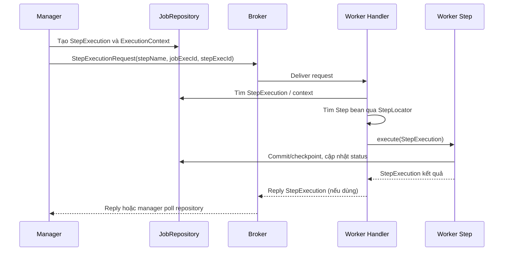

# Message-driven worker step trong Spring Batch Integration

Khi xử lý hàng triệu bản ghi, một Spring Batch job có thể chia dữ liệu thành nhiều **partition** và phân công chúng cho các worker ở những JVM hoặc máy khác. Thay vì chờ một lời gọi Java trực tiếp, worker **nhận thông điệp từ middleware, xác định StepExecution cần chạy, thực thi step, lưu kết quả và có thể gửi phản hồi về manager**. Đây là ý nghĩa của *message-driven worker step* trong mô hình **remote partitioning**.

Bài học nằm trong chương **Spring Batch Integration** của module `SPRING_BATCH_SCALING_OPERATIONS`. Mục tiêu là hiểu sự kiện message kích hoạt step ra sao, vai trò của `StepExecutionRequestHandler`, cấu hình `RemotePartitioningWorkerStepBuilder`, bảo vệ dữ liệu khi nhiều worker chạy đồng thời, và thiết kế retry/restart, giám sát, hiệu năng dựa trên tài nguyên thực tế. Các ví dụ tập trung vào **Spring Batch 5.2.x / Spring Batch Integration**.

## 1. Worker step “message-driven” là gì?

Trong một job chạy tuần tự, framework gọi `Step.execute(...)` tại tiến trình chạy job. Trong **remote partitioning**, manager tạo các `StepExecution` cho từng partition, rồi gửi thông điệp yêu cầu những worker ở nơi khác thực thi từng `StepExecution` ấy.

```mermaid
flowchart LR
    subgraph M["Manager application"]
        J["Job"] --> PM["Partition manager step"]
        PM --> P["Partitioner: tạo ExecutionContext"]
        P --> SE["Tạo worker StepExecution"]
        SE --> OUT["Request output channel"]
    end
    OUT --> RQ[("Broker request queue")]
    RQ --> IN["Worker input channel"]
    subgraph W["Worker application"]
        IN --> H["StepExecutionRequestHandler"]
        H --> L["StepLocator + JobExplorer"]
        L --> WS["Worker Step: Reader → Processor → Writer"]
        WS --> RE["StepExecution: status + counters"]
    end
    RE --> RO["Reply output channel"]
    RO --> PQ[("Broker reply queue")]
    PQ --> PM
```



Một **message** tương ứng với **yêu cầu chạy một worker `StepExecution`** (một partition), không phải một item hay một chunk. Sau khi được kích hoạt, bản thân worker step vẫn có thể là **chunk-oriented step** và xử lý hàng nghìn item theo nhiều transaction nhỏ.

Để ý bốn ranh giới:

1. **Manager phân việc:** `Partitioner` chia đầu vào, tạo `ExecutionContext` riêng cho mỗi partition.
2. **Middleware chuyển lệnh:** chuyển `StepExecutionRequest` qua message channel/broker tới worker.
3. **Worker thực thi:** handler tìm `StepExecution` và bean `Step` theo tên, đọc context rồi chạy đúng phạm vi dữ liệu.
4. **Manager tổng hợp:** nhận kết quả `StepExecution` hoặc truy vấn `JobRepository`, tính trạng thái cuối của manager step.

Không có cơ chế nào trong sơ đồ tự đảm bảo “mỗi item được ghi đúng một lần” nếu writer tạo side effect không idempotent. Message, metadata batch và business transaction là các lớp bảo đảm khác nhau.

## 2. Đừng nhầm remote partitioning với remote chunking

Hai mô hình đều truyền message, nhưng **đơn vị công việc và trách nhiệm của worker khác nhau**.

| Tiêu chí | Remote partitioning với message-driven worker step | Remote chunking |
| --- | --- | --- |
| Message manager gửi | `StepExecutionRequest` | `ChunkRequest<T>` |
| Đơn vị giao việc | Một `StepExecution` của partition | Một chunk gồm nhiều item |
| Nơi đọc dữ liệu nguồn | **Worker** dùng `ItemReader` với partition `ExecutionContext` | **Manager** đọc và chia chunk |
| Nơi chạy processor/writer | Worker step | Worker xử lý chunk |
| Kết quả chính | `StepExecution` / metadata trạng thái partition | `ChunkResponse` / đóng góp của chunk |
| Thành phần quan trọng | `StepExecutionRequestHandler`, `StepLocator`, `JobExplorer` | `ChunkProcessorChunkHandler`, `ChunkMessageChannelItemWriter` |
| Restart | Theo `StepExecution` của từng partition | Theo trạng thái manager step và protocol chunk |
| Điều kiện chọn | Dữ liệu chia được thành partition độc lập; worker có quyền đọc nguồn | Reader là một điểm tập trung hợp lý, worker xử lý/ghi nặng |

**Ví dụ:** bảng hóa đơn có 8 triệu dòng, có thể chia 32 dải ID độc lập. Remote partitioning gửi khoảng 32 yêu cầu chạy partition, mỗi worker tự đọc các ID thuộc dải được giao. Nếu manager đọc dữ liệu rồi gửi 16.000 chunk, đó là remote chunking.

Tách bạch hai mô hình giúp tránh lỗi phổ biến: cấu hình `RemoteChunkingWorkerBuilder` rồi gửi vào nó `StepExecutionRequest`. Hai builder xử lý **hai kiểu payload khác nhau** và không thể hoán đổi tùy ý.

## 3. StepExecutionRequest mang những thông tin gì?

Ở Spring Batch Integration 5.2, `org.springframework.batch.integration.partition.StepExecutionRequest` là đối tượng `Serializable` có constructor và các trường nhận diện:

```java
import org.springframework.batch.integration.partition.StepExecutionRequest;

StepExecutionRequest request = new StepExecutionRequest(
        "invoiceWorker",
        1200L, // jobExecutionId
        1307L  // stepExecutionId
);

System.out.println(request.getStepName());        // invoiceWorker
System.out.println(request.getJobExecutionId());  // 1200
System.out.println(request.getStepExecutionId()); // 1307
```

Ba trường này phục vụ hai thao tác cơ bản:

- `stepName`: handler xác định **đúng định nghĩa `Step`** cần chạy qua `StepLocator`. Tên phải khớp bean step worker được cung cấp cho process.
- `jobExecutionId` và `stepExecutionId`: handler dùng `JobExplorer`/`JobRepository` để tìm metadata execution đã được manager tạo, gồm `ExecutionContext` của partition.

Thông điệp **không cần chứa toàn bộ dữ liệu đầu vào**. `ExecutionContext` đã được lưu trong `JobRepository` có thể chứa `minId`, `maxIdExclusive`, mã khách hàng hoặc đường dẫn file mà worker cần. Tuy nhiên, worker phải có quyền truy cập kho metadata **và tài nguyên dữ liệu** được tham chiếu.

Ví dụ nội dung logic trong repository:

```text
JobExecution ID:    1200
StepExecution ID:   1307
Step name:          invoiceWorker:partition07
ExecutionContext:
  minId:            700001
  maxIdExclusive:   800001
```

Tên bean step mà `StepLocator` tìm là `invoiceWorker`; tên execution partition có thể có hậu tố `:partition07`. **Không tự lấy tên `StepExecution` có hậu tố rồi đi tìm một bean trùng nguyên văn tên đó.** Framework tách định nghĩa step và execution được chia partition.



## 4. Thành phần phía worker và trách nhiệm chính

| Thành phần | Chức năng | Lỗi khi cấu hình sai |
| --- | --- | --- |
| `MessageChannel` đầu vào | Nhận `StepExecutionRequest` từ adapter broker | Không có message; sai destination; sai payload |
| `RemotePartitioningWorkerStepBuilder` | Xây dựng worker step và đăng ký flow xử lý request | Không có endpoint nhận request hoặc cấu hình thiếu dependency |
| `StepExecutionRequestHandler` | Tiếp nhận request, tìm execution/step và chạy step | Lỗi tra cứu execution, step không tồn tại |
| `StepLocator` | Tra `Step` theo tên; mặc định có thể dùng `BeanFactoryStepLocator` | `stepName` không khớp bean worker |
| `JobExplorer` | Đọc metadata execution đã được manager tạo | Không truy cập được repository chung |
| `JobRepository` | Lưu trạng thái step, checkpoint và kết quả xử lý | Không thấy trạng thái mới, restart sai |
| `@StepScope` reader/writer | Tạo đối tượng phụ thuộc `stepExecutionContext` cho từng execution | Các partition đọc chồng cùng dữ liệu |
| `MessageChannel` đầu ra | Gửi reply tới manager trong chế độ reply aggregation | Manager đợi reply mãi dù step đã xong |

Trong mô hình triển khai nhiều process, các worker cần nhìn thấy **cùng hệ metadata Spring Batch** với manager, hoặc hạ tầng tương đương mà `JobExplorer`/`JobRepository` của chúng có thể truy cập nhất quán. Không tạo các database `BATCH_*` tách biệt theo từng worker rồi giả định request ID của manager có thể được tra cứu ở mọi nơi.

Ngoài metadata, worker phải kết nối tới DB nguồn, file store hoặc API đầu vào tương ứng với `ExecutionContext`. Dù trao đổi message thành công, worker vẫn không thể xử lý nếu thiếu tài nguyên dữ liệu.

## 5. Cấu hình một worker step qua RemotePartitioningWorkerStepBuilder

Trong Spring Batch 5.2, `@EnableBatchIntegration` cung cấp `RemotePartitioningWorkerStepBuilderFactory`. Factory giúp thiết lập các thành phần Spring Batch Integration cần thiết để cấu hình worker; ta tập trung khai báo tên step, request/reply channel và logic chunk.

Ví dụ sau là **worker application**. Các bean `invoicePartitionReader`, `invoiceProcessor`, `invoiceWriter` và hạ tầng batch/database được khai báo ở các cấu hình tiếp theo.

```java
import org.springframework.batch.core.Step;
import org.springframework.batch.integration.config.annotation.EnableBatchIntegration;
import org.springframework.batch.integration.partition.RemotePartitioningWorkerStepBuilderFactory;
import org.springframework.batch.item.ItemProcessor;
import org.springframework.batch.item.ItemWriter;
import org.springframework.batch.item.database.JdbcPagingItemReader;
import org.springframework.beans.factory.annotation.Qualifier;
import org.springframework.context.annotation.Bean;
import org.springframework.context.annotation.Configuration;
import org.springframework.integration.channel.DirectChannel;
import org.springframework.messaging.MessageChannel;
import org.springframework.transaction.PlatformTransactionManager;

@Configuration
@EnableBatchIntegration
public class InvoiceWorkerStepConfiguration {

    @Bean
    MessageChannel workerRequests() {
        return new DirectChannel();
    }

    @Bean
    MessageChannel workerReplies() {
        return new DirectChannel();
    }

    @Bean
    Step invoiceWorker(
            RemotePartitioningWorkerStepBuilderFactory workerFactory,
            PlatformTransactionManager transactionManager,
            @Qualifier("invoicePartitionReader")
                    JdbcPagingItemReader<Invoice> reader,
            @Qualifier("invoiceProcessor")
                    ItemProcessor<Invoice, Invoice> processor,
            @Qualifier("invoiceWriter")
                    ItemWriter<Invoice> writer,
            @Qualifier("workerRequests") MessageChannel requests,
            @Qualifier("workerReplies") MessageChannel replies) {

        return workerFactory.get("invoiceWorker")
                .inputChannel(requests)
                .outputChannel(replies)
                .<Invoice, Invoice>chunk(200, transactionManager)
                .reader(reader)
                .processor(processor)
                .writer(writer)
                .build();
    }
}
```

Các điểm cần nhớ:

1. `get("invoiceWorker")` định nghĩa **tên step** mà manager phải tham chiếu khi phân vùng.
2. `inputChannel(requests)` nhận yêu cầu **chạy `StepExecution`**; `outputChannel(replies)` chuyển kết quả cho manager nếu chọn cơ chế reply aggregation.
3. `chunk(200, transactionManager)` là chunk size **bên trong mỗi partition**, không phải số partition hay số message manager gửi.
4. Reader/processor/writer là các thành phần xử lý dữ liệu của worker. Bản thân `RemotePartitioningWorkerStepBuilder` lo phần nối message với quá trình chạy step.
5. Hai `DirectChannel` chỉ kết nối **bên trong ứng dụng**. Để nhận request từ máy manager và gửi reply sang máy đó, phải thêm Spring Integration AMQP/JMS adapter cùng broker, serializer, ACK và routing.

**Không sao chép ví dụ này nguyên vẹn để chạy production:** nó chưa có định nghĩa model `Invoice`, cấu hình `JobRepository`, data source, broker queue, converter và cơ chế khởi động application. `Invoice` có thể là `record Invoice(long id, BigDecimal amount) {}` trong một file Java riêng; các bean xử lý cần được bổ sung ở worker.

## 6. Reader đúng phạm vi partition với @StepScope

Worker cần đọc **đúng dải dữ liệu** mà manager giao. Ví dụ manager tạo:

```text
partition00: minId=0,      maxIdExclusive=100000
partition01: minId=100000, maxIdExclusive=200000
partition02: minId=200000, maxIdExclusive=300000
```

Các dải dùng quy ước nửa mở `[minId, maxIdExclusive)` nên hai partition liền kề không chồng biên. Reader cần lấy `minId` và `maxIdExclusive` từ `StepExecutionContext` của **partition hiện tại**, không đọc các giá trị từ singleton field chung cho mọi worker.

Ví dụ với Spring Batch 5.2, JDBC paging và primary key ổn định:

```java
import java.util.Map;
import javax.sql.DataSource;

import org.springframework.batch.core.configuration.annotation.StepScope;
import org.springframework.batch.item.database.JdbcPagingItemReader;
import org.springframework.batch.item.database.Order;
import org.springframework.batch.item.database.builder.JdbcPagingItemReaderBuilder;
import org.springframework.beans.factory.annotation.Value;
import org.springframework.context.annotation.Bean;
import org.springframework.context.annotation.Configuration;

@Configuration
class InvoicePartitionReaderConfiguration {

    @Bean
    @StepScope
    JdbcPagingItemReader<Invoice> invoicePartitionReader(
            DataSource dataSource,
            @Value("#{stepExecutionContext['minId']}") Long minId,
            @Value("#{stepExecutionContext['maxIdExclusive']}")
                    Long maxIdExclusive) {

        if (minId == null || maxIdExclusive == null
                || minId >= maxIdExclusive) {
            throw new IllegalArgumentException("Khoảng ID không hợp lệ");
        }

        return new JdbcPagingItemReaderBuilder<Invoice>()
                .name("invoicePartitionReader")
                .dataSource(dataSource)
                .selectClause("SELECT id, amount")
                .fromClause("FROM invoices")
                .whereClause(
                        "WHERE id >= :minId AND id < :maxIdExclusive")
                .parameterValues(Map.of(
                        "minId", minId,
                        "maxIdExclusive", maxIdExclusive))
                .sortKeys(Map.of("id", Order.ASCENDING))
                .rowMapper((rs, rowNum) ->
                        new Invoice(
                                rs.getLong("id"),
                                rs.getBigDecimal("amount")))
                .pageSize(200)
                .build();
    }
}
```

**Các điều kiện quan trọng:**

- `@StepScope` tạo reader theo từng `StepExecution`, để partition không chia sẻ state mutable của cùng reader.
- Điều kiện ID phải khớp chính xác với cách `Partitioner` tạo context; dùng quy ước biên nhất quán và kiểm tra khi có ID rỗng hoặc không liên tục.
- `ORDER BY` trên khóa ổn định/unique cần thiết cho paging và restart. Không dựa vào thứ tự dữ liệu mặc định của DB.
- Nếu dữ liệu nguồn có thể thêm/sửa/xóa khi job đang chạy, cần snapshot/cutoff hoặc chiến lược isolation thích hợp để việc paging và restart vẫn đúng.
- Với nhiều worker process, mọi instance phải có quyền truy cập cùng nguồn dữ liệu; cấu hình DB pool cần tính **tổng số kết nối của cả cụm**.

Không cần mang từng hóa đơn qua `StepExecutionRequest` trong remote partitioning: worker đọc dữ liệu từ chính nguồn sau khi lấy phạm vi ID.

## 7. Processor và writer: thread safety không tự giải quyết transaction

Một processor stateless và writer JDBC có thể được tái sử dụng khi cấu hình đúng, nhưng remote worker đồng thời vẫn có thể tranh chấp cùng bảng, index, connection pool hoặc external API.

Ví dụ xử lý đơn giản với dữ liệu `Invoice(id, amount)`:

```java
import java.math.RoundingMode;
import javax.sql.DataSource;

import org.springframework.batch.item.ItemProcessor;
import org.springframework.batch.item.database.JdbcBatchItemWriter;
import org.springframework.batch.item.database.builder.JdbcBatchItemWriterBuilder;
import org.springframework.beans.factory.annotation.Bean;
import org.springframework.context.annotation.Configuration;
import org.springframework.jdbc.core.namedparam.MapSqlParameterSource;

@Configuration
class InvoiceBusinessConfiguration {

    @Bean("invoiceProcessor")
    ItemProcessor<Invoice, Invoice> invoiceProcessor() {
        return invoice -> new Invoice(
                invoice.id(),
                invoice.amount().setScale(2, RoundingMode.HALF_UP));
    }

    @Bean("invoiceWriter")
    JdbcBatchItemWriter<Invoice> invoiceWriter(DataSource dataSource) {
        return new JdbcBatchItemWriterBuilder<Invoice>()
                .dataSource(dataSource)
                .sql("""
                        UPDATE invoices
                           SET normalized_amount = :amount
                         WHERE id = :id
                        """)
                .itemSqlParameterSourceProvider(item ->
                        new MapSqlParameterSource()
                                .addValue("id", item.id())
                                .addValue("amount", item.amount()))
                .build();
    }
}
```

Ví dụ giả định DB có bảng `invoices(id, amount, normalized_amount)` và `id` là khóa duy nhất. Câu `UPDATE` đặt một giá trị tính toán xác định theo ID, nên có thể chạy lại mà không tích lũy lần cập nhật như phép `balance = balance + :delta`. Nhưng điều đó **không tự bảo đảm** tính đúng nếu bảng nguồn thay đổi, partition overlap hoặc quy tắc tiền tệ không phù hợp.

Nếu writer gửi sự kiện, chuyển tiền, gọi REST hoặc xuất file, phải thiết kế **idempotency key** hoặc transactional outbox/chiến lược tương đương. `JobRepository` đảm nhiệm trạng thái batch, không thể rollback một side effect đã xảy ra ở hệ thống khác chỉ nhờ đổi `StepExecution` từ `FAILED` thành `STARTED`.

## 8. Manager tạo StepExecution và gửi request

Để thấy vị trí worker trong toàn hệ thống, manager thường dùng `RemotePartitioningManagerStepBuilder` (hoặc factory của nó):

```java
import org.springframework.batch.core.Step;
import org.springframework.batch.core.partition.support.Partitioner;
import org.springframework.batch.integration.partition.RemotePartitioningManagerStepBuilderFactory;
import org.springframework.beans.factory.annotation.Qualifier;
import org.springframework.context.annotation.Bean;
import org.springframework.messaging.MessageChannel;

@Bean
Step invoiceManager(
        RemotePartitioningManagerStepBuilderFactory managerFactory,
        @Qualifier("invoiceIdPartitioner") Partitioner partitioner,
        @Qualifier("managerRequests") MessageChannel requests,
        @Qualifier("managerReplies") MessageChannel replies) {

    return managerFactory.get("invoiceManager")
            .partitioner("invoiceWorker", partitioner)
            .gridSize(16)
            .outputChannel(requests)
            .inputChannel(replies)
            .build();
}
```

Đoạn này là method cấu hình **trên ứng dụng manager** (đặt bên trong một lớp `@Configuration` với `@EnableBatchIntegration` và bean tương ứng). Nó không phải phần bắt buộc phải có trong worker application.

`.partitioner("invoiceWorker", partitioner)` khai báo **tên worker step logic**. `gridSize(16)` là gợi ý số partition cần chia, không phải 16 JVM/consumer thực sự đang chạy. Số partition được tạo phụ thuộc `Partitioner`; concurrency thực tế phụ thuộc broker consumer, worker process, thread pool và tài nguyên.

### Trình tự khởi tạo metadata

Manager tạo `JobExecution` cho lần chạy, sinh các `StepExecution` từ `Partitioner`, lưu context và phát request. Worker nhận request **sau khi metadata cần tra cứu đã tồn tại**. Nếu triển khai app worker không kết nối được repository chung, `StepExecutionRequestHandler` không thể tải `StepExecution` theo các ID được gửi.

Khi manager dùng reply aggregation, worker gửi `StepExecution` kết quả về manager qua channel. Manager tổng hợp các trạng thái `BatchStatus`, `ExitStatus` và bộ đếm. Khi chọn chế độ polling repository, manager kiểm tra kết quả trong `JobRepository` thay vì đợi reply cho từng partition.

## 9. Hai cách xác nhận kết quả worker: reply và repository polling

| Chế độ | Manager chờ bằng gì? | Worker cần làm gì? | Ưu điểm | Cần kiểm soát |
| --- | --- | --- | --- | --- |
| Reply aggregation | Các `StepExecution` được gửi qua reply channel | Phát reply tới đúng manager | Phản hồi theo sự kiện; giảm phụ thuộc polling thường xuyên | Correlation, reply routing, mất/trùng reply, serializer |
| Repository polling | Đọc trạng thái worker `StepExecution` qua `JobExplorer` | Cập nhật repository đúng; reply có thể bỏ qua | Giảm phụ thuộc reply message | Poll interval/timeout, tải DB metadata, phát hiện worker kẹt |

Ở Spring Batch Integration 5.x, nếu worker builder không được khai báo `outputChannel` thì có thể dùng `NullChannel` khi manager đã chọn polling repository. **Không bỏ reply channel nếu manager vẫn đang cấu hình đợi kết quả qua reply aggregation.**

### Khi nào chọn cách nào?

- Với hạ tầng broker đã có request/reply routing rõ, reply aggregation thuận tiện để nhận kết quả sớm.
- Khi có nhiều worker và lo ngại độ bền của reply channel, polling repository là phương án cần cân nhắc; tuy nhiên DB metadata phải chịu thêm truy vấn.
- Chế độ nào cũng phải có timeout, phân loại worker bị kẹt, retry/restart và quy tắc tránh chạy trùng side effect.

Một câu hỏi vận hành cần trả lời trước khi tăng concurrency: nếu worker đã **commit thành công** nhưng reply bị mất, manager có thể nhận ra điều đó từ `JobRepository` và kết thúc đúng không? Câu trả lời phụ thuộc chế độ tổng hợp đang dùng.

## 10. Broker adapter, serializer và đường reply

`DirectChannel` trong ví dụ ở mục 5 **chưa truyền qua mạng**. Cấu hình production còn cần Spring Integration inbound/outbound adapters cho RabbitMQ, JMS hoặc middleware tương thích.


**Đặc tính middleware cần kiểm:**

1. Request message được đưa đến **một consumer có quyền thực thi** chứ không broadcast một request cho mọi worker.
2. `StepExecutionRequest` được serialize và deserialize đúng kiểu; nếu dùng JSON DTO tùy chỉnh, cần bridge để tái tạo đủ `stepName` và các ID. Không đưa thẳng một `Map` vào `StepExecutionRequestHandler`.
3. Reply `StepExecution` (nếu có) được chuyển về đúng manager; giữ correlation và route đúng khi có nhiều manager.
4. Xác định thời điểm ACK/NACK so với **commit DB, cập nhật `JobRepository` và publish reply**. Không giả định ba việc này nằm chung transaction.
5. Lỗi converter hoặc message “poison” phải có retry hữu hạn, backoff, dead-letter/quarantine thay vì requeue vô tận.
6. Bảo vệ quyền publish/consume và object deserialization: không nhận arbitrary Java serialized object từ nguồn không tin cậy.

Chọn broker durable giúp giảm rủi ro mất request khi có lỗi, nhưng **không tự đảm bảo exactly-once side effect**. Ngay cả khi Spring Batch metadata tránh chạy lại một `StepExecution` đã hoàn tất, các cửa sổ lỗi quanh DB commit, external API và message ACK vẫn cần kiểm thử.

## 11. Điều gì xảy ra khi hai worker nhận cùng một request?

Trong một hệ thống at-least-once, request có thể được giao lại nếu consumer chết trước ACK. Ví dụ:

```text
T1 Manager đã tạo StepExecution ID=1307, trạng thái STARTING
T2 Broker giao request cho Worker A
T3 Worker A bắt đầu chạy StepExecution
T4 Worker A ghi một số chunk, cập nhật checkpoint
T5 Worker A mất kết nối trước ACK
T6 Broker giao lại cùng request cho Worker B
```

Điều cần kiểm tra là `StepExecution` đang ở trạng thái nào và worker handler có được phép chạy nó ở thời điểm T6 không. `JobExplorer`/`JobRepository` cung cấp metadata để đánh giá, nhưng không nên **giả định sẽ không bao giờ có tranh chấp** khi hai process cùng thấy một request đang dở dang. Đặc biệt, service phía ngoài DB có thể đã nhận side effect mà checkpoint chưa phản ánh.

Các biện pháp:

- Chọn consumer topology đảm bảo **mỗi message chỉ tới một consumer mỗi lượt giao**, tránh fanout tới nhiều queue.
- Giữ request ID, tên step và `ExecutionContext` ổn định khi redelivery.
- Đảm bảo worker không chia sẻ reader/writer stateful giữa các `StepExecution`; dùng `@StepScope` cho thành phần phụ thuộc context.
- Có transaction và checkpoint bền vững, cùng khóa/idempotency ở tầng nghiệp vụ.
- Thử kill worker trước commit, sau commit, trước reply/ACK; đối chiếu số bản ghi/side effect thực.
- Không tùy tiện cập nhật `BATCH_STEP_EXECUTION.STATUS` bằng SQL để “mở khóa” một execution kẹt; dùng cơ chế restart/khôi phục được kiểm soát.

Trong môi trường remote partitioning, trạng thái `COMPLETED` của các `StepExecution` đã hoàn tất thường giúp manager **không phân công lại những partition đó** khi restart cùng `JobInstance`. Nhưng kết quả cuối cùng còn phụ thuộc `Partitioner` có giữ tên/phạm vi partition ổn định hay không và chính sách restart của job.

## 12. Restart và các yêu cầu về tính ổn định

Partition có thể hoàn tất ở các thời điểm khác nhau. Nếu 15 trên 16 partition đã `COMPLETED` mà partition cuối `FAILED`, restart đúng cách sẽ ưu tiên chạy lại **phần chưa hoàn thành** thay vì xử lý lại tất cả.

| Thành phần | Phải giữ ổn định khi restart | Nếu thay đổi tùy tiện |
| --- | --- | --- |
| `JobInstance` | Identifying `JobParameters` và snapshot/cutoff nguồn | Restart trở thành job mới, đọc dữ liệu khác |
| Worker `Step` | Tên logic `invoiceWorker` | Handler không tìm được bean step; metadata bị lệch |
| Partition keys | Ví dụ `partition00`, `partition01`, ... | Không nhận ra partition đã hoàn tất |
| `ExecutionContext` | Biên ID, file/resource, version của input | Worker xử lý nhầm phạm vi |
| Reader checkpoint | Page/position và sort key ổn định | Đọc thiếu hoặc trùng item |
| Writer side effect | Business key/idempotency | Duplicate khi worker/crash |
| Request/reply routing | Correlation và owner manager | Reply cũ đến nhầm execution |

### Tình huống khôi phục thực tế

1. Manager bắt đầu `JobExecution A`, tạo 16 partition.
2. Worker hoàn tất 12 partition, 3 đang xử lý, 1 bị lỗi DB.
3. Manager chết. Một số worker có thể tiếp tục và ghi trạng thái vào repository, tùy vòng đời của process.
4. Operator xác minh trạng thái cuối của job/step, đánh giá execution đang chạy hoặc kẹt.
5. Sau khi hệ thống ở trạng thái có thể restart an toàn, launch lại **cùng `JobInstance`** bằng identifying parameters tương ứng.
6. Kiểm tra những partition thực sự chạy lại, đối chiếu output và message cũ/dư.

Điều này **không đồng nghĩa** mọi `STARTED` “mồ côi” tự động được phép restart ngay sau crash: cần quy trình xác định worker có còn sống và cách framework quản lý trạng thái chưa kết thúc. Không được tạo job execution trùng đồng thời bằng cách giả mạo metadata.

## 13. Quản lý số lượng worker và tài nguyên

Trong remote partitioning, có **số partition logic** và **số partition thực thi đồng thời**. Hai đại lượng này khác nhau.

Giả sử:

```text
Partition logic (P):            64
Worker process:                  4
Consumer đồng thời/process:      2
Concurrency danh nghĩa (W):      8
```

Tối đa khoảng `min(P, W) = 8` partition có thể chạy cùng lúc nếu không có giới hạn khác. `gridSize=64` không tạo ra 64 process, không ép broker chạy 64 consumer, và không chứng minh DB đủ khả năng phục vụ 64 query đồng thời.

| Resource | Dấu hiệu bão hòa | Quyết định thường cần cân nhắc |
| --- | --- | --- |
| CPU worker | CPU cao, context switching/GC | Giảm concurrency hoặc scale CPU hợp lý |
| JDBC pool | Pending connection tăng, acquire time dài | Kiểm tổng connection toàn cụm; không chỉ tăng pool |
| Database | Lock wait, I/O, slow query, CPU cao | Tối ưu index/query, phạm vi partition, transaction |
| Broker | Request queue backlog, unacked/message age tăng | Điều chỉnh consumer/prefetch, đảm bảo ACK và retry |
| Metadata DB | Tranh chấp trên `BATCH_*` khi nhiều partition commit | Đo lưu trạng thái/repository polling và sizing DB |
| Remote API | 429/timeout, retry storm | Rate limit, backoff, idempotency |

Nếu partition có chi phí lệch nhau, worker rảnh có thể phải đợi một partition “đuôi dài”; điều chỉnh **độ hạt partition** (cùng logic và đầu vào) thường hiệu quả hơn chỉ tăng số worker. Nhưng chia partition quá nhỏ lại tăng overhead `StepExecution`, message và metadata.

## 14. Theo dõi StepExecution từ JobRepository

Với remote partitioning, mỗi partition có `StepExecution` của chính nó. Có thể truy vấn:

```sql
SELECT STEP_EXECUTION_ID,
       STEP_NAME,
       STATUS,
       EXIT_CODE,
       READ_COUNT,
       WRITE_COUNT,
       COMMIT_COUNT,
       ROLLBACK_COUNT,
       START_TIME,
       END_TIME
FROM BATCH_STEP_EXECUTION
WHERE JOB_EXECUTION_ID = :jobExecutionId
ORDER BY STEP_EXECUTION_ID;
```

Kết quả minh họa:

```text
invoiceWorker:partition00  COMPLETED  READ=10000 WRITE=10000
invoiceWorker:partition01  COMPLETED  READ=9800  WRITE=9800
invoiceWorker:partition02  FAILED     READ=4600  WRITE=4200
invoiceWorker:partition03  STARTED    READ=7200  WRITE=7000
```

Tên thực tế và count phụ thuộc cấu hình `Partitioner`, chunk, retry và skip policy. **Không lấy `WRITE_COUNT` làm bằng chứng duy nhất** về số side effect nghiệp vụ đã commit nếu writer có gửi API, event hoặc ghi ngoài transaction. Cần đối chiếu business ID, checksum hoặc snapshot đầu vào.

Mỗi log ở worker nên có `jobExecutionId`, `stepExecutionId`, `stepName`, `partitionKey` (suy từ context/tên execution nếu có), tên worker process và thời gian xử lý. Trên dashboard, nên đo:

- Partition `COMPLETED/FAILED/STARTED` theo `JobExecution`.
- Duration của từng partition và p95/p99 của partition duration.
- Request queue depth, unacked/redelivery và reply latency (nếu dùng reply).
- DB active/pending connections, CPU, GC, lock wait.
- Tỷ lệ retry/rollback và số business key thiếu/trùng sau job.

**Không dùng mỗi `stepExecutionId` làm label metric dài hạn:** sẽ tạo quá nhiều time series; ưu tiên log/tracing cho ID chi tiết, còn metric tổng hợp theo job/worker pool/status.

## 15. Lỗi thường gặp khi cấu hình message-driven worker step

| Triệu chứng | Nguyên nhân khả dĩ | Cách kiểm tra |
| --- | --- | --- |
| Broker có request nhưng worker không chạy | Inbound adapter sai queue, consumer không được tạo | Kiểm consumer count, wiring request channel |
| Worker báo không tìm thấy Step | `StepLocator` không biết `invoiceWorker` hoặc tên không khớp | So `StepExecutionRequest.stepName` với bean worker step |
| Handler báo không thấy StepExecution | Worker truy cập repository khác/metadata chưa khả dụng | Kiểm `jobExecutionId`, `stepExecutionId` và DB kết nối |
| Worker chạy nhưng đọc toàn bảng | Reader không dùng `stepExecutionContext` hoặc không `@StepScope` | Log biên partition, SQL thực, bean scope |
| Hai worker ghi trùng dữ liệu | Partition overlap hoặc duplicate message/restart | Kiểm partition keys, ID range, idempotency |
| Manager chờ mãi dù worker `COMPLETED` | Reply channel route lỗi hoặc polling chưa đúng | Kiểm lựa chọn reply vs polling, broker và repository |
| Worker xử lý xong nhưng reply deserialize lỗi | Converter/headers/phiên bản khác nhau | Kiểm serialization, payload type và DLQ |
| Tăng worker làm throughput giảm | DB/pool/broker bão hòa | Đo CPU, connection wait, queue depth, lock |
| Restart chạy lại partition đã xong | Tên partition đổi, job parameters khác, policy buộc chạy lại | So JobInstance/StepExecution cũ và mới |
| Step `FAILED` nhưng external API đã nhận lệnh | Side effect ngoài transaction | Idempotency key/outbox, đối soát |
| Queue tích tụ message lỗi | Retry/requeue vô hạn, poison message | Giới hạn retry, DLQ, lỗi schema và runbook |

## 16. Kiểm thử tích hợp và failure injection

Một bài lab nên có **broker thật**, repository chung, manager và ít nhất hai worker process. Đừng chỉ dùng hai `DirectChannel` trong một JVM rồi kết luận tính đúng khi mất kết nối/restart.

1. **Baseline:** chia 1.000 invoice thành 10 partition không chồng nhau; chạy 1 worker và kiểm đủ 1.000 bản ghi.
2. **Parallel workers:** tăng thành 2 rồi 4 consumer, giữ input và cách chia như cũ; đo throughput, CPU và connection wait.
3. **Xác minh StepLocator:** gửi request có stepName sai trong môi trường test; bảo đảm hệ thống báo lỗi kiểm soát, không chạy step khác.
4. **Xác minh context:** kiểm minId/maxIdExclusive ở mỗi `StepExecution`, dùng SQL đối chiếu không thiếu/trùng primary key.
5. **Lỗi DB giữa chừng:** làm một partition thất bại sau vài chunk commit; quan sát metadata, retry và restart.
6. **Worker crash trước commit:** đảm bảo checkpoint/restart không làm mất bản ghi.
7. **Worker crash sau business commit trước reply/ACK:** kiểm tra redelivery/idempotency và trạng thái step cuối.
8. **Manager crash:** kiểm tra partition đã hoàn thành, pending/running partition, thời điểm cho phép restart cùng `JobInstance`.
9. **Reply route down:** nếu dùng reply aggregation, chặn outbound reply tạm thời, quan sát trạng thái `JobRepository` và manager chờ.
10. **Tải lớn:** tăng số partition và consumer **trong các thí nghiệm riêng**, tìm điểm bão hòa của broker, DB và metadata.

### Những bất biến bắt buộc

```text
Input unique business IDs    = 1.000
Output business IDs expected = 1.000
Missing IDs                  = 0
Duplicate business effects   = 0
Unexpected partition overlap = 0
Manager job status           = COMPLETED (khi đã phục hồi thành công)
```

Kiểm tra `StepExecution` và metadata là **điều kiện cần**, nhưng bản ghi nghiệp vụ và tác dụng ngoài DB mới là nguồn kiểm chứng cuối của một batch job.

## 17. Khi nào nên chọn message-driven worker step?

| Câu hỏi | Nếu câu trả lời là “có” | Hướng kiến trúc |
| --- | --- | --- |
| Dữ liệu có thể chia phạm vi độc lập theo PK, tenant, file hoặc shard không? | Có | Remote partitioning là ứng viên |
| Worker có thể truy cập trực tiếp nguồn dữ liệu và metadata chung không? | Có | Message-driven worker step phù hợp |
| Chỉ một manager có thể đọc nguồn, worker chỉ nên xử lý item từ manager? | Có | Cân nhắc remote chunking |
| Nhiều bước nghiệp vụ độc lập nhưng mỗi bước xử lý một dataset khác nhau? | Có | Parallel steps hoặc tách job có thể đơn giản hơn |
| Tài nguyên database đã bão hòa trước khi scale worker? | Có | Tối ưu DB/query/partition; tăng worker có thể phản tác dụng |
| Yêu cầu nhất quán external side effect, retry, restart nghiêm ngặt? | Có | Chọn cơ chế idempotency/transaction trước khi tăng concurrency |

**Thông điệp chỉ là công cụ điều phối.** Tính đúng của worker vẫn phụ thuộc cách chia input, giao dịch, checkpoint, thread safety và giới hạn tài nguyên. Đôi khi local partitioning với `TaskExecutor` đã đáp ứng SLA và đơn giản hơn vận hành broker/remote worker.

## 18. Bài tập tự kiểm tra

**Câu 1.** Manager phát một `StepExecutionRequest`. Worker nhận được 10.000 item bên trong message đó đúng không?

**Đáp án:** Không. Request chứa định danh step và execution; worker tự lấy `ExecutionContext`, đọc dữ liệu theo phạm vi partition và xử lý các chunk trong step.

**Câu 2.** Một worker process dùng repository riêng không có `StepExecution ID=1307`. Message từ manager có ID đó sẽ chạy được không?

**Đáp án:** Không theo cấu hình chuẩn. Worker cần truy cập metadata được manager tạo trong `JobRepository`/`JobExplorer` tương thích.

**Câu 3.** Có 64 partition logic, 4 worker process, mỗi process một consumer. Có thể chắc chắn 64 partition chạy đồng thời không?

**Đáp án:** Không. Concurrency danh nghĩa chỉ khoảng 4 partition tại một thời điểm, còn tùy broker và giới hạn hạ tầng.

**Câu 4.** Manager được cấu hình nhận reply, nhưng worker bỏ `outputChannel`. Manager có chắc hoàn thành đúng không?

**Đáp án:** Không. Nếu manager đang dùng reply aggregation, phải cung cấp reply path phù hợp; chỉ khi manager dùng polling repository mới có thể không cần worker reply theo cấu hình tương ứng.

**Câu 5.** Một partition `COMPLETED`, broker giao lại `StepExecutionRequest` của partition đó. Điều này có nghĩa phải chạy lại mọi side effect không?

**Đáp án:** Không. Framework có metadata execution để kiểm soát xử lý/restart; không tự chạy lại side effect đã hoàn thành. Tuy vậy vẫn cần thử redelivery, trạng thái race và idempotency của writer, đặc biệt với hệ thống ngoài DB.

**Câu 6.** Reader `@StepScope` có tham số `minId` và `maxIdExclusive`, nhưng `Partitioner` dùng key `minValue`/`maxValue`. Điều gì xảy ra?

**Đáp án:** Reader không nhận đúng tham số, có thể lỗi khi tạo bean hoặc đọc sai vùng. Key trong `ExecutionContext` và SpEL phải khớp tuyệt đối.

## 19. Tài liệu đối chiếu

- [Spring Batch 5.2 — Remote Partitioning trong Spring Batch Integration](https://docs.spring.io/spring-batch/reference/5.2/spring-batch-integration/sub-elements.html): manager, worker, reply aggregation và repository polling.
- [Spring Batch 5.2 — Scaling and Parallel Processing / Partitioning](https://docs.spring.io/spring-batch/reference/5.2/scalability.html): partitioner, partition handler, restart và worker step.
- [Spring Batch 5.2 API — RemotePartitioningWorkerStepBuilder](https://docs.spring.io/spring-batch/docs/5.2.x/api/org/springframework/batch/integration/partition/RemotePartitioningWorkerStepBuilder.html): builder `inputChannel`, `outputChannel`, `stepLocator`.
- [Spring Batch 5.2 API — EnableBatchIntegration](https://docs.spring.io/spring-batch/docs/5.2.x/api/org/springframework/batch/integration/config/annotation/EnableBatchIntegration.html): các builder factories cho remote partitioning và remote chunking.
- [Spring Batch 5.2 API — StepExecutionRequest](https://docs.spring.io/spring-batch/docs/5.2.x/api/org/springframework/batch/integration/partition/StepExecutionRequest.html): `stepName`, `jobExecutionId`, `stepExecutionId`.
- [Spring Batch 5.2 API — StepExecutionRequestHandler](https://docs.spring.io/spring-batch/docs/5.2.x/api/org/springframework/batch/integration/partition/StepExecutionRequestHandler.html): xử lý request và trả `StepExecution`.
- [Spring Batch 5.2 API — MessageChannelPartitionHandler](https://docs.spring.io/spring-batch/docs/5.2.x/api/org/springframework/batch/integration/partition/MessageChannelPartitionHandler.html): phía manager gửi request và thu thập kết quả.
- [Spring Batch — ItemReader/ItemWriter](https://docs.spring.io/spring-batch/reference/readers-and-writers.html): các reader/writer và vấn đề checkpoint.

**Ghi nhớ:** *message-driven worker step* là **worker step của remote partitioning được kích hoạt bởi `StepExecutionRequest`**. Manager tạo `StepExecution` và context; worker dùng `StepExecutionRequestHandler`/`StepLocator` tìm step, thực thi phạm vi được giao rồi trả hoặc lưu trạng thái. Muốn mở rộng an toàn, phải **giữ tên step và partition ổn định, chia dữ liệu không chồng lấn, dùng `@StepScope` đúng cách, nối broker request/reply hoặc polling nhất quán và kiểm thử retry/restart cùng tính đúng nghiệp vụ**.
