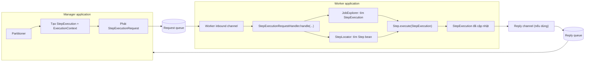
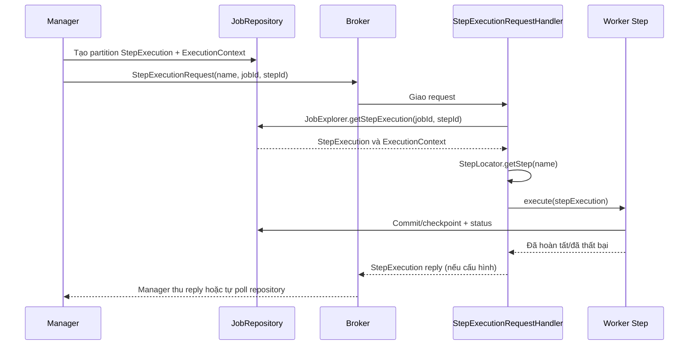
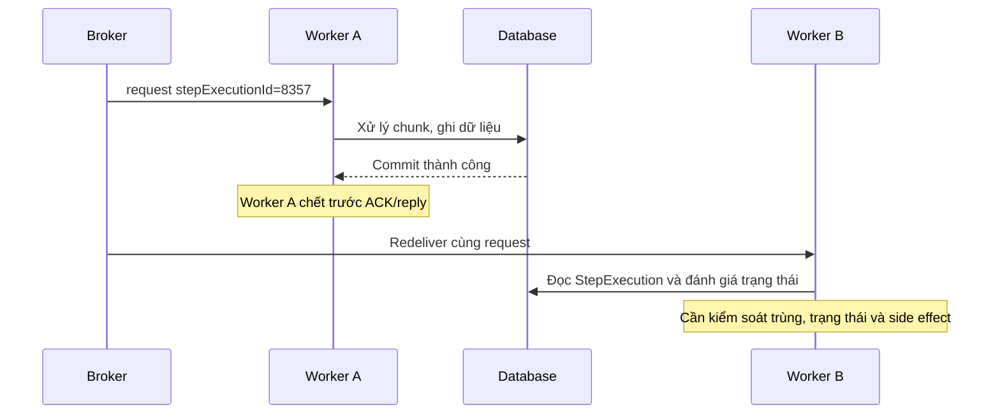

# StepExecutionRequestHandler trong Spring Batch Integration

Trong **remote partitioning**, manager chia workload thành các partition và giao từng partition cho worker ở một JVM hoặc máy khác. Manager không gửi hàng nghìn item trong mỗi thông điệp; thay vào đó, nó gửi một **`StepExecutionRequest` chứa thông tin định danh của `StepExecution` đã được tạo**. Ở phía worker, `StepExecutionRequestHandler` là thành phần nối thông điệp ấy với vòng đời thực thi `Step` của Spring Batch.

Bài học thuộc chương **Spring Batch Integration** trong module `SPRING_BATCH_SCALING_OPERATIONS`. Trọng tâm là cơ chế handler tìm đúng step, tải execution context, thực thi và trả kết quả; sau đó mở rộng sang thread safety, retry/restart, broker delivery, đo nút thắt và bảo đảm dữ liệu chính xác cho workload lớn. Các API bên dưới theo **Spring Batch Integration 5.2.x**; khi nâng lên major version khác, cần kiểm tra lại signature và cách cấu hình.

## 1. Vai trò chính: biến message thành một lần thực thi step

`StepExecutionRequestHandler` thuộc package `org.springframework.batch.integration.partition`. Đây là một **message endpoint** có phương thức chính:

```java
StepExecution handle(StepExecutionRequest request);
```

Handler không phải `ItemReader`, `ItemProcessor`, `ItemWriter` hoặc một message broker. Nó là bộ điều phối nhận yêu cầu chạy **một `StepExecution` đã tồn tại**, lấy đối tượng tương ứng trong metadata và gọi `Step` đã được cấu hình ở worker.



**Một request tương ứng với một partition execution**, không phải một chunk. Worker step vẫn có thể xử lý các chunk liên tiếp trong các transaction riêng. Việc đọc input và checkpoint xảy ra **tại worker step**; manager chỉ phân vùng dữ liệu và điều phối.

## 2. StepExecutionRequest có những trường nào?

Theo Spring Batch 5.2, `StepExecutionRequest` là lớp `Serializable` có constructor:

```java
new StepExecutionRequest(
    String stepName,
    Long jobExecutionId,
    Long stepExecutionId
);
```

Ví dụ:

```java
import org.springframework.batch.integration.partition.StepExecutionRequest;

StepExecutionRequest request = new StepExecutionRequest(
        "invoiceWorker",  // Tên Step bean mà worker có thể định vị
        8201L,            // JobExecution ID
        8357L             // StepExecution ID của partition
);

System.out.println(request.getStepName());        // invoiceWorker
System.out.println(request.getJobExecutionId());  // 8201
System.out.println(request.getStepExecutionId()); // 8357
```

| Trường | Ý nghĩa | Nếu sai sẽ thế nào? |
| --- | --- | --- |
| `stepName` | Tên **định nghĩa worker Step** cần thực thi | `StepLocator` không tìm được bean hoặc tìm nhầm step |
| `jobExecutionId` | ID của lần chạy job mà partition thuộc về | `JobExplorer` không tìm thấy hoặc không đối chiếu đúng execution |
| `stepExecutionId` | ID execution của partition được manager tạo | Không thể tải đúng `ExecutionContext` / trạng thái |

Điều quan trọng là `StepExecutionRequest` **không mang toàn bộ `ExecutionContext` hoặc danh sách item**. Manager đã tạo `StepExecution` và lưu context vào `JobRepository` dùng chung trước khi worker xử lý request.

Một ví dụ dữ liệu trong repository:

```text
JobExecution ID   = 8201
StepExecution ID  = 8357
StepExecution name = invoiceWorker:partition03
StepExecutionContext:
  minId           = 300000
  maxIdExclusive  = 400000
  snapshotId      = billing-2026-11-26
```

`stepName` trong request có thể là `invoiceWorker` trong khi `StepExecution` có tên với hậu tố `:partition03`. Đó là hai khái niệm khác nhau: **tên bean `Step` để thực thi** và **tên execution cụ thể của partition**.

## 3. Ba hợp đồng mà handler cần được cấu hình đúng

Ở Spring Batch Integration 5.2, class này có constructor không tham số và hai setter quan trọng:

```java
void setStepLocator(StepLocator stepLocator);
void setJobExplorer(JobExplorer jobExplorer);
StepExecution handle(StepExecutionRequest request);
```

### 3.1. StepLocator: tìm định nghĩa step

`StepLocator` nhận tên `invoiceWorker` và trả về bean `Step`. Với `BeanFactoryStepLocator`, việc tìm kiếm dựa trên các bean `Step` trong Spring `BeanFactory` của worker.

Nếu request chứa `stepName="invoiceWorker"` mà worker chỉ khai báo bean `paymentWorker`, handler không thể thực thi đúng. Trong môi trường nhiều loại job, nên giới hạn danh sách step mà một nhóm worker được phép chạy; **message đến từ broker không nên được xem là yêu cầu đáng tin tuyệt đối chỉ vì payload giải mã được**.

### 3.2. JobExplorer: tìm metadata partition đã tạo

`JobExplorer` có thể tải `StepExecution` thông qua:

```java
StepExecution existing = jobExplorer.getStepExecution(
        request.getJobExecutionId(),
        request.getStepExecutionId()
);
```

Kết quả đọc về cần bao gồm `ExecutionContext` của partition, đồng thời mang thông tin liên quan đến `JobExecution`. Nếu worker trỏ vào **một database metadata khác** so với manager, các ID trong request sẽ không tìm được, dù request queue hoạt động bình thường.

### 3.3. Step.execute: chạy nghiệp vụ và ghi trạng thái

Handler giao `StepExecution` cho bean `Step` tương ứng. Phần thân step phụ trách mở reader, xử lý item/chunk, gọi writer, commit/checkpoint và cập nhật metadata qua `JobRepository`. Kết quả trả về của handler là **`StepExecution`**, có `BatchStatus`, `ExitStatus` và các counter; không phải `ChunkResponse`.

**Ranh giới trách nhiệm:** `StepExecutionRequestHandler` **không tạo partition mới**, không tự tính range dữ liệu và không biến external side effect thành transaction chung với broker. Nó cũng không phải một `JobLauncher` tạo `JobInstance` mới mỗi lần nhận message.

## 4. Luồng xử lý một request, từng bước

Một luồng bình thường có thể hiểu như sau:



**Luồng tổng quát**:

1. Manager tạo `ExecutionContext` cho mỗi partition, ví dụ phạm vi khóa chính không giao nhau.
2. `JobRepository` lưu metadata `StepExecution` trước khi manager phát request.
3. Broker phân phối request cho một worker consumer đủ điều kiện.
4. Message converter khôi phục payload thành `StepExecutionRequest`; lỗi deserialize có thể dừng luồng **trước khi `handle(...)` được gọi**.
5. Handler dùng `JobExplorer` và `StepLocator`, thực thi step theo thông tin đã được lưu.
6. Step cập nhật trạng thái và đóng góp của các chunk vào metadata.
7. Handler trả `StepExecution`; Spring Integration route reply nếu được cấu hình.
8. Manager tổng hợp kết quả theo cơ chế **reply aggregation** hoặc **repository polling**.

Không suy ra rằng broker ACK, handler trả thành công và DB business commit **luôn xảy ra trong cùng một transaction**. Cần kiểm tra chính sách listener container và transaction manager cụ thể.

## 5. Cấu hình chuẩn: dùng RemotePartitioningWorkerStepBuilder

Trong ứng dụng Spring Batch, cách thường dùng là để builder tạo và nối sẵn IntegrationFlow gọi `StepExecutionRequestHandler`. Không cần tự viết thủ công một endpoint cho mỗi worker.

```java
import org.springframework.batch.core.Step;
import org.springframework.batch.integration.config.annotation.EnableBatchIntegration;
import org.springframework.batch.integration.partition.RemotePartitioningWorkerStepBuilderFactory;
import org.springframework.batch.item.ItemProcessor;
import org.springframework.batch.item.ItemReader;
import org.springframework.batch.item.ItemWriter;
import org.springframework.beans.factory.annotation.Qualifier;
import org.springframework.context.annotation.Bean;
import org.springframework.context.annotation.Configuration;
import org.springframework.integration.channel.DirectChannel;
import org.springframework.messaging.MessageChannel;
import org.springframework.transaction.PlatformTransactionManager;

@Configuration
@EnableBatchIntegration
class RemoteInvoiceWorkerConfiguration {

    @Bean
    MessageChannel workerRequests() {
        return new DirectChannel();
    }

    @Bean
    MessageChannel workerReplies() {
        return new DirectChannel();
    }

    @Bean
    Step invoiceWorker(
            RemotePartitioningWorkerStepBuilderFactory workerFactory,
            PlatformTransactionManager transactionManager,
            @Qualifier("invoiceReader") ItemReader<Invoice> reader,
            @Qualifier("invoiceProcessor") ItemProcessor<Invoice, Invoice> processor,
            @Qualifier("invoiceWriter") ItemWriter<Invoice> writer,
            @Qualifier("workerRequests") MessageChannel requests,
            @Qualifier("workerReplies") MessageChannel replies) {

        return workerFactory.get("invoiceWorker")
                .inputChannel(requests)
                .outputChannel(replies)
                .<Invoice, Invoice>chunk(200, transactionManager)
                .reader(reader)
                .processor(processor)
                .writer(writer)
                .build();
    }
}
```

Ví dụ trên giả định ứng dụng có `record Invoice(long id, BigDecimal amount) {}`, các bean xử lý `invoiceReader`/`invoiceProcessor`/`invoiceWriter` và batch infrastructure. Nó **chưa tự kết nối RabbitMQ/JMS**. Cần hai adapter khác nối `workerRequests` với broker request destination, và `workerReplies` với broker reply destination.

`@EnableBatchIntegration` cung cấp các factory cho Spring Batch Integration, trong đó có `RemotePartitioningWorkerStepBuilderFactory`. Khi dùng builder, handler và IntegrationFlow phục vụ request/reply được cấu hình trong quá trình xây worker step; **không tự đăng ký thêm một handler khác cùng consume channel đó**, nếu không một request có thể bị route hai lần hoặc không thể xác định consumer thực.

### 5.1. Mặc định StepLocator của builder

`RemotePartitioningWorkerStepBuilder` dùng `BeanFactoryStepLocator` theo `BeanFactory` nếu bạn không chỉ định `StepLocator` khác. Bean `Step` phải có tên khớp `stepName` manager gửi.

### 5.2. Không gửi reply trong chế độ polling

Nếu bỏ `outputChannel`, worker builder có thể sử dụng `NullChannel`, phù hợp khi **manager poll `JobRepository`** để xác định trạng thái worker. Nếu manager đang đợi reply aggregation mà worker âm thầm gửi vào `NullChannel`, job có thể bị chờ hoặc timeout.

## 6. Cấu hình thủ công để hiểu StepExecutionRequestHandler

Khi cần can thiệp sâu (ví dụ kiểm soát endpoint, logging hoặc routing), có thể tự cấu hình handler và IntegrationFlow. Đoạn dưới minh họa các API trực tiếp của class:

```java
import org.springframework.batch.core.explore.JobExplorer;
import org.springframework.batch.core.step.StepLocator;
import org.springframework.batch.integration.partition.BeanFactoryStepLocator;
import org.springframework.batch.integration.partition.StepExecutionRequestHandler;
import org.springframework.beans.factory.BeanFactory;
import org.springframework.beans.factory.annotation.Qualifier;
import org.springframework.context.annotation.Bean;
import org.springframework.context.annotation.Configuration;
import org.springframework.integration.dsl.IntegrationFlow;
import org.springframework.messaging.MessageChannel;

@Configuration
class ManualRequestHandlerConfiguration {

    @Bean
    StepLocator workerStepLocator(BeanFactory beanFactory) {
        BeanFactoryStepLocator locator = new BeanFactoryStepLocator();
        locator.setBeanFactory(beanFactory);
        return locator;
    }

    @Bean
    StepExecutionRequestHandler partitionRequestHandler(
            JobExplorer jobExplorer,
            @Qualifier("workerStepLocator") StepLocator locator) {
        StepExecutionRequestHandler handler =
                new StepExecutionRequestHandler();
        handler.setJobExplorer(jobExplorer);
        handler.setStepLocator(locator);
        return handler;
    }

    @Bean
    IntegrationFlow executePartitionRequestFlow(
            @Qualifier("workerRequests") MessageChannel requests,
            @Qualifier("workerReplies") MessageChannel replies,
            StepExecutionRequestHandler handler) {
        return IntegrationFlow.from(requests)
                .handle(handler, "handle")
                .channel(replies)
                .get();
    }
}
```

Ở cách thủ công, bean `Step` thực tế cần được khai báo riêng qua `StepBuilder` cùng `JobRepository`/`PlatformTransactionManager`, ví dụ `invoiceWorker`; các channel cũng phải tồn tại và được nối broker. **Chỉ chọn một cách wiring:** builder **hoặc** luồng thủ công cho cùng request destination/step, không kích hoạt cả hai như hai consumer độc lập.

`IntegrationFlow.handle(handler, "handle")` chuyển payload đến `handle(StepExecutionRequest)`. Phương thức này được đánh dấu `@ServiceActivator` trong API, nên Spring Integration có thể sử dụng như endpoint. Giá trị trả về là `StepExecution` để route tiếp tới reply channel.

**Vấn đề phiên bản:** trong API **5.2.x**, handler dùng `setJobExplorer(...)`; không sao chép ví dụ từ API **6.x** nếu thấy setter đã khác (ví dụ `setJobRepository(...)`). Giữ dependency Spring Batch và Spring Batch Integration theo cùng dòng phiên bản.

## 7. Điều kiện bắt buộc để handler chạy đúng

| Điều kiện | Vì sao cần? | Cách xác minh |
| --- | --- | --- |
| Manager và worker thống nhất contract `StepExecutionRequest` | Payload phải giải mã thành đúng object/field | Test converter qua broker thật |
| `stepName` được `StepLocator` tìm thấy | Handler cần bean `Step` để thực thi | Liệt kê bean `Step`, đối chiếu tên manager gửi |
| `JobExplorer` thấy `StepExecution` | Handler phải đọc metadata đã lưu | Truy vấn ID trên cùng repository của manager |
| `ExecutionContext` chứa các key reader cần | Worker phải đọc đúng phạm vi dữ liệu | Log key/biên range, test nhiều partition |
| Worker có DB/file/API nguồn | Request không mang toàn bộ item | Kiểm credentials/network/schema |
| Reader/writer không chia state gây race | Các worker có thể chạy đồng thời | Dùng `@StepScope`, writer idempotent, thử concurrent |
| Manager và worker thống nhất kiểu tổng hợp kết quả | Tránh manager đợi reply không đến | Kiểm reply channel hoặc polling |
| Broker có ACK/retry/DLQ rõ ràng | Message lỗi có thể redeliver | Kiểm thử crash và poison message |

### 7.1. Ví dụ StepScope đọc theo phạm vi khóa chính

Manager có thể ghi `minId` và `maxIdExclusive` vào mỗi partition context. Bean reader ở worker sử dụng SpEL:

```java
import javax.sql.DataSource;
import java.util.Map;

import org.springframework.batch.core.configuration.annotation.StepScope;
import org.springframework.batch.item.database.JdbcPagingItemReader;
import org.springframework.batch.item.database.Order;
import org.springframework.batch.item.database.builder.JdbcPagingItemReaderBuilder;
import org.springframework.beans.factory.annotation.Value;
import org.springframework.context.annotation.Bean;

@Bean("invoiceReader")
@StepScope
JdbcPagingItemReader<Invoice> invoiceReader(
        DataSource dataSource,
        @Value("#{stepExecutionContext['minId']}") Long minId,
        @Value("#{stepExecutionContext['maxIdExclusive']}") Long maxIdExclusive) {

    if (minId == null || maxIdExclusive == null || minId >= maxIdExclusive) {
        throw new IllegalArgumentException("Phạm vi partition không hợp lệ");
    }

    return new JdbcPagingItemReaderBuilder<Invoice>()
            .name("invoiceReader")
            .dataSource(dataSource)
            .selectClause("SELECT id, amount")
            .fromClause("FROM invoices")
            .whereClause("WHERE id >= :minId AND id < :maxId")
            .parameterValues(Map.of("minId", minId, "maxId", maxIdExclusive))
            .sortKeys(Map.of("id", Order.ASCENDING))
            .rowMapper((rs, rowNum) ->
                    new Invoice(rs.getLong("id"), rs.getBigDecimal("amount")))
            .pageSize(200)
            .build();
}
```

Đây là **method trong một lớp `@Configuration`**, không phải file Java độc lập. Cần định nghĩa `Invoice` và các bean processor/writer riêng để chạy trọn vẹn. Biên nửa mở `[minId, maxIdExclusive)` tránh chồng range giữa partition liền kề, miễn là `Partitioner` tạo đúng giá trị.

**Không dùng `@StepScope` để “tự tạo một reader riêng cho từng thread” trong một `StepExecution`.** Scope này tạo bean theo step execution; trong remote partitioning, mỗi partition có execution riêng nên phù hợp. Nếu bản thân worker step lại multi-threaded, reader scoped đó vẫn cần được đánh giá thread safety.

## 8. Handler không phải JobLauncher và không tự tạo JobExecution

Giả sử broker chứa thông điệp:

```text
StepExecutionRequest(
    stepName="invoiceWorker",
    jobExecutionId=8201,
    stepExecutionId=8357
)
```

Đây **không phải** lệnh “tạo job invoiceWorker mới”. `StepExecutionRequestHandler` hoạt động trên một execution đã được manager tạo và có thể tra cứu. Muốn chạy một `JobInstance` hoàn toàn mới, hệ thống điều phối phải dùng cơ chế launch job (`JobLauncher`, `JobOperator` hoặc scheduler phù hợp), không chỉ tạo request với ID ngẫu nhiên.

Nếu handler không tìm được execution:

- Manager có thể chưa lưu metadata, gửi sai ID hoặc request đã nằm lại từ một hệ thống cũ.
- Worker có thể trỏ nhầm data source/`JobRepository`, dùng sai schema hoặc thiếu quyền.
- Payload có thể bị sửa hoặc deserialize sai kiểu.

Không giải quyết bằng cách **tự insert một hàng vào `BATCH_STEP_EXECUTION`** từ worker để phù hợp ID đã nhận; việc này phá vỡ quan hệ với job, context và checkpoint. Hãy sửa luồng tạo execution và nguồn metadata.

## 9. Kết quả trả về là StepExecution, không phải “OK”

Sau `handle(...)`, kết quả `StepExecution` chứa nhiều thông tin hơn một cờ boolean:

| Nhóm | Ví dụ | Ý nghĩa |
| --- | --- | --- |
| Identity | `getId()`, `getStepName()`, `getJobExecutionId()` | Đối chiếu kết quả với partition đã phân công |
| Trạng thái | `getStatus()`, `getExitStatus()` | Phân biệt `COMPLETED`, `FAILED`, `STOPPED`, mã exit tùy chỉnh |
| Counters | `getReadCount()`, `getWriteCount()`, `getSkipCount()` | Tính kết quả xử lý/diagnostics |
| Transactions | `getCommitCount()`, `getRollbackCount()` | Hiểu checkpoint và lỗi |
| Timing | `getStartTime()`, `getEndTime()` | Đo duration/điểm nghẽn |
| Context | `getExecutionContext()` | Thông tin phạm vi partition và restart state |

Đối với **reply aggregation**, manager dùng các kết quả `StepExecution` của worker để xác định trạng thái manager step. Với **repository polling**, manager tra trạng thái các `StepExecution` được lưu, thay vì nhất thiết chờ một reply message từ worker.

**Không dùng `WRITE_COUNT` làm bằng chứng duy nhất về side effect ngoài database**. Worker có thể gửi email hoặc publish event trước khi transaction/chunk metadata commit; nếu crash rồi retry, ngoại tác có thể bị lặp dù metadata cuối cùng trông hợp lệ.

## 10. Reply aggregation và repository polling

| Tiêu chí | Reply aggregation | Repository polling |
| --- | --- | --- |
| Đường báo kết quả | Worker gửi `StepExecution` về reply channel | Manager định kỳ query `JobRepository` |
| Cấu hình worker | Cần output channel tới broker/manager | Có thể không cấu hình output channel; builder dùng `NullChannel` |
| Độ trễ kết quả | Có thể thấp nếu broker và consumer tốt | Phụ thuộc polling interval và DB |
| Lỗi đặc thù | Reply thất lạc, không đúng manager, converter/header lỗi | DB polling quá tải, timeout, step kẹt |
| Quan sát | Reply queue depth/latency + repository | Metadata trạng thái/last update + DB load |

Nếu worker đã `COMPLETED` và cập nhật repository nhưng reply bị lỗi, **manager dùng reply aggregation có thể vẫn chờ**. Ngược lại, repository polling cần đảm bảo manager nhìn được metadata mới và có timeout hợp lý.

Khi có **nhiều manager instance**, đừng cho mọi instance cùng consume một reply queue chung rồi giả định correlation sẽ tự chuyển reply tới đúng nơi. Broker có thể giao reply của A cho B; nếu B ACK nhầm, A có thể mất reply. Cần destination/routing/ownership nhất quán và cơ chế xử lý stale reply khi manager restart.

## 11. Request trùng, redelivery và cuộc đua giữa worker

Broker có thể **giao lại cùng `StepExecutionRequest`** khi worker crash trước ACK hoặc mạng bị đứt. Ví dụ:



`JobExplorer` giúp handler **kiểm tra trạng thái execution** (trong API 5.2, mô tả setter nêu rõ mục đích kiểm tra completion). Tuy nhiên, điều đó không thay thế cơ chế giao dịch chống trùng nếu có **hai worker cạnh tranh** hoặc một worker đã commit side effect nhưng chưa ghi nhận metadata.

Các cửa sổ nguy hiểm:

1. Worker A commit DB business nhưng chưa ACK request → broker redeliver.
2. Worker A đang thực sự chạy, nhưng broker giao lại cho B do mất kết nối → cùng partition có nguy cơ bị xử lý đồng thời.
3. Worker gửi reply thành công nhưng manager crash trước khi nhận → reply cũ đến muộn sau restart.
4. Writer gọi dịch vụ thanh toán/API ngoài transaction → commit Spring Batch không đồng nghĩa rollback tác dụng ngoài.

Biện pháp bảo vệ:

- Khóa business key/unique constraint hoặc dedupe trong cùng transaction với thao tác ghi.
- Partition context có biên dữ liệu **không overlap** và ổn định khi restart.
- Broker ACK, retry/backoff, dead-letter queue và consumer concurrency được cấu hình rõ.
- Không tự cho phép chạy lại một `StepExecution` `COMPLETED` bằng SQL cập nhật metadata.
- Với side effect ngoài DB, yêu cầu idempotency key hoặc transactional outbox/thiết kế tương đương.
- Tạo test crash thực tế tại các thời điểm trước/sau commit, trước reply và trước ACK.

**Không thể kết luận exactly-once** chỉ vì handler kiểm tra trạng thái `StepExecution`. Nó điều phối execution; tính đúng nghiệp vụ cần được chứng minh riêng.

## 12. Restart: giữ đúng StepName, partition key và dữ liệu đầu vào

Một `JobInstance` thất bại có thể được restart thành một `JobExecution` mới. Trong mô hình partitioning, **những partition đã hoàn thành thường không cần chạy lại**, còn phần lỗi/chưa hoàn tất được xử lý theo trạng thái đã lưu.

| Thuộc tính | Phải ổn định hoặc quản lý có chủ đích | Hậu quả nếu sai |
| --- | --- | --- |
| Identifying `JobParameters` | Giữ cùng `JobInstance` khi restart | Tạo job mới thay vì resume |
| `stepName` worker | Bean `Step` có cùng tên mà manager tham chiếu | `StepLocator` không tìm được |
| Partition keys | `partition00`, `partition01`, ... được gán ổn định | Không đối chiếu được kết quả cũ |
| `ExecutionContext` | `minId`, `maxIdExclusive`, file/resource, snapshot | Đọc thiếu, trùng, lệch phạm vi |
| Reader/writer state | Lưu checkpoint và quản lý tài nguyên đúng lifecycle | Restart xử lý sai vị trí |
| Broker request/reply | Định tuyến và tương quan theo execution | Message cũ áp sai, reply thất lạc |
| Business idempotency | Khóa nghiệp vụ bền qua các lần thực thi | Dữ liệu/trả tiền/gửi event trùng |

### Một ví dụ restart

```text
Lần chạy A:
  invoiceWorker:partition00  COMPLETED
  invoiceWorker:partition01  COMPLETED
  invoiceWorker:partition02  FAILED
  invoiceWorker:partition03  COMPLETED

Restart cùng JobInstance:
  partition đã COMPLETED: thông thường được bỏ qua
  partition02: được thực thi lại theo metadata/checkpoint
```

Đừng giả định mọi `STARTED` treo sau crash đều được restart ngay: có thể worker cũ vẫn chạy. Operator cần xác định process còn sống, trạng thái metadata và chính sách recovery trước khi khởi động execution mới để tránh cùng lúc ghi một phạm vi dữ liệu.

## 13. Xử lý lỗi ở từng lớp

| Lớp | Lỗi ví dụ | Khi nào xảy ra? | Hướng xử lý |
| --- | --- | --- | --- |
| Broker transport | Không kết nối được, queue không tồn tại | Trước khi request tới worker | Retry hữu hạn, publisher confirm, cảnh báo |
| Deserialization | Payload không phải `StepExecutionRequest` | Trước khi handler được gọi | Converter/allowlist, quarantine/DLQ, kiểm schema |
| `JobExplorer` | Không thấy step execution ID | Handler tra metadata | Kiểm repository chung, IDs, job lifecycle |
| `StepLocator` | `NoSuchStepException` / bean sai tên | Handler tìm `Step` | Đồng bộ tên step và application context |
| Step execution | DB lỗi, processor/writer exception | Trong `Step.execute` | Transaction/retry/skip policy có kiểm soát |
| Reply transport | Worker hoàn tất nhưng reply không về manager | Sau khi step xử lý | Reply queue/correlation, chọn polling nếu phù hợp |
| Restart | Worker cũ còn chạy, worker mới chạy lại | Sau crash/timeout | Reconciliation, ownership và idempotency |

**Lưu ý:** lỗi transport/deserialization có thể xảy ra **ngoài** phạm vi `StepExecution`, nên `BATCH_STEP_EXECUTION.EXIT_MESSAGE` không luôn là nơi đầu tiên tìm thấy exception. Kiểm tra cả listener container logs, Spring Integration error channel và broker DLQ.

## 14. Quan sát thực tế: tìm handler nào xử lý partition nào

Mỗi log worker nên gắn được tối thiểu `jobExecutionId`, `stepExecutionId`, `stepName`, `workerInstance` và thời gian xử lý. `StepExecutionRequest.toString()` có thể hữu ích khi debug, nhưng đừng dựa vào chuỗi `toString` làm giao thức correlation bền vững.

Ví dụ cấu trúc log do ứng dụng tự ghi:

```text
event=partition_request_received
jobExecutionId=8201
stepExecutionId=8357
stepName=invoiceWorker
workerInstance=worker-03

event=partition_execution_finished
jobExecutionId=8201
stepExecutionId=8357
status=COMPLETED
readCount=100000
writeCount=100000
durationMs=18200
```

Query `JobRepository`:

```sql
SELECT STEP_EXECUTION_ID,
       JOB_EXECUTION_ID,
       STEP_NAME,
       STATUS,
       EXIT_CODE,
       READ_COUNT,
       WRITE_COUNT,
       COMMIT_COUNT,
       ROLLBACK_COUNT,
       START_TIME,
       END_TIME
FROM BATCH_STEP_EXECUTION
WHERE JOB_EXECUTION_ID = :jobExecutionId
ORDER BY STEP_EXECUTION_ID;
```

Từ đây có thể phát hiện một partition `STARTED` quá lâu hoặc `FAILED` trong khi các partition còn lại `COMPLETED`. Để biết **nguyên nhân**, kết hợp step execution ID với exception ở worker, broker redelivery và metrics DB.

Đừng thêm `stepExecutionId` vào label của mọi metric dài hạn nếu số partition/job rất lớn; dùng nó trong log/tracing, còn metrics nên tổng hợp theo job, step type, worker pool, status.

## 15. Hiệu năng: handler có phải nút thắt không?

`StepExecutionRequestHandler` thường chỉ được gọi **một lần trên mỗi partition execution**, còn thời gian xử lý chủ yếu nằm ở reader, processor, writer, DB hoặc API. Nhưng nếu tạo hàng chục nghìn partition siêu nhỏ, chi phí message, lookup metadata và khởi tạo step có thể đáng kể.

Giả sử:

```text
Tổng input rows:                 2.000.000
Partition count:                      200
Trung bình rows/partition:         10.000
Số worker process:                     5
Consumer đồng thời/worker:              2
Concurrency danh nghĩa:                10
```

Không phải 200 partition đều chạy đồng thời. Với 5 process × 2 consumer, concurrency danh nghĩa khoảng 10, còn bị giới hạn bởi broker, DB pool và workload.

Đo các thành phần:

1. **Request latency:** từ manager publish tới worker inbound nhận.
2. **Metadata lookup time:** `JobExplorer` đọc `StepExecution`/context.
3. **Step execution duration:** reader/processor/writer, DB transaction, checkpoint.
4. **Reply latency:** từ worker hoàn thành tới manager nhận hoặc thời gian polling nhìn thấy trạng thái.
5. **Queue depth, unacked, redelivery** và lỗi converter.
6. **CPU/GC, DB connection wait, lock contention**, số business ID commit đúng.

Nếu phần lookup metadata chiếm lớn, xem xét giảm số partition rất nhỏ hoặc tối ưu DB metadata và indexing; **không tự sửa handler để bỏ tra metadata**, vì đó là nền tảng của restart/correlation.

| Quan sát | Chẩn đoán khả dĩ | Hướng cải thiện |
| --- | --- | --- |
| Queue request tích tụ, worker CPU nhàn | Adapter/converter hoặc consumer count hạn chế | Kiểm broker, listener concurrency |
| Handler nhận message nhanh nhưng query metadata chậm | DB repository/pool nghẽn | Tối ưu pool/DB và số partition |
| DB nghiệp vụ CPU/locks cao | Data hotspot/SQL/index | Tối ưu query và phân vùng không overlap |
| Worker hoàn tất nhưng manager chậm | Reply path/poll interval | Chọn route/polling hợp lý, đo pending |
| Tăng worker không tăng throughput | Bottleneck chung ở DB/API hoặc partition lệch | Đo saturation và skew |
| Worker thường nhận lại cùng execution ID | ACK/requeue/restart chưa ổn | Kiểm broker, idempotency và crash handling |

## 16. Bảo mật: không nhận mọi StepExecutionRequest tùy ý

Request có khả năng **kích hoạt một step được cài đặt trong worker**. Do đó nó là lệnh thực thi có tác động, không chỉ là dữ liệu đọc thụ động.

- Giới hạn quyền **publish vào request queue** theo ứng dụng manager được ủy quyền; dùng TLS và ACL phù hợp.
- Nếu có nhiều nhóm worker, giới hạn `StepLocator` chỉ trả về tập step được phép cho nhóm đó.
- Kiểm tra request ID có thuộc job/execution hợp lệ và trạng thái cho phép trong workflow được định nghĩa; không tin vào `stepName` hoặc ID do nguồn không đáng tin gửi.
- Không bật arbitrary Java native deserialization trên queue có thể bị bên không đáng tin publish; dùng converter, type allowlist và phiên bản thư viện an toàn.
- Giới hạn kích thước message, tốc độ request và retry để tránh quá tải DB/worker.
- Không log dữ liệu nhạy cảm trong `ExecutionContext`, raw message hay DLQ mà không có chính sách bảo vệ.

Handler và `JobExplorer` **không phải cơ chế authorization đầy đủ**. Nếu môi trường có yêu cầu an toàn cao, đặt kiểm soát trước khi message vào handler và xác minh truy cập metadata/dữ liệu ở worker.

## 17. Thử nghiệm tích hợp có chủ đích

Một bài lab hữu ích dùng **một manager, hai worker process, broker thật và `JobRepository` chung**. Chia 1.000 hóa đơn thành 10 partition không chồng nhau. Kiểm tra:

1. **Happy path:** 10 request hợp lệ được phân phối, 10 `StepExecution` `COMPLETED` và đủ 1.000 ID nghiệp vụ.
2. **Sai stepName:** thử request có tên step không tồn tại trong môi trường test; xác nhận lỗi lookup kiểm soát, không chạy step khác.
3. **Sai stepExecutionId:** handler không tìm được metadata; kiểm log/error channel/DLQ và không tự tạo execution giả.
4. **Sai context:** manager đặt key `minValue` nhưng reader yêu cầu `minId`; xác nhận worker fail rõ thay vì đọc toàn bảng.
5. **Đảo thứ tự hoàn tất:** worker xử lý partition 4 trước partition 3; manager vẫn tổng hợp đúng trạng thái/metrics.
6. **Duplicate request:** gửi lại cùng request sau khi completed; xác minh hành vi của phiên bản và không lặp side effect.
7. **Crash trước commit:** kill worker khi đang xử lý chunk; kiểm checkpoint và restart theo partition.
8. **Crash sau business commit trước broker ACK:** kiểm redelivery, dedupe và không có bản ghi trùng.
9. **Mất reply:** nếu dùng aggregation, ngắt đường reply; nếu dùng polling, kiểm khả năng manager quan sát repository.
10. **Tăng tải:** giữ dataset và số partition ổn định khi thử worker concurrency 1/2/4/8; ghi throughput, DB connections và tail latency.

### Bất biến đánh giá

```text
Input distinct invoice IDs     = 1.000
Output distinct invoice IDs    = 1.000
Missing invoice IDs            = 0
Duplicate business side effects = 0
Overlapping partition ranges    = 0
Final JobExecution status       = COMPLETED (sau phục hồi hợp lệ)
```

Không kết luận đã thành công chỉ nhờ `JobExecution=COMPLETED` hoặc `WRITE_COUNT=1000`. Các side effect ngoài transaction và ID trùng/thiếu phải được đối soát với dataset đầu vào.

## 18. Bài tập tự kiểm tra

**Câu 1.** Request chỉ chứa `stepName`, `jobExecutionId` và `stepExecutionId`. Worker lấy `minId`/`maxIdExclusive` ở đâu?

**Đáp án:** Từ `ExecutionContext` thuộc `StepExecution` đã lưu trong `JobRepository`, được tải qua `JobExplorer`. Request không cần nhét nguyên danh sách item.

**Câu 2.** Có thể gửi `ChunkRequest` tới `StepExecutionRequestHandler` không?

**Đáp án:** Không. `ChunkRequest` thuộc giao thức **remote chunking**; handler ở đây mong `StepExecutionRequest` của **remote partitioning**.

**Câu 3.** Handler của Spring Batch 5.2 có method cấu hình `setJobExplorer(...)` hay `setJobRepository(...)`?

**Đáp án:** Với API 5.2.x, `setJobExplorer(...)`. Cần kiểm tra Javadoc nếu codebase dùng major version khác.

**Câu 4.** Worker đã `COMPLETED` nhưng manager vẫn chờ reply. Có chắc handler chưa xử lý request?

**Đáp án:** Không. Có thể step đã cập nhật repository nhưng reply route/converter bị lỗi, hoặc manager đang chờ theo cơ chế aggregation không được cấu hình đúng.

**Câu 5.** Broker redeliver một request sau khi DB commit. Vì handler tra trạng thái step nên có thể bỏ toàn bộ idempotency ở writer không?

**Đáp án:** Không. Có cửa sổ lỗi giữa commit, metadata, reply và ACK; side effect ngoài transaction cũng có thể chạy lại.

**Câu 6.** Manager giao 100 partition, cluster có 4 worker process × 2 consumer. Có mặc nhiên 100 `StepExecution` chạy đồng thời không?

**Đáp án:** Không. Concurrency danh nghĩa là khoảng 8 execution cùng lúc, còn phụ thuộc resource/queue và chính sách worker.

## 19. Tài liệu tham khảo

- [Spring Batch 5.2.2 API — StepExecutionRequestHandler](https://docs.spring.io/spring-batch/docs/5.2.2/api/org/springframework/batch/integration/partition/StepExecutionRequestHandler.html): `handle`, `setStepLocator`, `setJobExplorer` và `@ServiceActivator`.
- [Spring Batch 5.2.2 API — StepExecutionRequest](https://docs.spring.io/spring-batch/docs/5.2.2/api/org/springframework/batch/integration/partition/StepExecutionRequest.html): constructor và ba trường định danh.
- [Spring Batch 5.2 API — JobExplorer](https://docs.spring.io/spring-batch/docs/5.2.x/api/org/springframework/batch/core/explore/JobExplorer.html): đọc `StepExecution` và context từ repository.
- [Spring Batch 5.2 API — BeanFactoryStepLocator](https://docs.spring.io/spring-batch/docs/5.2.x/api/org/springframework/batch/integration/partition/BeanFactoryStepLocator.html): tìm bean `Step` theo tên.
- [Spring Batch 5.2 API — RemotePartitioningWorkerStepBuilder](https://docs.spring.io/spring-batch/docs/5.2.x/api/org/springframework/batch/integration/partition/RemotePartitioningWorkerStepBuilder.html): cấu hình request/reply flow và chế độ `NullChannel`.
- [Spring Batch 5.2 — Remote Partitioning](https://docs.spring.io/spring-batch/reference/5.2/spring-batch-integration/sub-elements.html): manager/worker, Spring Integration và kết quả execution.
- [Spring Batch — Scaling and Parallel Processing](https://docs.spring.io/spring-batch/reference/scalability.html): partitioning, restart và lựa chọn kiến trúc.

**Ghi nhớ:** `StepExecutionRequestHandler` là **cầu nối giữa `StepExecutionRequest` trên message channel và `Step.execute(StepExecution)` trong remote partitioning**. Hãy giữ đúng `stepName`, `JobExplorer` trỏ tới metadata chung, `StepLocator` tìm được bean worker, context chia dữ liệu không overlap, chọn reply/polling nhất quán và kiểm thử kỹ redelivery/restart. Handler giúp thực thi **đúng partition được chỉ định**; tính đúng của **giao dịch và side effect nghiệp vụ** vẫn phải được thiết kế và kiểm chứng riêng.
