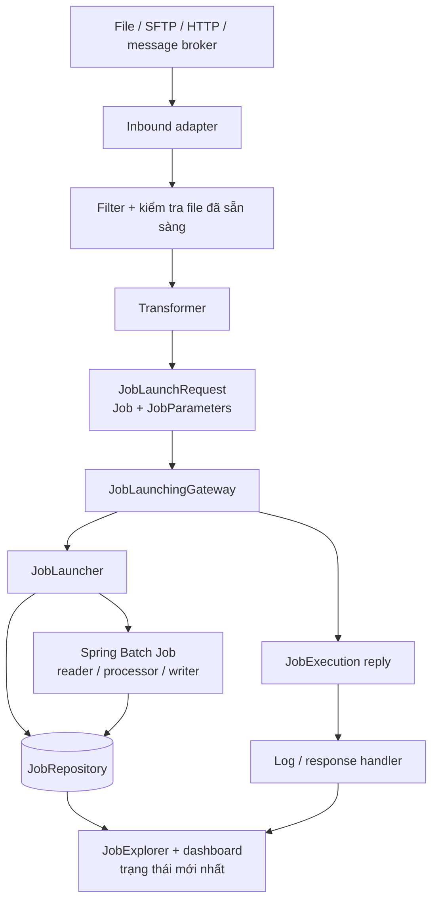
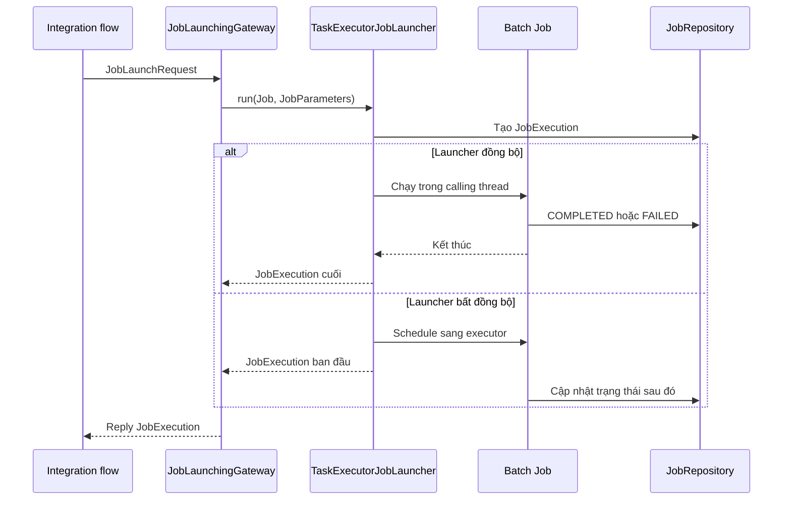
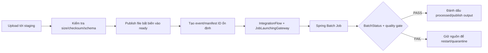

# JobLaunchingGateway và integration flow trong Spring Batch

> **Chương:** Spring Batch Integration  
> **Mục tiêu:** Dùng Spring Integration để tiếp nhận sự kiện, chuyển thành `JobLaunchRequest`, khởi chạy Spring Batch bằng `JobLaunchingGateway`, phân biệt kết quả khởi chạy với trạng thái hoàn thành và thiết kế luồng điều phối an toàn cho workload lớn. Ví dụ sử dụng **Spring Batch 5.2.x**, Spring Integration Java DSL và Java 17.

## 1. Bài toán: Có file mới thì tự động chạy batch job

Một dịch vụ xử lý dữ liệu nhận file CSV từ đối tác qua SFTP, một thư mục đồng bộ hoặc object storage. Mỗi file cần kích hoạt một job nhập hóa đơn. Hệ thống còn phải xử lý những yêu cầu khó hơn việc gọi `jobLauncher.run(...)` trực tiếp:

- File có thể xuất hiện liên tục, trong khi job mất hàng chục phút mới chạy xong.
- Một thông báo có thể được gửi lại hoặc file có thể được phát hiện nhiều lần.
- Job có thể chưa khởi động được, khởi động thành công nhưng **chạy thất bại**, hoặc đang chạy khi client cần phản hồi.
- Khi dữ liệu lớn, nhiều job đồng thời có thể làm cạn connection pool hoặc tăng lock wait tại database.
- Vận hành cần tìm được `JobExecution` từ sự kiện đầu vào, theo dõi tiến độ và restart đúng `JobInstance`.

Spring Batch Integration kết hợp hai trách nhiệm:

1. **Spring Integration** tạo *integration flow* tiếp nhận thông điệp, lọc, chuyển đổi, định tuyến và xử lý lỗi.
2. **Spring Batch** thực hiện job/step, quản lý `JobInstance`, `JobExecution`, checkpoint, transaction, retry và restart bằng `JobRepository`.

`JobLaunchingGateway` nằm ở **ranh giới giữa hai thế giới**. Nó giúp một message mang `JobLaunchRequest` trở thành lời gọi khởi chạy job, rồi đưa `JobExecution` vào phần tiếp theo của flow.

Đây là cơ chế **điều phối khởi chạy job**; nó không tự biến các step thành parallel steps, multi-threaded chunks hay remote workers. Việc scale bên trong job vẫn phải được cấu hình riêng.

## 2. Luồng chuẩn: Message → JobLaunchRequest → JobExecution



Ý nghĩa từng điểm:

| Thành phần | Vai trò | Không nên nhầm với |
| --- | --- | --- |
| **Inbound adapter** | Nhận `File`, sự kiện SFTP/JMS hoặc payload từ nguồn ngoài | Bản thân nó không chạy Spring Batch |
| **Filter/validator** | Loại đầu vào không phù hợp, yêu cầu file sẵn sàng | Filter theo đuôi `.csv` không xác minh file hoàn chỉnh |
| **Transformer** | Tạo `JobLaunchRequest` | Không nên thực thi logic nhập hàng triệu item tại đây |
| **JobLaunchingGateway** | Nhận request, gọi `JobLauncher` và tạo reply | Không phải remote chunking gateway |
| **JobLauncher** | Tạo/khởi chạy `JobExecution` bằng `JobRepository` | Không quyết định mọi thread bên trong step |
| **JobRepository** | Lưu trạng thái execution và hỗ trợ restart | Không thay thế kho dữ liệu nghiệp vụ |
| **JobExplorer** | Đọc lại metadata hiện tại | Không tự sửa kết quả JobExecution đã hoàn tất |

Spring Batch 5.2 cung cấp `org.springframework.batch.integration.launch.JobLaunchingGateway`, bên trong ủy quyền cho `JobLaunchingMessageHandler`. Payload đầu vào cần là `JobLaunchRequest`; payload phản hồi thông thường là `JobExecution`.

## 3. JobLaunchRequest chứa gì?

`JobLaunchRequest` là một object bao gồm **`Job`** sẽ chạy và **`JobParameters`** của lần chạy ấy:

```java
import org.springframework.batch.core.Job;
import org.springframework.batch.core.JobParameters;
import org.springframework.batch.core.JobParametersBuilder;
import org.springframework.batch.integration.launch.JobLaunchRequest;

JobParameters params = new JobParametersBuilder()
        .addString("input.file.path", "/data/batch/ready/invoice-20261126.csv")
        .toJobParameters();

JobLaunchRequest request = new JobLaunchRequest(invoiceImportJob, params);
```

`invoiceImportJob` là bean `Job` mà ứng dụng đã định nghĩa. `JobLaunchRequest` **không chứa** logic execute của step và không tự chạy job khi được tạo.

### Vai trò của JobParameters

Spring Batch nhận diện `JobInstance` từ **tên Job và tập `JobParameters` mang tính identifying**. Do đó thiết kế tham số không chỉ là việc truyền đường dẫn:

| Tham số | Ví dụ | Có nên identifying? |
| --- | --- | --- |
| `input.file.path` | `/data/batch/ready/invoice-20261126.csv` | Có, khi path bất biến theo lần nhập |
| `source.snapshot.id` | `snapshot-20261126-01` | Có, khi dữ liệu có version |
| `business.date` | `2026-11-26` | Tùy hợp đồng nghiệp vụ |
| `operator.note` | `scheduled-import` | Có thể không identifying |
| `launch.timestamp` ngẫu nhiên | Thời gian hệ thống mỗi lần poll | **Không thêm mặc định** nếu muốn chống trùng/restart cùng instance |

Ví dụ phân biệt identifying bằng overload có flag:

```java
JobParameters params = new JobParametersBuilder()
        .addString("source.snapshot.id", "snapshot-20261126-01", true)
        .addString("input.file.path", "/data/batch/ready/invoice.csv", false)
        .toJobParameters();
```

Đoạn trên chỉ đúng khi `snapshot.id` đủ định danh chính xác một phiên bản **bất biến** của file. Nếu file ở cùng path bị thay nội dung mà snapshot ID không đổi, restart có thể đọc sai dữ liệu. Không dùng tham số không identifying để che giấu input có thể thay đổi.

**Quy tắc:** Cùng job và cùng bộ identifying parameters → cùng `JobInstance`. Một instance đã `COMPLETED` thường không được khởi chạy lại như một lần mới; một instance `FAILED` có thể restart nếu job cho phép và metadata/reader phù hợp.

## 4. Đồng bộ và bất đồng bộ do JobLauncher quyết định

`JobLaunchingGateway` gọi `JobLauncher`. Với Spring Batch 5.2, `TaskExecutorJobLauncher` dùng `TaskExecutor` để quyết định công việc chạy trên thread hiện tại hay thread khác.

| Cấu hình launcher | Thời điểm gateway trả `JobExecution` | Ý nghĩa trạng thái khi nhận reply |
| --- | --- | --- |
| `SyncTaskExecutor` | Thường sau khi job đã kết thúc | Có thể xem trạng thái terminal của execution |
| `ThreadPoolTaskExecutor` | Thường ngay sau khi việc khởi chạy được chấp nhận/đưa sang thread khác | Có thể chỉ là `STARTING`/`STARTED`; **không chứng minh job thành công** |
| Launch bị từ chối trước khi tạo execution | Không có reply bình thường | Flow nhận lỗi khởi chạy (ví dụ exception qua messaging) |



**Đặc biệt:** Job chạy `FAILED` **không nhất thiết làm gateway ném exception**. Khi `JobExecution` đã được tạo, launcher có thể trả về một `JobExecution` mang `BatchStatus.FAILED`. Ngược lại, lỗi **không thể khởi chạy** (trùng instance đang chạy, tham số sai, thiếu cấu hình...) có thể tạo `MessageHandlingException` với nguyên nhân gốc là lỗi của `JobLauncher`.

Vì vậy tách hai câu hỏi:

- **Launch accepted?** Có tạo được `JobExecution` không?
- **Job finished successfully?** Khi nào `JobRepository` xác nhận trạng thái cuối và điều kiện nghiệp vụ thành công?

Không dùng `reply-timeout` của gateway như timeout cho **thời lượng toàn job**. Nó liên quan việc **gửi reply** vào channel có thể block; khác với thời gian execution của Spring Batch.

## 5. Dependency và điều kiện tối thiểu

Một ứng dụng Spring Boot phù hợp cần các thành phần có phiên bản **tương thích**:

```text
org.springframework.boot:spring-boot-starter-batch
org.springframework.integration:spring-integration-core
org.springframework.integration:spring-integration-file
org.springframework.batch:spring-batch-integration
spring-boot-starter-jdbc + JDBC driver của DB đang dùng
```

Các dòng trên là **tọa độ dependency tham khảo**, không phải một file build hoàn chỉnh. Khi dùng Spring Boot BOM, nên để BOM quản lý phiên bản Spring Batch/Integration; không trộn API Spring Batch 5.2 với artifact Spring Batch 6.

Các bean hạ tầng phải có:

- `JobRepository` trên cơ sở dữ liệu đủ bền vững; không dựa vào trạng thái JVM để restart.
- `Job` và các `Step` đã khai báo.
- `JobLauncher` cho cách chạy đồng bộ hoặc bất đồng bộ mà ứng dụng chọn.
- `JobLaunchingGateway` nhận launcher ấy.
- `IntegrationFlow` có nguồn message, transformer và bước xử lý reply.
- `JobExplorer` hoặc listener để quan sát kết quả cuối.
- Với file inbound: thư mục input, quyền đọc, chính sách staging và chiến lược chống duplicate.

## 6. Ví dụ Job thực tế: Đọc CSV theo JobParameters

Ví dụ này nhập file `invoiceId,amount` vào PostgreSQL. Bảng demo:

```sql
CREATE TABLE invoice_import (
    invoice_id BIGINT PRIMARY KEY,
    amount NUMERIC(18, 2) NOT NULL
);
```

Mẫu Java 17 / Spring Batch 5.2:

```java
package com.example.batch.integration;

import java.math.BigDecimal;
import org.springframework.batch.core.Job;
import org.springframework.batch.core.Step;
import org.springframework.batch.core.configuration.annotation.StepScope;
import org.springframework.batch.core.job.builder.JobBuilder;
import org.springframework.batch.core.repository.JobRepository;
import org.springframework.batch.core.step.builder.StepBuilder;
import org.springframework.batch.item.ItemWriter;
import org.springframework.batch.item.file.FlatFileItemReader;
import org.springframework.batch.item.file.builder.FlatFileItemReaderBuilder;
import org.springframework.beans.factory.annotation.Value;
import org.springframework.context.annotation.Bean;
import org.springframework.context.annotation.Configuration;
import org.springframework.core.io.FileSystemResource;
import org.springframework.jdbc.core.JdbcTemplate;
import org.springframework.transaction.PlatformTransactionManager;

@Configuration(proxyBeanMethods = false)
public class InvoiceBatchConfig {

    public record Invoice(long invoiceId, BigDecimal amount) {}

    @Bean
    @StepScope
    public FlatFileItemReader<Invoice> invoiceCsvReader(
            @Value("#{jobParameters['input.file.path']}") String path) {

        return new FlatFileItemReaderBuilder<Invoice>()
                .name("invoiceCsvReader")
                .resource(new FileSystemResource(path))
                .linesToSkip(1)
                .delimited()
                .names("invoiceId", "amount")
                .fieldSetMapper(fields -> new Invoice(
                        fields.readLong("invoiceId"),
                        fields.readBigDecimal("amount")))
                .build();
    }

    @Bean
    public ItemWriter<Invoice> invoiceDbWriter(JdbcTemplate jdbcTemplate) {
        return chunk -> {
            for (Invoice item : chunk) {
                jdbcTemplate.update("""
                    INSERT INTO invoice_import(invoice_id, amount)
                    VALUES (?, ?)
                    ON CONFLICT (invoice_id)
                    DO UPDATE SET amount = EXCLUDED.amount
                    """, item.invoiceId(), item.amount());
            }
        };
    }

    @Bean
    public Step invoiceImportStep(
            JobRepository repository,
            PlatformTransactionManager transactionManager,
            FlatFileItemReader<Invoice> invoiceCsvReader,
            ItemWriter<Invoice> invoiceDbWriter) {

        return new StepBuilder("invoiceImportStep", repository)
                .<Invoice, Invoice>chunk(200, transactionManager)
                .reader(invoiceCsvReader)
                .writer(invoiceDbWriter)
                .build();
    }

    @Bean
    public Job invoiceImportJob(
            JobRepository repository, Step invoiceImportStep) {

        return new JobBuilder("invoiceImportJob", repository)
                .start(invoiceImportStep)
                .build();
    }
}
```

**Các giới hạn rõ ràng:**

1. `@StepScope` bảo đảm reader được tạo khi có ngữ cảnh `StepExecution` và late-binding `input.file.path`; không mở file tại thời điểm ứng dụng khởi tạo bean.
2. `ON CONFLICT DO UPDATE` khiến việc ghi lại **cùng input** có thể lặp an toàn cho bảng demo. Nhưng nếu ID trùng giữa hai file và có amount khác nhau, nó có thể ghi đè dữ liệu ngoài ý muốn. Production cần source version, checksum, unique business key và chính sách conflict.
3. Các chunk được quản lý bằng `PlatformTransactionManager`; không bảo đảm transaction JDBC bao trùm cả việc polling file hoặc message broker.
4. Khi job dài, file nguồn phải **bất biến** trong suốt lần chạy và restart; không để producer tiếp tục append vào file đã được reader mở.
5. Job và step trên chưa có custom fault-tolerance, validation/quarantine hoặc tracing. Bài tập sẽ bổ sung chúng sau khi nắm được luồng launching.
6. Nếu Spring Boot tự động khởi chạy Job lúc startup, hãy kiểm soát cơ chế đó theo cấu hình ứng dụng để tránh Job chạy **hai lần**: một lần khi khởi động và một lần do integration flow phát sự kiện.

## 7. Cấu hình JobLaunchingGateway đồng bộ

Để dễ quan sát trong môi trường học, trước tiên cấu hình launcher **đồng bộ**. Với `SyncTaskExecutor`, lời gọi từ flow bị block cho đến khi job kết thúc.

```java
package com.example.batch.integration;

import org.springframework.batch.core.launch.JobLauncher;
import org.springframework.batch.core.launch.support.TaskExecutorJobLauncher;
import org.springframework.batch.core.repository.JobRepository;
import org.springframework.batch.integration.launch.JobLaunchingGateway;
import org.springframework.context.annotation.Bean;
import org.springframework.context.annotation.Configuration;
import org.springframework.core.task.SyncTaskExecutor;

@Configuration(proxyBeanMethods = false)
public class SynchronousJobLaunchConfig {

    @Bean
    public JobLauncher filePollingJobLauncher(JobRepository repository) {
        TaskExecutorJobLauncher launcher = new TaskExecutorJobLauncher();
        launcher.setJobRepository(repository);
        launcher.setTaskExecutor(new SyncTaskExecutor());
        return launcher;
    }

    @Bean
    public JobLaunchingGateway fileJobLaunchingGateway(
            JobLauncher filePollingJobLauncher) {
        return new JobLaunchingGateway(filePollingJobLauncher);
    }
}
```

Spring quản lý vòng đời `JobLauncher` khi nó là bean, gồm kiểm tra dependency theo lifecycle. Với `SyncTaskExecutor`, nếu một job chạy 20 phút, thread của inbound poller có thể bị chiếm tương ứng. Cách này đơn giản để diễn giải nhưng thường không thích hợp khi đầu vào đến liên tục.

**Phân biệt quan trọng:** “Gateway” ở đây là class `JobLaunchingGateway` trong Spring Batch Integration. Nó là một message handler tạo reply; không phải HTTP gateway và cũng không phải bộ xử lý remote chunking.

## 8. IntegrationFlow: File → Transformer → Gateway → Reply

Mẫu dưới đây dựa trên **Spring Integration Java DSL**. Inbound file adapter cung cấp payload `java.io.File`. Transformer biến file thành `JobLaunchRequest` rồi gateway trả `JobExecution`.

```java
package com.example.batch.integration;

import java.io.File;

import org.slf4j.Logger;
import org.slf4j.LoggerFactory;
import org.springframework.batch.core.Job;
import org.springframework.batch.core.JobExecution;
import org.springframework.batch.core.JobParameters;
import org.springframework.batch.core.JobParametersBuilder;
import org.springframework.batch.integration.launch.JobLaunchRequest;
import org.springframework.batch.integration.launch.JobLaunchingGateway;
import org.springframework.beans.factory.annotation.Qualifier;
import org.springframework.context.annotation.Bean;
import org.springframework.context.annotation.Configuration;
import org.springframework.integration.dsl.IntegrationFlow;
import org.springframework.integration.dsl.Pollers;
import org.springframework.integration.file.dsl.Files;
import org.springframework.integration.file.filters.SimplePatternFileListFilter;

@Configuration(proxyBeanMethods = false)
public class InvoiceFileLaunchFlowConfig {
    private static final Logger log =
            LoggerFactory.getLogger(InvoiceFileLaunchFlowConfig.class);

    @Bean
    public IntegrationFlow invoiceFileLaunchFlow(
            @Qualifier("invoiceImportJob") Job invoiceJob,
            @Qualifier("fileJobLaunchingGateway")
                    JobLaunchingGateway gateway) {

        return IntegrationFlow.from(
                        Files.inboundAdapter(new File("/data/batch/ready"))
                                .filter(new SimplePatternFileListFilter("*.csv")),
                        source -> source.poller(
                                Pollers.fixedDelay(5_000)
                                        .maxMessagesPerPoll(1)))
                .transform(File.class, file -> {
                    JobParameters parameters = new JobParametersBuilder()
                            .addString(
                                    "input.file.path",
                                    file.getAbsolutePath(),
                                    true)
                            .toJobParameters();
                    return new JobLaunchRequest(invoiceJob, parameters);
                })
                .handle(gateway)
                .handle(JobExecution.class, (execution, headers) -> {
                    log.info(
                            "batch_launch_reply jobExecutionId={} " +
                            "jobInstanceId={} status={}",
                            execution.getId(),
                            execution.getJobInstance().getInstanceId(),
                            execution.getStatus());
                    return null;
                })
                .get();
    }
}
```

Các class `InvoiceBatchConfig`, `SynchronousJobLaunchConfig` và `InvoiceFileLaunchFlowConfig` thuộc cùng ví dụ, với các bean hạ tầng Spring Boot/DB được cấu hình bên ngoài. Đường dẫn và bảng PostgreSQL phải tồn tại; ví dụ chưa cung cấp file nguồn thật.

**Luồng thực thi:**

1. Poller kiểm tra thư mục sẵn sàng theo chu kỳ 5 giây. `maxMessagesPerPoll(1)` hạn chế số file message được lấy trong mỗi chu kỳ polling.
2. `SimplePatternFileListFilter("*.csv")` chọn tên file theo pattern; **không xác minh** file đã upload xong và không phải cơ chế idempotency bền vững.
3. Transformer tạo `JobParameters` với path là tham số identifying và bao nó cùng `Job` thành `JobLaunchRequest`.
4. `.handle(gateway)` khởi chạy job. Trong cấu hình đồng bộ ở phần 7, lời gọi chỉ trả lại sau khi job chạy xong.
5. Handler cuối log `JobExecution` và kết thúc luồng message bằng `return null`. Để báo kết quả tới một dịch vụ khác, thay bằng channel/adapter hoặc listener phù hợp.
6. Nếu JobLaunchingGateway không thể khởi chạy job, lỗi đi theo quy tắc propagation/error channel của Spring Integration, **không chạy đến handler phản hồi như một execution thành công**.

### Khi nào không nên dùng File inbound adapter đơn giản?

Khi file đến qua SFTP hoặc từ object storage, tốt hơn dùng flow đặc thù:

- SFTP synchronizer/inbound adapter kéo/nhận file vào **thư mục staging**.
- Xác thực kích thước/checksum, chờ upstream đóng file hoặc nhận marker `.ready`.
- Chuyển file đã ổn định đến thư mục `ready` bằng thao tác publish phù hợp hạ tầng.
- Chỉ khi đó mới tạo `JobLaunchRequest`.
- Sau job thành công, chuyển hoặc đánh dấu nguồn `processed` theo workflow. Không di chuyển/xóa file khi reader đang chạy.

Với event từ Kafka/JMS/AMQP, transformer có thể nhận một DTO chứa **snapshot ID hoặc URI** thay vì `File`. Không truyền object `Job` qua broker; tại tiến trình launch, resolve job từ whitelist các bean được phép chạy.

## 9. Khi cần trả reply ngay: Dùng launcher bất đồng bộ

Trong production, job có thể kéo dài hàng giờ. Muốn poller hoặc HTTP caller nhận `JobExecution ID` sớm, dùng một `TaskExecutorJobLauncher` với executor được giới hạn.

**Thay** cấu hình launcher phần 7 bằng:

```java
import org.springframework.batch.core.launch.JobLauncher;
import org.springframework.batch.core.launch.support.TaskExecutorJobLauncher;
import org.springframework.batch.core.repository.JobRepository;
import org.springframework.context.annotation.Bean;
import org.springframework.scheduling.concurrent.ThreadPoolTaskExecutor;

@Bean
public ThreadPoolTaskExecutor batchLaunchExecutor() {
    ThreadPoolTaskExecutor executor = new ThreadPoolTaskExecutor();
    executor.setCorePoolSize(2);
    executor.setMaxPoolSize(2);
    executor.setQueueCapacity(8);
    executor.setThreadNamePrefix("batch-launch-");
    return executor;
}

@Bean
public JobLauncher filePollingJobLauncher(
        JobRepository repository,
        ThreadPoolTaskExecutor batchLaunchExecutor) {
    TaskExecutorJobLauncher launcher = new TaskExecutorJobLauncher();
    launcher.setJobRepository(repository);
    launcher.setTaskExecutor(batchLaunchExecutor);
    return launcher;
}
```

Hai bean này là **phương án thay thế**, không đăng ký trùng tên với bean đồng bộ trong cùng ApplicationContext.

Với async launcher:

- Gateway có thể trả `JobExecution` trước khi job xử lý item đầu tiên.
- `execution.getStatus()` trong handler cuối có thể là `STARTING`, `STARTED` hoặc trạng thái khác theo thời điểm quan sát; không sử dụng nó làm tín hiệu publish output thành công.
- `ThreadPoolTaskExecutor` giới hạn concurrency launch, nhưng queue `8` chỉ giữ task trên JVM, **không phải queue bền vững**. Khi process chết, task đang chờ trong RAM có thể mất; JobRepository vẫn cần được kiểm tra để phát hiện execution chưa hoàn tất.
- Việc tăng số job chạy đồng thời khác hoàn toàn việc tăng `TaskExecutor` của chunk step hoặc partition handler bên trong job; các giới hạn tài nguyên cần được tính **cộng dồn**.

### Bảng trạng thái nên áp dụng

| Trạng thái lúc gateway reply | Cách hiểu | Nên làm gì? |
| --- | --- | --- |
| `STARTING` / `STARTED` | Job chưa xác nhận hoàn tất | Lưu execution ID và tiếp tục theo dõi |
| `COMPLETED` | Job đã hoàn thành theo metadata | Kiểm tra thêm quality gate trước khi publish |
| `FAILED` | Job được tạo nhưng xử lý lỗi | Điều tra và quyết định restart |
| `STOPPED` | Job dừng theo cơ chế Batch | Kiểm tra điều kiện restart |
| Không có reply, gateway ném lỗi | Có vấn đề khi launch hoặc trên message flow | Kiểm tra nguyên nhân; không mặc định có execution ID |

## 10. Lấy trạng thái cuối qua JobExplorer hoặc listener

Đối với launcher bất đồng bộ, object `JobExecution` trả về là **ảnh chụp ban đầu**; muốn biết trạng thái mới nhất, hãy truy vấn `JobExplorer` bằng `JobExecution ID`.

```java
package com.example.batch.integration;

import org.springframework.batch.core.JobExecution;
import org.springframework.batch.core.explore.JobExplorer;

public final class JobExecutionStatusReader {
    private final JobExplorer jobExplorer;

    public JobExecutionStatusReader(JobExplorer jobExplorer) {
        this.jobExplorer = jobExplorer;
    }

    public JobExecution current(long jobExecutionId) {
        JobExecution current =
                jobExplorer.getJobExecution(jobExecutionId);
        if (current == null) {
            throw new IllegalArgumentException(
                    "No such JobExecution: " + jobExecutionId);
        }
        return current;
    }
}
```

Từ `current`, có thể xem `getStatus()`, `getExitStatus()`, `getStartTime()`, `getEndTime()`, danh sách `StepExecution` và counts. **Phân biệt:** `JobExecution.getId()` là ID của lượt thực thi, còn `JobExecution.getJobId()` trả ID của **JobInstance** mà execution thuộc về (không dùng hai giá trị thay cho nhau).

Một cách khác là `JobExecutionListener.afterJob`:

```java
import org.slf4j.Logger;
import org.slf4j.LoggerFactory;
import org.springframework.batch.core.JobExecution;
import org.springframework.batch.core.JobExecutionListener;

public final class JobCompletionLogListener
        implements JobExecutionListener {
    private static final Logger log =
            LoggerFactory.getLogger(JobCompletionLogListener.class);

    @Override
    public void afterJob(JobExecution execution) {
        log.info("batch_job_finished jobExecutionId={} " +
                        "jobInstanceId={} status={} exitCode={}",
                execution.getId(), execution.getJobId(),
                execution.getStatus(),
                execution.getExitStatus().getExitCode());
    }
}
```

Đăng ký listener vào `JobBuilder` bằng `.listener(listenerBean)`. Listener thích hợp để log, gửi metric hoặc kích hoạt quy trình bổ sung, nhưng nếu phát message ngoài DB transaction từ listener thì **không mặc định có bảo đảm delivery**. Với yêu cầu thông báo kết quả chắc chắn, cân nhắc outbox, durable event bus hoặc poll/reconcile JobRepository.

### Nhận dạng một execution để theo dõi

```text
jobName        = invoiceImportJob
jobInstanceId  = 807
jobExecutionId = 1234
status(reply)  = STARTING
status(later)  = COMPLETED
```

Đây chỉ là ví dụ. Khi restart cùng JobInstance, sẽ có **JobExecution ID mới**; hệ thống điều phối nên lưu cả `jobInstanceId` để xem lịch sử tất cả lần thử.

## 11. Ba nhóm lỗi không được đánh đồng

### Nhóm A — Lỗi trước khi tạo JobExecution

Ví dụ:

- `JobParametersInvalidException`: tham số không hợp lệ theo validator.
- `JobExecutionAlreadyRunningException`: một execution của cùng JobInstance vẫn chạy.
- `JobInstanceAlreadyCompleteException`: JobInstance đã hoàn thành, không được chạy lại như instance mới.
- `JobRestartException`: trạng thái/thiết kế job không cho restart.

Những lỗi này có thể được `JobLaunchingGateway` bọc thành `MessageHandlingException`. Cần phân loại **root cause**, không bật retry vô hạn cho mọi message error.

### Nhóm B — Job đã tạo, nhưng bước nghiệp vụ FAILED

Gateway **có thể vẫn trả `JobExecution` bình thường**. Nếu launcher async, thất bại xảy ra sau khi reply đã gửi. Xem `JobRepository`, failure exceptions, `ExitStatus` và logs theo `jobExecutionId`; không chỉ dựa vào việc integration handler không ném exception.

### Nhóm C — Lỗi trong integration flow hoặc hạ tầng messaging

Ví dụ:

- Adapter không đọc được file, payload không đúng kiểu.
- Transformer bị lỗi khi tạo parameters.
- Channel không thể gửi do queue đầy.
- Lỗi kết nối SFTP/Kafka/JMS hoặc reply channel thất bại.

Một `errorChannel` có thể thu thập lỗi của message endpoints theo mô hình Spring Integration. Với poller, cần gắn **error handler/error channel** và quyết định retry/requeue có giới hạn; lỗi của message trước khi launch khác với job FAILED **sau khi launch**.

**Bảng điều tra nhanh:**

| Hiện tượng | Nhóm lỗi | Hành động đúng |
| --- | --- | --- |
| Gateway báo instance đã COMPLETED | A | Đánh dấu file đã xử lý hoặc cấp snapshot ID mới nếu thực sự có input mới |
| Gateway báo instance đang RUNNING | A | Không khởi chạy job trùng; theo dõi execution hiện tại |
| Reply `STARTING`, sau đó DB báo `FAILED` | B | Điều tra job step, retry/restart đúng JobInstance |
| Gateway không có reply, poller log exception | A/C | Xem exception chain và kiểm tra JobRepository trước khi phát lại |
| Message đầu vào được giao lại | C/nguồn | Dùng identifying parameters ổn định, tránh job trùng |
| Job chạy tốt nhưng không ai biết đã xong | B/observability | Dùng listener hoặc truy vấn `JobExplorer`, lưu correlation |

## 12. Chống khởi chạy trùng và thiết kế restart

**Không thêm timestamp ngẫu nhiên vào mọi request** để “sửa” `JobInstanceAlreadyCompleteException`. Việc đó làm mỗi sự kiện redelivery thành **JobInstance mới**, khiến dữ liệu có thể bị xử lý lặp mà checkpoint cũ không còn giúp ích.

Một thiết kế có thể sử dụng:

```text
event identity       = sourceSystem + sourceFileId + sourceVersion
JobInstance identity = jobName + identifying JobParameters tương ứng
JobExecution identity = mỗi lượt chạy/restart do JobRepository tạo
```

Khi cùng event bị giao lại:

1. Kiểm tra mapping event → `JobInstance` trong hệ thống điều phối hoặc dùng `JobExplorer`.
2. Nếu đang `STARTING/STARTED`, không chạy job khác cho cùng input.
3. Nếu `COMPLETED`, coi event đã được xử lý theo chính sách nghiệp vụ.
4. Nếu `FAILED/STOPPED`, quyết định restart **cùng identifying parameters** sau khi sửa nguyên nhân.
5. Nếu input có version mới thật, tạo một **JobInstance mới** với version mới.

Cần kiểm thử những trường hợp sau:

| Kịch bản | Kỳ vọng |
| --- | --- |
| Poll cùng file hai lần rất nhanh | Tối đa một JobExecution chạy đồng thời cho cùng JobInstance |
| File đã xử lý thành công được phát hiện lại | Không nhập trùng dưới JobInstance mới ngẫu nhiên |
| Job FAILED giữa file và restart | Reader tiếp tục theo metadata hợp lệ, writer không tạo side effect trùng |
| File đổi nội dung nhưng giữ tên | Có snapshot/version mới và chính sách rõ ràng, không restart bằng checkpoint cũ |
| Hai instance ứng dụng cùng nhận sự kiện | Dùng JobRepository và cơ chế claim/lease phù hợp để ngăn xử lý đôi |
| Producer gửi hai message khác ID cho một file | Business identity ổn định, không dựa chỉ vào message ID |

JobRepository có cơ chế ràng buộc execution dựa trên JobInstance, nhưng **không thay thế** việc quản lý idempotency ở target DB, file archive, email, API và các side effect khác.

## 13. File readiness và trạng thái nguồn đầu vào

`Files.inboundAdapter(...).filter("*.csv")` trong ví dụ chỉ minh họa cách nhận file. Một file `.csv` chưa chắc đã được upload xong. File producer có thể đang append, ghi lại hoặc đổi tên.

Một quy trình nhập an toàn hơn:



Các yêu cầu bổ sung khi triển khai:

- Dùng **atomic rename** trên cùng filesystem khi được hạ tầng hỗ trợ hoặc marker/manifest phát hành sau upload ở object storage.
- Không xóa/di chuyển file đang được `FlatFileItemReader` sử dụng, kể cả khi gateway async đã trả `JobExecution ID`.
- Nếu nhiều pod nhận file, filesystem local trên một pod không nhất thiết được pod khác nhìn thấy. Dùng shared storage/object storage và URI có khả năng truy cập từ worker phù hợp.
- Lưu snapshot ID, path/URI, size, checksum, thời gian nhận và trạng thái ingest ở nơi bền vững.
- Nếu event mất trong khi file vẫn còn, cần cơ chế **reconciliation** liệt kê nguồn chưa được xử lý.
- Spring Integration file filter có thể chống lặp trong một số cấu hình, nhưng **không coi filter trong RAM là dedup bền vững qua restart**.

## 14. Backpressure và mở rộng theo tài nguyên thực tế

Tạo JobExecution nhanh không đồng nghĩa tổng workload được xử lý nhanh hơn. Nếu nguồn gửi 500 file/phút trong khi một job mất 30 phút, việc khởi chạy không kiểm soát có thể bão hòa tài nguyên.

Có ba tầng song song độc lập:

| Tầng | Cách tăng concurrency | Tài nguyên chính |
| --- | --- | --- |
| **Inbound flow** | Poller, executor channel, số consumer | CPU nhận event, buffer/queue, broker |
| **Job launching** | `TaskExecutor` của `TaskExecutorJobLauncher`, số instance được phép chạy | JobRepository, memory, connection pools |
| **Bên trong job** | Multi-threaded step, parallel steps, partitioning, remote workers | Reader, CPU, disk, DB locks, downstream APIs |

Ví dụ: hai job được khởi chạy đồng thời, mỗi job dùng bốn partition và mỗi partition cần một connection JDBC. Hệ thống có thể tạo nhu cầu gần tám connection **chưa tính metadata, cursor reader và các service khác**. Nếu DB pool chỉ có sáu connection, việc tăng launcher pool có thể làm toàn bộ job chậm đi.

Một chiến lược điều tiết thực tế:

1. Đo baseline khi chạy một job, ghi duration/throughput và DB/pool utilization.
2. Giới hạn concurrent jobs trước khi tăng số thread/worker bên trong.
3. Sử dụng hàng đợi **bền vững** cho sự kiện nguồn khi cần chờ lâu; queue executor trong JVM không thay thế broker.
4. Tách quota của JobRepository khỏi workload nặng nếu hạ tầng cho phép.
5. Thiết kế chính sách backlog: max pending jobs, oldest pending age, dead-letter/retry, ngưỡng cảnh báo.
6. Giảm concurrency khi DB lock wait hoặc rollback tăng, dù CPU batch còn rảnh.
7. Chỉ tăng scale nếu tính idempotency, restart và chất lượng dữ liệu đã được kiểm chứng.

```text
Successful throughput = số item hợp lệ đã ghi / thời gian thực tế

End-to-end latency = chờ file ready
                   + chờ integration/launch
                   + thời gian thực thi batch job
                   + validation/publish
```

Không dùng riêng thời gian trả reply của gateway async để đánh giá hiệu năng toàn job: nó thường chỉ phản ánh **thời gian khởi chạy**.

## 15. Observability: Theo dõi từ event đến StepExecution

Một hành trình điều tra hiệu quả nối được các ID:

```text
sourceEventId    = file-20261126-001
sourceSnapshotId = snapshot-20261126-01
jobName          = invoiceImportJob
jobInstanceId    = 807
jobExecutionId   = 1234
stepExecutionId  = 9015
messageId        = inbound-message-...
```

Trong structured logging, lưu:

| Trường | Lấy từ đâu | Mục đích |
| --- | --- | --- |
| `sourceEventId`, `sourceSnapshotId` | Event/manifest | Chống trùng và truy ngược file |
| `messageId`, `correlationId` | Spring Integration headers | Truy vết trước khi tạo execution |
| `jobName`, `jobInstanceId` | JobParameters, JobExecution metadata | Liên kết vòng đời logic |
| `jobExecutionId` | `JobExecution.getId()` | Phân biệt lượt chạy và restart |
| `stepExecutionId` | StepExecution trong worker | Chẩn đoán chunk/partition lỗi |
| `status`, `exitCode` | JobRepository | Xác minh trạng thái cuối |
| `readCount/writeCount/skipCount` | StepExecution | Đối chiếu chất lượng/throughput |

Dùng metric để theo dõi:

- Số file event nhận mỗi phút, số job launch accepted/rejected và backlog.
- Số JobExecution đang chạy, thành công, thất bại; thời gian job p50/p95.
- DB connection pool pending, worker threads active, executor queue depth.
- Step read/write/skip/rollback, thời gian chunk và tỷ lệ retry.
- Độ tuổi file chưa được xử lý, số lần reconciliation/replay.

Không đưa `messageId`, `jobExecutionId` hay path từng file làm **Prometheus metric tag**; cardinality cao làm tăng chi phí. Giữ chúng trong logs/traces, còn metric dùng tag ổn định như jobName, stepName và status.

## 16. Những lỗi cấu hình thường gặp

| Triệu chứng | Nguyên nhân có thể | Cách xử lý |
| --- | --- | --- |
| Gateway báo payload sai kiểu | Flow gửi `File` trực tiếp, chưa chuyển thành `JobLaunchRequest` | Thêm transformer và xác minh payload sau bước chuyển |
| Đã có JobLaunchingGateway nhưng không chạy | Chưa có endpoint/flow subscribe hoặc inbound poller chưa hoạt động | Kiểm tra flow wiring, auto-startup và source |
| Job chạy một lần lúc startup ngoài ý muốn | Spring Boot tự chạy Job bean | Kiểm soát startup auto-launch, chỉ để integration flow quyết định |
| Cùng file tạo nhiều lần chạy | Tham số identifying thay đổi ngẫu nhiên hoặc không có dedup | Dùng source snapshot ID ổn định, JobRepository và event store |
| `JobInstanceAlreadyCompleteException` lặp liên tục | File được poll lại, job đã COMPLETED | Quản lý trạng thái nguồn/processed và filter bền vững |
| Gateway trả `STARTING` dù job chạy lâu | Launcher async là hành vi dự kiến | Theo dõi bằng JobExplorer/listener, không coi reply là hoàn thành |
| Job FAILED nhưng flow không ném lỗi | Gateway trả `JobExecution` có status FAILED | Xử lý status terminal, quality gate và alert riêng |
| File bị `FileNotFoundException` khi step đọc | Input di chuyển/xóa sau khi gateway async reply | Giữ file bất biến đến khi job kết thúc |
| Tăng launcher pool nhưng job chậm | DB/CPU/I/O/pool cạn hoặc lock contention | Đo toàn hệ thống, giảm concurrent jobs |
| Trùng dữ liệu khi retry/restart | Writer thiếu unique key/idempotency | Thiết kế business key và kiểm thử restart |
| Không nhận được reply qua channel có giới hạn | Reply channel đầy, send timeout | Cấu hình consumer/capacity; phân biệt send timeout với job timeout |
| Poller im lặng khi lỗi | Chưa quan sát errorChannel/error handler | Log/alert message exceptions, phân loại lỗi trước/sau launch |
| Nâng cấp lên Batch 6, code gateway lỗi compile | Constructor/API launcher đã thay đổi | Kiểm tra Javadoc phiên bản đúng, không copy thẳng cấu hình 5.2 |

## 17. Thực hành và bài kiểm chứng

**Bài A — Flow đồng bộ.** Tạo file `invoiceId,amount` 1.000 dòng, chạy `IntegrationFlow` dùng `SyncTaskExecutor`. Ghi thời điểm poll, thời điểm handler reply và `BatchStatus`. Giải thích vì sao poller bị block đến khi job kết thúc.

**Bài B — Flow bất đồng bộ.** Đổi launcher sang `ThreadPoolTaskExecutor` pool 2 và queue 8. Tạo processor có độ trễ nhỏ để job kéo dài; quan sát reply `JobExecution` xuất hiện sớm rồi dùng `JobExplorer.getJobExecution(id)` để thấy trạng thái cuối.

**Bài C — Duplicate event.** Gửi cùng sự kiện file hai lần với identifying parameters giống nhau. Kiểm tra job không chạy song song hai execution cho cùng JobInstance; sau `COMPLETED`, chạy lại sẽ bị từ chối theo hợp đồng Spring Batch.

**Bài D — Job FAILED khác launch failure.** Cho writer ném exception sau một số chunk. Xác nhận gateway có thể đã trả một `JobExecution`, nhưng trạng thái cuối của job là `FAILED`. Đối chiếu exception, log và StepExecution counters.

**Bài E — Restart.** Cho job thất bại sau khi đã commit một số chunk. Chạy lại cùng identifying parameters, kiểm tra `JobExecution ID` mới trong cùng `JobInstance`. Đối chiếu tập business key nguồn/đích và side effect ngoài DB.

**Bài F — Input readiness.** Mô phỏng upstream còn đang ghi file khi poller phát hiện `*.csv`. Thiết kế lại bằng staging và marker/atomic publish; chứng minh không đọc file chưa hoàn chỉnh.

**Bài G — Backpressure.** Sinh 20 file cùng lúc, mỗi job tốn thời gian xử lý. Giới hạn launcher pool, đo queue, DB pending connections, throughput và tổng end-to-end latency; kiểm tra cơ chế event bền vững khi ứng dụng restart.

**Bài H — Error channel và notification.** Tạo một event với tham số sai để gây lỗi launch, một job nhận launch thành công nhưng xử lý FAILED. Thiết kế hai nhánh alert khác nhau, không đánh đồng lỗi message với lỗi nghiệp vụ.

### Checklist trước production

- [ ] `JobLaunchRequest` chứa đúng Job được phép chạy và identifying parameters ổn định.
- [ ] Biết launcher đang đồng bộ hay bất đồng bộ; reply được diễn giải đúng.
- [ ] Có cơ chế theo dõi trạng thái cuối qua `JobExplorer`/listener và quality gate.
- [ ] File sẵn sàng, bất biến, có snapshot/manifest để restart.
- [ ] Dedup event/JobInstance hoạt động khi nguồn gửi trùng hoặc ứng dụng restart.
- [ ] Lỗi launch, lỗi job và lỗi message transport được phân loại riêng.
- [ ] Có giới hạn concurrent jobs và giám sát connection pool, CPU, I/O, backlog.
- [ ] Writer idempotent; dữ liệu và side effect được đối soát sau failure/restart.
- [ ] Log gắn correlation event → JobExecution → StepExecution.
- [ ] Đã kiểm thử stop, restart, job failure, input change và nhiều instance ứng dụng.

## 18. Tài liệu chính thức

- [Spring Batch 5.2 — Launching Batch Jobs through Messages](https://docs.spring.io/spring-batch/reference/5.2/spring-batch-integration/launching-jobs-through-messages.html)
- [Spring Batch 5.2 — Available Attributes of the Job-Launching Gateway](https://docs.spring.io/spring-batch/reference/5.2/spring-batch-integration/available-attributes-of-the-job-launching-gateway.html)
- [Spring Batch 5.2 — JobLaunchingGateway Javadoc](https://docs.spring.io/spring-batch/docs/5.2.x/api/org/springframework/batch/integration/launch/JobLaunchingGateway.html)
- [Spring Batch 5.2 — JobLaunchRequest Javadoc](https://docs.spring.io/spring-batch/docs/5.2.x/api/org/springframework/batch/integration/launch/JobLaunchRequest.html)
- [Spring Batch 5.2 — TaskExecutorJobLauncher Javadoc](https://docs.spring.io/spring-batch/docs/5.2.x/api/org/springframework/batch/core/launch/support/TaskExecutorJobLauncher.html)
- [Spring Batch 5.2 — JobExplorer Javadoc](https://docs.spring.io/spring-batch/docs/5.2.x/api/org/springframework/batch/core/explore/JobExplorer.html)
- [Spring Batch 5.2 — JobExecution Javadoc](https://docs.spring.io/spring-batch/docs/5.2.x/api/org/springframework/batch/core/JobExecution.html)
- [Spring Integration — Java DSL](https://docs.spring.io/spring-integration/reference/dsl.html)
- [Spring Integration — File Support](https://docs.spring.io/spring-integration/reference/file.html)
- [Spring Batch 5.2 — Late Binding of Job and Step Attributes](https://docs.spring.io/spring-batch/reference/5.2/step/late-binding.html)

> **Lưu ý phiên bản:** Mã Java nhắm **Spring Batch 5.2.x**. Ở Spring Batch 6, constructor `JobLaunchingGateway` nhận `JobOperator` thay vì `JobLauncher` như ví dụ 5.2; API và cách wiring liên quan cũng có thể đổi. Luôn xem reference/Javadoc đúng phiên bản đang vận hành. Các đoạn mã cấu hình giả định database, datasource và file source đã có, không thay thế ứng dụng đầy đủ hoặc quy trình kiểm thử của dự án.

**Ghi nhớ:** `JobLaunchingGateway` là điểm nối giữa **Spring Integration message flow** và **Spring Batch JobLauncher**. Transformer tạo `JobLaunchRequest`, gateway trả `JobExecution`, nhưng **reply khởi chạy không tự bảo đảm job đã COMPLETED**—đặc biệt với launcher bất đồng bộ. Vận hành đáng tin cậy cần identifying parameters ổn định, xử lý duplicate, nguồn input bất biến, backpressure, quan sát trạng thái cuối và restart/idempotency được kiểm chứng.
